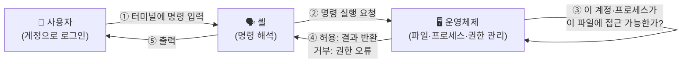
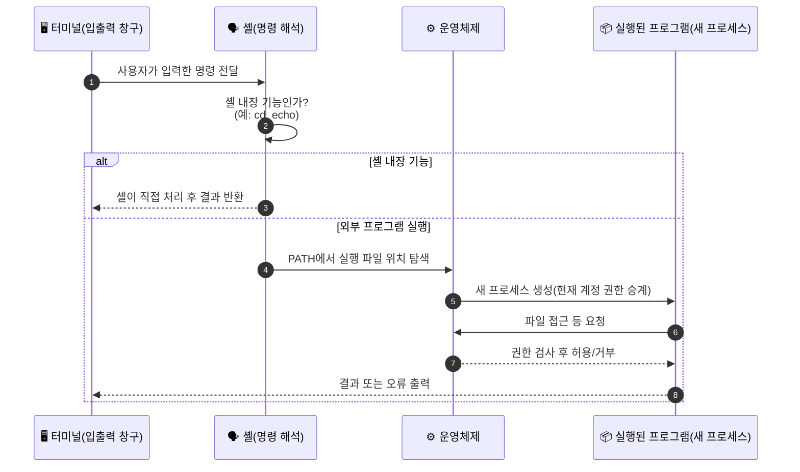

> [!summary] ⏱️ 5초 핵심 요약
> - **한 줄 비유**: 컴퓨터는 **작업장**, **운영체제(OS)**는 그 작업장의 **관리 체계**(누가 어떤 도구를 쓸 수 있는지 정하는 규칙)이고, **터미널**은 그 관리 체계에 **글자로 직접 말을 거는 창구**입니다.
> - **핵심 원리**: 저장된 **프로그램**과 지금 실행 중인 **프로세스**는 다른 것이고, 모든 요청은 결국 **"어느 계정으로, 어느 경로를, 어떤 권한으로"** 접근하느냐로 귀결됩니다. 관리자 **계정**으로 로그인한 것과 지금 이 **프로세스**가 관리자 **권한**으로 실행 중인 것도 서로 다른 질문입니다.
> - **핵심 체크 포인트**: 이후 글에서 `SUID`, `sudo`, `관리자 권한으로 실행`, `/etc/passwd`, `C:\Windows\System32` 같은 표현이 나올 때 **"어느 파일을, 어느 계정의 프로세스가, 어떤 권한으로 건드리려 하는가"**를 머릿속에 그릴 수 있으면 이 글의 목적은 끝입니다.

이 글은 [[모의해킹 전에 알아야 할 IT 기초 — 클라이언트-서버, IP·포트, HTTP]], [[모의해킹 전에 알아야 할 IT 기초 — 인증과 인가, 세션과 토큰]]에 이어지는 세 번째 **0단계 IT 기초**입니다. 앞의 두 글이 "컴퓨터와 컴퓨터가 어떻게 대화하는가"를 다뤘다면, 이 글은 **한 컴퓨터 안에서** 운영체제가 파일·프로세스·계정을 어떻게 관리하는지를 다룹니다. 이 기초를 바탕으로 [[Linux 권한상승을 위한 OS 내부구조 — SUID, Capabilities, PATH, cron와 systemd]]와 [[Windows 권한상승을 위한 OS 내부구조 — Access Token, UAC, 서비스 제어 관리자(SCM)]]로 넘어가면 권한상승 글이 바로 이해됩니다. 낯선 용어가 나오면 [[모의해킹 핵심 용어집 — 블로그에 반복 등장하는 용어 정리]]에서 찾아보세요.

---

## 1. 운영체제와 프로그램 — 관리 체계와 그 안에서 일하는 가게

**💡 한 줄 비유**: 하드웨어(CPU, 저장장치)가 건물 설비라면, **운영체제(OS)**는 그 건물의 **관리 체계**입니다. 누가 어느 방에 들어갈 수 있는지, 전기·수도를 어떻게 나눠 쓰는지 정해진 규칙대로 처리합니다. **앱(프로그램)**은 그 건물 안에서 영업하는 가게이고, 가게는 관리 체계가 허용하는 범위 안에서만 전기·수도(CPU, 메모리, 파일)를 씁니다.

### 핵심 원리
- **운영체제(OS)**: 프로그램 실행, 파일·메모리 관리, 장치 접근을 중개하는 소프트웨어입니다. Windows, Linux, macOS가 모두 OS입니다. 앱은 OS를 거치지 않고 하드웨어에 직접 접근하지 않습니다.
- **파일과 폴더**: 파일은 이름으로 다루는 데이터 단위입니다. 사진·문서뿐 아니라 프로그램 자체, 설정 값도 모두 파일입니다. 폴더(디렉터리)는 파일과 다른 폴더를 계층으로 정리하는 그릇입니다.
- **저장과 실행은 다른 공간**: 디스크에 저장된 파일(서가)과 실행 중에 쓰는 메모리(작업 책상)는 구별됩니다. 파일을 열었다고 그 내용 전체가 항상 통째로 메모리에 올라가는 것도 아닙니다.
- **프로그램 파일과 프로세스**: 프로그램은 디스크에 저장된 "실행할 지시서"이고, **프로세스**는 그 지시서를 실제로 실행 중인 하나의 작업 단위입니다. 같은 프로그램으로 여러 프로세스가 동시에 떠 있을 수 있습니다(브라우저 창을 여러 개 띄운 것처럼).
- **모의해킹에서의 의미**: 취약점 분석 보고서에 "이 프로세스가 이 권한으로 이 파일을 읽었다"는 문장이 자주 나옵니다. 이때 말하는 파일과 프로세스가 서로 다른 개념이라는 걸 구분하지 못하면 보고서를 오독합니다.

### 체크 포인트
- OS가 "요청을 판단하고 허용·거부하는 관리 체계"이고, 앱은 그 안에서 기능을 쓰는 입장이라는 구분이 되는가?
- 저장된 프로그램 파일 하나로 **여러 개의 프로세스**가 동시에 실행될 수 있다는 것이 이해되는가?

---

## 2. 경로와 현재 위치 — 전체 주소와 "여기서 두 칸 옆"

**💡 한 줄 비유**: **절대 경로**는 "서울시 OO구 OO로 10번지"처럼 어디서 출발하든 같은 곳을 가리키는 **전체 주소**이고, **상대 경로**는 "여기서 두 칸 옆"처럼 **지금 서 있는 위치를 기준**으로 하는 길 안내입니다. 서 있는 위치가 바뀌면 같은 "두 칸 옆"도 다른 곳을 가리킵니다.

### 핵심 원리
- **절대 경로**: 파일 트리의 최상위(루트)부터 전체 경로를 다 적은 표기입니다. Linux는 `/home/mina/notes/todo.txt`처럼 `/`에서 시작하고, Windows는 `C:\Users\Mina\notes\todo.txt`처럼 드라이브 문자에서 시작합니다.
- **상대 경로**: 현재 작업 폴더를 기준으로 한 표기입니다. 현재 위치가 `/home/mina`라면 `notes/todo.txt`는 위와 같은 파일을 가리키지만, 현재 위치가 달라지면 같은 글자여도 다른 파일을 가리킬 수 있습니다.
- **루트 디렉터리와 홈 폴더**: 루트(`/`)는 파일 트리 전체의 출발점이고, 홈 폴더는 계정마다 배정된 개인 작업 공간입니다. Linux의 관리자 계정 이름이 `root`인 것과 `/` 경로는 이름만 겹칠 뿐 별개 개념입니다.
- **원격 컴퓨터 접속 시 주의**: 모의해킹에서는 "내 컴퓨터"와 "원격 대상 컴퓨터"에 같은 이름·같은 상대 경로의 파일이 동시에 존재할 수 있습니다. 지금 입력을 받는 터미널이 **어느 컴퓨터의 셸에 연결돼 있는지**를 항상 먼저 확인해야 합니다.
- **모의해킹에서의 의미**: 경로 탐색(Path Traversal) 같은 공격은 결국 "서버가 의도한 경로 밖의 파일을, 상대 경로 표기(`../../etc/passwd` 등)로 가리키게 만드는 것"입니다. 절대·상대 경로 개념 없이는 이 공격의 원리를 설명할 수 없습니다.

### 체크 포인트
- 현재 작업 폴더가 바뀌면 똑같은 상대 경로 문자열이 다른 파일을 가리킬 수 있다는 것이 그려지는가?
- 지금 내가 보는 터미널 창이 **어느 컴퓨터**에 연결된 셸인지 구분하는 습관이 생겼는가?

---

## 3. 계정과 권한 — 누가, 무엇에, 무엇을 할 수 있는가

**💡 한 줄 비유**: **계정**은 직원증, **그룹**은 소속 부서, **권한**은 "이 서류함을 열어도 되는가"를 정한 허가표입니다. 직원증이 있다고 모든 서류함을 열 수 있는 건 아니고, 허가표는 서류함(파일)마다 따로 붙어 있습니다.

### 핵심 원리
- **계정과 그룹**: 계정은 OS가 "이 요청을 보낸 사람이 누구인지" 구분하는 단위입니다. 그룹은 여러 계정을 묶어 권한을 한 번에 관리하기 위한 단위입니다. 웹사이트 로그인 계정과 OS 로그인 계정은 전혀 다른 것일 수 있습니다.
- **소유자와 접근 권한**: 모든 파일에는 소유자가 있고, 그 파일에 누가 읽기·쓰기·실행을 할 수 있는지 규칙이 따로 정의돼 있습니다. "내가 소유자니까 무조건 전부 가능하다"로 단순화하면 안 됩니다. 실제 허용 여부는 OS가 파일마다 정해진 규칙을 확인해 판단합니다.
- **일반 사용자와 관리자**: 관리자(Linux의 `root`, Windows의 Administrator)는 더 많은 작업이 허용된 계정입니다. 그렇다고 관리자가 모든 제한을 무조건 없애는 만능 열쇠는 아니며, Linux·Windows 각각 세부 규칙이 다릅니다.
- **계정 권한과 프로세스 권한은 다른 질문**: 관리자 계정으로 로그인했다고 해서 지금 내가 실행한 모든 프로그램(프로세스)이 항상 관리자 권한으로 돌아가는 것은 아닙니다. 반대로 일반 계정으로 로그인했어도 특정 프로그램이 더 높은 권한으로 실행되도록 설계된 경우도 있습니다. "로그인 계정의 권한"과 "지금 이 프로세스가 실제로 쓰고 있는 권한"을 구분해야, Windows의 UAC나 Linux의 SUID처럼 둘 사이의 간극을 이용하는 권한상승 기법을 이해할 수 있습니다.
- **모의해킹에서의 의미**: 권한상승은 결국 "낮은 권한의 프로세스가 더 높은 권한을 가진 실행 경로·파일을 통해 그 권한을 빌려 쓰는 방법을 찾는 것"입니다. 계정·그룹·소유자·권한의 관계를 모르면 이 문장 자체가 이해되지 않습니다.

### 체크 포인트
- "로그인에 성공한 계정"과 "지금 이 프로세스가 쓰고 있는 권한"이 서로 다른 질문이라는 것이 구분되는가?
- 관리자 계정으로 로그인한 것과 관리자 권한으로 실행 중인 것이 항상 같지 않다는 것이 이해되는가?

---

## 4. 터미널에서 명령어를 치면 무슨 일이 일어나는가

**💡 한 줄 비유**: **터미널**은 글자를 주고받는 **창구**이고, **셸**은 그 창구에서 들어온 주문을 해석해 처리하는 **직원**입니다. 명령어는 "이 직원이 직접 처리할 수 있는 일"이거나 "다른 프로그램을 불러와 시켜야 하는 일" 둘 중 하나입니다.

### 핵심 원리
- **터미널과 셸**: 터미널은 글자를 입력받고 결과를 보여주는 창구일 뿐이고, 실제로 명령을 해석하고 처리하는 것은 **셸**(bash, PowerShell 등)이라는 프로그램입니다. 셸 자체도 하나의 프로세스입니다.
- **명령 이름·옵션·인자**: 명령 이름은 "무엇을 할지", 옵션(`-l`, `/all` 등)은 "어떻게 할지", 인자는 "무엇을 대상으로 할지"를 나타냅니다. 문법은 셸·프로그램마다 다릅니다.
- **셸 내장 명령과 외부 프로그램**: `cd`처럼 셸이 직접 처리하는 명령도 있고, 디스크에 저장된 별도 실행 파일을 셸이 찾아서 새 프로세스로 띄우는 명령도 있습니다. 후자의 경우 셸은 **PATH**(실행 파일을 찾아볼 폴더 목록)를 순서대로 뒤져 실행 파일을 찾습니다. 그래서 전체 경로를 안 적어도 명령 이름만으로 프로그램이 실행됩니다.
- **새 프로세스는 권한을 물려받는다**: 셸이 새 프로그램을 실행하면, 그 프로그램은 기본적으로 **셸을 실행한 계정과 같은 권한**으로 동작합니다. 이 "기본값"에서 벗어나는 특별한 경우들(관리자 권한으로 실행, 서비스로 등록된 실행 등)이 바로 뒤에 나올 권한상승 글의 핵심 소재입니다.
- **터미널 창 없이도 돌아가는 프로그램**: 서비스(Windows의 서비스, Linux의 systemd 유닛)나 예약 작업(cron)처럼, 사람이 터미널을 열지 않아도 정해진 계정 권한으로 실행되는 프로그램도 있습니다. 이런 프로그램의 접근 권한을 이해하려면 "어느 계정으로 실행되도록 설정됐는가"를 봐야 합니다.
- **모의해킹에서의 의미**: 리버스 셸을 띄우는 것도 결국 "원격 컴퓨터에서 새 셸 프로세스 하나를 내 통제 아래 실행시키는 것"입니다. 그 셸이 어떤 계정 권한을 물려받았는지가 이후 할 수 있는 일의 범위를 정합니다.

### 체크 포인트
- 터미널(창구)과 셸(해석 프로그램)이 서로 다른 것이라는 구분이 되는가?
- 명령 이름만 써도 프로그램이 실행되는 이유가 **PATH 탐색**이라는 것이 이해되는가?
- 새로 실행된 프로세스가 기본적으로 **셸을 실행한 계정의 권한을 물려받는다**는 흐름이 그려지는가?

---

## 마무리: 이제 OS별 권한상승 내부구조로

OS와 앱의 구분, 절대·상대 경로, 계정·그룹·소유자·권한, 터미널에서 명령이 실행되는 흐름까지가 이후 시스템 내부를 다루는 모든 글에서 설명 없이 쓰일 **공통 전제**입니다. 낯선 용어가 또 나오면 [[모의해킹 핵심 용어집 — 블로그에 반복 등장하는 용어 정리]]에서 바로 찾아보세요.

이 기초를 바탕으로 [[Linux 권한상승을 위한 OS 내부구조 — SUID, Capabilities, PATH, cron와 systemd]]에서는 "낮은 권한 프로세스가 어떻게 root 권한 경로를 빌려 쓰는가"를, [[Windows 권한상승을 위한 OS 내부구조 — Access Token, UAC, 서비스 제어 관리자(SCM)]]에서는 "계정의 Access Token과 서비스 실행 계정이 어떻게 권한 차이를 만드는가"를 이어서 다룹니다.
