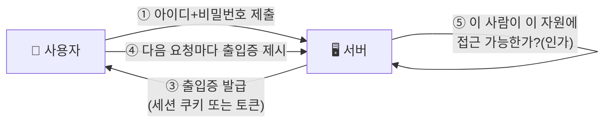

> [!summary] ⏱️ 5초 핵심 요약
> - **한 줄 비유**: **인증**은 건물 입구에서 **"신분증을 보여주세요"**라고 묻는 것이고, **인가**는 신분증을 확인한 뒤 **"이 사람은 몇 층까지 올라갈 수 있는가"**를 정하는 것입니다. 둘은 서로 다른 질문입니다.
> - **핵심 원리**: 로그인에 성공했다고(인증 통과) 해서 모든 데이터에 접근할 수 있는 것은 아닙니다(인가는 별개). 그리고 매번 아이디·비밀번호를 다시 치지 않도록, 서버는 **세션**이나 **토큰**이라는 "임시 출입증"을 발급해 로그인 상태를 기억합니다.
> - **핵심 체크 포인트**: 이후 글에서 "인증 우회", "세션 하이재킹", "토큰 위조" 같은 표현이 나올 때 **"신원을 확인하는 단계인지, 권한을 확인하는 단계인지, 그 출입증이 세션인지 토큰인지"**를 구분할 수 있으면 이 글의 목적은 끝입니다.

이 글은 [[모의해킹 전에 알아야 할 IT 기초 — 클라이언트-서버, IP·포트, HTTP]]에 이어지는 또 하나의 **0단계 IT 기초**입니다. 웹 서비스에 로그인하고 로그인 상태를 유지하는 원리만 다루며, 구체적인 공격 기법은 [[웹 취약점 진단 인증편 — 계정 잠금 우회부터 세션 하이재킹까지]]에서 이어집니다. Java 웹 서버에서 이 개념이 실제 코드로 어떻게 구현되는지는 [[Java 웹 기초 4 — Filter·Session과 인증·인가]]에서 더 깊이 다룹니다. 낯선 용어가 나오면 [[모의해킹 핵심 용어집 — 블로그에 반복 등장하는 용어 정리]]에서 바로 찾아보세요.

---

## 1. 인증과 인가 — "누구인가"와 "무엇을 할 수 있는가"

**💡 한 줄 비유**: 회사 정문에서 **사원증을 찍는 것이 인증**, 사원증을 찍고 들어온 뒤 **인사팀 서류함 앞에서 "이 사람이 여길 열어도 되나"를 다시 확인하는 것이 인가**입니다.

### 핵심 원리
- **인증(Authentication)**: "이 요청을 보낸 사람이 누구인가?"를 확인하는 절차입니다. 아이디·비밀번호 입력, 지문 인식, 이메일 인증 링크 클릭이 모두 인증입니다.
- **인가(Authorization)**: 인증으로 신원이 확인된 사람이 "**이 특정 자원**에 **이 특정 작업**을 해도 되는가?"를 판단하는 절차입니다. 로그인에 성공한 일반 회원이어도 다른 회원의 주문 내역이나 관리자 페이지에는 접근할 수 없어야 정상입니다.
- **둘은 순서도, 질문도 다름**: 먼저 인증으로 "누구인지"를 정하고, 그다음 매 요청마다 인가로 "이걸 해도 되는지"를 다시 확인합니다. 인증 한 번 통과했다고 인가가 영구히 열리는 것이 아닙니다.
- **모의해킹에서의 의미**: "로그인 화면을 우회해 바로 들어가는 것"은 인증 공격이고, "내 계정으로 로그인한 채로 남의 데이터 번호만 바꿔 조회하는 것"은 인가 공격입니다. 이 둘을 구분하지 못하면 취약점 보고서에서 원인을 엉뚱하게 짚게 됩니다.

### 체크 포인트
- "로그인에 성공했다"는 말과 "이 데이터에 접근할 권한이 있다"는 말이 **서로 다른 주장**이라는 것이 구분되는가?
- 관리자 메뉴 버튼이 화면에 안 보인다고 해서 그 요청 자체가 서버에서 막혀 있다는 보장은 없다는 것이 이해되는가?

---

## 2. 비밀번호 확인 — 서버는 원본을 모른 채 맞는지 안다

**💡 한 줄 비유**: 서버는 당신의 비밀번호를 그대로 적어두지 않고, **비밀번호를 한 번 갈아서 나온 "지문 가루"(해시)만 보관**합니다. 로그인할 때마다 입력한 비밀번호를 같은 방식으로 갈아 지문이 일치하는지만 비교합니다.

### 핵심 원리
- **평문 저장의 위험**: 비밀번호를 있는 그대로 데이터베이스에 저장하면, 데이터베이스가 유출되는 순간 모든 사용자의 비밀번호가 그대로 노출됩니다.
- **해시(Hash)로 저장**: 안전한 서비스는 비밀번호 원문 대신, 원문을 한쪽 방향으로만 변환해 역산이 거의 불가능한 **해시 값**을 저장합니다. 로그인 시 입력값을 같은 방식으로 해시해 저장된 값과 비교만 합니다.
- **로그인 성공 = 비밀번호 해시 일치**: 서버 입장에서 "로그인 성공"이란 "입력값을 해시했더니 저장된 해시와 같았다"는 뜻입니다. 서버는 사용자의 실제 비밀번호 원문을 몰라도 이 검증을 할 수 있습니다.
- **모의해킹에서의 의미**: 데이터베이스 유출 사고 보고서에 "비밀번호 해시가 유출됐다"는 표현이 나오면, 공격자가 원문을 바로 손에 넣은 것은 아니지만 해시를 깨뜨리려 시도(크래킹)할 수 있다는 뜻입니다.

### 체크 포인트
- "비밀번호를 저장한다"가 아니라 "비밀번호의 해시를 저장한다"는 표현 차이가 눈에 들어오는가?
- 로그인 성공 여부가 결국 **두 해시 값을 비교한 결과**라는 흐름이 그려지는가?

---

## 3. 세션과 쿠키 — 매번 비밀번호를 치지 않아도 되는 이유

**💡 한 줄 비유**: 찜질방에 들어갈 때 **한 번만 요금을 내고(로그인), 손목에 번호표(쿠키)를 받아** 그 번호표만 보여주면 다시 돈을 내지 않고 시설을 이용할 수 있는 것과 같습니다. 번호표 자체에는 아무 정보도 없고, 카운터(서버)가 그 번호에 대응하는 진짜 기록(세션)을 따로 보관합니다.

### 핵심 원리
- **문제 상황**: HTTP 요청은 기본적으로 "매번 처음 보는 사람"처럼 다뤄집니다(상태가 없음). 이대로면 페이지를 넘길 때마다 다시 로그인해야 합니다.
- **세션(Session)**: 로그인에 성공하면 서버가 "이 사람은 로그인된 상태"라는 정보를 서버 쪽 저장소에 보관합니다. 이 정보 묶음이 세션입니다.
- **쿠키(Cookie)**: 서버는 그 세션을 구분할 수 있는 임의의 번호(세션 ID)만 브라우저에 **쿠키**로 내려줍니다. 브라우저는 이후 같은 사이트로 보내는 모든 요청에 이 쿠키를 자동으로 함께 실어 보냅니다.
- **흐름**: 로그인 성공 → 서버가 세션 생성 + 세션 ID를 쿠키로 발급 → 브라우저가 다음 요청마다 쿠키 자동 전송 → 서버가 쿠키 속 세션 ID로 "이 사람이 누구였는지" 다시 찾아냄.
- **모의해킹에서의 의미**: 이 세션 ID(쿠키 값) 하나만 훔치면 비밀번호를 몰라도 그 사람인 척 행세할 수 있습니다. 이를 **세션 하이재킹**이라 부르며, 세션·쿠키 구조와 공격 방식은 [[Java 웹 기초 4 — Filter·Session과 인증·인가]]와 [[웹 취약점 진단 인증편 — 계정 잠금 우회부터 세션 하이재킹까지]]에서 더 자세히 다룹니다.

### 체크 포인트
- 쿠키 자체에는 "내가 로그인했다"는 실제 정보가 들어있지 않고, **서버가 보관한 세션을 찾는 번호표**일 뿐이라는 것이 구분되는가?
- "세션 쿠키를 훔치면 로그인 없이 그 사람 행세를 할 수 있다"는 말이 왜 성립하는지 설명할 수 있는가?

---

## 4. 토큰 기반 인증 — 서버가 기억하지 않는 방식

**💡 한 줄 비유**: 세션 방식이 "카운터(서버)가 번호표마다 기록을 직접 보관"하는 것이라면, 토큰 방식은 **손님에게 내용과 서명이 모두 찍힌 "증명서"를 통째로 쥐여주고, 서버는 그 서명만 확인**하는 것입니다. 서버가 따로 기억해둘 필요가 없습니다.

### 핵심 원리
- **세션 방식의 한계**: 서버가 세션마다 상태를 저장·관리해야 하므로, 서버가 여러 대로 늘어나거나(분산 서버) 모바일 앱·외부 API처럼 쿠키를 쓰기 애매한 환경에서는 불편합니다.
- **토큰(Token)**: 로그인 성공 시 서버는 "누가, 언제까지 유효한지" 같은 정보를 담은 문자열을 만들고, 위조를 막기 위해 서버만 아는 비밀 값으로 **서명**을 덧붙입니다. 대표적으로 JWT(JSON Web Token)라는 형식이 널리 쓰입니다.
- **검증 방식 차이**: 세션은 서버가 "이 ID로 저장된 기록이 있는가"를 조회해야 하지만, 토큰은 서버가 "이 서명이 내가 발급한 게 맞는가"만 계산으로 확인하면 되므로 별도 저장소 조회가 필요 없습니다.
- **모의해킹에서의 의미**: 토큰은 서명 검증 로직이 허술하거나(예: 서명 알고리즘을 "없음"으로 바꿔치기), 토큰 안의 정보(예: 사용자 역할)를 클라이언트가 변조해도 서버가 못 알아채면 바로 인증·인가 우회로 이어집니다. API나 모바일 앱, 단일 로그인(SSO) 환경에서 특히 자주 등장합니다.

### 체크 포인트
- 세션은 "서버가 기억하는 방식", 토큰은 "서버가 서명만 검증하는 방식"이라는 차이가 구분되는가?
- 토큰이 쿠키와 달리 모바일 앱이나 서버 간 통신(API)에서도 자주 쓰이는 이유가 짐작되는가?

---

## 마무리: 인증·인가 구분이 이후 모든 공격 글의 전제

인증과 인가의 구분, 비밀번호 해시 검증, 세션·쿠키로 로그인 상태를 유지하는 방식, 토큰 기반 인증까지가 이후 로그인·권한 관련 글에서 설명 없이 쓰일 **공통 전제**입니다. 더 깊은 내용은 [[Java 웹 기초 4 — Filter·Session과 인증·인가]](서버 구현 관점)와 [[웹 취약점 진단 인증편 — 계정 잠금 우회부터 세션 하이재킹까지]](공격 기법 관점)에서 이어서 확인하세요. 낯선 용어가 또 나오면 [[모의해킹 핵심 용어집 — 블로그에 반복 등장하는 용어 정리]]에서 바로 찾아보세요.
