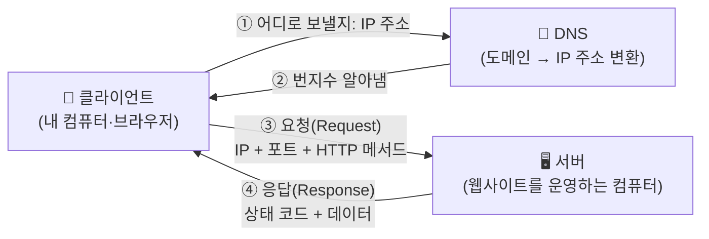
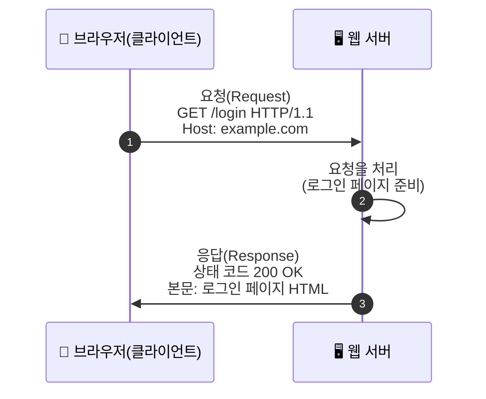

> [!summary] ⏱️ 5초 핵심 요약
> - **한 줄 비유**: 인터넷은 **손님(클라이언트)이 식당(서버)에 전화를 걸어 주문하는 것**과 같습니다. 전화번호가 **IP 주소**, "몇 번 테이블로 보내주세요"가 **포트**, 주문과 응답의 말투 규칙이 **HTTP**입니다.
> - **핵심 원리**: 모든 웹 공격은 "누가 요청을 보내고(클라이언트) 누가 처리하는지(서버)", "어떤 주소·몇 번 창구로 가는지(IP·포트)", "어떤 형식으로 묻고 답하는지(HTTP)"를 공격자가 **의도적으로 비틀거나 들여다보는 것**에서 시작합니다.
> - **핵심 체크 포인트**: 이후 글의 `GET /login`, `443번 포트`, `상태 코드 403` 같은 표현이 나올 때 **"누가 누구에게, 어느 주소·창구로, 무슨 형식으로 보냈는가"**를 머릿속에 그릴 수 있으면 이 글의 목적은 끝입니다.

이 글은 모의해킹 지식 지도의 **0단계, 가장 바닥에 깔리는 IT 기초**입니다. 보안 용어나 공격 기법은 전혀 다루지 않고, 뒤에 나올 모든 글이 "당연히 안다"고 가정하는 인터넷 동작 원리만 비유로 풀어 설명합니다. 이 글을 읽고 나면 바로 [[모의해킹 vs 레드팀 vs 퍼플팀 — 목적·접근방식·산출물로 구분하기]]로 넘어가 모의해킹 입문 3단계를 시작하면 됩니다. 낯선 용어가 또 나오면 [[모의해킹 핵심 용어집 — 블로그에 반복 등장하는 용어 정리]]에서 바로 찾아보세요.

---

## 1. 클라이언트-서버 — 묻는 쪽과 답하는 쪽

**💡 한 줄 비유**: 식당에서 **손님(클라이언트)이 주문하면 주방(서버)이 음식을 만들어 내보내는** 구조와 같습니다. 손님이 먼저 말을 걸지 않으면 주방은 아무것도 하지 않습니다.

### 핵심 원리
- **클라이언트**: 서비스를 먼저 요청하는 쪽입니다. 웹 브라우저(Chrome, Edge 등), 모바일 앱, `curl` 같은 명령줄 도구가 모두 클라이언트입니다.
- **서버**: 요청을 받아 처리한 뒤 결과를 돌려주는 쪽입니다. 웹사이트, 로그인 시스템, API가 동작하는 컴퓨터(또는 클라우드 인스턴스)가 서버입니다.
- **요청(Request)과 응답(Response)**: 모든 대화는 "클라이언트가 요청을 보낸다 → 서버가 응답을 돌려준다"는 한 쌍으로 이뤄집니다. 서버가 먼저 클라이언트에게 말을 거는 경우는 거의 없습니다.
- **모의해킹에서의 의미**: 모의해킹은 대부분 **클라이언트처럼 서버에 요청을 보내고, 돌아오는 응답을 분석**해 서버가 숨기고 있는 약점을 찾는 작업입니다. 즉 평범한 사용자와 똑같은 자리에서 시작합니다.

### 체크 포인트
- 지금 내가 쓰는 브라우저가 **클라이언트**, 그 웹사이트를 운영하는 컴퓨터가 **서버**라는 구분이 자연스럽게 떠오르는가?
- "요청을 보냈다", "응답을 받았다"는 표현이 나오면 **누가 먼저 말을 걸었는지**를 구분할 수 있는가?

---

## 2. IP 주소와 포트 — 건물 주소와 호실 번호

**💡 한 줄 비유**: **IP 주소**는 "서울시 OO로 10번지"처럼 인터넷에서 그 컴퓨터를 찾아가는 **건물 주소**이고, **포트**는 그 건물 안의 "302호"처럼 **어떤 서비스로 들어갈지** 정하는 **방 번호**입니다.

### 핵심 원리
- **IP 주소(IP Address)**: 인터넷에 연결된 모든 장치에 부여되는 고유한 숫자 주소입니다(예: `203.0.113.10`). 이 주소가 없으면 어느 컴퓨터로 데이터를 보낼지 알 수 없습니다.
- **포트(Port)**: 같은 서버(같은 건물) 안에서도 웹사이트, 이메일, 파일 공유 등 **여러 서비스가 동시에** 돌아갈 수 있습니다. 포트는 0~65535 사이 번호로 "이 요청은 어떤 서비스로 보낼지"를 구분합니다.
- **잘 알려진 포트(Well-known Port)**: 웹은 보통 **80번(HTTP)**, 암호화된 웹은 **443번(HTTPS)**을 씁니다. 번호 자체는 규칙일 뿐 강제는 아니지만, 대부분의 서비스가 이 관례를 따릅니다.
- **모의해킹에서의 의미**: 모의해킹의 첫 단계인 **포트 스캐닝**은 "이 건물(서버)에 어떤 방(포트)들이 열려 있고, 그 방마다 어떤 서비스가 응답하는지"를 확인하는 작업입니다. 열린 포트 하나하나가 공격 표면(Attack Surface)이 됩니다.

### 주소·호실 비유로 보는 IP·포트

| 현실 세계 | 인터넷 | 예시 |
|---|---|---|
| 건물 주소 | IP 주소 | `203.0.113.10` |
| 건물 안의 호실 번호 | 포트 번호 | `80`(웹), `443`(암호화된 웹), `22`(원격 접속) |
| 호실 안에서 실제로 손님을 받는 직원 | 그 포트에서 돌아가는 서비스(프로그램) | 웹 서버 프로그램, SSH 서버 프로그램 |

### 체크 포인트
- "80번 포트가 열려 있다"는 말이 **"이 서버의 302호(웹 서비스)가 문을 열어뒀다"**는 뜻으로 바로 번역되는가?
- IP 주소(건물)와 포트(호실)가 **서로 다른 개념**이라는 것이 구분되는가?
- 더 깊이 들어가는 포트·서비스 점검 절차는 [[체계적 서비스 열거 플레이북 — SMB, LDAP, SNMP, MSSQL, NFS 프로토콜별 체크리스트]]에서 다룹니다.

---

## 3. 도메인과 DNS — 주소 대신 쓰는 이름표

**💡 한 줄 비유**: 숫자로 된 건물 주소(IP)를 매번 외우기 어려우니, **"구글 본사"라고 말하면 안내 데스크(DNS)가 정확한 번지수를 찾아주는 전화번호부**와 같습니다.

### 핵심 원리
- **도메인(Domain)**: `example.com`처럼 사람이 외우기 쉬운 이름입니다. 실제 통신은 숫자로 된 IP 주소로만 이뤄지므로, 도메인은 IP 주소를 대신하는 이름표일 뿐입니다.
- **DNS(Domain Name System)**: 도메인 이름을 실제 IP 주소로 바꿔주는 시스템입니다. 브라우저에 주소를 입력하면 가장 먼저 "이 도메인의 IP 주소가 뭐야?"라고 DNS에 물어봅니다.
- **모의해킹에서의 의미**: 하나의 도메인 뒤에 여러 서브도메인(`api.example.com`, `admin.example.com`)이 숨어 있을 수 있고, 이런 서브도메인을 찾아내는 것도 정찰 단계의 중요한 작업입니다.

### 체크 포인트
- "도메인을 입력하면 IP 주소로 바뀐 뒤에야 서버를 찾아간다"는 순서가 그려지는가?

---

## 4. HTTP — 요청과 응답이 오가는 공통 말투

**💡 한 줄 비유**: HTTP는 손님과 주방이 주고받는 **정해진 말투 규칙**입니다. "OO 메뉴 주세요(요청)" → "준비됐습니다, 여기 있습니다(응답)"처럼 **형식이 정해져 있어야** 서로 알아들을 수 있습니다.

### 핵심 원리
- **요청(Request)의 구성**: 무엇을 하고 싶은지를 나타내는 **메서드**(`GET`=조회, `POST`=전송·생성 등), 어디로 보내는지 나타내는 **경로**(`/login`), 추가 정보를 담는 **헤더**, 그리고 필요하면 데이터를 담는 **본문(Body)**으로 이뤄집니다.
- **응답(Response)의 구성**: 요청이 어떻게 처리됐는지 알려주는 **상태 코드**와, 실제 내용이 담긴 **본문**으로 이뤄집니다.
- **상태 코드로 보는 결과**: `200`(성공), `301/302`(다른 곳으로 이동), `403`(권한 없음), `404`(존재하지 않음), `500`(서버 내부 오류)처럼 숫자 범위마다 의미가 다릅니다.
- **HTTPS**: HTTP 통신 내용을 암호화해서 중간에서 가로채도 못 읽게 만든 버전입니다. 주소창의 자물쇠 아이콘과 `https://`가 이 표시입니다.
- **모의해킹에서의 의미**: 웹 모의해킹의 상당 부분은 **이 요청의 메서드·경로·헤더·본문을 평범하지 않은 값으로 바꿔 보내고, 응답(상태 코드와 본문)이 예상과 다르게 돌아오는지 관찰**하는 과정입니다.

### 자주 보는 상태 코드 한눈에 보기

| 범위 | 의미 | 예시 |
|---|---|---|
| 2xx | 요청이 성공적으로 처리됨 | `200 OK` |
| 3xx | 다른 위치로 이동(리다이렉트) | `301 Moved Permanently` |
| 4xx | 클라이언트 쪽 요청에 문제가 있음 | `403 Forbidden`, `404 Not Found` |
| 5xx | 서버 쪽에서 처리 중 오류가 발생함 | `500 Internal Server Error` |

### 체크 포인트
- 브라우저 주소창에 주소를 입력하는 순간 **요청이 나가고**, 화면에 페이지가 뜨는 순간 **응답을 받은 것**이라는 흐름이 떠오르는가?
- `403`과 `404`가 **"권한이 없다"**와 **"존재하지 않는다"**로 서로 다른 의미라는 것이 구분되는가?
- 이 흐름을 바탕으로 한 실제 웹 취약점 진단 기법은 [[웹 취약점 진단 기법 입문 — XXE, SSRF부터 SQLi, XSS까지]]에서 이어집니다.

---

## 마무리: 이제 모의해킹 입문 3단계로

클라이언트-서버, IP·포트, 도메인·DNS, HTTP 요청·응답까지가 이후 모든 글에서 설명 없이 쓰일 **공통 전제**입니다. 낯선 용어가 또 나오면 [[모의해킹 핵심 용어집 — 블로그에 반복 등장하는 용어 정리]]에서 바로 찾아보세요.

이제 [[모의해킹 vs 레드팀 vs 퍼플팀 — 목적·접근방식·산출물로 구분하기]] → [[스코프와 교전규칙(RoE) — 모의해킹을 시작하기 전에 정해야 할 것들]] → [[모의해킹 방법론 총정리 — PTES 7단계와 OWASP WSTG로 보는 진단 전체 지도]] 순서로 읽으면 모의해킹 입문 3단계가 끝납니다.
