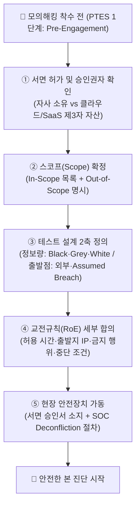
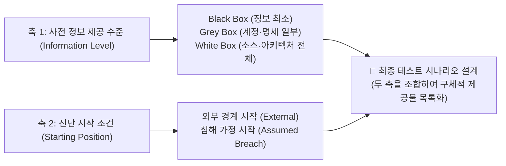
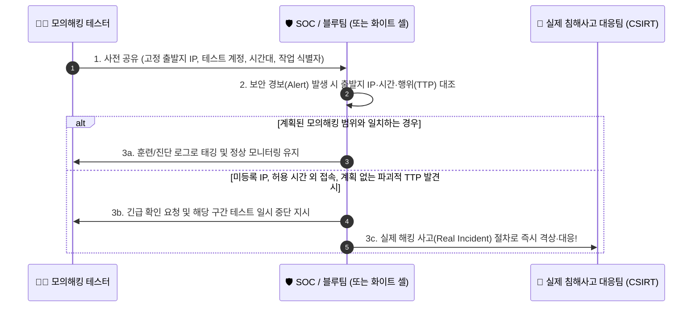

> [!summary] ⏱️ 5초 핵심 요약
> - **한 줄 비유**: 수술용 메스도 **환자 동의서와 수술 부위 표시**가 있어야 합법적인 치료가 되듯, 모의해킹은 **서면 허가(권한)·스코프(범위)·교전규칙(RoE)**이 있어야 범죄가 아닌 보안 업무가 됩니다.
> - **핵심 원리**: 구두 합의나 메신저 한 줄이 아니라, **포함/제외 자산(CIDR·도메인·제3자 인프라)**, **정보 제공 수준(Black/Grey/White Box)과 출발 위치(Assumed Breach)**, **허용 시간·금지 행위·비상 연락망**을 서명된 문서로 확정해야 합니다.
> - **핵심 체크 포인트**: 현장 제시용 서면 승인서(**Get-Out-of-Jail-Free Card**)를 준비하고, 관제팀(SOC)이 허가된 테스트와 실제 해킹을 즉시 구분하는 **Deconfliction(충돌 방지)** 절차를 반드시 가동하세요.

[[모의해킹 방법론 총정리 — PTES 7단계와 OWASP WSTG로 보는 진단 전체 지도]]가 Pre-Engagement의 존재와 전체 순서에서의 위치를 보여준다면, 이 글은 PTES 1단계에서 **실제로 무엇을 합의해야 하는가**를 다룹니다. 이후 취약점 탐색이나 공격 기법은 다루지 않으며, 진단을 시작하기 전에 스코프와 교전규칙(Rules of Engagement, RoE)을 문서로 확정하는 실무 체크리스트에만 집중합니다.



---

## 한눈에 보는 Pre-Engagement 7대 합의 축

| 합의 축 | 핵심 질문 | 부실 합의 시 실무 사고 예시 | 필수 문서화 항목 |
|---|---|---|---|
| **1. 법적 권한** | 누가 어떤 자산에 어떤 기간 동안 테스트를 허가했는가? | 권한 없는 실무자의 구두 요청만 믿고 점검했다가 무단 침입 논란 발생 | 승인권자 서명, 기간, 수행사·테스터 실명/식별자 |
| **2. 스코프(범위)** | 포함 대상과 **절대 건드리면 안 되는 제외 대상**은 무엇인가? | `*.example.com`만 적었다가 외부 SaaS·결제 게이트웨이·운영 DB까지 스캔 | 허용 IP/CIDR, 도메인·URL·API, 명시적 Out-of-Scope |
| **3. 정보 제공 수준** | Black·Grey·White Box 중 어떤 자료와 계정을 주는가? | "그레이 박스"라고만 적고 실제 계정·API 명세서 전달이 지연돼 일정 허비 | 제공 계정(권한별), 소스코드, 아키텍처 도면 목록 |
| **4. 시작 조건** | 외부 경계에서 시작하는가, 내부 침해를 가정(Assumed Breach)하는가? | 사전 제공받은 초기 내부 계정을 "발견한 취약점"으로 잘못 집계 | 초기 진입 위치(외부/내부), 제공 호스트·계정, 만료일 |
| **5. 행위 규칙(RoE)** | 시간대, 출발지 IP, 금지 행위, 데이터 취급 규칙은 무엇인가? | 운영 피크 시간대 자동화 스캐너 구동으로 서비스 장애 유발 | 허용 시간대(타임존), 테스터 고정 IP, 금지 기법(DoS 등) |
| **6. 비상 대응** | 장애 발생 시 누가 즉시 중단·복구·재개를 결정하는가? | 야간 작업 중 DB 응답 지연 발생 시 연락 두절로 대처 지연 | 24시간 비상 연락망, 작업 중단(Stop-Work) 조건·권한자 |
| **7. 충돌 방지** | 허가된 테스트 트래픽과 실제 공격을 어떻게 구분(Deconfliction)하는가? | SOC가 테스트를 실제 침해사고로 오인해 전사 비상 소집 또는 실제 해커 방치 | 테스터 출발지 IP·시간 공유, 미계획 TTP 발견 시 사고 전환 |

---

## 1. 허가가 모의해킹의 출발선인 이유

**💡 한 줄 비유**: 같은 수술용 메스를 사용해도 **환자의 서면 동의와 병원의 승인** 아래 시행하면 치료지만, 허락 없이 사용하면 범죄가 됩니다. 보안 테스트도 기술 자체가 아니라 **누가 무엇을 어디까지 허가했는가**가 합법적 업무와 무단 침해를 가르는 출발선입니다.

### 핵심 원리
- **명시적 권한 부여**: 허락 없이 시스템에 접근하거나 기능을 시험하면 정보통신망법 등 관련 법령상 침해 행위가 될 수 있으며, 명시적인 권한과 범위 안에서 수행해야 합법적인 모의해킹이 됩니다.
- **서명된 계약·동의서로서의 RoE**: RoE 문서는 고객과 테스터가 허용한 대상, 시간, 방법, 중단 조건을 같은 언어로 확인하는 법적·업무적 기준선 역할을 합니다.
- **구두·메신저 합의의 한계**: 구두 합의나 메신저 한 줄은 담당자가 바뀌거나 장애·사고가 발생했을 때 승인 범위를 입증하기 어렵습니다. 법률·규제 요건은 조직과 국가마다 다르므로 실제 계약은 반드시 법무·컴플라이언스 담당자의 검토를 받아야 합니다.

### 부실한 합의 vs 명확한 서면 합의 비교

| 구분 | ❌ 위험한 구두·메신저 합의 | ✅ 안전한 서면 RoE 합의 |
|---|---|---|
| **대상 지정** | "저희 쇼핑몰 사이트 전반적으로 봐주세요" | `https://shop.example.com` 및 `203.0.113.10/32` (외부 PG사 연동 구간 제외) |
| **승인 주체** | 개발팀 실무자의 슬랙 메시지 ("오늘 밤에 테스트하셔도 됩니다") | 정보보호최고책임자(CISO) 또는 시스템 소유 임원의 전자/서면 서명 |
| **제3자 자산** | 클라우드·CDN·외부 SaaS 소유권 미확인 | 호스팅·클라우드·외부 SaaS 등 제3자 소유 자산의 정책 및 별도 승인 조건 사전 확인 |

### 체크 포인트
- 승인자가 대상 시스템에 대해 실제로 **보안 테스트를 허가할 법적·조직적 권한**을 가진 사람인지 확인했는가?
- 고객사·수행사·테스터 실명(또는 식별 정보), 테스트 기간, 목적과 승인 범위를 서명된 문서로 남겼는가?
- 클라우드·호스팅·외부 SaaS처럼 **제3자 소유 자산**이 걸려 있을 때 해당 사업자의 정책과 별도 허가 조건을 확인했는가?
- 참고: [PTES — Pre-engagement](http://www.pentest-standard.org/index.php/Pre-engagement)

---

## 2. 스코프 — 포함 대상보다 제외 대상을 더 선명하게

**💡 한 줄 비유**: 아파트 누수 공사를 맡기면서 "우리 집 좀 고쳐 주세요"라고만 하면 작업자가 어느 벽까지 깨도 되는지 알 수 없습니다. 작업할 동·호수(**In-Scope**)뿐 아니라 **절대 건드리면 안 되는 가스 배관과 공용 설비(Out-of-Scope)**를 함께 표시해야 대형 사고를 막을 수 있습니다.

### 핵심 원리
- **모호한 도메인 표기의 함정**: 스코프는 허용된 IP 대역, 도메인, 애플리케이션, API, 계정, 환경과 함께 **명시적인 제외 대상(Out-of-Scope)**을 정의해야 합니다. `example.com`처럼 넓은 이름만 적으면 서브도메인, CDN(Content Delivery Network: 콘텐츠를 여러 지역 서버에서 전달하는 네트워크), 외부 결제 연동, 개발·운영 환경의 포함 여부가 모호해집니다.
- **소유 주체와 운영 중요도 구분**: 같은 IP 대역(CIDR) 안에 고객사 운영 서버와 제3자 위탁 서비스가 섞여 있을 수 있고, 장애 허용도가 다른 시스템을 같은 강도로 시험하면 안 됩니다.
- **현장 스코프 임의 확대 금지**: 진단 중 새로운 서브도메인이나 내부 대역을 발견했더라도 현장에서 구두로 범위를 넓혀 즉시 공격하지 말고, 반드시 승인권자의 서면 스코프 변경 이력을 남겨야 합니다.

### 실무 스코프 명세서 작성 예시
```yaml
# [예시] 모의해킹 대상 스코프 정의표
in_scope:
  domains:
    - "app.example.com"
    - "api.example.com"
  ip_ranges:
    - "198.51.100.10/32 (웹 프론트엔드)"
    - "198.51.100.20/32 (API 게이트웨이 - 스테이징)"
  environments:
    - "Staging 환경 전체 및 Production 환경의 읽기 전용 검증"

out_of_scope:
  domains:
    - "pay.vendor-pg.example (제3자 결제 대행사)"
    - "help.example.com (외부 고객센터 SaaS)"
  ip_ranges:
    - "198.51.100.99/32 (레거시 의료·생산 제어 연동 DB - 무중단 필수)"
  paths_and_actions:
    - "POST /api/v1/sms/send (실제 과금 및 대량 문자 발송 유발 API)"
```

### 체크 포인트
- 허용 IP/CIDR(Classless Inter-Domain Routing: IP 주소 대역을 표기하는 방식), 도메인·서브도메인, URL, API, 모바일 백엔드, 계정과 환경을 구체적으로 열거했는가?
- 운영(Prod)·개발(Dev)·스테이징(Staging)·재해복구(DR) 환경, 공유 인프라, 제3자 서비스의 포함 여부를 각각 표시했는가?
- 의료·결제·생산 설비처럼 **중단 위험이 큰 대상과 테스트 금지 경로**를 명시했는가?
- 진단 중 신규 자산 발견 시 즉시 시험하지 않고 **스코프 변경 승인 절차**를 따르도록 합의했는가?
- 참고: [PTES — Scope Definition](http://www.pentest-standard.org/index.php/Pre-engagement#Scope_Definition)

---

## 3. Black·Grey·White Box와 Assumed Breach는 다른 축이다

**💡 한 줄 비유**: 건물 점검자가 도면을 전혀 받지 않는지, 일부만 받는지, 전체 설계도를 다 받는지는 **보유 정보의 양(Box 유형)** 문제입니다. 반면 건물 밖 정문에서 시작하는지, 이미 1층 로비 출입증을 받은 상태로 안에서 시작하는지는 **출발 위치(시작 조건)** 문제입니다.



### 핵심 원리
1. **정보 제공 수준 축 (Black / Grey / White Box)**:
   - **Black Box**: 외부 공격자에 가까운 제한된 정보만 제공 (주로 도메인·IP 범위만 전달)
   - **Grey Box**: 일반/관리자 테스트 계정, API 명세서(Swagger/OpenAPI), 일부 설계 문서 제공
   - **White Box**: 애플리케이션 소스 코드, 설정 파일, 상세 아키텍처 도면, 로그 접근 권한까지 폭넓게 제공
   - *실무 주의점*: 실제 제공물은 프로젝트마다 다르므로 추상적인 Box 명칭만 계약서에 쓰지 말고 **구체적으로 인도받을 자료와 계정 목록**을 적어야 합니다.
2. **시작 조건·시나리오 축 (External vs Assumed Breach)**:
   - **Assumed Breach(침해 가정)**는 Black·Grey·White Box와 나란히 놓이는 네 번째 Box 유형이 아니라 **별도의 시작 조건 축**입니다.
   - 초기 침해 지점이나 내부 접근 권한을 이미 확보했다고 가정(고객이 초기 계정·워크스테이션·VPN을 제공)한 상태에서 내부 횡적이동과 권한상승을 검증합니다.
   - 따라서 내부 일반 계정을 제공받은 Assumed Breach 프로젝트도 내부 아키텍처 정보를 얼마나 공개하느냐에 따라 **Assumed Breach + Grey Box** 또는 **Assumed Breach + White Box** 방식으로 결합될 수 있습니다.

### 체크 포인트
- 추상적인 Box 명칭 대신 **제공 계정(권한 등급별), 소스 코드, 네트워크 도면, 로그 접근권한**을 구체적 목록으로 명시했는가?
- Assumed Breach 시나리오에서 제공되는 **초기 계정·호스트·권한·네트워크 위치와 계정 만료 시점**을 기록했는가?
- 고객사가 사전 조건으로 제공한 접근권한을 테스터가 **"발견한 취약점"으로 중복 계산하지 않고** 사전 전제 조건으로 명확히 구분했는가?
- 참고: [PTES — Pre-engagement](http://www.pentest-standard.org/index.php/Pre-engagement)

---

## 4. RoE 핵심 항목 — 시간, 금지 행위, 중단 조건, 비상 연락망

**💡 한 줄 비유**: 축구장 대관 허가를 받았더라도 한밤중에 조명을 켜거나 골대를 부숴도 된다는 뜻은 아닙니다. **경기 시간, 반칙 기준, 부상자가 나왔을 때 즉시 휘슬을 불 심판**을 미리 정해야 안전한 경기가 됩니다.

### 핵심 원리
- **행동 규칙 구체화**: RoE는 "테스트 가능"이라는 넓은 허가를 실제 행동 규칙으로 좁힙니다. 허용 시간대와 트래픽 강도(초당 요청 수 제한 등), 테스터가 사용할 고정 출발지 IP, 민감 데이터 취급 방식, 증거 보관 기간, 테스트 중단 권한을 구체적으로 정해야 운영 장애와 법적 분쟁을 줄일 수 있습니다.
- **금지 행위의 명시화**: 금지 행위는 "상식선에서 안 하겠지"라고 추정하지 말고 문서에 명시합니다.
  - **DoS**(Denial of Service: 단일 대상 서비스 마비 공격) 및 **DDoS**(Distributed Denial of Service: 분산 서비스 거부 공격)
  - 대량 자동화 퍼징·무차별 대입(계정 잠금 유발), 운영 데이터 삭제·변조 같은 파괴적 시험
  - 임직원 대상 피싱 등 사회공학(Social Engineering), 물리적 침투, 승인되지 않은 원격 제어 악성코드 설치
  - *원칙*: 위 항목들은 명시적으로 서면 승인되지 않았다면 **기본적으로 금지(Opt-out)**로 두어야 안전합니다. 파괴적 검증이 꼭 필요하다면 별도 승인, 격리 환경, 백업·복구 계획과 즉시 중단 기준이 선행돼야 합니다.
- **비상 연락망과 중단(Stop-Work) 절차**: 고객 프로젝트 책임자, **SOC**(Security Operations Center: 보안 이벤트를 감시·분석·대응하는 조직)·블루팀 연락점, 인프라 운영 담당자, 수행사 책임자와 승인권자를 넣고 주·야간 연락 수단을 구분합니다.

### 체크 포인트
- 허용 날짜·시간대·표준 시간대(예: KST/UTC), 테스터 출발지 IP, 초당 요청 속도(Rate Limit)와 운영 피크 시간 회피 조건을 명시했는가?
- DoS, 사회공학, 물리 침투, 운영 데이터 변경·삭제, 지속성(Persistence) 설치의 **허용·금지 여부를 각각 표기**했는가?
- 진단 중 접하는 민감 데이터(개인정보·기밀)의 **최소 수집(마스킹), 암호화 저장, 공유 대상, 보관 기간과 안전한 폐기 방식**을 합의했는가?
- 이상 징후 발생 시 **중단 기준과 중단 권한자, 장애 알림 순서, 재개 승인 절차**를 한 페이지에서 즉시 찾게 구성했는가?
- 참고: [PTES — Rules of Engagement](http://www.pentest-standard.org/index.php/Pre-engagement#Rules_of_Engagement)

---

## 5. Get-Out-of-Jail-Free Card — 현장에서 제시할 수 있는 서면 승인

**💡 한 줄 비유**: 야간에 은행 출입 통제 장치를 점검하는 기술자가 출동한 경비원에게 보여줄 **공식 작업허가증과 본사 당직실 직통 번호**를 갖고 있어야 하는 것과 같습니다. "낮에 담당 팀장님이 구두로 허락했다"는 말만으로는 현장의 체포나 제지를 피하기 어렵습니다.

### 핵심 원리
- **현장 제시용 공식 승인서**: 흔히 **Get-Out-of-Jail-Free Card**라고 부르는 문서는 테스터가 승인된 업무 수행 중임을 제3자(현장 보안요원, 관제 당직자, ISP, 사법기관 등)에게 즉시 증명하는 서면 승인서입니다.
- **필수 포함 요소**: 고객 조직명, 수행사 및 투입 테스터 실명, 유효 기간, 승인된 대상 범위 요약, **24시간 진위를 즉시 확인할 수 있는 긴급 연락처**, 승인권자의 서명이 포함돼야 합니다.
- **법적 한계 명확화 (면책 특권 아님)**: 이 문서는 모든 행동에 대한 무제한 면책 특권이 **절대 아닙니다**. 스코프 밖 자산 접근, 유효 기간이 지난 후의 접속, 계약이 금지한 파괴적 행위까지 보호하지 않으며 국가의 관할 법률을 대체하지도 않습니다.

### 체크 포인트
- 현장 보안 담당자나 원격 관제 당직자가 승인서의 진위를 **실시간으로 전화해 확인할 수 있는 연락처와 검증 절차**를 마련했는가?
- 승인서에 적힌 대상·기간·수행자 정보가 **최신 변경된 RoE 본문과 정확히 일치**하는지 테스트 시작일에 재확인했는가?
- 승인서 분실·외부 유출에 대비해 민감한 내부 구조 정보는 빼고 필요한 식별 정보만 넣었으며, 종료 후 보관·폐기 책임을 지정했는가?
- 참고: [PTES — Permission to Test](http://www.pentest-standard.org/index.php/Pre-engagement#Permission_to_Test)

---

## 6. Deconfliction — 허가된 테스트와 실제 공격을 구분하기

**💡 한 줄 비유**: 소방 훈련 중 연기가 나더라도 모든 화재경보를 "오늘 훈련이겠지"라고 무시하면 **진짜 불이 났을 때 건물이 다 타버립니다**. 반대로 훈련 사실을 통제실이 전혀 모르면 매번 소방차가 총출동해 업무가 마비됩니다.



### 핵심 원리
- **양방향 오인 방지(Deconfliction)**: 승인된 테스트 때문에 SOC와 블루팀이 불필요한 사고대응에 소모되지 않게 하고, 동시에 **같은 시기에 실제 해커의 공격이 발생했을 때 이를 모의해킹 활동으로 착각해 방치하지 않도록** 식별·조정하는 핵심 절차입니다.
- **모의해킹 vs 레드팀의 공유 수준 차이**:
  - **일반 모의해킹**: 출발지 IP, 테스트 계정, 활동 시간대와 작업 식별자(예: 커스텀 HTTP `User-Agent` 헤더 등)를 SOC에 사전 공유합니다.
  - **블라인드 레드팀**: 탐지 역량 평가를 위해 일반 관제 요원에게는 일정을 숨기더라도, **최소한의 통제 담당자(화이트 셀, White Cell)**는 승인 범위와 테스터 식별 정보를 실시간으로 파악하고 있어야 합니다.
- **실제 침해사고 전환 기준**: 경보가 발생한 출발지 IP, 시간대, 또는 **TTP**(Tactics, Techniques, and Procedures: 공격자의 전술·기술·절차)가 사전 계획된 테스트 기록과 맞지 않으면 즉시 실제 침해사고 가능성을 우선 확인해야 합니다.

### 체크 포인트
- 프로젝트 성격(모의해킹 vs 레드팀)에 따라 **SOC·블루팀에 사전 공유할 정보와 비공개로 유지할 정보(화이트 셀만 공유)**를 명확히 구분했는가?
- 테스트 출발지 IP·계정·시간·식별 헤더와 테스터의 **일일 활동 타임라인 로그**를 즉시 대조 가능하게 보관하고 있는가?
- 계획에 없는 TTP, 미등록 외부 IP, 예상 밖의 대량 데이터 유출 징후가 보일 때 **실제 침해사고 대응 절차로 즉시 전환하는 기준**이 있는가?
- 실제 외부 공격이 의심될 때 **모의해킹 즉시 중단 → 현장 증거 보존 → 사고대응팀(CSIRT) 인계 → 안전 확인 후 재개 승인** 순서가 합의되어 있는가?
- 참고: [PTES — Communication](http://www.pentest-standard.org/index.php/Pre-engagement#Communication)

---

## 마무리: 안전한 모의해킹을 여는 RoE 최종 점검

좋은 RoE는 테스터의 손발을 묶는 번거로운 서류가 아니라, **고객사의 서비스 안정성과 테스터의 법적·업무적 안전을 동시에 지켜주는 방어막**입니다. 첫 패킷을 보내기 전에 위 7가지 합의 축이 서명된 문서에 빠짐없이 들어가 있는지 반드시 확인하세요.

전체 흐름에서 이 단계의 위치를 다시 보려면 [[모의해킹 방법론 총정리 — PTES 7단계와 OWASP WSTG로 보는 진단 전체 지도]]로 돌아가고, 진단 종료 후 결과를 의사결정과 패치로 연결하는 방법은 [[모의해킹 리포트 작성법 — 재현 가능한 증적과 경영진 요약 쓰기]]에서 이어서 확인하세요.
