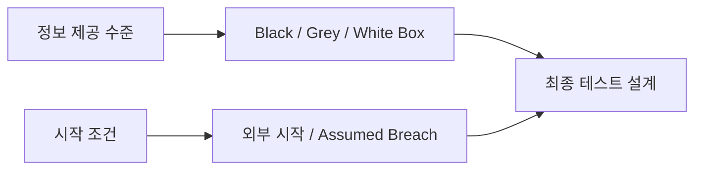

[[모의해킹 방법론 총정리 — PTES 7단계와 OWASP WSTG로 보는 진단 전체 지도]]가 Pre-Engagement의 존재와 전체 순서에서의 위치를 보여준다면, 이 글은 PTES 1단계에서 **실제로 무엇을 합의해야 하는가**를 다룹니다. 이후 취약점 탐색이나 공격 기법은 다루지 않으며, 진단을 시작하기 전에 스코프와 교전규칙(Rules of Engagement, RoE)을 문서로 확정하는 실무 체크리스트에만 집중합니다.

---

## 1. 허가가 모의해킹의 출발선인 이유

쉽게 말하면 같은 수술 도구를 사용해도 환자의 동의와 병원의 승인 아래 시행하면 치료지만, 몰래 사용하면 범죄가 됩니다. 보안 테스트도 기술 자체가 아니라 **누가 무엇을 어디까지 허가했는가**가 합법적 업무와 무단 침해를 가르는 출발선입니다.

**원리**: 허락 없이 시스템에 접근하거나 기능을 시험하면 해킹 행위가 될 수 있고, 명시적인 권한과 범위 안에서 수행해야 모의해킹이 됩니다. RoE 문서는 고객과 테스터가 허용한 대상, 시간, 방법, 중단 조건을 같은 언어로 확인하는 서명된 계약·동의서 역할을 합니다.

구두 합의나 메신저 한 줄은 담당자가 바뀌거나 사고가 발생했을 때 범위를 입증하기 어렵습니다. 최소한 대상 조직의 권한 있는 승인자가 서명한 문서에 대상과 기간, 수행 주체, 제한 사항, 비상 연락망을 남겨야 합니다. 법률·규제 요건은 조직과 국가마다 다르므로 실제 계약은 법무·컴플라이언스 담당자의 검토를 받아야 합니다.

- 체크 포인트:
  - 승인자가 대상 시스템에 테스트를 허가할 권한을 가진 사람인지 확인
  - 고객사·수행사·테스터 실명 또는 식별 정보, 기간, 목적과 승인 범위를 문서화
  - 클라우드·호스팅·외부 SaaS처럼 제3자 소유 자산은 별도 허가 조건 확인
- 참고: [PTES — Pre-engagement](http://www.pentest-standard.org/index.php/Pre-engagement)

## 2. 스코프 — 포함 대상보다 제외 대상을 더 선명하게

쉽게 말하면 아파트 누수 공사를 맡기면서 “우리 집을 점검해 주세요”라고만 하면 작업자가 어느 벽까지 열어도 되는지 알 수 없습니다. 동·호수뿐 아니라 건드리면 안 되는 배관과 공용 설비를 함께 표시해야 사고를 막을 수 있습니다.

**원리**: 스코프는 허용된 IP 대역, 도메인, 애플리케이션, API, 계정, 환경과 함께 **명시적인 제외 대상**을 정의합니다. `example.com`처럼 넓은 이름만 적으면 서브도메인, CDN(Content Delivery Network: 콘텐츠를 여러 지역 서버에서 전달하는 네트워크), 외부 결제 연동, 개발·운영 환경의 포함 여부가 모호해집니다.

대상 목록에는 소유 주체와 운영 중요도도 붙이는 편이 좋습니다. 같은 IP 대역 안에 고객 운영 서버와 제3자 서비스가 섞여 있을 수 있고, 장애 허용도가 다른 시스템을 같은 강도로 시험하면 안 됩니다. 스코프 변경은 현장에서 구두로 확대하지 말고 승인권자와 변경 이력을 남겨야 합니다.

- 체크 포인트:
  - 허용 IP/CIDR(Classless Inter-Domain Routing: IP 주소 대역을 표기하는 방식), 도메인·서브도메인, URL, API, 모바일 백엔드, 계정과 환경을 구체적으로 열거
  - 운영·개발·재해복구 환경, 공유 인프라, 제3자 서비스의 포함 여부를 각각 표시
  - 의료·결제·생산 시스템처럼 중단 위험이 큰 대상과 테스트 금지 경로를 명시
  - 신규 자산 발견 시 즉시 시험하지 않고 스코프 변경 승인 절차를 따르기
- 참고: [PTES — Scope Definition](http://www.pentest-standard.org/index.php/Pre-engagement#Scope_Definition)

## 3. Black·Grey·White Box와 Assumed Breach는 다른 축이다

쉽게 말하면 건물 점검자가 도면을 전혀 받지 않는지, 일부만 받는지, 전체 도면과 설비 목록을 받는지는 **보유 정보의 양**에 관한 문제입니다. 반면 이미 로비 출입증을 받은 상태에서 점검을 시작하는지는 **출발 위치**의 문제입니다. 두 질문은 서로 교차할 수 있습니다.

**원리**: Black Box, Grey Box, White Box는 테스터에게 제공되는 사전 정보와 내부 지식의 수준을 나타냅니다. Black Box는 외부 공격자에 가까운 제한된 정보, Grey Box는 일부 계정·설계 정보, White Box는 소스 코드·구성·아키텍처 등 폭넓은 정보를 제공하는 방식입니다. 실제 제공물은 프로젝트마다 다르므로 명칭만 쓰지 말고 구체적인 자료와 계정을 함께 적어야 합니다.

**Assumed Breach는 이 세 가지와 같은 축의 네 번째 Box 유형이 아닙니다.** 초기 침해 지점이나 접근 권한을 이미 확보했다고 가정하거나 고객이 제공한 상태에서 시작하는 **별도의 시작 조건·시나리오 축**입니다. 예를 들어 내부 일반 계정을 제공한 Assumed Breach 프로젝트도 내부 구조 정보를 얼마나 공개하느냐에 따라 Grey Box나 White Box 방식과 결합할 수 있습니다.

- 체크 포인트:
  - Box 명칭 대신 제공 계정, 소스 코드, 네트워크 도면, 로그 접근권한을 목록으로 명시
  - Assumed Breach에서 제공되는 초기 계정·호스트·권한·네트워크 위치와 만료 시점을 기록
  - 제공된 접근권한을 “발견한 취약점”으로 계산하지 않고 사전 조건으로 구분
- 참고: [PTES — Pre-engagement](http://www.pentest-standard.org/index.php/Pre-engagement)

## 4. RoE 핵심 항목 — 시간, 금지 행위, 중단 조건, 비상 연락망

쉽게 말하면 경기장 사용 허가를 받았더라도 아무 시간에 들어가거나 시설을 부숴도 된다는 뜻은 아닙니다. 운영 시간, 금지 동작, 사고가 났을 때 호루라기를 불 사람을 미리 정해야 안전한 경기가 됩니다.

**원리**: RoE는 “테스트 가능”이라는 넓은 허가를 실제 행동 규칙으로 좁힙니다. 허용 시간대와 트래픽 강도, 사용할 출발지 IP, 데이터 취급 방식, 증거 보관 기간, 테스트 중단 권한을 구체적으로 정해야 운영 장애와 오해를 줄일 수 있습니다.

금지 행위는 기본값으로 추정하지 말고 문서에 적습니다. DoS(Denial of Service: 한 대상의 서비스를 마비시키는 공격)·DDoS(Distributed Denial of Service: 여러 시스템에서 동시에 수행하는 서비스 거부 공격), 대량 요청, 데이터 삭제·변경 같은 파괴적 시험, 사회공학, 물리적 침투, 악성코드 사용은 명시적으로 승인되지 않았다면 수행하지 않는 것으로 두는 편이 안전합니다. 파괴적 검증이 꼭 필요하다면 별도 승인, 격리 환경, 복구 계획과 즉시 중단 기준이 선행돼야 합니다.

비상 연락망에는 고객 프로젝트 책임자, SOC(Security Operations Center: 보안 이벤트를 감시·분석·대응하는 조직)·블루팀 연락점, 운영 담당자, 수행사 책임자와 승인권자를 넣고 주·야간 연락 수단을 구분합니다. 장애나 예상 밖의 데이터 접근이 확인되면 누가 테스트를 멈추고, 누가 복구를 지시하며, 언제 재개를 승인하는지도 정합니다.

- 체크 포인트:
  - 허용 날짜·시간대·시간대 표준, 출발지 IP, 요청 속도와 운영 피크 시간 회피 조건 명시
  - DoS, 사회공학, 물리 침투, 데이터 변경·삭제, 지속성 확보의 허용·금지 여부를 각각 표시
  - 민감 데이터 최소 수집, 암호화 저장, 공유 대상, 보관 기간과 안전한 폐기 방식 합의
  - 중단 기준과 중단 권한자, 장애 발생 시 알림 순서, 재개 승인 절차를 한 페이지에서 찾게 구성
- 참고: [PTES — Rules of Engagement](http://www.pentest-standard.org/index.php/Pre-engagement#Rules_of_Engagement)

## 5. Get-Out-of-Jail-Free Card — 현장에서 제시할 수 있는 서면 승인

쉽게 말하면 야간에 건물 출입 통제 장치를 시험하는 사람이 현장 경비원에게 보여줄 작업허가증을 갖고 있어야 하는 것과 같습니다. “본사 담당자가 알고 있다”는 말만으로는 현장의 오해를 풀기 어렵습니다.

**원리**: 흔히 Get-Out-of-Jail-Free Card라고 부르는 문서는 테스터가 승인된 업무 중임을 확인하는 서면 승인서입니다. 고객 조직, 수행사와 테스터, 유효 기간, 승인된 대상, 확인 가능한 긴급 연락처, 승인권자의 서명이 포함돼야 합니다.

이 문서는 모든 행동에 대한 면책 특권이 아닙니다. 스코프 밖 행위, 유효 기간이 지난 활동, 계약이 금지한 방법까지 보호하지 않으며 관할 법률을 대체하지도 않습니다. 카드의 내용은 본 계약과 RoE에 일치해야 하고, 진위를 확인할 수 있는 고객 연락처가 실제로 응답 가능해야 합니다.

- 체크 포인트:
  - 현장 또는 원격 대응 담당자가 승인서의 진위를 확인할 전화번호와 절차 마련
  - 승인서의 대상·기간·수행자 정보가 최신 RoE와 일치하는지 테스트 시작일에 재확인
  - 분실·노출에 대비해 필요한 정보만 넣고 보관·폐기 책임을 지정
- 참고: [PTES — Permission to Test](http://www.pentest-standard.org/index.php/Pre-engagement#Permission_to_Test)

## 6. Deconfliction — 허가된 테스트와 실제 공격을 구분하기

쉽게 말하면 소방 훈련 중 연기가 보여도 모든 경보를 “훈련이겠지”라고 넘기면 실제 화재를 놓칩니다. 반대로 훈련 사실을 전혀 모르면 소방대가 매번 총출동해 정상 업무가 마비될 수 있습니다.

**원리**: Deconfliction은 승인된 테스트 때문에 SOC와 블루팀이 불필요한 사고대응에 매달리지 않게 하고, 동시에 실제 공격이 같은 시기에 발생했을 때 이를 테스트 활동으로 오인하지 않도록 식별·조정하는 절차입니다.

레드팀처럼 탐지 역량을 평가하려고 대부분의 방어 인력에게 일정을 숨기는 경우에도, 최소한의 통제 담당자(화이트 셀)는 승인 범위와 테스터 식별 정보를 알고 있어야 합니다. 일반 모의해킹에서는 출발지 IP, 테스트 계정, 활동 시간과 작업 식별자를 SOC에 공유하고, 경보가 계획된 행위와 맞지 않으면 실제 사고 가능성을 우선 확인합니다.

- 체크 포인트:
  - SOC·블루팀에 공유할 정보와 비공개로 유지할 정보를 사전에 구분
  - 테스트 출발지 IP·계정·시간·작업 식별자와 일일 활동 기록을 대조 가능하게 보관
  - 계획에 없는 TTP(Tactics, Techniques, and Procedures: 공격자의 전술·기술·절차), 다른 출발지, 예상 밖의 데이터 유출은 실제 사고 절차로 전환
  - 실제 공격이 의심되면 테스트 중단, 증거 보존, 사고대응 인계와 재개 승인을 순서대로 수행
- 참고: [PTES — Communication](http://www.pentest-standard.org/index.php/Pre-engagement#Communication)

## 정리

| 합의 축 | 반드시 문서화할 질문 |
|---|---|
| 권한 | 누가 어떤 자산에 어떤 기간 동안 테스트를 허가했는가 |
| 스코프 | 포함·제외 대상과 제3자 자산은 무엇인가 |
| 정보 수준 | Black·Grey·White Box 중 어떤 자료와 계정을 제공하는가 |
| 시작 조건 | 외부에서 시작하는가, Assumed Breach 접근을 제공하는가 |
| 행위 규칙 | 시간대, 금지 행위, 데이터 처리와 중단 기준은 무엇인가 |
| 비상 대응 | 누가 연락받고 중단·복구·재개를 승인하는가 |
| 충돌 방지 | 허가된 테스트와 실제 공격을 어떻게 구분하는가 |

좋은 RoE는 테스터를 묶는 서류가 아니라 고객의 운영과 테스터의 법적·업무적 경계를 함께 보호하는 안전장치입니다. 전체 흐름에서 이 단계의 위치를 다시 보려면 [[모의해킹 방법론 총정리 — PTES 7단계와 OWASP WSTG로 보는 진단 전체 지도]]로 돌아가고, 종료 후 결과를 전달하는 방법은 [[모의해킹 리포트 작성법 — 재현 가능한 증적과 경영진 요약 쓰기]]에서 이어서 확인하세요.
