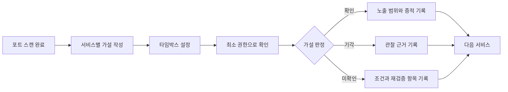

포트 스캔이 끝났다고 공격 표면을 다 본 것은 아닙니다. 열린 포트 뒤에서 어떤 서비스가 어떤 정보와 권한을 내어주는지 확인해야 다음 진단 순서를 정할 수 있습니다. 이 글은 SMB, LDAP, SNMP, MSSQL, NFS의 초기 열거를 빠뜨리지 않기 위한 플레이북이며, 모든 확인은 **사전에 승인된 대상과 교전규칙(RoE) 안에서만** 수행합니다.

---

## 1. 스캔 다음에 열거를 시작하는 방법

**원리**: 스캔이 건물의 문을 두드려 열려 있는지 확인하는 일이라면, 열거(Enumeration)는 열린 문 옆의 문패를 읽고 안내도를 살펴 안의 구조를 추측하는 일입니다. 포트 번호만 기록하는 데서 멈추지 않고 서비스 버전, 인증 방식, 공개된 자원, 실제 접근 권한을 확인해 "무엇을 더 검증할 가치가 있는가"를 판단하는 단계입니다.

이 블로그의 웹 취약점 "정찰" 글이 도메인·서브도메인·HTTP 헤더 같은 웹 공격 표면을 다룬다면, 이 글은 포트 스캔 뒤에 만나는 네트워크·호스트 수준 서비스인 SMB, LDAP, SNMP, MSSQL, NFS를 다룹니다. 둘은 서로 보완 관계지만 관찰 대상과 체크리스트가 다릅니다.

열거를 시작하기 전에 프로토콜별 타임박스를 정합니다. 예를 들어 각 서비스에 10~15분의 1차 확인 시간을 배정하고, 의미 있는 노출이나 권한 단서가 있을 때만 시간을 연장하면 한 서비스에 매달려 나머지를 놓치는 일을 줄일 수 있습니다. 시간은 정답이 아니라 대상 수와 RoE에 맞추는 예산이며, 만료되면 "확인", "기각", "미확인" 중 하나로 현재 결론을 남깁니다.

열거 중에는 도구 출력만 모으지 말고 가설을 기록합니다. "SMB 익명 세션으로 공유 목록을 볼 수 있다"처럼 검증 가능한 문장으로 적고, 관찰 결과와 판정을 붙이면 다음 단계의 이유가 남습니다.

| 시각 | 서비스 | 가설 | 관찰 | 판정 | 다음 행동 |
| --- | --- | --- | --- | --- | --- |
| 10:10 | SMB | 인증 없이 공유 목록 조회 가능 | 세션은 열렸으나 목록 조회 거부 | 기각 | 인증 경로 확인 |
| 10:18 | LDAP | 익명 bind 후 디렉터리 검색 가능 | rootDSE만 조회 가능 | 부분 확인 | 노출 범위 기록 후 종료 |

- 체크 포인트:
  - 스캔 결과에서 서비스와 예상 프로토콜을 연결하되 포트 번호만으로 단정하지 않았는지
  - 각 프로토콜의 1차 확인 시간과 연장 조건을 미리 정했는지
  - 가설마다 관찰 결과와 확인·기각·미확인 판정을 남겼는지
  - 실패와 접근 거부도 "취약하지 않음"으로 과대 해석하지 않고 당시 조건과 함께 기록했는지
- 참고: [Nmap — NSE Documentation](https://nmap.org/book/nse.html), [HackTricks — Network Services Pentesting](https://book.hacktricks.xyz/network-services-pentesting)

## 2. SMB — 익명 접근, 공유 권한, 프로토콜 보호

**원리**: SMB 열거는 공동 문서함의 안내판과 열쇠 상태를 확인하는 일과 비슷합니다. null session은 사용자 이름과 암호 없이 연결을 시도하는 것이며, 연결 자체가 성립해도 공유 목록 조회나 파일 접근 권한까지 자동으로 주어지는 것은 아닙니다.

먼저 인증 없는 연결이 허용되는지 확인하고, 가능하다면 노출되는 공유 이름과 설명을 기록합니다. 각 공유는 목록 조회 가능 여부와 읽기·쓰기 권한을 따로 판단해야 합니다. 쓰기 권한은 RoE가 허용한 전용 위치에서만 무해한 임시 파일로 검증하고, 운영 파일을 수정하거나 덮어쓰지 않습니다.

그다음 협상된 SMB 버전과 서명(signing) 설정을 확인합니다. SMBv1 사용 여부는 오래된 프로토콜 노출로 기록하고, SMB 서명은 필수·지원하지만 선택·비활성 중 어느 상태인지 구분합니다. "서명 지원"을 "서명 필수"와 같은 의미로 적으면 중간자 공격 저항성을 잘못 평가할 수 있습니다.

- 체크 포인트:
  - null session 연결 성공 여부와 실제 열거 가능 범위를 분리해 기록했는지
  - 공유별 목록 조회·읽기·쓰기 권한을 각각 확인했는지
  - 쓰기 검증이 승인된 임시 경로와 무해한 파일에 한정됐는지
  - SMBv1 활성 여부와 협상 가능한 최신 버전을 확인했는지
  - SMB 서명이 필수인지, 선택 사항인지, 비활성인지 구분했는지
- 참고: [Microsoft — SMB security enhancements](https://learn.microsoft.com/windows-server/storage/file-server/smb-security), [HackTricks — SMB](https://book.hacktricks.xyz/network-services-pentesting/pentesting-smb)

## 3. LDAP — anonymous bind와 디렉터리 노출 범위

**원리**: LDAP는 조직의 전화번호부와 비슷해서, 로비에서 안내를 받을 수 있다고 직원 명부 전체를 열람할 수 있는 것은 아닙니다. anonymous bind 성공 여부, rootDSE 같은 기본 메타데이터 조회, 실제 디렉터리 트리 검색 권한을 서로 나눠 확인해야 합니다.

먼저 자격증명 없이 bind가 허용되는지 확인합니다. 성공했다면 naming context, 지원 기능 같은 서버 메타데이터와 사용자·그룹·컴퓨터·조직 단위 등 디렉터리 항목 중 어디까지 검색되는지 최소 질의로 범위를 좁힙니다. anonymous bind가 실패해도 rootDSE 일부가 공개될 수 있고, 반대로 bind 성공 메시지만으로 유의미한 디렉터리 정보가 노출됐다고 결론 내릴 수도 없습니다.

노출된 속성은 계정명, 그룹 구성, 설명 필드, 이메일, 호스트 정보처럼 이후 경로를 추측하게 하는 정보가 있는지 분류합니다. 값 전체를 불필요하게 수집하지 말고, 노출 유형과 대표 증적만 보존해 개인정보 수집을 최소화합니다.

- 체크 포인트:
  - anonymous bind 허용 여부와 익명 검색 허용 여부를 별도로 확인했는지
  - rootDSE에서 보이는 naming context와 서버 기능 범위를 기록했는지
  - 검색 가능한 base DN과 객체·속성 범위를 최소 질의로 확인했는지
  - 사용자·그룹·호스트·설명 필드 등 민감한 구조 정보의 노출 정도를 분류했는지
  - LDAP, LDAPS, StartTLS 등 관찰한 전송 보호 상태를 함께 기록했는지
- 참고: [Microsoft — Anonymous LDAP operations](https://learn.microsoft.com/troubleshoot/windows-server/active-directory/anonymous-ldap-operations-active-directory-disabled), [HackTricks — LDAP](https://book.hacktricks.xyz/network-services-pentesting/pentesting-ldap)

## 4. SNMP — community string과 평문 관리 정보

**원리**: SNMP v1/v2c의 community string은 관리 장비에 건네는 공동 출입 암호와 비슷합니다. `public`, `private` 같은 기본값이나 추측하기 쉬운 문자열이 남아 있으면 여러 사람이 같은 암호로 장비 정보를 읽거나, 권한에 따라 설정 변경까지 시도할 수 있고 그 문자열 자체도 암호화되지 않은 채 네트워크를 지납니다.

승인된 소수의 기본·조직 지정 후보만으로 응답 여부를 확인하고, 무차별 대입은 별도 허가와 제한이 없으면 수행하지 않습니다. 응답이 오면 읽기 전용인지 쓰기 권한까지 있는지 구분하되, 쓰기 권한은 실제 SET 요청으로 변경하지 않고 설정과 승인된 안전한 방법으로 확인합니다.

읽기 권한만 있어도 시스템 설명, 인터페이스, IP·라우팅 정보, 프로세스나 설치 소프트웨어 같은 운영 정보가 노출될 수 있습니다. 따라서 "설정 변경 불가"를 "영향 없음"으로 적지 말고, 실제로 읽힌 관리 정보의 범위를 기준으로 평가합니다. 가능하면 인증과 암호화를 제공하는 SNMPv3 사용 여부도 함께 확인합니다.

- 체크 포인트:
  - `public`, `private` 등 기본·추측 가능한 community string의 사용 여부를 제한된 횟수로 확인했는지
  - SNMP v1/v2c가 community string과 응답 데이터를 평문으로 전송한다는 점을 기록했는지
  - 응답한 community의 읽기·쓰기 권한을 구분하되 운영 설정을 변경하지 않았는지
  - 시스템·인터페이스·라우팅·프로세스 등 실제 노출 정보 범위를 분류했는지
  - SNMPv3와 인증·암호화 사용 여부를 확인했는지
- 참고: [CISA — Reducing the Risk of SNMP Abuse](https://www.cisa.gov/news-events/alerts/2017/06/15/reducing-risk-snmp-abuse), [HackTricks — SNMP](https://book.hacktricks.xyz/network-services-pentesting/pentesting-snmp)

## 5. MSSQL — 기본 계정, 인증 정책, 확장 기능

**원리**: MSSQL 열거는 데이터베이스의 현관 열쇠와 관리실 스위치를 함께 확인하는 일입니다. 기본 시스템 관리자 계정인 `sa`가 활성화돼 있고 약한 암호를 쓰면 데이터베이스 전체 권한으로 이어질 수 있으며, `xp_cmdshell` 같은 확장 저장 프로시저는 데이터베이스 경계를 넘어 운영체제 명령 실행 통로가 될 수 있습니다.

`sa` 활성 여부와 인증 모드, 잠금 정책을 먼저 확인하고, 약한 인증 점검은 승인된 계정·후보 수·속도 안에서만 수행합니다. 로그인 실패를 대량으로 발생시키는 방식은 계정 잠금이나 서비스 영향을 만들 수 있으므로 기본 열거 단계의 범위를 넘어섭니다.

`xp_cmdshell`은 최신 MSSQL에서 기본적으로 비활성화되는 기능이지만, 활성화되면 호출 권한과 서비스 계정 또는 프록시 계정의 운영체제 권한에 따라 영향이 커집니다. 이 단계에서는 구성 메타데이터로 활성화 여부와 접근 권한만 확인하고, 기능을 켜거나 실제 운영체제 명령을 실행하지 않습니다. 비슷한 이유로 OLE Automation, CLR 같은 외부 실행·연동 기능도 발견 사실과 설정 상태까지만 기록합니다.

- 체크 포인트:
  - `sa` 계정 활성 여부와 SQL Server 인증 사용 여부를 확인했는지
  - 약한 인증 확인이 RoE의 계정·시도 횟수·속도 제한을 지켰는지
  - 로그인 성공 계정의 서버·데이터베이스 역할을 최소 질의로 확인했는지
  - `xp_cmdshell`의 활성화 여부만 확인하고 켜거나 명령을 실행하지 않았는지
  - 데이터베이스 외부로 이어지는 기능과 SQL Server 서비스 계정 권한을 위험 맥락으로 기록했는지
- 참고: [Microsoft — xp_cmdshell server configuration option](https://learn.microsoft.com/sql/database-engine/configure-windows/xp-cmdshell-server-configuration-option), [HackTricks — MSSQL](https://book.hacktricks.xyz/network-services-pentesting/pentesting-mssql-microsoft-sql-server)

## 6. NFS — exports 범위와 안전한 마운트 확인

**원리**: NFS export는 서버의 디렉터리를 네트워크에 공유하는 창구와 같습니다. 창구가 어느 클라이언트에게 열려 있는지뿐 아니라, 서버가 원격 root 사용자를 낮은 권한으로 바꾸는 `root_squash`를 적용하는지가 피해 범위를 좌우합니다.

먼저 공개된 export 경로와 허용 클라이언트 범위, 읽기·쓰기 옵션을 확인합니다. 모든 호스트에 열린 export나 과도하게 넓은 네트워크 대역은 접근 통제가 약한 징후입니다. `no_root_squash`가 설정되면 원격 root의 권한이 서버 파일 권한에 그대로 반영될 수 있으므로, 쓰기 가능한 export와 결합될 때 특히 위험합니다.

마운트 가능 여부는 승인된 테스트 호스트에서 우선 읽기 전용으로 확인하고, 보이는 디렉터리와 대표 파일의 권한만 기록합니다. 쓰기 검증이 필요하면 SMB와 마찬가지로 지정된 임시 위치에서만 수행합니다. NFSv4는 pseudo-filesystem을 사용해 전통적인 export 조회 결과가 비어 있어도 마운트가 가능할 수 있으므로, 한 도구의 빈 결과만으로 서비스를 기각하지 않습니다.

- 체크 포인트:
  - export 경로와 허용 호스트·네트워크 범위가 필요 이상으로 넓지 않은지
  - 읽기 전용·읽기/쓰기 설정과 실제 마운트 가능 여부를 구분했는지
  - `root_squash`, `no_root_squash`, `all_squash` 등 사용자 매핑 설정을 확인했는지
  - 최초 마운트를 읽기 전용으로 수행하고 운영 파일을 수정하지 않았는지
  - NFS 버전과 NFSv4 pseudo-filesystem 특성을 고려해 결과를 해석했는지
- 참고: [Red Hat — NFS server configuration](https://docs.redhat.com/en/documentation/red_hat_enterprise_linux/9/html/managing_file_systems/exporting-nfs-shares_managing-file-systems), [HackTricks — NFS](https://book.hacktricks.xyz/network-services-pentesting/nfs-service-pentesting)

---

서비스 열거의 목표는 가능한 명령을 많이 실행하는 것이 아니라, 제한된 시간 안에 가설을 확인하거나 기각하고 다음 판단에 필요한 근거를 남기는 것입니다. 각 프로토콜에서 인증 없는 접근, 노출 범위, 실제 권한, 보호 설정을 같은 순서로 기록하면 도구가 바뀌어도 재현 가능한 플레이북이 됩니다.
