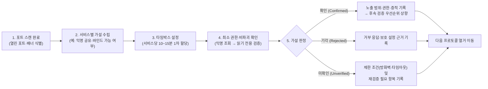

> [!summary] ⏱️ 5초 핵심 요약
> - **한 줄 비유**: 포트 스캔이 **건물의 어느 문이 열려 있는지 손잡이를 당겨보는 일**이라면, 서비스 열거(Enumeration)는 열린 문 안의 **안내판·방명록·열쇠함을 살펴 누구에게 어디까지 출입이 허락되는지 확인하는 일**입니다.
> - **핵심 원리**: 열린 포트 번호만 보고 넘어가지 않고, 프로토콜별로 **① 익명/기본 인증 허용 여부 → ② 노출된 목록·메타데이터 범위 → ③ 실제 읽기/쓰기·명령 실행 권한 → ④ 전송 보호 설정(서명·암호화)**을 타임박스와 가설 기반으로 검증합니다.
> - **핵심 체크 포인트**: 모든 열거는 **사전 승인된 스코프와 RoE 안에서 비파괴적(읽기 전용 우선) 방식**으로 수행하며, "연결 성공"과 "실제 민감 자원 접근 가능"을 엄격히 구분해 기록해야 합니다.

포트 스캔이 끝났다고 공격 표면을 다 본 것은 아닙니다. 열린 포트 뒤에서 어떤 서비스가 어떤 정보와 권한을 내어주는지 확인해야 다음 진단 순서를 정할 수 있습니다. 이 글은 SMB, LDAP, SNMP, MSSQL, NFS의 초기 열거를 빠뜨리지 않기 위한 플레이북이며, 모든 확인은 **사전에 승인된 대상과 교전규칙(RoE) 안에서만** 수행합니다.



---

## 한눈에 보는 5대 네트워크 프로토콜 열거 비교표

| 프로토콜 (주요 포트) | 한 줄 비유 | 1차 핵심 확인 가설 | 자주 하는 오판 (주의점) | 핵심 보호·방어 설정 |
|---|---|---|---|---|
| **SMB** (`445/tcp`, `139/tcp`) | 사내 공동 문서함과 자물쇠 상태 확인 | Null session 허용 여부, 공유 폴더 목록 및 읽기/쓰기 권한 | 세션 연결 성공만으로 공유 폴더 열람이 가능하다고 단정, '서명 지원'을 '서명 필수'와 혼동 | SMBv1 비활성화, **SMB Signing 필수(Required)**, 익명 접근 차단 |
| **LDAP** (`389/tcp`, `636/tcp`, `3268/tcp`) | 사내 내선 전화번호부 및 조직도 열람 | Anonymous bind 허용 여부, `rootDSE` 및 하위 객체(계정·그룹·설명) 검색 범위 | `rootDSE` 메타데이터 응답만으로 전체 디렉터리 트리가 털렸다고 과장 | 익명 바인드 차단, LDAPS/StartTLS 및 LDAP 서명·채널 바인딩 강제 |
| **SNMP** (`161/udp`) | 장비 관리실 공동 출입 암구호 확인 | `public`/`private` 등 기본 Community String 응답 및 MIB 정보 노출 범위 | 읽기 전용(RO)이라고 '영향 없음'으로 과소평가 (라우팅·프로세스·설치 SW 대량 노출 가능) | SNMPv1/v2c 중지 및 **SNMPv3(AuthPriv: 인증+암호화)** 전환, 관리망 ACL |
| **MSSQL** (`1433/tcp`, `1434/udp`) | 금고 현관 열쇠(`sa`)와 관리실 직통 스위치(`xp_cmdshell`) 확인 | SQL 인증 활성 여부, 승인 범위 내 기본 계정 점검, `xp_cmdshell` 등 확장 기능 설정 상태 | 무리한 대입으로 계정 잠금 유발, 승인 없이 `xp_cmdshell`을 임의로 활성화하거나 OS 명령 실행 | Windows 통합 인증 우선, `sa` 비활성/강력 암호, **`xp_cmdshell` 비활성 유지**, 서비스 계정 최소 권한 |
| **NFS** (`2049/tcp·udp`, `111/tcp·udp`) | 외부에 열어둔 원격 공유 창구와 방문자 신분 변환 규칙 | 공개된 `exports` 목록, 허용 대역, `no_root_squash` 설정 여부 | `showmount -e` 결과가 비어 있다고 NFSv4 pseudo-filesystem 마운트 가능성까지 조기 기각 | 허용 클라이언트 IP 엄격 제한, **`root_squash` 기본 적용**, 불필요한 쓰기(`rw`) 제거 |

---

## 1. 스캔 다음에 열거를 시작하는 방법

**💡 한 줄 비유**: 포트 스캔이 건물의 문을 하나씩 두드려 **문이 열려 있는지 확인하는 일**이라면, 열거(Enumeration)는 열린 문 옆의 **문패와 로비 안내도를 읽고 어디까지 들어갈 수 있는지 파악하는 일**입니다.

### 핵심 원리
- **웹 정찰과 네트워크 서비스 열거의 차이**: 이 블로그의 웹 취약점 "정찰" 글이 도메인·서브도메인·HTTP 헤더 같은 웹 공격 표면을 다룬다면, 이 글은 포트 스캔 뒤에 만나는 네트워크·호스트 수준 서비스인 **SMB, LDAP, SNMP, MSSQL, NFS**를 다룹니다. 둘은 서로 보완 관계지만 관찰 대상과 체크리스트가 다릅니다.
- **타임박스(Timeboxing) 운영**: 열거를 시작하기 전에 프로토콜별 타임박스를 정합니다. 예를 들어 각 서비스에 **10~15분의 1차 확인 시간**을 배정하고, 의미 있는 노출이나 권한 단서가 있을 때만 시간을 연장하면 한 서비스에 매달려 나머지를 놓치는 일을 줄일 수 있습니다.
- **가설 기반 기록**: 도구 출력만 무작정 복사해 모으지 말고 검증 가능한 가설을 기록합니다. 시간이 만료되면 현재 상태를 **"확인(Confirmed)", "기각(Rejected)", "미확인(Unverified)"** 중 하나로 판정해 남겨야 다음 단계의 근거가 분명해집니다.

### 실무 열거 로그 작성 예시

| 시각 | 대상 및 서비스 | 검증 가설 | 관찰 결과 | 판정 | 다음 행동 |
|---|---|---|---|---|---|
| 10:10 | `10.20.30.11:445` (SMB) | 인증 없이(Null session) 공유 목록 조회 가능 | 세션 연결은 성립했으나 `STATUS_ACCESS_DENIED`로 공유 목록 조회 거부 | **기각** | 사전 제공된 Grey Box 테스트 계정으로 재확인 |
| 10:18 | `10.20.30.12:389` (LDAP) | 익명 bind 후 디렉터리 객체 검색 가능 | `rootDSE`(namingContexts 등)만 조회되고 하위 트리 검색은 거부됨 | **부분 확인** | 도메인 명칭(`DC=corp,DC=example`) 기록 후 종료 |

### 체크 포인트
- 스캔 결과에서 서비스와 예상 프로토콜을 연결하되 **단순 포트 번호만으로 서비스를 단정하지 않았는가?** (비표준 포트 및 배너 확인)
- 각 프로토콜의 **1차 확인 타임박스와 시간 연장 조건**을 미리 정했는가?
- 가설마다 관찰 결과와 **확인·기각·미확인 판정**을 명확히 남겼는가?
- 연결 실패나 접근 거부를 무조건 "취약하지 않음"으로 과대 해석하지 않고 **당시 테스트 조건(무인증 등)과 함께 기록**했는가?
- 참고: [Nmap — NSE Documentation](https://nmap.org/book/nse.html), [HackTricks — Network Services Pentesting](https://book.hacktricks.xyz/network-services-pentesting)

---

## 2. SMB — 익명 접근, 공유 권한, 프로토콜 보호

**💡 한 줄 비유**: SMB 열거는 사내 공동 문서함의 **로비 출입문(세션 연결), 서랍 목록표(공유 조회), 서랍 속 문서 열람·작성 권한(읽기/쓰기), 그리고 배달원 신원 확인 도장(SMB 서명)**을 차례대로 점검하는 일입니다.

### 단계별 확인 절차와 명령어 예시
1. **익명 접근(Null Session / Guest) 및 공유 목록 확인**:
   - 사용자 이름과 암호 없이 연결을 시도하는 Null session이 성립하는지, 혹은 Guest 계정이 활성화되어 있는지 확인합니다.
   - *주의*: **세션 연결 자체가 성립해도 공유 목록 조회나 파일 접근 권한까지 자동으로 주어지는 것은 아닙니다.**
   ```bash
   # 익명(Null session)으로 공유 목록 조회 시도
   smbclient -N -L //10.20.30.11/

   # Nmap NSE로 SMB 버전 및 서명(Signing) 상태 비파괴 확인
   nmap -p 445 --script smb-protocols,smb2-security-mode 10.20.30.11
   ```
2. **공유별 권한 분리 검증 (목록 조회 vs 읽기 vs 쓰기)**:
   - 각 공유(`IPC$`, `ADMIN$`, `C$`, 사용자 정의 공유 등)마다 목록 조회 가능 여부와 실제 파일 읽기·쓰기 권한을 따로 판단합니다.
   - **쓰기 권한 검증 원칙**: RoE가 허용한 전용 테스트 위치에서만 무해한 빈 임시 파일로 검증하고 즉시 정리하며, **운영 파일을 절대 수정하거나 덮어쓰지 않습니다.**
3. **프로토콜 버전 및 SMB 서명(Signing) 확인**:
   - **SMBv1** 활성 여부는 오래된 취약 프로토콜 노출로 기록합니다.
   - **SMB 서명(Signing)**은 **필수(`Message signing enabled and required`)**, **지원하지만 선택(`enabled but not required`)**, **비활성(`disabled`)** 중 어느 상태인지 정확히 구분합니다. "서명 지원(선택)"을 "서명 필수"와 같은 의미로 적으면 NTLM 릴레이 등 중간자 공격 저항성을 잘못 평가하게 됩니다.

### 체크 포인트
- Null session 연결 성공 여부와 **실제 공유 목록·파일 열거 가능 범위**를 분리해 기록했는가?
- 공유별 **목록 조회·읽기·쓰기 권한**을 각각 확인했는가?
- 쓰기 검증이 **승인된 임시 경로와 무해한 파일**에 한정되었는가?
- **SMBv1 활성 여부**와 협상 가능한 최신 버전(SMBv2/v3)을 확인했는가?
- SMB 서명이 **필수(Required)인지, 선택 사항(Optional)인지, 비활성인지** 명확히 구분했는가?
- 참고: [Microsoft — SMB security enhancements](https://learn.microsoft.com/windows-server/storage/file-server/smb-security), [HackTricks — SMB](https://book.hacktricks.xyz/network-services-pentesting/pentesting-smb)

---

## 3. LDAP — anonymous bind와 디렉터리 노출 범위

**💡 한 줄 비유**: LDAP는 조직의 내선 전화번호부와 같아서, **로비 안내데스크에 말을 걸 수 있다(`rootDSE` 조회)고 해서 전 직원 인사기록 카드 전체(하위 디렉터리 트리)를 열람할 수 있는 것은 아닙니다.**

### 단계별 확인 절차와 명령어 예시
1. **`rootDSE` 메타데이터 조회 vs Anonymous Bind 구분**:
   - 자격증명 없이(`-x -D "" -w ""`) 바인드가 허용되는지, 기본 서버 메타데이터인 `rootDSE`가 응답하는지 확인합니다.
   - `rootDSE`에서 `defaultNamingContext`(예: `DC=corp,DC=example,DC=com`), 지원 컨트롤, 서버 기능 범위를 먼저 파악합니다.
   ```bash
   # 1단계: rootDSE 기본 메타데이터 최소 질의 (base 스코프)
   ldapsearch -x -H ldap://10.20.30.12 -b "" -s base "(objectClass=*)" namingContexts supportedLDAPVersion

   # 2단계: 식별된 Base DN에 대해 익명 하위 검색 가능 여부 제한 확인 (-z 5로 결과 수 제한)
   ldapsearch -x -H ldap://10.20.30.12 -b "DC=corp,DC=example,DC=com" -z 5 "(objectClass=user)" sAMAccountName description
   ```
2. **디렉터리 트리 노출 범위와 최소 수집 원칙**:
   - Anonymous bind가 실패해도 `rootDSE` 일부가 공개될 수 있고, 반대로 bind 성공 메시지만으로 유의미한 디렉터리 정보가 노출됐다고 결론 내릴 수 없습니다.
   - 검색이 허용된다면 계정명(`sAMAccountName`, `uid`), 그룹 구성, **설명 필드(`description` — 종종 초기 비밀번호나 역할 메모가 노출됨)**, 이메일, 호스트 정보처럼 후속 공격 경로를 추측하게 하는 속성이 보이는지 분류합니다.
   - **개인정보 최소 수집**: 전체 덤프를 무분별하게 뜨지 말고(`-z` 옵션 등으로 제한), 노출 속성 유형과 최소 대표 증적만 보존합니다.
3. **전송 보호 상태 기록**:
   - 평문 `LDAP(389)`, `LDAPS(636)`, `StartTLS` 지원 여부 및 LDAP 서명·채널 바인딩 요구 상태를 함께 기록합니다.

### 체크 포인트
- **Anonymous bind 허용 여부**와 **실제 익명 디렉터리 검색 허용 여부**를 별도로 확인했는가?
- `rootDSE`에서 보이는 `namingContexts`와 서버 기능 범위를 기록했는가?
- 검색 가능한 Base DN과 객체·속성 범위를 **최소 질의(결과 개수 제한)**로 확인했는가?
- 사용자·그룹·호스트·`description`(설명) 필드 등 민감한 구조 정보의 노출 정도를 분류했는가?
- `LDAP`, `LDAPS`, `StartTLS` 등 관찰한 전송 보호 상태를 함께 기록했는가?
- 참고: [Microsoft — Anonymous LDAP operations](https://learn.microsoft.com/troubleshoot/windows-server/active-directory/anonymous-ldap-operations-active-directory-disabled), [HackTricks — LDAP](https://book.hacktricks.xyz/network-services-pentesting/pentesting-ldap)

---

## 4. SNMP — community string과 평문 관리 정보

**💡 한 줄 비유**: SNMP v1/v2c의 Community String은 네트워크 장비 관리실에 들어갈 때 대는 **평문 공동 암구호**와 같습니다. `public`이나 `private` 같은 기본 암구호가 그대로 남아 있으면 누구나 장비 내부의 지도와 실행 중인 프로그램 목록을 읽어갈 수 있습니다.

### 단계별 확인 절차와 명령어 예시
1. **제한된 Community String 응답 확인**:
   - SNMP v1/v2c는 Community String과 응답 데이터를 **암호화 없이 평문으로 전송**합니다.
   - 사전 승인된 소수의 기본값(`public`, `private`) 또는 조직 지정 후보만으로 응답 여부를 확인하며, 무차별 대입(Brute-force)은 별도 허가와 속도 제한이 없으면 수행하지 않습니다.
   ```bash
   # 단일 기본 OID(sysDescr: 1.3.6.1.2.1.1.1.0)로 읽기 응답 여부만 가볍게 확인
   snmpget -v2c -c public 10.20.30.13 1.3.6.1.2.1.1.1.0

   # 응답 확인 시 시스템 기본 정보 트리(system MIB) 범위 확인
   snmpwalk -v2c -c public 10.20.30.13 1.3.6.1.2.1.1
   ```
2. **읽기 전용(RO) 노출 가치 평가와 쓰기(RW) 안전 확인**:
   - **읽기 권한만 있어도 영향이 큼**: 시스템 설명(`sysDescr`), 네트워크 인터페이스·IP·라우팅 테이블, 실행 중인 프로세스 목록(`hrSWRunName` — 명령줄 인자에 비밀번호가 노출되기도 함), 설치된 소프트웨어 버전 등 핵심 운영 정보가 대량 노출될 수 있습니다. 따라서 **"설정 변경 불가(RO)"를 "보안 영향 없음"으로 적지 말고**, 실제 읽힌 관리 정보의 범위를 기준으로 위험도를 평가합니다.
   - **쓰기 권한 검증 주의**: 실제 `snmpset` 요청으로 운영 장비 설정을 바꾸지 않고, 장비 설정 파일 검토나 승인된 안전한 방법으로만 확인합니다.
3. **SNMPv3 전환 여부 확인**:
   - 사용자 기반 인증과 암호화(`authPriv`)를 제공하는 **SNMPv3** 사용 여부를 함께 점검합니다.

### 체크 포인트
- `public`, `private` 등 기본·추측 가능한 Community String의 사용 여부를 **제한된 횟수**로 확인했는가?
- SNMP v1/v2c가 **Community String과 응답 데이터를 평문으로 전송**한다는 점을 위험 맥락으로 기록했는가?
- 응답한 Community의 읽기·쓰기 권한을 구분하되 **실제 운영 장비 설정을 변경(SET)하지 않았는가?**
- 시스템·인터페이스·라우팅·프로세스 목록 등 **실제 노출된 MIB 정보 범위**를 분류했는가?
- 인증과 암호화를 지원하는 **SNMPv3 사용 여부**를 확인했는가?
- 참고: [CISA — Reducing the Risk of SNMP Abuse](https://www.cisa.gov/news-events/alerts/2017/06/15/reducing-risk-snmp-abuse), [HackTricks — SNMP](https://book.hacktricks.xyz/network-services-pentesting/pentesting-snmp)

---

## 5. MSSQL — 기본 계정, 인증 정책, 확장 기능

**💡 한 줄 비유**: MSSQL 열거는 데이터베이스의 **현관 마스터키(`sa` 계정) 관리 상태**와, 금고 안에서 건물 전체 제어실로 바로 통하는 **직통 비밀 통로(`xp_cmdshell` 등 확장 기능)가 열려 있는지**를 함께 확인하는 일입니다.

### 단계별 확인 절차와 쿼리 예시
1. **인증 모드 및 기본 계정(`sa`) 정책 확인**:
   - SQL Server 인증(혼합 모드) 활성 여부, 기본 시스템 관리자 계정인 `sa` 활성 여부, 계정 잠금 정책을 먼저 확인합니다.
   - *주의*: 로그인 실패를 대량으로 발생시키는 패스워드 대입은 계정 잠금이나 운영 장애를 유발할 수 있으므로, 반드시 **RoE가 허용한 계정·시도 횟수·속도 안에서만** 수행합니다.
2. **현재 계정의 권한 및 확장 저장 프로시저(`xp_cmdshell` 등) 상태 확인 (비파괴 메타데이터 조회)**:
   - 로그인에 성공한 계정이 있다면 데이터베이스 서버 역할(`sysadmin` 여부 등)과 확장 기능 활성화 상태를 **카탈로그 뷰(`sys.configurations`) 질의만으로 안전하게 확인**합니다.
   - `xp_cmdshell`은 최신 MSSQL에서 기본 비활성화되어 있으나, 켜져 있을 경우 DB 경계를 넘어 SQL Server 서비스 계정(또는 프록시 계정) 권한으로 OS 명령을 실행하는 통로가 됩니다.
   - **절대 주의**: 초기 열거 단계에서는 설정 메타데이터로 활성화 여부와 접근 권한만 확인하며, **`sp_configure`로 기능을 임의로 켜거나 실제 운영체제 명령을 실행하지 않습니다.** OLE Automation, CLR 통합, Linked Server 등도 설정 상태까지만 기록합니다.
   ```sql
   -- 1. 현재 로그인 계정 및 sysadmin 역할 여부 최소 확인
   SELECT SYSTEM_USER AS CurrentLogin, IS_SRVROLEMEMBER('sysadmin') AS IsSysAdmin;

   -- 2. xp_cmdshell, Ole Automation Procedures, clr enabled 활성화 상태만 읽기 전용 조회
   SELECT name, value, value_in_use
   FROM sys.configurations
   WHERE name IN ('xp_cmdshell', 'Ole Automation Procedures', 'clr enabled');
   ```

### 체크 포인트
- `sa` 계정 활성 여부와 **SQL Server 인증(혼합 모드) 사용 여부**를 확인했는가?
- 약한 인증 확인이 **RoE의 계정·시도 횟수·속도 제한**을 엄격히 지켰는가?
- 로그인 성공 계정의 서버·데이터베이스 역할을 **최소 읽기 질의**로 확인했는가?
- `xp_cmdshell` 등의 **활성화 상태(`value_in_use`)만 확인**하고, 기능을 임의로 켜거나 OS 명령을 실행하지 않았는가?
- 데이터베이스 외부로 이어지는 확장 기능(OLE, CLR, Linked Server)과 **SQL Server 서비스 실행 계정 권한**을 위험 맥락으로 함께 기록했는가?
- 참고: [Microsoft — xp_cmdshell server configuration option](https://learn.microsoft.com/sql/database-engine/configure-windows/xp-cmdshell-server-configuration-option), [HackTricks — MSSQL](https://book.hacktricks.xyz/network-services-pentesting/pentesting-mssql-microsoft-sql-server)

---

## 6. NFS — exports 범위와 안전한 마운트 확인

**💡 한 줄 비유**: NFS export는 서버의 특정 폴더를 네트워크에 열어둔 **외부 공유 창구**입니다. 창구가 **아무에게나(`*`) 열려 있는지**뿐 아니라, 창구로 들어온 원격 관리자(`root`)의 계급장을 **일반 방문객(`nobody`)으로 강등시키는 안전장치(`root_squash`)가 켜져 있는지**가 피해 규모를 결정합니다.

### 단계별 확인 절차와 명령어 예시
1. **Export 목록과 허용 대역 확인**:
   - 공개된 export 경로와 허용 클라이언트 IP/CIDR 범위를 확인합니다. 모든 호스트(`*` 또는 `everyone`)에 열린 export나 과도하게 넓은 대역은 접근 통제 미흡 징후입니다.
   ```bash
   # NFS 서버에 공개된 export 경로 및 허용 호스트 목록 조회
   showmount -e 10.20.30.15

   # Nmap NSE로 export 목록 및 마운트 관련 상세 옵션 확인
   nmap -p 111,2049 --script nfs-showmount,nfs-ls 10.20.30.15
   ```
2. **사용자 매핑(`root_squash` vs `no_root_squash`) 및 안전한 읽기 전용 마운트**:
   - **`root_squash` (기본 권장)**: 원격 클라이언트의 `root(UID 0)` 요청을 서버의 낮은 권한 계정(`nfsnobody`/`nobody`)으로 매핑해 보호합니다.
   - **`no_root_squash` (매우 위험)**: 원격 `root`의 권한이 서버 파일시스템에 그대로 반영됩니다. 쓰기 가능한(`rw`) export와 결합되면 공격자가 SUID 바이너리 생성이나 핵심 설정 변조로 서버 전체 권한을 장악할 수 있습니다.
   - **안전한 마운트 원칙**: 마운트 가능 여부는 승인된 테스트 호스트에서 **반드시 읽기 전용(`-o ro,nosuid,nodev`)으로 먼저 확인**하고, 보이는 디렉터리와 대표 파일의 권한(UID/GID)만 기록합니다.
   ```bash
   # 승인된 테스트 호스트에서 읽기 전용(ro) 및 안전 옵션으로 마운트 검증
   mkdir -p /mnt/nfs_ro_test
   mount -t nfs -o ro,nosuid,nodev 10.20.30.15:/srv/shared /mnt/nfs_ro_test
   ls -lan /mnt/nfs_ro_test
   umount /mnt/nfs_ro_test
   ```
3. **NFSv4 Pseudo-filesystem 주의점**:
   - **NFSv4**는 루트 pseudo-filesystem(`/`) 구조를 사용하므로 전통적인 `MOUNT` 프로토콜 기반의 `showmount -e` 결과가 비어 있거나 타임아웃될 수 있습니다. 따라서 한 도구의 빈 결과만으로 서비스를 즉시 기각하지 않고, NFS 버전(v3 vs v4)과 포트(`2049` 단독 운영 여부) 특성을 함께 고려해 해석합니다.

### 체크 포인트
- Export 경로와 **허용 호스트·네트워크 범위**가 필요 이상으로 넓지 않은지(`*` 등) 확인했는가?
- 설정상의 읽기 전용(`ro`)·읽기/쓰기(`rw`) 표시와 **실제 마운트 가능 여부**를 구분했는가?
- `root_squash`, **`no_root_squash`**, `all_squash` 등 사용자 UID 매핑 설정을 확인했는가?
- 최초 마운트를 **읽기 전용(`-o ro`)으로 수행**하고 운영 파일을 수정하지 않았는가?
- **NFS 버전과 NFSv4 pseudo-filesystem 특성**을 고려해 `showmount` 빈 결과에 따른 조기 기각(오판)을 피했는가?
- 참고: [Red Hat — NFS server configuration](https://docs.redhat.com/en/documentation/red_hat_enterprise_linux/9/html/managing_file_systems/exporting-nfs-shares_managing-file-systems), [HackTricks — NFS](https://book.hacktricks.xyz/network-services-pentesting/nfs-service-pentesting)

---

## 마무리

서비스 열거의 목표는 가능한 모든 공격 명령을 무작정 실행하는 것이 아니라, **제한된 타임박스 안에 가설을 비파괴적으로 확인하거나 기각하고 다음 단계의 판단 근거를 남기는 것**입니다. 각 프로토콜에서 **① 무인증 접근 가능 여부 → ② 노출 범위 → ③ 실제 권한 → ④ 보호 설정(서명·암호화·권한 매핑)**을 일관된 순서로 기록하면, 사용하는 도구가 바뀌어도 흔들리지 않는 재현 가능한 플레이북이 됩니다.
