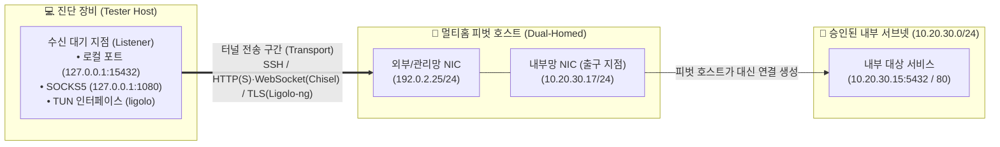
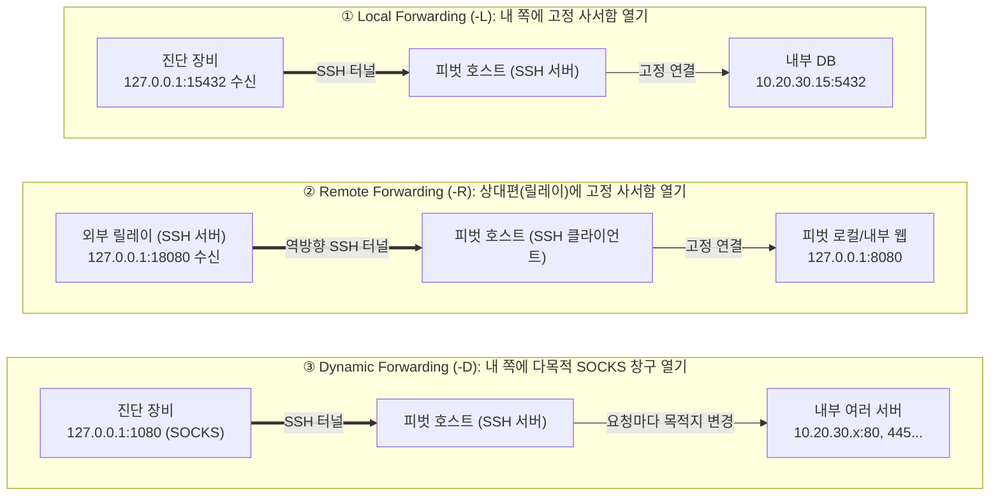

> [!summary] ⏱️ 5초 핵심 요약
> - **한 줄 비유**: 외부에서 직접 배달할 수 없는 내부망 편지를 **두 도로에 모두 접한 중간 우체국(멀티홈 피벗 호스트)**으로 먼저 보낸 뒤, 우체국이 내부 주소로 대신 배달해 주도록 **전용 사서함(포트 포워딩·SOCKS)이나 임시 전용 도로(TUN 라우팅)를 놓는 기술**입니다.
> - **핵심 원리**: 피벗팅 경로는 항상 **① 수신 대기 지점(Listener) → ② 터널 전송 구간(Transport) → ③ 실제 연결이 나가는 출구 지점(Exit)** 세 곳으로 나누어 설계해야 `127.0.0.1`이나 목적지 방향을 헷갈리지 않습니다.
> - **핵심 체크 포인트**: 고정 포트 1개면 **SSH `-L`/`-R`**, 다수 TCP 목적지면 **SOCKS(`-D` / Chisel) + Proxychains**, 애플리케이션 제약 없는 서브넷 단위 L3 접근이면 **Ligolo-ng(TUN)**를 선택하고, 작업 후 생성한 리스너·라우트·인터페이스를 반드시 원상 복구하세요.

외부에서 보이지 않는 내부 서비스를 검증하려면, 이미 접근 권한을 확보한 호스트를 중간 경유지로 삼아 진단 장비와 내부망 사이에 통신 경로를 만들어야 합니다. 터널링은 이 경로를 만들고, 피벗팅은 그 경로를 이용해 다음 네트워크 구간으로 진단 범위를 옮기는 과정입니다. 기존 클라우드 인프라의 SSRF/IMDS 글이 **단일 요청으로 내부에 한 번 도달하는 기법**을 다룬다면, 이 글은 침투 후 내부망에 지속적으로 접근할 수 있는 **네트워크 경로(터널)를 구축하는 기법**을 다룹니다. 모든 절차는 교전규칙(RoE)에 포함된 **승인된 호스트·서브넷·시간대에만** 적용합니다.



---

## 한눈에 보는 피벗팅·터널링 도구 선택 비교표

| 구분 | SSH `-L` / `-R` | SSH `-D` + Proxychains | Chisel (`R:socks` 등) | Ligolo-ng (`TUN` 인터페이스) |
|---|---|---|---|---|
| **한 줄 비유** | 단일 목적지 직통 사서함 | 편지마다 주소를 적는 창구 + 통역사 | 웹 택배 상자(HTTP/S)에 담은 사서함 | OS에 직접 개통한 내부망 전용 도로(VPN형) |
| **동작 계층·방식** | L4 단일 TCP 포트 고정 전달 | L4 SOCKS 프록시 + libc `connect()` 후킹 | HTTP/WebSocket 위 SSH 다중화 (L4/SOCKS) | L3 가상 네트워크 인터페이스(`TUN`) 라우팅 |
| **주 사용 상황** | DB·관리 웹 등 고정된 단일 포트 접근 | SSH 접속이 가능하고 여러 내부 TCP 서비스 점검 시 | SSH(22)가 막혀 있고 승인된 HTTP(S) 출구만 열려 있을 때 | Proxychains 제약 없이 여러 도구로 서브넷 전체를 다룰 때 |
| **지원 프로토콜 제약** | 지정한 TCP 포트 1개 | **TCP connect만 지원** (SYN 스캔·ICMP·일반 UDP·정적 바이너리 불가) | SOCKS 사용 시 Proxychains와 동일 제약 | OS 라우팅 기반 (유저랜드 스택 변환으로 raw SYN 스캔 등은 주의) |
| **권한·사전 요구사항** | SSH 클라이언트/서버 (`AllowTcpForwarding`) | 동적 링크 바이너리 + `proxychains4` | 양단 Chisel 바이너리 실행 | 진단 장비 `root`/관리자 권한(`TUN`/Wintun 생성), 피벗 agent는 일반 권한 가능 |

---

## 1. 피벗팅과 터널링의 기본 모델

**💡 한 줄 비유**: 터널링은 외부에서 직접 배달할 수 없는 편지를 중간 도시의 **우체국 사서함**으로 먼저 보낸 뒤, 그 우체국이 최종 주소로 다시 배달하게 만드는 통로입니다. 피벗팅은 이 사서함을 거점 삼아 새로 보이는 내부 마을(서브넷)로 진단 범위를 넓혀 가는 운영 전체를 뜻합니다.

### 핵심 원리: 3대 지점 분리 설계
경로를 설계할 때는 먼저 아래 세 지점을 분리해서 적어야 합니다. `127.0.0.1:1080`이 보인다고 해서 그것이 최종 목적지는 아닙니다. 그 포트는 편지를 받는 사서함이고, 실제 목적지는 SOCKS 요청이나 라우팅 테이블이 결정합니다.
1. **수신 대기 지점 (Listener)**: 진단 도구가 접속할 로컬 포트(`127.0.0.1:15432`), SOCKS 포트(`127.0.0.1:1080`), 또는 OS의 가상 `TUN` 인터페이스입니다.
2. **전송 구간 (Transport)**: 진단 장비와 피벗 호스트(또는 외부 릴레이) 사이를 잇는 SSH, HTTP(S)/WebSocket, TLS 암호화 터널입니다.
3. **출구 지점 (Exit / Target Resolution)**: 터널을 빠져나와 **실제 내부 목적지 서비스에 연결(`connect()`)을 여는 주체**(피벗 호스트의 내부 인터페이스)입니다.

### SOCKS 프록시(L4) vs TUN 라우팅(L3)의 결정적 차이
- **SOCKS 프록시 방식**: 편지마다 목적지를 적어 사서함 창구에 맡기는 방식입니다. 애플리케이션이 만든 TCP 연결을 하나씩 중계하므로 운영 관점에서는 **L4 연결 단위**이며, 프록시를 모르는 도구에는 `proxychains` 같은 래퍼가 필요합니다.
- **TUN 인터페이스 방식 (Ligolo-ng 등)**: 내부망으로 향하는 도로 자체를 진단 장비 OS 라우팅 테이블에 추가하는 소형 VPN과 비슷합니다. 애플리케이션을 프록시용으로 감싸지 않아도 해당 대역으로 가는 **L3 IP 패킷**이 자동으로 `TUN` 인터페이스로 들어갑니다.

### 체크 포인트
- **수신 대기 지점, 터널 전송 구간, 실제 연결이 나가는 출구 지점**을 각각 구분해 기록했는가?
- 새로 발견한 내부 대역이 **RoE의 승인 범위와 일치하는지 확인**한 뒤 경로를 추가했는가?
- 단일/소수 TCP 도구만 쓸 것인지(포트 포워딩·SOCKS), 서브넷 라우팅이 필요한지(TUN) 먼저 결정했는가?
- 터널 종료 조건과 생성한 **리스너·라우트·프로세스의 철거 절차**를 작업 전에 정리했는가?
- 참고: [OpenSSH — ssh(1)](https://man.openbsd.org/ssh), [Ligolo-ng — GitHub](https://github.com/nicocha30/ligolo-ng)

---

## 2. 멀티홈 호스트에서 내부 서브넷 식별

**💡 한 줄 비유**: 멀티홈(Multi-homed) 호스트는 **서로 다른 두 도로(외부망과 내부망)에 출입구가 각각 나 있는 건물**과 같습니다. 정문(외부망)으로 들어왔더라도 뒷문(내부 인터페이스)과 건물 안 안내도(라우팅 테이블)를 함께 읽어야 숨겨진 내부 도로망을 찾을 수 있습니다.

### 핵심 원리와 OS별 확인 명령어
중요한 것은 IP 주소 하나만 보는 게 아니라 **인터페이스 주소, 프리픽스 길이(서브넷 마스크), 직접 연결 경로(On-link), 기본 게이트웨이**를 함께 읽는 것입니다.

```bash
# [Linux] 인터페이스별 IP/프리픽스와 라우팅 테이블 확인
ip -br addr
ip route
```

```powershell
# [Windows] 인터페이스 구성(IP·DNS·게이트웨이)과 IPv4 라우팅 테이블 확인
Get-NetIPConfiguration
Get-NetRoute -AddressFamily IPv4 | Sort-Object DestinationPrefix
```

### 실무 해석 및 라우팅 충돌 주의사항
- **가상 인터페이스 오인 주의**: 예를 들어 피벗 호스트에 `192.0.2.25/24`와 `10.20.30.17/24`가 있고 라우팅 테이블에 `10.20.30.0/24`가 직접 연결로 표시된다면 후자가 내부 후보 대역입니다. 단, RFC 1918 사설 주소라는 사실만으로 진단 권한이 생기지는 않으며, VPN·Docker(`172.17.0.0/16`)·Hyper-V 같은 로컬 가상 인터페이스일 수도 있으므로 인터페이스 상태·메트릭·ARP(`ip neigh` / `Get-NetNeighbor`) 항목과 **RoE의 허용 대역**을 반드시 대조해야 합니다.
- **로컬 대역과의 라우팅 충돌(Overlapping Subnets)**: 진단 장비의 로컬 네트워크가 이미 `10.20.30.0/24`를 쓰고 있다면, 같은 목적지에 Ligolo-ng 라우트를 추가해도 **가장 긴 프리픽스 일치(Longest Prefix Match)**나 낮은 메트릭 때문에 기존 로컬 경로가 선택될 수 있습니다. 이때 무작정 기본 게이트웨이를 바꾸지 말고, 승인된 대상 호스트에 한정한 **`/32` 호스트 경로**나 별도 네트워크 네임스페이스(`ip netns`)처럼 영향 범위가 작은 방법을 사용합니다.

### 체크 포인트
- 인터페이스가 2개 이상인지, 각 주소와 프리픽스가 어떤 직접 연결 경로를 만드는지 확인했는가?
- 기본 게이트웨이와 내부 목적지별 경로를 구분하고 **가장 긴 프리픽스 일치 규칙(Longest Prefix Match)**을 고려했는가?
- Docker·루프백·비활성 가상 인터페이스를 실제 내부 업무망 연결로 오인하지 않았는가?
- 발견한 후보 대역을 스캔하기 전에 **RoE의 허용 CIDR·금지 자산·허용 시간**과 대조했는가?
- 참고: [Microsoft Learn — Get-NetIPConfiguration](https://learn.microsoft.com/powershell/module/nettcpip/get-netipconfiguration), [iproute2 — ip-route(8)](https://man7.org/linux/man-pages/man8/ip-route.8.html)

---

## 3. SSH Local·Remote·Dynamic Port Forwarding

**💡 한 줄 비유**: SSH 포워딩의 3가지 모드는 **"사서함(수신 포트)을 내 쪽에 열 것인가, 상대편에 열 것인가"** 그리고 **"배달 목적지를 하나로 고정할 것인가, 매번 바꿀 것인가"**로 구분하면 절대 헷갈리지 않습니다.



### 3가지 모드 비교 및 실전 명령어

| 모드 | 옵션 문법 | 리스너(수신) 위치 | 출구(목적지 해석) 주체 | 대표 활용 상황 |
|---|---|---|---|---|
| **Local (`-L`)** | `-L [bind:]port:dest:dport` | SSH 클라이언트 (진단 장비) | **SSH 서버** (피벗 호스트) | 진단 장비에서 피벗 너머의 단일 DB·웹 포트에 접속할 때 |
| **Remote (`-R`)** | `-R [bind:]rport:dest:dport` | **SSH 서버** (외부 릴레이) | SSH 클라이언트 (피벗 호스트) | 피벗 호스트로 인바운드 접속은 막혀 있으나 아웃바운드 SSH는 가능할 때 |
| **Dynamic (`-D`)** | `-D [bind:]port` | SSH 클라이언트 (진단 장비) | **SSH 서버** (피벗 호스트) | 여러 내부 호스트·포트를 SOCKS 프록시로 유연하게 점검할 때 |

```bash
# 1. Local Forwarding (-L): 진단 장비 127.0.0.1:15432 접속 시 -> 피벗이 10.20.30.15:5432로 연결
ssh -N -o ExitOnForwardFailure=yes \
  -L 127.0.0.1:15432:10.20.30.15:5432 pentest@pivot.example

# 2. Remote Forwarding (-R): 피벗에서 외부 릴레이로 역방향 연결 후 -> 릴레이의 127.0.0.1:18080을 피벗의 127.0.0.1:8080으로 전달
ssh -N -o ExitOnForwardFailure=yes \
  -R 127.0.0.1:18080:127.0.0.1:8080 pentest@relay.example

# 3. Dynamic Forwarding (-D): 진단 장비 127.0.0.1:1080에 SOCKS 프록시 리스너 생성
ssh -N -o ExitOnForwardFailure=yes \
  -D 127.0.0.1:1080 pentest@pivot.example
```

### 운영 주의사항 (`127.0.0.1`의 기준점과 보안 옵션)
- **`127.0.0.1`이 가리키는 호스트 주의**: 목적지 연결은 터널 반대편(출구 주체)의 관점에서 이루어집니다. 예컨대 `-L 127.0.0.1:8080:127.0.0.1:80`에서 뒤쪽의 `127.0.0.1:80`은 진단 장비가 아니라 **SSH 서버(피벗 호스트) 자신의 루프백**입니다.
- **필수 안전 플래그**:
  - `-N`: 원격 셸을 열지 않고 포트 포워딩만 유지합니다.
  - `-o ExitOnForwardFailure=yes`: 포트 충돌이나 권한 부족으로 리스너를 만들지 못했을 때 즉시 종료시켜, 포워딩이 안 됐는데 세션만 살아 있는 착각을 막아줍니다.
  - 루프백 바인딩(`127.0.0.1:`): 원격 리스너를 외부 인터페이스에 노출하려면 서버의 `GatewayPorts` 설정이 관여하지만, 특별한 협업 요구가 없다면 반드시 `127.0.0.1`로 묶어 제3자 접근을 차단합니다.
  - 에이전트 포워딩(`-A`) 금지: 터널링 자체에는 SSH 에이전트 포워딩이 불필요하며, 피벗 호스트에 소켓이 노출될 위험이 있으므로 사용하지 않습니다.

### 체크 포인트
- **`-L`**(로컬 수신 → 서버 측 고정 목적지), **`-R`**(서버 수신 → 클라이언트 측 고정 목적지), **`-D`**(로컬 SOCKS 수신 → 서버 측 동적 목적지) 방향을 정확히 검증했는가?
- 리스너를 기본적으로 **`127.0.0.1`에 바인딩**하고, 서버의 `GatewayPorts`·`AllowTcpForwarding`·`PermitOpen` 정책을 사전 확인했는가?
- 장시간 승인된 작업에서 `ServerAliveInterval`·`ServerAliveCountMax`를 쓸 때 자동 재연결이 **RoE 허용 작업 시간을 넘기지 않도록** 통제했는가?
- 터널에 불필요한 **SSH 에이전트 포워딩(`-A`)을 배제**했는가?
- 참고: [OpenSSH — ssh(1) `-L`, `-R`, `-D`](https://man.openbsd.org/ssh), [OpenSSH — sshd_config(5)](https://man.openbsd.org/sshd_config)

---

## 4. SOCKS 프록시와 Proxychains

**💡 한 줄 비유**: SOCKS가 우체국 창구에 편지를 낼 때마다 목적지 주소를 함께 불러주는 방식이라면, **Proxychains는 프록시 사용법을 모르는 일반 프로그램 옆에 붙어 `connect()` 요청을 가로채 우체국 창구로 대신 넣어주는 통역사**입니다.

### 핵심 원리와 설정·실행 예시
Proxychains-ng는 `LD_PRELOAD`를 이용해 동적 링크 프로그램의 네트워크 관련 libc 함수(`connect()` 등)를 가로채 SOCKS 프록시로 우회시킵니다.
- **`strict_chain` vs `dynamic_chain`**: 프록시가 하나라면 차이는 작지만, 여러 프록시를 직렬로 잇는 경우 `strict_chain`은 목록의 모든 프록시가 살아 있어야 동작하고, `dynamic_chain`은 응답하지 않는 프록시를 건너뜁니다.

```ini
# ./proxychains.conf 최소 설정 예시
strict_chain
proxy_dns

[ProxyList]
socks5 127.0.0.1 1080
```

```bash
# 전용 설정 파일(-f)을 명시해 단일 웹 서비스 및 TCP 포트 검증
proxychains4 -f ./proxychains.conf curl http://10.20.30.15/
proxychains4 -f ./proxychains.conf nmap -sT -Pn -n -p 80,443 10.20.30.15
```

### ⚠️ 실무에서 가장 많이 겪는 Proxychains 3대 함정
1. **TCP `connect()`만 지원 (Raw Socket·UDP·ICMP 불가)**:
   - Nmap의 기본 SYN 스캔(`-sS`)이나 ICMP 핑은 커널 raw socket을 쓰므로 libc 후킹을 타지 않고 로컬 네트워크로 직접 나가거나 실패합니다. 따라서 반드시 **`-sT`(TCP Connect 스캔)와 `-Pn`(핑 생략)**을 함께 써야 합니다.
2. **정적 링크(Statically Linked) 바이너리 미작동**:
   - Go 언어로 기본 빌드된 일부 정적 바이너리나 직접 시스템 콜(`syscall`)을 호출하는 도구는 libc를 거치지 않아 Proxychains가 가로채지 못합니다. 이때는 도구 자체의 `--proxy socks5://127.0.0.1:1080` 옵션을 쓰거나 6절의 **Ligolo-ng(TUN)** 방식을 사용합니다.
3. **DNS 누출(DNS Leak) 문제**:
   - 내부 호스트명(예: `intranet.corp.local`)을 쓸 때 `proxy_dns`를 켜도 애플리케이션이 독자적인 이름 해석 함수를 쓰면 로컬 DNS 서버로 질의가 새어 나가 실패하거나 내부 도메인 이름이 외부에 노출될 수 있습니다. **숫자 IP(`-n`)로 경로부터 검증**하고, 내부 DNS 질의가 승인된 경우에만 `dig @<내부DNS_IP> +tcp` 등으로 별도 시험합니다.

### 체크 포인트
- SOCKS 리스너가 루프백에서 열렸는지와 `proxychains.conf`의 **주소·포트·프로토콜 버전(`socks5`)**이 일치하는가?
- 대상 도구가 동적 링크된 **TCP connect 방식**인지, 아니면 raw socket·UDP·ICMP·정적 링크 바이너리인지 구분했는가?
- 내부 도메인 이름을 쓸 때 **DNS 질의가 로컬 외부 DNS로 새지 않는지** 패킷 캡처나 로그로 확인했는가?
- 느린 SOCKS 특성상 전체 대역 스캔보다 **승인된 호스트·필수 포트부터 좁게 검증**했는가?
- 참고: [Proxychains-ng — GitHub](https://github.com/rofl0r/proxychains-ng), [OpenSSH — Dynamic Forwarding](https://man.openbsd.org/ssh#D)

---

## 5. Chisel로 HTTP(S) 기반 터널 만들기

**💡 한 줄 비유**: 건물 경비실이 SSH(22번 포트) 화물차는 통과시키지 않지만 승인된 웹 택배 차량(HTTP/HTTPS)은 통과시킬 때, **겉상자는 웹 트래픽(HTTP/WebSocket + TLS)으로 포장하고 안에는 똑같은 SSH 암호화 사서함을 담아 나르는 도구**가 Chisel입니다.

### 핵심 원리와 안전한 실행 예시
Chisel은 겉 운송 경로로 HTTP/WebSocket(또는 HTTPS)을 사용하지만 내부 채널은 SSH 프로토콜로 보호하며, 단일 연결 위에 여러 TCP 포워딩이나 SOCKS를 다중화합니다. 보안 통제를 몰래 무력화하는 도구가 아니라, **RoE에서 승인한 웹 경로로 터널 기능을 운반하는 도구**입니다.

피벗 호스트가 외부 릴레이로 나갈 수 있는 상황에서 **Reverse SOCKS(`R:socks`)**를 만들려면, 반드시 **릴레이 서버에 `--reverse`, 사용자 인증(`--auth`), TLS 인증서(`--tls-cert`/`--tls-key`)를 적용**하고 클라이언트에서 **서버 인증서 지문(`--fingerprint`)**을 검증해야 합니다.

```bash
# 1. 승인된 외부 릴레이 서버: Reverse 허용 + 계정 인증 + TLS 활성화
chisel server --port 8443 --reverse \
  --auth 'lab-user:strong-password' \
  --tls-cert ./relay.crt --tls-key ./relay.key

# 2. 피벗 호스트(클라이언트): 서버 SHA256 지문 검증 + Reverse SOCKS(릴레이 127.0.0.1:1080에 생성)
chisel client --auth 'lab-user:strong-password' \
  --fingerprint '<server-SHA256-fingerprint>' \
  https://relay.example:8443 R:socks
```
- **단일 서비스 최소 노출**: 범용 SOCKS(`R:socks`) 대신 내부 서비스 하나만 필요하면 `R:127.0.0.1:18080:10.20.30.15:80`처럼 목적지를 고정해 노출 범위를 줄일 수 있습니다.

### HTTP(S) 포트가 열려 있어도 실패하는 환경 요인
- 기업망의 **명시적 웹 프록시(Explicit Proxy) 인증 요구**, **WebSocket `Upgrade` 헤더 차단**, **TLS 복호화 검사(SSL Inspection — 자체 인증서 치환으로 지문 불일치 발생)**, **SNI·목적지 도메인 허용 목록(Allowlist)**, **장시간 유휴 연결 강제 종료**가 각각 영향을 줍니다.
- 연결 실패 시 임의로 우회 시도를 반복하지 말고, Chisel 로그와 방화벽/프록시 로그를 대조해 **DNS → TCP → TLS 핸드셰이크 → HTTP Upgrade** 중 어느 단계에서 차단됐는지 진단합니다.

### 체크 포인트
- Chisel 바이너리 반입과 릴레이 목적지·포트가 **RoE 및 방화벽 예외 승인**에 포함되었는가?
- **`--auth`와 TLS를 적용**하고 클라이언트에서 **서버 지문(`--fingerprint`)을 검증**했는가?
- 역방향 포워딩 사용 시 서버에 **`--reverse` 옵션**을 지정했는가?
- 리스너를 기본적으로 서버 루프백(`127.0.0.1`)에 두고, 필요한 최소 목적지만 허용했는가?
- 연결 종료 후 **서버/클라이언트 프로세스·자격증명·인증서·생성한 리스너를 완전히 제거**하고 로그를 보존했는가?
- 참고: [Chisel — GitHub](https://github.com/jpillora/chisel), [Chisel — README](https://github.com/jpillora/chisel/blob/master/README.md)

---

## 6. Ligolo-ng와 TUN 기반 L3 터널링

**💡 한 줄 비유**: 편지를 보낼 때마다 통역사(Proxychains)를 부르는 대신, **진단 장비 운영체제에 내부망으로 바로 이어지는 전용 고속도로(`TUN` 가상 네트워크 인터페이스)를 개통**하는 방식입니다. 도로가 깔리면 일반 도구들은 그냥 내부 IP를 치고 달리면 됩니다.

### 핵심 원리와 구성 절차
Ligolo-ng는 진단 장비(프록시 서버)에 L3 `TUN` 인터페이스를 만들고, 내부 대역(`10.20.30.0/24`) 라우팅을 그 인터페이스로 지정합니다. 피벗 호스트에서 실행된 `agent`가 프록시로 역방향 TLS 연결을 맺으면, Proxychains로 프로그램을 감쌀 필요 없이 OS 라우팅 테이블에 따라 트래픽이 전달됩니다.
*(버전에 따라 실행 파일명과 콘솔 명령이 달라질 수 있으므로 실제 배포본의 `--help`와 공식 Quickstart를 함께 확인합니다.)*

```text
# 1. 진단 장비(Ligolo-ng 프록시 콘솔): TUN 생성 -> 세션 선택 -> 터널 시작 -> 승인된 라우트 추가
interface_create --name ligolo
session
tunnel_start --tun ligolo
interface_add_route --name ligolo --route 10.20.30.0/24
```

```bash
# 2. 피벗 호스트(Agent): 프록시 TLS 인증서 지문 검증 후 역방향 연결 (-ignore-cert 사용 금지!)
./agent -connect relay.example:11601 \
  -accept-fingerprint '<proxy-certificate-fingerprint>'
```

### ⚠️ 기술적 정확성: TUN이라고 해서 완전한 Raw Packet 패스스루는 아니다
- **유저랜드 네트워크 스택(Gvisor 기반) 동작**: 진단 장비 쪽은 L3 `TUN` 인터페이스를 쓰지만, 피벗 호스트의 `agent`는 관리자(root) 권한 없이도 동작하도록 **사용자 공간(Userland) 네트워크 스택에서 IP 패킷을 해석해 `agent`의 `connect()` 시스템 콜 등으로 변환**합니다.
- **스캔 시 주의사항**: 따라서 피벗 호스트에 관리자 권한이 없어도 터널링이 된다는 큰 장점이 있는 반면, Nmap의 **raw SYN 스캔(`-sS`)이 원시 패킷 그대로 전달되지 않고 내부 스택 변환을 거치므로** 스캔 동작과 응답 의미가 달라질 수 있습니다. 공식 문서의 제한에 맞춰 Nmap은 `--unprivileged` 또는 TCP connect(`-sT`) 계열을 사용하고, UDP·ICMP 지원 범위는 사용 중인 버전에서 교차 검증해야 합니다.

### 체크 포인트
- 프록시 서버(진단 장비)에서 `TUN` 인터페이스 생성 권한과 Windows의 `Wintun` 드라이버 등 플랫폼 전제조건을 확인했는가?
- `agent`의 인터페이스 정보와 RoE를 대조한 뒤 **승인된 최소 CIDR만 라우팅 테이블에 추가**했는가?
- **인증서 지문 검증(`-accept-fingerprint`)**을 적용하고 운영 환경에서 `-ignore-cert`를 배제했는가?
- 기존 사내 VPN·로컬 대역과 경로가 겹치지 않는지(`ip route get <내부IP>`), 실제 선택 경로가 `ligolo` TUN인지 확인했는가?
- 유저랜드 스택 변환에 따른 **raw 패킷 스캔의 한계를 이해**하고 도구 옵션(`-sT`, `--unprivileged`)을 맞췄는가?
- 참고: [Ligolo-ng — GitHub](https://github.com/nicocha30/ligolo-ng), [Ligolo-ng — Quickstart](https://docs.ligolo.ng/Quickstart/)

---

## 7. Egress Filtering 환경의 설계와 운영

**💡 한 줄 비유**: Egress Filtering(출구 필터링)은 건물 밖으로 나가는 모든 우편물을 **지정된 보안 검색대·승인된 수취인 주소·정해진 업무 시간에만 통과시키는 통제**입니다. 몰래 담장을 넘는 것이 아니라, 승인된 검색대를 통과할 때 터널이 성립하는지와 경보가 정상 작동하는지를 단계별로 검증해야 합니다.


### 핵심 설계·운영 및 철거(Teardown) 원칙
1. **사전 합의와 역산 설계**: 도구를 먼저 고르는 대신 **필요한 연결 수와 프로토콜, 피벗 호스트의 OS 권한, 출구 방화벽 정책**으로 역산합니다. 정상 업무 트래픽과 섞이지 않는 전용 릴레이를 준비하고 방화벽 담당자와 목적지 FQDN/IP·포트·프로토콜·작업 시간을 합의합니다.
2. **6단계 분리 진단**: 연결이 실패했을 때 포트를 무작위로 바꾸거나 공개 서비스로 위장하지 말고, 위 다이어그램의 **DNS → TCP → TLS → 애플리케이션 협상(HTTP Upgrade 등) → 터널 리스너 → 내부 서비스** 6단계 중 어디서 막혔는지 로그로 확인해 방화벽 정책의 효과를 기록합니다.
3. **안정성과 시간 통제**: Keepalive와 자동 재연결은 장시간 터널의 끊김을 줄여주지만, **작업 종료 후에도 좀비처럼 다시 살아날 위험**이 있습니다. 재시도 횟수와 종료 시간을 제한하고 대역폭·동시 연결 수를 조절해 운영 서비스에 부하를 주지 않습니다.
4. **완전한 철거(Teardown) 체크**: 작업이 끝나면 생성한 역순으로 모든 흔적과 우회로를 닫아, 진단용 터널이 **새로운 상시 보안 홀(Backdoor)로 남는 일**을 막아야 합니다.
   ```bash
   # [Linux 진단 장비/피벗 호스트] 작업 종료 후 철거 및 잔존 리스너·라우트 확인 예시
   ip route del 10.20.30.0/24 dev ligolo
   ip link delete ligolo
   ss -tulpn | grep -E '1080|15432|18080|8443|11601'
   ps -ef | grep -E 'ssh|chisel|agent|proxy'
   ```

### 체크 포인트
- 승인된 릴레이의 **FQDN/IP·포트·프로토콜·작업 시간과 예상 트래픽량**을 사전 합의했는가?
- 연결 문제 발생 시 **DNS, 명시적 프록시, TCP, TLS, HTTP Upgrade, 터널 리스너, 내부 서비스** 순으로 분리 검증했는가?
- 최소 권한 계정·키 인증·인증서 지문 검증을 적용하고 **비밀번호나 토큰을 셸 히스토리에 남기지 않았는가?**
- 자동 재연결·keepalive·동시 연결 수가 **RoE 시간 제한과 서비스 안정성 기준**을 넘지 않도록 제한했는가?
- 작업 종료 후 **프로세스, 리스너, TUN 인터페이스, 라우트, 임시 자격증명, 방화벽 예외를 역순으로 완전히 제거**하고 확인했는가?
- 참고: [MITRE ATT&CK — Proxy: External Proxy](https://attack.mitre.org/techniques/T1090/002/), [NIST SP 800-41 Rev. 1 — Firewalls and Firewall Policy](https://csrc.nist.gov/pubs/sp/800/41/r1/final)

---

## 마무리

피벗팅은 도구 이름을 외우는 작업이 아니라 **① 누가 어디서 수신하고(Listener), ② 어느 암호화 구간을 지나(Transport), ③ 누가 최종 내부 연결을 여는지(Exit)**를 정확히 그리는 작업입니다.
- 고정 서비스 하나면 **SSH `-L`** (역방향은 **`-R`**)
- 여러 TCP 목적지면 **SSH `-D` + Proxychains**
- 승인된 HTTP(S) 출구만 쓸 수 있으면 **Chisel**
- 애플리케이션 제약 없이 서브넷 단위로 접근해야 하면 **Ligolo-ng (`TUN`)**

어떤 방식을 쓰든 **최소 범위 라우팅·강한 상호 인증·타임스탬프 로깅·완전한 철거**가 터널 자체보다 먼저 설계되어야 합니다.
