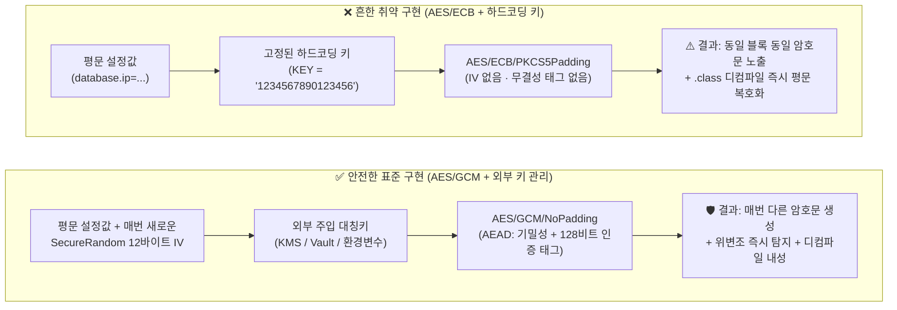
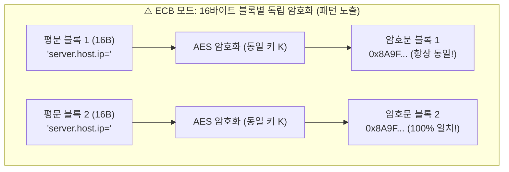
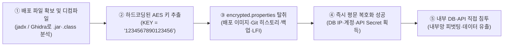

> [!summary] ⏱️ 5초 핵심 요약
> - **한 줄 비유**: `AES/ECB/PKCS5Padding`에 소스코드 하드코딩 키를 쓰는 것은, **원본 그림의 윤곽선이 그대로 비치는 반투명 모자이크 타일(ECB 모드)을 덮어놓고 그 옆에 금고 열쇠(하드코딩된 키)를 스카치테이프로 붙여둔 것**과 같습니다.
> - **핵심 원리**: ECB 모드는 IV(초기화 벡터) 없이 16바이트 블록을 각각 독립적으로 암호화하므로 **같은 평문 블록은 언제나 똑같은 암호문 블록**이 나오는 결정론적(Deterministic) 결함을 가지며, 변조를 막는 무결성 검증(MAC/Tag)도 전혀 없습니다.
> - **핵심 방어 포인트**: 암호화 모드는 인증 암호화(AEAD)인 **`AES/GCM/NoPadding`**으로 전환하고, 매 암호화마다 `SecureRandom`으로 **12바이트 랜덤 IV(Nonce)를 새로 생성**해 암호문 앞에 붙여 저장하며, 대칭키는 코드에서 완전히 분리해 **환경변수·OS 키스토어·KMS/Vault**에서 주입하세요.

설정파일(`properties`)에 DB 접속 정보나 API 키를 평문으로 두는 대신 AES로 암호화해서 저장하는 패턴을 소스코드 진단에서 자주 봅니다. 그런데 그중 상당수가 `AES/ECB/PKCS5Padding`(또는 모드 생략 시 기본값인 `AES`)을 그대로 씁니다. 코드는 에러 없이 돌아가지만, 진단원 입장에서는 **"암호화했다"는 착각(난독화)만 주는 위험한 구현**입니다. 실전에서는 ECB 모드 하나만 단독으로 문제인 경우는 거의 없고, **대칭키를 소스코드에 상수로 박아 넣는 습관**이 항상 세트로 따라붙습니다. 이 글에서는 흔히 쓰이는 취약한 구현을 그대로 해부하고, 왜 위험한지, 어떻게 뚫리는지, 그리고 실무 표준인 `AES/GCM/NoPadding`으로 어떻게 고쳐야 하는지 순서대로 짚습니다.



---

## 한눈에 보는 취약 구현 vs 안전 구현 비교표

| 비교 항목 | ❌ 취약한 구현 (`AES/ECB/PKCS5Padding`) | ✅ 안전한 구현 (`AES/GCM/NoPadding`) |
|---|---|---|
| **한 줄 비유** | 같은 무늬는 항상 같은 색으로 칠하는 타일 벽지 + 문 옆에 붙여둔 열쇠 | 매번 무작위 난수를 섞고 봉인 스티커(Tag)까지 붙이는 금고 + 외부 금고실 열쇠 |
| **Java `Cipher` 변환 문자열** | `"AES"` 또는 `"AES/ECB/PKCS5Padding"` | **`"AES/GCM/NoPadding"`** |
| **IV (초기화 벡터 / Nonce)** | **사용 안 함** (같은 평문은 언제나 100% 동일한 암호문 출력) | **매 암호화마다 `SecureRandom`으로 12바이트(96비트) 새로 생성** |
| **패턴 은닉성 (Semantic Security)** | **취약** (16바이트 블록 단위 반복 패턴 및 구조 그대로 노출) | **안전** (카운터 기반 스트림 암호화 방식으로 블록 패턴 완전 은닉) |
| **무결성 검증 (변조 탐지)** | **없음** (공격자가 암호문 블록을 잘라 붙이거나 바꿔도 복호화 시 모름) | **내장 (AEAD)** (128비트 인증 태그 검증 실패 시 `AEADBadTagException` 발생 후 즉시 거부) |
| **대칭키 보관 위치** | 소스코드 내 문자열 상수 하드코딩 (`private static final String KEY = ...`) | **AWS KMS, HashiCorp Vault, 런타임 환경변수, OS 키스토어** 등 코드 외부 분리 |
| **문자열 인코딩 명시** | `getBytes()` (OS 기본 인코딩에 의존해 환경마다 깨질 위험) | `StandardCharsets.UTF_8` 명시 |

---

## 1. 흔히 보는 취약한 구현

**💡 한 줄 비유**: 현관문에 디지털 도어락(`AES`)을 달아 두었지만, **누구나 똑같은 모양의 열쇠 자국을 볼 수 있는 구형 모델(`ECB`)**을 쓰고 **도어락 바로 위에 포스트잇으로 비밀번호(`KEY = "1234567890123456"`)를 적어 붙인 격**입니다.

### 1.1 취약한 암호화 코드 (`AESEncryption.java`)
각종 블로그나 오래된 유틸리티 클래스에서 복사해 쓰곤 하는 전형적인 예제입니다.

```java
import javax.crypto.Cipher;
import javax.crypto.spec.SecretKeySpec;
import java.util.Base64;

public class AESEncryption {

    public static String encrypt(String plainText, String key) throws Exception {
        // [취약점 1] 인코딩 미지정 getBytes() 및 하드코딩된 평문 문자열 키 사용
        SecretKeySpec secretKey = new SecretKeySpec(key.getBytes(), "AES");
        // [취약점 2] IV가 없고 블록 패턴이 그대로 드러나는 ECB 모드 사용
        // 참고: Cipher.getInstance("AES")라고만 써도 SunJCE 기본값인 AES/ECB/PKCS5Padding으로 동작함!
        Cipher cipher = Cipher.getInstance("AES/ECB/PKCS5Padding");
        cipher.init(Cipher.ENCRYPT_MODE, secretKey);
        byte[] encryptedBytes = cipher.doFinal(plainText.getBytes());
        return Base64.getEncoder().encodeToString(encryptedBytes);
    }

    public static void main(String[] args) throws Exception {
        String key = "1234567890123456"; // [취약점 3] 소스에 하드코딩된 16-byte 키
        String plainText = "database.ip=192.168.1.100\napi.url=http://example.com/api";

        String encryptedText = encrypt(plainText, key);
        System.out.println("Encrypted Text: " + encryptedText);
    }
}
```
위 코드로 생성된 암호문 문자열을 `encrypted.properties` 파일에 저장합니다.

### 1.2 취약한 복호화 코드 (`SecureProperties.java`)
애플리케이션 시작 시점에 `encrypted.properties`를 읽어들여 복호화하는 코드입니다.

```java
import javax.crypto.Cipher;
import javax.crypto.spec.SecretKeySpec;
import java.util.Base64;
import java.io.InputStream;
import java.util.Properties;

public class SecureProperties {

    // [치명적 결함] 컴파일된 .class / .jar 디컴파일 시 1초 만에 그대로 노출되는 키
    private static final String KEY = "1234567890123456"; // 16-byte secret key

    public static void main(String[] args) throws Exception {
        Properties properties = new Properties();
        InputStream input = SecureProperties.class.getClassLoader()
                .getResourceAsStream("encrypted.properties");

        if (input == null) {
            System.out.println("Sorry, unable to find encrypted.properties");
            return;
        }

        byte[] encryptedBytes = input.readAllBytes();
        String decryptedContent = decrypt(new String(encryptedBytes), KEY);
        properties.load(new java.io.StringReader(decryptedContent));

        System.out.println("Database IP: " + properties.getProperty("database.ip"));
        System.out.println("API URL: " + properties.getProperty("api.url"));
    }

    public static String decrypt(String encryptedText, String key) throws Exception {
        SecretKeySpec secretKey = new SecretKeySpec(key.getBytes(), "AES");
        Cipher cipher = Cipher.getInstance("AES/ECB/PKCS5Padding");
        cipher.init(Cipher.DECRYPT_MODE, secretKey);
        byte[] decryptedBytes = cipher.doFinal(Base64.getDecoder().decode(encryptedText));
        return new String(decryptedBytes);
    }
}
```

### 체크 포인트
- 코드에서 `"AES/ECB/PKCS5Padding"`뿐 아니라 **모드를 생략한 `Cipher.getInstance("AES")`**(Java JCE 기본값이 `ECB`임)를 사용하고 있지 않은가?
- 복호화 클래스나 설정 로더 안에 `private static final String KEY = ...` 형태로 **대칭키가 하드코딩**되어 있지 않은가?
- 참고: [Java Standard Algorithm Names — Cipher](https://docs.oracle.com/en/java/javase/17/docs/specs/security/standard-names.html#cipher-algorithm-names), [OWASP Cryptographic Storage Cheat Sheet](https://cheatsheetseries.owasp.org/cheatsheets/Cryptographic_Storage_Cheat_Sheet.html)

---

## 2. 왜 이 구현이 위험한가 (3대 구조적 결함)

**💡 한 줄 비유**: 벽지의 원래 그림(평문)을 가린다면서 **같은 무늬 타일은 무조건 같은 색 페인트로만 칠하면(ECB 모드)**, 페인트 색의 비밀을 몰라도 멀리서 보면 **원래 그림의 윤곽선(펭귄 모양)이 그대로 다 보입니다.**



### 2.1 결함 ①: ECB 모드 — "같은 평문 블록은 언제나 같은 암호문 블록"
- **16바이트 독립 암호화의 한계**: AES는 데이터를 16바이트(128비트) 블록 단위로 자릅니다. **ECB(Electronic Codebook)** 모드는 앞뒤 블록과의 연결 없이 각 블록을 완전히 독립적으로 암호화합니다.
- **타일 벽지와 ECB 펭귄 현상**: 평문 블록 16바이트가 같으면 암호문 블록 16바이트도 항상 똑같이 나옵니다. `database.ip=`, `api.url=`, 공백, 줄바꿈처럼 반복되는 프리픽스나 구조가 있는 설정 파일에서는 암호문만 보고도 **어느 위치에 같은 값이 반복되는지, 블록 경계가 어디인지** 구조 정보가 그대로 새어 나갑니다.
- **블록 잘라 붙이기(Block Suffling/Replay) 취약성**: 무결성 검증(MAC)이 없고 블록이 서로 독립적이기 때문에, 공격자가 암호문 블록의 순서를 바꾸거나 다른 설정의 16바이트 암호문 블록을 복사해 끼워 넣어도 복호화 에러 없이 조작된 설정값이 로드될 수 있습니다.

### 2.2 결함 ②: IV(초기화 벡터) 부재로 인한 결정론적(Deterministic) 암호화
- ECB는 구조상 IV(Initialization Vector)를 아예 쓰지 않습니다. 따라서 같은 키로 같은 평문을 암호화하면 **백 번을 실행해도 백 번 다 똑같은 암호문**이 나옵니다.
- 공격자가 특정 설정값 후보군(예: 내부 IP 대역이나 `true`/`false` 플래그)을 알고 있을 때, 암호문만 단순 비교해 원문을 알아맞히는 **사전 공격(Dictionary Attack / Known-Plaintext 비교)**에 그대로 노출됩니다.

### 2.3 결함 ③: 하드코딩된 16바이트 키 — 암호화를 단순 '난독화'로 전락시키는 주범
- `"1234567890123456"`처럼 소스코드에 키를 박아 넣으면, 컴파일된 `.class`, `.jar`, `.war`, 또는 안드로이드 `.apk` 파일을 **`jadx`, `CFR`, `Ghidra` 같은 디컴파일러로 여는 순간 몇 초 만에 평문 문자열로 추출**됩니다.
- 암호화 알고리즘 자체가 아무리 수학적으로 안전한 AES-128/256이라도 **복호화 키가 배포 파일 안에 함께 들어 있다면 그것은 암호화(Encryption)가 아니라 단순 난독화(Obfuscation)**에 불과합니다.

### 체크 포인트
- 암호화된 설정값이 **동일한 평문 입력에 대해 매번 같은 암호문을 출력(결정론적 동작)**하고 있지 않은가?
- 암호문이 공격자에 의해 **일부 블록만 치환·변조되었을 때 복호화 단계에서 예외를 던지며 차단할 무결성 검증 장치(Tag/HMAC)**가 있는가?
- 애플리케이션 배포 패키지(`.jar`/`.war`/`.apk`)만 탈취당한 상황에서 공격자가 **외부 KMS나 런타임 비밀 없이 단독으로 설정 파일을 복호화**할 수 있는 구조인가?

---

## 3. 실전 공격 시나리오로 이어지는 킬체인 흐름

**💡 한 줄 비유**: 금고를 훔친 도둑이 금고 옆면에 붙어 있던 열쇠(`SecureProperties.class` 디컴파일)로 금고 문(`encrypted.properties`)을 열고, 그 안에 적힌 **본사 지하 서버실 마스터 계정(DB/API 자격증명)**을 손에 넣어 내부망 전체를 장악하는 시나리오입니다.



### 왜 '약한 모드(ECB)'와 '하드코딩 키'는 항상 세트로 발견되는가?
1. **초기 침투 지점 결합**: 공격자는 웹 취약점(LFI/경로 탐색), 잘못 구성된 CI/CD 아티팩트 저장소, 컨테이너 이미지 레지스트리, 또는 Git 커밋 히스토리 유출을 통해 `.jar` 빌드 파일과 `encrypted.properties`를 함께 확보합니다.
2. **암호화의 완전 무력화**: 키가 소스에 하드코딩되어 있다면 사실 ECB냐 GCM이냐를 따지기 전에 **①→② 단계에서 이미 게임이 끝납니다.** 실무 진단에서 이 두 결함이 늘 함께 묶여 나오는 이유는, 처음에 키 관리(Key Management) 아키텍처를 설계하지 않고 "일단 파일만 안 읽히게 가리자"는 식으로 급조된 튜토리얼 코드를 복사해 넣었기 때문입니다.
3. **클라이언트 배포물의 치명성**: 특히 모바일 앱(APK/IPA)이나 고객 PC에 배포되는 데스크톱용 Java 클라이언트 안에 이런 구조로 DB·클라우드 자격증명을 넣어두면, 모든 사용자가 곧 잠재적 내부망 침투자가 됩니다.

### 체크 포인트
- Git 저장소나 빌드 산출물(`.jar`/컨테이너 이미지)이 유출되었을 때 **소스/바이너리 내부 정보만으로 설정 파일 복호화가 완결**되는가?
- 클라이언트 사이드 배포물(모바일 앱·데스크톱 에이전트)에 서버용 DB 접속 정보나 마스터 API 키를 암호화해 넣어두지 않았는가?

---

## 4. 이렇게 고칩니다 — `AES/GCM/NoPadding` + 랜덤 IV + 외부 키 분리

**💡 한 줄 비유**: 암호화할 때마다 주사위를 굴려 **새 일회용 난수표(12바이트 랜덤 IV)**를 앞에 붙이고, 누군가 글자 하나만 건드려도 즉시 경보가 울리는 **위변조 방지 납봉인(128비트 GCM 인증 태그)**을 채우며, **금고 열쇠는 건물 밖 보안 금고실(KMS/Vault/환경변수)에서 실행 시점에만 받아오는 구조**입니다.

### 4.1 안전한 암호화 및 복호화 전체 구현 (`AESGcmPropertyCrypto.java`)
핵심은 **① AEAD 모드(`AES/GCM/NoPadding`) 사용**, **② 매 암호화마다 `SecureRandom`으로 12바이트 IV 새로 생성 후 암호문 앞에 결합(`[IV 12B] + [Ciphertext + Tag]`)**, **③ 복호화 시 앞 12바이트에서 IV를 잘라내어 검증·복호화**, **④ 키를 코드 밖(환경변수·KMS 등)에서 주입**하는 것입니다.

```java
import javax.crypto.Cipher;
import javax.crypto.SecretKey;
import javax.crypto.spec.GCMParameterSpec;
import javax.crypto.spec.SecretKeySpec;
import java.nio.ByteBuffer;
import java.nio.charset.StandardCharsets;
import java.security.SecureRandom;
import java.util.Base64;

public class AESGcmPropertyCrypto {

    private static final String ALGORITHM = "AES";
    private static final String TRANSFORMATION = "AES/GCM/NoPadding";
    private static final int IV_LENGTH_BYTES = 12;   // NIST 권장 GCM 표준 Nonce(IV) 길이 (96-bit)
    private static final int TAG_LENGTH_BITS = 128;  // AEAD 무결성 인증 태그 길이 (128-bit)
    private static final SecureRandom SECURE_RANDOM = new SecureRandom();

    /**
     * 평문을 AES-GCM으로 암호화하고 [12바이트 IV + 암호문(인증태그 포함)]을 Base64로 반환합니다.
     */
    public static String encrypt(String plainText, SecretKey key) throws Exception {
        byte[] iv = new byte[IV_LENGTH_BYTES];
        SECURE_RANDOM.nextBytes(iv); // 매 호출마다 새로운 랜덤 IV 생성 (동일 키에서 IV 재사용 절대 금지!)

        Cipher cipher = Cipher.getInstance(TRANSFORMATION);
        GCMParameterSpec parameterSpec = new GCMParameterSpec(TAG_LENGTH_BITS, iv);
        cipher.init(Cipher.ENCRYPT_MODE, key, parameterSpec);

        byte[] cipherTextWithTag = cipher.doFinal(plainText.getBytes(StandardCharsets.UTF_8));

        // 복호화할 때 동일한 IV를 쓸 수 있도록 암호문 맨 앞에 IV(12B)를 붙여서 함께 직렬화
        ByteBuffer byteBuffer = ByteBuffer.allocate(iv.length + cipherTextWithTag.length);
        byteBuffer.put(iv);
        byteBuffer.put(cipherTextWithTag);
        return Base64.getEncoder().encodeToString(byteBuffer.array());
    }

    /**
     * Base64 문자열에서 앞 12바이트 IV를 분리한 뒤, 무결성 태그를 검증하며 복호화합니다.
     * 암호문이나 IV가 1비트라도 변조되었으면 AEADBadTagException이 발생합니다.
     */
    public static String decrypt(String base64Payload, SecretKey key) throws Exception {
        byte[] decoded = Base64.getDecoder().decode(base64Payload);
        if (decoded.length < IV_LENGTH_BYTES + (TAG_LENGTH_BITS / 8)) {
            throw new IllegalArgumentException("유효하지 않은 암호문 길이입니다.");
        }

        ByteBuffer byteBuffer = ByteBuffer.wrap(decoded);
        byte[] iv = new byte[IV_LENGTH_BYTES];
        byteBuffer.get(iv); // 앞 12바이트에서 IV 추출

        byte[] cipherTextWithTag = new byte[byteBuffer.remaining()];
        byteBuffer.get(cipherTextWithTag); // 나머지 암호문 + 16바이트 GCM 태그 추출

        Cipher cipher = Cipher.getInstance(TRANSFORMATION);
        GCMParameterSpec parameterSpec = new GCMParameterSpec(TAG_LENGTH_BITS, iv);
        cipher.init(Cipher.DECRYPT_MODE, key, parameterSpec);

        byte[] plainBytes = cipher.doFinal(cipherTextWithTag);
        return new String(plainBytes, StandardCharsets.UTF_8);
    }

    /**
     * 대칭키는 절대 코드에 하드코딩하지 않고 KMS, Vault, 또는 런타임 환경변수(Base64 인코딩된 256-bit 키)에서 주입받습니다.
     */
    public static SecretKey loadKeyFromEnv(String envVarName) {
        String base64Key = System.getenv(envVarName);
        if (base64Key == null || base64Key.isBlank()) {
            throw new IllegalStateException("필수 암호화 키 환경변수가 설정되지 않았습니다: " + envVarName);
        }
        byte[] keyBytes = Base64.getDecoder().decode(base64Key);
        if (keyBytes.length != 16 && keyBytes.length != 24 && keyBytes.length != 32) {
            throw new IllegalArgumentException("AES 키 길이는 128/192/256비트(16/24/32바이트)여야 합니다.");
        }
        return new SecretKeySpec(keyBytes, ALGORITHM);
    }
}
```

### 4.2 왜 이렇게 바뀌어야 안전한가? (4가지 핵심 방어 원리)
1. **AEAD(`AES/GCM/NoPadding`)를 통한 기밀성 + 무결성 동시 보장**:
   - GCM(Galois/Counter Mode)은 **AEAD(Authenticated Encryption with Associated Data)** 방식으로, 데이터를 암호화함과 동시에 **128비트 인증 태그(Authentication Tag)**를 생성해 암호문 끝에 붙입니다.
   - ECB나 단순 CBC 모드는 공격자가 암호문을 위변조(예: Padding Oracle 공격이나 블록 치환)해도 복호화 시점에 변조 여부를 알기 어렵지만, GCM은 복호화 시 태그 검증에 실패하면 즉시 `AEADBadTagException`을 던지고 평문을 일절 반환하지 않습니다.
2. **매 암호화마다 `SecureRandom`으로 뽑는 12바이트 IV(Nonce)**:
   - 매번 새로운 랜덤 IV를 쓰면 똑같은 `"database.ip=192.168.1.100"`을 열 번 암호화해도 **열 번 모두 완전히 다른 암호문**이 나옵니다. ECB의 블록 패턴 노출과 사전 공격이 원천 차단됩니다.
   - *⚠️ 절대 주의*: **같은 대칭키에서 동일한 IV(Nonce)를 두 번 재사용(Nonce Reuse)하면 GCM의 기밀성과 인증키가 수학적으로 완전히 깨집니다.** 따라서 고정된 상수 IV를 쓰지 말고 반드시 매 암호화마다 `SecureRandom`으로 새로 생성해 암호문 앞에 붙여 저장해야 합니다.
3. **키의 코드 외부 분리 (External Key Management)**:
   - 대칭키는 소스코드나 Git 저장소에서 완전히 제거하고, **AWS KMS / GCP KMS / Azure Key Vault, HashiCorp Vault, Kubernetes Secrets, 또는 OS/런타임 환경변수**를 통해 실행 시점에 메모리에만 주입되도록 설계합니다.
   -這樣 하면 설령 공격자가 `.jar` 파일이나 Git 소스코드를 탈취해 디컴파일하더라도 키가 없으므로 `encrypted.properties`를 복호화할 수 없습니다.
4. **더 근본적인 아키텍처 대안 (배포 파일에서 비밀 제거)**:
   - 가능하다면 민감한 설정값(DB 비밀번호, API 키)을 애초에 애플리케이션 빌드 산출물(`properties` 파일)에 담아 배포하지 말고, 컨테이너 오케스트레이터나 클라우드 시크릿 매니저에서 실행 환경으로 직접 주입하는 구조가 가장 안전합니다.

### 체크 포인트
- `Cipher.getInstance("AES/GCM/NoPadding")`과 `GCMParameterSpec(128, iv)`를 사용해 **기밀성과 무결성(변조 탐지)을 동시에 확보**했는가?
- 고정 IV를 쓰지 않고 매 암호화마다 **`SecureRandom`으로 12바이트 IV를 새로 생성**해 암호문과 함께 전달·저장했는가?
- 소스코드와 설정 파일 어디에도 대칭키를 하드코딩하지 않고 **KMS·Vault·런타임 시크릿**에서 주입받도록 분리했는가?
- 문자열과 바이트 배열 변환 시 플랫폼 기본값에 의존하지 않고 **`StandardCharsets.UTF_8`을 명시**했는가?
- 참고: [NIST SP 800-38D — Recommendation for Block Cipher Modes of Operation: Galois/Counter Mode (GCM)](https://csrc.nist.gov/pubs/sp/800/38/d/final), [OWASP Cryptographic Storage Cheat Sheet](https://cheatsheetseries.owasp.org/cheatsheets/Cryptographic_Storage_Cheat_Sheet.html)

---

## 마무리

`AES/ECB/PKCS5Padding`에 하드코딩된 대칭키를 결합한 코드는 **"암호화한 것처럼 보이는 평문"**일 뿐입니다.
1. 모드는 반드시 인증 암호화인 **`AES/GCM/NoPadding`**으로 전환하고,
2. 매 암호화마다 **`SecureRandom`으로 생성한 12바이트 IV**를 사용해 패턴 노출을 막으며,
3. 대칭키는 소스코드 밖의 **환경변수·OS 키스토어·KMS/Vault**로 완전히 분리하세요.
이 세 가지가 지켜져야 비로소 설정 파일 암호화가 실제 공격자 앞에서 방어력을 발휘합니다.
