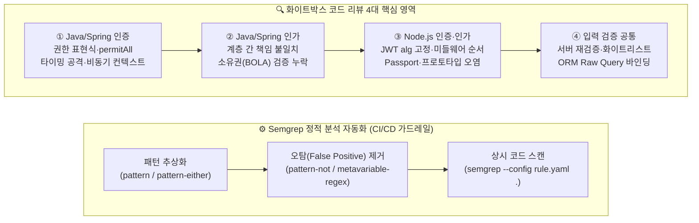

> [!summary] ⏱️ 5초 핵심 요약
> - **한 줄 비유**: 블랙박스 진단이 **완성된 건물을 밖에서 두드려보며 약한 벽을 찾는 작업**이라면, 화이트박스 코드 리뷰는 **설계 도면(소스 코드)을 펼쳐놓고 애초에 벽이 얇게 그려졌거나 자물쇠가 누락된 문을 짚어내는 작업**입니다.
> - **핵심 원리**: 인증·인가 취약점은 코드 한 줄의 문법 오류가 아니라 **프레임워크의 기본 동작 오해(`hasRole` 접두어, `ThreadLocal` 컨텍스트 전파, 미들웨어 등록 순서)**와 **계층 간 책임 불일치(URL 필터 vs 메서드 시큐리티, 컨트롤러 vs 서비스 소유권 검증)**에서 발생합니다.
> - **핵심 방어 포인트**: 눈으로 찾는 수동 리뷰 패턴을 정리한 뒤, 반복되는 안티패턴(어노테이션 누락, `jwt.verify` 알고리즘 미고정, Raw Query 문자열 결합)은 **Semgrep 커스텀 룰(`pattern`, `pattern-not`, `metavariable-regex`)로 코드화해 CI/CD 파이프라인에서 상시 검증**하세요.

[[웹 취약점 진단 인가편 — 권한 매트릭스로 BOLA·BFLA 찾기]]에서 외부 요청을 교차 대입해 인가 허점을 찾는 블랙박스 관점을 다뤘고, [[Java Properties 파일 AES 암호화 — ECB 모드의 함정]]에서 암호화 설정 코드의 구조적 결함을 살펴봤습니다. 블랙박스 진단이 완성된 건물을 두드려보며 약한 벽을 찾는 것이라면, 화이트박스 코드 리뷰는 설계 도면(소스 코드)을 보고 애초에 벽이 얇게 설계된 곳을 짚어내는 과정입니다. 이번 글에서는 Java(Spring Boot)와 Node.js(Express·NestJS) 환경에서 인증·인가·입력 검증 코드를 읽을 때 반드시 의심해야 할 위험 신호를 정리하고, 이를 Semgrep 정적 분석 룰로 자동화하는 방법을 살펴봅니다.



---

## 한눈에 보는 인증·인가·입력 검증 화이트박스 리뷰 비교표

| 점검 영역 | 자주 발견되는 취약 코드 패턴 (Smell) | 프레임워크 / 런타임 원인 | 안전한 코드 설계 원칙 |
|---|---|---|---|
| **① Spring 인증 (Authentication)** | `hasRole('ROLE_ADMIN')` 혼용, 광범위한 `permitAll()`, `String.equals()` 비밀번호 비교, `@Async` 내 `SecurityContextHolder` 조회 | `ROLE_` 자동 접두어 규칙 오해, Ant/PathPattern 매칭 범위 과다, 비상수 시간 비교, `ThreadLocal` 전략의 스레드 격리 | `hasRole`·`hasAuthority` 일관성 유지, 최소 범위 매칭 후 `authenticated()` 기본 적용, `PasswordEncoder.matches()` 위임, `DelegatingSecurityContextExecutor` 사용 |
| **② Spring 인가 (Authorization)** | 컨트롤러에만 권한 검사를 두고 서비스 계층은 무방비 방치, `@PathVariable` ID로만 엔티티 조회 후 바로 반환 | 다중 진입점(REST·배치·메시지 큐)에서 동일 서비스 호출 시 우회, 객체 소유자(`ownerId`)와 현재 주체(`principal`) 대조 누락 | 도메인/서비스 계층 `@PreAuthorize` 및 소유권 검증 강제, 쿼리 수준에서 `findByIdAndOwnerId(id, userId)`로 조회 범위 제한 |
| **③ Node.js 인증·인가 (Express/NestJS)** | `jwt.verify(token, key)`에서 `algorithms` 옵션 생략, 라우트 선언 뒤에 `app.use(auth)` 배치, 사용자 입력 깊은 병합(Deep Merge) | 토큰 헤더의 `alg` 값을 그대로 신뢰(알고리즘 혼동), Express 미들웨어 순차 실행 특성, `__proto__` 오염을 통한 권한 플래그 주입 | `algorithms: ['RS256']` 등 명시적 화이트리스트 고정, 라우터 마운트 전 글로벌/라우트별 가드 선행 배치, `Object.create(null)` 또는 스키마 검증 후 병합 |
| **④ 입력 검증 공통 (Input Validation)** | 프런트엔드 검증만 믿고 백엔드 `@Valid` 생략, 금칙어 블랙리스트 필터링, ORM Raw Query에 템플릿 리터럴/문자열 결합 | 클라이언트 우회 요청에 무방비, 인코딩·변형 우회에 취약, ORM을 쓰더라도 Native Query 문자열 결합 시 SQLi 직결 | UX용 클라이언트 검증과 별개로 서버 DTO 스키마 검증 필수, 허용 문자 화이트리스트 적용, 이름/위치 기반 파라미터 바인딩(`:param`, `?`, `$1`) 강제 |
| **⑤ Semgrep 룰 자동화** | 수동 코드 리뷰에만 의존해 신규 엔드포인트 추가 시 어노테이션 누락 재발 | 대규모 코드베이스에서 사람 눈으로 모든 컨트롤러와 설정 변경을 전수 추적하기 어려움 | 프로젝트 맞춤형 커스텀 룰(`pattern-not`으로 정상 패턴 제외)을 작성해 PR 단계에서 자동 차단 |

---

## 1. Java/Spring 인증(Authentication) 코드 리뷰 패턴

**💡 한 줄 비유**: 건물 보안 규정에 **"출입증에 `직급_임원`이라고 적혀 있어야 통과시킨다"**고 되어 있는데, 어떤 경비원은 글자 그대로 읽고(`hasAuthority`) 어떤 경비원은 앞에 `직급_`을 자기가 한 번 더 붙여서 읽는 바람에(`hasRole`) 정작 권한 설정이 엉키거나, **별관으로 넘어가는 복도(`@Async` 스레드)에서는 출입증 바구니(`ThreadLocal`)가 따라오지 않아 신원 확인이 풀려버리는 설계 결함**입니다.

### 1.1 `@PreAuthorize` / `@Secured` 어노테이션 누락 및 `hasRole` vs `hasAuthority` 혼동
코드를 읽을 때 가장 먼저 확인할 부분은 Spring Security가 권한 문자열을 해석하는 방식의 일관성입니다.
- **`hasRole('ADMIN')` vs `hasAuthority('ADMIN')`의 차이**: Spring Security의 `hasRole("ADMIN")`은 내부적으로 기본 접두어인 `ROLE_`을 자동으로 붙여 실제 권한 목록에 `"ROLE_ADMIN"`이 있는지를 검사합니다(Spring Security 6의 `DefaultMethodSecurityExpressionHandler` 기준). 반면 `hasAuthority("ADMIN")`은 접두어를 붙이지 않고 정확히 `"ADMIN"` 문자열과 일치하는지 확인합니다.
- **리뷰 시 의심할 패턴**: `UserDetailsService`에서 권한을 생성할 때는 `new SimpleGrantedAuthority("ADMIN")`처럼 `ROLE_` 없이 넣어두고 컨트롤러에서는 `@PreAuthorize("hasRole('ADMIN')")`으로 검사하거나, 반대로 표현식 안에 `@PreAuthorize("hasRole('ROLE_ADMIN')")`처럼 접두어를 중복 기재해 예외가 발생하거나 잘못된 분기로 빠지는 코드를 주의 깊게 봐야 합니다. 또한 SpEL 표현식 내 오타나 논리 연산자 우선순위(`and`와 `or` 혼용 시 괄호 누락)도 단골 리뷰 대상입니다.

### 1.2 `authorizeHttpRequests` 내 `permitAll()` 남용과 경로 매칭 함정
`SecurityFilterChain` 설정 파일을 리뷰할 때는 **`requestMatchers(...).permitAll()`에 지정된 와일드카드 범위가 의도보다 넓지 않은지**, 그리고 **마지막에 `anyRequest().authenticated()`(또는 `denyAll()`)가 빠짐없이 선언되어 있는지** 확인해야 합니다.
- 예를 들어 정적 리소스나 공개 API를 열겠다며 `/api/v1/**` 전체에 `permitAll()`을 부여한 뒤, 그 아래 줄에 `/api/v1/admin/**`에 대한 `hasRole("ADMIN")`을 선언하면 **Spring Security는 위에서 아래로 첫 번째 매칭된 규칙을 우선 적용하므로 관리자 경로까지 전부 공개(Fail-Open)**됩니다.

### 1.3 커스텀 인증 로직의 `String.equals()` 비밀번호/토큰 비교 (타이밍 공격 위험)
레거시 연동이나 API 키 검증을 위해 커스텀 `AuthenticationProvider` 또는 `UserDetailsService` 후처리 로직을 직접 작성한 코드를 볼 때, 평문이나 해시 문자열을 `String.equals()`로 직접 비교하고 있다면 즉시 지적해야 합니다.
- `String.equals()`는 첫 번째로 다른 문자가 나오는 즉시 `false`를 반환(Short-circuit)하므로, 응답 시간의 미세한 차이를 통계적으로 측정해 비밀값을 한 글자씩 추론하는 **타이밍 공격(Timing Attack)**에 노출될 수 있습니다.
- 비밀번호 검증은 내부적으로 솔트(Salt) 처리와 상수 시간 비교(`MessageDigest.isEqual`)를 수행하는 Spring Security의 **`PasswordEncoder.matches(rawPassword, encodedPassword)`**에 위임해야 하며, 별도 API 토큰이나 HMAC 서명을 비교할 때도 `MessageDigest.isEqual(a, b)`를 사용해야 합니다.

### 1.4 비동기(`@Async`) 및 멀티스레드 구간의 `SecurityContextHolder` 유실·오염
Spring Security의 `SecurityContextHolder`는 기본적으로 **`MODE_THREADLOCAL` 전략**을 사용합니다. 즉, 현재 인증된 사용자 정보(`Authentication`)는 요청을 처리하던 원래 워커 스레드의 `ThreadLocal`에만 들어 있습니다.
- **리뷰 시 의심할 패턴**: `@Async`가 붙은 메서드, `CompletableFuture.supplyAsync(...)`, 또는 직접 생성한 `ExecutorService` 내부에서 `SecurityContextHolder.getContext().getAuthentication()`을 호출하는 코드입니다.
- 새 스레드에서는 `SecurityContext`가 비어 있어 `null`이 반환되거나, 스레드 풀을 재사용하는 과정에서 이전 작업이 남긴 오염된 컨텍스트를 잘못 참조할 위험이 있습니다. 비동기 작업에 인증 컨텍스트를 안전하게 전달하려면 **`DelegatingSecurityContextAsyncTaskExecutor`**나 **`DelegatingSecurityContextExecutorService`**로 스레드 풀을 감싸거나, 필요한 사용자 식별자(`Long userId`)만 불변 파라미터로 명시적으로 넘겨야 합니다.

```java
// ❌ 취약한 코드: Spring 인증 설정 및 비동기/비밀번호 비교 안티패턴 모음
@Configuration
@EnableWebSecurity
@EnableMethodSecurity
public class VulnerableSecurityConfig {

    @Bean
    public SecurityFilterChain filterChain(HttpSecurity http) throws Exception {
        http.authorizeHttpRequests(auth -> auth
            // [결함 1] 넓은 와일드카드(/api/**)를 먼저 permitAll()로 열어두어 아래의 /api/admin/** 규칙이 무시됨!
            .requestMatchers("/api/**").permitAll()
            .requestMatchers("/api/admin/**").hasRole("ADMIN")
            .anyRequest().authenticated()
        );
        return http.build();
    }
}

@Service
public class VulnerableAuthService {

    // [결함 2] PasswordEncoder를 쓰지 않고 직접 해시 문자열을 String.equals()로 비상수 시간 비교
    public boolean verifyApiKey(String inputSecret, String storedSecret) {
        return inputSecret.equals(storedSecret);
    }

    // [결함 3] 기본 ThreadLocal 전략에서 @Async 스레드는 SecurityContext가 전파되지 않음
    @Async
    public void writeAuditLogAsync(String action) {
        Authentication auth = SecurityContextHolder.getContext().getAuthentication();
        // auth가 null이 되어 감사 로그 누락 또는 NullPointerException 발생!
        String username = (auth != null) ? auth.getName() : "ANONYMOUS";
        auditRepository.save(new AuditLog(username, action));
    }
}
```

```java
// ✅ 안전한 코드: 구체적 경로 우선 매칭, 상수 시간 비교, 비동기 컨텍스트 안전 전파
@Configuration
@EnableWebSecurity
@EnableMethodSecurity
public class SafeSecurityConfig {

    @Bean
    public SecurityFilterChain filterChain(HttpSecurity http) throws Exception {
        http.authorizeHttpRequests(auth -> auth
            // [방어 1] 좁고 구체적인 공개 엔드포인트만 명시적으로 허용하고, 관리자 경로를 먼저 선언
            .requestMatchers("/api/public/health", "/api/auth/login").permitAll()
            .requestMatchers("/api/admin/**").hasRole("ADMIN") // DB/토큰에는 "ROLE_ADMIN"으로 일관되게 부여
            .anyRequest().authenticated()
        );
        return http.build();
    }

    // [방어 3-A] 비동기 실행 시 SecurityContext를 자식 스레드로 안전하게 복제·정리하는 Executor 구성
    @Bean
    public DelegatingSecurityContextAsyncTaskExecutor taskExecutor(ThreadPoolTaskExecutor delegate) {
        return new DelegatingSecurityContextAsyncTaskExecutor(delegate);
    }
}

@Service
@RequiredArgsConstructor
public class SafeAuthService {

    private final PasswordEncoder passwordEncoder;

    // [방어 2-A] 비밀번호는 반드시 PasswordEncoder.matches()에 위임
    public boolean verifyPassword(String rawPassword, String encodedPassword) {
        return passwordEncoder.matches(rawPassword, encodedPassword);
    }

    // [방어 2-B] 고정 토큰/서명 비교 시 MessageDigest.isEqual()을 통한 상수 시간(Constant-time) 비교
    public boolean verifyApiKey(String inputSecret, String storedSecret) {
        byte[] inputBytes = inputSecret.getBytes(StandardCharsets.UTF_8);
        byte[] storedBytes = storedSecret.getBytes(StandardCharsets.UTF_8);
        return MessageDigest.isEqual(inputBytes, storedBytes);
    }

    // [방어 3-B] 또는 비동기 메서드 호출 전에 컨트롤러/호출자 스레드에서 추출한 식별자를 명시적 인자로 전달
    @Async
    public void writeAuditLogAsync(Long actorUserId, String action) {
        auditRepository.save(new AuditLog(actorUserId, action));
    }
}
```

### 체크 포인트
- `GrantedAuthority` 생성 시 부여하는 문자열(`ROLE_ADMIN` vs `ADMIN`)과 `@PreAuthorize`의 검증 함수(`hasRole` vs `hasAuthority`)가 프로젝트 전체에서 일관되게 짝을 이루고 있는가?
- `SecurityFilterChain`의 `authorizeHttpRequests` 블록에서 `permitAll()`이 선언된 매처가 하위 보호 경로를 덮어쓰고 있지 않으며, 체인 끝에 `anyRequest().authenticated()`가 위치하는가?
- 비밀번호 검증에 `PasswordEncoder.matches()` 외의 수동 문자열 비교(`equals`)를 쓰거나, API 시크릿 비교 시 `MessageDigest.isEqual()`을 누락한 곳이 없는가?
- `@Async`, `CompletableFuture`, 커스텀 스레드 풀 내부에서 `SecurityContextHolder`를 직접 참조할 때 `DelegatingSecurityContextExecutor`가 적용되어 있는가?
- **참고**: [Spring Security Reference — Authorize HttpServletRequests](https://docs.spring.io/spring-security/reference/servlet/authorization/authorize-http-requests.html), [Spring Security Reference — Method Security](https://docs.spring.io/spring-security/reference/servlet/authorization/method-security.html), [OWASP Authentication Cheat Sheet](https://cheatsheetseries.owasp.org/cheatsheets/Authentication_Cheat_Sheet.html)

---

## 2. Java/Spring 인가(Authorization) 코드 리뷰 패턴

**💡 한 줄 비유**: 아파트 단지 정문 경비실(URL 필터)만 통과하면 **어느 동·어느 호수 현관문(`@PathVariable Long id`)이든 집주인 신분증 대조 없이 열쇠를 내어주거나, 정문에는 경비원을 세워놓고 지하 주차장 엘리베이터(다른 컨트롤러/내부 호출 경로)에는 아무런 통제 장치를 두지 않은 설계**입니다.

### 2.1 컨트롤러 계층과 서비스 계층 간 인가 책임 불일치
화이트박스 리뷰에서 자주 보는 구조적 허점은 **권한 검사를 특정 웹 컨트롤러 한 곳에만 두고 핵심 비즈니스 로직이 담긴 `Service` 계층에는 아무런 인가 장치를 두지 않는 것**입니다.
- 처음에는 `AdminOrderController`만 `OrderService.cancelOrder(orderId)`를 호출했더라도, 서비스가 커지면서 일반 사용자용 `UserOrderController`, GraphQL 리졸버, 또는 배치/웹훅 핸들러가 같은 `OrderService.cancelOrder(orderId)`를 호출하게 됩니다.
- 컨트롤러에만 `@PreAuthorize("hasRole('ADMIN')")`가 붙어 있었다면 새로 연결된 진입점을 통해 무검증 상태로 비즈니스 로직이 실행됩니다. 반면 반대로 서비스 메서드에만 `@PreAuthorize`를 걸어두고 URL 매처(`authorizeHttpRequests`) 설정과 어긋나게 구성하면, 필터 단에서 차단되어야 할 요청이 불필요하게 컨트롤러 파싱·바인딩 계층까지 진입하거나 예외 처리 흐름이 일관성을 잃게 됩니다. 따라서 **URL 필터 수준의 거시적 접근통제(심층 방어 1차선)와 도메인/서비스 메서드의 세밀한 권한 검증(심층 방어 2차선)을 함께 맞추는 것**이 안전합니다.

### 2.2 `@PathVariable` 조회 시 소유권 검증 누락 (BOLA / IDOR 유발 패턴)
소스 코드를 읽을 때 컨트롤러나 서비스 메서드 시그니처에 `@PathVariable Long id`(또는 `UUID id`)가 보이면, **그 `id`가 레포지토리 쿼리로 들어갈 때 현재 로그인한 사용자(`@AuthenticationPrincipal`)의 식별자와 어떻게 결합되는지**를 끝까지 추적해야 합니다.
- `orderRepository.findById(orderId)`만 호출해 엔티티를 꺼낸 뒤 바로 DTO로 변환해 반환하거나 수정·삭제한다면 100% BOLA(IDOR) 취약점입니다.
- 안전한 코드는 **① 쿼리 조건 자체에 소유자 ID를 묶어서 조회(`findByIdAndUserId(orderId, currentUser.getId())`)**하거나, **② 조회 직후 도메인 엔티티의 소유권 검증 메서드(`order.validateOwnership(currentUser.getId())`)를 호출**하거나, **③ Spring Security의 `@PostAuthorize("returnObject.ownerId == authentication.principal.id")`를 명시**하는 패턴을 취합니다.

```java
// ❌ 취약한 코드: 소유권 검증 없이 @PathVariable ID로만 조회 및 컨트롤러-서비스 인가 불일치
@RestController
@RequestMapping("/api/orders")
@RequiredArgsConstructor
public class VulnerableOrderController {

    private final OrderService orderService;

    // [결함 1] 현재 로그인한 사용자가 누구인지(@AuthenticationPrincipal)조차 받지 않고 ID로만 단건 조회 (BOLA)
    @GetMapping("/{orderId}")
    public OrderResponse getOrder(@PathVariable Long orderId) {
        return orderService.getOrderById(orderId);
    }

    // [결함 2] URL이나 메서드에 역할·소유권 검증 어노테이션이 누락된 상태에서 서비스의 공용 삭제 메서드 호출
    @DeleteMapping("/{orderId}")
    public void cancelOrder(@PathVariable Long orderId) {
        orderService.forceCancelOrder(orderId);
    }
}

@Service
@RequiredArgsConstructor
public class OrderService {

    private final OrderRepository orderRepository;

    public OrderResponse getOrderById(Long orderId) {
        // DB에서 orderId만으로 레코드를 꺼내 그대로 반환 (타인의 주문서 열람 가능)
        Order order = orderRepository.findById(orderId)
                .orElseThrow(() -> new EntityNotFoundException("주문을 찾을 수 없습니다."));
        return OrderResponse.from(order);
    }

    // AdminController에서 부를 것이라 가정하고 Service 메서드에 @PreAuthorize를 생략함
    @Transactional
    public void forceCancelOrder(Long orderId) {
        orderRepository.deleteById(orderId);
    }
}
```

```java
// ✅ 안전한 코드: 쿼리 수준 소유권 조건 결합 + 서비스 계층 메서드 시큐리티 심층 방어
@RestController
@RequestMapping("/api/orders")
@RequiredArgsConstructor
public class SafeOrderController {

    private final SafeOrderService orderService;

    @GetMapping("/{orderId}")
    @PreAuthorize("isAuthenticated()")
    public OrderResponse getOrder(
            @PathVariable Long orderId,
            @AuthenticationPrincipal CustomUserDetails currentUser) {
        // [방어 1] 인증 주체(SecurityContext)에서 꺼낸 사용자 ID를 서비스 계층으로 명시적 전달
        return orderService.getMyOrder(orderId, currentUser.getUserId());
    }

    @DeleteMapping("/admin/{orderId}")
    @PreAuthorize("hasRole('ADMIN')")
    public void adminCancelOrder(@PathVariable Long orderId) {
        orderService.forceCancelOrderByAdmin(orderId);
    }
}

@Service
@RequiredArgsConstructor
public class SafeOrderService {

    private final OrderRepository orderRepository;

    @Transactional(readOnly = true)
    public OrderResponse getMyOrder(Long orderId, Long currentUserId) {
        // [방어 2] WHERE id = :orderId AND user_id = :currentUserId 쿼리로 타인 객체 접근 원천 차단
        Order order = orderRepository.findByIdAndUserId(orderId, currentUserId)
                .orElseThrow(() -> new AccessDeniedException("조회 권한이 없거나 존재하지 않는 주문입니다."));
        return OrderResponse.from(order);
    }

    // [방어 3] 다른 컨트롤러나 진입점에서 잘못 호출하더라도 서비스 계층 자체가 ROLE_ADMIN을 강제 검증
    @Transactional
    @PreAuthorize("hasRole('ADMIN')")
    public void forceCancelOrderByAdmin(Long orderId) {
        orderRepository.deleteById(orderId);
    }
}
```

### 체크 포인트
- `@PathVariable`이나 `@RequestParam`으로 리소스 식별자(`id`, `uuid`)를 받는 모든 엔드포인트에서 `findById(id)` 단독 호출 대신 **현재 인증된 사용자의 ID(`@AuthenticationPrincipal`)와 소유권을 대조하는 로직**이 존재하는가?
- 동일한 `Service` 메서드를 여러 `Controller`(일반 유저용, 관리자용, 파트너용)에서 공유할 때, **서비스 계층 메서드 자체에도 `@PreAuthorize` 또는 도메인 권한 검증이 방어선으로 선언**되어 있는가?
- URL 패턴 기반 보안(`SecurityFilterChain`)과 어노테이션 기반 메서드 보안(`@EnableMethodSecurity`) 사이에 경로 매칭 불일치(예: 후행 슬래시, 경로 변수 정규식 차이)로 인한 사각지대가 없는가?
- **참고**: [OWASP Authorization Cheat Sheet](https://cheatsheetseries.owasp.org/cheatsheets/Authorization_Cheat_Sheet.html), [OWASP API Security Top 10 2023 — API1 Broken Object Level Authorization](https://api-security.owasp.org/editions/2023/en/0xa1-broken-object-level-authorization/), [Spring Security Reference — Method Security](https://docs.spring.io/spring-security/reference/servlet/authorization/method-security.html)

---

## 3. Node.js (Express/NestJS) 인증·인가 코드 리뷰 패턴

**💡 한 줄 비유**: 위조 신분증에 적힌 **"검사 방법: 도장 확인 안 함(`alg: none`)"이라는 문구를 경비원이 그대로 믿고 통과**시키거나, **건물 출입문(라우트 핸들러)을 먼저 통과시킨 뒤 출구에서야 신분증 검사대(인증 미들웨어)를 세워둔 격**입니다.

### 3.1 JWT 검증 시 `algorithms` 미고정 및 `none` 알고리즘 허용 (알고리즘 혼동)
Node.js 생태계의 `jsonwebtoken`이나 `express-jwt` 설정 코드를 리뷰할 때 가장 먼저 찾아야 할 부분은 `jwt.verify(token, secretOrPublicKey, options)`의 세 번째 인자인 **`options.algorithms` 배열이 명시적으로 고정(Pinning)되어 있는가**입니다.
- 역사적으로 여러 JWT 라이브러리 구현체에서 토큰 헤더의 `alg` 필드를 검증 옵션으로 제한하지 않을 때 두 가지 치명적인 설계 결함이 반복되어 왔습니다:
  1. **`alg: "none"` 수용**: 서명 자체가 없는 토큰을 유효한 것으로 받아들이는 설정 오류.
  2. **알고리즘 혼동(Algorithm Confusion, 예: `RS256` → `HS256`)**: 서버가 비대칭키(`RS256`) 검증을 의도해 공개키(`publicKey`)를 두 번째 인자로 넘겼는데, `algorithms` 옵션을 고정하지 않으면 외부에서 헤더를 대칭키 알고리즘(`HS256`)으로 바꾼 토큰을 보냈을 때 라이브러리가 서버의 **공개키 문자열을 대칭키(HMAC Secret)로 삼아 서명을 검증**해 버리는 구조적 취약점 클래스입니다.
- 따라서 코드 리뷰 시 `jwt.verify`나 `expressjwt` 호출부에 **`algorithms: ['RS256']`(또는 `['HS256']`)처럼 서버가 의도한 단일 알고리즘 화이트리스트가 박혀 있는지** 반드시 확인해야 합니다.

### 3.2 Express 미들웨어 등록 순서 오류 및 NestJS Guard 누락
Express는 **코드에 `app.use()`나 라우트 핸들러가 선언된 순서 그대로 위에서 아래로 파이프라인을 실행**합니다.
- **리뷰 시 의심할 패턴**: `app.get('/api/admin/users', ...)` 또는 `app.use('/api', apiRouter)`를 먼저 선언해 놓고, 그 아래 줄에 `app.use(authenticateMiddleware)`를 등록한 코드입니다. 이 경우 앞선 라우트 핸들러가 응답(`res.json(...)`)을 보내고 요청을 끝내버리므로 뒤에 있는 인증 미들웨어는 아예 실행되지 않습니다.
- NestJS 환경에서는 컨트롤러나 메서드에 `@UseGuards(JwtAuthGuard, RolesGuard)`를 일일이 붙이는 방식의 특성상, **신규 컨트롤러를 만들 때 `@UseGuards`를 빠뜨리거나 `RolesGuard`를 `JwtAuthGuard`보다 먼저 실행되도록 순서를 거꾸로 적는(`@UseGuards(RolesGuard, JwtAuthGuard)`) 실수**가 흔합니다. `RolesGuard`가 먼저 실행되면 아직 `request.user`가 채워지기 전이라 인가 검사가 항상 실패하거나 잘못된 기본값으로 우회될 수 있습니다.

### 3.3 잘못 구성된 Passport Strategy 및 `express-jwt` 옵션
Passport.js의 커스텀 `Strategy`(예: `LocalStrategy`, `JwtStrategy`) 콜백 코드를 읽을 때는 **인증 실패 분기에서 `return done(null, false)`를 정확히 호출하고 있는지** 확인해야 합니다.
- 개발자가 실수로 사용자를 찾지 못했거나 탈퇴한 계정인 분기에서 에러 객체 없이 `done(null, {})`(빈 객체는 JavaScript에서 Truthy 값임!)을 넘기거나 `return` 문을 빼먹어 아래쪽 정상 `done(null, user)` 코드가 연달아 실행되면 인증이 그대로 통과됩니다.

### 3.4 프로토타입 오염(Prototype Pollution)으로 인한 인가 로직 우회
JavaScript 특유의 동적 객체 모델을 사용하는 Node.js 코드에서는 **사용자 입력 JSON을 재귀적 깊은 병합(Deep Merge) 함수나 안전하지 않은 클론 유틸리티에 그대로 넘기는 패턴**을 눈여겨봐야 합니다.
- 만약 재귀 병합 함수가 `__proto__`, `constructor`, `prototype` 키를 필터링하지 않는다면, 입력 객체에 포함된 `{"__proto__": {"isAdmin": true}}` 같은 속성이 애플리케이션 프로세스 내 `Object.prototype`을 오염시킬 수 있습니다.
- 이후 인가 체크 코드가 `if (user.isAdmin)`처럼 해당 객체에 명시적으로 정의되지 않은 속성을 읽을 때, 프로토타입 체인을 타고 올라가 오염된 `true` 값을 참조하게 되어 인가 검증이 무력화될 위험이 있습니다.

```typescript
// ❌ 취약한 코드: Node.js (Express) 인증·인가 및 객체 병합 안티패턴
import express from 'express';
import jwt from 'jsonwebtoken';

const app = express();
app.use(express.json());

// [결함 1] 재귀 병합 시 __proto__ / constructor 키 검증이 없어 Prototype Pollution에 노출됨
function unsafeMerge(target: any, source: any) {
  for (const key of Object.keys(source)) {
    if (typeof source[key] === 'object' && source[key] !== null) {
      if (!target[key]) target[key] = {};
      unsafeMerge(target[key], source[key]);
    } else {
      target[key] = source[key];
    }
  }
  return target;
}

// [결함 2] 인증 미들웨어(app.use(authMiddleware))보다 라우트 핸들러가 먼저 선언되어 무인증 접근 허용!
app.post('/api/settings', (req, res) => {
  const userConfig: Record<string, any> = {};
  unsafeMerge(userConfig, req.body);

  // userConfig 자체에 isAdmin이 없어도 Object.prototype이 오염되면 조건문 통과 위험
  if (userConfig.isAdmin) {
    return res.json({ status: 'Admin settings updated' });
  }
  return res.json({ status: 'User settings updated' });
});

app.use((req, res, next) => {
  const token = req.headers.authorization?.split(' ')[1] ?? '';
  try {
    // [결함 3] algorithms 화이트리스트 미지정 (토큰 헤더의 alg 값에 의존)
    const decoded = jwt.verify(token, process.env.JWT_PUBLIC_KEY!);
    (req as any).user = decoded;
    next();
  } catch (err) {
    res.status(401).json({ error: 'Unauthorized' });
  }
});
```

```typescript
// ✅ 안전한 코드: 미들웨어 선행 배치, JWT 알고리즘 명시적 고정, 프로토타입 오염 방지
import express, { Request, Response, NextFunction } from 'express';
import jwt from 'jsonwebtoken';

const app = express();
app.use(express.json());

const DANGEROUS_KEYS = new Set(['__proto__', 'constructor', 'prototype']);

// [방어 1] 프로토타입 오염 키 차단 및 Object.hasOwn 기반의 안전한 병합(또는 Zod 등 스키마 파서 사용 권장)
function safeMerge(target: Record<string, unknown>, source: Record<string, unknown>) {
  for (const key of Object.keys(source)) {
    if (DANGEROUS_KEYS.has(key)) {
      continue; // 위험 키 즉시 무시
    }
    const val = source[key];
    if (typeof val === 'object' && val !== null && !Array.isArray(val)) {
      if (!Object.hasOwn(target, key) || typeof target[key] !== 'object') {
        target[key] = Object.create(null);
      }
      safeMerge(target[key] as Record<string, unknown>, val as Record<string, unknown>);
    } else {
      target[key] = val;
    }
  }
  return target;
}

// [방어 2 & 3] 보호 대상 라우트보다 인증 미들웨어를 반드시 먼저 등록하고, algorithms 배열을 명시적으로 고정
function requireAuth(req: Request, res: Response, next: NextFunction) {
  const authHeader = req.headers.authorization;
  if (!authHeader?.startsWith('Bearer ')) {
    return res.status(401).json({ error: 'Missing Bearer token' });
  }
  const token = authHeader.slice(7);
  try {
    // 공개키 기반 RS256만 허용하도록 핀닝 (HS256 다운그레이드 및 none 알고리즘 원천 차단)
    const payload = jwt.verify(token, process.env.JWT_PUBLIC_KEY!, {
      algorithms: ['RS256'],
      issuer: 'https://auth.example.com',
    });
    (req as any).user = payload;
    return next();
  } catch {
    return res.status(401).json({ error: 'Invalid or expired token' });
  }
}

app.use('/api', requireAuth);

app.post('/api/settings', (req, res) => {
  const user = (req as any).user;
  const userConfig = safeMerge(Object.create(null), req.body);

  // 인가 판단은 사용자 입력 병합 객체가 아니라 서명이 검증된 토큰 페이로드(또는 DB 조회 결과)로만 수행!
  if (user?.role === 'ADMIN') {
    return res.json({ status: 'Admin settings updated', config: userConfig });
  }
  return res.json({ status: 'User settings updated', config: userConfig });
});
```

### 체크 포인트
- `jwt.verify()` 또는 `expressjwt()` 호출 시 `algorithms: ['RS256']` 등 **허용 알고리즘 배열이 하드코딩된 화이트리스트로 명시**되어 있으며, `'none'`이 포함되어 있지 않은가?
- Express의 `app.use()` / Router 마운트 순서상 **모든 보호 대상 라우트보다 인증·인가 미들웨어가 앞줄에 위치**하는가? (또는 NestJS에서 `APP_GUARD` 글로벌 가드로 기본 잠금 후 공개 라우트만 `@Public()` 데코레이터로 예외 처리하고 있는가?)
- Passport Strategy의 검증 콜백에서 실패 케이스마다 누락 없이 `return done(null, false)`를 호출하며, 실수로 빈 객체(`{}`) 등 Truthy 값을 넘기지 않는가?
- 사용자 입력 객체를 병합·복사할 때 `__proto__`, `constructor`, `prototype` 키를 차단하거나 Zod·Joi·class-validator 같은 명시적 스키마 검증기를 거치는가?
- **참고**: [RFC 8725 — JSON Web Token Best Current Practices](https://datatracker.ietf.org/doc/html/rfc8725), [OWASP JSON Web Token (JWT) Cheat Sheet for Java](https://cheatsheetseries.owasp.org/cheatsheets/JSON_Web_Token_for_Java_Cheat_Sheet.html), [OWASP NodeJS Security Cheat Sheet](https://cheatsheetseries.owasp.org/cheatsheets/Nodejs_Security_Cheat_Sheet.html), [OWASP Prototype Pollution Prevention Cheat Sheet](https://cheatsheetseries.owasp.org/cheatsheets/Prototype_Pollution_Prevention_Cheat_Sheet.html)

---

## 4. 입력 검증(Input Validation) 화이트박스 리뷰 공통 패턴

**💡 한 줄 비유**: 공항 보안 검색대에서 **승객이 집에서 직접 작성해 온 '자체 수하물 이상 없음 확인서(클라이언트 측 검증)'만 믿고 엑스레이 검색(서버 측 재검증)을 생략**하거나, 금지 물품 목록에 적힌 단어만 지우면 통과시키는 허술한 검문소와 같습니다.

### 4.1 클라이언트 측 검증에만 의존하고 서버 측 재검증 누락
프런트엔드(React, Vue, 모바일 앱)의 폼 검증은 사용자가 오타를 빠르게 인지하도록 돕는 **사용자 경험(UX) 및 불필요한 네트워크 트래픽 절감 수단으로서 분명한 가치**가 있습니다. 하지만 공격자는 브라우저 UI를 거치지 않고 HTTP 클라이언트로 API를 직접 호출할 수 있으므로, **클라이언트 측 검증은 보안 경계선(Security Boundary)이 될 수 없습니다.**
- 코드 리뷰 시 프런트엔드 레포지토리에만 정규식·길이·타입 제한이 있고 백엔드 컨트롤러 DTO에는 `@Valid`(Spring Jakarta Bean Validation)나 `ValidationPipe` / Zod 스키마(Node.js)가 빠져 있다면, "서버 측만 검증하면 충분하다"는 극단도 피해야 하지만 **"보안 통제로서의 최종 결정권은 반드시 서버 측 스키마 검증에 있어야 한다"**는 원칙으로 보완해야 합니다.

### 4.2 블랙리스트(Blacklist) 기반 검증 vs 화이트리스트(Allowlist) 기반 검증
코드에서 `input.replaceAll("(?i)<script>|select|union|--", "")`처럼 특정 공격 문자열이나 특수문자 몇 개만 골라 막거나 지우는 **블랙리스트 필터링**이 보이면 즉시 위험 신호로 분류해야 합니다.
- 블랙리스트는 대소문자 변형, 중첩 문자열(`selselectect`), 주석 삽입, 인코딩 우회 등 예측하지 못한 변종 앞에서 쉽게 무력화됩니다.
- 반면 정렬 기준 컬럼명(`sortBy`), 상태 코드(`status`), 파일 확장자처럼 허용 가능한 값의 집합이 정해져 있는 입력은 **`enum` 타입이나 `Set.of("createdAt", "price")` 같은 엄격한 화이트리스트(Allowlist) 대조**로만 통과시켜야 합니다.

### 4.3 ORM 환경의 Raw Query 문자열 결합 (JPA, TypeORM, Sequelize)
"우리 프로젝트는 JPA(또는 TypeORM, Sequelize) 같은 ORM을 쓰니까 SQL Injection에서 완전히 안전하다"는 믿음은 화이트박스 진단에서 가장 자주 깨지는 통념입니다. 복잡한 통계 쿼리나 동적 조건을 작성할 때 개발자들이 ORM의 **Raw/Native Query 기능에 문자열 결합(`+`)이나 템플릿 리터럴(`` `${...}` ``)을 그대로 쓰는 순간 ORM의 보호막은 사라집니다.**
- **Spring Data JPA**: `@Query(value = "...", nativeQuery = true)`는 위치 기반(`?1`)이나 이름 기반(`:param`) 바인딩을 지원하므로 안전하게 쓸 수 있지만, `EntityManager.createNativeQuery("SELECT * FROM users WHERE name = '" + name + "'")`처럼 문자열을 직접 이어 붙이면 즉시 SQL Injection이 발생합니다.
- **TypeORM / Sequelize (Node.js)**: `dataSource.query(\`SELECT * FROM orders WHERE code = '\${code}'\`)` 또는 `sequelize.query(\`... \${input}\`)`처럼 백틱(Template Literal) 안에 변수를 바로 삽입하는 패턴을 찾아내어, 반드시 파라미터 바인딩 배열/객체(`parameters`, `replacements`, `bind`)로 분리하도록 수정해야 합니다.

```java
// ❌ 취약한 코드 (Java / JPA): 블랙리스트 치환 후 EntityManager Native Query 문자열 결합
@Repository
@RequiredArgsConstructor
public class VulnerableUserCustomRepository {

    private final EntityManager em;

    public List<User> searchUsers(String keyword, String sortColumn) {
        // [결함 1] 허술한 블랙리스트 치환으로 SQL 키워드를 막으려 시도함
        String filteredKeyword = keyword.replace("'", "").replace("--", "");

        // [결함 2] 문자열 결합(+)으로 Native SQL 조립 -> SQL Injection 취약!
        String sql = "SELECT * FROM users WHERE username LIKE '%" + filteredKeyword + "%' ORDER BY " + sortColumn;
        return em.createNativeQuery(sql, User.class).getResultList();
    }
}
```

```java
// ✅ 안전한 코드 (Java / JPA): 파라미터 바인딩(:keyword) + ORDER BY 컬럼 화이트리스트 검증
@Repository
@RequiredArgsConstructor
public class SafeUserCustomRepository {

    private final EntityManager em;
    // 바인딩 변수를 쓸 수 없는 ORDER BY 식별자는 반드시 엄격한 화이트리스트(Allowlist)로만 매핑!
    private static final Set<String> ALLOWED_SORT_COLUMNS = Set.of("id", "username", "created_at");

    public List<User> searchUsers(String keyword, String sortColumn) {
        if (!ALLOWED_SORT_COLUMNS.contains(sortColumn)) {
            throw new IllegalArgumentException("허용되지 않은 정렬 기준입니다: " + sortColumn);
        }

        String sql = "SELECT * FROM users WHERE username LIKE :keyword ORDER BY " + sortColumn + " DESC";
        return em.createNativeQuery(sql, User.class)
                .setParameter("keyword", "%" + keyword + "%")
                .getResultList();
    }
}
```

```typescript
// ❌ 취약한 코드 (TypeScript / TypeORM & Sequelize): 템플릿 리터럴(${})을 통한 Raw Query 직접 삽입
export async function findInvoicesVulnerable(dataSource: DataSource, sequelize: Sequelize, status: string) {
  // [TypeORM 결함] 백틱 문자열 내부에 사용자 입력 변수 직접 보간
  const rows1 = await dataSource.query(`SELECT * FROM invoices WHERE status = '${status}'`);

  // [Sequelize 결함] replacements 없이 문자열 결합으로 쿼리 실행
  const rows2 = await sequelize.query(`SELECT * FROM invoices WHERE status = '${status}'`);
  return { rows1, rows2 };
}

// ✅ 안전한 코드 (TypeScript / TypeORM & Sequelize): 위치/이름 기반 파라미터 바인딩 사용
import { QueryTypes } from 'sequelize';

export async function findInvoicesSafe(dataSource: DataSource, sequelize: Sequelize, status: string) {
  // [TypeORM 방어] 드라이버 플레이스홀더($1 또는 ?)와 파라미터 배열을 분리해 전달
  const rows1 = await dataSource.query(
    'SELECT * FROM invoices WHERE status = $1',
    [status]
  );

  // [Sequelize 방어] replacements 객체(:status)와 QueryTypes.SELECT 명시
  const rows2 = await sequelize.query(
    'SELECT * FROM invoices WHERE status = :status',
    {
      replacements: { status },
      type: QueryTypes.SELECT,
    }
  );
  return { rows1, rows2 };
}
```

### 체크 포인트
- 프런트엔드의 입력 검증 로직과 별개로, 백엔드 API 진입점마다 **서버 측 스키마/DTO 검증(`@Valid`, `ValidationPipe`, `Zod`)이 강제**되어 있는가?
- 특수문자 치환이나 금지 단어 목록(블랙리스트)에 의존하는 필터링 코드를 **허용 형식·허용 값 목록(화이트리스트/Enum) 검증**으로 전환했는가?
- 코드베이스 내 `createNativeQuery`, `.query(`, `sequelize.query(` 호출부에서 문자열 결합(`+`)이나 템플릿 리터럴(`` `${...}` ``)이 사용된 곳이 없는가?
- 파라미터 바인딩이 불가능한 SQL 식별자(테이블명, `ORDER BY` 컬럼명, `ASC`/`DESC`)는 사용자 입력을 직접 이어 붙이지 않고 서버의 `Set`/`Map`/`Enum` 화이트리스트에서 매핑해 사용하는가?
- **참고**: [OWASP Input Validation Cheat Sheet](https://cheatsheetseries.owasp.org/cheatsheets/Input_Validation_Cheat_Sheet.html), [OWASP SQL Injection Prevention Cheat Sheet](https://cheatsheetseries.owasp.org/cheatsheets/SQL_Injection_Prevention_Cheat_Sheet.html)

---

## 5. Semgrep 커스텀 룰 작성 실전 — 리뷰 패턴을 코드로 자동화하기

**💡 한 줄 비유**: 베테랑 도면 감리사가 눈으로만 찾던 설계 결함 체크리스트를 **CAD 프로그램의 '자동 규격 검사 매크로(Semgrep YAML 룰)'로 등록해 두어, 누가 새 방(API 엔드포인트)을 그릴 때마다 자물쇠가 빠지면 즉시 경고등이 켜지게 만드는 작업**입니다.

수동 화이트박스 리뷰로 위의 패턴들을 찾아내 수정하더라도, 다음 스프린트에 새 컨트롤러나 API가 추가되면 똑같은 누락이 반복되기 쉽습니다. **Semgrep**은 정규표현식(grep)과 달리 언어별 추상 구문 트리(AST)의 의미 구조를 이해하면서도, 복잡한 빌드 환경 없이 코드 조각 패턴(`...`, `$METAVAR`)만으로 빠르게 정적 분석(SAST) 규칙을 작성할 수 있는 도구입니다.

### 5.1 실전 커스텀 룰 작성 (`custom-auth-rules.yaml`)
앞서 1~3절에서 다룬 핵심 안티패턴 중 **① Spring MVC 컨트롤러 핸들러 메서드의 인가 어노테이션 누락 탐지 룰**과 **② Node.js `jsonwebtoken`의 `jwt.verify()` 알고리즘 미고정 및 `'none'` 허용 탐지 룰**을 실제 동작하는 Semgrep 스키마로 작성한 예시입니다.

```yaml
rules:
  # ------------------------------------------------------------------------
  # Rule 1: Spring MVC 매핑 메서드에 메서드 시큐리티 어노테이션이 누락된 패턴 탐지
  # ------------------------------------------------------------------------
  - id: spring-controller-missing-method-security
    languages:
      - java
    severity: WARNING
    message: >-
      Spring MVC 엔드포인트 메서드($METHOD)에 @PreAuthorize, @Secured, 또는 @PostAuthorize
      인가 어노테이션이 누락되어 있습니다. URL 필터에만 의존하지 않고 메서드 수준 인가 정책을
      명시하거나, 의도된 공개 API라면 프로젝트 표준 공개 어노테이션을 선언하세요.
    metadata:
      category: security
      subcategory:
        - audit
      cwe: "CWE-862: Missing Authorization"
      owasp:
        - "A01:2021 - Broken Access Control"
        - "API5:2023 - Broken Function Level Authorization"
      confidence: MEDIUM
    patterns:
      # 1) 컨트롤러 매핑 어노테이션이 붙은 public 메서드를 매칭
      - pattern: |
          @$MAPPING(...)
          public $RET $METHOD(...) {
            ...
          }
      # 2) $MAPPING 메타변수가 Spring Web 요청 매핑 어노테이션인 경우로 한정
      - metavariable-regex:
          metavariable: $MAPPING
          regex: ^(RequestMapping|GetMapping|PostMapping|PutMapping|DeleteMapping|PatchMapping)$
      # 3) 오탐(False Positive) 제거: 메서드에 인가 어노테이션이 이미 존재하는 경우는 제외
      - pattern-not: |
          @PreAuthorize(...)
          public $RET $METHOD(...) {
            ...
          }
      - pattern-not: |
          @PostAuthorize(...)
          public $RET $METHOD(...) {
            ...
          }
      - pattern-not: |
          @Secured(...)
          public $RET $METHOD(...) {
            ...
          }
      - pattern-not: |
          @RolesAllowed(...)
          public $RET $METHOD(...) {
            ...
          }
      # 4) 오탐 제거: 헬스체크나 로그인 등 명시적으로 허용한 메서드 이름 패턴 제외 예시
      - pattern-not: |
          @$MAPPING(...)
          public $RET healthCheck(...) {
            ...
          }

  # ------------------------------------------------------------------------
  # Rule 2: Node.js jwt.verify 호출 시 algorithms 옵션 누락 또는 'none' 알고리즘 사용 탐지
  # ------------------------------------------------------------------------
  - id: nodejs-jwt-verify-unpinned-or-none-algorithm
    languages:
      - javascript
      - typescript
    severity: ERROR
    message: >-
      jwt.verify() 호출 시 허용할 서명 알고리즘(algorithms: ['RS256'] 등)이 명시적으로
      고정되지 않았거나 'none' 알고리즘이 포함되어 있습니다. 알고리즘 혼동(Algorithm Confusion) 및
      서명 우회를 막기 위해 안전한 알고리즘 화이트리스트를 명시하세요.
    metadata:
      category: security
      subcategory:
        - vuln
      cwe: "CWE-347: Improper Verification of Cryptographic Signature"
      owasp:
        - "A02:2021 - Cryptographic Failures"
      confidence: HIGH
    pattern-either:
      # 케이스 A: 세 번째 옵션 인자 없이 인자 2개(token, secretOrKey)만 전달한 동기 호출
      - pattern: $JWT.verify($TOKEN, $SECRET)
      # 케이스 B: 옵션 객체 없이 바로 콜백 함수만 3번째 인자로 전달한 비동기 호출
      - pattern: |
          $JWT.verify($TOKEN, $SECRET, function(...) {
            ...
          })
      - pattern: |
          $JWT.verify($TOKEN, $SECRET, (...) => ...)
      # 케이스 C: 옵션 객체를 전달했으나 algorithms 속성이 아예 없는 경우
      - patterns:
          - pattern: |
              $JWT.verify($TOKEN, $SECRET, { ... }, ...)
          - pattern-not: |
              $JWT.verify($TOKEN, $SECRET, { ..., algorithms: [...], ... }, ...)
      # 케이스 D: algorithms 배열이나 algorithm 속성에 'none'(대소문자 무관)을 명시한 경우
      - patterns:
          - pattern-either:
              - pattern: |
                  $JWT.verify($TOKEN, $SECRET, { ..., algorithms: [..., $ALG, ...], ... }, ...)
              - pattern: |
                  $JWT.verify($TOKEN, $SECRET, { ..., algorithm: $ALG, ... }, ...)
          - metavariable-regex:
              metavariable: $ALG
              regex: "^['\"](?i:none)['\"]$"
```

### 5.2 Semgrep 실행 방법과 CI/CD 연동 명령어
작성한 룰 파일(`custom-auth-rules.yaml`)을 프로젝트 루트나 보안 룰 디렉터리에 저장한 뒤, 아래 명령어로 로컬 코드베이스 전체를 즉시 스캔할 수 있습니다.

```bash
# 1. 커스텀 룰 파일로 현재 디렉터리(.) 전체 스캔
semgrep --config custom-auth-rules.yaml .

# 2. 매칭되는 취약 패턴 발견 시 종료 코드(Exit Code)를 1로 반환해 CI 파이프라인(GitHub Actions 등)을 실패 처리
semgrep scan --config custom-auth-rules.yaml --error .

# 3. 결과를 SARIF 포맷으로 출력해 GitHub Security 탭(Code Scanning)이나 대시보드에 연동
semgrep scan --config custom-auth-rules.yaml --sarif --output semgrep-results.sarif .
```

### 5.3 오탐(False Positive)을 줄이는 2가지 핵심 기법: `pattern-not`과 `metavariable-regex`
정적 분석 룰이 개발팀에게 외면받지 않으려면 **"진짜 위험한 코드만 정확히 집어내고, 정상적인 예외 코드는 조용히 넘어가도록(오탐 최소화)"** 다듬어야 합니다.

1. **`pattern-not`을 활용한 안전 패턴 소거(Exclusion)**:
   - 위 `Rule 1`(`spring-controller-missing-method-security`)에서 만약 `pattern: @$MAPPING(...) public $RET $METHOD(...) { ... }` 하나만 적었다면 프로젝트의 **모든** 컨트롤러 메서드가 경고로 쏟아져 나왔을 것입니다.
   - 여기에 `pattern-not`으로 `@PreAuthorize(...)`, `@Secured(...)`, `@RolesAllowed(...)`가 붙은 메서드를 차집합으로 빼주면, **어노테이션을 깜빡 빠뜨린 메서드만 정확히 필터링**됩니다.
   - 마찬가지 원리로 `Rule 2`의 케이스 C에서도 `{ ... }` 옵션 객체를 받는 모든 `jwt.verify` 호출(`pattern`) 중에서 `algorithms: [...]` 키가 정상적으로 존재하는 호출(`pattern-not`)을 제외해, `issuer`나 `maxAge`만 적고 정작 `algorithms`를 빼먹은 미묘한 실수를 잡아냅니다.
2. **`metavariable-regex`를 활용한 메타변수 정밀 필터링**:
   - Semgrep의 메타변수(`$MAPPING`, `$ALG`, `$METHOD`)는 기본적으로 어떤 식별자나 리터럴이든 전부 매칭합니다.
   - 이때 `metavariable-regex`를 결합하면, `pattern-either`로 `@GetMapping`, `@PostMapping`, `@PutMapping` 블록을 6번이나 복사해 붙여 넣는 대신 **`$MAPPING` 하나가 `^(RequestMapping|GetMapping|...)$` 정규식에 부합할 때만 동작하도록 룰을 압축**할 수 있습니다.
   - 또한 공개 API 컨트롤러(`Public*Controller`)나 헬스체크 메서드(`health*`, `ping*`)처럼 인가 어노테이션이 없어도 정상인 대상을 `pattern-not` + `metavariable-regex` 조합으로 제외하면 실무 오탐률을 획기적으로 낮출 수 있습니다.

### 체크 포인트
- 수동 코드 리뷰에서 발견한 취약점 패턴을 일회성 패치로 끝내지 않고, **재발 방지를 위한 Semgrep 커스텀 룰(`.semgrep/rules.yaml`)로 코드화**했는가?
- `pattern-not`과 `metavariable-regex`를 활용해 프로젝트 고유의 정상 예외(공개 엔드포인트, 공통 래퍼 유틸리티 등)에 대한 **오탐(False Positive)을 충분히 제거**했는가?
- 작성한 룰을 PR 단계의 CI 워크플로(`semgrep scan --config ... --error`)에 통합하여, 취약한 패턴이 메인 브랜치에 병합되기 전에 자동으로 피드백하고 있는가?
- **참고**: [Semgrep Rule Syntax Documentation](https://semgrep.dev/docs/writing-rules/rule-syntax), [Semgrep Pattern Syntax Reference](https://semgrep.dev/docs/writing-rules/pattern-syntax), [OWASP Source Code Analysis Tools](https://owasp.org/www-community/Source_Code_Analysis_Tools)

---

## 마무리

화이트박스 코드 리뷰는 공격 페이로드를 던져보는 대신 **코드에 적힌 프레임워크 설정과 데이터 흐름이 개발자의 원래 보안 의도와 일치하는지 대조하는 과정**입니다.
1. **Java/Spring 환경**에서는 `hasRole`/`hasAuthority` 접두어 규칙, `permitAll()` 매칭 순서, 비동기 스레드의 `SecurityContext` 전파, 그리고 `@PathVariable` 조회 쿼리의 소유권 결합 여부를 최우선으로 점검하세요.
2. **Node.js 환경**에서는 `jwt.verify`의 `algorithms` 화이트리스트 고정, Express 미들웨어와 NestJS Guard의 실행 순서, 그리고 객체 병합 시 프로토타입 오염 가능성을 꼼꼼히 확인하세요.
3. **공통 입력 검증과 정적 분석**에서는 클라이언트 검증과 별개로 서버 측 스키마 검증과 ORM 파라미터 바인딩을 강제하고, 반복되는 리뷰 체크리스트를 **Semgrep 커스텀 룰(`pattern-not`, `metavariable-regex`)로 만들어 CI/CD 파이프라인에 상시 가드레일로 심어두세요.**
