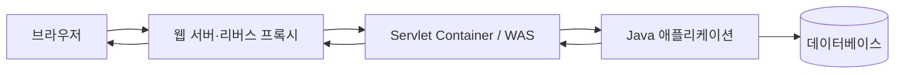

웹 취약점을 이해하려면 페이로드보다 먼저 **요청이 어디에서 해석되고 어떤 값으로 바뀌는지** 알아야 합니다. 이 글은 브라우저에서 로그인 버튼을 눌렀을 때 무엇이 실행되고, 요청이 어디까지 갔다가, 어떤 순서로 화면에 돌아오는지부터 설명합니다.

## 먼저 보기: 로그인 버튼을 누르면 무슨 일이 생길까?

가장 먼저 기억할 점은 **버튼이 서버의 Java 코드를 직접 실행하지는 않는다**는 것입니다. 버튼을 누르면 브라우저가 먼저 움직입니다. 브라우저가 HTTP 요청을 만들고, 서버는 그 요청을 받은 뒤 알맞은 Java 코드를 실행합니다.

예를 들어 다음과 같은 로그인 화면이 있다고 가정해 보겠습니다.

```html
<form action="/login" method="post">
  <input name="username" />
  <input name="password" type="password" />
  <button type="submit">로그인</button>
</form>
```

사용자가 아이디와 비밀번호를 입력하고 로그인 버튼을 누르면 다음 순서로 움직입니다.

```text
사용자
  ↓ ① 로그인 버튼 클릭
브라우저
  ↓ ② POST /login 요청 생성
웹 서버·리버스 프록시
  ↓ ③ 요청 전달
WAS·Servlet Container
  ↓ ④ /login에 적용할 Filter와 Servlet 결정
Filter
  ↓ ⑤ 인코딩·인증·로그 같은 공통 검사 후 Servlet 호출
Servlet 또는 Spring DispatcherServlet
  ↓ ⑥ Controller 등 애플리케이션 코드 연결
Controller → Service → DAO → 데이터베이스
  ↓ ⑦ 입력 확인 → 로그인 규칙 실행 → 사용자 조회
데이터베이스 → DAO → Service → Controller
  ↓ ⑧ 호출 결과가 호출한 계층으로 돌아옴
JSP 또는 JSON 응답
  ↓ ⑨ 서버가 HTML이나 데이터를 HTTP 응답에 담음
웹 서버·리버스 프록시
  ↓ ⑩ 응답 전달
브라우저
  ↓ ⑪ HTML 해석 또는 JavaScript의 화면 갱신
사용자에게 로그인 결과 표시
```

### 1단계: 브라우저가 클릭을 처리한다

위 예시는 `type="submit"` 버튼이므로 브라우저의 기본 동작이 `<form>` 내용을 제출합니다. 입력값이 브라우저 검증을 통과하고 JavaScript가 기본 제출을 취소하지 않았다면, 브라우저는 `<form>`의 `action="/login"`을 목적지로, `method="post"`를 요청 방식으로 사용합니다. 버튼 자체가 주소와 요청 방식을 정하는 것은 아닙니다.

JavaScript가 연결된 버튼이라면 순서가 조금 다릅니다. 클릭 이벤트가 JavaScript 함수를 먼저 실행하고, 그 함수가 `fetch()` 같은 기능으로 요청을 보낼 수 있습니다. 즉 다음 두 방식 모두 가능하지만 출발점은 항상 브라우저입니다.

- 일반 폼 제출: 응답으로 받은 새 HTML 문서로 페이지 전체를 바꾸는 경우가 많습니다.
- JavaScript `fetch()`: JSON 같은 데이터만 받은 뒤 필요한 화면 부분만 바꿀 수 있습니다.

### 2단계: 브라우저가 HTTP 요청을 만든다

브라우저가 만드는 요청을 단순화하면 다음과 같습니다.

```http
POST /login HTTP/1.1
Host: example.com
Content-Type: application/x-www-form-urlencoded

username=alice&password=example
```

`POST`는 요청 방식, `/login`은 목적지, 헤더는 데이터 형식 같은 부가 정보, 빈 줄 아래는 사용자가 입력한 본문입니다. HTTPS를 사용하면 이 메시지는 전송 중 암호화됩니다.

### 3단계: 요청이 서버 입구에 도착한다

브라우저는 도메인 이름에 해당하는 서버 주소를 찾고 연결을 만듭니다. 이 예제의 배포 구성에서는 요청이 Nginx 같은 웹 서버나 리버스 프록시를 먼저 거칩니다. 이 계층은 HTTPS 연결, 요청 크기 제한, 어느 내부 서버로 보낼지 등을 처리한 뒤 WAS(Web Application Server: Java 웹 코드를 실행하는 서버)로 요청을 넘깁니다. 구성에 따라 리버스 프록시 없이 WAS가 요청을 직접 받을 수도 있습니다.

### 4단계: WAS가 실행할 Java 코드를 찾는다

WAS 안의 Servlet Container는 `/login`에 대응하는 Servlet과 적용할 Filter 체인을 결정합니다. Filter가 전처리를 마치고 다음 대상을 호출하면 Servlet이 실행됩니다. Filter가 요청을 차단하거나 응답을 직접 만들면 Servlet까지 가지 않을 수도 있습니다. Container는 요청 내용을 읽을 `HttpServletRequest`와 응답을 작성할 `HttpServletResponse` 객체를 만들어 Java 코드에 전달합니다.

```java
protected void doPost(HttpServletRequest request, HttpServletResponse response) {
    String username = request.getParameter("username");
    String password = request.getParameter("password");
    // 다음 단계의 로그인 로직 호출
}
```

Spring MVC를 사용한다면 Container는 먼저 `DispatcherServlet`이라는 Servlet에 요청을 전달합니다. `DispatcherServlet`이 Spring의 매핑 정보를 보고 `/login`에 연결된 Controller 메서드 실행을 이어 줍니다. Container가 Spring Controller를 직접 고르는 것은 아닙니다.

### 5단계: 애플리케이션이 일을 나눠 처리한다

일반적인 MVC(Model·View·Controller: 데이터·화면·요청 제어 책임을 나누는 구조)에서는 역할을 다음처럼 나눕니다.

- Controller: 입력을 받고 어떤 작업을 할지 결정합니다.
- Service: 비밀번호 확인, 잠긴 계정 확인 같은 로그인 규칙을 실행합니다.
- DAO(Data Access Object: 데이터베이스 접근을 맡는 객체): SQL을 실행해 사용자를 조회합니다.
- 데이터베이스: 저장된 사용자 정보를 찾아 결과를 돌려줍니다.

이 예제의 호출은 `Controller → Service → DAO → 데이터베이스` 순서로 들어갑니다. 조회 결과는 호출한 계층으로 `데이터베이스 → DAO → Service → Controller` 순서로 반환되고, Controller가 그 결과를 이용해 새 응답을 만듭니다. 각 메서드의 `return` 값이나 예외가 이 반환 흐름을 만듭니다. 모든 요청이 데이터베이스까지 가는 것은 아니며, Filter의 후처리가 있다면 응답이 나가기 전에 실행됩니다.

### 6단계: 서버가 HTTP 응답을 만든다

서버는 Session(세션: 여러 요청에 걸쳐 값을 유지하는 서버 측 상태)을 관리할 수 있고, 브라우저에는 보통 Session ID가 든 Cookie(쿠키: 브라우저가 보관했다가 조건에 맞는 요청에 다시 보내는 작은 값)를 전달합니다. Session은 로그인 전에도 만들어질 수 있으며 Cookie에 비밀번호나 세션 데이터 전체가 들어가는 것은 아닙니다. 로그인 성공 뒤에는 탈취 방지를 위해 Session ID를 새로 발급하는 것이 안전합니다.

그다음에는 보통 둘 중 하나를 선택합니다.

- JSP 방식: Controller가 결과를 JSP에 전달하고, JSP가 완성한 HTML을 응답합니다.
- API 방식: Controller가 성공 여부 같은 JSON 데이터를 응답합니다.

로그인 직후 서버가 다른 주소로 이동하라는 redirect(리다이렉트: 브라우저에 새 주소로 다시 요청하라고 지시하는 응답)를 보낼 수도 있습니다. 이때 브라우저는 새 주소로 별도의 `GET` 요청을 보내므로 왕복이 한 번 더 생깁니다.

단순화한 응답은 다음과 같습니다.

```http
HTTP/1.1 200 OK
Content-Type: text/html; charset=UTF-8
Set-Cookie: JSESSIONID=새로운값; HttpOnly; Secure

<html><body>alice님, 환영합니다.</body></html>
```

### 7단계: 브라우저가 응답을 화면으로 바꾼다

응답은 Filter의 후처리와 WAS를 지나고, 이 예제에서는 프록시를 거쳐 브라우저에 도착합니다. 브라우저는 상태 코드와 헤더를 먼저 확인하고, HTML이라면 문서를 해석해 화면을 그립니다. JSON 자체가 화면을 바꾸지는 않습니다. `fetch()`를 실행한 JavaScript가 JSON을 읽고 성공 문구나 사용자 정보를 화면에 넣어야 합니다.

이것이 **클릭 → 요청 → 서버 코드 실행 → 데이터베이스 → 응답 → 화면 갱신**의 한 번의 왕복입니다. 아래부터는 이 왕복에 등장한 HTTP, 프록시, WAS를 하나씩 자세히 살펴봅니다.

## 1. HTTP는 요청과 응답의 규칙이다

HTTP(Hypertext Transfer Protocol: 웹에서 요청과 응답을 주고받는 규칙) 메시지는 시작 줄, 헤더, 선택적인 본문으로 구성됩니다.

```text
브라우저 → 요청 메서드·경로·헤더·본문 → 서버
브라우저 ← 상태 코드·헤더·본문       ← 서버
```

- 메서드는 작업 의도를 나타냅니다. `GET`은 조회, `POST`는 보통 데이터 제출에 사용하지만 실제 권한을 보장하지는 않습니다.
- 경로와 쿼리 문자열은 요청 대상을 표현합니다.
- 헤더는 콘텐츠 형식, 인증 정보, 캐시, 출처 같은 부가 정보를 전달합니다.
- 본문에는 폼, JSON, 파일 등이 들어갈 수 있습니다.

HTTPS는 HTTP를 TLS(Transport Layer Security: 전송 구간을 암호화하고 서버 신원을 확인하는 프로토콜) 위에서 전달합니다. 전송 암호화는 도청을 줄이지만, 서버가 받은 입력을 안전하게 처리한다는 뜻은 아닙니다.

참고: [RFC 9110 — HTTP Semantics](https://www.rfc-editor.org/rfc/rfc9110), [RFC 9112 — HTTP/1.1](https://www.rfc-editor.org/rfc/rfc9112)

## 2. 웹 서버·리버스 프록시·WAS의 역할

실무에서는 한 프로세스가 모든 일을 처리하지 않는 경우가 많습니다.



- 웹 서버는 정적 파일 제공과 HTTP 연결 처리를 맡을 수 있습니다.
- 리버스 프록시는 외부 요청을 내부 서버로 전달하며 TLS 종료, 라우팅, 압축, 요청 크기 제한 등을 수행할 수 있습니다.
- WAS(Web Application Server: 애플리케이션 코드를 실행하고 요청을 연결하는 서버) 또는 Servlet Container는 URL을 Servlet에 매핑하고 요청·응답 객체를 만들어 Java 코드를 호출합니다.
- 애플리케이션은 업무 규칙을 수행하고 데이터베이스나 외부 API를 호출합니다.

제품마다 경계는 다릅니다. Tomcat은 Servlet Container이면서 HTTP 서버 역할도 할 수 있고, 앞에 Nginx 같은 프록시를 둘 수도 있습니다. 따라서 “웹 서버가 검사했으니 애플리케이션도 같은 값을 본다”고 가정하면 안 됩니다.

## 3. 같은 요청을 서로 다르게 해석할 수 있다

프록시, WAS, 프레임워크는 각각 경로, 헤더, 본문을 파싱합니다. 이때 다음 차이가 보안 문제의 출발점이 됩니다.

- 중복 헤더나 중복 파라미터 중 어느 값을 선택하는가
- URL 인코딩과 문자 인코딩을 몇 번, 어떤 순서로 해제하는가
- 프록시가 정규화한 경로와 애플리케이션이 인가에 사용한 경로가 같은가
- 요청 본문 형식과 크기 제한이 모든 계층에서 일치하는가
- `X-Forwarded-For` 같은 전달 헤더를 신뢰할 수 있는 프록시만 설정하는가

핵심은 외부 입력을 문자열 하나로 보지 않고 **어느 계층에서 어떤 값으로 변환됐는지** 추적하는 것입니다. 인증·인가·로그도 가능한 한 애플리케이션이 실제 처리한 정규화된 값을 기준으로 일관되게 판단해야 합니다.

## 4. 문자 인코딩과 요청 본문

문자열은 바이트를 문자로 해석한 결과입니다. 클라이언트와 서버의 인코딩이 다르면 같은 바이트가 다른 글자로 보일 수 있습니다. Java 웹에서는 요청 본문을 읽기 전에 문자 인코딩을 확정하고, 응답에도 올바른 `Content-Type`과 charset을 지정해야 합니다.

JSON, 폼 데이터, 파일 업로드는 파서도 다릅니다. 한 형식에 적용한 검증이 다른 형식에는 자동으로 적용되지 않습니다. 컨트롤러가 최종적으로 받는 값과 원본 요청을 함께 확인해야 파싱 경계를 이해할 수 있습니다.

## 체크리스트

- 외부 요청이 거치는 프록시·로드밸런서·WAS를 순서대로 그렸는가?
- 각 계층의 경로 정규화, 헤더 신뢰, 요청 크기와 시간 제한을 확인했는가?
- 요청 형식별 파서와 문자 인코딩이 명확한가?
- 인증·인가·로그가 같은 정규화 값을 기준으로 동작하는가?

참고: [Jakarta Servlet Specification](https://jakarta.ee/specifications/servlet/), [Tomcat Architecture](https://tomcat.apache.org/tomcat-11.0-doc/architecture/overview.html)
