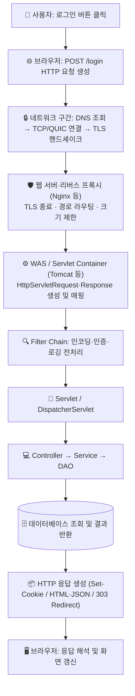
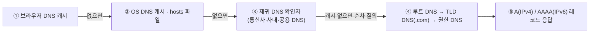
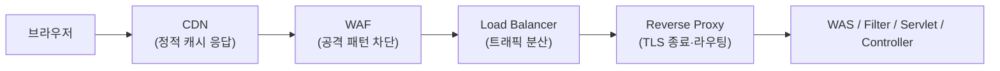

> [!summary] ⏱️ 5초 핵심 요약
> - **한 줄 비유**: 브라우저에서 로그인 버튼을 누르는 것은 **주문서(HTTP 요청)**를 작성해 **안내 데스크(리버스 프록시·웹 서버)**를 거쳐 **주방 매니저(WAS·Servlet Container)**와 **요리사(Controller·Service·DAO)**에게 전달하고 완성된 요리를 돌려받는 과정입니다.
> - **핵심 원리**: 버튼이 서버의 Java 코드를 직접 실행하는 것이 아니라, **`브라우저(HTTP 요청 생성)` → `네트워크(DNS·TCP·TLS)` → `프록시/웹 서버` → `WAS(Filter·Servlet)` → `애플리케이션(Controller·Service·DAO)` → `DB`** 순서로 해석·전달됩니다.
> - **핵심 보안 포인트**: 프록시, WAS, 프레임워크가 **같은 요청(경로·헤더·파라미터·인코딩)을 서로 다르게 해석(파싱 불일치)**할 때 접근통제 우회와 취약점이 발생하므로, 모든 검증과 인가는 **애플리케이션이 최종 처리하는 정규화된 값**을 기준으로 수행해야 합니다.

웹 취약점을 깊이 이해하려면 공격 페이로드보다 먼저 **요청이 어느 구간에서 해석되고 어떤 값으로 바뀌는지**부터 알아야 합니다. 이 글은 브라우저에서 로그인 버튼을 눌렀을 때 무엇이 실행되고, 요청이 어디까지 갔다가, 어떤 순서로 화면에 돌아오는지 전체 왕복 흐름을 해부합니다.



---

## 한눈에 보는 요청 처리 계층별 역할과 보안 경계

| 구간 / 계층 | 핵심 역할 | 다루는 주요 데이터 | 대표 보안 체크 포인트 |
|---|---|---|---|
| **브라우저 (Client)** | `<form>` 제출 또는 `fetch()`로 HTTP 메시지 생성, 응답 렌더링 | URL, 입력 폼, DOM, Cookie | 클라이언트 검증은 언제든 우회 가능 (보안 경계 아님) |
| **네트워크 (DNS·TCP·TLS)** | 도메인→IP 변환, 연결 수립, 전송 구간 암호화 | IP 패킷, TLS 레코드, SNI | TLS는 전송 구간 도청만 막으며 서버 입력 검증을 대신하지 않음 |
| **리버스 프록시 / 웹 서버** | 외부 요청 수신, TLS 종료, 정적 파일 응답, 내부 WAS 전달 | 원본 URI, `Host`, `X-Forwarded-*` 헤더 | 프록시와 WAS 간 경로 정규화(`/..;`) 및 헤더 신뢰 설정 불일치 주의 |
| **WAS / Servlet Container** | 소켓 읽기, HTTP 파싱, Filter 체인 및 Servlet 실행 | `HttpServletRequest`, `HttpServletResponse`, `HttpSession` | 요청 본문 읽기 전 문자 인코딩(`UTF-8`) 확정, 세션 ID 재발급 |
| **애플리케이션 (MVC + DB)** | 입력 검증, 비즈니스 규칙(인증·인가), SQL 실행 | DTO/VO, 도메인 객체, SQL 파라미터 | 파라미터 바인딩(`PreparedStatement`), 객체 단위 인가 검증 |

---

## 1. 먼저 보기: 로그인 버튼을 누르면 무슨 일이 생길까?

**💡 한 줄 비유**: 화면의 로그인 버튼은 주방의 가스레인지를 직접 켜는 스위치가 아니라, **웨이터(브라우저)에게 "이 주문서(`POST /login`)를 주방(서버)에 갖다 주세요"라고 지시하는 호출 벨**입니다.

가장 먼저 기억할 점은 **버튼이 서버의 Java 코드를 직접 실행하지는 않는다**는 것입니다. 버튼을 누르면 브라우저가 먼저 움직여 HTTP 요청을 만들고, 서버는 그 요청을 받은 뒤 알맞은 Java 코드를 실행합니다.

예를 들어 다음과 같은 로그인 화면이 있다고 가정해 보겠습니다.

```html
<form action="/login" method="post">
  <input name="username" />
  <input name="password" type="password" />
  <button type="submit">로그인</button>
</form>
```

사용자가 아이디와 비밀번호를 입력하고 로그인 버튼을 누르면 **1단계부터 7단계까지** 다음 순서로 움직입니다.

### 1단계: 브라우저가 클릭을 처리한다
- **일반 `<form>` 제출**: 위 예시는 `type="submit"` 버튼이므로 입력값이 브라우저 검증을 통과하고 JavaScript가 기본 제출을 취소하지 않았다면, 브라우저는 `<form>`의 `action="/login"`을 목적지로, `method="post"`를 요청 방식으로 사용합니다. (버튼 자체가 주소와 방식을 정하는 것이 아닙니다.) 응답으로 받은 새 HTML 문서로 페이지 전체를 바꾸는 경우가 많습니다.
- **JavaScript `fetch()` 호출**: JavaScript가 연결된 버튼이라면 클릭 이벤트가 함수를 먼저 실행하고 `fetch()`로 요청을 보냅니다. JSON 같은 데이터만 받은 뒤 필요한 화면 일부분만 갱신할 수 있습니다. 출발점은 두 방식 모두 브라우저입니다.

### 2단계: 브라우저가 HTTP 요청을 만든다
브라우저가 만드는 HTTP 요청을 단순화하면 다음과 같습니다.

```http
POST /login HTTP/1.1
Host: example.com
Content-Type: application/x-www-form-urlencoded

username=alice&password=example
```

- **시작 줄**: `POST`는 요청 방식(메서드), `/login`은 목적지 경로입니다.
- **헤더**: `Host`, `Content-Type`처럼 데이터 형식이나 부가 정보를 담습니다.
- **본문(Body)**: 빈 줄 아래에 사용자가 입력한 데이터가 들어갑니다. HTTPS를 사용하면 이 메시지는 전송 중 암호화됩니다.

### 3단계: 요청이 서버 입구에 도착한다
- 브라우저는 도메인 이름에 해당하는 서버 IP 주소를 찾고 연결을 만듭니다.
- 실무 배포 구성에서는 요청이 Nginx 같은 **웹 서버나 리버스 프록시**를 먼저 거치는 경우가 많습니다. 이 계층은 HTTPS 연결(TLS 종료), 요청 크기 제한, 어느 내부 서버로 보낼지(라우팅) 등을 처리한 뒤 **WAS(Web Application Server: Java 웹 코드를 실행하는 서버)**로 요청을 넘깁니다.
- 구성에 따라 리버스 프록시 없이 WAS가 요청을 직접 받을 수도 있습니다.

### 4단계: WAS가 실행할 Java 코드를 찾는다
- WAS 안의 **Servlet Container**는 `/login`에 대응하는 Servlet과 적용할 **Filter 체인**을 결정합니다.
- Filter가 인코딩·인증·로깅 같은 전처리를 마치고 다음 대상을 호출하면 Servlet이 실행됩니다. (만약 Filter가 요청을 차단하거나 응답을 직접 만들면 Servlet까지 가지 않을 수도 있습니다.)
- Container는 요청 내용을 읽을 `HttpServletRequest`와 응답을 작성할 `HttpServletResponse` 객체를 만들어 Java 코드에 전달합니다.

```java
protected void doPost(HttpServletRequest request, HttpServletResponse response) {
    String username = request.getParameter("username");
    String password = request.getParameter("password");
    // 다음 단계의 로그인 로직 호출
}
```

- **Spring MVC 사용 시**: Container는 먼저 `DispatcherServlet`이라는 단일 진입점 Servlet에 요청을 전달합니다. `DispatcherServlet`이 Spring의 매핑 정보를 보고 `/login`에 연결된 `@Controller` 메서드 실행을 이어 줍니다(Container가 Spring Controller를 직접 고르는 것이 아닙니다).

### 5단계: 애플리케이션이 일을 나눠 처리한다
일반적인 **MVC(Model·View·Controller: 데이터·화면·요청 제어 책임을 나누는 구조)**에서는 역할을 다음과 같이 분리합니다.

- **Controller**: 입력을 받고 어떤 작업을 할지 결정합니다.
- **Service**: 비밀번호 확인, 잠긴 계정 확인 같은 비즈니스 로그인 규칙을 실행합니다.
- **DAO(Data Access Object: 데이터베이스 접근을 맡는 객체)**: SQL을 실행해 사용자를 조회합니다.
- **데이터베이스(DB)**: 저장된 사용자 정보를 찾아 결과를 돌려줍니다.

호출은 `Controller → Service → DAO → 데이터베이스` 순서로 들어가고, 조회 결과는 각 메서드의 `return` 값이나 예외를 통해 `데이터베이스 → DAO → Service → Controller` 역순으로 반환됩니다. 모든 요청이 데이터베이스까지 가는 것은 아니며, Filter의 후처리가 있다면 응답이 나가기 전에 실행됩니다.

### 6단계: 서버가 HTTP 응답을 만든다
- **세션과 쿠키 발급**: 서버는 **Session**(세션: 여러 요청에 걸쳐 값을 유지하는 서버 측 상태)을 관리할 수 있고, 브라우저에는 보통 Session ID가 든 **Cookie**(쿠키: 브라우저가 보관했다가 조건에 맞는 요청에 다시 보내는 작은 값)를 전달합니다. Cookie에 비밀번호나 세션 데이터 전체가 들어가는 것은 아닙니다. 로그인 성공 뒤에는 세션 고정(Session Fixation) 방지를 위해 **Session ID를 새로 발급**하는 것이 안전합니다.
- **응답 형식 선택**:
  - **JSP 방식**: Controller가 결과를 JSP에 전달하고, JSP가 완성한 HTML을 응답합니다.
  - **API 방식**: Controller가 성공 여부 같은 JSON 데이터를 응답합니다.
  - **Redirect 방식**: 로그인 직후 서버가 다른 주소로 이동하라는 **redirect**(리다이렉트: 브라우저에 새 주소로 다시 요청하라고 지시하는 응답)를 보낼 수도 있습니다. 이때 브라우저는 새 주소로 별도의 `GET` 요청을 보내므로 왕복이 한 번 더 생깁니다.

```http
HTTP/1.1 200 OK
Content-Type: text/html; charset=UTF-8
Set-Cookie: JSESSIONID=새로운값; HttpOnly; Secure

<html><body>alice님, 환영합니다.</body></html>
```

### 7단계: 브라우저가 응답을 화면으로 바꾼다
- 응답은 Filter의 후처리와 WAS, 프록시를 거쳐 브라우저에 도착합니다.
- 브라우저는 상태 코드와 헤더를 먼저 확인하고, HTML이라면 문서를 해석해 화면을 그립니다.
- JSON 응답이라면 JSON 자체가 화면을 바꾸지는 않으며, `fetch()`를 실행한 JavaScript가 JSON을 읽고 성공 문구나 사용자 정보를 DOM에 반영합니다.

---

## 2. DNS부터 서버까지: 네트워크 구간을 더 자세히 보기

**💡 한 줄 비유**: 가게 이름(`shop.example`)만 알고 있을 때 **전화번호부(DNS)**에서 실제 주소(`203.0.113.10`)를 찾고, **도로망(라우터·게이트웨이)**을 따라 이동해 **상대방과 통화 연결(TCP/QUIC)**을 맺은 뒤 **도청 방지 암호기(TLS)**를 켜는 과정입니다.

앞에서는 "브라우저가 서버로 요청을 보낸다"라고 짧게 표현했지만, 실제로는 도메인 이름을 IP 주소로 바꾸고 암호화 통로를 만든 뒤 HTTP 요청을 보내야 합니다.

| 항목 | 예시 값 (문서 설명용) | 의미 |
|---|---|---|
| 사용자가 누른 페이지 | `https://shop.example/login` | 로그인 요청을 받을 주소 |
| DNS 응답 | `203.0.113.10` | 설명용 서버 IP 주소 ([RFC 5737](https://www.rfc-editor.org/rfc/rfc5737) 예약 대역) |
| HTTPS 포트 | `443` | 암호화된 웹 연결의 기본 포트 |
| 프록시가 전달할 내부 주소 | `10.0.2.15:8080` | 외부에서 직접 보이지 않는 내부 WAS 주소 예시 |
| Servlet 매핑 | `/login` | 이 경로를 처리할 Java 코드 |
| 성공 응답 | `303 Location: /home` | POST 이후 브라우저에 홈 화면을 GET으로 요청하라는 지시 |

*(주의: `shop.example`과 `203.0.113.10`은 표준에서 예약한 설명용 값이므로, 실습 명령에는 자신이 관리하거나 허가받은 실제 호스트를 넣으세요.)*

### 1) 브라우저가 URL을 나눈다
브라우저는 `https://shop.example/login`을 다음과 같이 쪼개어 해석합니다.
- **`https` (Scheme)**: HTTPS 통신 방식으로 연결합니다.
- **`shop.example` (Host)**: 찾아가야 할 서버의 도메인 이름입니다.
- **`443` (Port)**: URL에 포트가 생략되었으므로 HTTPS 기본 포트(`443`)를 사용합니다.
- **`/login` (Path)**: 서버 안에서 요청할 자원의 경로입니다.

`<form action="/login">`처럼 상대 경로만 적혀 있어도 브라우저는 현재 페이지의 scheme, host, port를 합쳐 전체 목적지를 계산합니다. (만약 브라우저에 **Service Worker**가 등록돼 있다면 네트워크로 나가기 전에 요청을 가로채 처리할 수도 있습니다.)

### 2) DNS가 도메인을 IP 주소로 바꾼다
**DNS(Domain Name System)** 조회는 매번 루트 서버부터 찾지 않고 캐시를 먼저 확인합니다.



- **스텁 리졸버(Stub Resolver)와 재귀 확인자**: 브라우저와 OS 캐시에 결과가 없으면 OS의 스텁 리졸버가 설정된 재귀 DNS 확인자(공유기, 통신사, 클라우드 DNS 등)에 질문합니다. (브라우저가 DoH 같은 보안 DNS를 직접 쓰면 OS와 다른 경로로 질문할 수도 있습니다.)
- **계층적 질의**: 재귀 확인자도 답을 모르면 **루트 DNS**(TLD 위치 안내) → **TLD DNS**(`.com`, `.kr` 등의 권한 DNS 안내) → **권한 DNS**(최종 레코드 보유) 순서로 찾아냅니다.
- **레코드와 TTL**: `A`는 IPv4, `AAAA`는 IPv6 주소를 주며, `CNAME`은 별칭 도메인을 가리켜 추가 조회가 발생할 수 있습니다. 응답의 **TTL(Time To Live)**이 남아 있거나 기존 서버 연결을 재사용하면 버튼을 다시 눌러도 DNS 조회와 연결 수립은 생략됩니다.
- 참고: [RFC 1034 — DNS 개념과 구성](https://www.rfc-editor.org/rfc/rfc1034), [RFC 1035 — DNS 구현과 레코드](https://www.rfc-editor.org/rfc/rfc1035)

### 3) 내 컴퓨터가 첫 번째 네트워크 장비로 보낸다
- 운영체제는 라우팅 테이블을 보고 목적지가 같은 로컬 네트워크인지, 기본 게이트웨이(공유기 등)로 보낼지 결정합니다.
- **ARP**(IPv4) 또는 **NDP**(IPv6)로 다음 장비의 MAC 주소를 찾아 랜선이나 Wi-Fi로 패킷을 전달합니다.
- 가정용 공유기는 흔히 사설 IP를 공인 IP로 바꾸는 **NAT(Network Address Translation)**를 수행하며, 인터넷 사업자 간 경로는 **BGP(Border Gateway Protocol)** 정보를 바탕으로 여러 중간 라우터를 거쳐 목적지 IP로 전달됩니다. 각 라우터는 도메인이 아니라 **목적지 IP**를 보고 다음 구간을 고릅니다.

### 4) TCP 또는 QUIC 연결을 만든다
- **HTTP/1.1과 HTTP/2 (TCP 기반)**: 순서와 전달을 보장하는 TCP 위에서 동작하며, 새 연결은 **3-way handshake**(`SYN` → `SYN-ACK` → `ACK`)로 시작합니다.
- **HTTP/3 (QUIC 기반)**: TCP 대신 UDP 위의 **QUIC**을 사용하며, QUIC은 연결 수립 과정에 TLS 1.3 핸드셰이크를 통합합니다.
- **연결 재사용**: 한 번 만든 연결은 Keep-Alive나 멀티플렉싱(HTTP/2, HTTP/3)으로 여러 요청에 재사용되므로 "요청 1개 = TCP 연결 1개"가 아닙니다.

### 5) TLS로 서버를 확인하고 암호화 키를 만든다
HTTPS에서는 HTTP 메시지를 보내기 전에 **TLS 핸드셰이크**가 진행됩니다.
1. 브라우저가 지원 TLS 버전, 암호 스위트, 임시 키 정보, 그리고 접속하려는 도메인 이름인 **SNI(Server Name Indication)**를 보냅니다.
2. 서버가 선택된 암호 조건과 **서버 인증서**를 보냅니다.
3. 브라우저는 인증서의 도메인 일치 여부, 유효기간, 발급자(CA)를 검증합니다.
4. 양쪽이 대칭 암호화 키를 계산하고, **ALPN(Application-Layer Protocol Negotiation)**으로 `http/1.1` 또는 `h2` 같은 프로토콜을 합의합니다.
5. 이후 모든 HTTP 헤더와 본문은 암호화된 TLS 레코드 안에서 전달됩니다. *(단, TLS는 전송 구간만 보호할 뿐 서버 코드의 SQL Injection이나 인가 누락을 막아주지 않습니다.)*
- 참고: [RFC 8446 — TLS 1.3](https://www.rfc-editor.org/rfc/rfc8446)

### 6) 인터넷 경계 장비를 지나 실제 애플리케이션으로 간다
실제 운영 서비스에서는 요청이 여러 경계 장비를 통과합니다.



- CDN이 캐시된 응답을 바로 주면 요청은 WAS까지 도달하지 않습니다.
- TLS가 CDN이나 리버스 프록시에서 종료(TLS Termination)되면 브라우저와의 HTTPS 연결은 그 장비에서 끝나고, 프록시에서 내부 WAS까지는 별도의 내부 연결이 만들어집니다.

### 7) 응답이 돌아오고 추가 요청(PRG 패턴)이 생긴다
로그인 성공 후 새로고침 시 중복 `POST` 제출을 막기 위해 흔히 **POST / Redirect / GET (PRG)** 패턴을 사용합니다.

```http
# 1) 로그인 폼 제출
POST /login HTTP/1.1
...
# 2) 서버의 리다이렉트 및 세션 쿠키 발급 응답
HTTP/1.1 303 See Other
Location: /home
Set-Cookie: JSESSIONID=xyz987; HttpOnly; Secure

# 3) 브라우저가 자동으로 새 주소에 GET 요청 전송
GET /home HTTP/1.1
Cookie: JSESSIONID=xyz987
```

이후 브라우저가 `/home`의 HTML을 해석하면서 CSS, JS, 이미지, 폰트 파일을 발견하면 각각 추가 요청을 보내므로, 버튼은 한 번 눌렀어도 개발자 도구 Network 탭에는 수십 줄의 요청이 기록됩니다.

---

## 3. 직접 확인하는 실습 (PowerShell & 브라우저 개발자 도구)

**💡 한 줄 비유**: 이론으로만 배운 택배 경로를 **운송장 조회 명령어(`Resolve-DnsName`, `curl -v`)와 CCTV(브라우저 Network 탭)**로 직접 눈으로 따라가 보는 단계입니다.

*(반드시 자신이 소유하거나 실습이 허가된 사이트에서만 수행하고, 테스트 계정을 사용하세요.)*

### 1) DNS·포트·TLS·HTTP 왕복 명령어 점검
```powershell
# 1. DNS A(IPv4) 및 AAAA(IPv6) 레코드와 TTL 확인
Resolve-DnsName example.com
Resolve-DnsName example.com -Type AAAA

# 2. 목적지 IP의 443 포트까지 TCP 연결 수립 가능 여부 확인
Test-NetConnection example.com -Port 443

# 3. TLS 핸드셰이크 과정과 요청(>) / 응답(<) 헤더 상세 확인
curl.exe -v https://example.com/

# 4. 301/302/303 리다이렉트 응답 시 다음 Location까지 자동으로 따라가며 확인
curl.exe -v -L https://example.com/
```

### 2) 브라우저 개발자 도구(`F12`) Network 탭 확인 순서
1. **Network** 탭을 열고 목록을 비운 뒤 테스트 로그인 버튼을 클릭합니다.
2. `/login` 요청을 선택하고 **Headers** 탭에서 `Request URL`, `Request Method`, `Status Code`, `Remote Address`를 확인합니다.
3. **Payload** 탭에서 브라우저가 보낸 폼 데이터나 JSON 구조를 확인합니다.
4. **Response** 탭에서 서버가 돌려준 본문을 확인하고, `302`/`303` 리다이렉트라면 뒤이어 발생한 `/home` 요청에 `Cookie` 헤더가 실렸는지 확인합니다.
5. **Timing** 탭에서 `DNS Lookup`, `Initial connection`, `SSL(TLS)`, `Waiting (TTFB)` 소요 시간을 확인합니다. (기존 연결 재사용 시 `0ms`에 가깝게 표시될 수 있습니다.)

---

## 4. 파싱 불일치: 같은 요청을 계층마다 다르게 해석할 때 생기는 문제

**💡 한 줄 비유**: 건물 입구 경비원(프록시)은 출입증을 보고 **"일반 방문객 통로(`/public/../admin` → `/public` 계열?)"**라고 통과시켰는데, 안쪽 사무실 문지기(WAS)는 경로를 계산해 **"관리자실(`/admin`)"** 문을 열어주는 것처럼 **해석 기준이 다를 때** 보안 사고가 터집니다.

HTTP([RFC 9110](https://www.rfc-editor.org/rfc/rfc9110), [RFC 9112](https://www.rfc-editor.org/rfc/rfc9112)) 메시지는 프록시, WAS, 프레임워크가 각각 파싱합니다. 이때 계층 간 해석 차이가 취약점의 출발점이 됩니다.

### 계층 간 주요 파싱 불일치 지점
- **경로 정규화(Path Normalization) 차이**: `/admin/..;/login`이나 이중 URL 인코딩(`%252e%252e%252f`)을 프록시와 WAS/Spring이 서로 다르게 해석해 접근통제를 우회하는 현상
- **중복 파라미터·헤더 처리(HPP)**: `?id=user&id=admin`처럼 같은 이름의 파라미터나 헤더가 두 번 들어올 때, 앞의 값을 읽는 계층과 뒤의 값을 읽는 계층이 갈리는 문제
- **신뢰할 수 없는 전달 헤더 오용**: `X-Forwarded-For`, `X-Forwarded-Host`를 신뢰할 수 있는 리버스 프록시가 덮어쓰지 않고 클라이언트가 보낸 값 그대로 애플리케이션이 믿어버리는 문제
- **문자 인코딩과 Content-Type 파서 차이**: JSON, `application/x-www-form-urlencoded`, `multipart/form-data`는 파서가 각각 다릅니다. 한 형식에 적용한 필터가 다른 형식에는 적용되지 않을 수 있으며, Java에서는 요청 본문을 읽기 전에 문자 인코딩(`request.setCharacterEncoding("UTF-8")`)을 먼저 확정해야 바이트 해석 오류가 생기지 않습니다.

---

## 5. 진단 및 시큐어코딩 체크리스트

**💡 한 줄 비유**: 집을 지을 때 **도로(네트워크) → 대문(프록시) → 현관(WAS) → 방 문(애플리케이션)**까지 모든 문짝의 규격과 잠금장치가 서로 어긋나지 않는지 최종 점검하는 표입니다.

- [ ] 도메인 이름이 DNS 캐시·재귀 확인자를 거쳐 IP 주소로 바뀌고 TCP/QUIC·TLS로 연결되는 흐름을 구분할 수 있는가?
- [ ] 서비스 앞단에 CDN·WAF·로드밸런서·리버스 프록시 중 실제로 존재하는 계층과 TLS 종료 지점을 파악했는가?
- [ ] 프록시가 정규화한 URL 경로와 WAS·애플리케이션이 인가(Authorization) 판단에 사용하는 경로가 정확히 일치하는가?
- [ ] `X-Forwarded-For` 등 프록시 헤더를 신뢰할 수 있는 내부 프록시 구간에서만 수용하도록 설정했는가?
- [ ] 요청 형식(`urlencoded`, `multipart`, `json`)별 파서와 문자 인코딩(`UTF-8`), 요청 크기 및 시간 제한이 일관되게 적용되어 있는가?
- [ ] 다음 단계로 WAS 내부에서 요청이 어떻게 멀티스레드로 처리되는지 보려면 [[Java 웹 기초 2 — Servlet 생명주기·멀티스레딩과 Scope]] 글을 이어서 참고하세요.
- 참고: [Jakarta Servlet Specification](https://jakarta.ee/specifications/servlet/), [Tomcat Architecture](https://tomcat.apache.org/tomcat-11.0-doc/architecture/overview.html)
