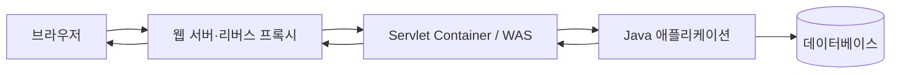

웹 취약점을 이해하려면 페이로드보다 먼저 **요청이 어디에서 해석되고 어떤 값으로 바뀌는지** 알아야 합니다. 이 글은 브라우저에서 보낸 HTTP 요청이 리버스 프록시와 Java 웹 애플리케이션을 거쳐 응답으로 돌아오는 경계를 정리합니다.

## 1. HTTP는 요청과 응답의 규칙이다

HTTP(Hypertext Transfer Protocol: 웹에서 요청과 응답을 주고받는 규칙) 메시지는 시작 줄, 헤더, 선택적인 본문으로 구성됩니다.

```text
브라우저 → 요청 메서드·경로·헤더·본문 → 서버
브라우저 ← 상태 코드·헤더·본문       ← 서버
```

- 메서드는 작업 의도를 나타냅니다. `GET`은 조회, `POST`는 보통 데이터 제출에 사용하지만 실제 권한을 보장하지는 않습니다.
- 경로와 쿼리 문자열은 요청 대상을 표현합니다.
- 헤더는 콘텐츠 형식, 인증 정보, 캐시, 출처 같은 부가 정보를 전달합니다.
- 본문에는 폼, JSON, 파일 등이 들어갈 수 있습니다.

HTTPS는 HTTP를 TLS(Transport Layer Security: 전송 구간을 암호화하고 서버 신원을 확인하는 프로토콜) 위에서 전달합니다. 전송 암호화는 도청을 줄이지만, 서버가 받은 입력을 안전하게 처리한다는 뜻은 아닙니다.

참고: [RFC 9110 — HTTP Semantics](https://www.rfc-editor.org/rfc/rfc9110), [RFC 9112 — HTTP/1.1](https://www.rfc-editor.org/rfc/rfc9112)

## 2. 웹 서버·리버스 프록시·WAS의 역할

실무에서는 한 프로세스가 모든 일을 처리하지 않는 경우가 많습니다.



- 웹 서버는 정적 파일 제공과 HTTP 연결 처리를 맡을 수 있습니다.
- 리버스 프록시는 외부 요청을 내부 서버로 전달하며 TLS 종료, 라우팅, 압축, 요청 크기 제한 등을 수행할 수 있습니다.
- WAS(Web Application Server: 애플리케이션 코드를 실행하고 요청을 연결하는 서버) 또는 Servlet Container는 URL을 Servlet에 매핑하고 요청·응답 객체를 만들어 Java 코드를 호출합니다.
- 애플리케이션은 업무 규칙을 수행하고 데이터베이스나 외부 API를 호출합니다.

제품마다 경계는 다릅니다. Tomcat은 Servlet Container이면서 HTTP 서버 역할도 할 수 있고, 앞에 Nginx 같은 프록시를 둘 수도 있습니다. 따라서 “웹 서버가 검사했으니 애플리케이션도 같은 값을 본다”고 가정하면 안 됩니다.

## 3. 같은 요청을 서로 다르게 해석할 수 있다

프록시, WAS, 프레임워크는 각각 경로, 헤더, 본문을 파싱합니다. 이때 다음 차이가 보안 문제의 출발점이 됩니다.

- 중복 헤더나 중복 파라미터 중 어느 값을 선택하는가
- URL 인코딩과 문자 인코딩을 몇 번, 어떤 순서로 해제하는가
- 프록시가 정규화한 경로와 애플리케이션이 인가에 사용한 경로가 같은가
- 요청 본문 형식과 크기 제한이 모든 계층에서 일치하는가
- `X-Forwarded-For` 같은 전달 헤더를 신뢰할 수 있는 프록시만 설정하는가

핵심은 외부 입력을 문자열 하나로 보지 않고 **어느 계층에서 어떤 값으로 변환됐는지** 추적하는 것입니다. 인증·인가·로그도 가능한 한 애플리케이션이 실제 처리한 정규화된 값을 기준으로 일관되게 판단해야 합니다.

## 4. 문자 인코딩과 요청 본문

문자열은 바이트를 문자로 해석한 결과입니다. 클라이언트와 서버의 인코딩이 다르면 같은 바이트가 다른 글자로 보일 수 있습니다. Java 웹에서는 요청 본문을 읽기 전에 문자 인코딩을 확정하고, 응답에도 올바른 `Content-Type`과 charset을 지정해야 합니다.

JSON, 폼 데이터, 파일 업로드는 파서도 다릅니다. 한 형식에 적용한 검증이 다른 형식에는 자동으로 적용되지 않습니다. 컨트롤러가 최종적으로 받는 값과 원본 요청을 함께 확인해야 파싱 경계를 이해할 수 있습니다.

## 체크리스트

- 외부 요청이 거치는 프록시·로드밸런서·WAS를 순서대로 그렸는가?
- 각 계층의 경로 정규화, 헤더 신뢰, 요청 크기와 시간 제한을 확인했는가?
- 요청 형식별 파서와 문자 인코딩이 명확한가?
- 인증·인가·로그가 같은 정규화 값을 기준으로 동작하는가?

다음 글: [[Java 웹 기초 2 — Servlet 생명주기·멀티스레딩과 Scope]]

참고: [Jakarta Servlet Specification](https://jakarta.ee/specifications/servlet/), [Tomcat Architecture](https://tomcat.apache.org/tomcat-11.0-doc/architecture/overview.html)
