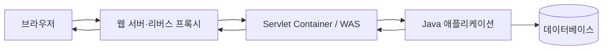

웹 취약점을 이해하려면 페이로드보다 먼저 **요청이 어디에서 해석되고 어떤 값으로 바뀌는지** 알아야 합니다. 이 글은 브라우저에서 로그인 버튼을 눌렀을 때 무엇이 실행되고, 요청이 어디까지 갔다가, 어떤 순서로 화면에 돌아오는지부터 설명합니다.

## 먼저 보기: 로그인 버튼을 누르면 무슨 일이 생길까?

가장 먼저 기억할 점은 **버튼이 서버의 Java 코드를 직접 실행하지는 않는다**는 것입니다. 버튼을 누르면 브라우저가 먼저 움직입니다. 브라우저가 HTTP 요청을 만들고, 서버는 그 요청을 받은 뒤 알맞은 Java 코드를 실행합니다.

예를 들어 다음과 같은 로그인 화면이 있다고 가정해 보겠습니다.

```html
<form action="/login" method="post">
  <input name="username" />
  <input name="password" type="password" />
  <button type="submit">로그인</button>
</form>
```

사용자가 아이디와 비밀번호를 입력하고 로그인 버튼을 누르면 다음 순서로 움직입니다.

```text
사용자
  ↓ ① 로그인 버튼 클릭
브라우저
  ↓ ② POST /login 요청 생성
웹 서버·리버스 프록시
  ↓ ③ 요청 전달
WAS·Servlet Container
  ↓ ④ /login에 적용할 Filter와 Servlet 결정
Filter
  ↓ ⑤ 인코딩·인증·로그 같은 공통 검사 후 Servlet 호출
Servlet 또는 Spring DispatcherServlet
  ↓ ⑥ Controller 등 애플리케이션 코드 연결
Controller → Service → DAO → 데이터베이스
  ↓ ⑦ 입력 확인 → 로그인 규칙 실행 → 사용자 조회
데이터베이스 → DAO → Service → Controller
  ↓ ⑧ 호출 결과가 호출한 계층으로 돌아옴
JSP 또는 JSON 응답
  ↓ ⑨ 서버가 HTML이나 데이터를 HTTP 응답에 담음
웹 서버·리버스 프록시
  ↓ ⑩ 응답 전달
브라우저
  ↓ ⑪ HTML 해석 또는 JavaScript의 화면 갱신
사용자에게 로그인 결과 표시
```

### 1단계: 브라우저가 클릭을 처리한다

위 예시는 `type="submit"` 버튼이므로 브라우저의 기본 동작이 `<form>` 내용을 제출합니다. 입력값이 브라우저 검증을 통과하고 JavaScript가 기본 제출을 취소하지 않았다면, 브라우저는 `<form>`의 `action="/login"`을 목적지로, `method="post"`를 요청 방식으로 사용합니다. 버튼 자체가 주소와 요청 방식을 정하는 것은 아닙니다.

JavaScript가 연결된 버튼이라면 순서가 조금 다릅니다. 클릭 이벤트가 JavaScript 함수를 먼저 실행하고, 그 함수가 `fetch()` 같은 기능으로 요청을 보낼 수 있습니다. 즉 다음 두 방식 모두 가능하지만 출발점은 항상 브라우저입니다.

- 일반 폼 제출: 응답으로 받은 새 HTML 문서로 페이지 전체를 바꾸는 경우가 많습니다.
- JavaScript `fetch()`: JSON 같은 데이터만 받은 뒤 필요한 화면 부분만 바꿀 수 있습니다.

### 2단계: 브라우저가 HTTP 요청을 만든다

브라우저가 만드는 요청을 단순화하면 다음과 같습니다.

```http
POST /login HTTP/1.1
Host: example.com
Content-Type: application/x-www-form-urlencoded

username=alice&password=example
```

`POST`는 요청 방식, `/login`은 목적지, 헤더는 데이터 형식 같은 부가 정보, 빈 줄 아래는 사용자가 입력한 본문입니다. HTTPS를 사용하면 이 메시지는 전송 중 암호화됩니다.

### 3단계: 요청이 서버 입구에 도착한다

브라우저는 도메인 이름에 해당하는 서버 주소를 찾고 연결을 만듭니다. 이 예제의 배포 구성에서는 요청이 Nginx 같은 웹 서버나 리버스 프록시를 먼저 거칩니다. 이 계층은 HTTPS 연결, 요청 크기 제한, 어느 내부 서버로 보낼지 등을 처리한 뒤 WAS(Web Application Server: Java 웹 코드를 실행하는 서버)로 요청을 넘깁니다. 구성에 따라 리버스 프록시 없이 WAS가 요청을 직접 받을 수도 있습니다.

### 4단계: WAS가 실행할 Java 코드를 찾는다

WAS 안의 Servlet Container는 `/login`에 대응하는 Servlet과 적용할 Filter 체인을 결정합니다. Filter가 전처리를 마치고 다음 대상을 호출하면 Servlet이 실행됩니다. Filter가 요청을 차단하거나 응답을 직접 만들면 Servlet까지 가지 않을 수도 있습니다. Container는 요청 내용을 읽을 `HttpServletRequest`와 응답을 작성할 `HttpServletResponse` 객체를 만들어 Java 코드에 전달합니다.

```java
protected void doPost(HttpServletRequest request, HttpServletResponse response) {
    String username = request.getParameter("username");
    String password = request.getParameter("password");
    // 다음 단계의 로그인 로직 호출
}
```

Spring MVC를 사용한다면 Container는 먼저 `DispatcherServlet`이라는 Servlet에 요청을 전달합니다. `DispatcherServlet`이 Spring의 매핑 정보를 보고 `/login`에 연결된 Controller 메서드 실행을 이어 줍니다. Container가 Spring Controller를 직접 고르는 것은 아닙니다.

### 5단계: 애플리케이션이 일을 나눠 처리한다

일반적인 MVC(Model·View·Controller: 데이터·화면·요청 제어 책임을 나누는 구조)에서는 역할을 다음처럼 나눕니다.

- Controller: 입력을 받고 어떤 작업을 할지 결정합니다.
- Service: 비밀번호 확인, 잠긴 계정 확인 같은 로그인 규칙을 실행합니다.
- DAO(Data Access Object: 데이터베이스 접근을 맡는 객체): SQL을 실행해 사용자를 조회합니다.
- 데이터베이스: 저장된 사용자 정보를 찾아 결과를 돌려줍니다.

이 예제의 호출은 `Controller → Service → DAO → 데이터베이스` 순서로 들어갑니다. 조회 결과는 호출한 계층으로 `데이터베이스 → DAO → Service → Controller` 순서로 반환되고, Controller가 그 결과를 이용해 새 응답을 만듭니다. 각 메서드의 `return` 값이나 예외가 이 반환 흐름을 만듭니다. 모든 요청이 데이터베이스까지 가는 것은 아니며, Filter의 후처리가 있다면 응답이 나가기 전에 실행됩니다.

### 6단계: 서버가 HTTP 응답을 만든다

서버는 Session(세션: 여러 요청에 걸쳐 값을 유지하는 서버 측 상태)을 관리할 수 있고, 브라우저에는 보통 Session ID가 든 Cookie(쿠키: 브라우저가 보관했다가 조건에 맞는 요청에 다시 보내는 작은 값)를 전달합니다. Session은 로그인 전에도 만들어질 수 있으며 Cookie에 비밀번호나 세션 데이터 전체가 들어가는 것은 아닙니다. 로그인 성공 뒤에는 탈취 방지를 위해 Session ID를 새로 발급하는 것이 안전합니다.

그다음에는 보통 둘 중 하나를 선택합니다.

- JSP 방식: Controller가 결과를 JSP에 전달하고, JSP가 완성한 HTML을 응답합니다.
- API 방식: Controller가 성공 여부 같은 JSON 데이터를 응답합니다.

로그인 직후 서버가 다른 주소로 이동하라는 redirect(리다이렉트: 브라우저에 새 주소로 다시 요청하라고 지시하는 응답)를 보낼 수도 있습니다. 이때 브라우저는 새 주소로 별도의 `GET` 요청을 보내므로 왕복이 한 번 더 생깁니다.

단순화한 응답은 다음과 같습니다.

```http
HTTP/1.1 200 OK
Content-Type: text/html; charset=UTF-8
Set-Cookie: JSESSIONID=새로운값; HttpOnly; Secure

<html><body>alice님, 환영합니다.</body></html>
```

### 7단계: 브라우저가 응답을 화면으로 바꾼다

응답은 Filter의 후처리와 WAS를 지나고, 이 예제에서는 프록시를 거쳐 브라우저에 도착합니다. 브라우저는 상태 코드와 헤더를 먼저 확인하고, HTML이라면 문서를 해석해 화면을 그립니다. JSON 자체가 화면을 바꾸지는 않습니다. `fetch()`를 실행한 JavaScript가 JSON을 읽고 성공 문구나 사용자 정보를 화면에 넣어야 합니다.

이것이 **클릭 → 요청 → 서버 코드 실행 → 데이터베이스 → 응답 → 화면 갱신**의 한 번의 왕복입니다. 아래부터는 이 왕복에 등장한 HTTP, 프록시, WAS를 하나씩 자세히 살펴봅니다.

## DNS부터 서버까지: 네트워크 구간을 더 자세히 보기

앞에서는 “브라우저가 서버로 요청을 보낸다”라고 짧게 표현했습니다. 실제로는 도메인 이름을 IP 주소로 바꾸고, 그 IP까지 연결을 만든 다음, 암호화 통로 안으로 HTTP 요청을 보내야 합니다.

다음은 설명을 위한 가상 예시입니다.

| 항목 | 예시 값 | 의미 |
|---|---|---|
| 사용자가 누른 페이지 | `https://shop.example/login` | 로그인 요청을 받을 주소 |
| DNS 응답 | `203.0.113.10` | 설명용 서버 IP 주소 |
| HTTPS 포트 | `443` | 암호화된 웹 연결의 기본 포트 |
| 프록시가 전달할 내부 주소 | `10.0.2.15:8080` | 외부에서 직접 보이지 않는 WAS 주소 예시 |
| Servlet 매핑 | `/login` | 이 경로를 처리할 Java 코드 |
| 성공 응답 | `303 Location: /home` | POST 이후 브라우저에 홈 화면을 GET으로 요청하라는 지시 |

`shop.example`과 `203.0.113.10`은 표준에서 예약한 설명용 값이며 실제 DNS 조회나 HTTPS 연결 성공을 기대하면 안 됩니다. 아래 실습 명령에는 자신이 관리하거나 확인을 허가받은 실제 호스트를 넣으세요. 참고: [RFC 5737 — 문서용 IPv4 주소](https://www.rfc-editor.org/rfc/rfc5737)

### 1. 브라우저가 URL을 나눈다

브라우저는 `https://shop.example/login`을 다음처럼 나눠 이해합니다.

- `https`: HTTPS 방식으로 연결합니다.
- `shop.example`: 찾아가야 할 서버의 도메인 이름입니다.
- `443`: URL에 포트가 없으므로 HTTPS 기본 포트를 사용합니다.
- `/login`: 서버 안에서 요청할 자원의 경로입니다.

버튼이 상대 경로인 `action="/login"`만 가지고 있어도 브라우저는 현재 페이지의 scheme(스킴: `http`나 `https` 같은 통신 방식), host(호스트: 도메인 이름), port(포트: 서버 프로그램을 구분하는 번호)를 합쳐 전체 목적지를 계산합니다.

Service Worker(서비스 워커: 브라우저 안에서 요청을 가로채 캐시나 네트워크를 선택할 수 있는 스크립트)가 등록돼 있다면 네트워크로 나가기 전에 요청을 처리할 수도 있습니다. 일반적인 서버 왕복 예제에서는 Service Worker가 없다고 가정합니다.

### 2. DNS가 도메인을 IP 주소로 바꾼다

DNS(Domain Name System: 사람이 읽는 도메인 이름을 IP 주소 등의 정보로 바꾸는 분산 시스템) 조회는 보통 다음 순서로 진행됩니다.

```text
브라우저 DNS 캐시
  ↓ 없으면
운영체제 DNS 캐시·hosts 파일
  ↓ 없으면
재귀 DNS 확인자
  ↓ 답을 모르면
루트 DNS → TLD DNS → 권한 DNS
  ↓
A 또는 AAAA 레코드 응답 → 브라우저
```

각 역할은 다음과 같습니다.

1. 브라우저와 운영체제는 최근에 찾은 결과가 남아 있는지 먼저 확인합니다.
2. 없으면 일반적으로 운영체제의 stub resolver(스텁 리졸버: 애플리케이션 대신 DNS 질문을 전달하는 작은 확인자)가 설정된 재귀 DNS 확인자에 질문합니다. 보통 공유기, 통신사, 회사 또는 공용 DNS가 이 역할을 합니다. 브라우저가 보안 DNS를 직접 사용하면 운영체제와 다른 경로로 질문할 수도 있습니다.
3. 재귀 확인자도 답을 캐시하지 않았다면 DNS 계층을 따라 질문합니다. 다음은 대표 흐름이며 브라우저가 루트부터 직접 순회하는 것이 아닙니다.
   - 루트 DNS는 해당 TLD 서버의 위치를 알려줍니다.
   - TLD(Top-Level Domain: `.com`, `.kr` 같은 최상위 도메인) DNS는 해당 도메인의 권한 DNS를 알려줍니다.
   - 권한 DNS는 그 도메인에 대해 관리자가 등록한 최종 레코드를 답합니다.
4. `A` 레코드는 IPv4 주소를, `AAAA` 레코드는 IPv6 주소를 제공합니다. `CNAME`은 다른 도메인 이름을 가리키므로 추가 조회가 생길 수 있습니다.
5. 각 응답의 TTL(Time To Live: DNS 결과를 캐시에 보관할 수 있는 시간)이 지나기 전에는 같은 질문을 반복하지 않을 수 있습니다.

따라서 **버튼을 누를 때마다 루트 DNS부터 전부 다시 조회하는 것은 아닙니다.** 캐시가 있거나 기존 서버 연결을 재사용하면 DNS 조회와 연결 수립 단계가 생략될 수 있습니다.

참고: [RFC 1034 — DNS 개념과 구성](https://www.rfc-editor.org/rfc/rfc1034), [RFC 1035 — DNS 구현과 레코드](https://www.rfc-editor.org/rfc/rfc1035)

### 3. 내 컴퓨터가 첫 번째 네트워크 장비로 보낸다

IP 주소를 알았다고 해서 패킷이 곧바로 목적지 서버에 도착하는 것은 아닙니다. 운영체제는 라우팅 테이블을 보고 목적지가 같은 로컬 네트워크인지, 기본 게이트웨이로 보낼지 결정합니다. 이 설명은 HTTP 연결을 기준으로 나눈 것이며, 앞선 DNS 질문과 응답도 이미 같은 라우팅 과정을 이용합니다.

- ARP(Address Resolution Protocol: IPv4 환경에서 같은 네트워크의 IP 주소에 해당하는 MAC 주소를 찾는 규칙)나 NDP(Neighbor Discovery Protocol: IPv6의 이웃 탐색 규칙)로 다음 장비의 링크 계층 주소를 찾습니다.
- Wi-Fi 또는 유선 랜을 통해 패킷을 공유기나 회사 게이트웨이로 보냅니다.
- 가정용 공유기는 흔히 NAT(Network Address Translation: 내부 사설 IP와 외부 공인 IP를 변환하는 기능)를 수행하지만 모든 네트워크에 NAT가 있는 것은 아닙니다.
- 통신사와 여러 중간 라우터가 목적지 IP에 더 가까운 다음 경로로 패킷을 전달합니다. 인터넷 사업자 사이의 큰 경로는 BGP(Border Gateway Protocol: 서로 다른 네트워크가 도달 경로를 교환하는 프로토콜)의 영향을 받습니다. BGP가 사용자의 요청마다 새 경로를 계산한다는 뜻은 아닙니다.

요청 패킷과 응답 패킷이 인터넷에서 반드시 완전히 같은 라우터를 거치는 것은 아닙니다. 중요한 점은 각 라우터가 최종 도메인이 아니라 주로 목적지 IP와 라우팅 정보를 보고 다음 구간을 선택한다는 것입니다.

### 4. TCP 또는 QUIC 연결을 만든다

HTTP/1.1과 HTTP/2는 일반적으로 TCP(Transmission Control Protocol: 순서와 전달을 확인하는 연결형 전송 프로토콜) 위에서 동작합니다. 새 TCP 연결은 다음 3-way handshake(3단계 연결 확인)로 시작합니다.

```text
브라우저 → SYN     → 서버
브라우저 ← SYN-ACK ← 서버
브라우저 → ACK     → 서버
```

HTTP/3은 TCP 대신 UDP 위의 QUIC(Quick UDP Internet Connections: 연결과 암호화를 함께 제공하는 전송 프로토콜)를 사용합니다. QUIC은 TLS 1.3 handshake를 연결 과정에 통합하므로 HTTP/3에서는 “QUIC 연결을 만든 다음 별도로 TLS를 시작한다”고 이해하면 안 됩니다. 브라우저와 서버가 지원하는 방식에 따라 실제 연결 과정은 달라집니다.

한 번 만든 연결은 여러 요청에 재사용될 수 있습니다. HTTP/2와 HTTP/3은 하나의 연결에서 여러 요청을 동시에 처리할 수도 있으므로 “요청 하나마다 TCP 연결 하나”라고 외우면 안 됩니다.

### 5. TLS로 서버를 확인하고 암호화 키를 만든다

HTTPS에서는 HTTP를 보내기 전에 TLS(Transport Layer Security: 서버 신원을 확인하고 통신을 암호화하는 프로토콜) handshake(핸드셰이크: 연결 조건을 합의하는 과정)가 진행됩니다.

단순화하면 다음과 같습니다.

1. 브라우저가 지원하는 TLS 버전, 암호 방식, 임시 키 정보와 SNI(Server Name Indication: 접속하려는 도메인 이름)를 보냅니다.
2. 서버가 사용할 조건과 인증서를 보냅니다.
3. 브라우저는 인증서의 도메인, 유효기간, 발급자를 확인합니다.
4. 양쪽이 이번 연결에 사용할 암호화 키를 계산합니다.
5. ALPN(Application-Layer Protocol Negotiation: TLS 연결에서 사용할 HTTP 버전을 합의하는 기능)으로 HTTP/1.1이나 HTTP/2 같은 프로토콜을 정할 수 있습니다.
6. 이후 HTTP 헤더와 본문은 암호화된 TLS 레코드 안에서 전달됩니다.

TLS는 전송 중 내용을 보호하지만 서버 애플리케이션의 SQL Injection이나 접근통제 오류까지 고쳐주지는 않습니다.

참고: [RFC 8446 — TLS 1.3](https://www.rfc-editor.org/rfc/rfc8446)

### 6. 인터넷 경계 장비를 지나 실제 애플리케이션으로 간다

서비스 구성에 따라 요청은 다음 중 일부를 거칩니다.

```text
브라우저
  → CDN
  → WAF
  → Load Balancer
  → Reverse Proxy
  → WAS
  → Filter
  → Servlet / DispatcherServlet
  → Controller
```

- CDN(Content Delivery Network: 여러 지역의 경계 서버에서 콘텐츠를 제공하는 망)은 가까운 서버에서 캐시된 파일을 바로 응답할 수 있습니다.
- WAF(Web Application Firewall: 웹 요청 규칙을 검사하는 방화벽)는 요청을 차단하거나 통과시킵니다.
- Load Balancer(로드밸런서: 여러 서버 중 처리할 서버를 고르는 장비나 소프트웨어)는 건강 상태와 분산 정책에 따라 대상을 정합니다.
- Reverse Proxy(리버스 프록시: 외부 요청을 내부 서버 대신 받아 전달하는 중계 서버)는 TLS 종료, 경로 라우팅, 헤더 추가 등을 수행할 수 있습니다.
- WAS와 Servlet Container가 URL 매핑을 보고 Java 코드를 실행합니다.

이 장비들이 모든 서비스에 전부 존재하는 것은 아닙니다. 작은 개발 환경은 브라우저가 Tomcat의 `8080` 포트로 직접 연결할 수 있고, 큰 서비스는 CDN부터 여러 프록시 계층을 거칠 수 있습니다.

CDN이 캐시된 응답을 만들면 요청은 WAS까지 가지 않을 수 있습니다. TLS가 CDN이나 프록시에서 종료되면 그 장비가 브라우저와의 HTTPS 연결 끝점이며, 프록시에서 WAS까지는 별도의 연결이 만들어집니다. 위의 `Filter → Servlet → Controller`는 Spring MVC의 `DispatcherServlet`을 사용하는 대표적인 Java 구성입니다.

### 7. 응답이 돌아오고 추가 요청이 생긴다

서버가 만든 상태 코드, 헤더, 본문은 각 계층의 응답 후처리를 거쳐 브라우저로 돌아옵니다. 브라우저가 HTML을 받으면 문서를 해석하면서 CSS, JavaScript, 이미지, 글꼴 주소를 발견하고 각각 별도의 요청을 만들 수 있습니다.

로그인 화면을 여는 순간부터 포함하면 대표적인 POST/Redirect/GET 흐름은 다음과 같습니다. `303 See Other`는 POST 처리 뒤 지정한 주소를 `GET`으로 요청하라는 의미를 명확히 합니다.

```text
GET /login
  ← 200 OK, 로그인 화면 HTML
POST /login
  ← 303 Location: /home, Set-Cookie: JSESSIONID=...
GET /home
  Cookie: JSESSIONID=...
  ← 200 OK, 홈 화면 HTML
```

즉 사용자가 버튼을 한 번 눌렀어도 네트워크 패널에는 로그인 요청, 리다이렉트 요청, CSS·JavaScript·이미지 요청이 여러 줄로 보일 수 있습니다.

## 직접 확인하는 실습

자신이 소유하거나 실습이 허용된 사이트에서만 확인하세요. 실제 비밀번호 대신 테스트 계정을 사용하고, 인증 헤더나 Cookie 값을 캡처해 외부에 공유하지 마세요.

### 1. DNS 결과 보기

Windows PowerShell에서는 다음 명령으로 DNS 레코드와 TTL을 확인할 수 있습니다.

```powershell
Resolve-DnsName example.com
Resolve-DnsName example.com -Type AAAA
```

`Name`, `Type`, `TTL`, `IPAddress`를 확인합니다. 같은 명령을 반복했을 때 결과가 즉시 나오는 것은 캐시의 영향일 수 있습니다.

### 2. 목적지 포트까지 연결되는지 보기

```powershell
Test-NetConnection example.com -Port 443
```

`RemoteAddress`는 DNS로 선택된 원격 IP 중 하나이며, `TcpTestSucceeded`는 그 IP의 443 포트까지 TCP 연결을 만들 수 있었는지 보여줍니다. 애플리케이션 로그인이 성공했다는 뜻은 아닙니다.

### 3. TLS와 HTTP 왕복 보기

```powershell
curl.exe -v https://example.com/
curl.exe -v -L https://example.com/
```

`-v`는 연결 대상, TLS 협상, 보낸 요청 헤더와 받은 응답 헤더를 보여줍니다. 출력의 `>`는 클라이언트가 보낸 내용, `<`는 서버가 돌려준 내용입니다. HTTPS 본문이 네트워크에서 평문으로 전송된다는 뜻이 아니라, `curl`이 암호화 전후의 자기 데이터를 화면에 보여주는 것입니다. 기본 `curl`은 리다이렉트를 자동으로 따라가지 않으며 `-L`을 추가해야 후속 요청을 볼 수 있습니다. 여러 실행 사이에 Cookie를 저장하고 다시 쓰려면 `-c`와 `-b` 옵션이 별도로 필요하지만, Cookie 파일은 인증 정보이므로 실습 후 안전하게 관리해야 합니다.

### 4. 브라우저에서 버튼 요청 보기

Chrome이나 Edge에서 `F12`를 눌러 개발자 도구를 열고 다음 순서로 확인합니다.

1. **Network** 탭을 열고 요청 목록을 비웁니다.
2. 테스트 로그인 버튼을 누릅니다.
3. `/login` 요청을 선택합니다.
4. **Headers**에서 Request URL, Method, Status Code, Remote Address를 봅니다.
5. **Payload**에서 브라우저가 보낸 폼 또는 JSON 구조를 봅니다.
6. **Response**에서 서버가 돌려준 HTML이나 JSON을 봅니다.
7. `302`나 `303` 같은 리다이렉트 응답이 있다면 뒤이어 발생한 `/home` 요청과 Cookie 전송을 확인합니다.
8. **Timing**에서 DNS, Initial connection, SSL, Waiting 같은 구간을 확인합니다.

브라우저가 캐시된 DNS와 기존 연결을 사용하면 일부 Timing 항목이 없거나 `0ms`에 가깝게 보일 수 있습니다. 새 연결 과정을 보려면 개발자 도구에서 캐시를 끄는 것만으로는 DNS·연결 재사용이 전부 초기화되지 않을 수 있다는 점도 기억하세요.

## 1. HTTP는 요청과 응답의 규칙이다

HTTP(Hypertext Transfer Protocol: 웹에서 요청과 응답을 주고받는 규칙) 메시지는 시작 줄, 헤더, 선택적인 본문으로 구성됩니다.

```text
브라우저 → 요청 메서드·경로·헤더·본문 → 서버
브라우저 ← 상태 코드·헤더·본문       ← 서버
```

- 메서드는 작업 의도를 나타냅니다. `GET`은 조회, `POST`는 보통 데이터 제출에 사용하지만 실제 권한을 보장하지는 않습니다.
- 경로와 쿼리 문자열은 요청 대상을 표현합니다.
- 헤더는 콘텐츠 형식, 인증 정보, 캐시, 출처 같은 부가 정보를 전달합니다.
- 본문에는 폼, JSON, 파일 등이 들어갈 수 있습니다.

HTTPS는 HTTP를 TLS(Transport Layer Security: 전송 구간을 암호화하고 서버 신원을 확인하는 프로토콜) 위에서 전달합니다. 전송 암호화는 도청을 줄이지만, 서버가 받은 입력을 안전하게 처리한다는 뜻은 아닙니다.

참고: [RFC 9110 — HTTP Semantics](https://www.rfc-editor.org/rfc/rfc9110), [RFC 9112 — HTTP/1.1](https://www.rfc-editor.org/rfc/rfc9112)

## 2. 웹 서버·리버스 프록시·WAS의 역할

실무에서는 한 프로세스가 모든 일을 처리하지 않는 경우가 많습니다.



- 웹 서버는 정적 파일 제공과 HTTP 연결 처리를 맡을 수 있습니다.
- 리버스 프록시는 외부 요청을 내부 서버로 전달하며 TLS 종료, 라우팅, 압축, 요청 크기 제한 등을 수행할 수 있습니다.
- WAS(Web Application Server: 애플리케이션 코드를 실행하고 요청을 연결하는 서버) 또는 Servlet Container는 URL을 Servlet에 매핑하고 요청·응답 객체를 만들어 Java 코드를 호출합니다.
- 애플리케이션은 업무 규칙을 수행하고 데이터베이스나 외부 API를 호출합니다.

제품마다 경계는 다릅니다. Tomcat은 Servlet Container이면서 HTTP 서버 역할도 할 수 있고, 앞에 Nginx 같은 프록시를 둘 수도 있습니다. 따라서 “웹 서버가 검사했으니 애플리케이션도 같은 값을 본다”고 가정하면 안 됩니다.

## 3. 같은 요청을 서로 다르게 해석할 수 있다

프록시, WAS, 프레임워크는 각각 경로, 헤더, 본문을 파싱합니다. 이때 다음 차이가 보안 문제의 출발점이 됩니다.

- 중복 헤더나 중복 파라미터 중 어느 값을 선택하는가
- URL 인코딩과 문자 인코딩을 몇 번, 어떤 순서로 해제하는가
- 프록시가 정규화한 경로와 애플리케이션이 인가에 사용한 경로가 같은가
- 요청 본문 형식과 크기 제한이 모든 계층에서 일치하는가
- `X-Forwarded-For` 같은 전달 헤더를 신뢰할 수 있는 프록시만 설정하는가

핵심은 외부 입력을 문자열 하나로 보지 않고 **어느 계층에서 어떤 값으로 변환됐는지** 추적하는 것입니다. 인증·인가·로그도 가능한 한 애플리케이션이 실제 처리한 정규화된 값을 기준으로 일관되게 판단해야 합니다.

## 4. 문자 인코딩과 요청 본문

문자열은 바이트를 문자로 해석한 결과입니다. 클라이언트와 서버의 인코딩이 다르면 같은 바이트가 다른 글자로 보일 수 있습니다. Java 웹에서는 요청 본문을 읽기 전에 문자 인코딩을 확정하고, 응답에도 올바른 `Content-Type`과 charset을 지정해야 합니다.

JSON, 폼 데이터, 파일 업로드는 파서도 다릅니다. 한 형식에 적용한 검증이 다른 형식에는 자동으로 적용되지 않습니다. 컨트롤러가 최종적으로 받는 값과 원본 요청을 함께 확인해야 파싱 경계를 이해할 수 있습니다.

## 체크리스트

- 도메인 이름이 DNS 캐시·재귀 확인자를 거쳐 IP 주소로 바뀌는 대표 흐름을 설명할 수 있는가?
- TCP·QUIC과 TLS가 어떤 순서와 방식으로 연결을 만드는지 구분할 수 있는가?
- CDN·WAF·로드밸런서·프록시 중 실제 서비스에 존재하는 계층을 확인했는가?
- 외부 요청이 거치는 프록시·로드밸런서·WAS를 순서대로 그렸는가?
- 각 계층의 경로 정규화, 헤더 신뢰, 요청 크기와 시간 제한을 확인했는가?
- 요청 형식별 파서와 문자 인코딩이 명확한가?
- 인증·인가·로그가 같은 정규화 값을 기준으로 동작하는가?

참고: [Jakarta Servlet Specification](https://jakarta.ee/specifications/servlet/), [Tomcat Architecture](https://tomcat.apache.org/tomcat-11.0-doc/architecture/overview.html)
