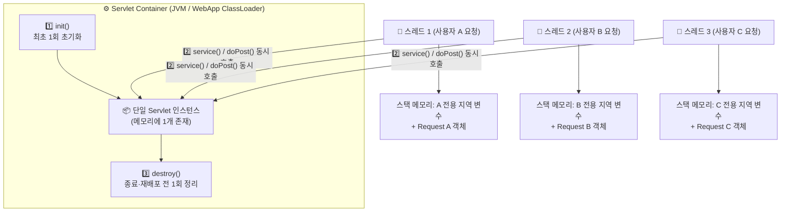
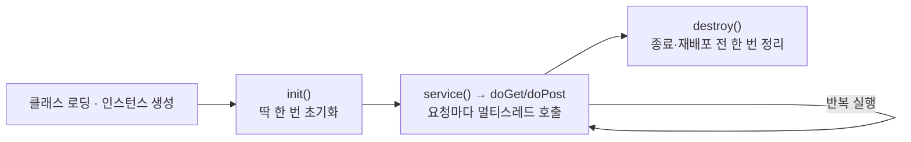

> [!summary] ⏱️ 5초 핵심 요약
> - **한 줄 비유**: WAS 안의 **Servlet은 매장 안에 딱 한 대만 설치된 무인 키오스크(싱글톤 유사 인스턴스)**이고, 동시에 몰려든 **여러 손님(스레드)이 그 한 대의 기계를 같이 누르는 구조**입니다.
> - **핵심 원리**: Container는 Servlet 인스턴스를 보통 **하나만 생성(`init`)**해 두고, 요청이 올 때마다 **서로 다른 스레드가 같은 인스턴스의 `service()`(`doGet`/`doPost`)를 동시에 실행**합니다.
> - **핵심 보안 포인트**: Servlet의 **인스턴스 필드(멤버 변수)나 `static` 필드에 사용자별 데이터를 저장하면 다른 사용자의 요청과 값이 섞이는 치명적인 정보 노출(Race Condition)**이 발생합니다. 요청별 값은 반드시 **지역 변수**나 **`Request` Scope**에 두어야 합니다.

이전 글 [[Java 웹 기초 1 — HTTP·웹 서버·WAS와 요청 처리 흐름]]에서는 요청이 네트워크와 프록시를 거쳐 WAS에 도착하기까지의 경계를 살펴봤습니다. 이제 WAS(Servlet Container)가 Java 객체를 어떻게 만들고, 동시에 들어오는 수많은 사용자의 요청을 어떻게 섞이지 않게 처리하는지 알아봅니다.

> **전체 왕복에서 이 글의 위치:** WAS가 `/login`에 맞는 Java 코드를 고르고 `service`, `doGet`, `doPost` 같은 메서드를 실행하는 부분입니다. 동시에 여러 사람이 버튼을 눌렀을 때 요청이 섞이지 않는 원리와 잘못 짰을 때 섞이는 원리를 함께 다룹니다.



---

## 한눈에 보는 Java 웹 데이터 저장 위치(Scope)와 스레드 안전성

| 저장 위치 / Scope | 대표 객체 / 선언 위치 | 수명 (Lifecycle) | 공유 범위 | 스레드 안전 여부 및 주의점 |
|---|---|---|---|---|
| **지역 변수 (Local)** | 메서드 내부 변수 (`String userId`) | 메서드 실행 동안 | **현재 스레드 단독** | ✅ **안전** (단, 참조 대상이 공유 가변 객체면 위험) |
| **Request Scope** | `HttpServletRequest` | HTTP 요청 1회 왕복 | 현재 요청 처리 구간 (`forward` 포함) | ✅ **안전** (요청마다 새 객체 생성) |
| **Session Scope** | `HttpSession` | 로그인 등 세션 유지 기간 | **같은 사용자(세션)의 여러 요청** | ⚠️ **주의** (한 사용자가 동시에 여러 탭/요청 전송 시 경합 가능) |
| **Servlet 인스턴스 필드** | 클래스 멤버 변수 | Servlet 생성~소멸 | **모든 사용자의 모든 요청 스레드** | 🚨 **매우 위험** (사용자별 상태 저장 절대 금지) |
| **Application Scope** | `ServletContext` | 웹 앱 시작~종료 | **웹 애플리케이션 전체 사용자** | ⚠️ **주의** (전역 읽기 전용 설정 외 가변 상태 저장 주의) |

---

## 1. Servlet은 요청을 처리하는 Java 컴포넌트다

**💡 한 줄 비유**: **Servlet**은 HTTP라는 외국어로 적힌 편지(`HttpServletRequest`)를 받아 Java 코드로 읽고, 답장(`HttpServletResponse`)을 써서 돌려보내는 **표준 번역 창구**입니다.

### 핵심 원리와 네임스페이스 주의사항
- **역할**: Servlet은 HTTP 요청을 Java 코드와 연결하는 서버 측 컴포넌트입니다. Container는 URL 매핑을 보고 알맞은 Servlet을 선택한 뒤 `HttpServletRequest`와 `HttpServletResponse`를 만들어 전달합니다.
- **메서드 흐름**: Container가 진입점인 `service()`를 호출하면, 그 안에서 HTTP 메서드(`GET`, `POST` 등)에 따라 `doGet()`, `doPost()` 같은 메서드로 분기됩니다.
- **`jakarta.servlet.*` vs `javax.servlet.*`**: 현대 Jakarta EE(Tomcat 10.1+, Spring Boot 3+)에서는 `jakarta.servlet.*` 패키지를 사용합니다. 과거 Java EE 시절의 `javax.servlet.*`는 같은 계보의 이전 네임스페이스이므로, 코드 분석이나 라이브러리 적용 시 플랫폼 버전을 먼저 확인해야 합니다.

---

## 2. 생명주기: `init` → `service` → `destroy`

**💡 한 줄 비유**: 식당이 아침에 문을 열며 주방 도구를 세팅하는 것이 **`init`**, 영업시간 내내 손님 주문을 받아 요리하는 것이 **`service`**, 밤에 영업 종료 후 불을 끄고 정리하는 것이 **`destroy`**입니다.



- **`init`**: 설정과 공유 자원을 준비하는 초기화 지점입니다(보통 최초 요청 시점 또는 서버 시작 시 1회 실행).
- **`service`**: 들어오는 각 HTTP 요청을 처리합니다.
- **`destroy`**: 애플리케이션 종료나 재배포 전에 열어둔 자원을 정리할 기회를 제공합니다.

> [!important] 생명주기의 주인은 개발자가 아니라 Container다
> 애플리케이션 코드에서 `new LoginServlet()`처럼 Servlet을 직접 생성해 호출하는 방식으로 이해하면 안 됩니다. 초기화 실패, 재배포, 여러 애플리케이션의 ClassLoader 분리 모두 Container의 생명주기 관리에 따라 동작합니다.
- 참고: [Jakarta Servlet — Servlet Interface](https://jakarta.ee/specifications/servlet/), [Java Virtual Machine Specification](https://docs.oracle.com/javase/specs/jvms/se21/html/)

---

## 3. 멀티스레딩: 하나의 인스턴스에 여러 요청이 동시에 들어온다

**💡 한 줄 비유**: 화이트보드 하나(Servlet 인스턴스 필드)를 두고 직원 10명(스레드)이 동시에 각자 고객 이름을 적으면 글씨가 겹쳐 엉망이 됩니다. 각 직원은 **자기 손에 든 개인 메모장(지역 변수·`HttpServletRequest`)**에 적어야 섞이지 않습니다.

일반적인 Container는 **Servlet 인스턴스 하나**의 요청 처리 메서드를 **여러 스레드에서 동시에 호출**합니다. 따라서 인스턴스 필드에 사용자별 값을 저장하면 요청 사이에 값이 뒤섞이는 동시성 사고가 일어납니다. (과거의 `SingleThreadModel`은 이미 폐기된 방식이므로 현대 설계에서는 절대 사용하지 않습니다.)

### 취약한 코드 vs 안전한 코드 비교
```java
// ❌ 취약한 코드: Servlet 인스턴스 필드에 요청별 값을 저장 (다른 사용자에게 노출됨!)
public class ProfileServlet extends HttpServlet {
    private String currentUserId; // 모든 스레드가 공유하는 필드!

    @Override
    protected void doGet(HttpServletRequest request, HttpServletResponse response) throws IOException {
        this.currentUserId = request.getParameter("userId");
        // 여기서 스레드 문맥 교환(Context Switch)이 일어나면 다른 사용자의 userId로 덮어써짐!
        response.getWriter().println("User: " + this.currentUserId);
    }
}

// ✅ 안전한 코드: 요청별 값은 메서드 내부 지역 변수에 둔다
public class SafeProfileServlet extends HttpServlet {
    @Override
    protected void doGet(HttpServletRequest request, HttpServletResponse response) throws IOException {
        String userId = request.getParameter("userId"); // 현재 스레드 스택에만 존재
        // 이 요청 안에서만 안전하게 검증 및 사용
    }
}
```

### 지역 변수라도 안심할 수 없는 경우
- 지역 변수 자체는 스레드마다 분리되지만, **지역 변수가 참조하는 객체가 공유·변경 가능(Mutable)한 객체**라면 여전히 안전하지 않습니다.
- 공유 캐시, 스레드 안전하지 않은 날짜 포매터(`SimpleDateFormat` 등), 일반 컬렉션(`HashMap`, `ArrayList`), 카운터, DB 연결 객체는 **불변성(Immutability), 동기화, 스레드 안전 구현체(`ConcurrentHashMap`, `DateTimeFormatter`), 적절한 커넥션 풀**을 사용해야 합니다.

---

## 4. Scope: 값의 수명과 공유 범위를 결정하는 3단계 그릇

**💡 한 줄 비유**: **`Request`**는 손님 한 명에게 나가는 **일회용 쟁반**, **`Session`**은 손님이 퇴장할 때까지 쓰는 **개인 사물함**, **`Application`**은 매장 전체 손님이 같이 보는 **중앙 전광판**입니다.

- **Request Scope (`HttpServletRequest`)**: 요청 하나가 처리되는 동안만 유지되며 다음 요청에는 자동으로 이어지지 않습니다. Controller에서 JSP로 화면 렌더링용 데이터를 넘길 때 가장 적합한 최소 범위입니다.
- **Session Scope (`HttpSession`)**: 같은 세션(동일 사용자 브라우저)의 여러 요청에 걸쳐 유지됩니다. 사용자별 로그인 상태 저장에 쓰이지만, 만료 시간 관리와 **한 사용자가 동시에 여러 요청을 보낼 때의 상태 경합**을 고려해야 합니다.
- **Application Scope (`ServletContext`)**: 웹 애플리케이션 전체에서 딱 하나 존재하며 모든 사용자가 공유합니다. 변경 가능한 사용자 상태를 여기에 넣으면 전체 사용자에게 정보가 노출됩니다.

**원칙**: 범위가 넓어질수록 동시 접근과 정보 혼합 위험이 커지므로, **항상 필요한 가장 좁은 Scope(Request 우선)를 선택**하고 Session 저장 시에도 키와 인가 경계를 명확히 해야 합니다.

---

## 5. JVM과 ClassLoader 최소한으로 이해하기

**💡 한 줄 비유**: 한 건물(JVM) 안에 여러 입주사(웹 애플리케이션)가 들어와 있을 때, **입주사별 전용 캐비닛(`WebApp ClassLoader`)**은 분리되어 있지만 **건물 공용 배관이나 퇴거 후 안 치운 짐(`ThreadLocal` 누수, 미종료 스레드)**은 건물 전체에 문제를 일으킵니다.

- **ClassLoader 분리 한계**: JVM(Java Virtual Machine) 위에서 돌아가는 WAS는 보통 웹 애플리케이션별 ClassLoader를 사용해 각 앱의 라이브러리와 `static` 필드를 분리합니다. 하지만 Container 공유 라이브러리나 외부 시스템 자원까지 모두 격리되는 것은 아닙니다.
- **`static` 필드와 `ThreadLocal` 주의**:
  - `static` 필드는 요청별 저장소가 아니라 클래스 로더 단위의 전역 공간입니다.
  - WAS는 스레드 풀(Thread Pool)을 사용해 스레드를 재사용합니다. 따라서 **`ThreadLocal`에 사용자 정보를 넣은 뒤 요청 종료 시 `remove()`로 지우지 않으면**, 그 스레드를 재할당받은 **다음 다른 사용자의 요청에서 이전 사용자의 정보가 그대로 읽히는 심각한 보안 사고**와 메모리 누수가 발생합니다.

---

## 6. 진단 및 시큐어코딩 체크리스트

- [ ] Servlet(또는 Spring `@Controller`, `@Service` 싱글톤 빈)의 인스턴스 필드에 요청·사용자별 가변 상태가 남아 있지 않은가?
- [ ] `ThreadLocal`을 사용하는 경우 Filter나 Interceptor의 `finally` 블록에서 반드시 `remove()`로 초기화하는가?
- [ ] 공유 객체(캐시, 포매터, 컬렉션 등)의 스레드 안전성과 자원 해제를 확인했는가?
- [ ] Request·Session·Application Scope 중 목적에 맞는 **최소 범위**를 선택했는가?
- [ ] 사용하는 플랫폼 버전에 맞춰 `jakarta.servlet`과 레거시 `javax.servlet` 네임스페이스를 정확히 구분했는가?
- [ ] 다음 단계로 Java 코드가 만든 데이터가 어떻게 JSP 화면으로 바뀌는지 보려면 [[Java 웹 기초 3 — JSP·EL·JSTL과 MVC Model 1·2]] 글을 이어서 참고하세요.
- 참고: [Jakarta Servlet Specification](https://jakarta.ee/specifications/pages/), [Apache Tomcat Class Loader How-To](https://tomcat.apache.org/tomcat-11.0-doc/class-loader-howto.html)
