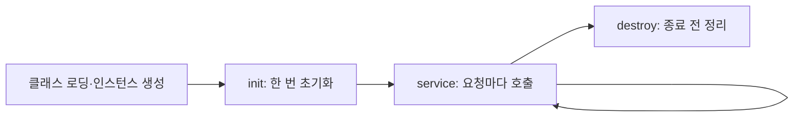

이전 글 [[Java 웹 기초 1 — HTTP·웹 서버·WAS와 요청 처리 흐름]]에서는 요청이 WAS에 도착하기까지의 경계를 살펴봤습니다. 이제 Servlet Container가 Java 코드를 어떻게 만들고 여러 사용자의 요청을 동시에 처리하는지 알아봅니다.

## 1. Servlet은 요청을 처리하는 Java 컴포넌트다

Servlet은 HTTP 요청을 Java 코드와 연결하는 서버 측 컴포넌트입니다. 현대 Jakarta EE에서는 `jakarta.servlet.*` 패키지를 사용합니다. 오래된 프로젝트의 `javax.servlet.*`는 같은 계보의 이전 네임스페이스이므로 사용하는 플랫폼 버전을 먼저 확인해야 합니다.

Container는 URL 매핑을 보고 Servlet을 선택한 뒤 `HttpServletRequest`와 `HttpServletResponse`를 전달합니다. `doGet`, `doPost` 같은 메서드는 결국 `service` 흐름에서 호출됩니다.

## 2. 생명주기: init → service → destroy



- `init`은 설정과 공유 자원을 준비하는 초기화 지점입니다.
- `service`는 각 요청을 처리합니다.
- `destroy`는 애플리케이션 종료나 재배포 전에 자원을 정리할 기회를 제공합니다.

Container가 생명주기를 관리하므로 애플리케이션 코드에서 Servlet을 직접 생성해 호출하는 방식으로 이해하면 안 됩니다. 초기화 실패, 재배포, 여러 애플리케이션의 ClassLoader 분리도 운영 동작에 영향을 줍니다.

참고: [Jakarta Servlet — Servlet Interface](https://jakarta.ee/specifications/servlet/), [Java Virtual Machine Specification](https://docs.oracle.com/javase/specs/jvms/se21/html/)

## 3. 하나의 인스턴스에 여러 요청이 들어올 수 있다

일반적인 Container는 Servlet 인스턴스 하나의 요청 처리 메서드를 여러 스레드에서 동시에 호출할 수 있습니다. 따라서 인스턴스 필드에 사용자별 값을 저장하면 요청 사이에 값이 섞일 수 있습니다.

```java
// 요청별 값은 지역 변수에 둔다.
protected void doGet(HttpServletRequest request, HttpServletResponse response) {
    String userId = request.getParameter("userId");
    // validate and use userId within this request
}
```

지역 변수도 참조하는 객체가 공유·변경 가능하면 안전하지 않을 수 있습니다. 공유 캐시, 날짜 포매터, 컬렉션, 카운터, 연결 객체는 불변성·동기화·스레드 안전한 구현·적절한 풀을 검토해야 합니다. 과거의 `SingleThreadModel`은 폐기된 해결책이며 현대 설계로 사용하면 안 됩니다.

## 4. Scope는 값의 수명과 공유 범위를 정한다

| Scope | 대표 객체 | 공유 범위 | 주의점 |
|---|---|---|---|
| Request | `HttpServletRequest` | 요청 하나 | 다음 요청에는 자동 유지되지 않음 |
| Session | `HttpSession` | 같은 세션의 여러 요청 | 사용자별 상태와 만료·동시 요청 고려 |
| Application | `ServletContext` | 웹 애플리케이션 전체 | 모든 사용자가 공유하므로 변경 상태 주의 |

범위가 넓어질수록 동시 접근과 정보 혼합 위험도 커집니다. 요청에서만 필요한 값을 Session이나 Application에 저장하지 않고, Session에 저장한 객체도 다른 사용자의 세션과 혼동되지 않도록 키와 인가 경계를 명확히 해야 합니다.

## 5. JVM과 ClassLoader를 최소한으로 이해하기

JVM(Java Virtual Machine: Java 바이트코드를 실행하는 가상 머신)은 클래스를 로딩하고 메모리를 관리합니다. 웹 애플리케이션은 보통 애플리케이션별 ClassLoader를 사용해 라이브러리와 정적 필드를 분리하지만, Container 공유 라이브러리나 외부 자원까지 모두 격리되는 것은 아닙니다.

정적 필드는 요청별 저장소가 아닙니다. 재배포 때 남은 스레드나 ThreadLocal 값, 닫지 않은 자원은 메모리 누수와 사용자 상태 혼합을 만들 수 있으므로 Container 생명주기에 맞춰 정리해야 합니다.

## 체크리스트

- Servlet 인스턴스 필드에 요청·사용자별 상태가 남아 있지 않은가?
- 공유 객체의 스레드 안전성과 자원 해제를 확인했는가?
- Request·Session·Application Scope를 필요한 최소 범위로 선택했는가?
- `jakarta.servlet`과 레거시 `javax.servlet` 버전을 혼동하지 않았는가?

다음 글: [[Java 웹 기초 3 — JSP·EL·JSTL과 MVC Model 1·2]]

참고: [Jakarta Servlet Specification](https://jakarta.ee/specifications/servlet/), [Apache Tomcat Class Loader How-To](https://tomcat.apache.org/tomcat-11.0-doc/class-loader-howto.html)
