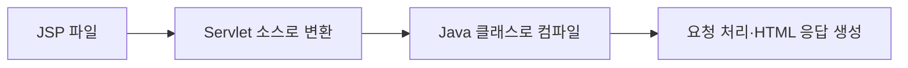

이전 글 [[Java 웹 기초 2 — Servlet 생명주기·멀티스레딩과 Scope]]에서 요청 처리 객체의 수명과 동시성을 살펴봤습니다. 이번에는 Java 코드가 만든 데이터를 JSP 화면으로 전달하는 과정과 MVC 구조를 정리합니다.

> **전체 왕복에서 이 글의 위치:** Controller가 Service와 DAO의 결과를 받은 뒤 JSP에 넘기고, JSP가 브라우저로 보낼 HTML을 만드는 부분입니다.

## 1. JSP는 결국 Servlet으로 실행된다

JSP(JavaServer Pages: HTML 중심 문서에 서버 측 표현을 넣는 View 기술)는 파일 자체가 그대로 실행되는 것이 아닙니다. Container가 JSP를 Java Servlet 소스로 변환하고 컴파일한 뒤 그 Servlet을 실행합니다.



첫 요청이나 JSP 변경 뒤에는 변환·컴파일 비용이 발생할 수 있습니다. 변환된 Servlet도 여러 요청을 처리하므로 JSP 선언부에 변경 가능한 인스턴스 상태를 두면 동시성 문제가 생길 수 있습니다.

참고: [Jakarta Pages Specification](https://jakarta.ee/specifications/pages/)

## 2. EL과 JSTL은 View 표현을 단순화한다

EL(Expression Language: Scope에 저장된 값을 간결하게 조회하는 표현식 언어)은 `${user.name}`처럼 데이터를 읽습니다. JSTL(Jakarta Standard Tag Library: 반복·조건·출력 등에 사용하는 표준 태그 모음)은 Java 코드를 JSP에 직접 섞는 일을 줄입니다.

과거 JSP의 `<% ... %>` Scriptlet은 화면과 업무 로직을 강하게 결합하므로 신규 코드에서는 피하는 편이 좋습니다. Controller와 Service가 처리한 결과를 request attribute 같은 명확한 모델로 전달하고 JSP는 출력에 집중해야 합니다.

EL이나 태그를 썼다고 출력이 자동으로 모든 문맥에서 안전해지는 것은 아닙니다. HTML 본문, 속성, JavaScript, URL은 필요한 인코딩 방식이 다르므로 출력 위치에 맞는 안전한 API와 템플릿 기능을 사용해야 합니다.

## 3. MVC Model 1과 Model 2

MVC(Model–View–Controller: 데이터·화면·요청 제어 책임을 나누는 구조)는 코드의 역할을 분리합니다.

### Model 1

JSP가 요청 파라미터를 읽고 업무 처리나 데이터 접근까지 수행한 뒤 화면을 만듭니다. 작은 예제는 단순하지만 검증·인가·트랜잭션·출력이 한 파일에 섞여 변경과 테스트가 어려워집니다.

### Model 2

Servlet Controller가 요청을 받고 Service/DAO를 호출한 뒤 결과를 View에 전달합니다.

```text
Request → Controller → Service → DAO → Database
                ↓
              Model → JSP View → Response
```

Model 2는 특정 클래스 이름을 강제하는 제품이 아니라 책임 분리 방식입니다. Controller가 모든 업무 로직을 떠안거나 JSP가 다시 데이터베이스를 호출하면 계층만 생기고 책임은 분리되지 않습니다.

## 4. forward와 redirect는 이동 위치가 다르다

- `forward`는 서버 내부에서 같은 요청과 응답을 다른 자원으로 넘깁니다. 브라우저 주소는 바뀌지 않고 request attribute를 이어서 사용할 수 있습니다.
- `redirect`는 브라우저에 새 URL로 다시 요청하라고 응답합니다. 새 요청이므로 기존 request attribute는 사라집니다.

사용자 입력으로 이동 경로를 만들 때는 허용된 내부 경로인지 검증해야 합니다. 또한 forward 전후로 인가 검사가 빠지거나, redirect 대상에 외부 URL을 무제한 허용하지 않도록 경계를 명확히 합니다.

## 체크리스트

- JSP는 출력에 집중하고 업무·데이터 접근 로직은 분리했는가?
- Model에 민감정보를 불필요하게 담거나 화면에 노출하지 않는가?
- 출력 위치에 맞는 인코딩을 적용했는가?
- forward와 redirect의 요청 수명 및 인가 경계를 구분했는가?

참고: [Jakarta Expression Language](https://jakarta.ee/specifications/expression-language/), [Jakarta Tags](https://jakarta.ee/specifications/tags/)
