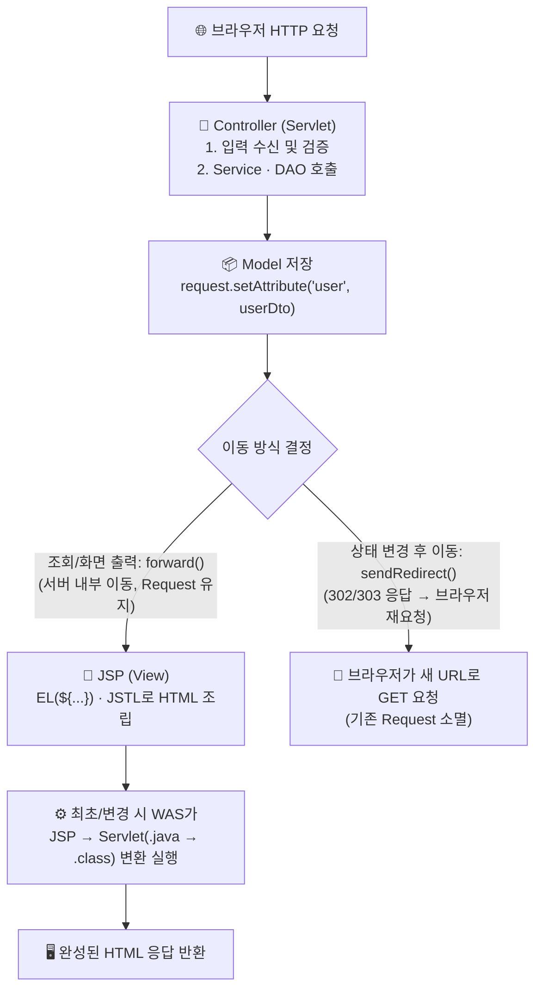
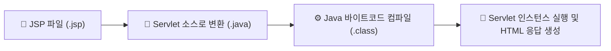
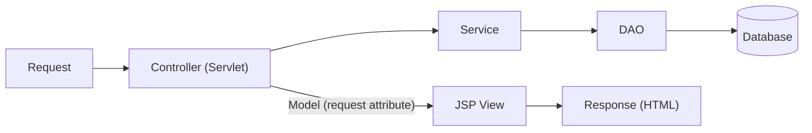

> [!summary] ⏱️ 5초 핵심 요약
> - **한 줄 비유**: **JSP**는 겉보기엔 HTML 문서 같지만, 실제로는 WAS가 뒤에서 **자동으로 `out.write("<html>...")` 형태의 Java Servlet 코드로 번역해 실행하는 템플릿**입니다.
> - **핵심 원리**: **MVC Model 2**에서는 Servlet(Controller)이 요청 제어와 비즈니스 호출을 맡고, 처리 결과(Model)만 `request.setAttribute()`에 담아 **JSP(View)로 `forward`**하여 화면 출력을 분리합니다.
> - **핵심 보안 포인트**: EL(`${...}`)은 기본적으로 HTML 인코딩을 해주지 않으므로 XSS를 막으려면 **출력 문맥(HTML 본문·속성·JS·URL)에 맞는 인코딩**을 적용해야 하며, 서버 내부 이동(`forward`)과 브라우저 재요청(`redirect`)의 인가·외부 URL 검증 경계를 엄격히 구분해야 합니다.

이전 글 [[Java 웹 기초 2 — Servlet 생명주기·멀티스레딩과 Scope]]에서 요청 처리 객체의 수명과 동시성을 살펴봤습니다. 이번에는 Java 코드가 만든 데이터를 JSP 화면으로 전달하는 과정과 MVC 아키텍처의 진화(Model 1 → Model 2)를 정리합니다.

> **전체 왕복에서 이 글의 위치:** Controller가 Service와 DAO의 결과를 받은 뒤 JSP에 넘기고, JSP가 브라우저로 보낼 최종 HTML을 조립하는 부분입니다.



---

## 한눈에 보는 MVC 구조 및 이동 방식 비교

| 비교 항목 | MVC Model 1 (초기 구조) | MVC Model 2 (표준 구조) | `forward` (서버 내부 전달) | `redirect` (브라우저 재요청) |
|---|---|---|---|---|
| **핵심 동작** | **JSP 혼자** 파라미터 수신 + 비즈니스 로직 + DB 조회 + HTML 출력까지 전부 처리 | **Servlet(Controller)**이 흐름 제어, **Service/DAO**가 로직/DB, **JSP(View)**는 출력만 담당 | 서버 내부에서 같은 `request`/`response`를 다음 자원으로 넘김 | 서버가 `302`/`303`과 `Location`을 내려 브라우저가 새 요청 전송 |
| **브라우저 URL** | `.jsp` 경로 직접 노출 | Controller 매핑 경로 유지 | **바뀌지 않음** (최초 요청 URL 유지) | **새 URL로 변경됨** |
| **Request Scope** | 해당 요청 동안 유지 | Controller → JSP로 데이터 전달 | **그대로 유지됨** (`request.getAttribute` 가능) | **소멸됨** (완전히 새로운 요청) |
| **보안 주의점** | 검증·인가·출력이 한 파일에 뒤엉켜 누락 위험 극대화 | 계층은 나눴으나 JSP에 Scriptlet을 남기면 책임 분리 무력화 | 내부 전달 전후 **인가 검증 누락** 및 경로 조작 주의 | `Location`에 외부 URL 허용 시 **Open Redirect** 발생 |

---

## 1. JSP는 결국 Servlet으로 변환되어 실행된다

**💡 한 줄 비유**: 요리사가 HTML이라는 보기 편한 레시피(`login.jsp`)를 작성해 두면, 주방 기계(Container)가 첫 주문이 들어올 때 자동으로 **기계가 실행할 수 있는 Java 코드(`login_jsp.java` → `.class`)로 번역해 돌리는 구조**입니다.



- **동작 원리**: JSP(JavaServer Pages: HTML 중심 문서에 서버 측 표현을 넣는 View 기술)는 파일 자체가 그대로 실행되는 것이 아닙니다. Container가 JSP를 Java Servlet 소스로 변환하고 컴파일한 뒤 그 Servlet을 실행합니다.
- **성능과 동시성 주의점**:
  - 첫 요청이나 JSP 파일 변경 직후에는 변환·컴파일 비용이 발생할 수 있습니다.
  - **변환된 결과물 역시 일반 Servlet과 똑같이 싱글톤 유사 인스턴스로 여러 요청을 동시에 처리**합니다. 따라서 JSP 선언부(`<%! ... %>`)에 변경 가능한 인스턴스 멤버 변수를 두면 [[Java 웹 기초 2 — Servlet 생명주기·멀티스레딩과 Scope]]에서 본 것과 동일한 멀티스레드 상태 섞임 문제가 발생합니다.
- 참고: [Jakarta Pages Specification](https://jakarta.ee/specifications/pages/)

---

## 2. EL과 JSTL은 View 표현을 단순화한다 (그리고 XSS 주의점)

**💡 한 줄 비유**: HTML 문서 한가운데에 날것의 Java 코드(`<% ... %>`)를 직접 난도질해 넣는 대신, **깔끔한 빈칸 채우기 스티커(`EL`)와 표준 조립 블록(`JSTL`)**만 쓰도록 정돈하는 도구입니다.

- **Scriptlet(`<% ... %>`) 지양**: 과거 JSP에서 Java 코드를 직접 적던 Scriptlet은 화면과 업무 로직을 강하게 결합해 유지보수와 보안 점검을 어렵게 하므로 신규 코드에서는 사용하지 않는 것이 원칙입니다. Controller와 Service가 처리한 결과를 `request` attribute 같은 명확한 모델로 전달하고 JSP는 출력에만 집중해야 합니다.
- **EL (Expression Language)**: `${user.name}`처럼 Scope(`page` → `request` → `session` → `application` 순 탐색)에 저장된 값을 간결하게 조회하는 표현식 언어입니다.
- **JSTL (Jakarta Standard Tag Library)**: `<c:forEach>`, `<c:if>`, `<c:out>` 등 반복·조건·출력에 사용하는 표준 태그 모음입니다.

### EL 출력 시 XSS(Cross-Site Scripting) 함정과 방어
EL이나 태그를 썼다고 해서 출력이 모든 문맥에서 자동으로 안전해지는 것은 아닙니다!

```jsp
<%-- ❌ 취약한 출력: EL(${...}) 단독 사용 시 HTML 특수문자(<, >, ", ')가 그대로 렌더링되어 XSS 발생 --%>
<div class="bio">${user.bio}</div>

<%-- ✅ 안전한 출력 (HTML 본문/일반 속성): JSTL <c:out> 또는 fn:escapeXml()로 HTML 인코딩 적용 --%>
<%@ taglib prefix="c" uri="jakarta.tags.core" %>
<%@ taglib prefix="fn" uri="jakarta.tags.functions" %>

<div class="bio"><c:out value="${user.bio}" /></div>
<input type="text" name="nick" value="${fn:escapeXml(user.nickname)}" />
```

- **문맥별 인코딩 필수**: HTML 본문, HTML 속성, `<script>` 내부의 JavaScript 변수, `href`/`src` 같은 URL 문맥은 각각 필요한 인코딩 규칙과 허용 스킴 검증(`javascript:` 차단 등)이 다르므로 출력 위치에 맞는 안전한 API와 템플릿 기능을 사용해야 합니다.

---

## 3. MVC Model 1과 Model 2의 차이

**💡 한 줄 비유**: **Model 1**은 1인 식당에서 사장님 혼자 주문받고, 요리하고, 계산하고, 서빙까지 다 하는 구조이고, **Model 2**는 **홀 매니저(Controller), 주방장(Service), 창고지기(DAO), 플레이팅 담당(JSP View)**이 역할을 엄격히 나눈 레스토랑입니다.

### Model 1: JSP 중심 구조
- JSP 하나가 요청 파라미터를 읽고 업무 처리나 데이터 접근(DB 쿼리)까지 수행한 뒤 화면을 만듭니다.
- 아주 작은 예제는 단순해 보이지만, **입력 검증·인가·트랜잭션·화면 출력이 한 파일에 뒤섞여** 규모가 조금만 커져도 변경과 보안 검증이 불가능에 가까워집니다.

### Model 2: Controller(Servlet)와 View(JSP) 분리 구조


- Servlet Controller가 요청을 받고 Service/DAO를 호출한 뒤, 결과(Model)만 View(JSP)에 전달합니다.
- **주의할 점**: Model 2는 특정 클래스 이름을 강제하는 제품이 아니라 **책임 분리 방식**입니다. 클래스만 나눠 놓고 Controller가 모든 업무 로직과 SQL을 떠안거나, JSP 안에서 다시 데이터베이스를 호출하면 껍데기만 Model 2일 뿐 책임은 전혀 분리되지 않습니다.

---

## 4. `forward`와 `redirect`는 이동 위치와 보안 경계가 다르다

**💡 한 줄 비유**: **`forward`**는 내선 전화를 옆 부서로 **바로 돌려주는 것**(고객은 전화 한 번으로 처리됨)이고, **`redirect`**는 고객에게 **"저쪽 다른 부서 번호로 다시 전화하세요"라고 안내하고 끊는 것**(고객이 새로 전화를 걸어야 함)입니다.

```java
// 1. forward: 서버 내부에서 같은 요청/응답 객체를 JSP로 전달 (브라우저 URL 유지, request attribute 유지)
request.setAttribute("profile", profileDto);
request.getRequestDispatcher("/WEB-INF/views/profile.jsp").forward(request, response);

// 2. redirect: 브라우저에 새 URL로 다시 GET 요청하라고 응답 (브라우저 URL 변경, 기존 request 소멸)
response.sendRedirect(request.getContextPath() + "/home");
```

### 보안 체크 포인트
1. **JSP 직접 접근 차단 (`/WEB-INF/`)**: Model 2에서 JSP를 웹 루트 바로 아래에 두면 사용자가 Controller(및 인가 검사)를 거치지 않고 `.jsp` URL을 직접 호출할 수 있습니다. JSP 파일을 외부에서 직접 요청할 수 없는 **`/WEB-INF/views/`** 아래에 두고 Controller를 통해서만 `forward`되도록 구성하는 것이 안전합니다.
2. **동적 `forward` 경로 조작 주의**: 사용자 입력 파라미터로 `getRequestDispatcher(path)` 경로를 조립하면 허용되지 않은 서버 내부 자원이나 `/WEB-INF/web.xml` 등이 노출될 수 있으므로 반드시 허용된 내부 경로 목록(Whitelist)으로만 선택해야 합니다.
3. **`redirect` 시 Open Redirect 방지**: `?next=https://evil.example` 같은 외부 입력값을 검증 없이 `sendRedirect()`에 넘기면 피싱 등에 악용되는 **Open Redirect** 취약점이 발생합니다. 내부 상대 경로인지, 허용된 호스트인지 반드시 검증해야 합니다.

---

## 5. 진단 및 시큐어코딩 체크리스트

- [ ] JSP는 화면 출력에만 집중하고 업무 규칙·데이터 접근 로직은 Controller/Service/DAO로 완전히 분리했는가?
- [ ] View가 직접 호출되지 않도록 `/WEB-INF/` 하위에 배치하는 등 Controller 우회 경로를 차단했는가?
- [ ] Model에 비밀번호 해시·내부 식별자 등 불필요한 민감정보를 담거나 화면/주석에 노출하지 않는가?
- [ ] EL 출력 시 문맥(HTML 본문·속성·JS·URL)에 맞는 인코딩(`<c:out>` 등)을 적용했는가?
- [ ] `forward`와 `redirect`의 요청 수명 차이를 구분하고, 이동 경로에 외부 입력이 들어갈 때 허용 목록 검증을 수행하는가?
- [ ] 다음 단계로 요청 앞뒤의 공통 보안 검사와 세션 관리 방식을 보려면 [[Java 웹 기초 4 — Filter·Session과 인증·인가]] 글을 이어서 참고하세요.
- 참고: [Jakarta Expression Language](https://jakarta.ee/specifications/expression-language/), [Jakarta Tags](https://jakarta.ee/specifications/tags/)
