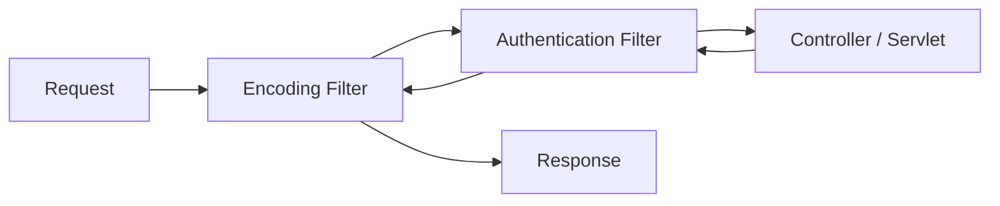

이전 글 [[Java 웹 기초 3 — JSP·EL·JSTL과 MVC Model 1·2]]에서 Controller와 View의 책임을 나눴습니다. 이번에는 요청 앞뒤의 공통 처리와 사용자 상태, 인증·인가 경계를 살펴봅니다.

## 1. Filter Chain은 요청 앞뒤의 공통 경계다

Filter는 Servlet 호출 전후에 요청과 응답을 처리합니다. 인코딩 설정, 인증 확인, 보안 헤더, 로깅처럼 여러 경로에 공통으로 필요한 작업에 적합합니다.

Filter 순서는 결과에 영향을 줍니다. 요청 본문을 먼저 소비하거나 응답을 확정한 뒤 다음 Chain을 호출하면 뒤의 컴포넌트가 예상대로 동작하지 않을 수 있습니다. 인증 Filter만 두고 Controller의 객체 단위 인가를 생략해서도 안 됩니다.

Listener는 애플리케이션·Session·Request의 생성과 소멸 같은 생명주기 이벤트를 관찰합니다. 자원 초기화나 통계에 사용할 수 있지만, Listener에서 무거운 외부 작업을 동기적으로 수행하면 요청과 종료가 지연될 수 있습니다.

참고: [Jakarta Servlet Specification — Filters and Listeners](https://jakarta.ee/specifications/servlet/)

## 2. Cookie와 Session은 같은 것이 아니다

Cookie는 브라우저가 저장했다가 조건에 맞는 요청에 보내는 작은 데이터입니다. Session은 보통 서버가 사용자별 상태를 저장하고, 브라우저의 Session ID Cookie로 해당 상태를 찾는 구조입니다.

중요한 Cookie 속성은 다음과 같습니다.

- `Secure`: HTTPS 연결에서만 전송
- `HttpOnly`: JavaScript의 직접 접근 제한
- `SameSite`: 다른 사이트에서 시작된 요청에 Cookie를 보낼 조건 제한
- `Path`·`Domain`: Cookie가 전송되는 범위 제한
- `Max-Age`·`Expires`: 보관 기간 설정

Session ID는 인증 상태를 가리키는 열쇠이므로 로그·URL·오류 화면에 노출하지 않습니다. 로그인 성공처럼 권한 수준이 바뀔 때 ID를 재발급하고, 로그아웃과 만료 때 서버 상태도 무효화해야 합니다.

## 3. 인증과 인가는 질문이 다르다

- 인증(Authentication)은 “누구인가?”를 확인합니다.
- 인가(Authorization)는 “이 사용자가 이 대상에 이 작업을 해도 되는가?”를 판단합니다.

로그인했다는 사실만으로 모든 데이터 접근을 허용할 수 없습니다. URL 숨김이나 버튼 비활성화는 화면 편의일 뿐 서버 인가가 아닙니다. 서버는 요청마다 사용자, 작업, 대상 객체, 테넌트 같은 조건을 신뢰 가능한 데이터로 검증해야 합니다.

## 4. 대표적인 실패 조건

- 로그인 전 발급한 Session ID를 로그인 후에도 그대로 사용하면 세션 고정 위험이 커집니다.
- 상태 변경 요청에 출처·토큰 검증이 없으면 CSRF(Cross-Site Request Forgery: 사용자가 의도하지 않은 요청을 보내게 하는 공격) 위험이 생깁니다.
- 여러 요청이 같은 Session 객체를 동시에 변경하면 순서 경쟁으로 상태가 꼬일 수 있습니다.
- “관리자 메뉴” Filter만 검사하고 개별 객체 소유권을 확인하지 않으면 접근통제 누락이 생깁니다.

## 체크리스트

- Filter 순서와 적용 URL이 명시돼 있는가?
- 로그인·권한 변경 시 Session ID를 재발급하는가?
- Cookie에 필요한 Secure·HttpOnly·SameSite·범위·만료 속성이 있는가?
- 인증과 객체 단위 인가를 별도로 검증하는가?
- 상태 변경 요청과 동시 Session 변경을 안전하게 처리하는가?

이전 글: [[Java 웹 기초 3 — JSP·EL·JSTL과 MVC Model 1·2]]
다음 글: [[Java 웹 기초 5 — JDBC·트랜잭션과 Spring MVC 요청 흐름]]
