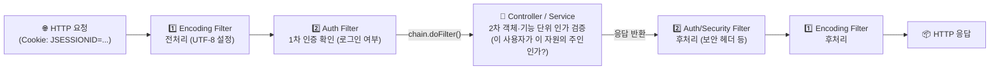

> [!summary] ⏱️ 5초 핵심 요약
> - **한 줄 비유**: **Filter**는 건물 입구의 **공통 보안 검색대**, **Cookie**는 손님이 들고 다니는 **보관함 번호표(`JSESSIONID`)**, **Session**은 서버 금고 안에 있는 **실제 고객 사물함**, **인증**은 **"신분증 확인"**, **인가**는 **"이 방에 들어갈 자격 확인"**입니다.
> - **핵심 원리**: Filter Chain은 Servlet 실행 전후에 공통 작업(인코딩·인증·로깅)을 수행하지만, **입구에서 로그인 여부(인증)만 확인했다고 해서 개별 데이터(객체 단위 인가)까지 허용된 것은 아닙니다.**
> - **핵심 보안 포인트**: 로그인 성공 등 권한 수준이 바뀔 때는 **Session ID를 반드시 재발급(세션 고정 방지)**하고, 세션 쿠키에 **`HttpOnly`·`Secure`·`SameSite`** 속성을 설정하며, 매 요청마다 서버에서 **사용자 × 작업 × 대상 객체의 소유권**을 검증해야 합니다.

이전 글 [[Java 웹 기초 3 — JSP·EL·JSTL과 MVC Model 1·2]]에서 Controller와 View의 책임을 나눴습니다. 이번에는 요청 앞뒤의 공통 처리 경계인 Filter, 사용자 상태를 유지하는 Cookie·Session, 그리고 웹 보안의 핵심 축인 인증·인가 경계를 살펴봅니다.

> **전체 왕복에서 이 글의 위치:** 요청이 Controller에 들어가기 전 Filter가 검사하는 부분과, 로그인 성공 응답의 Session ID Cookie가 다음 요청에 다시 실려 인증·인가 판단에 쓰이는 부분입니다.



---

## 한눈에 보는 상태·보안 개념 비교

| 비교 축 | 개념 A | 개념 B | 보안상 핵심 차이점 및 실무 함정 |
|---|---|---|---|
| **상태 저장** | **Cookie (쿠키)**<br/>브라우저가 보관하고 매 요청에 자동 전송하는 작은 문자열 | **Session (세션)**<br/>서버 메모리/저장소에 보관하는 사용자 상태 객체 | 쿠키에는 상태 원본 대신 **예측 불가능한 열쇠(`JSESSIONID`)만** 담아야 하며, 열쇠가 털리면 세션 전체가 털림 |
| **보안 검증** | **인증 (Authentication)**<br/>"이 요청자가 누구인가?" (신원 확인) | **인가 (Authorization)**<br/>"이 사용자가 이 대상에 이 작업을 해도 되는가?" | **인증 ≠ 인가**: 로그인 Filter를 통과했더라도 남의 주문 번호를 조회(IDOR/BOLA)할 수 있으면 인가 실패 |
| **생명주기 훅** | **Filter (필터)**<br/>요청·응답 흐름을 가로채 전후 처리 및 차단 가능 | **Listener (리스너)**<br/>앱·세션·요청의 생성/소멸 이벤트를 관찰 | Filter는 순서와 URL 패턴 누락 주의, Listener는 무거운 동기 작업 시 전체 요청/종료 지연 주의 |

---

## 1. Filter Chain은 요청 앞뒤의 공통 경계다

**💡 한 줄 비유**: 공항에서 비행기(Servlet/Controller)를 타기 전에 모든 승객이 순서대로 통과해야 하는 **수하물 검사대 → 여권 심사대(Filter Chain)**와 같으며, 내릴 때도 역순으로 통로를 지나갑니다.

- **동작 구조**: Filter는 Servlet 호출 전후에 요청과 응답을 가로채 처리합니다. 문자 인코딩 설정, 로그인 여부 확인, 보안 응답 헤더 추가, 감사 로깅처럼 여러 경로에 공통으로 필요한 작업에 적합합니다.
- **Filter 실행 시 3가지 주의사항**:
  1. **Filter 순서의 중요성**: 예를 들어 인코딩 설정 Filter보다 파라미터를 먼저 읽는 다른 Filter가 앞에 있으면 한글 인코딩이 깨집니다.
  2. **요청 본문(Stream) 소모 주의**: `HttpServletRequest`의 InputStream은 기본적으로 한 번 읽으면 다시 읽을 수 없습니다. Filter에서 로깅이나 검증을 위해 본문을 먼저 다 읽어버린 뒤 래퍼(`HttpServletRequestWrapper`) 없이 `chain.doFilter()`를 호출하면 뒤의 Controller가 빈 본문을 받게 됩니다.
  3. **Filter만으로 모든 인가를 대신할 수 없음**: URL 패턴 기반의 인증 Filter만 두고 Controller/Service 계층의 **객체 단위 소유권 인가**를 생략하면 심각한 접근통제 취약점이 발생합니다.
- **Listener와의 차이**: Listener는 애플리케이션(`ServletContextListener`), Session(`HttpSessionListener`), Request의 생성과 소멸 같은 생명주기 이벤트를 관찰합니다. 초기 자원 준비나 접속 통계에 유용하지만, 무거운 외부 네트워크 작업을 동기적으로 수행하면 요청과 서버 종료가 지연될 수 있습니다.
- 참고: [Jakarta Servlet Specification — Filters and Listeners](https://jakarta.ee/specifications/servlet/)

---

## 2. Cookie와 Session은 같은 것이 아니다

**💡 한 줄 비유**: 찜질방에 갈 때 **손목에 차고 다니는 플라스틱 번호표가 `Cookie`(`JSESSIONID`)**이고, 그 번호표로 카운터 안쪽에서 여는 **진짜 귀중품 보관함이 서버의 `Session`**입니다.

Cookie는 브라우저가 저장했다가 조건에 맞는 요청에 자동으로 실어 보내는 작은 데이터이고, Session은 서버가 사용자별 상태를 보관하고 브라우저가 보낸 Session ID Cookie로 해당 상태를 찾아 연결하는 구조입니다.

### 필수 Cookie 보안 속성 5가지

| 속성 | 역할 | 미설정 시 위험 |
|---|---|---|
| **`HttpOnly`** | JavaScript(`document.cookie`)의 직접 접근 차단 | XSS 발생 시 공격자 스크립트가 세션 쿠키를 즉시 탈취 |
| **`Secure`** | HTTPS 암호화 연결에서만 쿠키 전송 | 평문 HTTP 요청 시 네트워크 스니핑으로 세션 ID 노출 |
| **`SameSite`** | 교차 사이트(Cross-Site) 요청 시 쿠키 자동 전송 제한 (`Strict`/`Lax`/`None`) | 외부 사이트에서 유도된 상태 변경 요청(CSRF)에 쿠키가 그대로 실림 |
| **`Path` / `Domain`** | 쿠키가 전송될 URL 경로와 도메인 범위 제한 | 같은 도메인 내 다른 하위 서비스나 불필요한 경로로 세션 쿠키 노출 |
| **`Max-Age` / `Expires`** | 쿠키의 보관 기간 설정 | 만료 정책 부재 시 공용 PC 등에서 세션이 장기간 방치됨 |

### 안전한 세션 생명주기 관리 코드 예시
```java
// ✅ 로그인 성공 시: 세션 고정(Session Fixation) 방지를 위해 반드시 세션 ID 재발급!
HttpSession session = request.getSession(true);
request.changeSessionId(); // 기존 세션 객체는 유지하되 새로운 JSESSIONID 발급 (Servlet 3.1+)
session.setAttribute("loginUserId", authenticatedUser.getId());

// ✅ 로그아웃 시: 브라우저 쿠키만 지우는 것이 아니라 서버 측 세션 상태를 즉시 무효화!
HttpSession currentSession = request.getSession(false);
if (currentSession != null) {
    currentSession.invalidate();
}
```

- Session ID는 인증 상태를 가리키는 열쇠이므로 **로그 파일, URL 쿼리스트링(`;jsessionid=...`), 오류 화면**에 절대 노출하지 않아야 합니다.

---

## 3. 인증(Authentication)과 인가(Authorization)는 질문이 다르다

**💡 한 줄 비유**: **인증**은 회사 정문에서 **"우리 회사 사원증이 맞나?"**를 보는 것이고, **인가**는 사원증을 찍고 들어온 직원이 **"인사팀 금고(대상 객체)를 열 권한이 있는가?"**를 확인하는 것입니다.

- **인증 (Authentication)**: "이 요청을 보낸 주체가 누구인가?"를 확인합니다.
- **인가 (Authorization)**: "확인된 이 사용자가 **이 대상 객체(Resource)**에 **이 작업(Action)**을 수행해도 되는가?"를 판단합니다.

> [!warning] 화면에서 버튼을 숨기는 것은 보안이 아니다
> 로그인했다는 사실만으로 모든 데이터 접근을 허용할 수 없습니다. 관리자 메뉴 URL을 화면에서 숨기거나 수정 버튼을 비활성화(`disabled`)해 두는 것은 UI 편의일 뿐, 공격자는 HTTP 요청을 직접 만들어 전송합니다. 서버는 **매 요청마다 현재 세션의 사용자, 수행하려는 작업, 대상 객체의 소유권/테넌트 일치 여부**를 신뢰 가능한 서버 측 데이터로 검증해야 합니다.

---

## 4. 실무에서 자주 터지는 4대 실패 조건

**💡 한 줄 비유**: 출입증을 로그인 전후에 똑같이 쓰거나(세션 고정), 남이 몰래 등을 떠밀어 도장을 찍게 하거나(CSRF), 입구만 지키고 방문은 다 열어두는(객체 인가 누락) 전형적인 사고 패턴입니다.

1. **세션 고정 (Session Fixation)**: 로그인 전에 발급된 Session ID를 로그인 성공이나 권한 상승 후에도 재발급(`changeSessionId()`)하지 않고 그대로 사용하면, 미리 세션 ID를 심어둔 공격자가 피해자의 로그인 세션을 가로챌 수 있습니다.
2. **CSRF (Cross-Site Request Forgery)**: 비밀번호 변경·송금·권한 부여 같은 상태 변경 요청에 CSRF 토큰이나 `Origin`/`Referer` 검증이 없으면, 로그인된 사용자가 악성 페이지를 열었을 때 브라우저가 자동으로 쿠키를 붙여 의도치 않은 요청이 실행됩니다.
3. **동시 요청에 의한 Session 상태 경합 (Race Condition)**: `HttpSession` 자체는 스레드 안전하게 동기화해주지 않습니다. 한 사용자가 동시에 여러 요청을 보내 같은 Session 속성을 읽고 수정하면 순서 경쟁(TOCTOU)으로 상태가 꼬이거나 중복 처리가 발생할 수 있습니다.
4. **수평/수직 접근통제 누락 (BOLA/BFLA)**: "로그인 여부"나 `/admin/*` URL 패턴만 Filter에서 대충 검사하고, 정작 Controller/Service에서 개별 게시글·주문·계좌의 **소유자 일치 여부**를 확인하지 않으면 남의 데이터를 열람·수정할 수 있습니다.

---

## 5. 진단 및 시큐어코딩 체크리스트

- [ ] Filter의 실행 순서와 적용 URL 패턴이 빠짐없이 명시되어 있으며, 경로 정규화 우회가 없는가?
- [ ] 로그인 성공 및 권한 수준 변경 시마다 Session ID를 재발급(`request.changeSessionId()`)하는가?
- [ ] 로그아웃 및 만료 시 서버 측 `HttpSession`을 즉시 `invalidate()` 처리하는가?
- [ ] 세션 Cookie에 `Secure`, `HttpOnly`, `SameSite`, 적절한 `Path`/`Domain`, 만료 속성이 설정되어 있는가?
- [ ] 입구 인증(Filter)과 별개로 Service/Controller 계층에서 **객체 단위 소유권 인가**를 매번 검증하는가?
- [ ] 상태 변경 요청에 대한 CSRF 방어와 동시 Session 변경에 대한 동기화/원자성을 확보했는가?
- [ ] 다음 단계로 데이터베이스 접근(JDBC·트랜잭션)과 Spring MVC가 이 전체 흐름을 어떻게 완성하는지 보려면 [[Java 웹 기초 5 — JDBC·트랜잭션과 Spring MVC 요청 흐름]] 글을 이어서 참고하세요.
