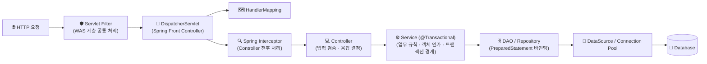
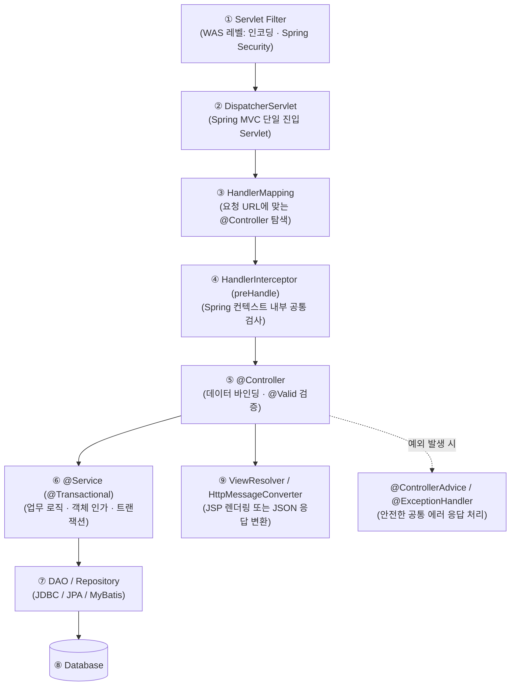

> [!summary] ⏱️ 5초 핵심 요약
> - **한 줄 비유**: **Connection Pool**은 매번 새로 개통하지 않고 빌려 썼다 반납하는 **사내 공용 직통 전화기**, **`PreparedStatement`**는 빈칸(`?`)에 값만 채워 넣는 **위조 방지 양식지**, **트랜잭션**은 송금 시 출금과 입금을 하나로 묶는 **"전부 성공 아니면 전부 취소" 계약**, **`DispatcherServlet`**은 모든 손님을 맞아 담당 부서로 연결하는 **Spring의 종합 안내 데스크**입니다.
> - **핵심 원리**: Spring MVC는 Servlet API를 대체하는 것이 아니라 **Servlet 위에서 동작하는 `DispatcherServlet`(Front Controller)**을 중심으로 매핑·검증·트랜잭션을 추상화합니다.
> - **핵심 보안 포인트**: SQL 실행 시 외부 입력은 반드시 **파라미터 바인딩(`?`)**으로 처리하고, 바인딩할 수 없는 테이블명·정렬 기준(`ORDER BY`)은 **화이트리스트(허용 목록)**로 제한하며, **Servlet Filter → Spring Interceptor → Controller → Service(`@Transactional`) → DAO**의 실행 순서와 보안 책임 경계를 명확히 나눠야 합니다.

이전 글 [[Java 웹 기초 4 — Filter·Session과 인증·인가]]까지 Servlet 기반 웹의 요청·상태·인증 경계를 살펴봤습니다. 시리즈의 마지막인 이 글에서는 데이터베이스 작업(JDBC·트랜잭션)과 실무 표준인 **Spring MVC**가 지금까지 배운 모든 구조를 어떻게 하나로 연결하는지 정리합니다.

> **전체 왕복에서 이 글의 위치:** 요청이 `DispatcherServlet`을 통해 Controller에 도달하고, Controller가 Service(트랜잭션 경계)를 호출하며, Service가 DAO를 거쳐 데이터베이스에 들어갔다가 조회 결과를 반대 순서로 돌려받는 핵심 백엔드 구간입니다.



---

## 한눈에 보는 백엔드 계층별 역할과 보안·운영 책임

| 계층 / 컴포넌트 | 핵심 역할 | 주요 기술 요소 | 핵심 보안 및 운영 체크 포인트 |
|---|---|---|---|
| **Servlet Filter** | Spring 진입 전 WAS 레벨의 요청·응답 전후 처리 | `jakarta.servlet.Filter`, Spring Security Filter Chain | 인코딩 설정, 전역 인증/보안 헤더, XSS/요청 래핑 |
| **DispatcherServlet & Interceptor** | URL 매핑 탐색, 핸들러 호출 전후 공통 가로채기 | `DispatcherServlet`, `HandlerInterceptor` | 컨트롤러 진입 전 세부 권한/세션 확인, 감사 로깅 |
| **Controller** | HTTP 파라미터 바인딩, 입력 형식 검증, View/Body 선택 | `@Controller`, `@RestController`, `@Valid` | 입력값 타입·길이·형식 검증, 허용 필드만 담긴 **DTO 사용(Mass Assignment 방지)** |
| **Service** | 비즈니스 로직 수행, **트랜잭션 경계**, **객체 단위 인가** | `@Service`, `@Transactional` | 현재 로그인 사용자가 대상 데이터의 소유자인지 검증, 원자적 롤백 보장 |
| **DAO / Repository & JDBC** | DB 커넥션 획득/반납, SQL 실행 및 결과 매핑 | `DataSource`, `PreparedStatement`, JPA/MyBatis | **파라미터 바인딩(`?`) 필수**, 동적 컬럼명 화이트리스트, 커넥션 반환 누수 방지 |

---

## 1. JDBC와 DataSource, 그리고 Connection Pool

**💡 한 줄 비유**: DB에 질문할 때마다 매번 전화국에 신청해 새 전화선(TCP+DB 인증)을 깔면 너무 느립니다. **미리 개통해 둔 직통 전화기 여러 대(`Connection Pool`)를 두고, 필요할 때 빌려 썼다가 통화가 끝나면 수화기를 내려놓아(`close()` = 반납) 다음 사람이 바로 쓰게 하는 방식**입니다.

- **JDBC (Java Database Connectivity)**: Java에서 관계형 데이터베이스에 접근하는 표준 API로, 연결(`Connection`)을 얻고 SQL(`PreparedStatement`)을 실행하며 결과(`ResultSet`)를 읽는 인터페이스를 제공합니다.
- **`DataSource` (`javax.sql.DataSource`)**: DB 연결 획득 방식을 애플리케이션 코드와 분리하는 표준 인터페이스입니다(Jakarta EE 환경에서도 표준 Java SE의 `java.sql`/`javax.sql` 패키지를 그대로 사용합니다).
- **Connection Pool 운영 주의점**:
  - 애플리케이션이 `connection.close()`를 호출하면 실제 물리 연결을 끊는 것이 아니라 **풀(Pool)에 커넥션을 반납**합니다.
  - 만약 `try-with-resources` 등을 쓰지 않아 **반납이 누락되거나, 너무 긴 트랜잭션이 커넥션을 오래 붙잡고 있으면 풀이 고갈되어 전체 웹 서비스가 멈추는 장애(DoS)**로 이어집니다.
- 참고: [JDBC Basics](https://docs.oracle.com/javase/tutorial/jdbc/basics/), [DataSource API](https://docs.oracle.com/en/java/javase/21/docs/api/java.sql/javax/sql/DataSource.html)

---

## 2. SQL Injection 방어: 문자열 결합 대신 바인딩한다

**💡 한 줄 비유**: 백지에 손님이 부르는 대로 문장을 이어 적으면 손님이 **"그리고 금고 문도 열어라(`' OR '1'='1`)"**라고 명령어를 섞어 부를 때 그대로 실행됩니다. 처음부터 **"이름 칸: `[ ? ]`"**처럼 **구조가 인쇄된 양식지(`PreparedStatement`)**를 쓰면 그 칸 안에 적힌 글자는 오직 '이름 데이터'로만 취급됩니다.

SQL에 외부 입력을 문자열(`+`)로 이어 붙이면 데이터와 명령어의 경계가 무너져 **SQL Injection**이 발생합니다. 반드시 `PreparedStatement`의 파라미터 바인딩(`?`)을 사용해 SQL 구조와 값을 분리해야 합니다.

### 취약한 코드 vs 안전한 코드 비교
```java
// ❌ 취약한 코드: 문자열 결합으로 SQL 조립 (SQL Injection 직격!)
String badSql = "SELECT id, name FROM users WHERE username = '" + username + "'";
Statement stmt = connection.createStatement();
ResultSet rs = stmt.executeQuery(badSql);

// ✅ 안전한 코드: try-with-resources로 자동 자원 반납 + PreparedStatement 파라미터 바인딩
String sql = "SELECT id, name FROM users WHERE id = ?";
try (Connection connection = dataSource.getConnection();
     PreparedStatement statement = connection.prepareStatement(sql)) {
    statement.setLong(1, userId); // SQL 구조가 고정된 상태에서 값만 바인딩
    try (ResultSet result = statement.executeQuery()) {
        // 결과 매핑
    }
}
```

### 파라미터 바인딩으로도 못 막는 구간: 동적 식별자
- `?` 바인딩은 **데이터 값(리터럴)** 자리에만 사용할 수 있으며, **테이블명, 열(컬럼) 이름, 정렬 방향(`ORDER BY name ASC/DESC`)** 같은 SQL 식별자나 키워드 자리에는 바인딩할 수 없습니다.
- 이런 동적 구조에 사용자 입력을 넣어야 할 때는 문자열을 그냥 붙이지 말고 반드시 서버 코드의 **허용 목록(Whitelist, `switch`/`Map`/Enum)**으로 검증해 선택해야 합니다. 또한 DB 계정 자체도 필요한 스키마와 최소 작업 권한만 부여합니다.

---

## 3. 트랜잭션(Transaction)은 하나의 업무 단위를 지킨다

**💡 한 줄 비유**: A 계좌에서 돈을 빼고 B 계좌에 돈을 넣는 송금 작업 중 정전이 났다면, **"A에서 빠진 돈도 없던 일로 되돌려야(`rollback`)"**지 A에서만 돈이 사라지면 안 됩니다. 이 작업 묶음의 경계가 **트랜잭션**입니다.

트랜잭션은 여러 데이터 변경을 **전부 성공(`commit`)시키거나 실패 시 함께 되돌리는(`rollback`) 원자적 경계**입니다.

- **`commit` / `rollback` / `autoCommit`**:
  - `commit`은 변경을 최종 확정하고, `rollback`은 현재 트랜잭션의 변경을 모두 취소합니다.
  - 만약 `autoCommit`이 켜져 있으면 각 SQL 문이 실행될 때마다 즉시 개별 확정되어 버리므로, 여러 SQL을 묶으려면 하나의 트랜잭션 안에서 관리해야 합니다.
- **실무 트랜잭션 설계의 3대 원칙**:
  1. **경계는 Controller가 아니라 Service의 업무 단위에 둔다**: 비즈니스 규칙 하나가 완결되는 Service 메서드 단위로 트랜잭션을 묶습니다.
  2. **트랜잭션 안에서 느린 외부 작업을 하지 않는다**: 외부 API(결제사·메일 서버 등) 호출이나 파일 I/O를 트랜잭션 안에 길게 넣어두면 DB 락(Lock)과 커넥션 점유 시간이 늘어나 전체 서버가 마비될 수 있습니다.
  3. **예외 삼킴과 커넥션 분리 주의**: `try-catch`로 예외를 잡아서 삼켜버려 비정상 상태에서 그대로 `commit`되거나, 일부 DAO가 트랜잭션과 다른 별도 커넥션을 사용해 `rollback` 대상에서 빠지지 않는지 확인해야 합니다.

---

## 4. Controller · Service · DAO의 명확한 책임 분리

**💡 한 줄 비유**: **Controller**는 손님의 주문서를 받아 형식이 맞는지 보는 **접수 창구**, **Service**는 손님이 주문할 자격이 있는지 확인하고 요리를 총괄하는 **주방 책임자**, **DAO**는 레시피대로 식재료 창고(DB)에서 재료를 꺼내오는 **창고 담당**입니다.

- **Controller**: HTTP 입력을 받고 형식 검증을 수행한 뒤, Service를 호출하고 응답 형식(View 또는 JSON Body)을 결정합니다.
- **Service**: 핵심 업무 규칙, **객체 단위 인가 검증**, **트랜잭션 경계**를 담당합니다.
- **DAO (Data Access Object)**: SQL 실행과 결과 매핑만을 캡슐화해 담당합니다.

> [!important] 계층만 나눴다고 자동으로 안전해지지 않는다
> 인가 판단에 필요한 **현재 로그인 사용자 정보와 대상 객체의 관계**가 Service까지 정확히 전달되어 검증되어야 하며, DAO(또는 MyBatis XML의 `${...}` 등)가 내부에서 임의 문자열 결합 SQL을 만들지 않아야 합니다.

---

## 5. Spring MVC도 결국 Servlet 위에서 동작한다

**💡 한 줄 비유**: Spring MVC는 완전히 새로운 외계 기술이 아니라, **표준 Servlet이라는 튼튼한 엔진 위에 `DispatcherServlet`이라는 자동 변속기와 내비게이션을 얹은 완성차**입니다.

Spring MVC의 중심인 **`DispatcherServlet`**은 표준 Servlet API(`HttpServlet` 상속) 위에서 동작하는 **Front Controller**입니다.



- **추상화와 본질**: Spring은 URL 매핑(`@GetMapping`), 데이터 바인딩(`@RequestBody`), 검증(`@Valid`), View 선택, 선언적 트랜잭션(`@Transactional`), 전역 예외 처리(`@ControllerAdvice`)를 편리하게 제공하지만, 앞서 배운 **HTTP·Servlet·멀티스레드·Session·트랜잭션의 물리적 경계를 없애지는 않습니다.**
- **보안 검사 위치 파악**: WAS 레벨의 **Servlet Filter**(예: Spring Security Filter), Spring 레벨의 **`HandlerInterceptor`**, 메서드 레벨의 **AOP/어노테이션(`@PreAuthorize`)**, 그리고 **`@ControllerAdvice` 예외 처리기**는 실행 시점과 접근 가능한 컨텍스트가 각각 다르므로, 진단과 설계 시 어느 계층에서 어떤 보안 검사를 수행하는지 정확히 구분해야 합니다.
- 참고: [Spring MVC — DispatcherServlet](https://docs.spring.io/spring-framework/reference/web/webmvc/mvc-servlet.html), [Spring Transaction Management](https://docs.spring.io/spring-framework/reference/data-access/transaction.html)

---

## 6. 진단 및 시큐어코딩 체크리스트

- [ ] 모든 외부 입력값이 `PreparedStatement`(또는 MyBatis `#{...}`, JPA 파라미터 바인딩)로 바인딩되고, 테이블/컬럼명 등 동적 식별자는 화이트리스트를 사용하는가?
- [ ] `Connection`·`Statement`·`ResultSet`이 예외 발생 여부와 무관하게 항상 반환·종료(`try-with-resources` 또는 프레임워크 관리)되는가?
- [ ] `@Service`의 업무 단위와 트랜잭션 경계(`@Transactional`)가 일치하며, 예외 발생 시 정확히 롤백되는가?
- [ ] `@Controller`의 입력 형식 검증(및 DTO 분리)과 `@Service`의 객체 단위 소유권 인가가 모두 존재하는가?
- [ ] `Servlet Filter` → `DispatcherServlet` → `Interceptor` → `Controller` → `ControllerAdvice`의 실행 순서와 예외 노출 방지를 이해하고 있는가?
- [ ] 이제 Java 웹의 동작 원리를 모두 익혔다면, 이 구조 위에서 실제로 어떤 취약점들이 발생하는지 [[웹 취약점 진단 기법 입문 — XXE, SSRF부터 SQLi, XSS까지]] 글로 넘어가 실전 진단 기법을 확인하세요.
