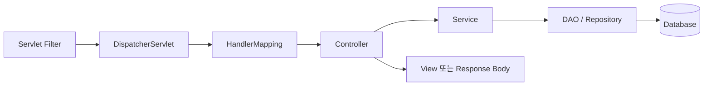

이전 글 [[Java 웹 기초 4 — Filter·Session과 인증·인가]]까지 Servlet 기반 웹의 요청·상태 경계를 살펴봤습니다. 마지막으로 데이터베이스 작업과 Spring MVC가 이 구조를 어떻게 추상화하는지 연결합니다.

> **전체 왕복에서 이 글의 위치:** Controller가 Service를 호출하고, Service가 DAO를 거쳐 데이터베이스에 들어갔다가 조회 결과를 반대 순서로 돌려받는 부분입니다.

## 1. JDBC와 DataSource

JDBC(Java Database Connectivity: Java에서 관계형 데이터베이스에 접근하는 표준 API)는 연결을 얻고 SQL을 실행하며 결과를 읽는 인터페이스를 제공합니다. `DataSource`는 현재도 `javax.sql.DataSource` 타입이며 연결 획득 방식을 애플리케이션 코드와 분리합니다.

Connection Pool은 데이터베이스 연결을 매 요청마다 새로 만드는 대신 미리 관리하고 재사용합니다. 애플리케이션이 `close()`를 호출하면 실제 연결을 종료하기보다 풀에 반환될 수 있습니다. 반환 누락, 너무 긴 트랜잭션, 부적절한 풀 크기는 장애와 자원 고갈로 이어집니다.

참고: [JDBC Basics](https://docs.oracle.com/javase/tutorial/jdbc/basics/), [DataSource API](https://docs.oracle.com/en/java/javase/21/docs/api/java.sql/javax/sql/DataSource.html)

## 2. 문자열 결합 대신 바인딩한다

SQL에 외부 입력을 문자열로 이어 붙이면 입력과 명령의 경계가 무너집니다. `PreparedStatement`의 파라미터 바인딩을 사용해 SQL 구조와 값을 분리해야 합니다.

```java
String sql = "SELECT id, name FROM users WHERE id = ?";
try (Connection connection = dataSource.getConnection();
     PreparedStatement statement = connection.prepareStatement(sql)) {
    statement.setLong(1, userId);
    try (ResultSet result = statement.executeQuery()) {
        // map the result
    }
}
```

바인딩은 값의 경계를 지키지만 테이블명·열 이름·정렬 방향 같은 SQL 식별자를 대신 검증하지는 않습니다. 이런 동적 구조는 허용 목록으로 선택해야 합니다. 데이터베이스 계정도 필요한 스키마와 작업만 허용합니다.

## 3. 트랜잭션은 하나의 업무 단위를 지킨다

트랜잭션은 여러 데이터 변경을 전부 성공시키거나 실패 시 함께 되돌리는 경계입니다.

- `commit`은 변경을 확정합니다.
- `rollback`은 현재 트랜잭션의 변경을 되돌립니다.
- `autoCommit`이 켜져 있으면 각 SQL이 개별 트랜잭션처럼 즉시 확정될 수 있습니다.

트랜잭션 경계는 보통 Controller가 아니라 Service의 업무 단위에 둡니다. 외부 API 호출이나 사용자 입력 대기를 트랜잭션 안에 오래 유지하면 잠금과 연결 점유가 늘어납니다. 예외를 삼켜 commit되거나, 일부 DAO만 별도 연결을 사용해 rollback에서 빠지지 않는지 확인해야 합니다.

## 4. Controller·Service·DAO의 책임

- Controller는 HTTP 입력을 받고 검증한 뒤 응답 형식을 결정합니다.
- Service는 업무 규칙과 트랜잭션 경계를 담당합니다.
- DAO(Data Access Object: 데이터 저장소 접근을 캡슐화한 객체)는 SQL 실행과 결과 매핑을 담당합니다.

계층을 나눴다는 사실만으로 안전해지지는 않습니다. 인가에 필요한 현재 사용자와 대상 객체의 관계가 Service까지 정확히 전달되고, DAO가 임의 문자열 SQL을 만들지 않아야 합니다.

## 5. Spring MVC도 Servlet 위에서 동작한다

Spring MVC의 중심인 `DispatcherServlet`은 Servlet API 위에서 동작하는 Front Controller입니다.



Spring은 매핑, 데이터 바인딩, 검증, View 선택, 예외 처리를 편리하게 만들지만 HTTP·Servlet·Session·트랜잭션 경계를 없애지는 않습니다. Filter와 Spring Interceptor, Controller Advice의 실행 위치가 다르므로 어느 계층에서 어떤 보안 검사를 하는지 구분해야 합니다.

참고: [Spring MVC — DispatcherServlet](https://docs.spring.io/spring-framework/reference/web/webmvc/mvc-servlet.html), [Spring Transaction Management](https://docs.spring.io/spring-framework/reference/data-access/transaction.html)

## 체크리스트

- 모든 외부 값이 파라미터로 바인딩되고 동적 식별자는 허용 목록을 사용하는가?
- Connection·Statement·ResultSet이 항상 반환·종료되는가?
- Service의 업무 단위와 트랜잭션 경계가 일치하는가?
- Controller 입력 검증과 Service 객체 단위 인가가 모두 존재하는가?
- Filter·Interceptor·Controller·예외 처리의 실행 순서를 이해하고 있는가?
