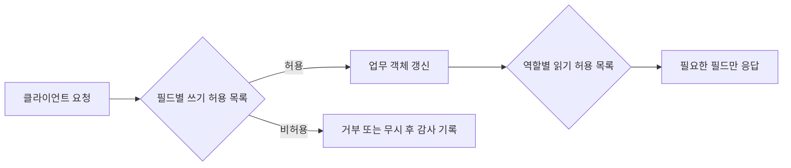

[[웹 취약점 진단 인가편 — 권한 매트릭스로 BOLA·BFLA 찾기]]가 "누가 어떤 객체나 기능에 접근할 수 있는가"라는 BOLA·BFLA 축을 다뤘다면, 이 글은 **접근 가능한 객체 안에서 어떤 필드까지 읽고 쓸 수 있는가**라는 BOPLA 축에 집중합니다. 특히 인가편 4절의 속성 단위 권한 누락을 더 깊게 다루는 후속편으로, 그 글에서 설명한 `role`·`isAdmin` 같은 권한 상승 필드는 반복하지 않고 응답 과다 노출, 벌크 내보내기의 민감 필드, 중첩 객체·배열의 Mass Assignment를 살펴봅니다. 섀도우 API의 발견과 자산 관리는 별도 글에서 다룹니다.

---

## 1. API 계약과 필드 단위 인가의 경계

REST API는 클라이언트와 서버가 정해진 형식의 주문서를 주고받는 창구이고, OpenAPI 스펙은 서로 말이 통하도록 경로·필드·자료형을 미리 적어 둔 계약서에 가깝습니다. 그런데 화면에 보이는 주문란이 몇 개뿐이어도 주방 직원인 서버가 주문서에 적힌 모든 항목을 별도 확인 없이 처리한다면, 손님은 숨겨진 항목을 임의로 덧붙일 수 있습니다. 이것이 Mass Assignment의 기본 모습입니다. BOLA가 "이 주문서가 누구의 것인가"를 묻는다면 BOPLA는 "그 주문서의 어떤 칸까지 읽거나 바꿀 수 있는가"를 묻습니다.

**원리**: BOPLA(Broken Object Property Level Authorization)는 OWASP API3:2023이 입력 측 Mass Assignment와 출력 측 과도한 데이터 노출을 필드 단위 인가 실패라는 한 축으로 묶은 개념입니다. 객체 자체에 접근할 권한이 있어도 모든 속성에 같은 읽기·쓰기 권한이 생기는 것은 아닙니다. 본인 주문을 볼 수 있다는 사실과 내부 정산 메모나 공급가까지 볼 수 있다는 사실은 별개입니다.

서버 모델을 요청 바디에 통째로 바인딩하거나, 데이터베이스 객체를 응답 DTO 없이 그대로 직렬화하면 이 경계가 쉽게 무너집니다. 다만 문서에 없는 필드가 보인다는 사실만으로 곧바로 취약점이 되는 것은 아니며, 해당 역할이 그 필드를 읽거나 바꿀 업무상 필요가 없는지와 실제 영향까지 함께 확인해야 합니다.

- 체크 포인트:
  - OpenAPI의 요청·응답 스키마와 실제 트래픽의 필드 목록을 비교하고, 문서 밖 필드가 수신·반환되는지 확인
  - 같은 객체에 대해 역할별 읽기 필드와 쓰기 필드를 따로 표로 만들고 업무상 필요를 검토
  - 알 수 없는 필드를 보냈을 때 거부·무시·저장 중 어떤 동작을 하는지 승인된 테스트 환경에서 확인
- 참고: [OWASP API3:2023 Broken Object Property Level Authorization](https://owasp.org/API-Security/editions/2023/en/0xa3-broken-object-property-level-authorization/), [OWASP Mass Assignment Cheat Sheet](https://cheatsheetseries.owasp.org/cheatsheets/Mass_Assignment_Cheat_Sheet.html)

## 2. 중첩 객체와 배열에서 생기는 Mass Assignment

**원리**: 최상위 필드만 허용 목록으로 제한해도 중첩 객체나 배열 원소를 범용 역직렬화기로 처리하면 안쪽 속성이 그대로 저장될 수 있습니다. 예를 들어 배송지 배열에서 사용자가 입력해야 할 주소 외에 검수 상태·내부 분류·기본 배송지 결정값 같은 속성까지 모델에 바인딩되거나, 주문 항목 배열에서 화면에 없는 처리 상태가 함께 반영되는 식입니다.

특히 부분 수정용 `PATCH`가 들어온 JSON 구조를 기존 객체에 재귀 병합하는 구현은 경계를 흐리기 쉽습니다. 최상위 `addresses`가 허용된 필드라는 이유만으로 그 아래 모든 키까지 허용해서는 안 됩니다. 배열 원소가 새 객체인지 기존 객체 수정인지, 원소 식별자가 현재 사용자의 범위에 속하는지도 별도로 검증해야 합니다.

안전한 진단은 응답이나 스키마에서 확인한 후보 필드를 소량씩 추가해 서버의 거부 여부와 저장 전후 차이를 비교하는 방식입니다. 실제 운영 데이터의 상태를 바꾸지 않도록 전용 계정과 되돌릴 수 있는 테스트 객체를 사용하고, 필드 하나의 반영 여부와 비즈니스 영향을 분리해 기록합니다.

- 체크 포인트:
  - 최상위 DTO뿐 아니라 중첩 객체·배열 원소마다 입력 허용 필드가 선언돼 있는지 확인
  - 재귀 병합, 범용 `update`, ORM 자동 바인딩이 문서 밖 속성까지 복사하는지 코드와 테스트로 대조
  - 배열 원소의 식별자·소유권·상태 전이가 각각 서버에서 다시 검증되는지 확인
- 참고: [OWASP Mass Assignment Cheat Sheet](https://cheatsheetseries.owasp.org/cheatsheets/Mass_Assignment_Cheat_Sheet.html), [OWASP Authorization Cheat Sheet](https://cheatsheetseries.owasp.org/cheatsheets/Authorization_Cheat_Sheet.html)

## 3. 응답 과다 노출과 역할별 직렬화

**원리**: 화면이 일부 값만 표시하더라도 네트워크 응답에 포함된 필드는 이미 클라이언트에 공개된 것입니다. 프런트엔드에서 숨기거나 렌더링하지 않는 것은 서버의 읽기 인가가 아닙니다. 내부 고객 등급 산정값, 운영 메모, 공급가, 다른 연락 채널 같은 정보가 범용 응답 모델에 섞이면 정상 사용자도 개발자 도구나 API 클라이언트로 확인할 수 있습니다.

같은 직렬화 모델을 고객 화면·상담원 도구·관리자 화면에서 재사용할 때 특히 과다 노출이 발생합니다. 서버가 행 단위 소유권을 올바르게 검사해도, 고객 역할에 필요 없는 열까지 반환하면 BOLA가 아닌 BOPLA로 분류할 수 있습니다. 다만 공개 정보나 업무상 필요한 필드를 단순히 많이 반환한다는 이유만으로 취약점으로 판단해서는 안 됩니다.

진단 결과에는 필드 이름만 나열하지 말고 데이터 민감도, 노출 가능한 역할, 예상 업무 목적, 실제 소비 화면을 함께 적습니다. 이 기록이 있어야 개발팀도 응답 모델 분리와 호환성 영향 범위를 정확히 판단할 수 있습니다.

- 체크 포인트:
  - 고객·상담원·관리자 계정으로 같은 객체를 조회해 응답 키와 값의 민감도를 역할별로 비교
  - UI에서 사용하지 않는 필드도 프록시 원본 응답, 오류 응답, 캐시 응답에 포함되는지 확인
  - 데이터베이스 엔터티를 직접 직렬화하지 않고 용도별 응답 DTO나 명시적 필드 선택을 쓰는지 확인
- 참고: [OWASP API3:2023 Broken Object Property Level Authorization](https://owasp.org/API-Security/editions/2023/en/0xa3-broken-object-property-level-authorization/), [OWASP REST Security Cheat Sheet](https://cheatsheetseries.owasp.org/cheatsheets/REST_Security_Cheat_Sheet.html)

## 4. 검색·벌크 내보내기의 필드 누출

**원리**: 단건 조회는 필요한 필드만 반환하지만 검색, CSV 내보내기, 비동기 보고서 같은 벌크 경로는 별도 코드로 구현돼 전체 레코드를 직렬화하는 경우가 있습니다. 이때 사용자가 볼 수 있는 행만 선택했다는 이유로 인가가 끝났다고 판단하면, 각 행의 민감 필드가 대량으로 노출될 수 있습니다.

벌크 경로의 위험은 한 건의 필드 누출이 수천 건으로 확대된다는 점입니다. 다운로드 작업을 생성하는 API, 완료 파일을 받는 저장소 URL, 파일 보관 기간도 함께 봐야 합니다. 생성 요청의 권한이 맞아도 결과 파일에 역할별 필드 필터가 빠지거나, 다운로드 시점에 권한을 재검증하지 않으면 별도 문제가 됩니다.

표본 몇 건만 눈으로 보는 대신 단건 응답·목록 응답·내보내기 헤더를 기계적으로 비교하면 경로별 필드 차이를 빠르게 찾을 수 있습니다. 다만 운영 환경에서 대량 작업을 실제 실행하면 비용과 개인정보 처리가 발생할 수 있으므로 작은 테스트 데이터셋과 승인된 한도를 사용합니다.

- 체크 포인트:
  - 단건 조회, 목록·검색, CSV·보고서, 백그라운드 내보내기의 필드 집합을 동일 역할로 비교
  - 필터·정렬용 내부 필드가 응답이나 내보내기 파일에도 그대로 포함되는지 확인
  - 비동기 결과 파일의 다운로드 권한, 만료, 캐시, 로그에 민감 필드가 남는지 확인
- 참고: [OWASP API3:2023 Broken Object Property Level Authorization](https://owasp.org/API-Security/editions/2023/en/0xa3-broken-object-property-level-authorization/), [OWASP Logging Cheat Sheet](https://cheatsheetseries.owasp.org/cheatsheets/Logging_Cheat_Sheet.html)

## 5. 스키마와 실제 동작을 묶어 검증하는 방법

**원리**: 가장 안정적인 방어는 입력과 출력을 각각 기본 거부 방식으로 설계하는 것입니다. 요청은 작업별 DTO에 선언된 필드만 받고, 응답은 역할과 사용 목적에 맞춘 DTO의 필드만 반환합니다. 단순히 민감 필드 이름을 차단 목록에 추가하면 새 필드가 생길 때 다시 노출되므로 허용 목록이 더 예측 가능합니다.

OpenAPI는 계약의 기준점이지만 실행 중인 서버가 반드시 그 계약대로 동작한다는 보장은 없습니다. 계약 테스트에서 문서 밖 요청 필드의 거부 여부, 역할별 응답 스키마, 중첩 구조의 `additionalProperties` 처리, 목록·내보내기 경로의 필드 일치를 함께 검사해야 합니다. 로그에는 민감한 원문 값을 남기지 않고 거부된 필드명과 요청 식별자 정도만 기록합니다.

발견 사항은 "문서 밖 필드를 받는다"에서 끝내지 않고, 어느 역할이 어느 객체의 어떤 필드를 읽거나 쓸 수 있었는지와 그 영향으로 정리합니다. 그래야 BOLA나 단순 입력 검증 실패와 혼동하지 않고 필드 단위 인가의 근본 원인을 고칠 수 있습니다.

- 체크 포인트:
  - 생성·전체 수정·부분 수정마다 별도 입력 스키마와 필드 허용 목록이 있는지 확인
  - 역할별 응답 계약 테스트에 민감 필드 부재를 회귀 조건으로 추가
  - 차단 목록이 아니라 허용 목록을 사용하고, 거부 로그에 필드 값 자체가 남지 않는지 확인
- 참고: [OWASP API Security Top 10 2023](https://owasp.org/API-Security/editions/2023/en/0x11-t10/), [OWASP Mass Assignment Cheat Sheet](https://cheatsheetseries.owasp.org/cheatsheets/Mass_Assignment_Cheat_Sheet.html), [OWASP Authorization Cheat Sheet](https://cheatsheetseries.owasp.org/cheatsheets/Authorization_Cheat_Sheet.html)

---

## 정리

| 진단 축 | 핵심 질문 | 대표 위험 |
|---|---|---|
| 입력 필드 | 허용되지 않은 필드를 요청에 추가해도 저장되는가 | Mass Assignment, 상태 변조 |
| 중첩 구조 | 객체·배열 안쪽에도 필드별 검증이 적용되는가 | 재귀 병합을 통한 비인가 변경 |
| 응답 필드 | 역할과 목적에 불필요한 속성이 내려오는가 | 민감 정보 과다 노출 |
| 벌크 경로 | 단건과 목록·내보내기의 필드 정책이 같은가 | 대량 민감 정보 노출 |
| 계약 검증 | OpenAPI와 실제 입출력이 일치하는가 | 문서 밖 필드의 수신·반환 |

BOPLA는 객체 접근 허용 여부 다음에 반드시 확인해야 하는 별도의 인가 축입니다. 객체·기능 수준의 역할 매트릭스와 소유권 검증은 [[웹 취약점 진단 인가편 — 권한 매트릭스로 BOLA·BFLA 찾기]]를 참고하고, 여기서는 그 객체 안의 입력·출력 필드를 끝까지 대조하는 데 집중해야 합니다.
