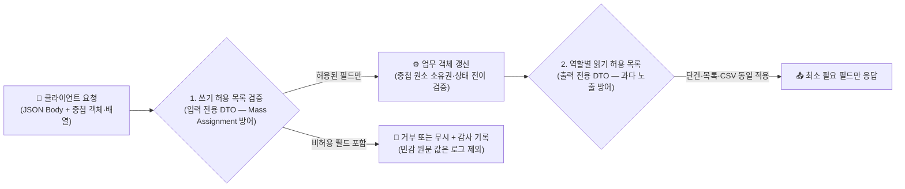

> [!summary] ⏱️ 5초 핵심 요약
> - **한 줄 비유**: 내 인사기록카드(객체)를 열람·수정할 권한이 있다고 해서, 그 카드 안의 **'인사 고과 등급'이나 '연봉 결정액'(민감 필드)까지 내가 직접 고쳐 쓰거나 내부 평가 메모를 다 읽을 수 있어야 하는 건 아닙니다.**
> - **핵심 원리**: **BOPLA(OWASP API3:2023)**는 객체 접근 권한(BOLA) 통과 이후, **그 객체 내부의 개별 속성(Property/Field)에 대한 쓰기 인가 실패(Mass Assignment)와 읽기 인가 실패(과도한 데이터 노출)**를 하나로 묶은 필드 단위 인가 취약점입니다.
> - **핵심 공격 표면**: ① 최상위 및 중첩 객체·배열(`PATCH` 재귀 병합)에 숨은 필드 주입, ② 고객·상담원·관리자가 공유하는 직렬화 DTO의 민감 필드 노출, ③ 단건 조회에선 가렸지만 검색·CSV 벌크 내보내기에서 새어 나오는 열(Column) 누출.
> - **핵심 방어**: DB 엔터티 직접 바인딩·직렬화를 금지하고, **작업·역할별로 분리된 입력/출력 전용 DTO(허용 목록 기반)**를 강제합니다.

[[웹 취약점 진단 인가편 — 권한 매트릭스로 BOLA·BFLA 찾기]]가 "누가 어떤 객체나 기능에 접근할 수 있는가"라는 BOLA·BFLA 축을 다뤘다면, 이 글은 **접근 가능한 객체 안에서 어떤 필드까지 읽고 쓸 수 있는가**라는 BOPLA 축에 집중합니다. 특히 인가편 4절의 속성 단위 권한 누락을 더 깊게 다루는 후속편으로, 그 글에서 설명한 `role`·`isAdmin` 같은 권한 상승 필드는 반복하지 않고 응답 과다 노출, 벌크 내보내기의 민감 필드, 중첩 객체·배열의 Mass Assignment를 살펴봅니다. 섀도우 API의 발견과 자산 관리는 별도 글에서 다룹니다.



---

## 한눈에 보는 BOPLA (OWASP API3:2023) 5대 진단 축

| 진단 축 | 방향 | 핵심 질문 | 대표 위험 | 핵심 방어 |
|---|---|---|---|---|
| **1. API 계약과 입력 경계** | 쓰기(Input) | 문서(OpenAPI)에 없는 필드를 요청에 추가해도 서버 모델에 저장되는가? | Mass Assignment, 내부 상태 변조 | 엔터티 직접 바인딩 금지, 작업별 입력 DTO |
| **2. 중첩 객체·배열 병합** | 쓰기(Input) | `PATCH` 재귀 병합 시 객체·배열 안쪽 속성까지 필드 검증이 적용되는가? | 하위 객체 검수 상태·내부 분류 비인가 변경 | 중첩 DTO마다 허용 필드 선언 및 원소 소유권 검증 |
| **3. 응답 과다 노출** | 읽기(Output) | UI에 안 보인다는 이유로 역할에 불필요한 내부 속성까지 내려주는가? | 내부 등급, 상담 메모, 공급가, 타 연락처 유출 | 역할·목적별 분리된 응답 DTO 직렬화 |
| **4. 검색·벌크 내보내기** | 읽기(Output) | 단건 조회와 목록·검색·CSV 내보내기의 필드 필터 정책이 동일한가? | 수천 건의 민감 열(Column) 대량 유출 | 벌크·비동기 내보내기에도 동일 필드 마스킹·DTO 적용 |
| **5. 스키마·실제 동작 검증** | 양방향 | OpenAPI 스키마와 실제 서버의 입출력 허용 필드가 일치하는가? | 문서 밖 필드의 조용한 수신·반환 | `additionalProperties: false` 및 역할별 계약 회귀 테스트 |

---

## 1. API 계약과 필드 단위 인가의 경계

**💡 한 줄 비유**: 식당 주문서(API)에 손님이 적는 칸은 '메뉴'와 '수량' 두 개뿐인데, **주방 직원(서버)이 주문서 여백에 손님이 몰래 적어 넣은 '주방장 특별 서비스 승인 완료'라는 문구까지 그대로 장부에 반영해 버리는 상황**입니다.

### 핵심 원리
REST API는 클라이언트와 서버가 정해진 형식의 주문서를 주고받는 창구이고, OpenAPI 스펙은 경로·필드·자료형을 미리 적어 둔 계약서에 가깝습니다.
- **BOLA vs BOPLA**: BOLA가 **"이 주문서가 누구의 것인가(행 단위 소유권)"**를 묻는다면, BOPLA(Broken Object Property Level Authorization, OWASP API3:2023)는 **"그 주문서의 어떤 칸까지 읽거나 바꿀 수 있는가(열·속성 단위 권한)"**를 묻습니다.
- **왜 깨지는가**: 서버 도메인 모델(ORM 엔터티)을 요청 바디에 통째로 자동 바인딩하거나, DB 객체를 응답 DTO 없이 그대로 직렬화할 때 경계가 무너집니다. 본인 주문을 볼 권한이 있다고 해서 내부 정산 메모나 공급가까지 읽거나 수정할 권한이 생기는 것은 아닙니다.
- **판정 시 주의점**: 문서에 없는 필드가 보인다는 사실만으로 곧바로 취약점이 되는 것은 아니며, **해당 역할이 그 필드를 읽거나 바꿀 업무상 필요가 없는지와 실제 비즈니스 영향**까지 함께 확인해야 합니다.

### 체크 포인트
- OpenAPI의 요청·응답 스키마와 실제 트래픽의 필드 목록을 비교했을 때 문서 밖 필드가 수신·반환되는가?
- 같은 객체에 대해 역할별 **읽기 허용 필드**와 **쓰기 허용 필드**를 따로 표로 만들고 업무상 필요를 검토했는가?
- 알 수 없는 필드를 보냈을 때 서버가 `거부(400)`·`무시`·`저장` 중 어떤 동작을 하는지 승인된 테스트 환경에서 확인했는가?
- 참고: [OWASP API3:2023 Broken Object Property Level Authorization](https://owasp.org/API-Security/editions/2023/en/0xa3-broken-object-property-level-authorization/), [OWASP Mass Assignment Cheat Sheet](https://cheatsheetseries.owasp.org/cheatsheets/Mass_Assignment_Cheat_Sheet.html)

---

## 2. 중첩 객체와 배열에서 생기는 Mass Assignment

**💡 한 줄 비유**: 정문 경비원이 **큰 여행 가방(최상위 필드)의 개수는 검사하면서도, 가방 안에 든 작은 파우치(중첩 객체·배열) 속 금지 물품은 열어보지 않고 그대로 통과시키는 것**과 같습니다.

### 핵심 원리
최상위 필드만 허용 목록으로 제한하더라도, **중첩 객체(Nested Object)나 배열(Array) 원소**를 범용 역직렬화기나 재귀 병합(`deepMerge`, 범용 `update`)으로 처리하면 안쪽 속성이 그대로 DB에 저장될 수 있습니다.
- **대표적인 취약 사례**:
  - 배송지 배열(`addresses[]`)에서 사용자가 입력해야 할 도로명 주소 외에 **검수 상태(`verificationStatus`), 내부 분류 코드, 기본 배송지 강제 지정값**까지 모델에 바인딩되는 경우
  - 주문 항목 배열(`items[]`)을 부분 수정(`PATCH`)할 때 화면에 없는 **내부 정산 완료 플래그나 환불 처리 상태**가 함께 반영되는 경우
- **배열 원소 검증의 핵심**: 최상위 `addresses`가 허용된 필드라는 이유만으로 그 아래 모든 키까지 허용해서는 안 됩니다. 배열 원소가 신규 생성인지 기존 객체 수정인지, **원소 식별자(`id`)가 현재 사용자의 소유 범위에 속하는지**도 별도로 검증해야 합니다.

### 취약한 중첩 `PATCH` 요청 예시
```json
// PATCH /api/v1/users/me/profile
{
  "nickname": "길동",
  "addresses": [
    {
      "id": 402,
      "street": "서울시 강남구 테헤란로 1",
      "verification_status": "VERIFIED_BY_ADMIN",
      "internal_tier_override": "VIP"
    }
  ]
}
```
*(❌ 최상위 `nickname`, `addresses`만 허용 목록으로 검사하고 배열 내부 객체를 ORM 엔터티에 재귀 병합하면 `verification_status` 등이 변조됩니다.)*

### 안전한 진단 방법
- 응답이나 스키마에서 확인한 후보 필드를 소량씩 추가해 서버의 거부 여부와 저장 전후 차이를 비교합니다.
- 실제 운영 데이터의 상태를 바꾸지 않도록 **전용 테스트 계정과 되돌릴 수 있는 테스트 객체**를 사용하고, 필드 반영 여부와 비즈니스 영향을 분리해 기록합니다.

### 체크 포인트
- 최상위 DTO뿐 아니라 **중첩 객체·배열 원소마다 별도의 입력 허용 필드(Nested Input DTO)**가 선언돼 있는가?
- 재귀 병합, 범용 `update`, ORM 자동 바인딩이 문서 밖 하위 속성까지 복사하는지 코드와 테스트로 대조했는가?
- 배열 원소의 식별자(`id`)·소유권·상태 전이가 각각 서버에서 다시 검증되는가?
- 참고: [OWASP Mass Assignment Cheat Sheet](https://cheatsheetseries.owasp.org/cheatsheets/Mass_Assignment_Cheat_Sheet.html), [OWASP Authorization Cheat Sheet](https://cheatsheetseries.owasp.org/cheatsheets/Authorization_Cheat_Sheet.html)

---

## 3. 응답 과다 노출과 역할별 직렬화

**💡 한 줄 비유**: 고객에게 영수증을 줄 때 **화면에서는 합계 금액만 보여주지만, 영수증 뒷면(네트워크 원본 JSON)에는 원가·마진율·블랙컨슈머 여부가 전부 인쇄되어 나가는 상태**입니다.

### 핵심 원리
화면(UI)이 일부 값만 표시하더라도 **네트워크 응답에 포함된 필드는 이미 클라이언트에 공개된 것**입니다. 프런트엔드에서 숨기거나 렌더링하지 않는 것은 서버의 읽기 인가가 아닙니다.
- **흔히 발생하는 원인**: 같은 직렬화 모델(Response DTO 또는 DB 엔터티)을 **고객 화면·상담원 도구·관리자 화면에서 그대로 재사용**할 때 발생합니다.
- **BOLA와의 구분**: 서버가 행 단위 소유권("내 주문만 조회 가능")을 올바르게 검사했더라도, 고객 역할에 필요 없는 열(내부 고객 등급 산정값, 상담원 운영 메모, 공급가, 타 연락 채널 등)까지 반환하면 BOLA가 아니라 **BOPLA(과도한 데이터 노출)**로 분류합니다.
- **보고서 작성 팁**: 공개 정보나 업무상 필요한 필드를 단순히 많이 반환한다고 취약점으로 판단해서는 안 됩니다. 보고서에는 **필드명 + 데이터 민감도 + 노출 허용 역할 + 예상 업무 목적 + 실제 소비 화면**을 함께 적어야 개발팀이 응답 모델 분리 범위를 정확히 판단할 수 있습니다.

### 체크 포인트
- 고객·상담원·관리자 계정으로 **같은 객체**를 조회해 응답 JSON 키와 값의 민감도를 역할별로 비교했는가?
- UI에서 렌더링하지 않는 필드도 프록시 원본 응답, 에러 응답, 캐시 응답에 포함되는지 확인했는가?
- 데이터베이스 엔터티를 직접 직렬화하지 않고 용도·역할별 응답 DTO나 명시적 필드 선택(Projection)을 사용하는가?
- 참고: [OWASP API3:2023 Broken Object Property Level Authorization](https://owasp.org/API-Security/editions/2023/en/0xa3-broken-object-property-level-authorization/), [OWASP REST Security Cheat Sheet](https://cheatsheetseries.owasp.org/cheatsheets/REST_Security_Cheat_Sheet.html)

---

## 4. 검색·벌크 내보내기의 필드 누출

**💡 한 줄 비유**: 창구에서 한 장씩 서류를 떼어줄 때는 주민번호 뒷자리를 꼼꼼히 가려주면서, **"전체 목록 엑셀 다운로드" 버튼을 누르면 가림 처리 없는 원본 데이터베이스 표를 통째로 뽑아주는 허점**입니다.

### 핵심 원리
단건 조회(`GET /orders/{id}`)는 필요한 필드만 깔끔하게 반환하도록 잘 다듬어져 있어도, **검색(`POST /orders/search`), CSV/엑셀 내보내기, 비동기 보고서 생성 같은 벌크(Bulk) 경로**는 별도 코드로 구현돼 전체 레코드를 그대로 직렬화하는 경우가 많습니다.
- **왜 위험한가**: 사용자가 볼 수 있는 '행(Row)'만 선택했다는 이유로 인가가 끝났다고 판단하면, 각 행의 민감 필드가 **한 번에 수천 건 규모로 확대 유출**됩니다.
- **비동기 파일 다운로드의 추가 경계**: 다운로드 작업을 생성하는 API의 권한이 맞아도, ① 결과 파일 자체에 역할별 필드 필터가 빠졌거나, ② 완료 파일을 받는 저장소 URL에서 다운로드 시점 권한 재검증·만료 처리가 빠지면 별도 취약점이 됩니다.
- **효율적인 진단법**: 표본 몇 건만 눈으로 보는 대신 **단건 응답 키 집합 vs 목록 응답 키 집합 vs CSV 내보내기 헤더(열 이름)**를 기계적으로 비교(diff)하면 경로별 필드 차이를 즉시 찾을 수 있습니다. *(단, 운영 환경에서는 작은 테스트 데이터셋과 승인된 한도 내에서만 수행합니다.)*

### 경로별 필드 집합 비교 예시
| 조회 경로 | 반환되는 필드 (고객 역할 기준) | 판정 |
|---|---|---|
| **단건 조회** (`GET /api/orders/101`) | `orderId`, `itemName`, `paidAmount`, `deliveryStatus` | ✅ 정상 (최소 필드) |
| **목록 검색** (`GET /api/orders?q=...`) | 위 필드 + `internalCsMemo`, `fraudRiskScore` | 🚨 **BOPLA 노출** (검색 전용 쿼리에서 DTO 누락) |
| **CSV 내보내기** (`POST /api/orders/export`) | DB 테이블 전체 컬럼 (`wholesaleCost`, `pgFee`, `operatorId` 포함) | 🚨 **대량 BOPLA 노출** (엔터티 전체 덤프) |

### 체크 포인트
- 단건 조회, 목록·검색, CSV·보고서, 백그라운드 내보내기의 필드 집합을 동일 역할로 기계적 비교(diff)했는가?
- 서버 내부의 필터·정렬용 필드가 검색 응답이나 내보내기 파일에도 그대로 포함되어 내려오는가?
- 비동기 결과 파일의 다운로드 권한 재검증, 만료 시간, 캐시, 로그에 민감 필드가 남지 않는가?
- 참고: [OWASP API3:2023 Broken Object Property Level Authorization](https://owasp.org/API-Security/editions/2023/en/0xa3-broken-object-property-level-authorization/), [OWASP Logging Cheat Sheet](https://cheatsheetseries.owasp.org/cheatsheets/Logging_Cheat_Sheet.html)

---

## 5. 스키마와 실제 동작을 묶어 검증하는 방법

**💡 한 줄 비유**: 출입 금지 물품(차단 목록)만 적어두면 신종 위험물은 막지 못하지만, **반입 허용 물품(허용 목록 DTO)만 딱 정해두고 설계도(OpenAPI)와 실제 검색대(계약 테스트)를 매일 대조하면 빈틈이 생기지 않습니다.**

### 핵심 원리
가장 안정적인 방어는 입력과 출력을 각각 **기본 거부(Default Deny) 및 허용 목록(Allowlist)** 방식으로 설계하는 것입니다.
- **차단 목록(Blocklist)의 한계**: 민감 필드 이름(`isAdmin`, `internalMemo`)만 제외 목록에 추가하면, 나중에 개발자가 새 내부 필드(`vipScore`)를 모델에 추가하는 순간 자동으로 외부에 노출됩니다.
- **계약 테스트(Contract Testing) 자동화**: OpenAPI는 계약의 기준점이지만 실행 중인 서버가 그 계약대로 동작한다는 보장은 없습니다. CI 계약 테스트에서 다음 4가지를 회귀 조건으로 묶어야 합니다:
  1. 문서 밖 요청 필드의 거부 여부 (`additionalProperties: false`)
  2. 역할별 응답 스키마 일치 및 민감 필드 부재 확인
  3. 중첩 객체·배열 구조의 `additionalProperties` 처리
  4. 단건·목록·내보내기 경로 간 필드 정책 일치 여부
- **안전한 감사 로깅**: 비허용 필드가 유입되어 거부할 때, 로그에는 민감한 원문 값(Value)을 남기지 않고 **거부된 필드명(Key)과 요청 식별자**만 기록합니다.

### 체크 포인트
- 생성(`POST`)·전체 수정(`PUT`)·부분 수정(`PATCH`)마다 별도 입력 스키마와 필드 허용 목록이 선언돼 있는가?
- 역할별 응답 계약 테스트에 **민감 필드 부재 확인**이 회귀 조건으로 포함되어 있는가?
- 차단 목록이 아니라 허용 목록을 사용하고, 거부 로그에 필드 값 자체가 남지 않도록 처리했는가?
- 참고: [OWASP API Security Top 10 2023](https://owasp.org/API-Security/editions/2023/en/0x11-t10/), [OWASP Mass Assignment Cheat Sheet](https://cheatsheetseries.owasp.org/cheatsheets/Mass_Assignment_Cheat_Sheet.html), [OWASP Authorization Cheat Sheet](https://cheatsheetseries.owasp.org/cheatsheets/Authorization_Cheat_Sheet.html)

---

## 정리

BOPLA는 객체 접근 허용 여부(BOLA) 다음에 반드시 확인해야 하는 별도의 인가 축입니다. 객체·기능 수준의 역할 매트릭스와 소유권 검증은 [[웹 취약점 진단 인가편 — 권한 매트릭스로 BOLA·BFLA 찾기]]를 참고하고, 여기서는 그 객체 안의 입력·출력 필드를 끝까지 대조하는 데 집중해야 합니다.
