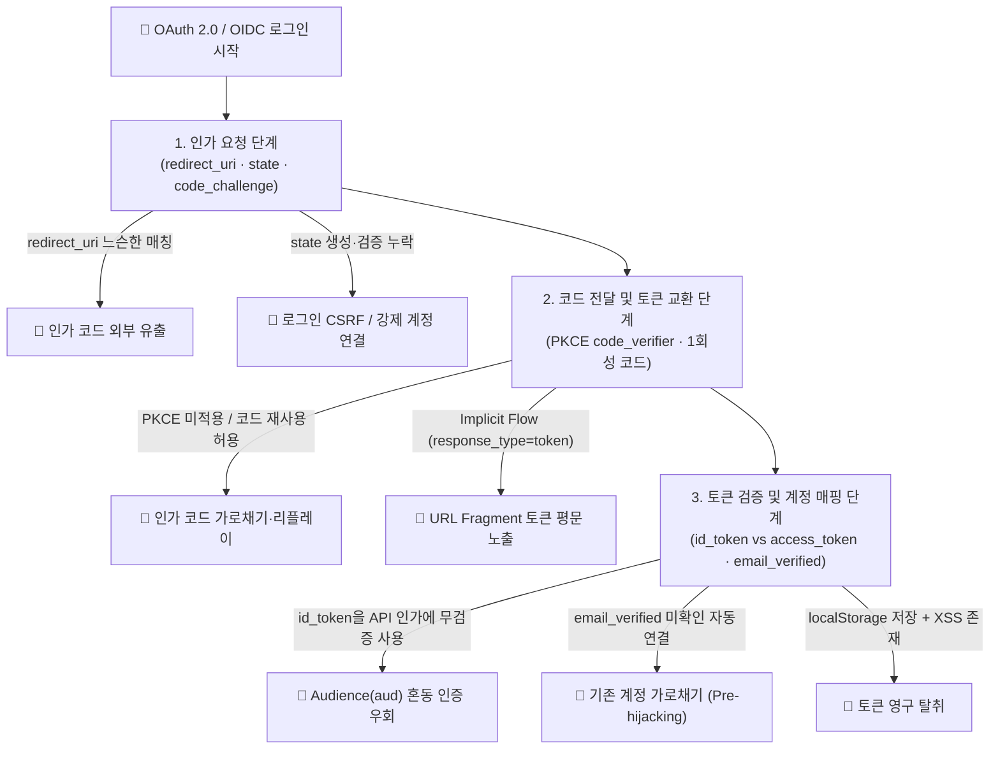
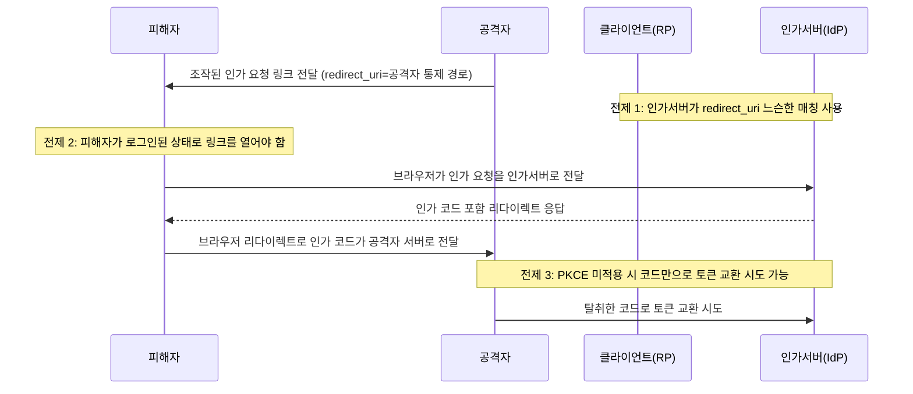
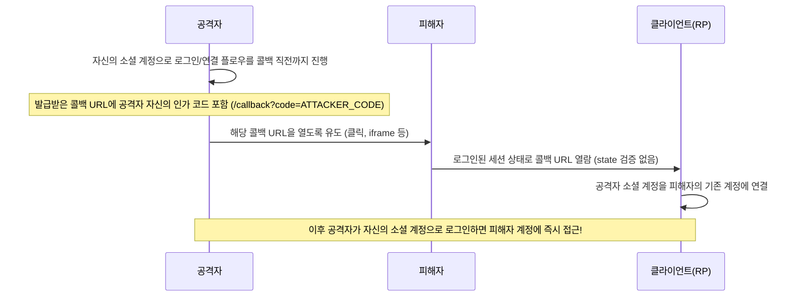

> [!summary] ⏱️ 5초 핵심 요약
> - **한 줄 비유**: 외부 신원보증기관(IdP)이 써준 **'임시 출입 교환권(인가 코드·토큰)'을 건물 안내데스크(RP)에 전달하는 과정에서, 배달 주소를 조작(`redirect_uri`)하거나 주인 확인 번호표(`state`·`PKCE`)를 빼먹어 남의 계정을 가로채는 공격**입니다.
> - **핵심 원리**: SSO는 **"토큰을 발급하는 서버(IdP)"**와 **"토큰을 받아쓰는 서버(클라이언트/RP)"**가 분리돼 있어, 어느 한쪽이라도 스펙(RFC 9700, OIDC Core)이 요구하는 검증 하나를 빠뜨리면 인증 우회·계정 탈취로 직결됩니다.
> - **7대 핵심 공격 지점**: ① `redirect_uri` 느슨한 매칭, ② `state` 누락(로그인 CSRF·강제 계정 연결), ③ `PKCE` 미적용 및 코드 재사용, ④ 암묵적 플로우(`#access_token`) 노출, ⑤ `id_token` vs `access_token`(`aud`) 혼동, ⑥ 미인증 이메일(`email_verified: false`) 자동 계정 연결, ⑦ `localStorage` 토큰 저장과 XSS 결합.
> - **핵심 방어**: `redirect_uri` 문자열 완전 일치, 모든 클라이언트에 `PKCE(S256)` + `state` 강제, 토큰 교환 시 1회성 검증, `id_token`의 `iss`·`aud`·`exp`·서명 및 `email_verified` 엄격 확인.

[[웹 취약점 진단 기법 입문 — XXE, SSRF부터 SQLi, XSS까지]], [[웹 취약점 진단 심화 — 실무에서 보는 기법들]], [[웹 취약점 진단 설정편 — CORS·SOP부터 후속 공격까지]]에서 다룬 항목들이 애플리케이션 코드나 브라우저 보안 모델의 결함이었다면, 이번 글은 로그인을 다른 서비스에 위임하는 **OAuth 2.0 / OpenID Connect(OIDC) 플로우** 자체에서 반복적으로 드러나는 설계·구현 결함을 모았습니다.

SSO는 "토큰을 발급하는 서버(IdP)"와 "토큰을 받아쓰는 서버(클라이언트/RP)"가 분리돼 있어서, 어느 한쪽이 스펙이 요구하는 검증 하나를 빠뜨리면 인증 우회·계정 탈취로 바로 이어지는 경우가 많습니다. 각 항목은 원리와 함께 **실제로 성립하는 정확한 전제 조건**을 짚었으니, 기능이 있다고 자동으로 취약하다고 단정하지 말고 조건까지 확인하세요.



---

## 한눈에 보는 OAuth·OIDC 7대 취약점 성립 조건 및 방어

| 취약점 항목 | 누구의 결함인가 | 공격이 실제로 성립하기 위한 필수 전제 조건 | 표준 방어 대책 (RFC 9700 / OIDC) |
|---|---|---|---|
| **1. `redirect_uri` 검증 결함** | 인가 서버(IdP) (+ RP 내 오픈 리다이렉트) | ① 느슨한 매칭(Prefix/도메인 단위) + ② 피해자의 링크 클릭 + ③ **PKCE 미적용** | 등록된 URI와 **문자열 완전 일치(Exact Match)** 강제 + PKCE |
| **2. `state` 파라미터 누락** | 클라이언트(RP) | `state` 미발급 또는 콜백 시 세션 저장값과 미대조 + 피해자의 콜백 URL 열람 유도 | 예측 불가능한 1회성 `state`를 세션에 묶어 콜백에서 검증 |
| **3. 인가 코드 가로채기·재사용** | 클라이언트(RP) & 인가 서버(IdP) | PKCE 미적용 상태에서 커스텀 스킴/로그로 코드 유출, 또는 사용된 코드의 재교환 허용 | 모든 클라이언트에 **`PKCE(S256)` 적용** + 코드 재사용 시 기존 발급 토큰 즉시 폐기 |
| **4. 암묵적 플로우(`token`)** | 클라이언트(RP) & 인가 서버(IdP) | `response_type=token` 사용 + 히스토리/외부 스크립트/`postMessage` 노출 경로 존재 | 암묵적 플로우 폐기, **Authorization Code + PKCE**로 전환 |
| **5. `id_token` vs `access_token` 혼동** | 리소스 서버 / RP 백엔드 | `id_token`을 API 인가에 쓰면서 서명·`iss`·**`aud`(대상 클라이언트 ID)**·`exp` 미검증 | API 인가에는 `access_token` 사용, `id_token`은 서명·`iss`·`aud`·`exp` 필수 검증 |
| **6. 이메일 미인증 계정 연결** | 클라이언트(RP) | 이메일 동일성만으로 자동 연결하면서 **`email_verified` 클레임 미확인** (또는 미인증 IdP 허용) | `email_verified === true` 확인 + 최초 연결 시 기존 계정 재인증 요구 |
| **7. `localStorage` 토큰 저장** | 클라이언트(SPA) | 토큰을 Web Storage에 보관 + **동일 Origin 내 XSS 취약점이 실제로 존재**할 것 | XSS 원천 차단 + 필요 시 `HttpOnly` 쿠키(CSRF 방어 병행) 또는 BFF 패턴 도입 |

---

## 1. `redirect_uri` 검증 결함

**💡 한 줄 비유**: 등기우편(인가 코드)을 보낼 때 **'서울시 강남구 테헤란로 1번지 본사 건물'까지 주소가 정확히 같아야만 배달해야 하는데, '서울시 강남구로 시작하면 어디든 배달'해 주거나 건물 로비의 전달 심부름꾼(오픈 리다이렉트)에게 넘겨주어 도둑이 우편물을 가로채는 상황**입니다.

### 핵심 원리
인가 코드/암묵적 플로우에서 인가 서버(IdP)는 발급한 인가 코드(또는 토큰)를 요청에 담긴 `redirect_uri`로 돌려보냅니다. 인가 서버가 사전 등록된 `redirect_uri`와 요청값을 **정확히 일치(Exact Match)**시키지 않고, 등록값으로 시작하기만 하면 통과시키는 **Prefix 매칭**이나 **도메인 단위 검사**만 쓰면 공격자는 등록된 호스트 아래 자신이 통제 가능한 경로(오픈 리다이렉트 엔드포인트, 와일드카드 서브도메인, 경로 조작값)를 지정해 인가 코드를 자기 서버로 빼돌릴 수 있습니다.



### 실제로 공격이 성립하기 위한 3가지 필수 전제 조건
1. **느슨한 URI 매칭**: 인가 서버가 문자열 완전 일치 대신 Prefix 매칭·와일드카드 서브도메인을 허용하거나, 허용된 RP 경로 안에 오픈 리다이렉트 취약점이 존재할 것
2. **피해자 상호작용**: 해당 IdP에 로그인된 피해자가 공격자가 조작한 인가 요청 링크를 열어야 할 것
3. **PKCE 미적용**: **PKCE가 적용돼 있지 않아야** 탈취한 코드를 바로 토큰으로 바꿀 수 있습니다. (PKCE가 걸려 있으면 원본 `code_verifier` 없이는 코드만 훔쳐도 토큰 교환이 거부됩니다.)

*(참고: **RFC 9700**은 인가 서버가 `redirect_uri`를 등록값과 **문자열 완전 일치**로 검증할 것을 명시적으로 요구합니다.)*

### 체크 포인트
- 인가 서버가 등록된 `redirect_uri` 뒤에 추가 경로(`../`, `/extra`)나 임의 쿼리 파라미터를 허용하는가?
- 와일드카드 서브도메인(`https://*.example.com/callback`)이 등록되어 있는가?
- 등록된 도메인 내부에 체이닝 가능한 오픈 리다이렉트 엔드포인트가 존재하는가?
- 토큰 교환 단계에 PKCE(`code_verifier` 검증)가 강제되어 있는가?
- 참고: [RFC 9700 — OAuth 2.0 Security Best Current Practice](https://www.rfc-editor.org/rfc/rfc9700), [OWASP OAuth 2.0 Protocol Cheat Sheet](https://cheatsheetseries.owasp.org/cheatsheets/OAuth2_Cheat_Sheet.html), [PortSwigger — OAuth 2.0 authentication vulnerabilities](https://portswigger.net/web-security/oauth)

---

## 2. `state` 파라미터 누락 — 로그인 CSRF / 강제 계정 연결

**💡 한 줄 비유**: 세탁소에 옷을 맡길 때 **보관 번호표(`state`)를 주지 않아서, 도둑이 자기 이름으로 발급받은 '계정 연결 접수증(콜백 URL)'을 내 손에 슬쩍 쥐여주니 세탁소 직원이 내 옷장에 도둑의 열쇠(소셜 계정)를 연결해 버리는 격**입니다.

### 핵심 원리
인가 요청의 `state`는 인가 서버가 콜백에 그대로 되돌려주는 값으로, 클라이언트가 **"이 콜백이 내가 방금 이 브라우저 세션에서 시작한 바로 그 요청의 응답인지"** 확인하는 CSRF 방지용 1회성 토큰입니다.



### 왜 위험한가 (강제 계정 연결 시나리오)
- 클라이언트가 `state`를 발급하지 않거나 콜백에서 검증하지 않으면, 공격자는 **자기 소셜 계정**으로 로그인(또는 계정 연동) 플로우를 진행해 받은 콜백 URL(`?code=공격자코드`)을 피해자에게 열게 만듭니다.
- 피해자가 로그인된 상태에서 그 URL을 열면, 클라이언트는 **공격자의 소셜 계정을 피해자의 기존 계정에 연결**해 버립니다.
- 이후 공격자는 자기 소셜 계정으로 로그인하는 것만으로 피해자 계정을 완전히 장악합니다. 세션 토큰을 훔치는 게 아니라 **계정 연결 상태 자체를 조작하는 CSRF**라서 일반 CSRF 점검에서 빠지기 쉽습니다.

### 체크 포인트
- 인가 요청에 예측 불가능한 난수 `state` 파라미터가 포함되는가?
- 콜백 처리 로직이 `state`를 **현재 사용자의 서버 세션(또는 서명된 쿠키)에 저장해 둔 값과 실제로 비교**하는가? (단순히 파라미터 존재 여부만 보지 않는가?)
- 소셜 계정 연결용 콜백 엔드포인트를 `state` 없이 호출하거나 다른 세션에서 재생했을 때 거부되는가?
- 참고: [RFC 9700 — OAuth 2.0 Security Best Current Practice](https://www.rfc-editor.org/rfc/rfc9700), [PortSwigger — Lab: Forced OAuth profile linking](https://portswigger.net/web-security/oauth/lab-oauth-forced-oauth-profile-linking)

---

## 3. 인가 코드 가로채기와 재사용 (PKCE)

**💡 한 줄 비유**: 택배 보관함 열쇠(인가 코드)만 있으면 누구나 문을 열 수 있던 구조에서, **최초 주문자만 아는 암구호(`code_verifier`)를 함께 대야만 문이 열리도록 이중 잠금장치(PKCE)를 거는 원리**입니다.

### 핵심 원리
1. **공개 클라이언트의 한계와 PKCE의 역할**:
   - 브라우저에서 실행되는 SPA나 배포된 모바일 앱(공개 클라이언트)은 `client_secret`을 안전하게 숨길 수 없습니다.
   - 만약 PKCE 없이 인가 코드 플로우를 쓰면, 같은 기기의 악성 앱이 커스텀 URL 스킴(`myapp://callback`)을 가로채거나 프록시·로그로 인가 코드가 유출됐을 때 코드만으로 토큰 교환이 가능해집니다.
   - **PKCE(Proof Key for Code Exchange)**는 인가 요청 시 무작위 `code_verifier`의 해시값(`code_challenge`)을 먼저 보내고, 토큰 교환 시 원본 `code_verifier`를 제시하게 하여 코드만 훔친 제3자의 교환 시도를 차단합니다.
2. **인가 코드 재사용(Replay) 차단**:
   - 인가 서버가 한 번 교환이 끝난 인가 코드를 다시 받아주면 가로챈 코드를 리플레이해 토큰을 또 발급받을 수 있습니다.
   - **RFC 9700**은 공개 클라이언트뿐 아니라 **기밀 클라이언트를 포함한 모든 클라이언트에 PKCE 사용을 권고**하며, 인가 코드는 엄격히 **1회성**으로 취급해 재사용 시도가 감지되면 그 코드로 이미 발급된 토큰까지 폐기할 것을 요구합니다.

### 체크 포인트
- SPA·모바일 및 웹 클라이언트가 PKCE(`code_challenge_method=S256`)를 적용하고 있는가? (`plain` 방식 허용 여부 포함 점검)
- 모바일 앱에서 다른 앱이 가로챌 수 있는 커스텀 URL 스킴 대신 검증된 App Links / Universal Links를 사용하는가?
- 같은 인가 코드를 두 번 제시해 토큰 교환을 시도했을 때 인가 서버가 즉시 거부하고 기존 발급 토큰을 폐기하는가?
- 참고: [RFC 7636 — Proof Key for Code Exchange (PKCE)](https://www.rfc-editor.org/rfc/rfc7636), [RFC 9700 — OAuth 2.0 Security Best Current Practice](https://www.rfc-editor.org/rfc/rfc9700)

---

## 4. 암묵적 플로우(Implicit Flow)의 구조적 문제

**💡 한 줄 비유**: 금고 열쇠로 바꿔 올 수 있는 '1회용 교환권(인가 코드)'을 주는 대신, **우편엽서 뒷면(URL `#access_token=...`)에 실제 금고 마스터키(액세스 토큰)를 그대로 적어서 보내 배달 경로와 책상 위(브라우저 히스토리·스크립트)에 노출시키는 방식**입니다.

### 핵심 원리
암묵적 플로우(`response_type=token`)는 별도의 백채널 토큰 교환 단계 없이 인가 서버가 액세스 토큰을 리다이렉트 URL의 **fragment(`#access_token=...`)**에 직접 실어 돌려줍니다.
- **왜 위험한가**:
  - URL fragment는 서버로 네트워크 전송되지는 않지만, **브라우저 히스토리에 평문으로 남습니다.**
  - 같은 페이지에 로드된 서드파티 스크립트나 브라우저 확장 프로그램이 `location.hash`를 읽어 그대로 가져갈 수 있습니다.
  - 가로챈 액세스 토큰은 추가 증명(`code_verifier` 등) 없이 즉시 사용할 수 있는 Bearer 토큰이므로 탈취 즉시 피해자 권한의 API 호출이 가능합니다.
- **표준 동향**: OAuth 2.1 초안(`draft-ietf-oauth-v2-1`)은 암묵적 그랜트를 아예 제거했고, 이미 발행된 **RFC 9700**도 암묵적 그랜트 사용을 금지·비권장하며 공개 클라이언트에도 **인가 코드 플로우 + PKCE**를 표준으로 명시합니다.

### 체크 포인트
- 인가 요청에 `response_type=token` 또는 `id_token token`을 사용하는 클라이언트가 남아 있는가?
- 인가 서버가 등록된 클라이언트에 대해 불필요한 `implicit` 그랜트 타입을 열어두고 있지 않은가?
- 콜백 페이지가 `location.hash`의 토큰을 읽는 동안 외부 스크립트를 로드하거나 `postMessage(..., "*")`로 다른 창에 중계하지 않는가?
- 참고: [RFC 9700 — OAuth 2.0 Security Best Current Practice](https://www.rfc-editor.org/rfc/rfc9700), [draft-ietf-oauth-v2-1 — The OAuth 2.1 Authorization Framework](https://datatracker.ietf.org/doc/draft-ietf-oauth-v2-1/), [PortSwigger — Lab: Authentication bypass via OAuth implicit flow](https://portswigger.net/web-security/oauth/lab-oauth-authentication-bypass-via-oauth-implicit-flow)

---

## 5. ID 토큰 vs 액세스 토큰 혼동

**💡 한 줄 비유**: **`id_token`은 "이 사람은 홍길동이 맞다"는 주민등록증(신원 확인용)**이고, **`access_token`은 "이 사람에게 A 건물 3층 출입을 허가한다"는 출입증(API 인가용)**입니다. 출입증 대신 주민등록증만 보고 문을 열어주면, 옆 건물(다른 클라이언트)에 제출했던 주민등록증 사본을 들고 와도 문이 열립니다.

### 핵심 원리
| 구분 | `id_token` (OIDC) | `access_token` (OAuth 2.0) |
|---|---|---|
| **목적** | **"누가 언제 어떻게 인증했는가"**를 클라이언트(RP)에 알려주는 **인증 증명**(서명된 JWT) | 리소스 서버(API)에 특정 권한 범위(`scope`)의 접근을 요청하는 **인가 증명** |
| **`aud` (대상)** | 로그인을 요청한 **클라이언트 ID (`client_id`)** | 호출 대상 **리소스 서버(API) 식별자** |

### Audience(`aud`) 혼동 공격이 성립하는 원리
- 실무에서 백엔드가 `id_token`을 `Authorization: Bearer` 헤더에 그대로 넣어 API 인가에 쓰는 설계가 종종 보입니다.
- 이때 리소스 서버가 `id_token`의 서명을 IdP 공개키로 검증하지 않거나, 특히 **`aud` 클레임이 자신의 클라이언트 ID와 일치하는지 확인하지 않으면**, 공격자는 **같은 IdP(예: Google, 사내 SSO)를 사용하는 전혀 다른 서비스(공격자 앱)에 피해자가 로그인하게 한 뒤 그때 발급된 피해자의 `id_token`을 가져와 대상 API에 그대로 제출**하여 인증을 우회할 수 있습니다.

### 체크 포인트
- 리소스 서버가 `Authorization` 헤더로 받는 토큰이 용도에 맞는 `access_token`인가, 아니면 `id_token`인가?
- 토큰 검증 시 **발급자 서명(JWKS)·`iss`(발급자)·`aud`(수신 대상 클라이언트/API)·`exp`(만료 시각)**를 빠짐없이 모두 검증하는가?
- 같은 IdP를 공유하는 여러 OIDC 클라이언트가 있을 때 `aud` 클레임으로 대상 클라이언트를 엄격히 구분하는가?
- 참고: [OpenID Connect Core 1.0 — ID Token Validation (§3.1.3.7)](https://openid.net/specs/openid-connect-core-1_0-final.html), [OWASP OAuth 2.0 Protocol Cheat Sheet](https://cheatsheetseries.owasp.org/cheatsheets/OAuth2_Cheat_Sheet.html)

---

## 6. 계정 연결(Account Linking) 결함 — 이메일 미인증

**💡 한 줄 비유**: 은행에서 **"신분증에 적힌 이메일 주소가 기존 고객 이메일과 같으면 같은 사람으로 합쳐준다"**는 규칙만 두고, 정작 **아무나 남의 이메일을 적어 만들 수 있는 동네 사설 회원증(이메일 미인증 IdP 클레임)**을 그대로 믿어 기존 고객 계좌를 넘겨주는 셈입니다.

### 핵심 원리
소셜 로그인을 지원하는 서비스는 흔히 **"IdP가 내려준 이메일(`email`)이 기존 로컬 가입자의 이메일과 같으면 자동으로 기존 계정에 연결해 로그인시킨다"**는 편의 로직을 씁니다.
- **성립 조건**: 클라이언트가 그 이메일이 IdP 쪽에서 실제로 소유권이 확인된 값인지(**`email_verified: true`**) 검증하지 않거나, 이메일 인증 없이 가입·변경이 가능한 느슨한 IdP까지 신뢰 목록에 올려 둘 때 성립합니다.
- **공격 시나리오 (계정 가로채기 / Pre-Account Takeover)**:
  1. 공격자가 피해자의 이메일 주소(`victim@company.com`)로 이메일 인증이 필요 없는 IdP(또는 미인증 상태에서 토큰을 발급하는 IdP)에 계정을 만듭니다.
  2. 그 소셜 계정으로 대상 서비스에 로그인합니다.
  3. 대상 서비스가 `email_verified`가 `false`인데도 `"이메일이 일치하니 기존 계정에 자동 연결"` 흐름을 실행하여 피해자의 기존 계정을 공격자에게 넘겨줍니다.

```json
// ❌ 취약한 판단: email_verified가 false인데도 email 값만 보고 기존 계정과 자동 병합
{
  "iss": "https://idp.example.com",
  "sub": "attacker-idp-uid-999",
  "email": "victim@company.com",
  "email_verified": false
}
```

### 체크 포인트
- 소셜 로그인 자동 계정 연결 로직이 `email_verified === true` 클레임을 필수로 확인하는가?
- 신뢰하는 IdP 목록 중에 이메일 소유권 검증 없이 가입이나 이메일 변경이 가능한 곳이 포함되어 있지 않은가?
- 기존 로컬 계정에 소셜 계정을 최초 연결할 때 **기존 계정의 비밀번호 재확인이나 이메일 인증 승인** 같은 추가 검증을 거치는가?
- 참고: [OWASP OAuth 2.0 Protocol Cheat Sheet](https://cheatsheetseries.owasp.org/cheatsheets/OAuth2_Cheat_Sheet.html), [PortSwigger — OAuth 2.0 authentication vulnerabilities (unverified user registration)](https://portswigger.net/web-security/oauth)

---

## 7. 토큰 저장 위치 — `localStorage`와 XSS의 결합

**💡 한 줄 비유**: 집 열쇠(토큰)를 거실 탁자 위(`localStorage`)에 올려두는 것 자체로 도둑이 생기진 않지만, **창문이 깨져 도둑(XSS)이 한 번이라도 들어오면 탁자 위 열쇠를 그대로 복사해 들고 나가 언제든 다시 문을 열고 들어올 수 있게 됩니다.**

### 핵심 원리
- **`localStorage` / `sessionStorage` 저장의 의미**: 같은 Origin에서 실행되는 자바스크립트 코드라면 어디서든 `localStorage.getItem()`으로 토큰 원문을 읽을 수 있습니다.
- **정확한 판정 기준**: 저장소 선택 자체가 단독 취약점을 만드는 것은 아닙니다. 토큰이 실제로 유출되려면 **그 페이지(또는 동일 Origin)에 별도의 XSS나 악성 서드파티 스크립트 감염이 먼저 성립**해야 합니다. 다만 Web Storage 저장은 XSS가 터졌을 때의 피해 범위를 "현재 브라우저 내 대리 요청"에서 **"토큰 원문을 외부로 반출해 다른 곳에서 영구 재사용"**으로 키웁니다.
- **`HttpOnly` 쿠키와의 트레이드오프**: 토큰을 `HttpOnly` 쿠키에 담으면 JS가 토큰 원문을 읽을 수 없어 외부 반출 경로는 막히지만, 대신 브라우저가 자동으로 쿠키를 전송하므로 **CSRF 방어(`SameSite`, CSRF 토큰 등)**를 반드시 함께 챙겨야 합니다.

### 체크 포인트
- 액세스/리프레시 토큰이 `localStorage`나 `sessionStorage`에 평문 저장되는가?
- 해당 애플리케이션에 실제로 결합 가능한 XSS 취약점이나 통제되지 않는 외부 스크립트 로드가 존재하는가? (저장 위치만으로는 단독 취약점 단정 불가)
- 토큰을 `HttpOnly` 쿠키로 옮길 경우 `SameSite=Lax/Strict` 및 상태 변경 API에 대한 CSRF 방어가 함께 적용되는가?
- 참고: [OWASP OAuth 2.0 Protocol Cheat Sheet](https://cheatsheetseries.owasp.org/cheatsheets/OAuth2_Cheat_Sheet.html), [OWASP XSS Prevention Cheat Sheet](https://cheatsheetseries.owasp.org/cheatsheets/Cross_Site_Scripting_Prevention_Cheat_Sheet.html)
