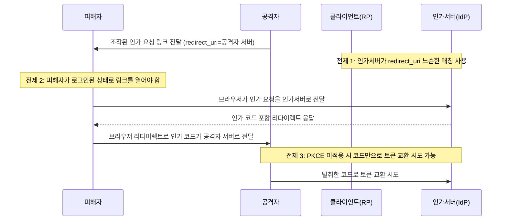
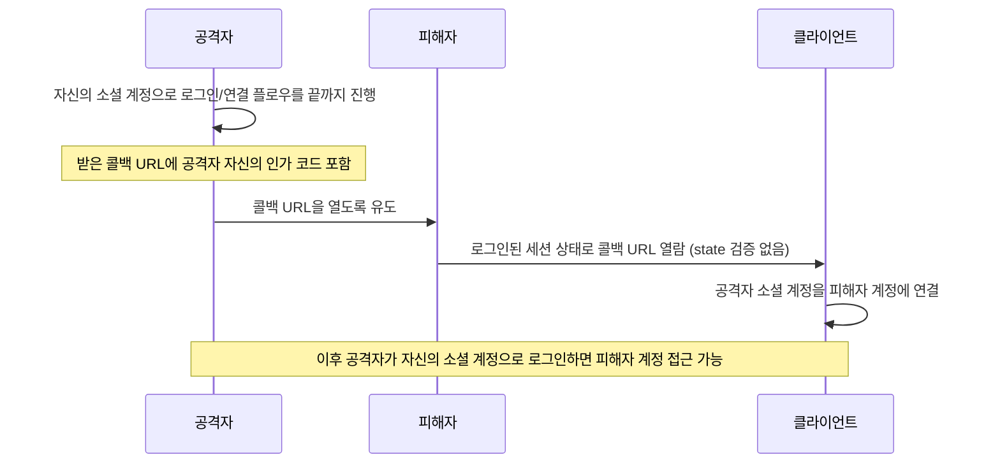

[[웹 취약점 진단 기법 입문 — XXE, SSRF부터 SQLi, XSS까지]], [[웹 취약점 진단 심화 — 실무에서 보는 기법들]], [[웹 취약점 진단 설정편 — CORS·SOP부터 후속 공격까지]]에서 다룬 항목들이 애플리케이션 코드나 브라우저 보안 모델의 결함이었다면, 이번 글은 로그인을 다른 서비스에 위임하는 **OAuth 2.0 / OpenID Connect(OIDC) 플로우** 자체에서 반복적으로 드러나는 설계·구현 결함을 모았습니다. SSO는 "토큰을 발급하는 서버(IdP)"와 "토큰을 받아쓰는 서버(클라이언트/RP)"가 분리돼 있어서, 어느 한쪽이 스펙이 요구하는 검증 하나를 빠뜨리면 인증 우회·계정 탈취로 바로 이어지는 경우가 많습니다. 각 항목은 원리와 함께 **실제로 성립하는 정확한 조건**을 짚었으니, 기능이 있다고 자동으로 취약하다고 단정하지 말고 조건까지 확인하세요.

---

## 1. redirect_uri 검증 결함

**원리**: 인가 코드/암묵적 플로우에서 인가 서버는 발급한 인가 코드(또는 토큰)를 요청에 담긴 `redirect_uri`로 돌려보냅니다. 인가 서버가 사전에 등록된 `redirect_uri`와 실제 요청값을 **정확히 일치**시키지 않고, 등록값으로 시작하기만 하면 통과시키는 prefix 매칭이나 도메인 단위 검사만 쓰면, 공격자는 등록된 호스트 아래 자신이 통제 가능한 경로(오픈 리다이렉트 엔드포인트, 느슨하게 등록된 와일드카드 서브도메인, 경로 뒤에 덧붙인 조작값)를 `redirect_uri`로 지정해 인가 코드가 자신의 서버로 흘러오게 만들 수 있습니다.

단, 이 공격이 실제로 성립하려면 ① 인가 서버가 정확 일치 대신 느슨한 매칭을 쓰고 있어야 하고, ② 그 서비스에 로그인된 피해자가 공격자가 만든 인가 요청 링크를 열어야 하며, ③ PKCE가 적용돼 있지 않아야 탈취한 코드를 바로 토큰으로 바꿀 수 있습니다 — PKCE가 걸려 있으면 `code_verifier` 없이는 코드만 훔쳐도 토큰 교환이 거부됩니다.

RFC 9700은 인가 서버가 `redirect_uri`를 등록값과 **문자열 완전 일치**로 검증할 것을 명시적으로 요구합니다.

- 체크 포인트:
  - 인가 서버가 `redirect_uri` 뒤에 추가 경로·쿼리를 허용하는지
  - 와일드카드 서브도메인 등록 여부
  - 등록 도메인 안에 오픈 리다이렉트가 있는지
  - PKCE 적용 여부
- 참고: [RFC 9700 — OAuth 2.0 Security Best Current Practice](https://www.rfc-editor.org/rfc/rfc9700), [OWASP OAuth 2.0 Protocol Cheat Sheet](https://cheatsheetseries.owasp.org/cheatsheets/OAuth2_Cheat_Sheet.html), [PortSwigger — OAuth 2.0 authentication vulnerabilities](https://portswigger.net/web-security/oauth)

## 2. state 파라미터 누락 — 로그인 CSRF / 강제 계정 연결

**원리**: 인가 요청의 `state`는 인가 서버가 콜백에 그대로 되돌려주는 값으로, 클라이언트가 "이 콜백이 내가 방금 시작한 그 요청에 대한 응답인지"를 확인하는 CSRF 방지용 1회성 토큰입니다.

클라이언트가 `state`를 발급하지 않거나 발급만 하고 콜백에서 검증하지 않으면, 공격자는 **자기 계정**으로 로그인(또는 계정 연결) 플로우를 끝까지 진행해 받은 콜백 URL(인가 코드 포함)을 피해자에게 열게 만들 수 있습니다. 피해자의 브라우저가 로그인된 세션 상태로 그 콜백을 열면, 클라이언트는 이를 "지금 세션의 사용자"에 대한 응답으로 처리해 공격자의 소셜 계정을 피해자의 기존 계정에 연결해 버립니다. 이후 공격자는 자신의 소셜 계정으로 로그인하는 것만으로 피해자 계정에 들어갈 수 있습니다 — 세션 토큰을 훔치는 게 아니라 **계정 연결 상태 자체를 조작하는** CSRF라서, 일반적인 CSRF 토큰 점검 목록에서 빠지기 쉽습니다.

성립 조건: 클라이언트가 `state`를 생성·검증하지 않아야 하고, 공격자가 피해자를 그 콜백 URL로 유도(클릭, 자동 리다이렉트 iframe 등)할 수 있어야 합니다.

- 체크 포인트: 인가 요청에 `state`가 있는지, 콜백 처리 로직이 `state`를 서버 측에 저장해 둔 값과 비교하는지(단순히 존재 여부만 보는 게 아닌지), 계정 연결용 콜백 엔드포인트를 `state` 없이 재생해도 처리되는지
- 참고: [RFC 9700 — OAuth 2.0 Security Best Current Practice](https://www.rfc-editor.org/rfc/rfc9700), [PortSwigger — Lab: Forced OAuth profile linking](https://portswigger.net/web-security/oauth/lab-oauth-forced-oauth-profile-linking)

## 3. 인가 코드 가로채기와 재사용 (PKCE)

**원리**: 공개 클라이언트(브라우저에서 실행되는 SPA, 배포된 모바일 앱)는 `client_secret`을 안전하게 보관할 수 없습니다. 이런 클라이언트가 PKCE 없이 인가 코드 플로우를 쓰면, 같은 기기에서 동작하는 다른 앱이 커스텀 URL 스킴 리다이렉트를 가로채거나(여러 앱이 같은 스킴을 등록할 수 있는 환경), 네트워크 경로·프록시 로그를 통해 인가 코드가 유출됐을 때 그 코드만으로 토큰 교환이 가능해집니다.

PKCE는 인가 요청 시 클라이언트가 만든 무작위 `code_verifier`의 해시값(`code_challenge`)을 먼저 보내고, 토큰 교환 시 원본 `code_verifier`를 함께 제시하게 해서, 코드만 가로챈 제3자는 `code_verifier`를 모르니 토큰 교환이 거부되게 만듭니다.

여기에 더해 인가 서버가 **같은 코드의 재사용을 거부하지 않으면**(한 번 교환이 끝난 코드를 다시 제시해도 받아주면), 가로챈 코드를 리플레이해 추가 토큰을 발급받을 길이 남습니다. RFC 9700은 공개 클라이언트뿐 아니라 **기밀 클라이언트를 포함한 모든 클라이언트**에 PKCE 사용을 권고하고, 인가 코드는 1회성으로 취급해 재사용 시도가 감지되면 그 코드로 이미 발급된 토큰까지 폐기할 것을 요구합니다.

- 체크 포인트: SPA/모바일 클라이언트가 PKCE(`code_challenge_method=S256`)를 쓰는지, 커스텀 URL 스킴 리다이렉트를 다른 앱이 가로챌 수 있는 환경인지, 같은 인가 코드를 두 번 제시했을 때 토큰 서버가 거부하고 기존 발급 토큰까지 폐기하는지
- 참고: [RFC 7636 — Proof Key for Code Exchange (PKCE)](https://www.rfc-editor.org/rfc/rfc7636), [RFC 9700 — OAuth 2.0 Security Best Current Practice](https://www.rfc-editor.org/rfc/rfc9700)

## 4. 암묵적 플로우(implicit flow)의 구조적 문제

**원리**: 암묵적 플로우(`response_type=token`)는 토큰 교환 단계 없이 인가 서버가 액세스 토큰을 리다이렉트 URL의 **fragment**(`#access_token=...`)에 직접 실어 돌려줍니다. fragment는 네트워크로 서버에 전송되지 않지만, 브라우저 히스토리에 평문으로 남고, 같은 페이지에 로드된 다른 스크립트나 브라우저 확장 프로그램이 `location.hash`를 읽어 그대로 가져갈 수 있습니다. 가로챈 액세스 토큰은 추가 증명 없이 바로 쓸 수 있는 bearer 토큰이라, 탈취되는 순간 피해자 권한으로 API를 호출할 수 있습니다.

이런 구조적 노출 경로 때문에 아직 RFC로 확정되지는 않은 OAuth 2.1 초안(`draft-ietf-oauth-v2-1`)은 암묵적 그랜트를 아예 제거했고, 이미 발행된 RFC 9700도 암묵적 그랜트 사용을 권고하지 않습니다 — 대신 공개 클라이언트에도 인가 코드 플로우 + PKCE를 표준 패턴으로 명시합니다.

- 체크 포인트: `response_type=token`을 쓰는 클라이언트가 남아 있는지, 토큰이 URL fragment로 반환되는지, 그 페이지가 외부 스크립트를 로드하거나 `postMessage`로 토큰을 다른 창에 중계하는지
- 참고: [RFC 9700 — OAuth 2.0 Security Best Current Practice](https://www.rfc-editor.org/rfc/rfc9700), [draft-ietf-oauth-v2-1 — The OAuth 2.1 Authorization Framework](https://datatracker.ietf.org/doc/draft-ietf-oauth-v2-1/), [PortSwigger — Lab: Authentication bypass via OAuth implicit flow](https://portswigger.net/web-security/oauth/lab-oauth-authentication-bypass-via-oauth-implicit-flow)

## 5. ID 토큰 vs 액세스 토큰 혼동

**원리**: OIDC의 `id_token`은 "이 사용자가 이 시점에 이 방식으로 인증했다"는 **인증 증명**(서명된 JWT)이지, 리소스 서버 API 호출에 쓰라고 만든 토큰이 아닙니다. 반면 `access_token`은 OAuth가 정의하는 **인가 증명**으로, 리소스 서버가 그 유효성을 확인해 API 접근을 허용합니다.

이 둘을 혼동해 클라이언트나 백엔드가 `id_token`을 `Authorization: Bearer` 헤더에 그대로 넣어 API 인가에 쓰는 설계가 실무에서 종종 보입니다. `id_token`은 `aud` 클레임이 API가 아니라 **그 로그인을 요청한 클라이언트 ID**로 한정돼 있고, 만약 리소스 서버가 그 서명을 발급자(IdP)의 공개키로 검증하지 않거나 `iss`/`aud`/`exp`를 확인하지 않으면, 다른 클라이언트를 대상으로 발급된 `id_token`이나 만료된 토큰도 그대로 통과시킵니다.

즉 문제의 핵심은 "id_token을 쓴다"는 사실 자체가 아니라, **리소스 서버가 그 id_token이 자신을 대상(aud)으로 발급됐고 신뢰하는 발급자의 서명인지까지 검증하는가**입니다. 검증이 빠지면, 같은 IdP를 공유하는 다른 OIDC 클라이언트에 로그인해서 받은 `id_token`을 가져와 이 API에 그대로 재사용하는 audience 혼동 공격이 성립합니다.

- 체크 포인트: 리소스 서버가 `Authorization` 헤더로 받는 토큰이 `id_token`인지 `access_token`인지, `id_token` 검증 시 서명·`iss`·`aud`·`exp`를 모두 확인하는지, 같은 발급자를 공유하는 여러 OIDC 클라이언트가 있을 때 `aud`로 클라이언트를 구분하는지
- 참고: [OpenID Connect Core 1.0 — ID Token Validation (§3.1.3.7)](https://openid.net/specs/openid-connect-core-1_0-final.html), [OWASP OAuth 2.0 Protocol Cheat Sheet](https://cheatsheetseries.owasp.org/cheatsheets/OAuth2_Cheat_Sheet.html)

## 6. 계정 연결(account linking) 결함 — 이메일 미인증

**원리**: 소셜 로그인을 지원하는 서비스는 흔히 "IdP가 준 이메일이 기존 가입 이메일과 같으면 자동으로 같은 계정에 연결한다"는 편의 로직을 씁니다.

문제는 그 이메일이 **IdP 쪽에서 실제로 소유권이 확인된 값인지**를 클라이언트가 검증하지 않을 때입니다 — OIDC 토큰의 `email_verified` 클레임이 `false`인데도 이를 확인하지 않거나, 이메일 인증 없이 누구나 계정을 만들 수 있는 IdP까지 신뢰 목록에 올려 두면, 공격자가 피해자의 이메일 주소로 그 IdP에 계정을 만들고 그 계정으로 로그인해 "이메일이 같으니 기존 계정에 연결" 흐름을 타고 피해자의 기존 계정을 가로챌 수 있습니다.

이건 IdP 한 곳의 문제가 아니라 **클라이언트가 이메일 동일성만으로 계정을 묶는 로직** 자체의 결함이라, 이메일 인증을 강제하는 대형 IdP를 주력으로 쓰더라도 클라이언트가 `email_verified`를 확인하지 않으면 함께 등록된 다른 느슨한 IdP를 통해 같은 구멍이 열립니다.

- 체크 포인트: 계정 연결 로직이 `email_verified` 클레임을 확인하는지, 신뢰하는 IdP 중 이메일 인증 없이 가입 가능한 곳이 있는지, 최초 연결 시점에 기존 계정 비밀번호 재확인 등 추가 검증이 있는지
- 참고: [OWASP OAuth 2.0 Protocol Cheat Sheet](https://cheatsheetseries.owasp.org/cheatsheets/OAuth2_Cheat_Sheet.html), [PortSwigger — OAuth 2.0 authentication vulnerabilities (unverified user registration)](https://portswigger.net/web-security/oauth)

## 7. 토큰 저장 위치 — localStorage와 XSS의 결합

**원리**: SPA가 액세스 토큰을 `localStorage`/`sessionStorage`에 저장하면 같은 origin에서 실행되는 JS 코드가 어디서든 `localStorage.getItem()`으로 읽을 수 있습니다. 저장소 선택 자체가 취약점을 만드는 건 아니고, 토큰이 실제로 유출되려면 그 페이지에 **별도의 XSS가 먼저 성립**해야 합니다 — storage 위치가 XSS를 만드는 게 아니라, XSS가 터졌을 때의 피해 범위를 "그 요청 하나"에서 "토큰을 들고 나가 다른 시점·다른 곳에서 영구 재사용"으로 키웁니다.

`HttpOnly` 쿠키에 담으면 JS가 애초에 읽을 수 없어 이 경로는 막히지만, 대신 CSRF 방어(`SameSite`, 별도 토큰 검증)를 다시 챙겨야 하는 트레이드오프가 생깁니다.

- 체크 포인트: 액세스/리프레시 토큰이 `localStorage`/`sessionStorage`에 저장되는지, 그 애플리케이션에 XSS가 실제로 존재하는지(저장 위치만으로는 취약 여부 판단 불가), 쿠키로 옮길 경우 CSRF 방어가 함께 적용되는지
- 참고: [OWASP OAuth 2.0 Protocol Cheat Sheet](https://cheatsheetseries.owasp.org/cheatsheets/OAuth2_Cheat_Sheet.html), [OWASP XSS Prevention Cheat Sheet](https://cheatsheetseries.owasp.org/cheatsheets/Cross_Site_Scripting_Prevention_Cheat_Sheet.html)
