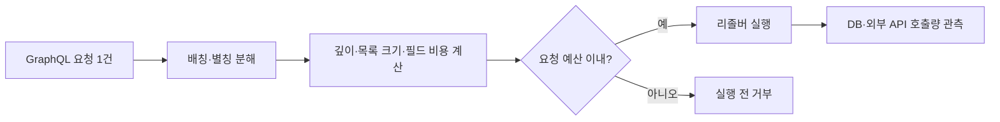

[[웹 취약점 진단 — 비즈니스 플로우 남용과 봇 방어 우회(API6)]]는 **누가 민감한 흐름을 얼마나 자주 호출하는가**, 즉 정상 동작이 속도와 규모로 남용되는 API6 문제를 다룹니다. 이 글은 요청 빈도와 별개로 **한 번의 요청이 얼마나 많은 CPU·메모리·대역폭·저장공간·외부 서비스 비용을 소비하는가**라는 API4:2023의 다른 축에 집중합니다. 따라서 일반적인 봇 판별보다 페이지 크기, 업로드 처리, GraphQL 작업량, 유료 연동의 요청당 비용을 측정합니다.

---

## 1. 요청 수가 아니라 요청당 비용 보기

리소스 소비는 손님 수만 세는 문제가 아닙니다. 한 사람이 식당에 한 번만 와도 음식을 1,000인분 주문하면 주방과 창고는 마비될 수 있습니다. API도 요청 한 건이 거대한 응답을 만들거나 복잡한 계산을 수행하고, SMS·AI·지도 같은 유료 외부 서비스를 여러 번 부르면 횟수 제한을 넘지 않고도 장애나 비용 피해가 생깁니다.

**원리**: API4 진단의 기본 단위는 `요청 횟수`가 아니라 `요청 하나가 유발한 작업량`입니다. 입력 바이트, 응답 바이트, DB 조회 행 수, CPU 시간, 메모리 최대치, 생성 파일 수, 외부 API 호출 수와 금액을 함께 봐야 합니다. 앞단 게이트웨이가 초당 요청 수만 제한해도 백엔드가 요청 내부의 반복 작업을 제한하지 않으면 보호가 성립하지 않습니다.

테스트는 서비스 장애를 만들지 않는 승인된 환경에서 작은 값부터 단계적으로 올리고, 지연시간·자원 사용량이 비선형으로 증가하는 지점을 찾는 방식이 안전합니다. 한계값이 없다는 사실과 실제 운영 용량을 소진했다는 사실은 구분해야 하며, 진단 중단 기준을 미리 합의해야 합니다.

- 체크 포인트:
  - 엔드포인트별 입력·응답·CPU·메모리·DB·외부 호출 비용을 계측하는지
  - 요청 빈도 제한과 요청당 작업량 제한이 각각 존재하는지
  - 승인된 환경, 단계적 증가폭, 자동 중단 임계치를 정했는지
- 참고: [OWASP API Security Top 10 2023 — API4 Unrestricted Resource Consumption](https://owasp.org/API-Security/editions/2023/en/0xa4-unrestricted-resource-consumption/), [CWE-400 — Uncontrolled Resource Consumption](https://cwe.mitre.org/data/definitions/400.html)

## 2. 페이지 크기와 대량 내보내기 상한

**원리**: `limit`, `page_size`, `size` 같은 파라미터를 클라이언트 값 그대로 DB 쿼리와 직렬화에 전달하면 한 요청이 대량 행 조회, 메모리 적재, JSON 변환, 네트워크 전송을 연쇄적으로 유발합니다. 기본값이 작아도 명시적인 최대값을 서버가 강제하지 않으면 큰 정수나 음수·누락 값이 프레임워크별 특수 동작으로 이어질 수 있습니다.

상한은 응답 행 수만 정하면 끝나지 않습니다. 각 행에 중첩 객체나 큰 텍스트·바이너리 메타데이터가 포함되면 같은 100건도 비용이 크게 달라집니다. 대량 내보내기가 필요한 기능은 동기 응답 대신 작업 큐, 결과 크기 제한, 사용자별 동시 작업 수, 만료되는 다운로드로 분리하는 편이 안전합니다.

- 체크 포인트:
  - 페이지 파라미터의 누락·0·음수·최대 정수·상한 초과를 서버가 일관되게 거부하거나 절삭하는지
  - 중첩 관계 포함 여부에 따라 응답 바이트와 DB 쿼리 수가 급증하는지
  - 대량 내보내기에 동시 작업 수·결과 크기·보관 기간 제한이 있는지
- 참고: [OWASP API Security Top 10 2023 — API4 Unrestricted Resource Consumption](https://owasp.org/API-Security/editions/2023/en/0xa4-unrestricted-resource-consumption/), [OWASP REST Assessment Cheat Sheet](https://cheatsheetseries.owasp.org/cheatsheets/REST_Assessment_Cheat_Sheet.html)

## 3. 업로드 크기와 후처리 증폭

**원리**: 업로드 요청의 위험은 전송된 파일 크기와 서버가 실제로 수행하는 작업량이 같지 않다는 데 있습니다. 압축 해제, 이미지 리사이즈, 문서 변환, 바이러스 검사, 미디어 인코딩은 작은 입력도 여러 임시 파일과 높은 CPU·메모리를 만들 수 있습니다. 프록시의 본문 크기 제한만 있고 애플리케이션의 해제 후 크기·픽셀 수·페이지 수·처리 시간 제한이 없으면 후처리 단계가 병목이 됩니다.

확장자나 `Content-Type`만으로 작업 종류를 결정하면 실제 형식과 불일치할 수 있으므로, 서버가 안전한 파서로 형식을 확인한 뒤 작업별 예산을 적용해야 합니다. 타임아웃이 걸려도 이미 생성한 임시 파일이 정리되지 않으면 저장공간 고갈은 계속될 수 있습니다.

- 체크 포인트:
  - 게이트웨이와 애플리케이션 양쪽에 업로드 바이트 상한이 있는지
  - 압축 해제 후 크기·파일 수, 이미지 픽셀 수, 문서 페이지 수, 변환 시간을 제한하는지
  - 실패·취소·타임아웃 때 임시 파일과 작업 큐 항목이 정리되는지
  - 파일 형식을 확장자·클라이언트 MIME만으로 신뢰하지 않는지
- 참고: [OWASP File Upload Cheat Sheet](https://cheatsheetseries.owasp.org/cheatsheets/File_Upload_Cheat_Sheet.html), [CWE-409 — Improper Handling of Highly Compressed Data](https://cwe.mitre.org/data/definitions/409.html)

## 4. GraphQL 깊이·복잡도·배칭

**원리**: GraphQL은 한 요청에서 중첩 필드를 선택하고 별칭이나 배열 배칭으로 여러 작업을 묶을 수 있어 HTTP 요청 수와 실제 리졸버 호출 수가 일치하지 않습니다. 깊이만 제한하면 같은 깊이에서 폭이 넓은 쿼리나 큰 목록 인자가 남고, 단순 필드 수만 세면 각 필드의 DB·외부 호출 비용 차이를 반영하지 못합니다.

따라서 스키마별 비용 가중치, 최대 깊이, 목록 크기, 별칭 수, 요청당 작업 수를 조합해 실행 전 예산을 계산해야 합니다. 데이터로더는 중복 조회를 줄이지만 무제한 쿼리를 허용하는 보안 통제는 아니며, introspection 차단 역시 복잡도 제한을 대신하지 않습니다.

- 체크 포인트:
  - 최대 깊이뿐 아니라 필드별 가중치·목록 크기·별칭·배치 작업 수를 제한하는지
  - 실행 전에 비용을 계산하고 예산 초과 쿼리를 거부하는지
  - 실제 리졸버·DB·외부 API 호출 수가 계산 모델과 맞는지
- 참고: [OWASP WSTG — Testing GraphQL](https://wstg.owasp.org/v4.2/4-Web_Application_Security_Testing/12-API_Testing/01-Testing_GraphQL/), [OWASP GraphQL Cheat Sheet](https://cheatsheetseries.owasp.org/cheatsheets/GraphQL_Cheat_Sheet.html)

## 5. SMS·AI·지도 등 비용 고갈

**원리**: 비밀번호 재설정, 문서 요약, 주소 검색처럼 내부 API 한 번이 유료 외부 API 호출로 이어지면 공격자가 소진시키는 자원은 서버 CPU가 아니라 사업자의 과금 한도일 수 있습니다. 외부 사업자가 정상 응답을 반환하므로 가용성 모니터링만으로는 늦게 발견되고, 요청이 인증됐다는 사실도 그 비용이 정당하다는 뜻은 아닙니다.

외부 호출은 사용자·계정·테넌트·기능별 예산과 전체 일일 한도를 함께 둬야 합니다. 캐시와 중복 제거는 비용을 줄이지만 입력을 조금씩 바꾸면 우회될 수 있어 하드 한도를 대신하지 못합니다. 경고만 있고 자동 차단이나 저비용 대체 경로가 없으면 경고를 확인하기 전까지 비용이 계속 증가합니다.

- 체크 포인트:
  - 내부 엔드포인트 한 번이 외부 유료 호출을 몇 번 만드는지 계측하는지
  - 사용자·테넌트·기능·전체 계정 단위의 금액 또는 호출 한도가 있는지
  - 예산 임계치에서 차단·승인 대기·저비용 기능 축소로 전환되는지
  - 재시도 큐가 외부 장애 때 호출과 비용을 증폭하지 않는지
- 참고: [OWASP API Security Top 10 2023 — API4 Unrestricted Resource Consumption](https://owasp.org/API-Security/editions/2023/en/0xa4-unrestricted-resource-consumption/), [CWE-770 — Allocation of Resources Without Limits or Throttling](https://cwe.mitre.org/data/definitions/770.html)

## 6. 한계값 검증과 탐지 지표

**원리**: 통제가 있다는 사실보다 실제 경계에서 일관되게 강제되는지가 중요합니다. 게이트웨이, 애플리케이션, 작업 큐, 외부 사업자 중 가장 느슨한 계층이 전체 한계가 되므로 정상값·경계값·상한 초과값을 각 경로에서 확인합니다. 거부 응답도 작업을 수행한 뒤 늦게 반환한다면 자원 보호 효과가 없습니다.

탐지는 요청 수 외에 응답 바이트, 쿼리 비용 점수, 작업 시간, 큐 적체, 외부 호출 수, 사용자별 비용을 봐야 합니다. 평소 분포와 비교해 급증을 찾되, 정상적인 대량 고객을 오탐으로 차단하지 않도록 기능별 기준을 분리합니다.

- 체크 포인트:
  - 상한 초과 입력이 무거운 작업 시작 전에 거부되는지
  - 게이트웨이·앱·큐·외부 사업자의 한계값이 서로 모순되지 않는지
  - 응답 크기·복잡도 점수·큐 지연·외부 비용을 사용자와 기능별로 관측하는지
- 참고: [OWASP API Security Top 10 2023 — API4 Unrestricted Resource Consumption](https://owasp.org/API-Security/editions/2023/en/0xa4-unrestricted-resource-consumption/), [CWE-400 — Uncontrolled Resource Consumption](https://cwe.mitre.org/data/definitions/400.html)

---

## 정리

| 소비 축 | 한 요청이 키우는 비용 | 핵심 통제 |
|---|---|---|
| 페이지·내보내기 | DB 행, 메모리, 응답 대역폭 | 서버 강제 상한, 비동기 작업 제한 |
| 업로드·변환 | CPU, 메모리, 임시 저장공간 | 해제·변환 후 크기와 시간 예산 |
| GraphQL | 리졸버, DB, 외부 호출 수 | 깊이·폭·가중치·배치 제한 |
| 유료 연동 | SMS·AI·지도 과금 | 기능·사용자·테넌트·전체 비용 한도 |
| 공통 | 장애와 운영비 증가 | 실행 전 거부, 자원별 관측 |

호출 빈도와 정상 비즈니스 흐름의 자동화 남용은 [[웹 취약점 진단 — 비즈니스 플로우 남용과 봇 방어 우회(API6)]]를 참고하고, 발견한 고비용 엔드포인트가 구버전에도 남아 있는지는 [[웹 취약점 진단 — 레거시·섀도우 API 자산 인벤토리(API9)]]에서 버전별로 추적하면 됩니다.
