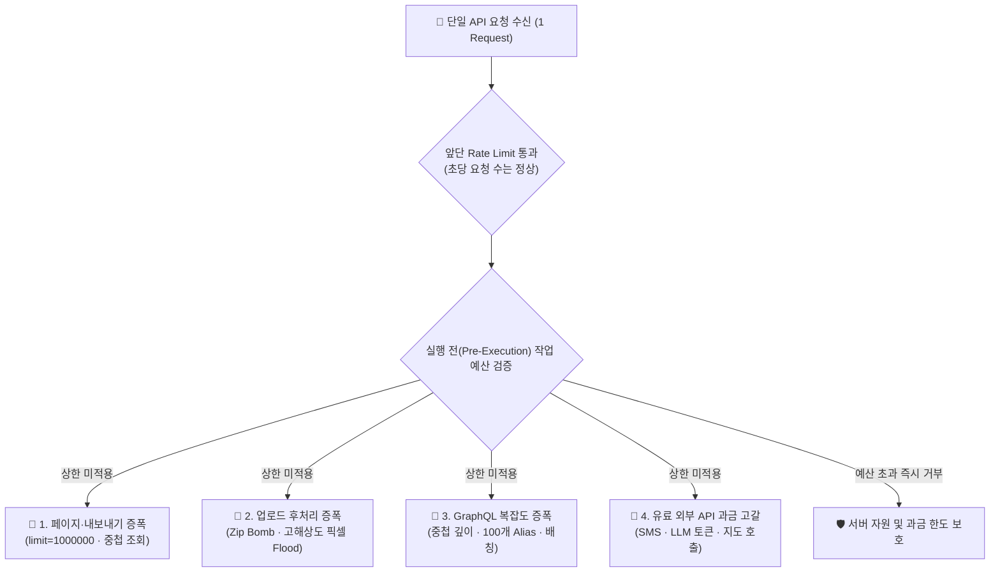
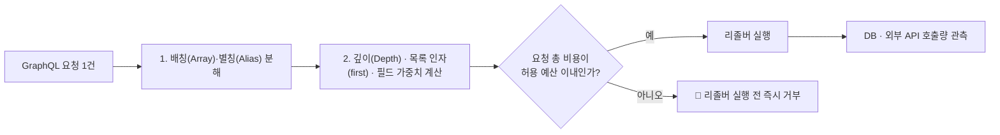

> [!summary] ⏱️ 5초 핵심 요약
> - **한 줄 비유**: 식당에 손님이 1명만 와서 출입 횟수 제한(Rate Limit)은 통과했더라도, **그 1명이 한 번에 '10만 인분 조리 + 최고급 외주 식자재 발주'를 적힌 주문서 한 장을 내밀면 주방과 가게 통장이 동시에 마비되는 원리**입니다.
> - **핵심 원리**: **OWASP API4:2023(Unrestricted Resource Consumption)**은 호출 빈도(API6)와 별개로, **단 한 번의 요청이 유발하는 CPU·메모리·DB 행·임시 디스크·외부 유료 API 과금 비용**에 상한선이 없을 때 발생합니다.
> - **4대 고비용 공격면**: ① 페이지 크기(`limit=999999`) 및 대량 내보내기, ② 파일 업로드 압축 해제·이미지/문서 변환 후처리 증폭, ③ GraphQL 중첩 깊이·별칭(Alias)·배칭(Batching) 증폭, ④ SMS·AI(LLM)·지도 등 유료 외부 연동 과금 고갈(Denial of Wallet).
> - **핵심 방어**: 무거운 리졸버나 후처리를 시작하기 **이전에(Pre-Execution)** 입력 크기·페이지 상한·GraphQL 비용 예산·계정/테넌트별 과금 한도를 계산해 초과 요청을 즉시 거부합니다.

[[웹 취약점 진단 — 비즈니스 플로우 남용과 봇 방어 우회(API6)]]는 **누가 민감한 흐름을 얼마나 자주 호출하는가**, 즉 정상 동작이 속도와 규모로 남용되는 API6 문제를 다룹니다.

이 글은 요청 빈도와 별개로 **한 번의 요청이 얼마나 많은 CPU·메모리·대역폭·저장공간·외부 서비스 비용을 소비하는가**라는 API4:2023의 다른 축에 집중합니다. 따라서 일반적인 봇 판별보다 페이지 크기, 업로드 처리, GraphQL 작업량, 유료 연동의 요청당 비용을 측정합니다.



---

## 한눈에 보는 API4 자원 소비 5대 진단 축

| 소비 축 | 한 번의 요청이 증폭시키는 비용 | 흔히 빠지는 방어 함정 | 핵심 통제 (Pre-Execution) |
|---|---|---|---|
| **1. 요청당 비용 계측** | 입력/응답 바이트, CPU 시간, 메모리 피크, DB 행 수 | 초당 요청 수(RPS)만 막으면 안전하다고 착각 | 요청 빈도 제한 + **요청당 작업량 예산** 이중 강제 |
| **2. 페이지 크기·내보내기** | 대량 DB 풀스캔, 직렬화 메모리, 네트워크 대역폭 | 기본값(`default=20`)만 두고 최대값(`max`)을 안 막음 | 서버 측 최대 `limit` 하드캡 강제 + 비동기 큐 분리 |
| **3. 업로드·후처리 증폭** | 압축 해제 디스크, 이미지 픽셀 디코딩 메모리, 변환 CPU | 전송된 압축 파일 크기(MB)만 검사하고 해제 후 크기를 안 봄 | 해제 후 바이트·파일 수·픽셀 수·변환 시간 상한 및 임시파일 즉시 정리 |
| **4. GraphQL 복잡도·배칭** | 리졸버 연쇄 호출(N+1), DB 부하, 응답 JSON 크기 | 쿼리 깊이(Depth)만 막고 별칭(Alias)·배칭(Batch)·목록 인자를 허용 | 실행 전 **깊이 + 필드 가중치 + 목록 크기 + 별칭/배치 수** 통합 예산 산정 |
| **5. 유료 외부 연동(SMS·AI)** | 클라우드·SMS·LLM·지도 사업자 과금 한도(Denial of Wallet) | 외부 API가 200 OK를 잘 주니 서버 가용성 알람이 안 울림 | 기능·사용자·테넌트·일일 전체 과금 하드 한도 및 서킷 브레이커 |

---

## 1. 요청 수가 아니라 요청당 비용 보기

**💡 한 줄 비유**: 리소스 소비는 식당에 들어오는 손님 머릿수만 세는 문제가 아니라, **손님 한 명이 들어와 음식을 1,000인분 주문했을 때 주방과 창고가 버틸 수 있는지를 보는 문제**입니다.

### 핵심 원리
- **API4 진단의 기본 단위**: `요청 횟수(Request Count)`가 아니라 **`요청 하나가 유발한 작업량(Work per Request)`**입니다.
- **관측해야 할 7대 자원 지표**: 입력 바이트, 응답 바이트, DB 조회 행 수, CPU 시간, 메모리 최대치(Peak Memory), 생성 임시 파일 수, 외부 유료 API 호출 수와 금액을 함께 봐야 합니다.
- **게이트웨이 RPS 제한의 한계**: 앞단 API 게이트웨이가 초당 요청 수만 제한해도 백엔드가 요청 내부의 반복·증폭 작업을 제한하지 않으면 보호가 성립하지 않습니다.
- **안전한 진단 원칙**: 서비스 장애를 만들지 않는 승인된 환경에서 작은 값부터 단계적으로 올리고, **지연시간(Latency)·자원 사용량이 비선형으로 급증하는 변곡점**을 찾는 방식이 안전합니다. 한계값이 없다는 사실과 실제 운영 용량을 소진했다는 사실은 구분해야 하며, 진단 중단 기준을 미리 합의해야 합니다.

### 체크 포인트
- 엔드포인트별 입력·응답·CPU·메모리·DB·외부 호출 비용을 계측하고 있는가?
- 요청 빈도 제한(Rate Limit)과 **요청당 작업량 제한(Resource Quota/Limit)**이 각각 존재하는가?
- 진단 수행 전 승인된 환경, 단계적 증가폭, 자동 중단 임계치를 정했는가?
- 참고: [OWASP API Security Top 10 2023 — API4 Unrestricted Resource Consumption](https://owasp.org/API-Security/editions/2023/en/0xa4-unrestricted-resource-consumption/), [CWE-400 — Uncontrolled Resource Consumption](https://cwe.mitre.org/data/definitions/400.html)

---

## 2. 페이지 크기와 대량 내보내기 상한

**💡 한 줄 비유**: 도서관에서 "한 번에 책 5권 대여"가 기본 규칙인데, 신청서 대여 권수 칸에 **`999,999권`이나 `-1권(전권 의미)`을 적어 냈더니 사서가 도서관 서고 전체를 수레에 실어 나르느라 업무가 마비되는 상황**입니다.

### 핵심 원리
1. **페이지네이션 파라미터 조작**:
   - `limit`, `page_size`, `size`, `per_page` 같은 파라미터를 클라이언트 값 그대로 DB 쿼리와 직렬화에 전달하면 한 요청이 대량 행 조회, 메모리 적재, JSON 변환, 네트워크 전송을 연쇄적으로 유발합니다.
   - 기본값(`default=20`)이 작아도 명시적인 **서버 최대값(`max=100`)**을 강제하지 않으면, 큰 정수(`1000000`)나 음수(`-1`), `0`, 파라미터 누락이 프레임워크별 전체 조회(Full Scan) 동작으로 이어질 수 있습니다.
2. **행당 무게와 대량 내보내기(Export) 분리**:
   - 상한은 응답 행 수만 정하면 끝나지 않습니다. 각 행에 중첩 객체(`include=comments,logs`)나 큰 텍스트·바이너리 메타데이터가 포함되면 같은 100건도 비용이 수십 배 달라집니다.
   - 대량 내보내기(CSV/PDF/보고서)가 필요한 기능은 동기 응답 대신 **비동기 작업 큐, 결과 크기 제한, 사용자별 동시 작업 수 제한, 만료되는 다운로드 URL**로 분리해야 합니다.

```http
GET /api/v1/orders?page=1&page_size=500000&include=items,audit_logs,payments HTTP/1.1
Host: api.example.com
Authorization: Bearer <TOKEN>
```
*(❌ `page_size` 상한과 `include` 중첩 관계 제한이 없으면 단일 요청이 수백만 건의 JOIN 결과와 수백 MB의 JSON 직렬화를 일으킵니다.)*

### 체크 포인트
- 페이지 파라미터의 **누락·`0`·음수(`-1`)·최대 정수·상한 초과값**을 서버가 일관되게 거부(`400`)하거나 안전한 최대값으로 절삭(Clamp)하는가?
- 중첩 관계(`include`/`expand`) 포함 여부에 따라 응답 바이트와 DB 쿼리 수가 급증하지 않는가?
- 대량 내보내기 기능에 **사용자별 동시 작업 수·최대 결과 크기·파일 보관 기간 제한**이 있는가?
- 참고: [OWASP API Security Top 10 2023 — API4 Unrestricted Resource Consumption](https://owasp.org/API-Security/editions/2023/en/0xa4-unrestricted-resource-consumption/), [OWASP REST Assessment Cheat Sheet](https://cheatsheetseries.owasp.org/cheatsheets/REST_Assessment_Cheat_Sheet.html)

---

## 3. 업로드 크기와 후처리 증폭

**💡 한 줄 비유**: 손바닥만 한 **진공 압축 매트리스(1MB 압축 파일·초고해상도 미니 이미지)**를 택배 크기 검사만 하고 작은 방 안에 들여놓았더니, **포장을 뜯는 순간(후처리) 방 전체가 터져 나갈 만큼 부풀어 오르는 현상**입니다.

### 핵심 원리
업로드 요청의 핵심 위험은 **전송된 원본 파일 바이트 크기와 서버가 실제로 수행하는 후처리 작업량이 전혀 비례하지 않는다**는 데 있습니다.
- **대표적인 후처리 증폭 지점**:
  - **압축 해제 (Zip Bomb 등)**: 수 MB짜리 압축 파일이 해제 후 수십 GB나 수십만 개의 임시 파일로 불어남
  - **이미지 리사이즈·썸네일 생성 (Pixel Flood)**: 파일 용량은 작지만 가로×세로 픽셀 차원(예: `65000 x 65000`)이 거대해 메모리에 비트맵을 펼치는 순간 수 GB RAM 고갈
  - **문서 변환·미디어 인코딩·백신 검사**: 복잡한 PDF 페이지 렌더링이나 동영상 트랜스코딩이 워커 CPU를 장시간 점유
- **임시 파일 잔류 위험**: 애플리케이션 타임아웃이 걸려 요청이 중단되더라도, **이미 디스크에 생성된 임시 파일과 큐 항목이 `finally` 블록에서 즉시 삭제되지 않으면** 디스크 고갈은 그대로 이어집니다.

### 체크 포인트
- 앞단 게이트웨이(본문 바이트 상한)와 백엔드 애플리케이션 양쪽에 업로드 크기 제한이 있는가?
- **압축 해제 후 총 바이트·파일 개수, 이미지 최대 가로/세로 픽셀 수, 문서 페이지 수, 변환 처리 시간**을 각각 제한하는가?
- 처리 실패·사용자 취소·타임아웃 발생 시 생성된 임시 파일과 작업 큐 항목이 즉시 정리되는가?
- 파일 형식을 확장자나 클라이언트가 보낸 `Content-Type`만으로 신뢰하지 않고 안전한 파서로 매직 바이트·헤더를 먼저 확인하는가?
- 참고: [OWASP File Upload Cheat Sheet](https://cheatsheetseries.owasp.org/cheatsheets/File_Upload_Cheat_Sheet.html), [CWE-409 — Improper Handling of Highly Compressed Data](https://cwe.mitre.org/data/definitions/409.html)

---

## 4. GraphQL 깊이·복잡도·배칭

**💡 한 줄 비유**: 민원 창구에서 "질문지 1장만 접수 가능"이라고 정했더니, 민원인이 **질문지 1장 안에 꼬리에 꼬리를 무는 하위 질문 10단계(중첩 깊이)와 똑같은 질문 100개 복사본(Alias·배칭)을 빽빽하게 적어 내는 상황**입니다.

### 핵심 원리
GraphQL은 단일 HTTP 요청 안에서 중첩 필드를 선택하고 **별칭(Alias)**이나 **배열 배칭(Batching)**으로 수십~수백 개의 작업을 묶을 수 있어, HTTP 요청 수(1건)와 백엔드 리졸버·DB 호출 수(수만 건)가 일치하지 않습니다.



### 단편적 방어가 우회되는 이유와 올바른 예산 계산
- **깊이(Depth)만 제한할 때의 한계**: 깊이가 2단계로 얕아도 같은 깊이에서 별칭(`a1: orders(first:100)`, `a2: orders(first:100)`...)을 100개 나열하거나 폭이 넓은 쿼리를 보내면 비용이 폭증합니다.
- **단순 필드 개수만 셀 때의 한계**: 단순 문자열 필드 1개와 외부 유료 API나 무거운 DB 집계를 부르는 필드 1개의 비용 차이를 반영하지 못합니다.
- **DataLoader와 Introspection 차단의 오해**: DataLoader는 동일 틱 내 중복 DB 조회를 줄여줄 뿐 무제한 복잡도 쿼리를 막는 보안 통제가 아니며, Introspection을 끈다고 복잡도 제한이 대신되지도 않습니다.
- **올바른 해법**: 리졸버 실행 전에 **`최대 깊이 + 필드별 비용 가중치 × 목록 크기 인자(first/limit) + 별칭 수 + 요청당 배치 작업 수`**를 종합 계산해 예산을 초과하면 즉시 거부해야 합니다.

```graphql
# ❌ 깊이는 2단계뿐이지만 별칭(Alias)과 목록 인자(first: 100)로 비용을 증폭시키는 쿼리 예시
query CostAmplification {
  q1: users(first: 100) { orders(first: 100) { id total } }
  q2: users(first: 100) { orders(first: 100) { id total } }
  q3: users(first: 100) { orders(first: 100) { id total } }
}
```

### 체크 포인트
- 최대 깊이(Max Depth)뿐 아니라 **필드별 비용 가중치(Query Complexity)·목록 크기 인자(`first`/`limit`)·별칭(Alias) 수·배치(Batch) 작업 수**를 함께 제한하는가?
- 리졸버를 실제로 실행하기 **이전에(AST 분석 단계)** 총 비용을 계산하고 예산 초과 쿼리를 거부하는가?
- 실제 리졸버·DB·외부 API 호출 수가 산정된 비용 모델과 일치하는지 관측하는가?
- 참고: [OWASP WSTG — Testing GraphQL](https://wstg.owasp.org/v4.2/4-Web_Application_Security_Testing/12-API_Testing/01-Testing_GraphQL/), [OWASP GraphQL Cheat Sheet](https://cheatsheetseries.owasp.org/cheatsheets/GraphQL_Cheat_Sheet.html)

---

## 5. SMS·AI·지도 등 비용 고갈 (Denial of Wallet)

**💡 한 줄 비유**: 우리 서버 CPU는 아무렇지 않게 쌩쌩 돌아가지만, 요청 한 번마다 **건당 요금이 나가는 국제문자(SMS)나 대형 AI 모델(LLM) API를 계속 호출하게 만들어 월말에 수천만 원짜리 청구서 폭탄을 맞히게 하는 공격**입니다.

### 핵심 원리
비밀번호 재설정/본인인증(SMS 발송), 문서 요약·챗봇(유료 LLM 토큰 소비), 주소 검색·경로 계산(유료 지도 API)처럼 내부 API 한 번이 **건당 과금되는 외부 서드파티 API 호출**로 이어지면 공격자가 노리는 자원은 서버 CPU가 아니라 **사업자의 과금 한도(Denial of Wallet)**입니다.
- **왜 늦게 발견되는가**: 외부 사업자 API가 `200 OK` 정상 응답을 빠르게 반환하므로 서버 CPU·메모리 모니터링만으로는 전혀 이상 징후가 잡히지 않습니다. 또한 요청이 로그인된 사용자에게서 왔다는 사실이 곧 그 과금 비용이 정당하다는 뜻도 아닙니다.
- **방어 설계의 핵심**:
  - **다중 단위 하드 한도(Hard Cap)**: 사용자·계정·테넌트·기능별 예산과 서비스 전체 일일 과금 상한을 함께 둬야 합니다.
  - **캐시만으로는 불충분**: 캐시와 중복 제거는 동일 입력 비용은 줄여주지만, 공격자가 프롬프트나 검색어를 조금씩만 바꾸면 100% 캐시 미스(Cache Miss)가 발생하므로 하드 한도를 대신할 수 없습니다.
  - **재시도(Retry) 폭풍 방지**: 외부 사업자 장애나 타임아웃 발생 시 무제한 자동 재시도 큐가 돌아가면 호출과 과금이 수배로 증폭됩니다.

### 체크 포인트
- 내부 엔드포인트 호출 1건이 외부 유료 API 호출을 몇 번, 얼마의 비용(토큰·건수)으로 유발하는지 계측하는가?
- **사용자·테넌트·기능·전체 계정 단위**의 일일/월간 금액 또는 호출 하드 한도가 설정되어 있는가?
- 예산 임계치 도달 시 단순 경고 알람만 보내는 것이 아니라 **자동 차단·승인 대기·저비용 대체 모델/경로로 즉시 전환(Graceful Degradation)**되는가?
- 재시도 큐가 외부 장애 시 호출과 과금을 증폭시키지 않도록 횟수와 백오프 상한이 있는가?
- 참고: [OWASP API Security Top 10 2023 — API4 Unrestricted Resource Consumption](https://owasp.org/API-Security/editions/2023/en/0xa4-unrestricted-resource-consumption/), [CWE-770 — Allocation of Resources Without Limits or Throttling](https://cwe.mitre.org/data/definitions/770.html)

---

## 6. 한계값 검증과 탐지 지표

**💡 한 줄 비유**: 다 해주고 나서 계산할 때 **"한도 초과입니다"라고 거절하면 이미 재료는 다 쓴 뒤**이므로, 반드시 **요리를 시작하기 전에 주문서 단계에서 한도를 확인하고 거절해야** 주방을 지킬 수 있습니다.

### 핵심 원리
1. **실행 전 거부(Fail-Fast Before Execution)**:
   - 거부 응답(`400`/`413`/`429`)이 나오더라도 무거운 DB 쿼리나 파일 변환을 이미 다 수행한 뒤 늦게 반환한다면 자원 보호 효과가 전혀 없습니다. 상한 초과 입력은 무거운 작업 시작 전에 즉시 거부되어야 합니다.
2. **계층 간 한계값 정합성 확인**:
   - API 게이트웨이, 웹 서버, 애플리케이션, 비동기 작업 큐, 외부 사업자 중 **가장 느슨한 계층이 전체 보안 경계의 약점**이 됩니다. 정상값·경계값·상한 초과값을 각 경로에서 교차 확인해야 합니다.
3. **자원 기반 관측 지표**:
   - 단순 요청 수(RPS) 외에 **응답 바이트, GraphQL 쿼리 비용 점수, 작업 소요 시간, 큐 적체 길이, 외부 유료 호출 수, 사용자·테넌트별 누적 비용**을 대시보드와 경보로 묶어야 합니다.

### 체크 포인트
- 상한 초과 입력이 무거운 연산·쿼리·외부 호출이 시작되기 **이전에** 빠르게 거부되는가? (거부 응답의 지연시간이 짧은가?)
- 게이트웨이·앱·작업 큐·외부 사업자의 크기 및 타임아웃 한계값이 서로 모순되지 않는가?
- 응답 크기·복잡도 점수·큐 지연·외부 과금 비용을 사용자와 기능별로 분리해 관측하고 오탐 없이 통제하는가?
- 참고: [OWASP API Security Top 10 2023 — API4 Unrestricted Resource Consumption](https://owasp.org/API-Security/editions/2023/en/0xa4-unrestricted-resource-consumption/), [CWE-400 — Uncontrolled Resource Consumption](https://cwe.mitre.org/data/definitions/400.html)

---

## 정리

호출 빈도와 정상 비즈니스 흐름의 자동화 남용은 [[웹 취약점 진단 — 비즈니스 플로우 남용과 봇 방어 우회(API6)]]를 참고하고, 발견한 고비용 엔드포인트가 구버전에도 남아 있는지는 [[웹 취약점 진단 — 레거시·섀도우 API 자산 인벤토리(API9)]]에서 버전별로 추적하면 됩니다.
