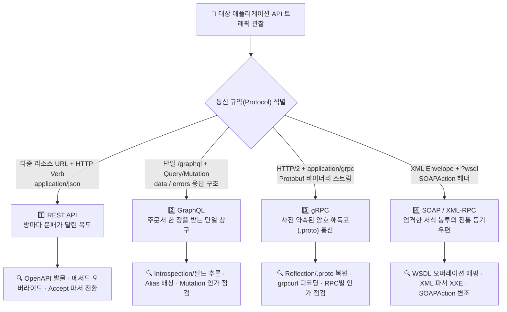
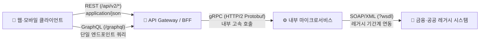

> [!summary] ⏱️ 5초 핵심 요약
> - **한 줄 비유**: 같은 건물이라도 **REST는 방마다 문패가 달린 복도**이고, **GraphQL은 주문서 한 장에 원하는 물품을 다 적어 내는 단일 안내 데스크**이며, **gRPC는 양측이 미리 나눠 가진 암호 해독표(`.proto`)로만 대화하는 무전기**, **SOAP은 엄격한 법률 서식 봉투에 담아 보내는 전통 등기우편**이라 출입구(진입점)를 찾고 검문하는 방법이 전부 다릅니다.
> - **핵심 원리**: BOLA·BFLA·Mass Assignment·SSRF·XXE 같은 **취약점의 본질(클래스)은 프로토콜이 바뀌어도 동일**하지만, 통신 규약(REST·GraphQL·gRPC·SOAP)에 따라 **엔드포인트와 스키마를 발굴하는 정찰 방식, 파라미터를 변조하는 문법, 속도 제한(Rate Limit) 및 파서(Parser)의 동작 구조**가 완전히 달라집니다.
> - **핵심 공격 표면**: REST의 숨겨진 OpenAPI 명세·HTTP 메서드 오버라이드·Content-Type 협상, GraphQL의 인트로스펙션·필드 제안(Field Suggestion)·배칭/별칭(Alias)·중첩 쿼리, gRPC의 `.proto`/리플렉션 노출 및 바이너리 스트림 내 메서드별 인가 누락, SOAP의 `?wsdl` 노출·XML 엔티티(XXE)·`SOAPAction` 헤더 불일치.
> - **핵심 진단 포인트**: 먼저 응답 헤더와 경로 패턴으로 대상의 API 스타일(또는 하이브리드 구조)을 식별한 뒤, 프로토콜별 계약 문서(OpenAPI·Schema·`.proto`·WSDL)를 확보해 공격 표면을 매핑하고 각 통신 규약 고유의 우회 기법을 교차 적용해야 합니다.

이 글은 새로운 취약점 분류 체계를 나열하는 글이 아닙니다. 객체·기능 단위 인가 결함은 [[웹 취약점 진단 인가편 — 권한 매트릭스로 BOLA·BFLA 찾기]]에서, 속성 단위 인가와 필드 바인딩 결함은 [[웹 취약점 진단 API편 — Mass Assignment와 필드 단위 인가(BOPLA)]]에서, 그리고 XML 외부 엔티티나 서버 측 요청 위조의 원리는 [[웹 취약점 진단 기법 입문 — XXE, SSRF부터 SQLi, XSS까지]]에서 이미 각각의 취약점 클래스로 다루었습니다. 또한 지속 연결 기반의 양방향 스트리밍 보안은 [[웹 취약점 진단 — WebSocket·실시간 통신 보안]]에서 별도로 다룹니다.

여기서는 **"똑같은 BOLA·BFLA·Mass Assignment·XXE를 찾더라도, 대상 API가 REST인지 GraphQL인지 gRPC인지 SOAP인지에 따라 진입점(Entry Point)을 어떻게 찾아내고 어떤 방식으로 스캔해야 하는가?"**라는 **통신 프로토콜별 진단 방법론의 차이**에 집중합니다.

---



## 한눈에 보는 4대 API 통신 방식별 진단 비교

| 구분 | REST | GraphQL | gRPC | SOAP / XML-RPC |
|---|---|---|---|---|
| **한 줄 비유** | 방마다 문패가 달린 복도 | 주문서 한 장으로 처리하는 단일 안내 데스크 | 미리 공유한 암호 책자(`.proto`)로만 통하는 무전 | 격식 갖춘 서식 봉투에 넣는 등기우편 |
| **구조 및 전송 특징** | 리소스 URL + HTTP 메서드(`GET`/`POST`/`PUT`/`DELETE`) | 단일 엔드포인트(`/graphql`) + 쿼리 언어로 필드 직접 지정 | HTTP/2 멀티플렉싱 + Protocol Buffers 바이너리 직렬화 | XML Envelope 구조 + HTTP `POST` (`SOAPAction` 헤더) |
| **공격 표면(계약) 발굴** | `/swagger.json`, `/openapi.yaml`, `/v2/api-docs` | `__schema` 인트로스펙션, 에러 메시지 및 필드 제안(Did you mean) | gRPC Server Reflection API, 앱 번들 내 `.proto` 추출 | `?wsdl`, `?xsd` 문서 조회로 전체 오퍼레이션 목록 확보 |
| **프로토콜 고유 진단 포인트** | `X-HTTP-Method-Override`, `Accept` 헤더를 통한 파서 전환 | Alias/배칭을 통한 Rate Limit 우회, 깊은 중첩 쿼리 DoS, Mutation 열거 | 바이너리 디코딩 도구(`grpcurl`) 필수, TLS와 무관한 메서드별 인가 검증 | XML 본문 기본 탑재에 따른 **XXE** 필수 점검, `SOAPAction`과 본문 불일치 |

---

## 1. REST — 리소스·메서드 구조와 파서 협상의 사각지대

**💡 한 줄 비유**: **방마다 고유한 문패(리소스 URL)가 붙어 있고, 같은 방문 앞에서도 '들여다보기(GET)·새로 넣기(POST)·고치기(PUT/PATCH)·부수기(DELETE)' 중 어떤 행동 카드를 내미느냐에 따라 서버 반응이 달라지는 복도형 건물**입니다.

### 핵심 원리와 진단 포인트
- **리소스 URL + HTTP Verb 매핑과 명세서 발굴**:
  - REST는 `/api/v1/users/{id}`처럼 명사형 리소스 경로에 HTTP 메서드를 결합해 CRUD 동작을 표현합니다. 따라서 숨겨진 엔드포인트를 하나씩 추측하기 전에, 먼저 **`/swagger.json`, `/openapi.yaml`, `/v2/api-docs`, `/v3/api-docs`, `/swagger-ui.html`** 등 자동 생성된 API 명세서가 운영 환경에 열려 있는지 확인하는 것이 정찰의 출발점입니다.
- **HTTP 메서드 오버라이드(Method Override)를 통한 접근통제·WAF 우회**:
  - 구형 방화벽이나 프록시가 `PUT`·`DELETE`를 막는 환경을 지원하기 위해, 많은 웹 프레임워크가 `POST` 요청에 특수 헤더나 쿼리 파라미터를 붙여 실제 동작 메서드를 덮어쓰는 기능을 제공합니다.
  - 앞선 WAF나 API 게이트웨이는 요청을 단순 `POST`로 보고 통과시켰지만, 백엔드 프레임워크는 **`X-HTTP-Method-Override: DELETE`**, **`X-HTTP-Method: PUT`**, **`X-Method-Override: PATCH`** 헤더나 **`?_method=DELETE`** 파라미터를 해석해 삭제·수정 핸들러를 실행할 수 있습니다. [[웹 취약점 진단 인가편 — 권한 매트릭스로 BOLA·BFLA 찾기]]의 권한 매트릭스를 돌릴 때 직접 `DELETE` 호출이 막힌다면 반드시 메서드 오버라이드를 함께 시도해야 합니다.
- **콘텐츠 협상(Content Negotiation)을 통한 파서(Parser) 전환**:
  - REST 서버는 클라이언트가 보낸 `Content-Type` 및 `Accept` 헤더에 따라 동일한 엔드포인트에서도 서로 다른 직렬화·역직렬화 라이브러리를 호출합니다.
  - 평소 `application/json`으로만 통신하던 엔드포인트에 `Content-Type: application/xml`이나 `Accept: application/xml`을 전송했을 때 서버가 내장 XML 파서로 코드 경로를 전환한다면, JSON 환경에서는 도달할 수 없던 **XXE(XML External Entity)**나 프레임워크별 역직렬화 취약점이 새로운 공격 표면으로 열립니다.

```http
POST /api/v1/users/1002 HTTP/1.1
Host: api.example.com
Authorization: Bearer <일반유저_토큰>
X-HTTP-Method-Override: DELETE
Content-Type: application/xml
Accept: application/json

<?xml version="1.0" encoding="UTF-8"?>
<user><reason>method-override-and-parser-test</reason></user>
```

### 체크 포인트
- 운영 환경에 `/swagger.json`, `/openapi.yaml`, `/v2/api-docs` 등 API 명세 문서가 비인가 상태로 노출되어 있는가?
- `X-HTTP-Method-Override`, `X-HTTP-Method`, `_method` 파라미터를 통해 게이트웨이의 메서드 제한이나 라우터의 인가 검사를 우회할 수 있는가?
- `Content-Type` 및 `Accept` 헤더를 `application/xml`, `text/xml`, `application/x-www-form-urlencoded` 등으로 변경했을 때 서버가 다른 파서를 호출하거나 상세 스택 트레이스를 반환하는가?
- 참고: [OWASP — REST Security Cheat Sheet](https://cheatsheetseries.owasp.org/cheatsheets/REST_Security_Cheat_Sheet.html), [OpenAPI Specification (Swagger)](https://swagger.io/specification/)

---

## 2. GraphQL — 스키마가 곧 공격 표면 지도가 되는 단일 창구

**💡 한 줄 비유**: 여러 방문을 돌아다닐 필요 없이 **1층의 단일 안내 데스크(`/graphql`) 한 곳에 가서, 내가 원하는 데이터 항목과 수정 작업을 주문서 한 장(Query·Mutation)에 촘촘히 적어 내면 직원이 한 번에 모아 가져다주는 구조**입니다.

### 핵심 원리와 진단 포인트
- **스키마 자체가 공격 표면 지도(Attack Surface Map)**:
  - REST에서는 엔드포인트 경로를 모르면 크롤링이나 단어장 대입(Fuzzing)을 해야 하지만, GraphQL은 모든 데이터 타입(Type), 조회(Query), 상태 변경(Mutation), 하위 필드 연결 관계가 **하나의 스키마(Schema)**에 정의되어 있습니다.
  - **인트로스펙션(Introspection) 쿼리**: 서버에 인트로스펙션이 활성화되어 있으면 `__schema` 메타 필드를 조회하는 단 한 번의 요청으로 전체 API의 쿼리·뮤테이션·입력 객체(`InputType`) 목록을 통째로 덤프할 수 있습니다.
  - **중요 — 인트로스펙션을 꺼도 스키마를 완전히 숨길 수는 없음**: 운영 환경에서 인트로스펙션(`__schema`)을 비활성화하는 것은 필수적인 기본 조치이지만, **그것만으로 스키마가 영구히 비밀이 된다고 착각해서는 안 됩니다.** 많은 GraphQL 엔진(Apollo, GraphQL.js 등)은 오타가 난 필드명을 요청받으면 `"Cannot query field 'usr' on type 'Query'. Did you mean 'user', 'users'?"`와 같은 **필드 제안(Field Suggestion)** 에러 메시지를 반환합니다. 공격자는 이 에러 응답과 타입 검증 오류를 자동화 도구(Clairvoyance 등)로 조합해 인트로스펙션 없이도 스키마를 상당 부분 역추적할 수 있으므로, 근본적으로는 **각 리졸버(Resolver)의 철저한 인가 검증, 필드 제안 비활성화, 쿼리 비용(Cost) 제한**이 함께 적용되어야 합니다.
- **쿼리 배칭(Batching)과 별칭(Alias)을 이용한 Rate Limit 우회**:
  - GraphQL은 하나의 HTTP `POST /graphql` 요청 안에 배열 형태로 여러 쿼리를 묶어 보내거나(Batching), 아래 예시처럼 **별칭(`alias`)**을 사용해 동일한 쿼리/뮤테이션을 인자만 바꿔 수백 번 반복 호출할 수 있습니다.
  - 만약 서버가 HTTP 요청 횟수(IP당 분당 N회) 기준으로만 단순하게 Rate Limit을 걸어두었다면, 단 1개의 HTTP 요청으로 수백 번의 OTP 번호 대입이나 타인 객체 조회(BOLA)를 수행할 수 있습니다.
- **깊은 중첩 쿼리(Query Depth/Complexity)를 통한 가용성 위협**:
  - `유저 → 작성글 → 댓글 → 작성자 → 작성글...`처럼 순환 참조되는 관계를 깊게 중첩해 요청하면, REST의 단순 엔드포인트 호출과 달리 요청 한 번에 DB 조인과 리졸버 호출이 기하급수적으로 폭발하는 자원 고갈(DoS)이 발생합니다.
- **Mutation은 REST의 `POST`/`PUT`/`PATCH`/`DELETE`와 동급**:
  - GraphQL에서 데이터를 생성·수정·삭제하는 모든 상태 변경 작업은 **Mutation**에 모여 있습니다. [[웹 취약점 진단 API편 — Mass Assignment와 필드 단위 인가(BOPLA)]]에서 다룬 민감 필드 바인딩이나 BFLA를 진단할 때는 스키마의 모든 Mutation과 그 입력 객체(`Input`)의 허용 필드를 REST의 쓰기 엔드포인트와 똑같은 강도로 전수 점검해야 합니다.

```graphql
# 하나의 HTTP 요청 안에서 별칭(Alias)으로 여러 객체를 동시에 조회·대입하는 예시
query CheckMultipleOrders {
  firstOrder: order(id: "1001") { id ownerEmail totalAmount }
  secondOrder: order(id: "1002") { id ownerEmail totalAmount }
}
```

### 체크 포인트
- 운영 환경에서 `__schema` 인트로스펙션 쿼리가 차단되어 있으며, 오타 입력 시 친절하게 필드명을 알려주는 **Field Suggestion(`Did you mean ...`)** 기능도 함께 비활성화되어 있는가?
- 단일 HTTP 요청 내 별칭(`alias`) 반복 및 배열 배칭(Batching) 개수 상한이 설정되어 있으며, 인증·조회 제한이 HTTP 요청 단위가 아닌 **리졸버 호출/쿼리 복잡도(Cost) 단위**로 적용되는가?
- 순환 참조를 악용한 중첩 쿼리를 막기 위해 **최대 쿼리 깊이(Max Query Depth)**와 타임아웃이 강제되는가?
- 모든 `Mutation`과 중첩 하위 리졸버마다 BOLA·BFLA·BOPLA 인가 검증이 빠짐없이 적용되어 있는가?
- 참고: [OWASP — GraphQL Cheat Sheet](https://cheatsheetseries.owasp.org/cheatsheets/GraphQL_Cheat_Sheet.html), [PortSwigger — GraphQL API vulnerabilities](https://portswigger.net/web-security/graphql), [GraphQL Official — Security & Introspection](https://graphql.org/learn/introspection/)

---

## 3. gRPC — 바이너리 암호 해독표(`.proto`)와 HTTP/2 스트림

**💡 한 줄 비유**: 일반 글자(JSON/XML)로 편지를 주고받는 대신, **양쪽이 미리 나눠 가진 암호 해독 책자(`.proto` 파일)에 적힌 번호표 규칙대로만 압축된 이진 신호(Protocol Buffers)를 주고받는 고속 무전 통신**입니다.

### 핵심 원리와 진단 포인트
- **Protocol Buffers 바이너리 직렬화와 프록시 가시성 한계**:
  - gRPC는 기본적으로 **HTTP/2** 위에서 동작하며, 메시지를 텍스트가 아닌 **Protocol Buffers(Protobuf) 바이너리 포맷**(`Content-Type: application/grpc`)으로 직렬화해 전송합니다.
  - 이 때문에 일반 HTTP 프록시(기본 설정의 Burp Suite 등)로 패킷을 가로채면 사람이 읽을 수 없는 깨진 바이트 나열처럼 보이며, HTTP/2의 단일 연결 멀티플렉싱(Multiplexing) 특성상 스트림 분석도 까다롭습니다. 진단자는 **`grpcurl`**, **Postman의 gRPC 클라이언트**, 또는 Burp/mitmproxy용 Protobuf 디코딩 확장 도구를 준비해야 파라미터를 읽고 변조할 수 있습니다.
- **서비스 계약서(`.proto`) 확보: 리플렉션(Reflection)과 클라이언트 번들 분석**:
  - Protobuf 바이너리는 필드 이름(`"user_id"`) 대신 필드 번호(`1`, `2`)만 담아 보내므로, 어떤 서비스와 메서드가 존재하고 각 필드가 무슨 타입인지 정의한 **`.proto` 명세**를 확보하는 것이 gRPC 진단의 핵심입니다.
  - 서버에 **gRPC Server Reflection API**가 켜져 있다면 `grpcurl` 명령 하나로 서버가 제공하는 모든 서비스·메서드·메시지 구조를 즉시 복원할 수 있습니다. 리플렉션이 꺼져 있더라도 모바일 앱(APK/IPA)이나 프런트엔드(gRPC-Web) 번들을 역분석하면 컴파일된 `.proto` 메타데이터가 그대로 남아 있는 경우가 많습니다.
- **중요 — "gRPC는 암호화되어 있으니 안전하다"는 오해 바로잡기**:
  - 실무에서 "gRPC는 바이너리이고 TLS 위에서 도니까 외부에서 건드리지 못한다"고 오해하는 경우가 많습니다. 그러나 **gRPC 계층의 TLS 적용은 전송 구간 도청을 막는 기밀성(Confidentiality) 통제일 뿐, 인증(Authentication)이나 인가(Authorization)와는 완전히 별개**입니다.
  - 전송 구간이 TLS로 완벽히 암호화되어 있더라도, 정당한 클라이언트 토큰을 가진 일반 유저가 `grpcurl`로 관리자용 RPC 메서드(`AdminService/DeleteUser`)를 호출했을 때 서버 인터셉터에서 역할 검증을 하지 않는다면 [[웹 취약점 진단 인가편 — 권한 매트릭스로 BOLA·BFLA 찾기]]의 **BFLA/BOLA가 그대로 발생**합니다.

```bash
# gRPC Server Reflection이 활성화된 서버에서 서비스 목록과 메서드 구조를 탐색하는 예시
grpcurl -plaintext api.internal.example.com:50051 list
grpcurl -plaintext api.internal.example.com:50051 describe user.v1.UserService
```

### 체크 포인트
- 외부 노출 gRPC 엔드포인트에서 **gRPC Server Reflection API**(`grpc.reflection.v1alpha.ServerReflection`)가 불필요하게 활성화되어 전체 메서드 구조를 노출하고 있지 않은가?
- TLS 전송 암호화나 바이너리 포맷의 난독성에 의존하지 않고, **모든 Unary/Streaming RPC 메서드(특히 내부 마이크로서비스 간 호출 포함)마다 인증 메타데이터(JWT 등)와 객체·기능 단위 인가 검증**을 수행하는가?
- 스트리밍(Client/Bidirectional Streaming) RPC에서 메시지 크기 상한과 연결 유지 시간, 유량 제한(Rate Limit)이 설정되어 있는가?
- 참고: [gRPC Official Documentation — Authentication & Security](https://grpc.io/docs/guides/auth/), [gRPC Server Reflection Protocol](https://grpc.io/docs/guides/reflection/), [GitHub — fullstorydev/grpcurl](https://github.com/fullstorydev/grpcurl)

---

## 4. SOAP / XML-RPC — 격식 있는 XML 봉투와 레거시 구간의 함정

**💡 한 줄 비유**: 반드시 **정해진 규격의 외교 행낭 봉투(`<soap:Envelope>`) 안에 서류를 넣고, 겉봉투에는 담당 부서 이름표(`SOAPAction` 헤더)를 붙여서 보내야만 접수해 주는 전통 등기우편 시스템**으로, 금융·공공·기간계 레거시 연동에서 여전히 널리 쓰입니다.

### 핵심 원리와 진단 포인트
- **WSDL(`?wsdl`) 문서 발견을 통한 전체 오퍼레이션 매핑**:
  - REST에 OpenAPI가 있다면 SOAP에는 **WSDL(Web Services Description Language)**이 있습니다. 엔드포인트 경로(예: `/services/AccountService.asmx`, `/ws/PaymentService`) 뒤에 **`?wsdl` 또는 `?singleWsdl`**을 붙여 호출했을 때 XML 명세서가 반환되면, 해당 서버가 제공하는 모든 함수(Operation) 이름, 필수 파라미터 구조, 데이터 타입(XSD)을 한눈에 파악할 수 있습니다.
- **XML 메시지 포맷 자체에서 비롯되는 필수 점검 항목 — XXE**:
  - SOAP과 XML-RPC는 모든 요청 본문이 XML 문서입니다. 즉, 별도로 `Content-Type`을 바꿀 필요도 없이 **기본 통신 채널 자체가 XML 파서와 직결**되어 있습니다.
  - 따라서 SOAP 엔드포인트를 만나면 [[웹 취약점 진단 기법 입문 — XXE, SSRF부터 SQLi, XSS까지]]에서 다룬 **XXE(외부 엔티티 참조)** 및 `DOCTYPE` 선언 허용 여부 점검이 선택이 아닌 **기본 필수 체크리스트 1순위**가 됩니다.
- **`SOAPAction` 헤더와 XML 본문 간 불일치(Confusion) 악용**:
  - SOAP/1.1 요청은 HTTP 헤더의 `SOAPAction: "urn:GetUserInfo"`와 XML `<soap:Body>` 내부의 실제 요소(`<GetUserInfo>`) 두 곳에 호출할 오퍼레이션 정보가 들어갑니다.
  - 만약 앞단의 API 게이트웨이나 인가 필터는 **`SOAPAction` 헤더만 읽고** "일반 조회 작업이구나"라고 통과시켰는데, 뒷단의 실제 SOAP 엔진은 **XML `<soap:Body>` 안의 `<DeleteUser>` 태그를 기준으로** 함수를 실행한다면 헤더-본문 불일치를 통한 접근통제 우회가 성립합니다.

```http
POST /ws/AccountService HTTP/1.1
Host: legacy.example.com
Content-Type: text/xml; charset=utf-8
SOAPAction: "http://example.com/ws/GetPublicNotice"

<?xml version="1.0" encoding="UTF-8"?>
<soap:Envelope xmlns:soap="http://schemas.xmlsoap.org/soap/envelope/">
  <soap:Body>
    <!-- SOAPAction 헤더는 공개 공지 조회로 위장하고 본문에는 다른 오퍼레이션 배치 -->
    <ns:ExportAllUsers xmlns:ns="http://example.com/ws/" />
  </soap:Body>
</soap:Envelope>
```

### 체크 포인트
- 운영 환경에서 `?wsdl`, `?xsd` 조회가 비인가 외부 사용자에게 노출되어 내부 전용 오퍼레이션까지 드러나지 않는가?
- SOAP/XML-RPC를 처리하는 XML 파서에서 **`DOCTYPE` 선언 및 외부 엔티티(External Entity, DTD) 처리가 원천 비활성화**되어 있는가?
- 인가 검증 시 HTTP의 `SOAPAction` 헤더만 신뢰하지 않고, **실제 XML `<soap:Body>`에서 파싱된 최종 실행 오퍼레이션과 일치하는지** 검증하는가?
- 참고: [W3C — Web Services Description Language (WSDL) 1.1](https://www.w3.org/TR/wsdl), [OWASP — XML External Entity (XXE) Prevention Cheat Sheet](https://cheatsheetseries.owasp.org/cheatsheets/XML_External_Entity_Prevention_Cheat_Sheet.html), [OWASP — Web Service Security Cheat Sheet](https://cheatsheetseries.owasp.org/cheatsheets/Web_Service_Security_Cheat_Sheet.html)

---

## 5. 프로토콜 빠른 식별과 복합(Hybrid) 아키텍처 진단 체크리스트

**💡 한 줄 비유**: 대형 종합병원을 점검할 때 **외래 접수처는 번호표 창구(REST)를 쓰고, 종합검진 센터는 단일 문진표(GraphQL)를 쓰며, 검사실끼리는 내부 무전기(gRPC)를, 보험청구 전산망은 등기우편(SOAP)을 함께 쓰는 것**처럼, 한 서비스 안에서도 구간마다 다른 통신 방식을 먼저 구분해야 빈틈이 보이지 않습니다.



### 핵심 원리: 3가지 단서로 통신 방식 즉시 판별하기
1. **응답·요청 `Content-Type` 헤더 확인**:
   - `application/json`, `application/problem+json` → 주로 **REST** 또는 **GraphQL**
   - `application/graphql-response+json` → **GraphQL**
   - `application/grpc`, `application/grpc+proto`, `application/grpc-web+proto` → **gRPC** (`grpc-status`, `grpc-message` 트레일러/헤더 동반)
   - `text/xml`, `application/soap+xml` (요청에 `SOAPAction` 헤더 포함) → **SOAP / XML-RPC**
2. **엔드포인트 경로(URL) 패턴 비교**:
   - `/api/v1/orders/123`, `/users/me`처럼 명사 계층 구조가 다양하게 나뉨 → **REST**
   - `/graphql`, `/api/graphql`, `/gql` 단일 경로로 거의 모든 `POST` 요청이 집중됨 → **GraphQL**
   - `/package.ServiceName/MethodName` 형태의 HTTP/2 경로 → **gRPC**
   - `.asmx`, `.svc`, `/ws/`, `?wsdl` 접미사 → **SOAP**
3. **에러 응답(Error Format)의 생김새**:
   - HTTP 상태 코드가 `200 OK`인데 본문 JSON 최상단에 `{"errors": [{"message": "...", "locations": [...], "path": [...]}]}` 구조가 내려옴 → 전형적인 **GraphQL**
   - XML 본문 안에 `<soap:Fault><faultcode>...` 구조가 내려옴 → **SOAP**
   - HTTP 헤더/트레일러에 `grpc-status: 3` (INVALID_ARGUMENT), `grpc-status: 7` (PERMISSION_DENIED) 같은 정수 상태 코드가 포함됨 → **gRPC**

### 실무의 복합(Hybrid) 아키텍처 주의점
- 현대 웹 서비스는 하나의 프로토콜만 쓰지 않습니다. 예를 들어 **일반 웹 화면은 REST**, **모바일 앱 피드 화면은 GraphQL**, **실시간 채팅·알림은 WebSocket**([[웹 취약점 진단 — WebSocket·실시간 통신 보안]]), **게이트웨이 뒤쪽의 내부 마이크로서비스 간 통신은 gRPC**, **결제·본인인증 대행사 연동은 구형 SOAP**을 동시에 사용하는 식입니다.
- 앞단 REST API만 진단하고 끝내면, 동일한 비즈니스 로직을 호출하는 GraphQL 리졸버나 gRPC-Web 브리지, 혹은 백엔드가 변환해 전달하는 SOAP 구간의 인젝션·인가 불일치를 통째로 놓치게 됩니다.

### 체크 포인트
- 대상 애플리케이션의 프록시 히스토리를 **`Content-Type`, URL 패턴, 에러 메시지 구조**로 분류해 사용 중인 모든 API 통신 프로토콜 목록을 작성했는가?
- 웹(REST)과 모바일/BFF(GraphQL·gRPC-Web)가 같은 백엔드 데이터를 서로 다른 프로토콜로 호출할 때, 양쪽 경로 모두에 동일한 권한 매트릭스를 교차 적용했는가?
- 앞단 JSON 입력값이 백엔드 내부에서 gRPC나 레거시 SOAP/XML 메시지로 변환되어 전달되는 구간(Protocol Translation)의 파서·인젝션 위험을 점검했는가?
- 참고: [OWASP API Security Top 10 2023](https://owasp.org/API-Security/editions/2023/en/0x11-t10/), [PortSwigger — API testing](https://portswigger.net/web-security/api-testing)

---

## 정리

이 글에서 정리한 통신 프로토콜별 정찰·파싱 기법으로 엔드포인트와 스키마(OpenAPI, GraphQL Schema, `.proto`, WSDL)를 모두 펼쳤다면, 그 위에서 실제로 검증해야 할 취약점 클래스는 기존 가이드들과 직결됩니다. 추출한 각 오퍼레이션의 객체·기능 단위 권한 검증은 [[웹 취약점 진단 인가편 — 권한 매트릭스로 BOLA·BFLA 찾기]]를, REST `PATCH`나 GraphQL `Mutation` 입력 객체의 허용 필드 바인딩 검증은 [[웹 취약점 진단 API편 — Mass Assignment와 필드 단위 인가(BOPLA)]]를, SOAP/XML 파서 전환 구간의 XXE와 콜백 SSRF는 [[웹 취약점 진단 기법 입문 — XXE, SSRF부터 SQLi, XSS까지]]를, 그리고 HTTP 요청-응답 모델을 벗어난 지속 연결 구간은 [[웹 취약점 진단 — WebSocket·실시간 통신 보안]]을 이어서 참고하면 전체 API 공격 표면을 빠짐없이 진단할 수 있습니다.
