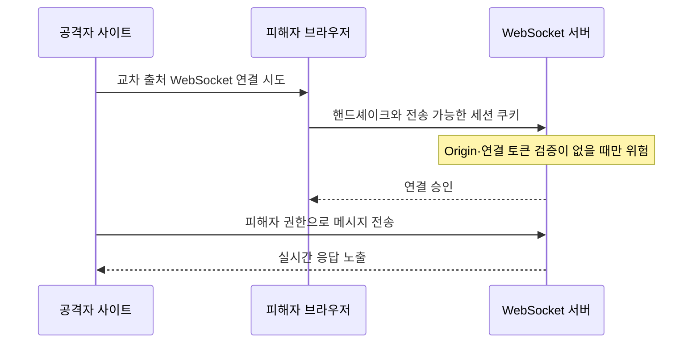

[[웹 취약점 진단 인증편 — 계정 잠금 우회부터 세션 하이재킹까지]]는 세션·쿠키의 발급과 생명주기를, [[웹 취약점 진단 설정편 — CORS·SOP부터 후속 공격까지]]은 일반 HTTP 응답을 읽는 CORS·SOP 경계를 다뤘다. 이 글은 그와 달리 **WebSocket 연결이 SOP의 교차 출처 읽기 제한과 일반적인 CORS 허용 헤더의 보호를 자동으로 받지 않는 특수성**, 그리고 연결 이후 메시지 단계에서 인증·인가를 계속 유지하는 방법에 집중한다.

---

## 1. 한 번 연결하고 계속 말하는 통로

일반 HTTP가 질문 한 번에 답 한 번을 받고 창구를 닫는 방식이라면, WebSocket은 처음에 전화를 걸어 연결한 뒤 양쪽이 원할 때 계속 말하는 통로와 비슷하다. 첫 전화 연결인 핸드셰이크는 HTTP로 시작하지만 `Upgrade: websocket` 협상이 성공하면 같은 연결에서 프레임을 주고받는다. 브라우저의 CORS는 일반 HTTP 응답을 다른 출처의 스크립트가 읽을 수 있는지 정하는 규칙이라 이 전용 통로를 자동 허가·차단하지 않는다.

**원리**: 브라우저는 WebSocket 핸드셰이크에 `Origin` 헤더를 보내지만, SOP가 교차 출처 WebSocket 연결 자체를 막거나 일반 CORS preflight와 `Access-Control-Allow-Origin`으로 통제하지 않는다. 따라서 서버가 신뢰할 출처를 직접 allowlist로 검사하지 않으면 다른 사이트의 스크립트도 연결을 시도할 수 있다.

다만 `Origin`은 비브라우저 클라이언트가 임의로 만들 수 있으므로 전역 인증 수단은 아니다. Origin 검증은 브라우저를 이용하는 교차 사이트 공격을 줄이는 통제이고, 사용자 인증과 메시지 인가는 별도로 필요하다. `wss://`도 전송 구간을 암호화할 뿐 발신 사이트나 메시지 권한을 판별하지 않는다.

- 체크 포인트:
  - 허용 Origin을 스킴·호스트·포트의 정확한 목록으로 비교하는지
  - 일반 CORS 설정만으로 WebSocket이 보호된다고 가정하지 않는지
  - 운영 연결이 `wss://`를 사용하고도 별도 인증·인가를 수행하는지
- 참고: [OWASP WSTG — Testing WebSockets](https://owasp.org/www-project-web-security-testing-guide/latest/4-Web_Application_Security_Testing/11-Client-side_Testing/10-Testing_WebSockets), [MDN — WebSocket](https://developer.mozilla.org/en-US/docs/Web/API/WebSocket), [RFC 6455 — The WebSocket Protocol](https://www.rfc-editor.org/rfc/rfc6455)

## 2. Cross-Site WebSocket Hijacking(CSWSH)

**원리**: CSWSH는 공격자 사이트가 피해자 브라우저에서 대상 WebSocket을 열고, 브라우저가 핸드셰이크에 붙인 세션 쿠키를 서버가 그대로 신뢰할 때 성립한다. 서버가 Origin이나 연결 전용 위조 방지 값을 검사하지 않으면 공격자 스크립트가 피해자 세션으로 메시지를 보내고, 서버가 돌려주는 실시간 데이터도 읽을 수 있다.

모든 쿠키 기반 WebSocket이 곧바로 취약한 것은 아니다. 세션 쿠키의 `SameSite` 정책과 브라우저의 서드파티 쿠키 제한이 교차 사이트 전송을 막을 수 있고, 서버가 엄격한 Origin allowlist나 일회성 연결 토큰을 검증하면 공격 조건이 깨진다. 반대로 같은 사이트 범위의 통제되지 않은 서브도메인은 `SameSite`만으로 막히지 않을 수 있으므로 Origin까지 확인해야 한다.

브라우저 WebSocket API는 임의의 인증 헤더 설정을 지원하지 않으므로 토큰 전달 방식을 신중히 고른다. 쿼리스트링 토큰은 서버·프록시 로그에 남을 수 있어 짧은 수명과 일회성 사용, 로그 마스킹이 필요하며, 장기 bearer 토큰을 URL에 그대로 두는 방식은 피한다.

- 체크 포인트:
  - 로그인된 브라우저에서 비신뢰 Origin의 연결을 서버가 거부하는지
  - 쿠키의 `SameSite`와 서드파티 제한에만 의존하지 않고 Origin을 검사하는지
  - 연결 토큰이 짧은 수명·일회성이고 URL·로그에 장기 비밀이 남지 않는지
- 참고: [OWASP WSTG — Testing WebSockets](https://owasp.org/www-project-web-security-testing-guide/latest/4-Web_Application_Security_Testing/11-Client-side_Testing/10-Testing_WebSockets), [OWASP — WebSocket Security Cheat Sheet](https://cheatsheetseries.owasp.org/cheatsheets/WebSocket_Security_Cheat_Sheet.html), [MDN — SameSite cookies](https://developer.mozilla.org/en-US/docs/Web/HTTP/Headers/Set-Cookie#samesitesamesite-value)

## 3. 핸드셰이크 이후의 인증 생명주기

**원리**: 연결할 때 토큰을 한 번 확인했다고 그 연결이 영구히 유효한 것은 아니다. WebSocket은 오래 유지될 수 있어 그 사이 세션이 만료되거나 사용자가 로그아웃하고, 계정이 정지되거나 권한이 바뀔 수 있다. 서버가 연결 당시의 인증 결과만 캐시하고 이런 변화를 반영하지 않으면 폐기된 세션이 연결 종료 전까지 계속 동작한다.

그렇다고 모든 프레임마다 bearer 토큰을 다시 보내야만 안전한 것은 아니다. 연결에 위조 불가능한 사용자 주체와 세션 식별자를 묶고, 각 메시지를 처리할 때 현재 세션·계정 상태와 필요한 권한을 확인하며, 만료·폐기 이벤트가 생기면 관련 연결을 끊는 방식도 가능하다. 핵심은 인증 상태의 변화가 활성 연결에 도달하는가다.

재연결도 새로운 인증 사건으로 취급해야 한다. 클라이언트의 자동 재연결이 만료된 토큰이나 과거 쿠키를 반복 사용하면 서버가 새 핸드셰이크에서 이를 거부하고 재인증을 요구해야 한다.

- 체크 포인트:
  - 세션 만료·로그아웃·계정 정지 후 기존 연결이 종료되거나 메시지가 거부되는지
  - 각 메시지 처리 시 연결의 사용자 주체와 현재 세션 상태를 신뢰 가능한 저장소에서 확인하는지
  - 자동 재연결이 새 핸드셰이크 인증과 만료 검사를 우회하지 않는지
- 참고: [OWASP — WebSocket Security Cheat Sheet](https://cheatsheetseries.owasp.org/cheatsheets/WebSocket_Security_Cheat_Sheet.html), [OWASP — Session Management Cheat Sheet](https://cheatsheetseries.owasp.org/cheatsheets/Session_Management_Cheat_Sheet.html)

## 4. 메시지와 채널 단위 인가

**원리**: 핸드셰이크 인증은 "누구와 연결됐는가"만 정한다. 이후 `subscribe`, `send`, `update` 같은 메시지가 가리키는 방·문서·주문을 그 사용자가 읽거나 바꿀 수 있는지는 매 동작마다 별도로 판단해야 한다. 클라이언트가 보낸 사용자 ID나 역할, 채널 이름을 연결의 권한보다 우선하면 다른 객체의 이벤트를 구독하거나 관리자 동작을 호출할 수 있다.

서버는 연결에 묶인 사용자 주체를 기준으로 객체 소유권, 조직·테넌트, 행위 권한을 확인하고 메시지의 주장과 대조해야 한다. 한 번 승인한 채널 구독도 권한 변경이나 멤버 탈퇴 뒤에는 해제해야 한다. 이는 세션 인증과는 별개인 객체·기능 단위 인가 문제다.

- 체크 포인트:
  - 메시지의 사용자·테넌트 식별자를 신뢰하지 않고 연결의 인증 주체에서 도출하는지
  - 채널 구독, 발행, 수정 동작마다 객체와 기능 권한을 각각 검사하는지
  - 권한 변경·멤버 탈퇴 시 기존 구독과 캐시된 권한이 무효화되는지
- 참고: [OWASP — WebSocket Security Cheat Sheet](https://cheatsheetseries.owasp.org/cheatsheets/WebSocket_Security_Cheat_Sheet.html), [OWASP API Security Top 10 2023](https://owasp.org/API-Security/editions/2023/en/0x11-t10/)

## 5. 메시지 검증과 자원 제한

**원리**: WebSocket 프레임도 신뢰할 수 없는 입력이다. JSON 스키마, 필수 필드, 타입, 문자열 길이, 허용 명령을 검사하고 알 수 없는 필드는 거부해야 한다. 메시지를 HTML에 표시하거나 데이터베이스·명령 처리기로 전달할 때는 일반 HTTP 입력과 같은 출력 인코딩과 안전한 API가 필요하다.

장기 연결은 작은 요청을 빠르게 반복하거나 큰 메시지·깊게 중첩된 데이터를 보내 워커, 메모리, 파서를 점유하기 쉽다. 연결별·사용자별 메시지 빈도와 최대 프레임·메시지 크기, 구독 수, 유휴 시간을 제한하고 초과 시 정책에 맞게 연결을 닫는다. 압축을 쓰면 압축 해제 뒤의 크기도 제한해야 한다.

- 체크 포인트:
  - 메시지 타입별 스키마와 허용 명령 목록이 서버에서 강제되는지
  - 연결·사용자별 빈도, 메시지 크기, 구독 수, 유휴 시간 상한이 있는지
  - 압축 해제 후 크기와 중첩 깊이를 제한하고 오류가 다른 연결에 번지지 않는지
- 참고: [OWASP — WebSocket Security Cheat Sheet](https://cheatsheetseries.owasp.org/cheatsheets/WebSocket_Security_Cheat_Sheet.html), [OWASP — Input Validation Cheat Sheet](https://cheatsheetseries.owasp.org/cheatsheets/Input_Validation_Cheat_Sheet.html)

## 6. 메시지 수준 로깅과 진단 절차

**원리**: HTTP 접근 로그에는 핸드셰이크만 남고 이후 프레임은 보이지 않는 경우가 많다. 연결 생성·종료, 인증 주체, Origin, 메시지 종류, 권한 거부, 속도 제한을 구조화해 남겨야 활성 연결의 남용을 추적할 수 있다. 다만 메시지 본문 전체와 토큰을 기록하면 로그가 새로운 민감정보 저장소가 된다.

진단은 비신뢰 Origin, 만료된 세션의 기존 연결, 권한 없는 채널 구독, 과대·과속 메시지를 각각 분리해 확인한다. 정상 사용자와 시스템에 영향을 주지 않도록 승인된 환경과 낮은 강도로 수행하고, 거부 결과뿐 아니라 서버 측 상태가 바뀌지 않았는지도 확인한다.

- 체크 포인트:
  - 핸드셰이크 이후의 메시지 유형·인가 실패·제한 초과가 추적 가능한지
  - 토큰, 쿠키, 개인 메시지 본문을 로그에서 마스킹하거나 제외하는지
  - 부정 테스트 뒤 객체·구독·서버 상태가 변경되지 않았음을 확인하는지
- 참고: [OWASP WSTG — Testing WebSockets](https://owasp.org/www-project-web-security-testing-guide/latest/4-Web_Application_Security_Testing/11-Client-side_Testing/10-Testing_WebSockets), [OWASP — Logging Cheat Sheet](https://cheatsheetseries.owasp.org/cheatsheets/Logging_Cheat_Sheet.html)

---

## 정리

| 진단 축 | 성립 조건 | 핵심 통제 |
| --- | --- | --- |
| 교차 출처 연결 | SOP·일반 CORS가 연결을 자동 차단한다고 가정 | 정확한 Origin allowlist |
| CSWSH | 브라우저가 인증 정보를 보내고 서버가 출처·연결 토큰을 미검증 | Origin 검증, 일회성 연결 토큰 |
| 인증 생명주기 | 연결 후 세션 만료·폐기를 반영하지 않음 | 상태 재확인, 연결 강제 종료 |
| 메시지 인가 | 인증된 연결이면 모든 객체·명령을 허용 | 메시지·객체·채널별 인가 |
| 자원·관측 | 크기·빈도 제한과 프레임 로그가 없음 | 상한 설정, 민감정보 없는 구조화 로그 |

쿠키·세션의 발급과 폐기 자체는 [[웹 취약점 진단 인증편 — 계정 잠금 우회부터 세션 하이재킹까지]]을, 브라우저의 일반 HTTP 교차 출처 정책과 설정 오류는 [[웹 취약점 진단 설정편 — CORS·SOP부터 후속 공격까지]]을 참고하면 경계를 더 넓게 볼 수 있다.
