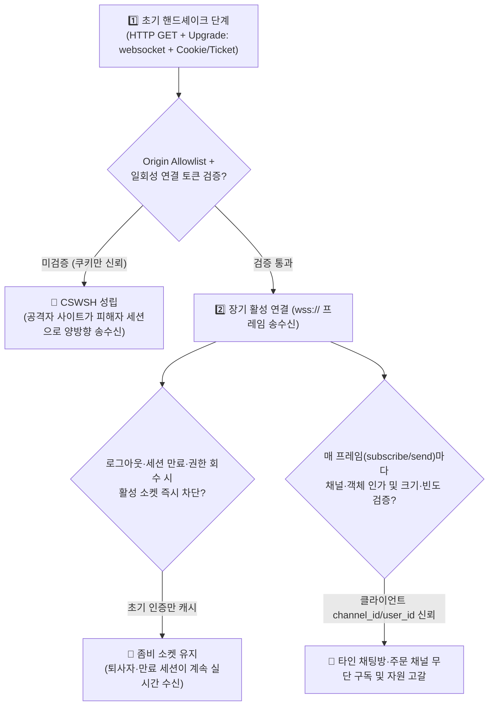
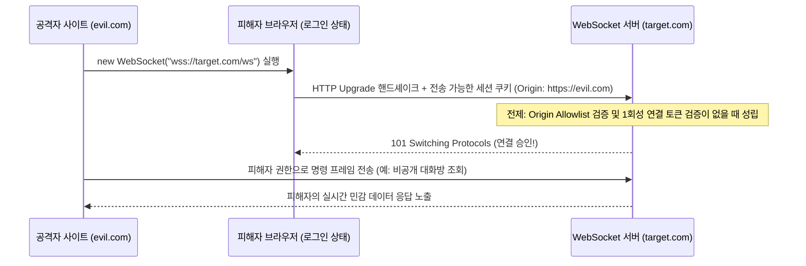

> [!summary] ⏱️ 5초 핵심 요약
> - **한 줄 비유**: 일반 HTTP가 매번 신분증을 확인하고 서류 한 장씩 주고받는 창구라면, **WebSocket은 처음에 한 번 전화를 걸어(HTTP Upgrade 핸드셰이크) 통화가 연결된 뒤에는 끊을 때까지 양쪽이 아무 말이나 실시간으로 주고받는 전용 직통전화**입니다.
> - **핵심 원리**: WebSocket 연결은 **브라우저 SOP의 교차 출처 읽기 제한이나 일반 `Access-Control-Allow-Origin`(CORS) 정책의 보호를 자동으로 받지 않으며**, 최초 핸드셰이크 통과 이후에도 세션 만료·권한 변경·메시지별 객체 인가를 서버가 직접 유지해야 안전합니다.
> - **5대 핵심 위협**: ① `Origin` 미검증 및 쿠키 자동 전송을 악용한 **CSWSH(Cross-Site WebSocket Hijacking)**, ② 연결 후 로그아웃·만료된 세션의 영구 유지, ③ `subscribe`/`send` 메시지 내 채널·객체 인가(BOLA/BFLA) 누락, ④ 프레임 페이로드 인젝션 및 메시지 폭주(자원 고갈), ⑤ HTTP 접근 로그에 남지 않는 프레임 사각지대.
> - **핵심 방어**: 핸드셰이크 시 **정확한 `Origin` Allowlist 검증 + 짧은 수명의 1회성 연결 티켓(Ticket)** 사용, 세션 폐기 시 활성 소켓 강제 종료, **매 프레임 처리 시 연결 주체 기준 채널·객체 권한 재검증** 및 메시지 크기·빈도 제한.

[[웹 취약점 진단 인증편 — 계정 잠금 우회부터 세션 하이재킹까지]]는 세션·쿠키의 발급과 생명주기를, [[웹 취약점 진단 설정편 — CORS·SOP부터 후속 공격까지]]은 일반 HTTP 응답을 읽는 CORS·SOP 경계를 다뤘습니다.

이 글은 그와 달리 **WebSocket 연결이 SOP의 교차 출처 읽기 제한과 일반적인 CORS 허용 헤더의 보호를 자동으로 받지 않는 특수성**, 그리고 연결 이후 메시지 단계에서 인증·인가를 계속 유지하는 방법에 집중합니다.



---

## 한눈에 보는 일반 HTTP API vs WebSocket 보안 통제 비교

| 보안 통제 영역 | 일반 HTTP REST API | WebSocket (`ws://` / `wss://`) | WebSocket 진단 시 핵심 확인 사항 |
|---|---|---|---|
| **1. 교차 출처(Cross-Origin) 통제** | 브라우저 SOP + `Access-Control-Allow-Origin` 헤더가 응답 읽기를 자동 통제 | **일반 CORS preflight 및 헤더가 적용되지 않음** | 서버가 핸드셰이크의 **`Origin` 헤더를 직접 Allowlist와 비교**해 거부하는가? |
| **2. CSRF / 하이재킹 방어** | 단발성 상태 변경 요청 위조 (CSRF) | **단 한 번의 핸드셰이크 성공으로 양방향 실시간 읽기·쓰기 모두 탈취 (CSWSH)** | 쿠키 자동 전송에만 의존하지 않고 **1회성 연결 티켓(Ticket)**을 함께 검증하는가? |
| **3. 인증 생명주기 (Session)** | 매 HTTP 요청마다 토큰/세션 만료 여부를 자연스럽게 재확인 | **한 번 맺은 연결이 수 시간~수일간 유지됨** | 로그아웃·비밀번호 변경·권한 박탈 시 **이미 열려 있는 소켓 연결도 즉시 끊는가?** |
| **4. 객체·기능 인가 (BOLA/BFLA)** | URL 경로(`/orders/123`)와 HTTP 메서드로 엔드포인트 구분 | 단일 소켓 통로 안에서 JSON 메시지(`{"action":"subscribe","room":"123"}`)로 구분 | 메시지 안의 `userId`를 믿지 않고 **소켓에 묶인 인증 주체로 매 프레임마다 인가**하는가? |
| **5. 로깅 및 관측성** | 웹 서버/ALB Access Log에 모든 요청 URL과 상태코드가 자동 기록됨 | Access Log에는 최초 `101 Switching Protocols` **1줄만 남고 이후 수만 개 프레임은 안 보임** | 애플리케이션 레벨에서 메시지 유형·인가 실패·속도 초과를 구조화 로그로 남기는가? |

---

## 1. 한 번 연결하고 계속 말하는 통로

**💡 한 줄 비유**: 일반 HTTP가 질문 한 번에 답 한 번을 받고 창구를 닫는 방식이라면, **WebSocket은 처음에 전화를 걸어 연결한 뒤 양쪽이 원할 때 계속 말하는 직통전화와 같아서, 일반 창구 규칙(CORS)이 통화 연결을 대신 막아주지 않습니다.**

### 핵심 원리
- **핸드셰이크와 프레임 전환**: 첫 연결인 핸드셰이크는 HTTP(`GET /chat HTTP/1.1` + `Upgrade: websocket`)로 시작하지만, 서버가 `101 Switching Protocols`로 응답해 협상이 성공하면 같은 TCP 연결 위에서 양방향 프레임을 계속 주고받습니다.
- **왜 일반 CORS 설정이 무의미한가**: 브라우저의 CORS는 일반 HTTP(`fetch`/`XHR`) 응답을 다른 출처의 스크립트가 읽을 수 있는지 정하는 규칙이라 WebSocket 전용 통로를 자동 허가·차단하지 않습니다. 브라우저는 핸드셰이크에 `Origin` 헤더를 실어 보내지만, **서버가 직접 `Origin` 헤더를 검사해 거부하지 않으면 다른 사이트의 악성 스크립트도 연결을 맺고 양방향 메시지를 읽고 쓸 수 있습니다.**
- **`Origin` 검증과 `wss://`의 역할 한계**:
  - `Origin` 헤더는 브라우저가 아닌 클라이언트(`curl`, Python 스크립트)가 얼마든지 위조할 수 있으므로 사용자 인증 수단이 아닙니다. (브라우저를 경유한 교차 사이트 공격을 막는 통제입니다.)
  - `wss://`(TLS) 역시 전송 구간 도청을 막을 뿐, 접속한 사이트나 메시지 권한이 정당한지는 판별하지 않습니다.

### 체크 포인트
- 서버가 핸드셰이크 요청의 `Origin` 헤더를 **스킴·호스트·포트가 정확히 일치하는 Allowlist**로 검증하는가?
- 일반 HTTP용 CORS 설정(`Access-Control-Allow-Origin`)만으로 WebSocket까지 보호된다고 잘못 가정하고 있지 않은가?
- 운영 환경 연결이 `wss://` 암호화를 사용하고, 이와 별개로 사용자 인증·메시지 인가를 수행하는가?
- 참고: [OWASP WSTG — Testing WebSockets](https://owasp.org/www-project-web-security-testing-guide/latest/4-Web_Application_Security_Testing/11-Client-side_Testing/10-Testing_WebSockets), [MDN — WebSocket](https://developer.mozilla.org/en-US/docs/Web/API/WebSocket), [RFC 6455 — The WebSocket Protocol](https://www.rfc-editor.org/rfc/rfc6455)

---

## 2. Cross-Site WebSocket Hijacking (CSWSH)

**💡 한 줄 비유**: 피해자가 은행 사이트에 로그인해 둔 상태에서 공격자 사이트를 열었더니, **공격자 사이트가 몰래 피해자의 브라우저 명찰(세션 쿠키)을 달고 은행과 직통전화를 연결해 피해자 행세를 하며 실시간 계좌 알림을 엿듣고 이체 명령까지 내리는 공격**입니다.

### 핵심 원리
CSWSH는 공격자 사이트가 피해자 브라우저에서 대상 WebSocket(`new WebSocket("wss://target.com/ws")`)을 열고, 브라우저가 핸드셰이크 요청에 자동으로 실어 보낸 세션 쿠키를 서버가 그대로 신뢰할 때 성립합니다. 일반 CSRF가 보통 응답을 읽지 못하는 단방향 공격인 반면, **CSWSH는 연결이 수립되는 순간 공격자 스크립트가 피해자 권한으로 메시지를 보내고 서버가 내려주는 실시간 응답까지 전부 읽을 수 있는 양방향 탈취**입니다.



### 성립 조건과 안전한 토큰 전달 설계
- **언제 막히고 언제 뚫리는가**:
  - 모든 쿠키 기반 WebSocket이 곧바로 취약한 것은 아닙니다. 세션 쿠키의 `SameSite=Strict/Lax` 정책과 브라우저의 서드파티 쿠키 제한이 교차 사이트 쿠키 전송을 막을 수 있고, 서버가 엄격한 `Origin` Allowlist나 1회성 연결 토큰을 검증하면 공격 조건이 깨집니다.
  - 그러나 **동일 사이트(Same-Site) 범위 내의 통제되지 않는 서브도메인 침해 시에는 `SameSite` 쿠키가 그대로 전송**되므로 반드시 서버 측 `Origin` 검증과 연결 토큰이 함께 필요합니다.
- **커스텀 헤더 제한과 일회성 티켓(Ticket) 패턴**:
  - 브라우저 기본 `WebSocket` API는 임의의 `Authorization: Bearer ...` 헤더 설정을 지원하지 않습니다.
  - 그렇다고 장기(Long-lived) JWT나 세션 토큰을 URL 쿼리스트링(`wss://.../ws?token=LONG_JWT`)에 그대로 넣으면 웹 서버·프록시 로그와 Referer에 장기 비밀이 노출됩니다.
  - **권장 패턴**: 먼저 일반 인증된 REST API(`POST /api/ws-ticket`)로 **수명이 매우 짧고(예: 30초) 단 한 번만 사용 가능한 연결 전용 티켓(One-Time Ticket)**을 발급받아 핸드셰이크에 사용하고 즉시 폐기하며, 로그에서는 해당 파라미터를 마스킹합니다.

### 체크 포인트
- 로그인된 브라우저에서 비신뢰 `Origin`(`https://evil.com` 및 비인가 서브도메인)으로 핸드셰이크를 시도했을 때 서버가 즉시 거부(`403`)하는가?
- 쿠키의 `SameSite` 설정에만 의존하지 않고 서버가 `Origin` Allowlist와 **짧은 수명의 1회성 연결 티켓**을 검증하는가?
- URL 쿼리스트링이나 프록시 로그에 재사용 가능한 장기 Bearer 토큰이 평문으로 남지 않는가?
- 참고: [OWASP WSTG — Testing WebSockets](https://owasp.org/www-project-web-security-testing-guide/latest/4-Web_Application_Security_Testing/11-Client-side_Testing/10-Testing_WebSockets), [OWASP — WebSocket Security Cheat Sheet](https://cheatsheetseries.owasp.org/cheatsheets/WebSocket_Security_Cheat_Sheet.html), [MDN — SameSite cookies](https://developer.mozilla.org/en-US/docs/Web/HTTP/Headers/Set-Cookie#samesitesamesite-value)

---

## 3. 핸드셰이크 이후의 인증 생명주기

**💡 한 줄 비유**: 아침에 출입증을 찍고 건물에 들어왔더라도 **낮에 퇴사 처리되거나 출입증이 정지됐다면 건물 안에 남아 있는 직원을 즉시 내보내야지, 아침에 한 번 통과했다는 이유로 퇴근할 때까지 기밀실을 활보하게 두어선 안 됩니다.**

### 핵심 원리
- **초기 인증 캐시의 함정**: 연결할 때 토큰을 한 번 확인했다고 그 연결이 영구히 유효한 것은 아닙니다. WebSocket은 수 시간 이상 유지될 수 있어 그 사이 **세션이 만료되거나, 사용자가 로그아웃하거나, 계정이 정지되거나, 부서/권한이 바뀔 수 있습니다.** 서버가 연결 당시의 인증 결과만 소켓 메모리에 캐시하고 변화를 반영하지 않으면 폐기된 세션이 연결 종료 전까지 계속 살아 움직입니다.
- **능동적 연결 종료와 상태 재확인**:
  - 모든 프레임마다 무거운 토큰 서명 검증을 반복해야만 안전한 것은 아닙니다.
  - 소켓 컨텍스트에 위조 불가능한 사용자 주체(`user_id`)와 세션 식별자(`session_id`)를 묶어 두고, ① **로그아웃·토큰 만료·권한 박탈 이벤트 발생 시 해당 세션의 활성 소켓 연결을 서버가 즉시 강제 종료(`Close Frame`)**하거나, ② **중요 메시지 처리 시 세션 저장소(Redis 등)의 유효 상태를 확인**하는 구조가 필요합니다.
- **자동 재연결(Auto-Reconnect) 검증**: 클라이언트의 자동 재연결 로직이 만료된 토큰이나 과거 쿠키를 반복 사용할 때 서버가 새 핸드셰이크에서 이를 정확히 거부하고 재인증을 요구하는지 확인합니다.

### 체크 포인트
- 사용자가 **로그아웃·비밀번호 변경·세션 만료·계정 정지**된 직후, 이미 열려 있던 기존 WebSocket 연결에서 메시지를 보내거나 받을 때 즉시 차단·종료되는가?
- 각 메시지 처리 시 연결에 바인딩된 사용자 주체와 현재 세션/권한 유효성을 신뢰 가능한 저장소와 동기화하는가?
- 네트워크 순단 후 자동 재연결 시 만료된 자격증명으로 핸드셰이크가 우회되지 않는가?
- 참고: [OWASP — WebSocket Security Cheat Sheet](https://cheatsheetseries.owasp.org/cheatsheets/WebSocket_Security_Cheat_Sheet.html), [OWASP — Session Management Cheat Sheet](https://cheatsheetseries.owasp.org/cheatsheets/Session_Management_Cheat_Sheet.html)

---

## 4. 메시지와 채널 단위 인가 (BOLA / BFLA)

**💡 한 줄 비유**: 호텔 정문에서 투숙객 확인(핸드셰이크 인증)을 마쳤다고 해서 **호텔 안의 모든 객실 문(`channel_id`)을 다 열 수 있는 건 아니므로, 각 방에 들어가거나 방송할 때마다 그 방의 열쇠가 맞는지 매번 확인해야 합니다.**

### 핵심 원리
핸드셰이크 인증은 **"누구와 연결됐는가"**만 정할 뿐입니다. 이후 단일 소켓 통로로 들어오는 `subscribe`, `publish`, `send`, `update`, `delete` 같은 개별 메시지가 가리키는 **채팅방·문서·주문·테넌트 채널**을 그 사용자가 읽거나 바꿀 수 있는지는 **매 메시지 동작마다 별도로 인가(Authorization)**해야 합니다.

### 취약한 메시지 처리 vs 안전한 메시지 인가 비교
```json
// ❌ 클라이언트가 전송한 WebSocket 프레임 예시
{
  "action": "subscribe",
  "senderUserId": "user_1004",
  "targetChannel": "private_order_stream_9999",
  "asRole": "ADMIN"
}
```
- **취약한 서버 구현**: 프레임 페이로드 안에 적힌 `senderUserId`나 `asRole`을 그대로 믿거나, 로그인된 소켓이라는 이유만으로 `private_order_stream_9999` 채널 구독을 허가함 → **실시간 BOLA / BFLA 성립**
- **안전한 서버 구현**:
  1. 페이로드의 `senderUserId`·`asRole`은 무시하고, 오직 **서버 측 소켓 세션에 바인딩된 인증 주체(`socket.auth.userId`)**만 신뢰합니다.
  2. `subscribe` 요청 시 해당 주체가 `private_order_stream_9999` 객체의 소유자/소속 테넌트인지 DB/캐시에서 검증합니다.
  3. 이미 구독을 승인한 채널이라도, **채팅방 강퇴·조직 탈퇴·권한 회수 이벤트가 발생하면 기존 채널 구독(Subscription)을 즉시 해제**합니다.

### 체크 포인트
- 메시지 페이로드 내부의 사용자·테넌트·역할 식별자를 신뢰하지 않고 **서버 소켓 컨텍스트의 인증 주체**에서 도출하는가?
- 채널 구독(`subscribe`), 메시지 발행(`publish`), 상태 수정 동작마다 **객체 수준(BOLA)과 기능 수준(BFLA) 권한을 각각 검사**하는가?
- 멤버 탈퇴나 권한 변경 시 이미 맺어진 채널 구독과 캐시된 권한이 즉시 무효화되는가?
- 참고: [OWASP — WebSocket Security Cheat Sheet](https://cheatsheetseries.owasp.org/cheatsheets/WebSocket_Security_Cheat_Sheet.html), [OWASP API Security Top 10 2023](https://owasp.org/API-Security/editions/2023/en/0x11-t10/)

---

## 5. 메시지 검증과 자원 제한

**💡 한 줄 비유**: 직통전화가 연결됐다고 해서 **상대방이 고성방가로 수 시간 동안 소리를 지르거나(메시지 폭주), 한 번에 백과사전 분량의 암호문(과대 프레임·압축 폭탄)을 읽어 내려가도 전화기를 끊지 않고 다 받아적으면 상담원이 쓰러집니다.**

### 핵심 원리
1. **프레임 입력 검증과 후속 인젝션 차단**:
   - WebSocket 프레임 역시 신뢰할 수 없는 외부 입력입니다. 메시지 타입별 JSON 스키마, 필수 필드, 자료형, 문자열 길이, 허용 명령(`action` Allowlist)을 검사하고 알 수 없는 필드는 거부해야 합니다.
   - 수신한 메시지를 다른 사용자의 브라우저 DOM에 렌더링할 때는 **DOM/Stored XSS**가, 백엔드 DB나 명령 처리기로 넘길 때는 **SQLi / Command Injection**이 그대로 발생할 수 있으므로 일반 HTTP API와 동일한 출력 인코딩·파라미터 바인딩을 적용합니다.
2. **장기 연결의 자원 고갈(DoS) 통제**:
   - 연결당·사용자당 **초당 메시지 전송 빈도(Message Rate Limit)**, **최대 프레임/메시지 바이트 크기(`maxPayload`)**, **동시 채널 구독 수**, **유휴 연결 유지 시간(Idle Timeout)** 및 **계정당 최대 동시 소켓 연결 수**를 제한해야 합니다.
   - `permessage-deflate` 같은 WebSocket 압축 확장을 사용할 경우, 작은 압축 프레임이 해제 후 거대한 메모리로 불어나는 압축 폭탄을 막기 위해 **압축 해제 후 크기와 JSON 중첩 깊이**도 함께 제한해야 합니다.

### 체크 포인트
- 메시지 타입별 JSON 스키마와 허용 명령 목록(Allowlist)이 서버에서 강제되는가?
- 연결·사용자별 **메시지 빈도, 최대 프레임 크기, 동시 구독 수, 최대 동시 연결 수, 유휴 시간(Idle Timeout) 상한**이 설정되어 있는가?
- WebSocket 압축(`permessage-deflate`) 사용 시 해제 후 크기와 JSON 중첩 깊이를 제한하며, 파싱 오류가 다른 연결로 전파되지 않는가?
- 참고: [OWASP — WebSocket Security Cheat Sheet](https://cheatsheetseries.owasp.org/cheatsheets/WebSocket_Security_Cheat_Sheet.html), [OWASP — Input Validation Cheat Sheet](https://cheatsheetseries.owasp.org/cheatsheets/Input_Validation_Cheat_Sheet.html)

---

## 6. 메시지 수준 로깅과 진단 절차

**💡 한 줄 비유**: 건물 출입구 CCTV(HTTP Access Log)에는 **"아침 9시에 들어갔다(`101 Switching Protocols`)"는 장면 한 줄만 남고 그 뒤로 건물 안에서 무슨 일을 벌였는지는 안 찍히므로**, 주요 방마다 별도의 행동 기록 장부(메시지 수준 감사 로그)를 남겨야 합니다.

### 핵심 원리
- **HTTP 접근 로그의 사각지대**: 일반적인 웹 서버나 로드밸런서 Access Log에는 최초 핸드셰이크 요청(`101`)만 남고 이후 주고받는 수만 개의 WebSocket 프레임은 전혀 남지 않습니다.
- **민감정보를 제외한 구조화 이벤트 로깅**:
  - 애플리케이션 레벨에서 `연결 생성·종료`, `인증 주체(user_id)`, `Origin`, `메시지 액션 종류`, `채널 구독/거부`, `속도·크기 제한 초과`를 구조화해 기록해야 실시간 남용을 추적할 수 있습니다.
  - 단, **연결 토큰, 세션 쿠키, 개인 간 대화 원문(Payload Body) 전체**를 그대로 로그에 남기면 로그 저장소가 새로운 민감정보 유출 경로가 되므로 반드시 마스킹·제외합니다.
- **안전한 4단계 진단 절차**: 승인된 환경에서 낮은 강도로 ① 비신뢰 `Origin` 핸드셰이크 시도(CSWSH), ② 로그아웃/만료 후 기존 열린 소켓으로 메시지 전송, ③ 타인 채널/관리자 액션 프레임 전송(BOLA/BFLA), ④ 상한 초과 크기·빈도 프레임 전송을 분리해 점검하고, 거부 응답뿐 아니라 **서버 측 실제 상태(구독 목록, DB)가 변하지 않았는지** 확인합니다.

### 체크 포인트
- 핸드셰이크 이후의 **메시지 액션 유형·인가 실패·속도 및 크기 제한 초과**가 애플리케이션 감사 로그로 추적 가능한가?
- 연결 티켓/토큰, 쿠키, 개인 메시지 본문 원문을 로그에서 마스킹하거나 제외하는가?
- 부정 테스트 수행 뒤 객체·구독 상태·서버 데이터가 실제로 변경되지 않았음을 확인했는가?
- 참고: [OWASP WSTG — Testing WebSockets](https://owasp.org/www-project-web-security-testing-guide/latest/4-Web_Application_Security_Testing/11-Client-side_Testing/10-Testing_WebSockets), [OWASP — Logging Cheat Sheet](https://cheatsheetseries.owasp.org/cheatsheets/Logging_Cheat_Sheet.html)

---

## 정리

쿠키·세션의 발급과 폐기 자체는 [[웹 취약점 진단 인증편 — 계정 잠금 우회부터 세션 하이재킹까지]]을, 브라우저의 일반 HTTP 교차 출처 정책과 설정 오류는 [[웹 취약점 진단 설정편 — CORS·SOP부터 후속 공격까지]]을 참고하면 경계를 더 넓게 볼 수 있습니다.
