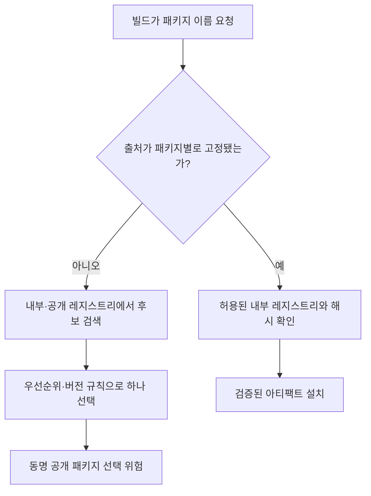

[[웹 취약점 진단 인프라편 — CI-CD와 클라우드 설정 노출]]은 시크릿, `.git`, 빌드 아티팩트처럼 CI/CD **파이프라인 설정과 배포 환경의 노출**을 다뤘습니다. 이 글은 파이프라인 설정이 아니라 파이프라인이 신뢰하고 그대로 내려받아 실행하는 **의존성 패키지 코드 자체의 오염**에 집중합니다. 따라서 dependency confusion, typosquatting, 설치 스크립트 실행, SCA·SBOM으로 이어지는 검증 경계를 별도로 다룹니다.

---

## 1. 의존성과 공급망 공격의 의미

의존성은 내가 직접 만들지 않고 다른 사람이 만든 재료를 가져와 제품에 넣는 것과 같습니다. 패키지 이름을 한 글자 잘못 입력하는 일은 택배 주소를 틀려 엉뚱한 집으로 물건을 보내는 것과 비슷하고, 공격자는 그 잘못된 주소에 미리 악성 패키지를 올려 둡니다. 공급망 공격은 완성된 서비스의 현관을 직접 부수기보다, 개발자가 믿고 들여오는 재료나 운송 경로를 오염시켜 빌드 과정 안으로 들어오는 방식입니다.

**원리**: npm·PyPI 같은 레지스트리에서 받은 패키지는 단순 데이터가 아니라 애플리케이션과 같은 권한으로 실행될 수 있는 코드입니다. 직접 의존성뿐 아니라 그 패키지가 다시 끌어오는 전이 의존성, 빌드 플러그인, 코드 생성기도 신뢰 경계에 포함됩니다. 따라서 버전 취약점만 찾는 SCA 결과와 패키지 출처·무결성·설치 시 실행 행위를 확인하는 공급망 검증을 구분해야 합니다.

취약한 정상 패키지와 처음부터 악성인 패키지는 대응도 다릅니다. 전자는 안전한 버전으로 갱신하고 영향 범위를 분석하지만, 후자는 설치 시점의 자격증명 노출과 빌드 산출물 변조까지 사고대응 범위로 봐야 합니다.

- 체크 포인트:
  - 직접·전이 의존성, 빌드 플러그인, 코드 생성기를 모두 목록화하는지
  - 패키지별 이름·버전·출처 레지스트리·해시·소유자를 기록하는지
  - 알려진 취약점과 악성·변조 의심 신호를 별도 절차로 처리하는지
- 참고: [CISA — Secure Software Development Framework](https://www.cisa.gov/resources-tools/resources/secure-software-development-framework-ssdf), [NIST SP 800-218 — Secure Software Development Framework](https://csrc.nist.gov/pubs/sp/800/218/final)

## 2. Dependency confusion과 레지스트리 우선순위

**원리**: dependency confusion은 조직 내부에서만 쓰는 패키지명과 같은 이름을 공개 레지스트리에 등록하고, 빌드 도구가 내부 저장소보다 공개 패키지를 선택하도록 유도하는 문제입니다. 성립 조건은 이름 충돌만이 아니라 레지스트리 탐색 순서, 버전 우선순위, 스코프 설정 중 하나가 공개 패키지 선택을 허용하는 경우입니다.

내부 패키지 버전보다 공개 레지스트리의 버전 숫자가 높을 때 "최신"을 자동 선택하는 구성이나, 패키지별 출처를 고정하지 않은 혼합 인덱스가 위험합니다. 잠금 파일이 이미 검증된 내부 아티팩트의 정확한 URL과 무결성 값을 고정하면 노출을 줄일 수 있지만, 잠금 파일이 재생성되거나 새 패키지가 추가되는 순간의 해석 규칙은 여전히 검증해야 합니다.

- 체크 포인트:
  - 내부 패키지 이름이 공개 레지스트리에도 존재하는지 승인된 방식으로 확인하는지
  - npm scope·레지스트리 매핑이나 Python 인덱스 정책을 패키지별로 고정하는지
  - 잠금 파일 재생성 시 다운로드 URL과 무결성 값이 예상 출처를 가리키는지
  - 빌드 환경이 임의의 추가 공개 인덱스를 참조하지 않는지
- 참고: [npm Docs — Configuring npm](https://docs.npmjs.com/cli/v11/using-npm/config/), [Python Packaging User Guide — Package Index Interfaces](https://packaging.python.org/en/latest/specifications/section-package-indices/), [CWE-427 — Uncontrolled Search Path Element](https://cwe.mitre.org/data/definitions/427.html)

## 3. Typosquatting과 이름 검증

**원리**: typosquatting은 정상 패키지와 철자·하이픈·스코프가 비슷한 이름을 등록해 개발자의 입력 실수나 리뷰 누락을 노립니다. 버전 고정과 해시 검증은 선택된 파일이 전송 중 바뀌지 않았다는 점은 증명하지만, 애초 잘못 고른 패키지의 정당성까지 증명하지는 않습니다.

신규 의존성은 이름만 보지 말고 공식 프로젝트가 안내하는 설치명, 게시자, 저장소 링크, 최초 게시 시점, 릴리스 이력과 대조해야 합니다. 다운로드 수가 많거나 이름이 익숙하다는 이유만으로 신뢰하면 안 되며, 조직에서 허용한 패키지 목록과 변경 승인을 두는 편이 재현성이 높습니다.

- 체크 포인트:
  - 신규 패키지명을 공식 프로젝트 문서의 설치명과 글자 단위로 대조하는지
  - 게시자·소스 저장소·릴리스 이력·서명 또는 provenance를 함께 확인하는지
  - 잠금 파일 diff에서 새 이름과 전이 의존성 추가를 사람이 검토하는지
  - 비슷한 이름의 패키지를 자동 경고하거나 허용목록 밖 설치를 차단하는지
- 참고: [PyPI — Security](https://pypi.org/security/), [npm Docs — About package provenance](https://docs.npmjs.com/generating-provenance-statements), [OWASP Top 10 2021 — A06 Vulnerable and Outdated Components](https://owasp.org/Top10/A06_2021-Vulnerable_and_Outdated_Components/)

## 4. 설치 스크립트와 빌드 타임 코드 실행

**원리**: npm의 `preinstall`·`install`·`postinstall` 같은 lifecycle script와 Python 패키지의 빌드 백엔드는 설치·빌드 과정에서 코드를 실행할 수 있습니다. 이 코드는 개발자 PC나 CI 러너가 가진 파일·환경변수·네트워크 권한으로 동작하므로, 애플리케이션이 실행되기 전에도 시크릿을 읽거나 산출물을 바꿀 수 있습니다.

모든 설치 스크립트가 악성인 것은 아닙니다. 네이티브 모듈 컴파일처럼 정당한 용도가 있어 전면 차단이 불가능할 수 있습니다. 기본은 스크립트를 비활성화한 격리 빌드로 두고, 필요한 패키지만 검토해 허용하며, 빌드 러너에는 배포에 꼭 필요한 최소 자격증명만 짧게 제공하는 방식이 현실적입니다.

- 체크 포인트:
  - 잠금 파일 변경 시 lifecycle script를 가진 신규·변경 패키지를 식별하는지
  - 설치 단계가 배포 시크릿·클라우드 메타데이터·내부망에 접근할 수 있는지
  - 가능한 작업은 스크립트 비활성화·격리·읽기 전용 파일시스템으로 빌드하는지
  - 허용한 설치 스크립트의 필요성과 검토 근거를 기록하는지
- 참고: [npm Docs — Scripts](https://docs.npmjs.com/cli/v11/using-npm/scripts/), [Python Packaging User Guide — pyproject.toml Specification](https://packaging.python.org/en/latest/specifications/pyproject-toml/), [NIST SP 800-218 — Secure Software Development Framework](https://csrc.nist.gov/pubs/sp/800/218/final)

## 5. SCA·SBOM과 실제 영향 판정

**원리**: SCA는 잠금 파일이나 빌드 산출물에서 구성요소와 버전을 식별해 알려진 취약점 데이터와 대조하고, SBOM은 그 구성요소 관계를 전달 가능한 목록으로 남깁니다. 둘 다 악성 패키지를 자동으로 판별하는 만능 도구는 아니며, CVE가 있다는 사실만으로 현재 서비스에서 악용 가능한 것도 아닙니다.

진단 결과는 `존재`, `실행 경로 도달 가능성`, `취약 기능 사용 여부`, `배포 환경의 완화 통제`를 나눠 판정해야 합니다. 다만 도달 가능성이 확인되지 않았다는 이유로 장기간 방치하면 안 됩니다. 분석 한계를 기록하고, 인터넷 노출·권한·악용 가능성·수정 버전 유무로 우선순위를 정합니다.

- 체크 포인트:
  - 소스 잠금 파일과 최종 이미지·번들 양쪽에서 구성요소를 식별하는지
  - SBOM에 직접·전이 의존성과 정확한 버전·해시가 포함되는지
  - CVE별 취약 코드 도달 가능성과 실제 기능 사용 여부를 근거와 함께 기록하는지
  - 악성 패키지 경보를 일반 버전 업데이트와 다른 사고대응 절차로 연결하는지
- 참고: [CISA — SBOM Resources Library](https://www.cisa.gov/topics/cyber-threats-and-advisories/sbom/sbomresourceslibrary), [OWASP Top 10 2021 — A06 Vulnerable and Outdated Components](https://owasp.org/Top10/A06_2021-Vulnerable_and_Outdated_Components/), [NIST SP 800-218 — Secure Software Development Framework](https://csrc.nist.gov/pubs/sp/800/218/final)

## 6. 재현 가능한 설치와 최소 권한 빌드

**원리**: 방어의 목표는 "항상 최신"이 아니라 검토한 구성요소를 같은 출처와 내용으로 재현해 설치하는 것입니다. 잠금 파일, 해시 검증, 내부 프록시 레지스트리, 변경 승인으로 선택 범위를 줄이고, CI에서는 네트워크 목적지와 자격증명 권한을 최소화해 악성 코드가 실행돼도 피해 범위를 제한합니다.

패키지 캐시는 속도를 높이지만 오염된 아티팩트를 오래 재사용할 수 있으므로 출처와 해시 검증이 필요합니다. 패키지를 삭제하거나 버전을 올린 뒤에도 이미 생성된 컨테이너 이미지·정적 번들·배포 아티팩트에 코드가 남을 수 있어 전 산출물을 다시 빌드하고 배포해야 합니다.

- 체크 포인트:
  - 잠금 파일과 무결성 검증을 우회하는 설치 옵션을 CI에서 금지하는지
  - 내부 프록시가 허용된 업스트림·패키지·버전만 제공하는지
  - 빌드 러너의 네트워크·시크릿·클라우드 권한을 작업별 최소 범위로 제한하는지
  - 패키지 사고 뒤 캐시 폐기, 자격증명 회전, 전체 산출물 재빌드를 수행하는지
- 참고: [NIST SP 800-218 — Secure Software Development Framework](https://csrc.nist.gov/pubs/sp/800/218/final), [npm Docs — About package provenance](https://docs.npmjs.com/generating-provenance-statements), [CISA — Secure Software Development Framework](https://www.cisa.gov/resources-tools/resources/secure-software-development-framework-ssdf)

---

## 정리

| 위험 | 신뢰가 깨지는 지점 | 핵심 확인 |
|---|---|---|
| Dependency confusion | 내부·공개 레지스트리 선택 | 패키지별 출처와 우선순위 고정 |
| Typosquatting | 사람이 고른 패키지 이름 | 공식 설치명·게시자·이력 검증 |
| 설치 스크립트 | 설치·빌드 중 코드 실행 | 격리, 스크립트 허용목록, 최소 권한 |
| 취약 구성요소 | 정상 패키지의 알려진 결함 | SCA, 도달 가능성, 수정 버전 |
| 악성 패키지 사고 | 빌드 자격증명과 산출물 | 회전, 캐시 폐기, 전체 재빌드 |

CI/CD 시크릿과 배포 설정 자체의 노출은 [[웹 취약점 진단 인프라편 — CI-CD와 클라우드 설정 노출]]을 참고하면 됩니다. 이 글의 SCA 결과에서 서비스에 노출된 구버전 API까지 확인됐다면 [[웹 취약점 진단 — 레거시·섀도우 API 자산 인벤토리(API9)]]의 자산·종료 기준으로 연결해 관리해야 합니다.
