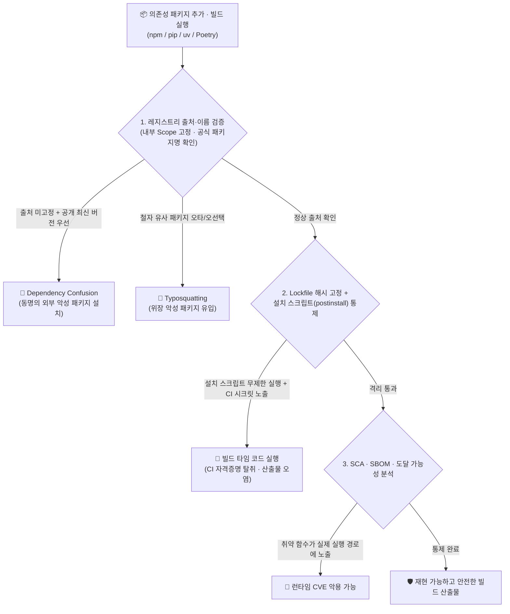
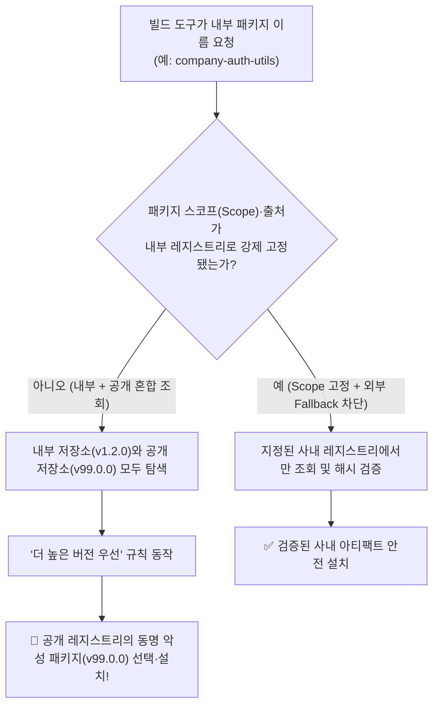

> [!summary] ⏱️ 5초 핵심 요약
> - **한 줄 비유**: 식당의 현관문과 금고는 철통같이 잠가 두었지만, **주방장이 매일 외부 도매상(공개 패키지 레지스트리)에서 들여오는 식자재 상자 안에 독극물(악성 패키지·설치 스크립트)이 섞여 들어와 조리 과정(빌드 파이프라인) 전체가 오염되는 공격**입니다.
> - **핵심 원리**: 외부 레지스트리(npm, PyPI 등)에서 내려받는 패키지는 단순 데이터가 아니라 **개발자 PC와 CI 빌드 러너의 권한으로 즉시 실행되는 코드**이므로, **알려진 취약점(CVE)을 찾는 SCA**와 **처음부터 악의적으로 만들어진 패키지를 막는 공급망 통제**를 분리해 다뤄야 합니다.
> - **4대 핵심 공격 경로**: ① 내부 전용 패키지명을 공개 저장소에 더 높은 버전으로 올리는 **Dependency Confusion**, ② 철자 실수를 노리는 **Typosquatting**, ③ 설치 순간 시크릿을 훔치는 **`preinstall`/`postinstall` 스크립트**, ④ 깊은 전이 의존성(Transitive Dependency)의 도달 가능한 CVE.
> - **핵심 방어**: 패키지별 레지스트리 출처(Scope) 고정, Lockfile(`npm ci` 등) 무결성 해시 강제, CI 설치 스크립트 기본 비활성화(`--ignore-scripts`) 및 최소 권한 격리, SBOM·도달 가능성(Reachability) 기반 SCA 운영.

[[웹 취약점 진단 인프라편 — CI-CD와 클라우드 설정 노출]]은 시크릿, `.git`, 빌드 아티팩트처럼 CI/CD **파이프라인 설정과 배포 환경의 노출**을 다뤘습니다.

이 글은 파이프라인 설정이 아니라 파이프라인이 신뢰하고 그대로 내려받아 실행하는 **의존성 패키지 코드 자체의 오염**에 집중합니다. 따라서 dependency confusion, typosquatting, 설치 스크립트 실행, SCA·SBOM으로 이어지는 검증 경계를 별도로 다룹니다.



---

## 한눈에 보는 '취약한 정상 패키지(SCA)' vs '악성 패키지(Malicious Package)' 비교

| 비교 항목 | 취약한 정상 패키지 (Vulnerable Package) | 악성 패키지 (Malicious Package) |
|---|---|---|
| **발생 원인** | 정상 오픈소스 개발자가 실수로 남긴 보안 버그 (향후 CVE 부여) | **공격자가 처음부터 시크릿 탈취·백도어 삽입 목적으로 제작·변조해 배포** |
| **주요 유입 경로** | 오래된 버전 방치, 깊은 전이 의존성(Transitive Dependency) | **Dependency Confusion, Typosquatting, 메인테이너 계정 탈취** |
| **코드 실행 시점** | 애플리케이션이 배포된 뒤 **런타임에 해당 취약 함수가 호출될 때** | **`npm install` / `pip install`을 실행하는 빌드/설치 순간(`postinstall` 등)** |
| **핵심 대응 절차** | 도달 가능성(Reachability) 평가 후 패치 버전 업데이트 또는 완화 통제 | **단순 삭제/업데이트로 끝나지 않음 → 빌드 러너 격리, 유출 자격증명 전면 회전(Rotate), 캐시 폐기 및 전 산출물 재빌드** |

---

## 1. 의존성과 공급망 공격의 의미

**💡 한 줄 비유**: 의존성은 내가 직접 농사짓지 않고 외부에서 사 오는 식자재와 같아서, **완성된 식당 현관을 부수는 대신 배달 오는 식자재 상자(패키지)나 배달 경로(레지스트리 우선순위)를 오염시키면 주방 안으로 손쉽게 침투할 수 있습니다.**

### 핵심 원리
- **패키지는 데이터가 아니라 '실행 코드'**: npm·PyPI 같은 레지스트리에서 받은 패키지는 애플리케이션과 동일한 권한으로 실행됩니다. 내가 직접 적은 **직접 의존성(Direct Dependency)**뿐 아니라 그 패키지가 꼬리에 꼬리를 물고 끌어오는 **전이 의존성(Transitive Dependency), 빌드 플러그인, 코드 생성기**까지 모두 신뢰 경계 안에 들어옵니다.
- **SCA와 공급망 검증의 분리**: 알려진 CVE 버전을 대조하는 일반 SCA 스캐너만으로는 방금 공격자가 새로 올린 악성 패키지(CVE 미할당)나 레지스트리 우선순위 설정 오류를 잡을 수 없습니다. 따라서 버전 취약점 점검과 **패키지 출처·무결성·설치 시 실행 행위 점검**을 병행해야 합니다.

### 체크 포인트
- 직접 의존성뿐 아니라 **전이 의존성, 빌드 플러그인, 코드 생성기**를 모두 목록화해 파악하고 있는가?
- 패키지별 이름·정확한 버전·출처 레지스트리 URL·무결성 해시(Integrity Hash)·게시자를 기록하는가?
- 알려진 버전 취약점(CVE) 대응 절차와 **악성·변조 의심 패키지 발견 시의 침해사고 대응 절차**를 분리해 운영하고 있는가?
- 참고: [CISA — Secure Software Development Framework](https://www.cisa.gov/resources-tools/resources/secure-software-development-framework-ssdf), [NIST SP 800-218 — Secure Software Development Framework](https://csrc.nist.gov/pubs/sp/800/218/final)

---

## 2. Dependency Confusion과 레지스트리 우선순위

**💡 한 줄 비유**: 사내 구내매점에만 파는 줄 알았던 **'사내전용-도시락'이라는 똑같은 이름으로 외부 배달앱에 '버전 99.0 특선 도시락'을 등록해 두었더니, 심부름하는 직원이 "숫자가 더 높으니 최신이겠네!"라며 외부 독극물 도시락을 사 오는 현상**입니다.

### 핵심 원리
Dependency Confusion(의존성 혼동)은 조직 내부에서만 쓰는 비공개 패키지명(예: `company-auth-utils`)과 동일한 이름을 공개 레지스트리(npmjs.com, PyPI.org)에 등록하고, 패키지 매니저가 내부 사설 저장소보다 공개 저장소의 패키지를 선택하도록 유도하는 공격입니다.



### 성립 조건과 근본 방어 설정
- **언제 성립하는가**: 단순히 이름이 같다고 무조건 뚫리는 것이 아니라, ① 패키지 매니저 설정이 내부 레지스트리와 공개 레지스트리를 함께 뒤지면서 **더 높은 버전(`99.0.0 > 1.2.0`)을 자동 선택**하거나(예: Python `pip --extra-index-url`의 기본 동작), ② 내부 스코프(`@company/*`)가 사내 프록시 레지스트리에만 고정되지 않고 공개 레지스트리로 Fallback될 때 성립합니다.
- **Lockfile만으로는 안심할 수 없는 순간**: 기존 Lockfile이 내부 URL과 해시를 고정하고 있어도, **개발자가 의존성을 추가·갱신하며 Lockfile을 재생성하는 순간** 잘못된 레지스트리 해석 규칙을 타면 오염된 패키지로 덮어써집니다.

```ini
# ✅ 안전한 .npmrc 설정 예시: 사내 스코프(@company)를 내부 레지스트리로 엄격히 고정
@company:registry=https://npm.internal.company.com/
always-auth=true

# ❌ 위험한 pip 실행 방식 (--extra-index-url은 공개 PyPI와 내부 인덱스를 모두 뒤져 높은 버전을 선택함)
# pip install --extra-index-url https://pypi.internal.company.com/ company-auth-utils
```

### 체크 포인트
- 사내 전용 패키지 이름이 클라이언트 번들·소스맵·공개 저장소 등을 통해 외부에 노출되어 있거나 이미 공개 레지스트리에 동명 패키지가 등록되어 있지 않은가?
- npm 스코프(`@org:registry=...`) 매핑이나 Python 인덱스 정책(`--index-url` 단일 프록시 사용 및 업스트림 규칙 고정)이 패키지별로 출처를 강제하는가?
- Lockfile 재생성 시 다운로드 URL(`resolved`)과 무결성 해시(`integrity`)가 예상한 내부 출처를 가리키는지 검증하는가?
- 참고: [npm Docs — Configuring npm](https://docs.npmjs.com/cli/v11/using-npm/config/), [Python Packaging User Guide — Package Index Interfaces](https://packaging.python.org/en/latest/specifications/section-package-indices/), [CWE-427 — Uncontrolled Search Path Element](https://cwe.mitre.org/data/definitions/427.html)

---

## 3. Typosquatting과 이름 검증

**💡 한 줄 비유**: 유명 은행 사이트 주소와 철자 하나만 다른 피싱 사이트처럼, **`requests` 대신 `reqeusts`처럼 개발자가 손가락 오타로 한 글자만 틀려도 바로 설치되도록 길목에 함정을 파놓는 수법**입니다.

### 핵심 원리
- **버전 고정·해시 검증의 사각지대**: Lockfile과 해시 검증은 **"내가 선택한 그 패키지가 전송 중에 변조되지 않았다"**는 점은 증명해 주지만, **"내가 애초에 입력한 패키지 이름이 진짜 공식 패키지가 맞다"**는 정당성까지는 증명해 주지 않습니다.
- **공격 방식**: 정상 패키지와 철자·하이픈·스코프·언더스코어가 교묘히 비슷한 이름(예: `lodash` vs `1odash`, `urllib3` vs `urlib3`, AI가 환각으로 만들어낸 존재하지 않던 패키지명 등록 등)을 공개 레지스트리에 미리 올려둡니다.
- **방어 절차**: 신규 의존성 추가 시 이름만 눈으로 보지 말고 **공식 프로젝트 문서의 설치 명령어, 게시자(Maintainer), 연결된 GitHub 저장소, 최초 게시일, 릴리스 이력, 패키지 출처 증명(Provenance/Attestation)**을 함께 대조해야 합니다.

### 체크 포인트
- 신규 패키지 추가 시 공식 프로젝트 문서가 안내하는 설치명과 글자 단위로 대조하는가?
- 패키지의 **게시자·소스 저장소 연결·릴리스 이력·서명 또는 Provenance(출처 증명)**를 함께 확인하는가?
- PR 코드 리뷰 시 `package-lock.json` / `uv.lock` diff에서 새로 추가된 직접·전이 의존성 이름을 사람이 검토하거나 사내 허용 목록(Allowlist) 프록시를 거치는가?
- 참고: [PyPI — Security](https://pypi.org/security/), [npm Docs — About package provenance](https://docs.npmjs.com/generating-provenance-statements), [OWASP Top 10 2021 — A06 Vulnerable and Outdated Components](https://owasp.org/Top10/A06_2021-Vulnerable_and_Outdated_Components/)

---

## 4. 설치 스크립트와 빌드 타임 코드 실행

**💡 한 줄 비유**: 가구(패키지)를 사서 아직 거실에 배치(런타임 실행)하지도 않았는데, **포장 박스를 뜯는 순간(`npm install`) 박스 안에 들어 있던 자동 태엽 장치(`postinstall` 스크립트)가 작동해 집 안의 금고 열쇠(CI 환경변수·클라우드 키)를 찍어 밖으로 전송하는 원리**입니다.

### 핵심 원리
- **실행 전(Pre-Runtime) 침해**: npm의 `preinstall`·`install`·`postinstall` 같은 라이프사이클 스크립트(Lifecycle Scripts)나 Python 패키지의 `setup.py` / 빌드 백엔드는 **패키지를 설치·빌드하는 그 순간에 임의의 셸 명령이나 코드를 실행**할 수 있습니다.
- **피해 범위**: 이 코드는 개발자 PC(`~/.aws/credentials`, SSH 키)나 CI 빌드 러너가 가진 **파일시스템·환경변수 시크릿·내부 네트워크 권한**으로 그대로 동작하므로, 웹 애플리케이션이 실제로 실행되기도 전에 배포 자격증명을 탈취하거나 빌드 산출물(번들 JS, 컨테이너 이미지)에 백도어를 심을 수 있습니다.
- **현실적인 통제 전략**: 네이티브 C++ 확장 모듈 컴파일 등 정당한 용도로 설치 스크립트를 쓰는 패키지도 있으므로 무조건 100% 영구 차단하기 어려울 수 있습니다. 따라서 **기본값은 스크립트 실행 비활성화(`--ignore-scripts`) 및 격리 빌드**로 두고, 꼭 필요한 패키지만 명시적 허용 목록(Allowlist)으로 승인하며, **의존성 설치 단계의 CI 스텝에는 배포용 시크릿이나 클라우드 권한을 아예 주입하지 않는 것**이 핵심입니다.

### 체크 포인트
- Lockfile 변경 시 `preinstall`/`install`/`postinstall` 등 설치 스크립트를 포함한 신규·변경 패키지를 자동으로 식별해 경고하는가?
- 패키지 설치 단계(`npm ci`, `pip install`)가 실행되는 CI 스텝이 배포 시크릿·클라우드 메타데이터(IMDS)·내부망에 접근할 수 없도록 분리되어 있는가?
- 기본적으로 설치 스크립트를 비활성화(`--ignore-scripts`)하거나 읽기 전용·네트워크 격리 컨테이너에서 빌드하며, 예외 허용한 스크립트의 검토 근거를 남기는가?
- 참고: [npm Docs — Scripts](https://docs.npmjs.com/cli/v11/using-npm/scripts/), [Python Packaging User Guide — pyproject.toml Specification](https://packaging.python.org/en/latest/specifications/pyproject-toml/), [NIST SP 800-218 — Secure Software Development Framework](https://csrc.nist.gov/pubs/sp/800/218/final)

---

## 5. SCA·SBOM과 실제 영향 판정

**💡 한 줄 비유**: 자동차 부품 목록(SBOM)에서 "창문 와이퍼 모터에 결함(CVE)이 있다"는 경고가 떴을 때, **우리 차는 아예 그 와이퍼 기능을 연결조차 안 해놨는지(도달 불가능), 아니면 브레이크와 직결되어 지금 당장 위험한지(도달 가능)를 구분해야 수리 우선순위를 정할 수 있습니다.**

### 핵심 원리
- **SCA(Software Composition Analysis)와 SBOM의 역할**: SCA는 Lockfile이나 최종 빌드 산출물(컨테이너 이미지·번들)에서 구성요소와 버전을 추출해 알려진 취약점 DB(CVE/GHSA)와 대조하고, **SBOM(Software Bill of Materials)**은 그 의존성 트리와 해시를 표준 형식으로 기록해 전달합니다.
- **단순 CVE 개수 나열을 넘어선 4단계 판정 기준**:
  1. **존재 여부 (Presence)**: 해당 버전의 패키지가 개발 전용(`devDependencies`)인지 실제 프로덕션 런타임 이미지에 포함되는지 확인
  2. **취약 기능 사용 여부 (Vulnerable Function Usage)**: 패키지 안의 수많은 함수 중 실제로 문제가 된 그 옵션·함수를 우리 코드가 부르는지 확인
  3. **실행 경로 도달 가능성 (Reachability)**: 외부 사용자의 입력이 그 취약한 함수까지 실제로 도달할 수 있는지 확인
  4. **배포 환경 완화 통제 (Mitigating Controls)**: WAF, 네트워크 격리, 입력 크기 제한 등으로 악용 전제 조건이 차단되어 있는지 확인
- **주의할 점**: "현재 코드에서는 도달 가능성이 확인되지 않는다"는 이유로 취약 버전을 영구 방치하면 안 됩니다. 향후 코드 변경 시 누군가 그 함수를 호출하는 순간 즉시 취약해지므로, 분석 한계를 기록하고 **인터넷 노출도·권한·PoC 유무·패치 버전 존재 여부**에 따라 업데이트 일정을 관리해야 합니다.

### 체크 포인트
- 소스 저장소의 Lockfile뿐 아니라 **최종 배포되는 컨테이너 이미지·번들 산출물 양쪽**에서 구성요소를 식별하는가?
- SBOM에 직접·전이 의존성과 정확한 버전·무결성 해시가 포함되는가?
- CVE 경보 처리 시 단순 버전 일치 여부를 넘어 **취약 코드 도달 가능성(Reachability)과 실제 기능 사용 여부**를 근거와 함께 판정하는가?
- 일반 CVE 버전 업데이트 절차와 **악성 패키지(Malware) 탐지 경보 시의 즉각적인 사고대응 절차**가 분리되어 있는가?
- 참고: [CISA — SBOM Resources Library](https://www.cisa.gov/topics/cyber-threats-and-advisories/sbom/sbomresourceslibrary), [OWASP Top 10 2021 — A06 Vulnerable and Outdated Components](https://owasp.org/Top10/A06_2021-Vulnerable_and_Outdated_Components/), [NIST SP 800-218 — Secure Software Development Framework](https://csrc.nist.gov/pubs/sp/800/218/final)

---

## 6. 재현 가능한 설치와 최소 권한 빌드

**💡 한 줄 비유**: 요리할 때마다 그날그날 시장에서 아무 재료나 새로 사 오는(`npm install`) 대신, **성분 검사가 끝난 밀봉 식자재 번호표(Lockfile + 해시)와 똑같은 재료만 반입(`npm ci`)하고, 만약 오염된 재료가 발견되면 조리대(캐시)를 전부 소독하고 주방 출입증(시크릿)까지 새로 발급받는 원칙**입니다.

### 핵심 원리
1. **재현 가능한 빌드(Reproducible Builds) 강제**:
   - 방어의 목표는 무조건 "항상 최신 버전 설치"가 아니라, **검토가 끝난 구성요소를 언제 어디서든 똑같은 출처와 똑같은 해시 내용으로 재현해 설치하는 것**입니다.
   - CI/CD에서는 Lockfile을 무시하거나 즉석에서 갱신하는 명령 대신, Lockfile과 해시 불일치 시 즉시 빌드를 실패시키는 결정론적 설치 명령(`npm ci`, `uv sync --frozen`, `pip install --require-hashes`)만 허용합니다.
2. **악성 패키지 유입 사고 발생 시 4대 사후 조치**:
   - 패키지 캐시는 빌드 속도를 높이지만 한 번 오염된 아티팩트를 계속 재사용하게 만듭니다.
   - 악성 패키지 설치가 확인되면 단순히 `package.json`에서 해당 줄만 지우고 끝내서는 안 되며 반드시 ① **CI/로컬 패키지 캐시 전면 폐기**, ② **빌드 시점에 노출 가능했던 모든 자격증명·토큰 회전(Rotate)**, ③ **오염 기간에 생성된 컨테이너 이미지·정적 번들 전량 폐기 및 클린 환경 재빌드·재배포**, ④ **개발자 단말 및 러너 침해 조사**를 수행해야 합니다.

### 체크 포인트
- CI/CD 파이프라인에서 Lockfile과 무결성 해시 검증을 우회하는 설치 옵션을 금지하고 결정론적 설치(`npm ci`, `--frozen` 등)를 강제하는가?
- 사내 프록시 레지스트리가 검증·허용된 업스트림과 패키지·버전만 중계하도록 통제하는가?
- 빌드 러너의 외부 네트워크(Egress) 목적지, 시크릿 접근, 클라우드 IAM 권한을 작업 스텝별 최소 범위로 분리했는가?
- 악성 패키지 사고 발생 시 **캐시 폐기 → 자격증명 전면 회전 → 전체 산출물 클린 재빌드**로 이어지는 플레이북이 준비되어 있는가?
- 참고: [NIST SP 800-218 — Secure Software Development Framework](https://csrc.nist.gov/pubs/sp/800/218/final), [npm Docs — About package provenance](https://docs.npmjs.com/generating-provenance-statements), [CISA — Secure Software Development Framework](https://www.cisa.gov/resources-tools/resources/secure-software-development-framework-ssdf)

---

## 정리

CI/CD 시크릿과 배포 설정 자체의 노출은 [[웹 취약점 진단 인프라편 — CI-CD와 클라우드 설정 노출]]을 참고하면 됩니다. 이 글의 SCA 결과에서 서비스에 노출된 구버전 API까지 확인됐다면 [[웹 취약점 진단 — 레거시·섀도우 API 자산 인벤토리(API9)]]의 자산·종료 기준으로 연결해 관리해야 합니다.
