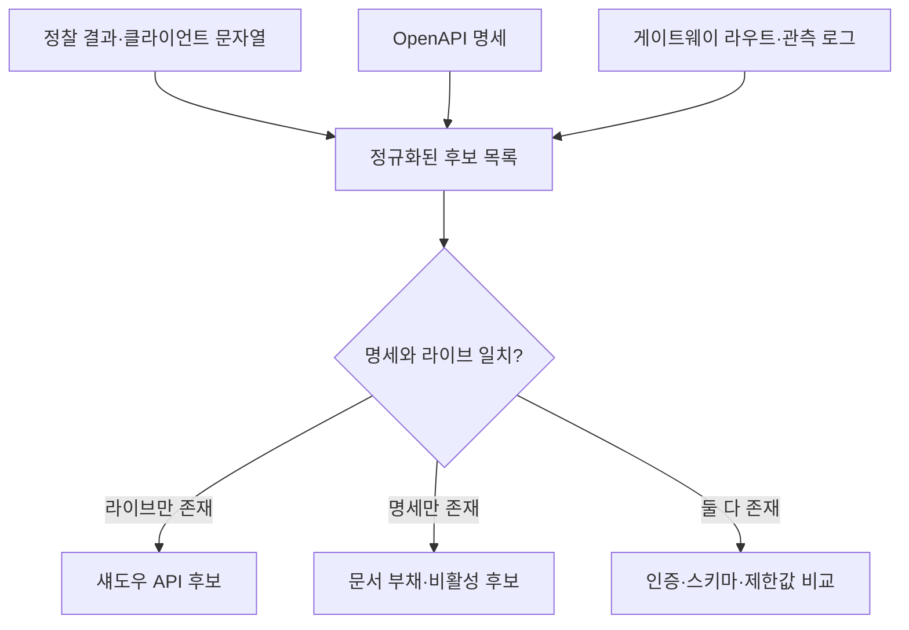

[[웹 취약점 진단 정찰편 — 공격표면 매핑과 헤더 기반 접근통제 우회]]는 JS 번들, 서브도메인, API 버전에서 숨은 공격 표면을 찾는 방법을 다뤘습니다. 이 글은 그 1~2번 섹션에서 얻은 엔드포인트 목록을 출발점으로 삼아, **API 엔드포인트·버전 단위의 인벤토리를 만들고 명세·실제 배포·보안 패치의 차이를 관리하는 후속편**에 집중합니다. 소스맵 탐색이나 인증서 로그 열거는 반복하지 않고, OWASP API9:2023의 자산관리 관점에서 무엇이 현행·레거시·섀도우·데드 API인지 판별합니다.

---

## 1. API 인벤토리의 의미와 최소 단위

API 인벤토리는 회사가 가진 모든 출입문을 목록으로 만들고, 각 문이 어느 건물에 있으며 누가 관리하고 어떤 열쇠가 필요한지 적어 두는 장부와 같습니다. 오래된 출입문을 바로 없애지 못하는 이유도 현실적입니다. 구버전 API를 끄면 아직 업데이트하지 않은 고객 앱이나 제휴 시스템이 멈출 수 있어, 하위 호환성을 지키라는 압박 때문에 낡은 문이 오래 남습니다. 문제는 장부에서 사라진 문도 실제 벽에는 그대로 열려 있을 수 있다는 점입니다.

**원리**: API9:2023에서 말하는 인벤토리는 호스트 이름만 모은 목록이 아닙니다. 최소 관리 단위는 `환경 + 호스트 + 버전 + HTTP 메서드 + 경로`이며, 여기에 소유 팀, 인증 방식, 공개 범위, 처리 데이터 등급, 현재 상태, 종료 예정일을 연결해야 합니다. 같은 `/users`라도 운영 v1의 `GET`과 스테이징 v2의 `POST`는 노출 조건과 위험이 달라 별도 항목으로 봐야 합니다.

문서에 있는 엔드포인트만 기록하면 실제 배포와 어긋날 수 있고, 게이트웨이 로그만 보면 최근 호출되지 않은 관리용·비상용 경로가 빠질 수 있습니다. 따라서 설계 명세, 배포 설정, 실제 트래픽이라는 서로 다른 근거를 함께 대조할 때만 인벤토리의 누락을 줄일 수 있습니다.

- 체크 포인트:
  - 각 항목에 환경·호스트·버전·메서드·경로·소유 팀·데이터 등급·종료일이 있는지
  - `production`, `staging`, `development`, `partner`, `internal`의 공개 범위를 구분했는지
  - 소유 팀이나 종료 계획이 비어 있는 항목을 예외가 아니라 미관리 자산으로 분류하는지
- 참고: [OWASP API Security Top 10 2023 — API9 Improper Inventory Management](https://owasp.org/API-Security/editions/2023/en/0xa9-improper-inventory-management/), [OpenAPI Specification](https://spec.openapis.org/oas/latest.html)

## 2. 정찰 결과를 단일 목록으로 정규화하기

**원리**: 정찰편에서 확보한 JS 번들·모바일 바이너리의 URL 문자열은 "클라이언트가 알고 있는 후보"이고, OpenAPI 문서는 "조직이 공개하거나 의도한 계약"이며, API 게이트웨이·로드밸런서 로그는 "실제로 관측된 호출"입니다. 어느 하나도 전체 목록을 보장하지 않으므로 세 집합을 같은 형식으로 정규화한 뒤 출처를 표시해야 합니다.

문자열에 남은 경로가 이미 폐기됐을 수도 있고, 최근 로그가 없다고 사용자가 없는 것도 아닙니다. 계절성 배치, 재해복구 절차, 오래된 모바일 앱처럼 호출 주기가 긴 소비자가 있기 때문입니다. 따라서 `발견 출처`, `마지막 관측 시각`, `명세 포함 여부`를 별도 필드로 남기고, 존재 여부와 사용 여부를 섞어 판단하지 않습니다.

- 체크 포인트:
  - 정찰 결과·OpenAPI·게이트웨이 라우트·트래픽 로그를 동일한 메서드/경로 형식으로 정규화하는지
  - 경로 파라미터(`/users/123`)를 템플릿(`/users/{id}`)으로 묶되 메서드는 합치지 않는지
  - 각 항목에 발견 출처와 마지막 관측 시각을 남기는지
  - 모바일 앱 최소 지원 버전과 제휴사 호출 주기를 함께 확인하는지
- 참고: [OWASP API Security Top 10 2023 — API9 Improper Inventory Management](https://owasp.org/API-Security/editions/2023/en/0xa9-improper-inventory-management/), [OpenAPI Specification — Paths Object](https://spec.openapis.org/oas/latest.html#paths-object)

## 3. OpenAPI 명세와 라이브 엔드포인트의 차이 찾기

**원리**: 명세와 실제 라우팅의 차이는 두 방향으로 생깁니다. 라이브에는 있지만 명세에 없는 경로는 섀도우 API 후보이고, 명세에는 있지만 라이브에서 확인되지 않는 경로는 문서 부채나 비활성 후보입니다. 다만 404 한 번만으로 비활성이라고 단정하면 안 됩니다. 특정 호스트, 테넌트, 기능 플래그, 인증 주체에서만 라우트가 열릴 수 있기 때문입니다.

비교할 때는 경로 존재 여부뿐 아니라 인증 요구, 요청 스키마, 응답 필드, 제한값도 봐야 합니다. 예를 들어 문서에는 OAuth가 필수인데 게이트웨이의 실제 라우트가 익명 호출을 허용하거나, 문서의 `page_size` 최대값과 서버의 실제 상한이 다르면 자산은 같아도 통제가 다른 상태입니다.

- 체크 포인트:
  - 명세와 실제 게이트웨이 라우트를 메서드 단위로 diff하는지
  - `security`, 요청/응답 스키마, 페이지 상한, 오류 응답의 차이까지 비교하는지
  - 기능 플래그·테넌트·내부 네트워크 조건 때문에 숨은 라우트를 별도로 확인하는지
- 참고: [OpenAPI Specification — Security Requirement Object](https://spec.openapis.org/oas/latest.html#security-requirement-object), [OWASP REST Assessment Cheat Sheet](https://cheatsheetseries.owasp.org/cheatsheets/REST_Assessment_Cheat_Sheet.html)

## 4. v1·v2·v3 보안 패치 반영 여부 비교

**원리**: 버전 비교의 목적은 응답 모양이 다른지 보는 것이 아니라 최신 버전에 들어간 보안 불변식이 구버전에도 유지되는지 확인하는 것입니다. 인증 강제, 객체·필드 인가, 입력 길이, 레이트 제한, 오류 정보 최소화 같은 항목을 동일한 정상·거부 시나리오로 호출해 결과를 표로 남깁니다.

최신 버전의 동작이 곧 정답이라는 보장은 없습니다. 변경 이력과 보안 수정 티켓에서 의도한 통제를 먼저 정한 뒤, 각 버전이 그 통제를 충족하는지 비교해야 합니다. 호환성 때문에 응답 스키마를 유지해야 해도 인증·인가 검사는 보통 백포트할 수 있으며, 불가능하다면 네트워크 제한이나 종료 기한 같은 보완 통제가 필요합니다.

| 비교 항목 | v1 | v2 | v3 | 판정 근거 |
|---|---|---|---|---|
| 인증 없는 호출 | 거부/허용 | 거부/허용 | 거부/허용 | 상태코드와 본문 |
| 객체·필드 인가 | 동일/상이 | 동일/상이 | 동일/상이 | 역할별 응답 차이 |
| 입력·페이지 상한 | 값 | 값 | 값 | 서버가 강제한 실제 값 |
| 오류 정보 | 상세/최소 | 상세/최소 | 상세/최소 | 내부 정보 노출 여부 |

- 체크 포인트:
  - 최신 버전의 보안 수정 목록을 기준 시나리오로 변환했는지
  - 동일 계정·동일 데이터·동일 입력으로 버전별 결과를 비교하는지
  - 구버전 미반영 통제마다 백포트, 보완 통제, 종료 중 하나의 결정을 기록하는지
- 참고: [OWASP API Security Top 10 2023 — API9 Improper Inventory Management](https://owasp.org/API-Security/editions/2023/en/0xa9-improper-inventory-management/), [OWASP Authorization Cheat Sheet](https://cheatsheetseries.owasp.org/cheatsheets/Authorization_Cheat_Sheet.html)

## 5. 섀도우 API와 데드 API의 판별 기준

**원리**: 섀도우 API는 중앙 인벤토리와 보안 운영의 시야 밖에 있지만 실제로 배포된 API이고, 데드 API는 합의된 소비자가 없고 종료 조건을 충족한 자산입니다. 최근 호출이 없다는 이유만으로 데드라고 분류하면 안 되며, 반대로 담당자가 없다는 이유만으로 트래픽이 있는 API를 즉시 끄는 것도 장애를 만듭니다.

종료 전에는 알려진 소비자, 앱 버전 분포, 제휴 계약, 배치 일정, DNS·게이트웨이 의존성을 확인합니다. 그 뒤 일정 기간 경고 응답과 관측을 거쳐 라우트를 차단하고, 재활성화 절차와 책임자를 남겨야 합니다. 데이터베이스나 메시지 큐가 최신 버전과 공유된다면 구버전 하나의 침해가 현행 데이터로 이어질 수 있어 우선순위가 높습니다.

- 체크 포인트:
  - 인벤토리 미등록이면서 실제 라우트가 존재하는 항목을 섀도우 API로 분류하는지
  - 마지막 호출만이 아니라 소비자·계약·배치 주기·앱 버전 분포를 종료 근거로 쓰는지
  - 구버전이 운영 DB·스토리지·메시지 큐를 공유하는지
  - 차단 전 경고 기간, 종료 승인자, 긴급 복구 절차가 있는지
- 참고: [OWASP API Security Top 10 2023 — API9 Improper Inventory Management](https://owasp.org/API-Security/editions/2023/en/0xa9-improper-inventory-management/), [NIST SP 800-218 — Secure Software Development Framework](https://csrc.nist.gov/pubs/sp/800/218/final)

## 6. 인벤토리를 운영 통제로 유지하기

**원리**: 일회성 스프레드시트는 배포 속도를 따라가지 못합니다. 새 라우트가 게이트웨이에 등록되거나 OpenAPI 명세가 변경될 때 인벤토리 항목과 소유자·데이터 등급이 함께 갱신되도록 배포 승인 조건에 연결해야 합니다. 다만 자동 발견 결과를 곧바로 삭제 대상으로 삼지 말고, 사람이 소유권과 종료 영향을 확인하는 절차를 둡니다.

운영 지표는 총 API 수보다 미등록 라우트 수, 소유자 없는 항목 수, 종료일을 넘긴 버전 수, 명세와 실제 통제의 불일치 수가 유용합니다. 이 수치가 줄어야 공격 표면이 실제로 관리되고 있다고 말할 수 있습니다.

- 체크 포인트:
  - 라우트·명세 변경 시 소유자와 데이터 등급이 없는 배포를 차단하는지
  - 미등록·무소유·종료일 초과·명세 불일치 항목을 정기 지표로 추적하는지
  - 모든 공개 버전에 동일한 게이트웨이·모니터링 정책이 적용되는지
- 참고: [OWASP API Security Top 10 2023 — API9 Improper Inventory Management](https://owasp.org/API-Security/editions/2023/en/0xa9-improper-inventory-management/), [NIST SP 800-218 — Secure Software Development Framework](https://csrc.nist.gov/pubs/sp/800/218/final)

---

## 정리

| 진단 축 | 핵심 질문 | 확인 결과 |
|---|---|---|
| 범위 | 환경·호스트·버전·메서드·경로가 모두 식별됐는가 | 누락 자산 목록 |
| 명세 일치 | OpenAPI와 실제 라우트·통제가 같은가 | 섀도우·문서 부채 |
| 버전 차이 | 최신 보안 수정이 구버전에도 적용됐는가 | 백포트·보완·종료 결정 |
| 수명주기 | 소비자와 종료 근거가 확인됐는가 | 현행·레거시·데드 분류 |
| 운영 책임 | 소유자와 종료일이 배포 절차에 연결됐는가 | 지속 관리 가능성 |

엔드포인트를 처음 찾는 방법은 [[웹 취약점 진단 정찰편 — 공격표면 매핑과 헤더 기반 접근통제 우회]]를 참고하고, 인벤토리에서 확인한 API의 객체·기능 인가를 검증하려면 [[웹 취약점 진단 인가편 — 권한 매트릭스로 BOLA·BFLA 찾기]]로 이어가면 됩니다.
