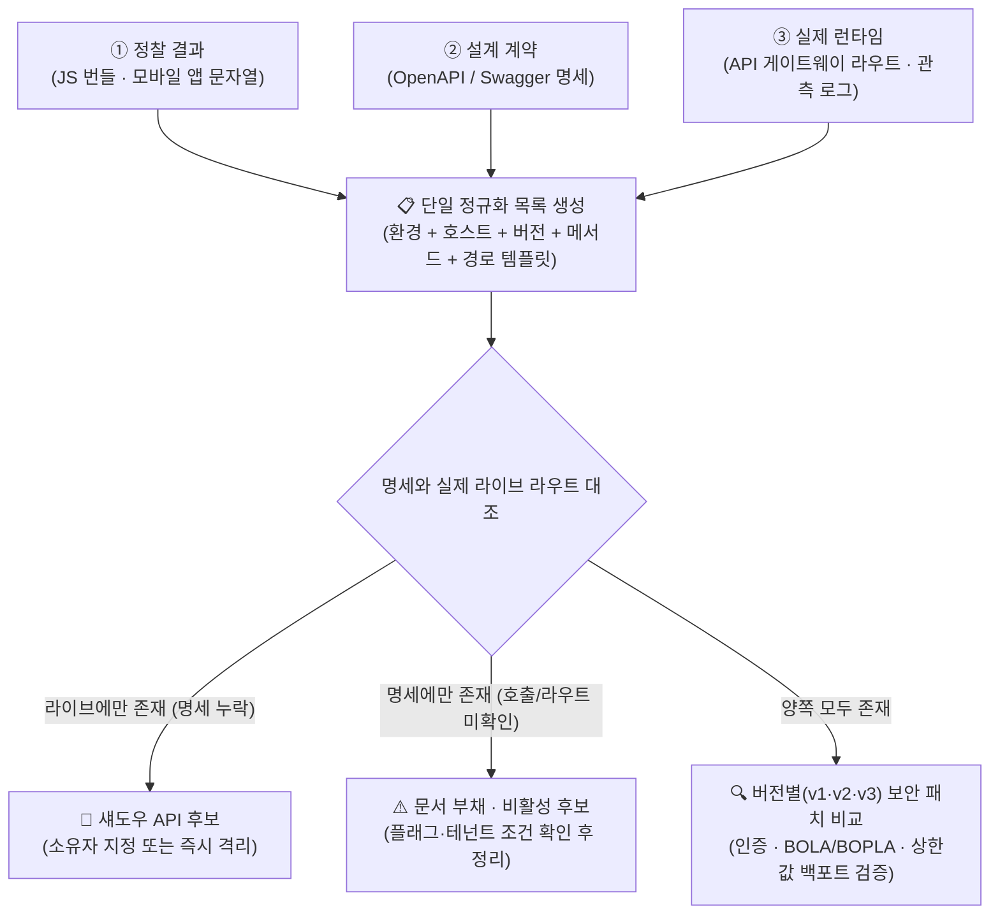

> [!summary] ⏱️ 5초 핵심 요약
> - **한 줄 비유**: 본관 정문(`v3 API`)에는 최신 생체인식 보안 검색대를 달아두었지만, **건물 도면(OpenAPI 명세)에서 지워진 줄 알았던 구관 뒷문(`v1 레거시·섀도우 API`)이 여전히 같은 금고(운영 DB)로 이어진 채 잠금장치 없이 열려 있는 상태**입니다.
> - **핵심 원리**: **OWASP API9:2023(Improper Inventory Management)**은 단순히 숨은 URL을 찾는 정찰을 넘어, **`환경 + 호스트 + 버전 + HTTP 메서드 + 경로` 단위의 인벤토리를 구축하고 설계 명세·실제 라우트·최신 보안 패치 반영 여부의 차이를 통제하지 못할 때** 발생합니다.
> - **4대 자산 분류**: ① 현행(Active) API, ② 하위 호환성 때문에 남겨둔 레거시(Legacy) API, ③ 명세·인벤토리 밖에 배포된 섀도우(Shadow) API, ④ 소비자가 사라진 종료 대상 데드(Dead) API.
> - **핵심 방어**: 정찰·OpenAPI·게이트웨이 로그를 단일 목록으로 정규화해 대조하고, **최신 버전(`v3`)에 적용된 보안 불변식(인증·인가·Rate Limit·필드 필터)이 구버전(`v1`·`v2`)에도 동일하게 백포트되었는지 교차 검증**하며, 소유자와 종료일(Sunset Date)을 CI/CD 배포 조건으로 강제합니다.

[[웹 취약점 진단 정찰편 — 공격표면 매핑과 헤더 기반 접근통제 우회]]는 JS 번들, 서브도메인, API 버전에서 숨은 공격 표면을 찾는 방법을 다뤘습니다.

이 글은 그 1~2번 섹션에서 얻은 엔드포인트 목록을 출발점으로 삼아, **API 엔드포인트·버전 단위의 인벤토리를 만들고 명세·실제 배포·보안 패치의 차이를 관리하는 후속편**에 집중합니다. 소스맵 탐색이나 인증서 로그 열거는 반복하지 않고, OWASP API9:2023의 자산관리 관점에서 무엇이 현행·레거시·섀도우·데드 API인지 판별합니다.

---

## 한눈에 보는 API 자산 4대 상태 분류 및 관리 기준

| 자산 상태 분류 | 정의 및 발생 원인 | 주요 보안 위험 | 진단 및 운영 조치 |
|---|---|---|---|
| **1. 현행 API (Active)** | 공식 명세와 인벤토리에 등록되어 현재 주력으로 운영 중인 버전 (`v3`) | 최신 보안 통제의 기준점(Baseline)이나 계약과 구현이 어긋날 수 있음 | OpenAPI 계약 테스트 및 보안 불변식 기준 수립 |
| **2. 레거시 API (Legacy)** | 구버전 앱·제휴사 하위 호환성 때문에 끄지 못하고 유지 중인 구버전 (`v1`, `v2`) | **`v3`에 패치된 인증·인가·속도 제한이 백포트되지 않고 운영 DB를 공유함** | `v3` 대비 보안 패치 교차 검증 → 백포트 또는 네트워크 격리·종료 일정 확정 |
| **3. 섀도우 API (Shadow)** | 중앙 인벤토리와 보안팀 시야 밖에 있지만 실제 게이트웨이/서버에 열려 있는 경로 | 인증 누락, 디버그/파트너 테스트용 임시 경로 방치, 모니터링 사각지대 | 게이트웨이 라우트·트래픽 역추적 → 소유 팀 귀속 후 보안 심사 또는 차단 |
| **4. 데드 API (Dead)** | 합의된 정상 소비자가 더 이상 없고 종료 조건을 충족했으나 코드에 남은 경로 | 불필요한 공격 표면 유지, 아무도 모니터링하지 않는 침투 경로 | 앱 버전 분포·제휴/배치 주기 확인 → 경고 기간(`Sunset` 헤더) 후 라우트 폐기 |

---

## 1. API 인벤토리의 의미와 최소 단위

**💡 한 줄 비유**: API 인벤토리는 회사가 가진 모든 출입문을 목록으로 만들고, **각 문이 어느 건물(환경) 몇 층(버전)에 있으며 누가 관리하고(소유 팀) 언제 폐쇄할지(종료일) 적어 두는 보안 장부**와 같습니다.

### 핵심 원리
- **왜 낡은 문이 사라지지 않는가**: 구버전 API를 바로 끄면 아직 업데이트하지 않은 고객 모바일 앱이나 제휴사 연동 시스템이 멈출 수 있어, 하위 호환성 압박 때문에 오래된 버전이 수년간 남습니다. 문제는 장부에서 지워진 문도 실제 벽에는 그대로 열려 있을 수 있다는 점입니다.
- **API9 인벤토리의 최소 관리 단위**: 단순히 호스트 이름(`api.example.com`)만 모은 목록은 인벤토리가 아닙니다. 최소 단위는 **`환경(Env) + 호스트(Host) + 버전(Version) + HTTP 메서드(Method) + 경로 템플릿(Path)`**이며, 여기에 다음 6가지 메타데이터가 연결되어야 합니다:
  1. **소유 팀 (Owner Team)**
  2. **인증·인가 방식 (Auth Scheme)**
  3. **공개 범위 (`production` / `staging` / `development` / `partner` / `internal`)**
  4. **처리 데이터 민감도 등급 (PII, 결제, 공개 등)**
  5. **현재 수명주기 상태 (`Active` / `Legacy` / `Deprecated` / `Retired`)**
  6. **종료 예정일 (Sunset / Deprecation Date)**

### 체크 포인트
- 인벤토리의 각 항목에 **환경·호스트·버전·메서드·경로·소유 팀·데이터 등급·종료일**이 빠짐없이 기록되어 있는가?
- `production`, `staging`, `development`, `partner`, `internal`의 공개 범위와 네트워크 접근 경계를 명확히 구분했는가?
- 소유 팀이나 종료 계획이 비어 있는 항목을 단순 예외가 아니라 **'미관리 고위험 자산'**으로 분류해 추적하는가?
- 참고: [OWASP API Security Top 10 2023 — API9 Improper Inventory Management](https://owasp.org/API-Security/editions/2023/en/0xa9-improper-inventory-management/), [OpenAPI Specification](https://spec.openapis.org/oas/latest.html)

---

## 2. 정찰 결과를 단일 목록으로 정규화하기

**💡 한 줄 비유**: 손님들이 들고 있는 옛날 약도(클라이언트 번들), 안내데스크의 공식 안내책자(OpenAPI 명세), 경비실의 실제 출입 기록(게이트웨이 로그)은 **각각 빠진 곳이 있으므로, 세 장을 똑같은 규격으로 포개어 봐야만 숨겨진 문이 보입니다.**

### 3대 데이터 출처의 한계와 교차 정규화

| 수집 출처 | 의미하는 바 | 단독으로만 볼 때의 한계 |
|---|---|---|
| **1. 정찰 결과 (JS 번들·모바일 앱 바이너리)** | 클라이언트가 호출할 수 있도록 하드코딩된 후보 경로 | 이미 서버에서 폐기된 죽은 경로가 섞여 있을 수 있고, 서버 간(B2B) 전용 API는 보이지 않음 |
| **2. OpenAPI / Swagger 명세** | 개발 조직이 공개하거나 의도한 설계 계약 | 문서 업데이트가 누락된 섀도우 API나 임시 디버그 라우트가 빠져 있음 |
| **3. API 게이트웨이 라우트 설정 & 트래픽 로그** | 실제로 배포되어 열려 있거나 최근 호출된 경로 | 최근 로그만 보면 호출 주기가 긴 **비상용·관리자용·연말 정산 배치용 경로**가 빠질 수 있음 |

### 정규화(Normalization) 실무 규칙
- **경로 템플릿 통합 + 메서드 분리**: `/api/v1/users/123`과 `/api/v1/users/456`은 `/api/v1/users/{id}` 템플릿 하나로 묶되, **`GET /users/{id}`와 `DELETE /users/{id}`는 권한과 위험이 전혀 다르므로 절대 합치지 않고 별도 행으로 분리**합니다.
- **존재 여부와 사용 여부의 분리**: 각 항목에 `발견 출처(Source)`, `마지막 관측 시각(Last Seen)`, `명세 포함 여부(Documented)`를 별도 컬럼으로 남기고, 최근 트래픽이 없다는 이유만으로 라우트가 닫혀 있다고 단정하지 않습니다.

### 체크 포인트
- 정찰 결과·OpenAPI·게이트웨이 라우트 설정·트래픽 로그를 **동일한 `메서드 + 정규화 경로 템플릿` 형식**으로 통합했는가?
- 경로 파라미터(`/users/123`)는 템플릿(`/users/{id}`)으로 묶되 HTTP 메서드는 합치지 않고 개별 관리하는가?
- 각 항목에 발견 출처와 마지막 관측 시각을 기록하고, 모바일 앱 최소 지원 버전 및 제휴사 배치 호출 주기를 함께 확인했는가?
- 참고: [OWASP API Security Top 10 2023 — API9 Improper Inventory Management](https://owasp.org/API-Security/editions/2023/en/0xa9-improper-inventory-management/), [OpenAPI Specification — Paths Object](https://spec.openapis.org/oas/latest.html#paths-object)

---

## 3. OpenAPI 명세와 라이브 엔드포인트의 차이 찾기

**💡 한 줄 비유**: 건물 설계도(OpenAPI)에는 **"카드키 필수 출입문"**이라고 그려져 있는데, 실제 현장(라이브 게이트웨이)에 가보니 **카드키 판독기가 꺼져 있거나 설계도에 아예 없는 쪽문(섀도우 API)이 뚫려 있는 차이를 찾아내는 작업**입니다.

### 핵심 원리
명세와 실제 라우팅의 차이(Drift)는 두 방향에서 발생합니다.
1. **라이브에만 있고 명세에 없는 경로 → 섀도우 API(Shadow API) 후보**:
   - 긴급 장애 대응용 임시 API, 파트너사 전용 커스텀 엔드포인트, 구버전 마이그레이션 잔재가 문서 없이 살아남은 경우입니다.
2. **명세에만 있고 라이브에서 안 보이는 경로 → 문서 부채 또는 조건부 은닉 라우트**:
   - 단순 `404 Not Found` 한 번만으로 비활성 경로라고 단정하면 안 됩니다. **특정 내부 Host 헤더, 특정 테넌트 설정, 기능 플래그(Feature Flag), 관리자 인증 토큰**이 있을 때만 라우트가 활성화될 수 있기 때문입니다.
3. **경로는 같지만 '보안 통제'가 다른 경우**:
   - 문서에는 `security: [BearerAuth]`가 필수인데 실제 게이트웨이 라우트가 익명 호출을 허용하거나, 문서의 `page_size` 상한(`100`)과 실제 백엔드가 허용하는 상한(`무제한`)이 다른 경우입니다.

### 체크 포인트
- OpenAPI 명세와 실제 API 게이트웨이/프레임워크 라우트 테이블을 메서드 단위로 자동 비교(diff)하는가?
- 단순 경로 유무뿐 아니라 **`security`(인증 요구), 요청/응답 스키마, 페이지 크기 상한, 에러 응답 노출 수준**까지 대조하는가?
- 기능 플래그·테넌트·내부 네트워크 조건에 따라 조건부로 열리는 라우트를 별도 점검했는가?
- 참고: [OpenAPI Specification — Security Requirement Object](https://spec.openapis.org/oas/latest.html#security-requirement-object), [OWASP REST Assessment Cheat Sheet](https://cheatsheetseries.owasp.org/cheatsheets/REST_Assessment_Cheat_Sheet.html)

---

## 4. `v1`·`v2`·`v3` 보안 패치 반영 여부 비교

**💡 한 줄 비유**: 아파트 3단지(`v3`)에서 도둑이 든 창문 방범창을 최신형으로 고쳤다면, **똑같은 구조로 지어진 1단지(`v1`)와 2단지(`v2`) 창문에도 방범창이 함께 설치됐는지 똑같은 방법으로 흔들어 봐야 합니다.**

### 핵심 원리
버전 비교 진단의 목적은 응답 JSON 모양이 다른지 구경하는 것이 아니라, **최신 버전(`v3`)에 적용된 보안 불변식(Security Invariants)이 구버전(`v1`, `v2`)에도 빠짐없이 유지되는지 확인**하는 것입니다.
- 변경 이력과 과거 보안 패치 티켓에서 의도한 통제를 먼저 기준 시나리오로 정의한 뒤, **동일한 테스트 계정·동일한 대상 데이터·동일한 조작 입력**으로 `v1`, `v2`, `v3`를 나란히 호출해 결과를 비교 표로 남깁니다.
- 하위 호환성 때문에 구버전의 응답 스키마(필드 구조)를 바꾸기 어렵더라도 **인증 강제, 소유권 검증(BOLA), Rate Limit 같은 보안 검사는 대부분 백포트(Backport)할 수 있으며**, 구조상 백포트가 불가능하다면 네트워크 접근 제한이나 즉시 종료 기한 같은 보완 통제를 걸어야 합니다.

### 버전별 보안 통제 교차 비교 매트릭스 예시

| 보안 검증 시나리오 | `v1` (레거시) | `v2` (구버전) | `v3` (현행 기준) | 판정 및 조치 근거 |
|---|---|---|---|---|
| **1. 인증 토큰 없는 호출** | `401 거부` | `401 거부` | `401 거부` | ✅ 전 버전 인증 일관 유지 |
| **2. 타인 객체 조회 (BOLA)** | `200 허용 (취약!)` | `403 거부` | `403 거부` | 🚨 **`v1`에 소유권 검증 패치 누락** (즉시 백포트/차단) |
| **3. 응답 민감 필드 (BOPLA)** | 내부 메모 포함 | 내부 메모 제외 | 내부 메모 제외 | 🚨 **`v1`이 엔터티 전체 직렬화 중** (DTO 마스킹 적용) |
| **4. 입력·페이지 상한 (`limit`)** | 무제한 (`10만 건`) | 최대 `100` | 최대 `100` | 🚨 **`v1`을 통한 자원 고갈(API4) 우회 가능** |
| **5. 에러 응답 정보 노출** | DB 스택트레이스 노출 | 표준 에러 코드 | 표준 에러 코드 | ⚠️ `v1` 전역 예외 처리기 미적용 |

### 체크 포인트
- 최신 버전의 보안 패치 이력을 검증 가능한 **기준 테스트 시나리오**로 변환했는가?
- **동일 계정·동일 데이터·동일 입력**으로 `v1`·`v2`·`v3`의 응답 상태 코드와 본문을 교차 비교했는가?
- 구버전에 누락된 보안 통제마다 **① 코드 백포트, ② 게이트웨이/네트워크 보완 통제, ③ 엔드포인트 즉시 종료** 중 하나의 결정을 기록했는가?
- 참고: [OWASP API Security Top 10 2023 — API9 Improper Inventory Management](https://owasp.org/API-Security/editions/2023/en/0xa9-improper-inventory-management/), [OWASP Authorization Cheat Sheet](https://cheatsheetseries.owasp.org/cheatsheets/Authorization_Cheat_Sheet.html)

---

## 5. 섀도우 API와 데드 API의 판별 기준

**💡 한 줄 비유**: **섀도우 API는 건물주가 존재조차 모르는데 누군가 드나들고 있는 비밀 통로**이고, **데드 API는 이제 아무도 안 쓰기로 약속했지만 철거하지 않고 방치해 둔 폐쇄 대상 통로**입니다.

### 핵심 원리
- **섣부른 오판 주의**:
  - 최근 7일간 호출 로그가 없다고 해서 곧바로 '데드 API'로 단정해 무작정 끄면 **월말 정산 배치나 재해복구(DR), 구버전 모바일 앱**에서 대형 장애가 날 수 있습니다.
  - 반대로 담당 팀이 불분명하다고 해서 실제 트래픽이 흐르는 섀도우 API를 예고 없이 차단할 수도 없습니다.
- **우선순위 최상위 기준 — "운영 DB·큐 공유 여부"**:
  - 구버전이나 스테이징/테스트용 섀도우 API가 **현행 프로덕션 데이터베이스, 스토리지, 메시지 큐를 함께 바라보고 있다면**, 그 낡은 API 하나가 뚫리는 순간 현행 고객 데이터 전체가 털리므로 최우선으로 격리·차단해야 합니다.
- **안전한 단계적 종료(Sunset) 절차**:
  1. 소비자(앱 버전 분포, 제휴 계약, 배치 스케줄) 및 인프라 의존성 확인
  2. 응답에 `Deprecation` / `Sunset` 헤더 및 사전 경고 공지 적용
  3. 일정 관측 기간 동안 잔여 호출을 모니터링하며 소비자를 신규 버전으로 유도
  4. 게이트웨이에서 라우트를 먼저 차단(Soft Block: 즉시 롤백 가능 상태)한 뒤 이상이 없을 때 애플리케이션 코드와 권한을 최종 제거

### 체크 포인트
- 인벤토리 미등록이면서 실제 게이트웨이/애플리케이션 라우트가 존재하는 항목을 **섀도우 API**로 분류해 관리하는가?
- 단순 최근 호출 유무만이 아니라 **소비자·제휴 계약·배치 주기·모바일 앱 버전 분포**를 데드 API 종료 근거로 확인하는가?
- 레거시/섀도우 API가 **운영 DB·스토리지·메시지 큐를 현행 버전과 공유**하고 있지 않은가?
- 라우트 차단 전 경고 기간, 종료 승인 책임자, 장애 시 긴급 복구(롤백) 절차가 정의되어 있는가?
- 참고: [OWASP API Security Top 10 2023 — API9 Improper Inventory Management](https://owasp.org/API-Security/editions/2023/en/0xa9-improper-inventory-management/), [NIST SP 800-218 — Secure Software Development Framework](https://csrc.nist.gov/pubs/sp/800/218/final)

---

## 6. 인벤토리를 운영 통제로 유지하기

**💡 한 줄 비유**: 대청소 날 한 번만 작성하는 엑셀 파일은 일주일이면 낡은 종이가 되므로, **새 문을 만들 때마다(CI/CD 배포) 담당자와 폐쇄 예정일을 등록해야만 문이 열리도록 공사 허가 절차에 묶어두어야 합니다.**

### 핵심 원리
- **배포 파이프라인(CI/CD) 연동**: 새 라우트가 API 게이트웨이나 프레임워크에 추가되거나 OpenAPI 명세가 변경될 때, **소유 팀(Owner)과 데이터 민감도 등급이 지정되지 않으면 배포 승인 게이트를 통과하지 못하도록** 자동화해야 합니다.
- **사람의 검토와 결합된 자동 발견**: 런타임 트래픽 분석 도구가 미등록 라우트를 자동 발견하면 곧바로 삭제하는 대신, 담당 팀 배정과 종료 영향 검토 티켓을 자동 생성하는 흐름으로 연결합니다.
- **실질적인 4대 운영 지표(KPI)**: 단순히 "전체 API가 몇 개인가"를 세는 것은 의미가 없습니다. 다음 4가지 숫자가 0에 수렴하는지를 정기 지표로 추적해야 합니다:
  1. **미등록 라우트 수 (Shadow API Count)**
  2. **소유자 없는 항목 수 (Orphaned API Count)**
  3. **종료 예정일을 넘긴 구버전 수 (Overdue Deprecated APIs)**
  4. **명세와 실제 런타임 보안 통제의 불일치 건수 (Spec-Runtime Drift)**

### 체크 포인트
- 라우트나 OpenAPI 명세 변경 시 **소유 팀과 데이터 등급이 누락된 배포를 CI/CD에서 차단**하는가?
- **미등록·무소유·종료일 초과·명세 불일치 항목 수**를 정기 보안 지표로 추적해 줄여나가고 있는가?
- 현행 버전뿐 아니라 외부에 열려 있는 모든 구버전(`v1`, `v2`)에도 동일한 API 게이트웨이 인증·로깅·WAF 정책이 적용되는가?
- 참고: [OWASP API Security Top 10 2023 — API9 Improper Inventory Management](https://owasp.org/API-Security/editions/2023/en/0xa9-improper-inventory-management/), [NIST SP 800-218 — Secure Software Development Framework](https://csrc.nist.gov/pubs/sp/800/218/final)

---

## 정리

엔드포인트를 처음 찾는 방법은 [[웹 취약점 진단 정찰편 — 공격표면 매핑과 헤더 기반 접근통제 우회]]를 참고하고, 인벤토리에서 확인한 API의 객체·기능 인가를 검증하려면 [[웹 취약점 진단 인가편 — 권한 매트릭스로 BOLA·BFLA 찾기]]로 이어가면 됩니다.
