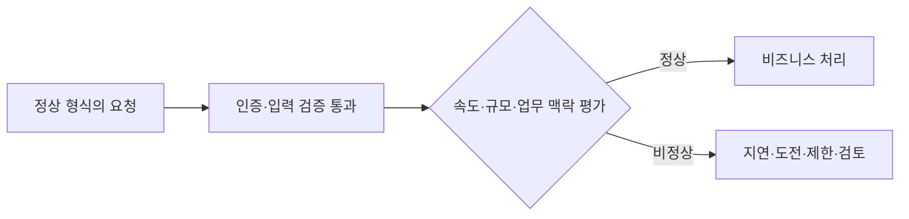

[[웹 취약점 진단 로직편 — 비즈니스 로직 결함 찾는 법]]이 가격·상태 전이·사용 횟수처럼 **설계 자체가 잘못된 결함**을 다뤘다면, 이 글은 설계와 개별 요청이 정상이어도 **속도와 규모로 남용되는 민감 비즈니스 흐름**을 다룹니다. 정상적으로 인증된 사용자가 정상 기능만 호출해도 자동화 규모가 커지면 티켓 선점, 가격 수집, 계정 탈취 시도 같은 사업 피해가 생긴다는 점에서 별개의 진단 축입니다.

---

## 1. 민감 비즈니스 플로우와 API6의 의미

민감 비즈니스 플로우는 재고 구매, 쿠폰 발급, 로그인 시도처럼 한 번 사용할 때는 평범하지만 **많이 또는 빨리 반복하면 사업에 실제 피해가 나는 동작**입니다. 매표소 직원이 한 사람씩 정상 절차로 표를 팔더라도 로봇 손님 1,000명이 동시에 줄을 서면 실제 관객은 표를 구하지 못합니다. 로봇 손님이 각각 정상 계정과 결제 수단을 갖고 있어도 결과는 달라지지 않습니다. 인증은 "누구인지"를 확인할 뿐 "이 속도와 규모가 정당한지"까지 보장하지 않기 때문입니다.

**원리**: OWASP API6:2023은 보안상 민감한 비즈니스 흐름에 무제한으로 접근할 수 있어 자동화 남용이 가능한 상태를 다룹니다. 서버가 요청 하나하나를 유효하게 처리하는 것과 서비스 전체가 공정하고 지속 가능하게 운영되는 것은 별개입니다. 따라서 진단도 비정상 페이로드보다 정상 요청의 반복 빈도·동시성·분산 정도가 업무 결과를 어떻게 바꾸는지에 초점을 둡니다.

민감도는 기술 부하만으로 정하지 않습니다. 한정 재고의 선점, 경쟁사에 유리한 가격 정보 수집, 계정 잠금이나 탈취 시도, 유료 혜택 소진처럼 매출·공정성·고객 신뢰에 미치는 영향을 기준으로 우선순위를 매깁니다.

- 체크 포인트:
  - 반복될 때 재고·혜택·계정·시장 정보에 손실을 주는 흐름을 제품 담당자와 함께 목록화
  - 인증 여부뿐 아니라 계정·세션·기기·네트워크·결제수단 단위의 반복을 관찰할 수 있는지 확인
  - 진단 전에 허용 요청량, 테스트 계정, 중단 조건을 정해 실제 고객과 재고에 영향을 주지 않도록 통제
- 참고: [OWASP API6:2023 Unrestricted Access to Sensitive Business Flows](https://owasp.org/API-Security/editions/2023/en/0xa6-unrestricted-access-to-sensitive-business-flows/), [OWASP API Security Top 10 2023](https://owasp.org/API-Security/editions/2023/en/0x11-t10/)

## 2. 티켓·가격·로그인 흐름의 남용 패턴

**원리**: 같은 자동화라도 보호해야 할 자산과 성공 기준은 다릅니다. 티켓 스캘핑은 좌석 조회부터 임시 선점·결제까지 이어지는 흐름에서 희소 재고를 빠르게 확보하는 것이 목적이고, 가격 스크래핑은 공개 조회를 넓고 지속적으로 수집해 시장 정보를 축적하는 것이 목적입니다. 크리덴셜 스터핑은 다른 서비스에서 유출된 자격 증명이 여기에서도 재사용되는지 대량으로 확인하는 패턴입니다.

티켓은 결제 완료 횟수만 보면 선점 단계의 고갈을 놓칠 수 있고, 가격 조회는 HTTP 오류가 없어도 경쟁사에 데이터가 축적될 수 있습니다. 로그인은 실패율만 보면 소수의 성공 계정과 분산된 저속 시도를 놓칩니다. 즉 흐름마다 "공격 요청 수"보다 실제 사업 결과를 나타내는 지표를 정해야 합니다.

정상 사용자와 자동화를 단일 신호로 구분하기는 어렵습니다. 접근성 도구, 기업 네트워크, 이동통신망, 비밀번호 관리자도 봇과 비슷한 특성을 보일 수 있으므로, 진단 결과는 탐지율뿐 아니라 정상 고객의 차단 가능성까지 함께 평가합니다.

- 체크 포인트:
  - 재고 조회·예약·결제, 가격 검색·상세 조회, 로그인·복구 등 연속 단계를 하나의 흐름으로 연결해 관찰
  - 티켓은 선점 후 미결제 비율, 가격은 수집 범위와 지속성, 로그인은 계정당·자격 증명당 실패와 성공을 함께 측정
  - 한 단계의 제한이 다른 엔드포인트나 모바일·웹 경로에서 동일하게 적용되는지 확인
- 참고: [OWASP API6:2023 Unrestricted Access to Sensitive Business Flows](https://owasp.org/API-Security/editions/2023/en/0xa6-unrestricted-access-to-sensitive-business-flows/), [OWASP Credential Stuffing Prevention Cheat Sheet](https://cheatsheetseries.owasp.org/cheatsheets/Credential_Stuffing_Prevention_Cheat_Sheet.html)

## 3. 단일 키 레이트리미팅의 한계

**원리**: IP 주소 하나에 초당 요청 수만 제한하면 단순한 반복은 막을 수 있지만, 계정·세션·기기·API 키·결제수단 등 다른 식별 축으로 분산된 자동화는 놓칠 수 있습니다. 반대로 회사·학교·통신사처럼 하나의 IP를 많은 사람이 공유하는 환경에서는 정상 사용자를 함께 막을 수 있습니다.

진단에서는 제한을 무작정 넘기는 대신 승인된 범위에서 요청 속도를 단계적으로 높이며 어떤 키와 시간 창이 적용되는지 확인합니다. 짧은 폭주뿐 아니라 낮은 속도가 오래 누적되는 경우, 여러 계정이 같은 재고나 자격 증명 집합을 겨냥하는 경우, 예약과 취소가 반복되는 경우도 별도 지표가 필요합니다.

429 상태 코드가 나온다는 사실만으로 방어가 충분하다고 결론 내리면 안 됩니다. 제한이 민감한 처리 직전에 일관되게 적용되는지, 프록시·캐시·비동기 작업 뒤에서도 같은 정책이 유지되는지, 차단 이후 이미 생성된 예약이나 혜택이 롤백되는지까지 확인해야 합니다.

- 체크 포인트:
  - IP 외에 계정·세션·기기·API 키·대상 자원별 한도가 함께 존재하는지 확인
  - 고정 창 경계, 짧은 폭주, 장기 저속 누적, 다계정 동시성에 대해 작은 승인 트래픽으로 정책을 검증
  - 제한 응답의 `Retry-After`, 오류 바디, 캐시 동작이 일관되고 내부 처리도 실제로 중단되는지 확인
- 참고: [OWASP API6:2023 Unrestricted Access to Sensitive Business Flows](https://owasp.org/API-Security/editions/2023/en/0xa6-unrestricted-access-to-sensitive-business-flows/), [OWASP Denial of Service Cheat Sheet](https://cheatsheetseries.owasp.org/cheatsheets/Denial_of_Service_Cheat_Sheet.html)

## 4. 디바이스·행동 신호와 우회 내성

**원리**: 디바이스 핑거프린팅과 행동 분석은 브라우저 특성, 세션 연속성, 입력·탐색 패턴 같은 여러 신호를 합쳐 자동화 가능성을 추정합니다. 이는 신원을 확정하는 수단이 아니라 위험 점수를 보완하는 확률적 통제입니다. 특정 헤더 하나나 자바스크립트 값 하나에 의존하면 환경 변화에 약하고 정상 사용자 오탐도 커집니다.

우회 내성 평가는 방어 로직의 세부값을 추출하거나 실제 공격 자동화를 만드는 작업이 아닙니다. 통제된 테스트 계정에서 브라우저·앱 경로, 쿠키 초기화, 네트워크 전환처럼 정상 환경에서도 생길 수 있는 변화에 점수가 어떻게 반응하는지 보고, 한 신호가 사라져도 다른 신호와 서버 측 업무 맥락이 남는지 확인합니다.

도전 과제나 추가 인증은 위험이 높을 때만 단계적으로 적용하는 편이 안전합니다. 모든 사용자에게 같은 퍼즐을 반복 요구하면 접근성과 전환율을 해치고, 공격자에게도 판별 기준을 학습할 기회를 줄 수 있습니다. 개인정보 수집 범위와 보관 기간 역시 봇 방어 효과와 별도로 검토해야 합니다.

- 체크 포인트:
  - 단일 헤더·쿠키·브라우저 특성이 아니라 여러 독립 신호와 서버 측 업무 결과를 결합하는지 확인
  - 정상적인 환경 변화에서 점수가 초기화되거나 과도하게 상승하는지, 접근성 사용자에게 불리한지 평가
  - 위험 기반 도전, 추가 인증, 수동 검토의 단계가 있고 수집 신호의 보관·접근 정책이 정해져 있는지 확인
- 참고: [OWASP Credential Stuffing Prevention Cheat Sheet](https://cheatsheetseries.owasp.org/cheatsheets/Credential_Stuffing_Prevention_Cheat_Sheet.html), [OWASP Multifactor Authentication Cheat Sheet](https://cheatsheetseries.owasp.org/cheatsheets/Multifactor_Authentication_Cheat_Sheet.html)

## 5. 방어 효과를 사업 결과로 검증하기

**원리**: 봇 방어가 요청을 차단했는지가 아니라 민감한 결과를 보호했는지로 효과를 측정해야 합니다. 예약 API에서 429를 많이 반환해도 공격 계정이 좌석을 계속 선점한다면 통제는 실패한 것입니다. 로그인 실패를 줄였어도 탈취 성공 알림과 비정상 세션이 늘었다면 같은 결론입니다.

관측 지표는 기술 지표와 사업 지표를 연결해야 합니다. 계정·기기별 요청률, 도전 통과율, 오류율과 함께 선점 후 미결제율, 쿠폰 소진 속도, 비정상 로그인 성공, 가격 카탈로그 열람 범위를 봅니다. 기준선은 출시일·행사·마케팅 캠페인처럼 정상 트래픽이 급증하는 상황을 포함해야 합니다.

탐지 규칙은 영구 차단보다 재평가 가능한 조치와 결합하는 것이 좋습니다. 지연, 대기열, 짧은 예약 만료, 추가 인증, 수동 검토를 위험도에 따라 적용하고 오탐을 해제할 운영 절차를 마련해야 합니다.

- 체크 포인트:
  - 차단 건수뿐 아니라 재고·혜택·계정 보호라는 최종 성과 지표와 상관관계를 확인
  - 행사·출시·장애 시기의 정상 급증을 기준선에 포함하고 탐지 임계값 변경을 기록
  - 오탐 이의 제기, 긴급 해제, 규칙 롤백, 개인정보 최소화 절차가 운영 문서에 있는지 확인
- 참고: [OWASP API6:2023 Unrestricted Access to Sensitive Business Flows](https://owasp.org/API-Security/editions/2023/en/0xa6-unrestricted-access-to-sensitive-business-flows/), [OWASP Logging Cheat Sheet](https://cheatsheetseries.owasp.org/cheatsheets/Logging_Cheat_Sheet.html)

## 6. 흐름 단위의 다층 방어

**원리**: 하나의 봇 탐지 제품이나 CAPTCHA만으로 모든 흐름을 보호하기는 어렵습니다. 민감 흐름을 먼저 식별하고, 요청률 제한·대기열·재고 선점 규칙·추가 인증·이상 징후 탐지·사후 취소를 업무 특성에 맞게 겹쳐야 합니다. 각 통제는 우회됐을 때 다음 통제가 피해 규모를 줄이는 구조여야 합니다.

방어는 API 엔드포인트 하나가 아니라 흐름 전체에 일관되게 적용합니다. 웹과 모바일, 구버전 API, 직접 결제와 간편 결제처럼 같은 결과에 도달하는 경로가 여러 개라면 가장 약한 경로가 전체 한도를 결정합니다. 다만 한 요청의 연산량이나 외부 API 비용 자체가 과도한 문제는 API4 자원 소비 진단의 범위이며, 여기서는 정상 비용의 요청이 반복돼 사업 기능을 남용하는 API6에 초점을 둡니다.

운영 전에는 작은 규모의 재현 가능한 시나리오로 각 계층의 실패 조건을 확인하고, 실서비스 부하 시험은 별도 승인과 안전장치 아래 수행합니다. 탐지 규칙의 존재보다 보호 결과와 정상 사용자 영향이 검증됐는지가 중요합니다.

- 체크 포인트:
  - 동일한 사업 결과에 도달하는 웹·앱·API 버전별 경로에 같은 정책이 적용되는지 확인
  - 제한, 대기열, 예약 만료, 추가 인증, 사후 탐지가 서로 독립적으로 피해를 줄이는지 검증
  - 정책 변경 시 탐지율·오탐률·구매 성공률을 함께 비교하고 즉시 롤백 가능한지 확인
- 참고: [OWASP API6:2023 Unrestricted Access to Sensitive Business Flows](https://owasp.org/API-Security/editions/2023/en/0xa6-unrestricted-access-to-sensitive-business-flows/), [OWASP API Security Top 10 2023](https://owasp.org/API-Security/editions/2023/en/0x11-t10/)

---

## 정리

| 진단 축 | 핵심 질문 | 대표 지표 |
|---|---|---|
| 민감 흐름 | 반복될 때 실제 사업 피해가 생기는 동작인가 | 재고·혜택·계정 영향 |
| 속도·규모 | 정상 요청이 어느 빈도와 동시성부터 남용이 되는가 | 계정·기기·대상별 요청률 |
| 분산 내성 | 단일 IP 밖의 여러 식별 축을 함께 보는가 | 다계정·다세션 상관관계 |
| 행동 신호 | 여러 신호를 결합하고 정상 환경 변화를 견디는가 | 탐지율·오탐률·도전 통과율 |
| 보호 결과 | 차단 건수가 아니라 업무 결과가 보호되는가 | 선점·소진·탈취 성공률 |

API6의 핵심은 정상 설계된 흐름도 대량 자동화되면 취약한 사업 경계가 된다는 점입니다. 가격·상태 전이·사용 횟수처럼 개별 요청의 규칙 자체가 잘못된 경우는 [[웹 취약점 진단 로직편 — 비즈니스 로직 결함 찾는 법]]을 참고하고, 이 글에서는 속도·규모·탐지·오탐을 하나의 운영 문제로 함께 검증해야 합니다.
