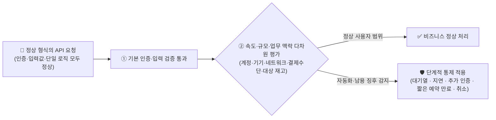
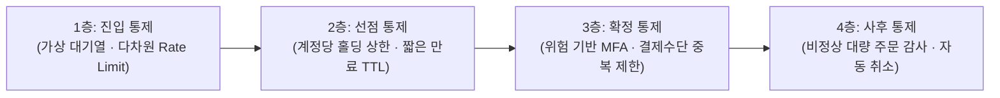

> [!summary] ⏱️ 5초 핵심 요약
> - **한 줄 비유**: 콘서트 매표소에서 1인 1매 규칙과 정가 결제(비즈니스 로직)가 완벽하게 지켜지더라도, **암표상이 고용한 로봇 손님 1,000명이 0.1초 만에 동시에 줄을 서서 표를 전부 사버리면 일반 관객은 단 한 장도 살 수 없는 현상**입니다.
> - **핵심 원리**: **OWASP API6:2023(Unrestricted Access to Sensitive Business Flows)**은 개별 요청의 문법·인증·로직이 모두 정상이더라도, **민감한 비즈니스 흐름이 자동화된 속도와 규모로 반복 호출될 때 발생하는 사업적 피해**를 다룹니다.
> - **대표 남용 흐름**: ① 한정 재고·티켓 선점(Scalping & Hoarding), ② 경쟁사 가격·카탈로그 대량 수집(Scraping), ③ 분산 크리덴셜 스터핑(Credential Stuffing), ④ 선착순 쿠폰·프로모션 예산 소진.
> - **핵심 방어**: 단순 단일 IP Rate Limit을 넘어 **계정·세션·기기·결제수단·대상 자원 단위의 다차원 제한 + 디바이스/행동 신호 + 대기열·짧은 예약 만료·사후 취소**를 흐름 전체에 겹쳐 적용합니다.

[[웹 취약점 진단 로직편 — 비즈니스 로직 결함 찾는 법]]이 가격·상태 전이·사용 횟수처럼 **설계 자체가 잘못된 결함**을 다뤘다면, 이 글은 설계와 개별 요청이 정상이어도 **속도와 규모로 남용되는 민감 비즈니스 흐름**을 다룹니다.

정상적으로 인증된 사용자가 정상 기능만 호출해도 자동화 규모가 커지면 티켓 선점, 가격 수집, 계정 탈취 시도 같은 사업 피해가 생긴다는 점에서 별개의 진단 축입니다.

---

## 한눈에 보는 로직 결함 vs 자원 고갈(API4) vs 플로우 남용(API6)

| 비교 구분 | 비즈니스 로직 결함 (로직편) | 자원 소비 제한 부재 (API4) | 비즈니스 플로우 남용 (API6 — 이 글) |
|---|---|---|---|
| **핵심 원인** | 상태 전이·가격 검증 등 **규칙 설계 자체가 깨짐** | **요청 1건이 유발하는 연산·과금 비용** 상한이 없음 | 개별 요청은 정상이나 **민감 흐름의 자동화 속도·규모 통제**가 없음 |
| **공격 형태** | 단 몇 번의 수작업 조작 요청 (예: 음수 수량, 단계 생략) | 무거운 단일/소수 요청 (예: `limit=100만`, 중첩 GraphQL) | 정상 요청의 대규모·고속·다계정 분산 자동화 반복 |
| **주요 피해** | 무결제 주문, 금액 변조, 쿠폰 무한 복제 | 서버 CPU/메모리 마비, 클라우드·SMS 과금 폭탄 | 한정 재고 독점(암표), 가격 정보 유출, 대량 계정 탈취 |
| **성공 지표** | 비인가 상태 전이 성립 여부 | 응답 지연·자원 피크·요청당 과금액 | **선점 후 미결제율, 쿠폰 소진 속도, 탈취 성공 건수** 등 사업 지표 |

---

## 1. 민감 비즈니스 플로우와 API6의 의미

**💡 한 줄 비유**: 매표소 직원이 한 사람씩 정상 절차로 표를 팔더라도 로봇 손님 1,000명이 동시에 줄을 서면 실제 관객은 표를 구하지 못하는 것처럼, **인증은 "누구인지"만 확인할 뿐 "이 속도와 규모가 정당한지"까지 보장하지 않습니다.**

### 핵심 원리
- **OWASP API6:2023의 정의**: 보안상 민감한 비즈니스 흐름(Sensitive Business Flows)에 자동화 남용을 막는 통제 없이 무제한 접근을 허용하는 상태입니다.
- **기술 부하가 아닌 '사업적 영향' 기준**: 서버 CPU가 10%만 쓰이고 HTTP `200 OK`가 정상 반환되더라도, **한정 재고 독점, 경쟁사 가격 정보 유출, 고객 계정 탈취, 프로모션 예산 조기 소진**처럼 매출·공정성·고객 신뢰가 무너지면 API6 취약점이 성립합니다.
- **진단 전 안전 통제**: 실제 운영 환경에서 무작정 대량 요청을 보내면 일반 고객의 재고가 잠기거나 서비스에 영향을 줄 수 있으므로, 진단 전 반드시 **허용 요청량, 테스트 전용 재고/계정, 중단 조건**을 제품 담당자와 합의해야 합니다.

### 체크 포인트
- 반복 호출될 때 재고·혜택·계정·시장 정보에 실제 사업 손실을 주는 흐름을 제품 담당자와 함께 목록화했는가?
- 인증 여부뿐 아니라 **계정·세션·기기·네트워크·결제수단 단위**의 반복 패턴을 관찰할 수 있는가?
- 진단 전에 허용 요청량, 테스트 계정, 중단 조건을 정해 실제 고객과 재고에 영향을 주지 않도록 통제했는가?
- 참고: [OWASP API6:2023 Unrestricted Access to Sensitive Business Flows](https://owasp.org/API-Security/editions/2023/en/0xa6-unrestricted-access-to-sensitive-business-flows/), [OWASP API Security Top 10 2023](https://owasp.org/API-Security/editions/2023/en/0x11-t10/)

---

## 2. 티켓·가격·로그인 흐름의 남용 패턴

**💡 한 줄 비유**: 식당에서 **예약만 걸어두고 안 나타나 좌석을 다 비워두는 노쇼 암표상(재고 홀딩)**, 메뉴판 사진을 매일 수만 장씩 찍어가는 **경쟁 식당 스파이(가격 스크래핑)**, 주운 열쇠 꾸러미를 모든 사물함에 하나씩 꽂아보는 **절도범(크리덴셜 스터핑)**은 각각 노리는 표적과 잡는 법이 다릅니다.

### 3대 대표 남용 흐름과 핵심 관측 지표

| 남용 패턴 | 공격자의 실제 목적 | 단순 모니터링이 놓치는 지점 | 반드시 봐야 할 핵심 사업 지표 |
|---|---|---|---|
| **1. 티켓·한정판 스캘핑 (Scalping / Hoarding)** | 좌석·재고 조회부터 **임시 선점(장바구니 홀딩)·결제**까지 빠르게 독점 | '결제 완료 건수'만 보면 **결제 전 임시 선점 단계에서 정상 재고가 전부 잠기는 현상(Inventory Hoarding)**을 놓침 | **선점 후 미결제(만료) 비율**, 인기 상품 오픈 직후 계정·결제수단별 선점 집중도 |
| **2. 가격·카탈로그 스크래핑 (Price Scraping)** | 공개 조회 API를 넓고 지속적으로 순회해 경쟁사 가격·재고 변동을 수집 | HTTP 에러(`4xx`/`5xx`)가 전혀 발생하지 않아 일반 장애 알람이 울리지 않음 | 세션·IP·API 키당 **전체 카탈로그 열람 커버리지(%)** 및 장기간 일정한 주기의 순차 조회 |
| **3. 크리덴셜 스터핑 (Credential Stuffing)** | 외부 유출 아이디·비밀번호 조합을 대량 대입해 재사용 계정 탈취 | 전체 로그인 실패율만 보면 **프록시로 분산된 저속(Low-and-Slow) 시도와 소수의 탈취 성공 계정**을 놓침 | 동일 기기/네트워크에서 **서로 다른 다수 계정 시도**, 평소와 다른 환경에서의 로그인 성공 직후 민감 정보 변경 |

### 오탐(False Positive) 방지의 중요성
정상 사용자와 자동화를 단일 신호로 구분하기는 어렵습니다. **시각장애인용 스크린 리더(접근성 도구), 대기업·학교 NAT 네트워크, 이동통신망 CGNAT, 브라우저 비밀번호 관리자**도 봇과 비슷한 요청 특성을 보일 수 있으므로, 진단 결과는 탐지율뿐 아니라 **정상 고객 차단 가능성(오탐률)**까지 함께 평가해야 합니다.

### 체크 포인트
- 재고 조회→예약→결제, 가격 검색→상세 조회, 로그인→계정 복구 등 **연속된 단계를 하나의 비즈니스 흐름**으로 연결해 관찰하는가?
- 티켓은 **선점 후 미결제 비율**, 가격은 **수집 범위와 지속성**, 로그인은 **계정당·자격증명당 실패와 성공**을 함께 측정하는가?
- 웹 화면의 제한이 모바일 앱 API나 구버전 엔드포인트에서도 동일하게 적용되는가?
- 참고: [OWASP API6:2023 Unrestricted Access to Sensitive Business Flows](https://owasp.org/API-Security/editions/2023/en/0xa6-unrestricted-access-to-sensitive-business-flows/), [OWASP Credential Stuffing Prevention Cheat Sheet](https://cheatsheetseries.owasp.org/cheatsheets/Credential_Stuffing_Prevention_Cheat_Sheet.html)

---

## 3. 단일 키 레이트리미팅의 한계

**💡 한 줄 비유**: "한 집(단일 IP)당 1개만 판매"라고 제한하면, **암표상은 동네 사람 100명 주소(프록시 IP)를 빌려 100개를 사 가고, 반대로 기숙사(공유 IP)에 사는 학생 100명은 합쳐서 1개밖에 못 사는 부작용**이 생깁니다.

### 핵심 원리
1. **단일 IP 기반 제한의 양면성**:
   - IP 주소 하나에 초당 요청 수만 제한하면 프록시 풀이나 다수 계정·세션으로 분산된 자동화는 그대로 통과합니다.
   - 반대로 회사·학교·통신사(CGNAT)처럼 하나의 공인 IP를 수백 명이 공유하는 환경에서는 정상 사용자를 집단 차단하는 장애를 만듭니다.
2. **다차원 식별 축(Multi-Dimensional Keys) 결합**:
   - `IP 주소` 단독이 아니라 **`계정 ID` + `세션/토큰` + `디바이스 식별자` + `결제수단/배송지` + `공격 대상 자원(특정 인기 상품 ID, 피공격 계정 ID)`**을 조합한 한도가 필요합니다.
3. **`429 Too Many Requests` 응답만 보고 안심하면 안 되는 이유**:
   - 제한이 민감한 처리 **직전에** 일관되게 걸리는지, 프록시·캐시·비동기 작업 큐 뒤에서도 같은 정책이 유지되는지, 그리고 **차단 시점에 이미 생성된 임시 예약이나 쿠폰 홀딩이 즉시 롤백되는지**까지 확인해야 합니다.

### 체크 포인트
- IP 외에 **계정·세션·기기·API 키·결제수단·대상 자원별 한도**가 함께 존재하는가?
- 고정 시간 창 경계(Fixed Window Boundary) 폭주, 장기 저속 누적(Low-and-Slow), 다계정 동시 집중에 대해 작은 승인 트래픽으로 정책을 검증했는가?
- `429` 제한 응답의 `Retry-After`, 오류 바디, 캐시 동작이 일관되고 내부 비즈니스 처리(재고 차감 등)도 실제로 중단되는가?
- 참고: [OWASP API6:2023 Unrestricted Access to Sensitive Business Flows](https://owasp.org/API-Security/editions/2023/en/0xa6-unrestricted-access-to-sensitive-business-flows/), [OWASP Denial of Service Cheat Sheet](https://cheatsheetseries.owasp.org/cheatsheets/Denial_of_Service_Cheat_Sheet.html)

---

## 4. 디바이스·행동 신호와 우회 내성

**💡 한 줄 비유**: 목소리 톤(헤더 1개)만 듣고 사람인지 로봇인지 판단하면 변조기 하나로 뚫리지만, **걸음걸이·시선 처리·이전 방문 기록·구매 맥락을 종합해 의심스러울 때만 신분증 재확인(Step-up 인증)을 요구하면** 로봇은 막고 단골손님은 불편하지 않게 할 수 있습니다.

### 핵심 원리
- **확률적 보조 통제로서의 핑거프린팅**: 디바이스 핑거프린팅과 행동 분석은 브라우저 특성, 세션 연속성, 입력·탐색 패턴 같은 여러 신호를 합쳐 자동화 가능성을 추정하는 확률적 통제입니다. 특정 커스텀 헤더 하나나 JS 변수 하나에 의존하면 쉽게 위조되고 정상 사용자 오탐도 커집니다.
- **안전한 우회 내성(Resilience) 진단 방법**:
  - 진단의 목적은 실제 공격 봇을 개발하는 것이 아닙니다.
  - 통제된 테스트 계정에서 **브라우저↔앱 경로 전환, 쿠키 초기화, 네트워크(Wi-Fi↔LTE) 전환**처럼 정상 환경에서도 생길 수 있는 변화에 위험 점수가 어떻게 반응하는지 확인하고, **클라이언트 신호 하나가 빠져도 서버 측 업무 맥락(계정 이력, 예약 빈도) 통제가 살아 있는지** 검증합니다.
- **위험 기반 단계적 도전(Risk-Based Challenge)과 프라이버시**:
  - 모든 사용자에게 매번 복잡한 CAPTCHA 퍼즐을 요구하면 접근성과 구매 전환율을 크게 해칩니다. 위험 점수가 높을 때만 단계적으로 도전 과제·추가 인증(MFA)을 요구해야 하며, 수집하는 기기·행동 신호의 **개인정보 수집 범위와 보관 기간**도 함께 검토해야 합니다.

### 체크 포인트
- 단일 헤더·쿠키·브라우저 특성이 아니라 **여러 독립 신호와 서버 측 업무 맥락**을 결합하는가?
- 정상적인 환경 변화(네트워크 전환 등)에서 위험 점수가 쉽게 초기화되거나 반대로 정상 사용자(접근성 도구 사용자 포함)에게 과도한 차단이 발생하지 않는가?
- 위험 기반 도전(CAPTCHA), 추가 인증(MFA), 수동 검토의 단계가 나뉘어 있고 수집 신호의 보관·접근 정책이 정의돼 있는가?
- 참고: [OWASP Credential Stuffing Prevention Cheat Sheet](https://cheatsheetseries.owasp.org/cheatsheets/Credential_Stuffing_Prevention_Cheat_Sheet.html), [OWASP Multifactor Authentication Cheat Sheet](https://cheatsheetseries.owasp.org/cheatsheets/Multifactor_Authentication_Cheat_Sheet.html)

---

## 5. 방어 효과를 사업 결과로 검증하기

**💡 한 줄 비유**: 성문 앞에서 화살 10,000발을 막아냈다고(`429 차단 건수`) 자랑하더라도, **성안의 식량 창고(실제 한정판 재고)가 이미 적군 손에 다 넘어갔다면 전투에서는 진 것**입니다.

### 핵심 원리
봇 방어의 성패는 "요청을 몇 건 차단했는가"가 아니라 **"보호하려던 민감한 사업 결과를 실제로 지켰는가"**로 측정해야 합니다.
- **기술 지표와 사업 지표의 결합**:
  - **기술 지표**: 계정·기기별 요청률, 도전 과제(CAPTCHA/MFA) 통과율, `429` 응답 비율
  - **사업 지표**: **선점 후 미결제율, 한정 쿠폰 소진 속도, 비정상 로그인 성공 후 정보 변경 건수, 가격 카탈로그 열람 범위**
- **정상 트래픽 급증 기준선(Baseline) 반영**: 티켓 오픈일, 신제품 출시, 대형 마케팅 캠페인처럼 정상 사용자가 몰리는 시기의 트래픽 분포를 기준선에 포함해야 행사 당일 정상 고객이 대량 차단되는 사고를 막을 수 있습니다.
- **가역적 조치와 오탐 구제 절차**: 영구 계정 정지보다 **지연(Tarpit), 가상 대기열(Waiting Room), 짧은 예약 만료 시간, 추가 본인인증, 사후 주문 검토**처럼 재평가 가능한 조치를 우선 적용하고, 정상 고객이 오탐으로 묶였을 때 즉시 해제할 수 있는 운영 절차를 마련해야 합니다.

### 체크 포인트
- 단순 차단 건수뿐 아니라 **재고·혜택·계정 보호라는 최종 사업 성과 지표**와의 상관관계를 확인하는가?
- 행사·출시·장애 시기의 정상 트래픽 급증을 기준선에 포함하고 탐지 임계값 변경 이력을 기록하는가?
- 오탐 이의 제기, 긴급 차단 해제, 탐지 규칙 즉시 롤백, 개인정보 최소화 절차가 운영 문서에 준비되어 있는가?
- 참고: [OWASP API6:2023 Unrestricted Access to Sensitive Business Flows](https://owasp.org/API-Security/editions/2023/en/0xa6-unrestricted-access-to-sensitive-business-flows/), [OWASP Logging Cheat Sheet](https://cheatsheetseries.owasp.org/cheatsheets/Logging_Cheat_Sheet.html)

---

## 6. 흐름 단위의 다층 방어

**💡 한 줄 비유**: 정문(웹 API)에만 최첨단 검색대를 설치하고 **쪽문(모바일 전용 API·구버전 v1 API·간편결제 직행 경로)은 열어두면 모든 로봇이 쪽문으로 몰려들기 때문에**, 같은 결과로 가는 모든 길목에 겹겹이 장벽을 세워야 합니다.

### 핵심 원리
1. **엔드포인트가 아닌 '흐름 전체(End-to-End Flow)' 일관성**:
   - 웹과 모바일 앱, 현행 v2와 레거시 v1 API, 일반 결제와 간편 결제처럼 **같은 사업 결과에 도달하는 경로가 여러 개라면 가장 약한 경로가 전체 방어 수준을 결정**합니다.
2. **상호 독립적인 다층 통제(Defense in Depth)**:
   - 하나의 봇 탐지 솔루션이나 CAPTCHA만으로는 모든 자동화를 막을 수 없습니다.
   - `가상 대기열(Waiting Room)` → `다차원 요청률 제한` → `1인당 재고 선점 수량 상한 및 짧은 홀딩 만료 시간` → `고위험 시 추가 본인인증` → `결제 후 이상 주문 사후 취소`를 겹쳐, 앞단 통제가 우회되더라도 뒷단 통제가 피해 규모를 제한하도록 설계합니다.

### 체크 포인트
- 동일한 사업 결과에 도달하는 **웹·모바일 앱·API 버전별 모든 경로**에 빠짐없이 같은 수준의 정책이 적용되는가?
- 속도 제한, 대기열, 예약 만료, 추가 인증, 사후 탐지가 서로 독립적으로 작동해 한 계층이 뚫려도 피해 규모를 줄이는가?
- 방어 정책 변경 시 **탐지율·오탐률·실제 정상 구매 성공률**을 함께 비교하고 문제 발생 시 즉시 롤백 가능한가?
- 참고: [OWASP API6:2023 Unrestricted Access to Sensitive Business Flows](https://owasp.org/API-Security/editions/2023/en/0xa6-unrestricted-access-to-sensitive-business-flows/), [OWASP API Security Top 10 2023](https://owasp.org/API-Security/editions/2023/en/0x11-t10/)

---

## 정리

API6의 핵심은 **정상 설계된 흐름도 대량 자동화되면 취약한 사업 경계가 된다**는 점입니다. 가격·상태 전이·사용 횟수처럼 개별 요청의 규칙 자체가 잘못된 경우는 [[웹 취약점 진단 로직편 — 비즈니스 로직 결함 찾는 법]]을 참고하고, 이 글에서는 속도·규모·탐지·오탐을 하나의 운영 문제로 함께 검증해야 합니다.
