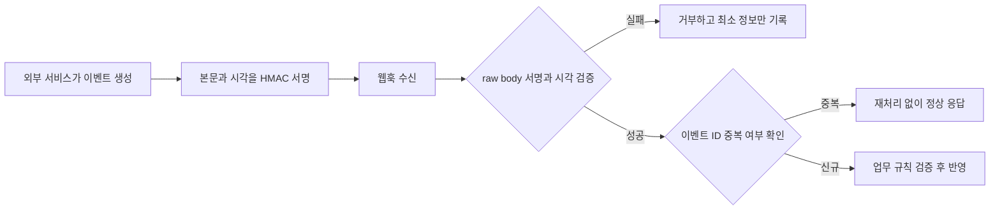

[[웹 취약점 진단 SSO편 — OAuth·OIDC 플로우 공격]]은 브라우저를 경유해 인증을 위임하는 OAuth·OIDC 리다이렉트 플로우를 다뤘지만, 이 글은 **서버와 서버 사이의 신뢰 관계**, 특히 외부 서비스가 우리 서버로 먼저 요청을 보내는 웹훅의 진위 검증에 집중한다. 외부 API 응답을 무검증으로 소비하는 문제는 API10:2023, 콜백·웹훅 URL로 내부 요청을 유도하는 문제는 API7:2023 SSRF라는 서로 다른 축으로 구분한다.

---

## 1. 서버 간 신뢰와 호출 방향 이해하기

서버 간 신뢰 관계는 거래처끼리 정해 둔 전용 우편 절차와 비슷하다. 일반 API 호출은 우리가 상대 서버에 편지를 보내 답장을 받는 방향이고, 웹훅은 상대가 사건 발생을 알리려고 우리 서버에 먼저 편지를 보내는 반대 방향이다. 이때 HMAC 서명은 편지 봉투의 인감도장처럼, 내용이 약속한 발신자가 만든 것이며 중간에 바뀌지 않았는지 확인하는 수단이다. 다만 도장이 맞아도 오래된 편지를 다시 낸 것인지까지 자동으로 판별해 주지는 않는다.

**원리**: 일반 API 소비에서는 우리 서버가 선택한 외부 응답을 신뢰 경계 안으로 들여오므로 응답 데이터의 형식·크기·의미를 검증해야 한다. 웹훅 수신에서는 인터넷의 임의 요청이 먼저 들어오므로 서명, 시간, 이벤트 식별자를 검증한 뒤에만 주문 완료나 권한 변경 같은 내부 상태에 반영해야 한다.

두 방향을 섞어 보면 방어 지점도 흐려진다. 외부 응답의 검증 누락은 **API10:2023 Unsafe Consumption of APIs**, 서버가 사용자 지정 URL을 대신 호출하는 문제는 **API7:2023 SSRF**다. 웹훅 위조는 수신 요청의 진위를 확인하는 문제이며, URL 기반 SSRF와도 별개다.

- 체크 포인트:
  - 연동별 호출 방향, 신뢰 경계, 내부 상태 변경 지점을 데이터 흐름도로 표시하는지
  - API10 응답 검증, 웹훅 발신자 검증, API7 URL 검증을 서로 다른 통제로 관리하는지
- 참고: [OWASP API Security Top 10 2023 — API10 Unsafe Consumption of APIs](https://owasp.org/API-Security/editions/2023/en/0xaa-unsafe-consumption-of-apis/), [OWASP API Security Top 10 2023 — API7 Server Side Request Forgery](https://owasp.org/API-Security/editions/2023/en/0xa7-server-side-request-forgery/)

## 2. 외부 API 응답의 안전하지 않은 소비(API10)

**원리**: 외부 API가 유명 벤더의 HTTPS 엔드포인트라는 사실은 응답 내용까지 안전하다는 뜻이 아니다. 공급자 침해, 잘못된 테넌트 설정, 중간 프록시의 오류, 스키마 변경으로 예상하지 못한 값이 들어올 수 있으므로 외부 응답도 사용자 입력과 같은 신뢰 수준에서 다뤄야 한다.

응답의 `Content-Type`, 상태 코드, 전체 크기, 필수 필드와 타입, 문자열 길이와 허용값을 확인하고, 내부 템플릿·SQL·파일 경로에 전달할 때는 해당 사용처의 안전한 API를 적용해야 한다. 다만 입력 스키마 검증만으로 후속 시스템의 권한 문제가 해결되지는 않는다. 외부 응답이 지시하는 사용자 ID나 할인율을 내부 권한 판단 없이 그대로 반영하면 형식이 올바른 값으로도 문제가 생긴다.

연결·읽기 시간 제한, 최대 리다이렉트 횟수, 응답 본문 상한도 보안 경계다. 한 번의 연동 요청이 대용량 응답이나 끝나지 않는 연결 때문에 워커를 점유하지 않도록 실패 시 닫힌 방향으로 처리하되, 결제 알림처럼 재시도가 필요한 흐름은 중복 처리 방지와 함께 설계해야 한다.

- 체크 포인트:
  - 외부 응답의 상태 코드·미디어 타입·스키마·크기·업무 허용값을 모두 검증하는지
  - 응답 필드를 HTML, 쿼리, 파일 경로 등에 사용할 때 용도별 안전한 처리를 거치는지
  - 타임아웃, 리다이렉트 상한, 실패 처리와 재시도 정책이 명시돼 있는지
- 참고: [OWASP API Security Top 10 2023 — API10 Unsafe Consumption of APIs](https://owasp.org/API-Security/editions/2023/en/0xaa-unsafe-consumption-of-apis/), [OWASP — Input Validation Cheat Sheet](https://cheatsheetseries.owasp.org/cheatsheets/Input_Validation_Cheat_Sheet.html)

## 3. 웹훅 HMAC 서명 검증

**원리**: HMAC은 발신자와 수신자만 아는 비밀키와 메시지 바이트로 인증값을 계산한다. 수신 서버는 벤더가 지정한 알고리즘과 정규화 규칙을 그대로 따라 다시 계산하고, 헤더의 서명과 상수 시간 비교를 해야 한다. JSON을 파싱했다가 다시 직렬화하면 공백·키 순서·인코딩이 바뀔 수 있으므로, 벤더 명세가 원문 본문을 서명 대상으로 삼는다면 **파싱 전 raw body**를 검증해야 한다.

서명이 맞기 전에 이벤트의 주문번호나 상태를 신뢰해서는 안 된다. 또한 개발·운영 키를 분리하고 키 식별자와 회전 기간을 관리해야 한다. 비밀키가 로그, 오류 응답, 클라이언트 번들에 노출되면 HMAC 알고리즘이 강해도 위조 방지는 성립하지 않는다.

- 체크 포인트:
  - 서명 계산이 벤더 명세의 raw body·시간·알고리즘을 정확히 따르는지
  - 서명을 상수 시간으로 비교하고 검증 전에는 본문 값을 사용하지 않는지
  - 웹훅 비밀키의 환경 분리·회전·로그 마스킹이 적용되는지
- 참고: [RFC 2104 — HMAC](https://www.rfc-editor.org/rfc/rfc2104), [CWE-345 — Insufficient Verification of Data Authenticity](https://cwe.mitre.org/data/definitions/345.html), [OWASP — Web Service Security Cheat Sheet](https://cheatsheetseries.owasp.org/cheatsheets/Web_Service_Security_Cheat_Sheet.html)

## 4. 재전송과 상태 전이 검증

**원리**: 올바른 HMAC은 요청의 출처와 무결성을 증명하지만 신선도는 증명하지 않는다. 과거에 정상 발급된 결제 완료 이벤트를 다시 보내도 서명 자체는 여전히 맞을 수 있으므로, 허용 시간 창의 타임스탬프와 고유 이벤트 ID를 함께 확인해야 한다.

이벤트 ID는 원자적으로 기록하고 이미 처리된 값이면 업무 동작을 반복하지 않는 멱등 처리가 필요하다. 다만 이벤트 ID만 다르면 같은 주문에 대한 모순된 상태 전이가 들어올 수 있으므로, `대기 → 결제 완료`처럼 서버가 허용한 상태 전이인지와 해당 주문·금액·테넌트가 실제 내부 기록과 일치하는지도 확인해야 한다.

시간 창은 서버 시계가 동기화돼 있다는 전제에서만 의미가 있다. 지나치게 좁은 창은 정상 지연을 실패시키고, 지나치게 넓은 창은 재전송 기회를 키우므로 벤더의 재시도 정책과 운영 지연을 기준으로 정한다.

- 체크 포인트:
  - 서명된 타임스탬프의 허용 오차와 서버 시간 동기화가 관리되는지
  - 이벤트 ID가 원자적으로 중복 확인·기록되고 재시도 응답이 멱등한지
  - 객체, 금액, 테넌트, 허용 상태 전이를 내부 원장과 대조하는지
- 참고: [OWASP — REST Security Cheat Sheet](https://cheatsheetseries.owasp.org/cheatsheets/REST_Security_Cheat_Sheet.html), [CWE-294 — Authentication Bypass by Capture-replay](https://cwe.mitre.org/data/definitions/294.html)

## 5. 콜백 URL을 통한 SSRF(API7)

**원리**: 사용자가 알림 받을 콜백 URL을 등록하고 서버가 그 주소로 요청을 보내는 기능은, 외부 입력으로 서버의 네트워크 목적지를 고르는 구조다. 목적지 검증이 없으면 서버가 접근 가능한 내부 관리 서비스, 클라우드 메타데이터, 루프백 주소로 요청을 보내게 할 수 있으며 이는 **API7:2023 SSRF**다. 외부 응답을 잘못 신뢰하는 API10으로 분류하면 안 된다.

가능하면 사전 등록된 HTTPS 목적지의 정확한 allowlist를 사용한다. 임의 URL이 꼭 필요하다면 스킴, 포트, 호스트를 파싱해 로컬·사설·링크 로컬 주소를 차단하고 DNS 해석 결과와 실제 연결 대상이 일치하는지 확인해야 한다. 최초 URL만 검사하고 리다이렉트를 자동 추적하면 다음 위치에서 내부 주소로 바뀔 수 있으므로 매 홉을 다시 검증하거나 리다이렉트를 끈다.

도메인 문자열 검사만으로는 DNS 재바인딩과 IPv6·혼합 표기 변형을 충분히 다루기 어렵다. 애플리케이션 검증과 함께 전용 송신 프록시, 네트워크 egress 정책, 메타데이터 서비스 보호를 겹쳐야 한다.

- 체크 포인트:
  - 콜백 목적지가 사전 등록 allowlist인지, 임의 URL이면 스킴·포트·해석 IP를 검증하는지
  - 리다이렉트의 매 홉과 실제 연결 IP를 다시 검사하는지
  - 송신 네트워크가 내부 대역·메타데이터 엔드포인트 접근을 별도로 차단하는지
- 참고: [OWASP API Security Top 10 2023 — API7 Server Side Request Forgery](https://owasp.org/API-Security/editions/2023/en/0xa7-server-side-request-forgery/), [OWASP — Server Side Request Forgery Prevention Cheat Sheet](https://cheatsheetseries.owasp.org/cheatsheets/Server_Side_Request_Forgery_Prevention_Cheat_Sheet.html)

## 6. 실패를 보이게 만드는 관측과 테스트

**원리**: 연동 보안은 정상 응답만 확인하는 기능 테스트로는 드러나지 않는다. 서명 누락·변조·만료, 중복 이벤트, 예상 밖 필드와 과대 응답, 차단 대상 URL을 각각 안전한 테스트 환경에서 넣어 보고, 거부가 내부 상태 변경보다 먼저 일어나는지 확인해야 한다.

로그에는 연동 이름, 이벤트 ID, 검증 단계, 결과, 지연 시간을 남기되 비밀키·전체 서명·민감 본문은 기록하지 않는다. 서명 실패나 내부 대역 URL 시도가 급증하면 경보하되, 재시도로 발생한 정상 중복과 공격성 반복을 구분할 수 있어야 한다.

- 체크 포인트:
  - 부정 테스트가 배포 파이프라인이나 정기 진단에 포함되는지
  - 거부된 요청에서도 내부 상태가 부분적으로 바뀌지 않는지
  - 비밀을 남기지 않는 구조화 로그와 실패율·중복률 경보가 있는지
- 참고: [OWASP — Logging Cheat Sheet](https://cheatsheetseries.owasp.org/cheatsheets/Logging_Cheat_Sheet.html), [OWASP API Security Top 10 2023](https://owasp.org/API-Security/editions/2023/en/0x11-t10/)

---

## 정리

| 진단 축 | 핵심 질문 | 대표 통제 |
| --- | --- | --- |
| API10 외부 응답 | 받은 값의 형식과 의미를 내부 데이터처럼 믿는가 | 스키마·크기·업무값 검증, 타임아웃 |
| 웹훅 진위 | 요청이 약속한 발신자의 최신 이벤트인가 | raw body HMAC, 타임스탬프, 키 관리 |
| 재전송 | 같은 사건이 여러 번 상태를 바꾸는가 | 이벤트 ID 멱등성, 상태 전이 검증 |
| API7 SSRF | 사용자가 서버의 요청 목적지를 고를 수 있는가 | 목적지 allowlist, 매 홉 검증, egress 차단 |
| 관측 | 거부와 이상 반복을 비밀 노출 없이 볼 수 있는가 | 구조화 로그, 실패율·중복률 경보 |

브라우저를 경유하는 인증 위임의 신뢰 경계는 [[웹 취약점 진단 SSO편 — OAuth·OIDC 플로우 공격]]을 참고하고, 입력점과 내부 요청 유도의 더 넓은 기초는 [[웹 취약점 진단 기법 입문 — XXE, SSRF부터 SQLi, XSS까지]]을 함께 참고하면 된다.
