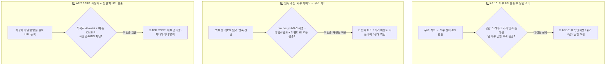
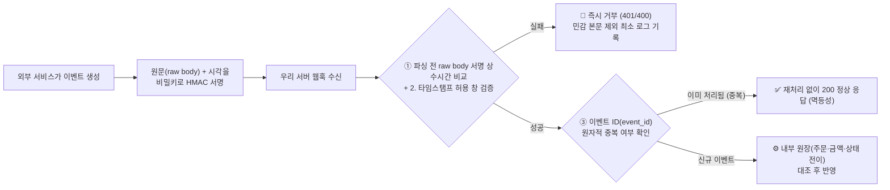

> [!summary] ⏱️ 5초 핵심 요약
> - **한 줄 비유**: 외부 거래처와 서류를 주고받을 때, **① 거래처가 보낸 답장 내용물을 무작정 믿거나(API10), ② 거래처 인감도장·발송 시각도 안 보고 입금 완료 처리하거나(웹훅 위조·재전송), ③ 손님이 적어준 가짜 거래처 주소로 우리 직원을 심부름 보내 사내 기밀실 문을 열게 하는(API7 SSRF) 세 가지 방향의 사고**입니다.
> - **핵심 원리**: 서버 간 연동 보안은 **호출 방향과 신뢰 주체**에 따라 ① 외부 API 응답의 안전하지 않은 소비(**OWASP API10:2023**), ② 수신 웹훅의 진위·신선도·멱등성 검증 실패, ③ 사용자 지정 콜백 URL을 통한 서버 측 요청 위조(**OWASP API7:2023 SSRF**)의 세 축으로 명확히 분리해 진단해야 합니다.
> - **핵심 공격 표면**: 파싱 후 재직렬화로 깨진 HMAC 검증 또는 서명 누락, 타임스탬프·이벤트 ID 미검증으로 인한 결제 완료 웹훅 리플레이, 콜백 URL 등록 및 리다이렉트 추적을 통한 내부망·IMDS 접근.
> - **핵심 방어**: 외부 API 응답 스키마·크기·타임아웃 강제, 웹훅 **파싱 전 `raw body` 상수 시간 HMAC 검증 + 타임스탬프 허용 창 + 이벤트 ID 원자적 멱등 처리**, 콜백 목적지 Allowlist 및 매 홉(Hop) IP 재검증.

[[웹 취약점 진단 SSO편 — OAuth·OIDC 플로우 공격]]은 브라우저를 경유해 인증을 위임하는 OAuth·OIDC 리다이렉트 플로우를 다뤘지만, 이 글은 **서버와 서버 사이의 신뢰 관계**, 특히 외부 서비스가 우리 서버로 먼저 요청을 보내는 웹훅의 진위 검증에 집중합니다.

외부 API 응답을 무검증으로 소비하는 문제는 **API10:2023**, 콜백·웹훅 URL로 내부 요청을 유도하는 문제는 **API7:2023 SSRF**라는 서로 다른 축으로 구분합니다.



---

## 한눈에 보는 서드파티 연동·웹훅 3대 위협 축 비교

| 구분 축 | 호출 방향 및 트리거 | 핵심 취약점 원리 | OWASP 분류 | 핵심 방어 통제 |
|---|---|---|---|---|
| **1. 외부 API 응답 무검증 소비** | 우리 서버 → 외부 API 호출 → **외부 응답 수신** | 유명 벤더(HTTPS)라는 이유로 응답 크기·스키마·특수문자·업무 맥락을 검증 없이 내부 DB/화면/권한에 반영 | **API10:2023** (Unsafe Consumption of APIs) | 응답 스키마·크기·타임아웃·리다이렉트 상한 + 사용처별 인코딩/파라미터 바인딩 |
| **2. 웹훅 위조 및 재전송(Replay)** | 외부 서버(또는 공격자) → **우리 웹훅 수신 엔드포인트** | 서명(HMAC) 미검증으로 가짜 결제완료 이벤트를 수락하거나, 과거 정상 이벤트를 재전송해 중복 적립/상태 역전 유발 | **CWE-345 / CWE-294** (인증·무결성·재전송) | **파싱 전 `raw body` HMAC 상수 시간 비교** + 타임스탬프 허용 창 + `event_id` 멱등성 + 원장 대조 |
| **3. 콜백/웹훅 URL SSRF** | 사용자 URL 등록 → **우리 서버가 해당 URL로 요청 발송** | 사용자가 등록한 웹훅 테스트/알림 URL을 통해 내부 루프백·사설망·클라우드 IMDS로 요청 유도 | **API7:2023** (Server Side Request Forgery) | 사전 등록 도메인 Allowlist + 리다이렉트 비활성화(또는 매 홉 해석 IP 검증) + Egress 방화벽 |

---

## 1. 서버 간 신뢰와 호출 방향 이해하기

**💡 한 줄 비유**: 일반 API 호출은 **우리가 거래처에 편지를 보내 답장을 받아 읽는 것**이고, 웹훅은 **거래처가 먼저 우리에게 등기우편을 보내는 것**이며, 콜백 등록은 **손님이 적어준 주소로 우리 직원을 직접 보내는 것**이라 세 가지 모두 확인해야 할 안전 수칙이 다릅니다.

### 핵심 원리
- **외부 API 소비 (Outbound Request → Inbound Response)**: 우리 서버가 선택한 외부 응답을 신뢰 경계 안으로 들여오므로 **응답 데이터의 형식·크기·의미**를 검증해야 합니다.
- **웹훅 수신 (Inbound Request)**: 인터넷을 통해 임의의 요청이 먼저 들어오므로 **HMAC 서명(인감도장), 타임스탬프(발송 시각), 이벤트 식별자(일련번호)**를 모두 검증한 뒤에만 주문 완료나 권한 변경 같은 내부 상태에 반영해야 합니다.
- **콜백 발신 (User-Supplied Outbound URL)**: 사용자가 입력한 주소로 우리 서버가 대신 요청을 보내므로 **목적지 네트워크 경계(SSRF)**를 통제해야 합니다.
- **분류 혼동 주의**: 두 방향을 섞어 보면 방어 지점도 흐려집니다. 외부 응답 검증 누락은 **API10:2023**, 서버가 사용자 지정 URL을 대신 호출하는 문제는 **API7:2023 SSRF**, 웹훅 위조는 수신 요청의 진위·신선도 검증 문제로 각각 다른 통제가 필요합니다.

### 체크 포인트
- 연동별 **호출 방향, 신뢰 경계, 내부 상태 변경 지점**을 데이터 흐름도로 명확히 표시하고 있는가?
- API10(외부 응답 검증), 웹훅 발신자·재전송 검증, API7(콜백 URL 검증)을 서로 다른 보안 통제로 분리해 관리하는가?
- 참고: [OWASP API Security Top 10 2023 — API10 Unsafe Consumption of APIs](https://owasp.org/API-Security/editions/2023/en/0xaa-unsafe-consumption-of-apis/), [OWASP API Security Top 10 2023 — API7 Server Side Request Forgery](https://owasp.org/API-Security/editions/2023/en/0xa7-server-side-request-forgery/)

---

## 2. 외부 API 응답의 안전하지 않은 소비 (API10)

**💡 한 줄 비유**: 유명 대기업 거래처에서 온 택배 상자(HTTPS 응답)라고 해서 **안 내용물을 X-레이 검사도 안 하고 공장 조립 라인에 그대로 부어버리면, 거래처 실수나 배송 사고로 섞여 들어온 불량 부품 때문에 우리 공장 기계 전체가 멈추는 것**과 같습니다.

### 핵심 원리
외부 API가 유명 벤더의 HTTPS 엔드포인트라는 사실은 전송 구간이 암호화되었다는 뜻일 뿐, **응답 내용물까지 항상 안전하고 정당하다는 뜻이 아닙니다.** 공급자 침해, 잘못된 테넌트 설정, 중간 프록시 오류, 예고 없는 스키마 변경으로 예상치 못한 값이 들어올 수 있으므로 외부 응답도 사용자 입력과 같은 신뢰 수준에서 다뤄야 합니다.

### 3대 필수 통제 영역
1. **스키마·타입·업무 맥락 검증**:
   - 응답의 `Content-Type`, HTTP 상태 코드, 전체 바이트 크기, 필수 필드와 자료형, 문자열 길이와 허용값을 먼저 확인합니다.
   - 내부 템플릿(HTML)·SQL·파일 경로·OS 명령에 전달할 때는 해당 싱크의 안전한 API(파라미터화 쿼리, 출력 인코딩 등)를 그대로 적용합니다.
   - **권한 맥락 재검증**: 스키마가 올바르더라도 외부 응답이 지시하는 `user_id`나 `discount_rate`를 내부 권한·한도 판단 없이 그대로 반영하면 비즈니스 로직이 깨집니다.
2. **가용성 경계 (타임아웃·크기·리다이렉트 상한)**:
   - 연결·읽기 타임아웃(Timeout), 최대 리다이렉트 횟수, 응답 본문 최대 바이트 상한을 반드시 설정해, 외부 연동 지연이나 거대 응답 하나가 우리 서버 워커 스레드를 전부 점유하지 못하게 막습니다.
3. **실패 시 닫힌 처리(Fail-Closed)와 멱등 재시도**:
   - 검증 실패 시 기본적으로 거부(Fail-Closed)하되, 결제 알림처럼 재시도가 필요한 흐름은 중복 처리 방지와 함께 설계합니다.

### 체크 포인트
- 외부 API 응답의 **상태 코드·미디어 타입(`Content-Type`)·스키마·본문 크기·업무 허용값**을 모두 검증하는가?
- 외부 응답 필드를 HTML 렌더링, DB 쿼리, 파일 경로 등에 사용할 때 용도별 살균·파라미터 바인딩을 거치는가?
- 연결/읽기 타임아웃, 최대 리다이렉트 횟수, 실패 처리 및 재시도 정책이 명시돼 있는가?
- 참고: [OWASP API Security Top 10 2023 — API10 Unsafe Consumption of APIs](https://owasp.org/API-Security/editions/2023/en/0xaa-unsafe-consumption-of-apis/), [OWASP — Input Validation Cheat Sheet](https://cheatsheetseries.owasp.org/cheatsheets/Input_Validation_Cheat_Sheet.html)

---

## 3. 웹훅 HMAC 서명 검증

**💡 한 줄 비유**: 봉투에 찍힌 인감도장(HMAC 서명)을 확인할 때는 **편지봉투 원본 그대로(`raw body`) 대조해야지, 비서가 내용을 워드로 다시 타이핑해 정리한 종이(JSON 파싱 후 재직렬화)에 도장을 대보면 글자 간격이 달라져 진위 판별이 깨지거나 허점이 생깁니다.**

### 핵심 원리
HMAC은 발신자와 수신자만 아는 비밀키(Webhook Secret)와 메시지 원문 바이트로 인증 해시값을 계산합니다.



### 구현 및 진단 시 핵심 포인트
- **반드시 파싱 전 `raw body`로 계산**: 프레임워크가 JSON을 객체로 파싱했다가 다시 `JSON.stringify()`로 직렬화하면 공백·키 순서·유니코드 이스케이프가 바뀔 수 있습니다. 벤더 명세가 원문 바이트를 서명 대상으로 삼는다면 반드시 **파싱 전 `raw body` 바이트 배열**을 그대로 사용해 HMAC을 계산해야 합니다.
- **상수 시간 비교(Constant-Time Comparison)**: 일반 문자열 비교(`===`, `==`) 대신 `crypto.timingSafeEqual`이나 `hmac.compare_digest`를 사용해 타이밍 부채널 공격을 예방하고, **서명 검증이 통과하기 전에는 본문 안의 주문번호나 상태값을 절대 신뢰하거나 읽어서 처리하지 않습니다.**
- **비밀키 수명주기 관리**: 개발·스테이징·운영 환경의 웹훅 비밀키를 철저히 분리하고, 키 식별자(`kid`)와 회전(Rotation) 기간을 두며, 로그·에러 응답·클라이언트 번들에 비밀키가 절대 노출되지 않게 관리합니다.

```python
# ✅ 안전한 웹훅 HMAC 검증 예시 (Python)
import hmac, hashlib, time

def verify_webhook(raw_body: bytes, timestamp_header: str, signature_header: str, secret: bytes) -> bool:
    # 1. 타임스탬프 신선도 검증 (예: 5분 = 300초 허용 창)
    now = int(time.time())
    if abs(now - int(timestamp_header)) > 300:
        return False
    # 2. 파싱 전 raw_body와 타임스탬프를 결합해 HMAC-SHA256 계산
    signed_payload = timestamp_header.encode("utf-8") + b"." + raw_body
    expected_sig = hmac.new(secret, signed_payload, hashlib.sha256).hexdigest()
    # 3. 상수 시간 비교 (Constant-Time Comparison)
    return hmac.compare_digest(expected_sig, signature_header)
```

### 체크 포인트
- 서명 계산이 벤더 명세의 **파싱 전 `raw body`·타임스탬프 결합 규칙·해시 알고리즘**을 정확히 따르는가?
- 서명을 **상수 시간 함수**로 비교하며, 검증 통과 전에는 본문 내부 값을 비즈니스 로직에 사용하지 않는가?
- 웹훅 비밀키의 환경별 분리, 주기적 회전, 로그 마스킹이 적용되어 있는가?
- 참고: [RFC 2104 — HMAC](https://www.rfc-editor.org/rfc/rfc2104), [CWE-345 — Insufficient Verification of Data Authenticity](https://cwe.mitre.org/data/definitions/345.html), [OWASP — Web Service Security Cheat Sheet](https://cheatsheetseries.owasp.org/cheatsheets/Web_Service_Security_Cheat_Sheet.html)

---

## 4. 재전송(Replay)과 상태 전이 검증

**💡 한 줄 비유**: 은행 수표의 **인감도장(HMAC)이 진짜더라도, 어제 이미 현금으로 바꿔 간 수표를 복사해 오늘 또 내밀거나(재전송), 10,000원짜리 주문에 100원 결제 수표를 내미는 것(원장 불일치)**까지 도장 하나만 보고 통과시켜선 안 됩니다.

### 핵심 원리
올바른 HMAC 서명은 요청의 **출처(Authenticity)와 무결성(Integrity)**은 증명하지만, **신선도(Freshness)와 단 한 번만 처리됨(Idempotency)**은 자동으로 증명하지 않습니다.
1. **타임스탬프 허용 창과 NTP 동기화**:
   - 과거에 정상 발급된 결제 완료 웹훅 패킷을 그대로 다시 보내도(Replay) 서명 자체는 맞을 수 있으므로, 서명 대상에 포함된 타임스탬프가 허용 시간 창(예: ±5분) 안에 있는지 확인해야 합니다.
   - 이때 서버 시계가 NTP로 정확히 동기화돼 있어야 하며, 벤더의 재시도 정책과 운영 지연을 고려해 창 크기를 정합니다.
2. **고유 이벤트 ID(`event_id`) 기반 원자적 멱등 처리**:
   - 허용 시간 창 안에서도 네트워크 재시도나 공격자 리플레이로 같은 이벤트가 여러 번 들어올 수 있습니다.
   - `event_id`를 DB 유니크 제약조건이나 원자적 연산으로 기록하고, 이미 처리된 ID면 포인트 적립·상품 지급을 반복하지 않고 조용히 정상 응답을 반환해야 합니다.
3. **내부 원장 및 상태 전이(State Transition) 대조**:
   - `event_id`만 다른 새로운 이벤트가 들어오더라도, **`대기 → 결제완료`처럼 허용된 단방향 상태 전이인지**(이미 `취소됨`/`환불됨`인 주문이 다시 `결제완료`로 바뀌지 않는지), 그리고 웹훅에 적힌 **주문 ID·결제 금액·통화·테넌트**가 우리 DB 원장 기록과 정확히 일치하는지 대조해야 합니다.

### 체크 포인트
- 서명에 포함된 타임스탬프의 허용 오차 검증과 서버 NTP 시간 동기화가 관리되는가?
- 고유 `event_id`가 원자적으로 중복 확인·기록되며 재시도 수신 시 부작용 없이 멱등하게 응답하는가?
- 웹훅이 가리키는 **주문 객체, 결제 금액, 테넌트, 허용된 상태 전이 방향**을 내부 DB 원장과 대조하는가?
- 참고: [OWASP — REST Security Cheat Sheet](https://cheatsheetseries.owasp.org/cheatsheets/REST_Security_Cheat_Sheet.html), [CWE-294 — Authentication Bypass by Capture-replay](https://cwe.mitre.org/data/definitions/294.html)

---

## 5. 콜백 URL을 통한 SSRF (API7)

**💡 한 줄 비유**: 손님이 **"내 택배가 도착하면 이 번호로 전화해 알려달라"며 적어준 번호(콜백 URL)가 사실은 회사 사장실 직통 내선 번호(`127.0.0.1`·`169.254.169.254`)여서, 안내 직원이 자기 권한으로 사장실에 전화를 걸어 기밀을 읽어주는 꼴**입니다.

### 핵심 원리
사용자가 알림을 받을 웹훅/콜백 URL을 직접 등록하고 우리 서버가 그 주소로 HTTP 요청(이벤트 전송 또는 `"연결 테스트"` 버튼)을 보내는 기능은, **외부 입력으로 서버의 네트워크 목적지를 고르는 전형적인 OWASP API7:2023 SSRF 구조**입니다. (이를 API10으로 분류하면 안 됩니다.)

### 다층 방어 원칙 (URL 문자열 검사만으로는 막을 수 없는 이유)
- **1순위: 사전 등록된 HTTPS 목적지 Allowlist**: 가능하면 검증된 파트너 도메인/엔드포인트 목록만 허용합니다.
- **2순위: 임의 URL 허용 시의 파싱·해석 IP 검증**:
  - 스킴(`https://`만 허용), 포트(지정 포트만 허용), 호스트를 파싱하고 DNS 해석 결과 IP가 **루프백(`127.0.0.0/8`, `::1`), 사설망(`10.0.0.0/8`, `172.16.0.0/12`, `192.168.0.0/16`), 링크 로컬·클라우드 메타데이터(`169.254.169.254`)** 대역이면 즉시 차단합니다.
  - **리다이렉트(3xx)와 DNS Rebinding 방어**: 최초 URL만 검사하고 HTTP 클라이언트가 `302 Redirect`를 자동 추적하면 다음 홉(Hop)에서 내부 IP로 바뀔 수 있으므로 **리다이렉트를 비활성화하거나 매 홉마다 해석된 실제 연결 IP를 다시 검증**해야 합니다.
- **3순위: 네트워크 계층 격리**: 애플리케이션 검증과 별개로, 웹훅 발신 워커는 **전용 송신 프록시(Egress Proxy)와 방화벽 정책**을 통해 내부망 및 IMDS 접근이 원천 차단된 서브넷에서 실행합니다.

### 체크 포인트
- 콜백 목적지가 사전 등록된 Allowlist인가? 임의 URL을 허용한다면 스킴·포트와 **DNS 해석 후 실제 연결 IP**를 검증하는가?
- `3xx` 리다이렉트를 비활성화했거나, 리다이렉트의 **매 홉(Hop)마다 목적지 IP를 다시 검사**하는가?
- 콜백 발신 서버의 송신 네트워크(Egress)가 내부 사설 대역 및 클라우드 메타데이터 엔드포인트 접근을 네트워크 계층에서 차단하는가?
- 참고: [OWASP API Security Top 10 2023 — API7 Server Side Request Forgery](https://owasp.org/API-Security/editions/2023/en/0xa7-server-side-request-forgery/), [OWASP — Server Side Request Forgery Prevention Cheat Sheet](https://cheatsheetseries.owasp.org/cheatsheets/Server_Side_Request_Forgery_Prevention_Cheat_Sheet.html)

---

## 6. 실패를 보이게 만드는 관측과 테스트

**💡 한 줄 비유**: 화재경보기가 정상 날에만 초록 불이 들어오는지 보는 게 아니라, **연기를 실제로 피웠을 때(서명 변조·만료·중복·내부 IP 테스트) 방화셔터가 먼저 내려가고 경보 기록이 정확히 남는지 훈련해보는 과정**입니다.

### 핵심 원리
- **부정 시나리오(Negative Testing) 검증**: 연동 보안은 정상 응답만 확인하는 기능 테스트로는 절대 드러나지 않습니다. 안전한 테스트 환경에서 **① 서명 누락·변조, ② 만료된 타임스탬프, ③ 동일 `event_id` 중복 전송, ④ 예상 밖 필드·과대 응답, ⑤ 사설 IP/메타데이터 콜백 URL**을 각각 주입해 보고, **거부가 내부 상태 변경보다 반드시 먼저 일어나는지** 확인해야 합니다.
- **민감정보 없는 구조화 로깅과 경보**:
  - 로그에는 `연동 이름`, `event_id`, `검증 단계(서명/시간/멱등/스키마)`, `판정 결과`, `소요 시간`을 구조화해 남기되, **웹훅 비밀키·전체 서명값·민감 개인정보 본문은 절대 기록하지 않습니다.**
  - 서명 검증 실패나 내부 대역 URL 호출 시도가 급증하면 실시간 경보를 발생시키되, 벤더의 정상 네트워크 재시도로 발생한 중복과 공격성 리플레이를 구분할 수 있어야 합니다.

### 체크 포인트
- 서명 변조·타임스탬프 만료·중복 이벤트·차단 URL에 대한 부정 테스트가 배포 파이프라인이나 정기 진단에 포함되어 있는가?
- 거부된 요청에서 내부 DB 상태나 외부 호출이 부분적으로라도 실행되지 않는가?
- 비밀키와 민감 본문을 남기지 않는 구조화 로그와 서명 실패율·중복률 급증 경보가 마련되어 있는가?
- 참고: [OWASP — Logging Cheat Sheet](https://cheatsheetseries.owasp.org/cheatsheets/Logging_Cheat_Sheet.html), [OWASP API Security Top 10 2023](https://owasp.org/API-Security/editions/2023/en/0x11-t10/)

---

## 정리

브라우저를 경유하는 인증 위임의 신뢰 경계는 [[웹 취약점 진단 SSO편 — OAuth·OIDC 플로우 공격]]을 참고하고, 입력점과 내부 요청 유도의 더 넓은 기초는 [[웹 취약점 진단 기법 입문 — XXE, SSRF부터 SQLi, XSS까지]]을 함께 참고하면 됩니다.
