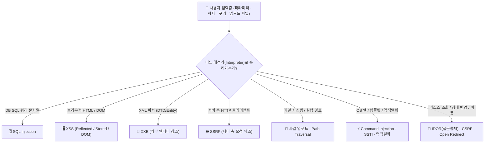
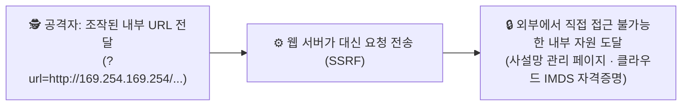

> [!summary] ⏱️ 5초 핵심 요약
> - **한 줄 비유**: 모든 웹 취약점의 뿌리는 **"손님(사용자)이 종이에 적어 낸 말을 의심 없이 그대로 주방 기계·금고·심부름꾼에게 명령어로 전달한 것"**입니다.
> - **핵심 원리**: 외부 입력값이 검증·바인딩·인코딩 없이 **DB 쿼리(SQLi), 브라우저 화면(XSS), XML 파서(XXE), 서버의 외부 요청기(SSRF), OS 쉘(Command Injection)** 등 해석기(Interpreter)로 흘러들어가 **데이터가 명령어로 둔갑**할 때 취약점이 발생합니다.
> - **핵심 진단 및 방어**: 진단자는 **"입력값이 어디로 흘러가 무엇으로 해석되는가?"**를 추적해 경계 탈출 문자를 넣어보고, 방어자는 **파라미터 바인딩·출력 문맥별 인코딩·화이트리스트 검증·권한 분리**로 데이터와 명령어의 경계를 원천 분리해야 합니다.

웹 취약점 진단에서 가장 자주 등장하는 핵심 취약점 12가지를 초보자도 단번에 이해할 수 있도록 정리했습니다. 각 항목은 **한 줄 비유·요약 → 왜 생기나 → 어디서 찾고 어떻게 확인하나 → 어떻게 막나** 순서로 구성했습니다. 진단은 반드시 **허가받은 대상**에만 수행하세요.



---

## 한눈에 보는 12대 웹 취약점 요약 비교표

| 취약점 | 입력값이 흘러가는 곳 | 진단 시 핵심 질문 | 핵심 방어 원칙 |
|---|---|---|---|
| **1. XXE** | XML 파서 (`application/xml`, DOCX, SVG) | XML의 외부 엔티티(`SYSTEM`)가 해석되는가? | DTD 및 외부 엔티티 기능 비활성화 |
| **2. SSRF** | 서버가 대신 호출하는 URL 파라미터 | 서버를 시켜 내부망(`127.0.0.1`, IMDS)을 찌를 수 있는가? | 도메인 화이트리스트 + DNS 해석 후 사설 IP 차단 |
| **3. SQL Injection** | 데이터베이스 SQL 쿼리문 | `'`나 논리식(`AND 1=1`)으로 쿼리 결과가 바뀌는가? | **PreparedStatement (파라미터 바인딩)** |
| **4. XSS** | 다른 사용자의 브라우저 HTML/JS | 입력한 태그·스크립트가 이스케이프 없이 실행되는가? | 출력 문맥별 인코딩 + `HttpOnly` + CSP |
| **5. CSRF** | 로그인 사용자의 상태 변경 요청 | 외부 사이트에서 유도한 요청이 토큰 검증 없이 처리되는가? | 예측 불가능한 CSRF 토큰 + `SameSite` 쿠키 |
| **6. 파일 업로드** | 서버 저장소 및 웹 루트 실행 경로 | 업로드한 웹쉘(`.jsp`, `.php`)이 서버에서 실행되는가? | 확장자 화이트리스트 + 난수 파일명 + 실행 권한 제거 |
| **7. Path Traversal** | 파일 읽기/다운로드 경로 | `../`를 넣어 상위 폴더의 시스템 파일을 읽을 수 있는가? | 파일명 대신 ID 매핑 + 정규화 후 허용 경로 검사 |
| **8. Command Injection** | OS 시스템 명령어 실행기 | `;`, `&&`, `|` 뒤에 붙인 OS 명령이 실행되는가? | 쉘(`sh -c`) 미사용 + 인자 배열 API + 화이트리스트 |
| **9. IDOR / 접근통제** | 객체 조회·수정·삭제 식별자 | 남의 주문 번호/ID로 바꿨을 때 데이터가 보이는가? | 매 요청마다 **서버 측 소유권·권한 검증** |
| **10. SSTI** | 서버 측 템플릿 엔진 (Jinja2, FreeMarker 등) | `{{7*7}}`이나 `${7*7}`이 `49`로 계산되어 나오는가? | 사용자 입력을 템플릿 문법 문자열에 직접 결합 금지 |
| **11. 역직렬화** | 객체 복원기 (`ObjectInputStream`, `pickle`) | 직렬화된 바이너리/문자열을 검증 없이 객체로 복원하는가? | 신뢰 불가 데이터 역직렬화 금지 + JSON 등 순수 데이터 사용 |
| **12. Open Redirect** | 로그인 후 이동 주소(`?next=`, `?redirect=`) | 외부 악성 사이트 주소로 리다이렉트되는가? | 내부 상대 경로만 허용 또는 도메인 화이트리스트 |

---

## 1. XXE (XML External Entity)

**💡 한 줄 비유**: 요리 레시피(XML)에 **"3번 재료는 사장님 금고 안의 비밀문서(`/etc/passwd`)를 복사해서 넣으세요"**라고 적어 냈더니, 고지식한 주방 로봇(XML 파서)이 진짜로 금고를 열어 문서를 가져다 화면에 펼쳐 놓는 상황입니다.

- **핵심 원리**: XML 표준에는 `DTD`/`ENTITY`라는 기능이 있어서 "이 엔티티 이름을 지정된 외부 파일이나 URL 내용으로 치환해라"라고 선언할 수 있습니다. 서버 XML 파서가 이 기능을 켜 둔 채 사용자 XML을 파싱하면 서버 내부 파일을 읽거나 내부망으로 요청(SSRF)을 보내게 만들 수 있습니다.
- **어디서 찾나**: XML을 받는 모든 곳. `Content-Type: application/xml`, SOAP API, **SVG 이미지 / DOCX / XLSX 문서 업로드**(내부가 XML 묶음), RSS 피드, SAML 인증. 심지어 평소 JSON을 받는 API도 요청 헤더의 `Content-Type`을 `application/xml`로 바꿔 보내면 XML 파서가 동작하는 경우가 있습니다.

### 확인 방법 (파일 읽기 및 Blind OOB)
```xml
<!-- 1. 기본 파일 읽기 확인 -->
<?xml version="1.0"?>
<!DOCTYPE foo [ <!ENTITY xxe SYSTEM "file:///etc/hostname"> ]>
<user><name>&xxe;</name></user>

<!-- 2. 응답에 값이 안 나올 때 (Blind XXE): 외부 수신 서버(Burp Collaborator 등)로 접속 유도 -->
<!DOCTYPE foo [ <!ENTITY xxe SYSTEM "http://내-수신서버/ping"> ]>
<user><name>&xxe;</name></user>
```

- **핵심 방어**: XML 파서 설정에서 **DTD와 외부 엔티티(External Entity) 기능을 완전히 끄는 것**이 유일한 근본 해결책입니다(Java의 경우 `disallow-doctype-decl`을 `true`로 설정). 가능하면 XML 대신 JSON을 사용하고 파서 라이브러리를 최신으로 유지합니다.

---

## 2. SSRF (Server-Side Request Forgery)

**💡 한 줄 비유**: 외부인은 출입할 수 없는 회사 보안 구역에 들어가기 위해, **사내 출입증을 가진 직원(웹 서버)에게 "저기 내부 자료실(`127.0.0.1` / 메타데이터 서버)에 가서 서류 좀 대신 찍어다 주세요"라고 심부름을 시키는 것**입니다.



- **어디서 찾나**: 서버가 URL이나 주소를 입력받아 대신 접근하는 모든 기능. 이미지 URL 업로드, 썸네일 생성, 웹훅(Webhook) 테스트, URL 미리보기(OpenGraph 수집), HTML→PDF 변환기, `?url=`, `?target=`, `?image=` 같은 파라미터.
- **확인 방법 (4단계)**:
  1. **외부 콜백 확인**: 내가 통제하는 서버 주소(Burp Collaborator 등)를 넣어 **서버가 실제로 요청을 보내는지** 가장 먼저 확인합니다.
  2. **루프백 및 내부망 탐색**: `http://127.0.0.1/`, `http://localhost:8080/`, 사설 IP 대역(`10.0.0.0/8`, `172.16.0.0/12`, `192.168.0.0/16`)으로 응답 차이를 확인합니다.
  3. **클라우드 메타데이터(IMDS) 확인**: 클라우드 환경이라면 `http://169.254.169.254/` 접근 가능 여부를 확인합니다(임시 IAM 자격증명 노출 시 치명적).
  4. **필터 우회 점검**: `127.1`, 진법 변환(`0x7f000001`), `127.0.0.1`로 해석되는 외부 도메인(DNS Rebinding/A레코드), `302` 리다이렉트 경유, `http://허용도메인@내부주소` 파싱 차이 등을 점검합니다. (응답 본문이 안 보여도 상태코드·응답 시간 차이로 내부 포트 열림을 알 수 있는 **Blind SSRF**도 존재합니다.)
- **핵심 방어**: 호출 대상 도메인 **화이트리스트** 적용, **DNS 해석 후 최종 연결 직전 IP가 사설/예약 대역인지 검증**, HTTP 리다이렉트 자동 추적 비활성화, `http`/`https` 외 스킴(`file://`, `gopher://`, `dict://`) 차단, 클라우드 환경은 **IMDSv2** 강제.

---

## 3. SQL Injection (SQLi)

**💡 한 줄 비유**: 설문지 이름 칸에 그냥 이름만 적는 대신, **`홍길동' OR '1'='1`처럼 문장 부호(따옴표)를 써서 설문지 문장 구조 자체를 "모두 통과시켜라"라는 명령으로 바꿔치기하는 것**입니다.

- **왜 생기나**: 사용자 입력값을 파라미터 바인딩 없이 문자열 이어 붙이기(`+`)로 SQL 쿼리문에 직접 결합하기 때문에 발생합니다.

```sql
-- ❌ 취약한 쿼리 조립 예시
SELECT * FROM users WHERE id = '입력값' AND pw = '...'

-- 공격자가 입력값에  ' OR '1'='1' --  를 넣으면 조건이 항상 참(True)이 되어 비밀번호 없이 로그인 우회!
SELECT * FROM users WHERE id = '' OR '1'='1' --' AND pw = '...'
```

- **확인 방법**:
  - **Error-based**: 작은따옴표(`'`)나 큰따옴표(`"`) 하나를 넣어 DB 문법 에러가 발생하는지, 응답이 달라지는지 관찰합니다.
  - **Boolean-based Blind**: `1 AND 1=1`(참)과 `1 AND 1=2`(거짓)를 넣었을 때 응답 내용이나 길이가 규칙적으로 달라지는지 비교합니다.
  - **Time-based Blind**: 에러도 응답 차이도 안 보이면 `SLEEP(5)`, `pg_sleep(5)` 등 시간 지연 함수를 넣어 응답 시간 차이로 동작 여부를 확인합니다.
  - **탐색 범위**: 로그인 폼뿐 아니라 검색창, **정렬 기준(`ORDER BY`, `ASC/DESC`)**, 쿠키, HTTP 헤더도 모두 대상입니다. (`sqlmap` 등 자동화 도구 사용 시 운영 DB 부하와 데이터 변조에 각별히 주의해야 합니다.)
- **핵심 방어**: **`PreparedStatement`(파라미터 바인딩)**를 사용해 SQL 구조와 데이터를 완벽히 분리합니다. 바인딩이 불가능한 테이블명·컬럼명·`ORDER BY` 절은 반드시 **화이트리스트**로만 분기하고, DB 계정은 최소 권한으로 운영합니다.

---

## 4. XSS (Cross-Site Scripting)

**💡 한 줄 비유**: 아파트 공용 게시판에 누군가 **일반 공지글인 척 "이 글을 읽는 사람의 지갑(세션 쿠키)을 내게 보내라"는 최면술(JavaScript)을 적어 붙여, 지나가며 읽은 입주민들의 브라우저가 그대로 실행하게 만드는 것**입니다.

- **3가지 유형**:
  1. **Reflected XSS (반사형)**: 검색어 등 요청 URL/파라미터에 담긴 값이 서버 응답 HTML에 그대로 반사되어 찍히는 형태 (피해자가 악성 링크를 클릭하도록 유도).
  2. **Stored XSS (저장형)**: 게시글·댓글·프로필 이름처럼 DB에 저장된 악성 스크립트가 해당 페이지를 열람하는 모든 사용자의 화면에서 자동 실행되는 형태 (피해 범위가 가장 큼).
  3. **DOM-based XSS (DOM 기반)**: 서버 응답 자체는 그대로인데 브라우저의 JavaScript가 URL(`location.search`, `location.hash`) 등을 읽어 `innerHTML`, `document.write()` 같은 위험한 싱크(Sink)에 직접 넣을 때 발생.

### 확인 방법
입력값이 응답 HTML의 **어느 문맥(Context)**에 들어가는지(태그 본문 사이, 속성값 따옴표 안, `<script>` 블록 안) 먼저 소스보기로 확인한 뒤, 그 문맥을 탈출하는 구문을 넣어 확인합니다.

```html
<!-- 속성값("...") 문맥을 닫고 빠져나와 이벤트 핸들러로 스크립트 실행 확인 -->
">
```

- **핵심 방어**: 출력 위치(HTML 본문, 속성, JS, URL)에 맞는 **컨텍스트별 출력 인코딩(Output Encoding)** 적용, 세션 쿠키에 **`HttpOnly`** 설정(쿠키 탈취 방지), **`innerHTML` 대신 `textContent`** 사용, **CSP(Content-Security-Policy)** 적용.

---

## 5. CSRF (Cross-Site Request Forgery)

**💡 한 줄 비유**: 은행 창구 직원이 손님 얼굴이나 본인 확인 서명(CSRF 토큰)은 안 보고 **손목에 찬 은행 출입 팔찌(자동 전송되는 쿠키)만 보고 무조건 송금해 주는 허점을 노려, 옆에서 손님 팔을 몰래 잡아끌어 송금 버튼을 누르게 하는 것**입니다.

- **확인 방법**: 비밀번호 변경, 이메일/권한 변경, 송금, 게시글 삭제 등 **서버 상태를 바꾸는 요청**에서 다음 4가지를 확인합니다.
  1. 요청 파라미터나 커스텀 헤더에 예측 불가능한 **CSRF 토큰**이 존재하는가?
  2. CSRF 토큰 파라미터를 아예 지우거나, 빈 값 또는 다른 계정의 토큰으로 바꿔도 요청이 성공하는가?
  3. 서버가 `Origin` 또는 `Referer` 헤더를 엄격히 검증하는가?
  4. 세션 쿠키의 `SameSite` 속성이 어떻게 설정되어 있는가?
- **핵심 방어**: 상태 변경 요청마다 세션과 묶인 예측 불가능한 **CSRF 토큰(Synchronizer Token Pattern)** 검증, 커스텀 헤더 사용, 세션 쿠키 `SameSite=Lax` 또는 `Strict` 설정, 민감 동작 시 현재 비밀번호 재확인.

---

## 6. 파일 업로드 취약점 (Unrestricted File Upload)

**💡 한 줄 비유**: 물품 보관함에 가방(이미지 파일)만 맡겨야 하는데, **원격 조종 로봇(웹쉘 코드, `.jsp`·`.php`)을 사진 액자 모양(`shell.jsp.jpg`)으로 위장해 넣어 보관함 안에서 작동시키는 것**입니다.

- **확인 방법**:
  - **확장자 필터 우회**: `.php` 차단 시 `.phtml`, `.php5`, `.phar`, `.inc` 시도 / `.jsp` 차단 시 `.jspx` 시도 / 대소문자 섞기(`.PhP`, `.JsP`) / 이중 확장자(`shell.php.jpg`) / 끝에 공백·점(`.`)·널바이트(`%00`) 추가.
  - **MIME 타입 및 매직바이트 위조**: 요청의 `Content-Type: image/png`만 검사하는지, 파일 첫머리에 `GIF89a` 같은 이미지 시그니처(매직바이트)를 붙이면 통과하는지 확인.
  - **실행 여부 및 연쇄 취약점**: 업로드된 파일의 저장 URL을 알아내 직접 접근했을 때 서버가 코드로 실행하는지 확인. 실행되지 않더라도 **SVG 업로드 시 Stored XSS/XXE**, 파일명에 `../../`를 넣은 **Path Traversal 덮어쓰기** 가능성을 함께 확인합니다.
- **핵심 방어**: 허용 확장자 **화이트리스트** 검증, 업로드된 파일명을 서버에서 **UUID 등 난수로 완전 변경**, 웹 루트(Web Root) **외부 경로(또는 별도 오브젝트 스토리지)**에 저장, 업로드 디렉터리의 **스크립트 실행 권한 원천 제거**.

---

## 7. Path Traversal (경로 조작)

**💡 한 줄 비유**: 도서관 열람실에서 `"지정된 1층 서가(`report.pdf`)의 책만 꺼내드립니다"`라고 할 때, 신청서에 **`"위로 네 번 올라가서 관장실 금고에 있는 장부(`../../../../etc/passwd`)"`**라고 적어 내어 비밀 파일을 읽는 기법입니다.

- **확인 방법**: `?file=report.pdf`, `?filename=manual.docx`처럼 파일 이름을 받는 파라미터에 상위 디렉터리 이동 문자인 `../../../../etc/passwd`(Linux) 또는 `..\..\..\..\windows\win.ini`(Windows)를 넣어 봅니다. 단순 치환 필터가 있으면 `....//`, URL 인코딩(`%2e%2e%2f`), 이중 URL 인코딩(`%252e%252e%252f`)을 시도합니다.
- **핵심 방어**: 사용자 입력값을 파일 경로 조립에 직접 쓰지 않고 **DB 식별자(숫자 ID 등)로 매핑**해 파일을 찾습니다. 부득이하게 파일명을 써야 한다면 파일명에서 경로 구분자(`/`, `\`, `..`)를 제거하고, **`getCanonicalPath()` 등으로 정규화한 최종 절대 경로가 허용된 기본 디렉터리 하위로 시작하는지(`startsWith`)** 반드시 검사합니다.

---

## 8. Command Injection (OS 명령어 삽입)

**💡 한 줄 비유**: 청소 업체에 `"101호 창문 닦아주세요"`라고 요청하면서 뒤에 **`"그리고 금고도 열어서 밖으로 던져주세요(; cat /etc/passwd)"`**라고 한 줄에 이어 적었더니 둘 다 그대로 실행해 버리는 상황입니다.

- **어디서 찾나**: 서버가 내부적으로 OS 쉘 명령어를 호출하는 기능. 네트워크 장비의 Ping/Traceroute/NSLookup 진단 도구, 외부 바이너리를 호출하는 이미지/문서/동영상 변환기 등.
- **확인 방법**: 입력값 뒤에 OS 명령어 구분자인 `;`, `&&`, `||`, `|`, 백틱(`` `...` ``), `$()`를 붙여 봅니다.

```text
# Ping 대상 IP 입력 칸에 세미콜론(;)으로 추가 명령 연결
127.0.0.1; id
```

응답 화면에 명령 실행 결과가 직접 출력되지 않는 경우(Blind Command Injection), `sleep 5`나 `ping -c 5 127.0.0.1`로 **응답 지연 시간**을 확인하거나 외부 콜백 서버로 DNS/HTTP 요청이 오는지 확인합니다.
- **핵심 방어**: 가급적 OS 명령어 호출 대신 언어 자체의 표준 라이브러리 API를 사용합니다. 외부 프로세스 실행이 꼭 필요하면 **쉘(`sh -c`, `cmd /c`)을 거치지 않고 명령어와 인자를 분리된 배열로 전달하는 API**(예: Java `ProcessBuilder(List<String>)`)를 사용하며, 입력값은 엄격한 화이트리스트(영숫자 등)로 제한합니다.

---

## 9. IDOR (Insecure Direct Object Reference) / 접근 통제 취약점

**💡 한 줄 비유**: 헬스장 사물함 열쇠는 자기 것(로그인 성공)을 받았는데, **사물함마다 번호만 적혀 있고 잠금장치(소유자 확인)가 없어서 내 열쇠로 옆 사람 사물함(`1001`번 → `1002`번)을 그냥 열어볼 수 있는 상태**입니다.

- **확인 방법**: 테스트용 계정 2개(A 계정, B 계정)를 준비합니다.
  1. **수평적 권한 상승 (BOLA/IDOR)**: A 계정으로 생성한 주문 조회 요청(`GET /orders/1001`)을 가로챈 뒤, **세션 쿠키나 토큰만 B 계정의 것으로 바꿔 그대로 전송**합니다. B 계정에게 A의 주문 내역이 응답되면 취약합니다.
  2. **수직적 권한 상승 (BFLA)**: 일반 사용자 세션으로 관리자 전용 API(`POST /admin/users/export`)를 직접 호출해 접근이 허용되는지 확인합니다.
- **핵심 방어**: 프런트엔드에서 버튼이나 메뉴만 숨기는 것은 방어가 아닙니다. **모든 요청마다 서버(Service/Controller)에서 현재 로그인한 세션의 사용자 ID가 요청 대상 리소스의 실제 소유자(또는 허용된 역할)와 일치하는지** DB 기준으로 검증해야 합니다. (상세 매트릭스 기법은 [[웹 취약점 진단 인가편 — 권한 매트릭스로 BOLA·BFLA 찾기]]에서 깊이 다룹니다.)

---

## 10. SSTI (Server-Side Template Injection)

**💡 한 줄 비유**: 이름표 인쇄기에 **"손님 이름 데이터"**만 칸에 넣어야 하는데, 인쇄기 설계도(템플릿 문법 `{{ ... }}`) 자체에 손님 말을 그대로 합쳐서 인쇄기가 계산식과 서버 명령어를 실행하게 만드는 취약점입니다.

- **확인 방법**: 입력값이 반영되는 곳에 템플릿 엔진별 수식 표현식을 넣어 **수식이 계산되어 `49`로 바뀌어 나오는지** 확인합니다.

```text
{{7*7}}    → 응답에 49가 찍히면 Jinja2 / Twig 등 템플릿 엔진이 코드로 해석 중!
${7*7}     → FreeMarker / Velocity / Spring EL 계열 확인
<%= 7*7 %> → ERB / JSP 계열 확인
#{7*7}     → Thymeleaf / Ruby 계열 확인
```

엔진 종류에 따라 후속 반응이 달라지므로(예: `{{7*'7'}}`이 `49`면 Twig, `7777777`이면 Jinja2), 결과 차이로 템플릿 엔진을 특정합니다.
- **핵심 방어**: 사용자 입력값을 템플릿 **문자열 자체에 연결(`+`)해 컴파일하지 말고**, 고정된 템플릿에 **컨텍스트 변수(Model 데이터)**로만 전달하며, 제한된 샌드박스 모드를 활성화합니다.

---

## 11. Insecure Deserialization (안전하지 않은 역직렬화)

**💡 한 줄 비유**: 외부에서 택배로 온 **냉동 조립 키트(직렬화된 데이터)에 "해동하는 순간 폭발해라"라는 자동 실행 장치(가젯 체인)가 숨겨져 있는데, 검수 없이 주방에서 그대로 해동(역직렬화)해 버리는 것**입니다.

- **확인 방법**: 쿠키, 숨은 폼 파라미터, 요청 본문에 언어별 직렬화 포맷이 쓰이는지 찾습니다.
  - **Java (`ObjectInputStream`)**: 16진수 바이너리 시그니처 `AC ED 00 05`, Base64 인코딩 시 **`rO0AB...`**로 시작.
  - **PHP (`unserialize`)**: `O:4:"User":2:{...}` 형태 문자열.
  - **Python (`pickle`)**: Base64 인코딩된 바이너리 스트림.
  - 발견 시 `ysoserial` 등의 도구로 DNS/HTTP 콜백(URLDNS 등 무해한 확인용 체인)을 생성해 서버가 역직렬화를 수행하는지 확인합니다.
- **핵심 방어**: 신뢰할 수 없는 외부 입력은 절대 네이티브 역직렬화하지 않고 **JSON 등 순수 데이터 포맷**으로 교체합니다. 불가피한 경우 HMAC 서명 검증과 엄격한 **역직렬화 허용 클래스 화이트리스트(`ObjectInputFilter`)**를 적용합니다.

---

## 12. Open Redirect

**💡 한 줄 비유**: 백화점 안내 데스크(`https://trusted.shop/login?next=...`)에서 안내원이 확인도 없이 **"손님, 안내 절차가 끝났으니 이제 길 건너 보이스피싱 가짜 매장(`https://evil.example`)으로 바로 가세요!"**라며 밀어 넣는 것입니다.

- **확인 방법**: 로그인, 로그아웃, 언어 변경 후 이동할 주소를 받는 `?next=`, `?redirect=`, `?returnUrl=`, `?url=` 파라미터에 외부 도메인(`https://example.com`)을 넣어 실제로 이동(`301`/`302` `Location` 헤더 또는 JS `location.href` 이동)하는지 확인합니다. 단순 문자열 검사가 있을 때는 `//example.com`, `https://신뢰도메인@evil.example`, `https://evil.example\trusted.com` 같은 URL 파서 혼동 패턴을 점검합니다. (단독으로는 피싱에 악용되지만, **OAuth `redirect_uri` 토큰 탈취나 서버 내부 SSRF 필터 우회와 결합되면 치명적**입니다.)
- **핵심 방어**: 외부에서 이동할 URL 전체를 입력받지 않고 이동할 페이지 코드를 매핑하거나, `/`로 시작하는 **내부 상대 경로**(단, `//`로 시작하는 프로토콜 상대 URL은 제외!) 및 **엄격히 파싱된 허용 도메인 화이트리스트**만 허용합니다.

---

## 13. 실전 진단 필수 도구와 보고서 작성 4요소

**💡 한 줄 비유**: 의사가 **청진기·내시경(Burp Suite 등 진단 도구)**으로 병의 원인을 정확히 찾아낸 뒤, 누구나 똑같이 재현하고 고칠 수 있도록 **진단서(취약점 보고서)**를 명확히 작성하는 마무리 단계입니다.

### 웹 진단의 4대 기본 도구
- **Burp Suite**: 브라우저와 서버 사이의 요청 가로채기(Proxy), 수동 변조 및 재전송(Repeater), 대량 대입 테스트(Intruder), Blind 취약점 외부 접속 확인(Collaborator)을 모두 담당하는 웹 진단의 핵심 도구.
- **sqlmap**: SQL Injection 정밀 검증 및 영향도 파악 자동화 도구.
- **ffuf / dirsearch**: 숨겨진 디렉터리, 파일, API 파라미터 퍼징(Fuzzing) 도구.
- **브라우저 개발자 도구 (`F12`)**: DOM XSS 추적, 프런트엔드 JS 번들 분석, 네트워크/쿠키 상태 확인.

### 좋은 취약점 진단 보고서에 반드시 들어가야 할 4가지
1. **어디서 (Location)**: 취약한 정확한 엔드포인트 URL, HTTP 메서드, 대상 파라미터/헤더 이름.
2. **어떻게 (Reproduction / PoC)**: 담당 개발자가 그대로 복사해 따라 하면 100% 똑같이 재현되는 단계별 절차와 원본 HTTP 요청/응답 패킷(민감 정보 마스킹 포함).
3. **영향 (Impact)**: 이 취약점이 악용되면 비즈니스에 어떤 실질적 피해(개인정보 유출, 타 계정 탈취, 내부망 침투, 원격 코드 실행 등)가 발생하는가.
4. **조치 (Remediation)**: 단순 "필터링 적용"이 아니라 해당 언어·프레임워크에 맞는 구체적인 시큐어코딩 수정 방안(위 각 절의 핵심 방어 원칙).

- 기초 12종을 모두 익혔다면, 실무 현장에서 마주치는 심화 공격 표면은 [[웹 취약점 진단 심화 — 실무에서 보는 기법들]]에서, 진단 전 공격 표면을 찾는 방법은 [[웹 취약점 진단 정찰편 — 공격표면 매핑과 헤더 기반 접근통제 우회]]에서 이어서 확인하세요.
- 참고: [PortSwigger Web Security Academy (무료 실습 랩)](https://portswigger.net/web-security), [OWASP Top 10](https://owasp.org/www-project-top-ten/)
