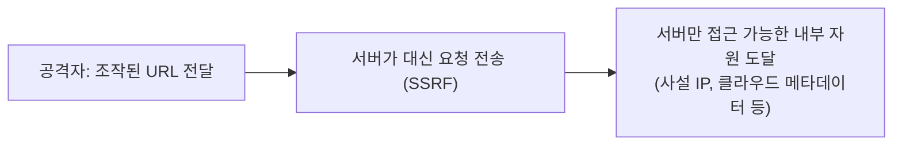

웹 취약점 진단에서 자주 나오는 취약점을 초보자 눈높이로 정리했습니다. 각 항목은 **한 줄 요약 → 왜 생기나 → 이렇게 확인한다 → 이렇게 막는다** 순서입니다. 진단은 반드시 **허가받은 대상**에만 하세요. 아래 예시는 개념 설명용 대표 패턴이고, 실제 진단 때는 대상 환경에 맞게 바꿔 씁니다.

## 큰 그림: 모든 취약점의 공통 원인

대부분은 한 문장으로 요약됩니다. **"사용자가 보낸 값을 믿고 그대로 어딘가에 넘겼다."**

| 사용자 입력이 흘러가는 곳 | 대표 취약점 |
|---|---|
| DB 쿼리 | SQL Injection |
| HTML 화면 | XSS |
| XML 파서 | XXE |
| 서버가 호출하는 URL | SSRF |
| 파일 경로 | Path Traversal, 파일 업로드 |
| OS 명령어 | Command Injection |
| 템플릿 엔진 | SSTI |
| 객체 복원(역직렬화) | Deserialization |

진단은 "이 값이 어디로 흘러가는지 추적하고, 거기서 의미가 바뀌는 문자를 넣어본다"의 반복입니다.

---

## 1. XXE (XML External Entity)

**한 줄 요약**: XML을 처리하는 서버가 XML 안에 적힌 "외부 파일/주소를 읽어와라"는 지시를 그대로 따라 버리는 취약점.

**왜 생기나**: XML에는 `DTD`/`ENTITY`라는 기능이 있어서 "이 이름을 이 파일 내용으로 치환해라"라고 쓸 수 있습니다. 서버 XML 파서가 이 기능을 켜 둔 채 사용자 XML을 받으면, 서버 안의 파일을 읽거나 내부망으로 요청을 보내게 만들 수 있습니다.

**어디서 찾나**: XML을 받는 곳 전부. `Content-Type: application/xml`, SOAP, SVG/DOCX/XLSX 업로드(내부가 XML), RSS, SAML 로그인. JSON을 받는 API도 `Content-Type`을 XML로 바꿔 보내면 처리되는 경우가 있습니다.

**확인 방법 (파일 읽기)**:

```xml
<?xml version="1.0"?>
<!DOCTYPE foo [ <!ENTITY xxe SYSTEM "file:///etc/hostname"> ]>
<user><name>&xxe;</name></user>
```

응답에 호스트 이름이 보이면 확정입니다. 응답에 값이 안 나오면(Blind XXE) 외부 서버로 접속을 유도해 서버가 요청을 보내는지 로그로 확인합니다(Burp Collaborator 같은 도구 사용).

```xml
<!DOCTYPE foo [ <!ENTITY xxe SYSTEM "http://내-수신서버/ping"> ]>
```

**방어**: XML 파서에서 **DTD/외부 엔티티를 끄는 것**이 정답입니다. 자바라면 `disallow-doctype-decl`을 true로, 가능하면 JSON을 사용하세요. 파서 라이브러리는 최신으로 유지합니다.

---

## 2. SSRF (Server-Side Request Forgery)

**한 줄 요약**: 서버가 사용자가 준 URL로 대신 요청을 보내 주는 기능을 악용해, **서버 입장에서만 접근 가능한 내부 자원**을 건드리는 취약점.

**비유**: 회사 밖 사람이 직원에게 "이 주소로 가서 서류 좀 받아와요"라고 시키는 상황. 직원은 사내 출입증이 있으니 외부인이 못 가는 방에도 들어갑니다.



**어디서 찾나**: URL/주소를 받는 기능 전부. 이미지 가져오기, 썸네일, 웹훅, URL 미리보기, PDF 변환, 파일을 URL로 가져오기, `?url=`, `?redirect=`, `?image=` 같은 파라미터.

**확인 방법**:
1. 내가 통제하는 서버 주소를 넣어 **요청이 실제로 들어오는지** 확인 (가장 기본)
2. 내부 주소로 응답 차이 확인: `http://127.0.0.1/`, `http://localhost:8080/`, 사설 대역(`10.x`, `172.16~31.x`, `192.168.x`)
3. 클라우드라면 메타데이터 주소: `http://169.254.169.254/` (AWS 등. 임시 자격증명이 노출될 수 있어 영향도가 매우 큽니다)
4. 필터 우회 시도: `127.1`, `0x7f000001`, `localhost` 대신 내가 만든 도메인이 127.0.0.1로 해석되게 하기, 리다이렉트 이용, `http://허용도메인@내부주소` 형태

응답 내용이 안 보여도 응답 시간·상태코드 차이로 내부 포트 열림 여부를 추정할 수 있습니다(Blind SSRF).

**방어**: 허용 도메인 **화이트리스트**, 내부 IP 대역 차단(DNS 해석 후 IP로 다시 검사), 리다이렉트 따라가지 않기, `http/https` 외 스킴(`file://`, `gopher://`) 차단, 클라우드 메타데이터는 IMDSv2 사용.

---

## 3. SQL Injection

**한 줄 요약**: 입력값이 SQL 문장의 일부로 해석되어 DB 질의가 바뀌는 취약점.

**왜 생기나**: 문자열을 이어 붙여 쿼리를 만들기 때문입니다.

```sql
SELECT * FROM users WHERE id = '입력값' AND pw = '...'
-- 입력값에  ' OR '1'='1' --  를 넣으면 조건이 항상 참이 되어 로그인 우회
```

**확인 방법**:
- `'` 하나를 넣어 **에러가 나는지**, 응답이 달라지는지 관찰
- 논리 비교: `1 AND 1=1` 과 `1 AND 1=2`의 결과가 다르면 의심
- 에러가 안 보이면 시간 지연(`SLEEP(5)` 등)으로 Blind 확인
- 로그인 폼뿐 아니라 검색, 정렬(`ORDER BY` 파라미터), 쿠키, 헤더도 대상
- 확인되면 `sqlmap` 같은 도구로 범위를 확인하되, 운영 DB에서는 부하·데이터 변경에 주의

**방어**: **Prepared Statement(파라미터 바인딩)**. 문자열 이어 붙이기를 없애는 것이 핵심이고, 필터링만으로는 우회됩니다. DB 계정은 최소 권한으로.

---

## 4. XSS (Cross-Site Scripting)

**한 줄 요약**: 공격자가 넣은 스크립트가 다른 사용자의 브라우저에서 실행되는 취약점.

**종류**:
- **Reflected**: 요청에 담긴 값이 응답에 그대로 찍힘 (링크를 클릭하게 유도)
- **Stored**: 게시글/댓글처럼 저장된 값이 다른 사용자 화면에 찍힘 (피해 범위 큼)
- **DOM-based**: 서버가 아니라 브라우저의 JS가 값을 위험하게 DOM에 넣음 (`innerHTML` 등)

**확인 방법**: 입력값이 응답 HTML의 **어느 위치**에 들어가는지 먼저 보고(태그 사이, 속성값 안, 스크립트 안), 그 위치를 탈출하는 문자를 넣습니다.

```html
">
```

`alert`가 뜨면 확인 완료. 실제 영향은 세션 쿠키 탈취, 사용자 대신 동작 수행 등이므로 보고서에 영향 시나리오를 함께 적습니다.

**방어**: 출력 시 **컨텍스트에 맞는 인코딩**(HTML/속성/JS), `HttpOnly` 쿠키, CSP(Content-Security-Policy), `innerHTML` 대신 `textContent`.

---

## 5. CSRF (Cross-Site Request Forgery)

**한 줄 요약**: 로그인된 사용자가 공격자 페이지를 열면, 브라우저가 쿠키를 자동으로 붙여 **사용자 모르게 요청이 전송되는** 취약점.

**확인 방법**: 상태를 바꾸는 요청(비밀번호 변경, 송금, 설정 변경)에서 ① CSRF 토큰이 있는지 ② 토큰을 지우거나 다른 값으로 바꿔도 통과하는지 ③ `Referer`/`Origin` 검증이 있는지 ④ 쿠키 `SameSite` 설정을 봅니다. 토큰이 없고 요청이 외부 폼으로 재현되면 취약합니다.

**방어**: 요청마다 예측 불가능한 CSRF 토큰, `SameSite=Lax/Strict` 쿠키, 중요 동작은 재인증.

---

## 6. 파일 업로드 취약점

**한 줄 요약**: 업로드한 파일이 서버에서 **실행**되거나 위험하게 취급되는 취약점. 웹쉘 업로드로 서버 장악까지 이어질 수 있습니다.

**확인 방법**:
- 확장자 검증 우회: `.php` 대신 `.phtml`, `.php5`, 대소문자 `.PhP`, 이중 확장자 `shell.php.jpg`, 널바이트·공백·점 붙이기
- `Content-Type`만 검사하는지 (요청에서 `image/png`로 위조)
- 파일 내용(매직바이트) 검사 여부
- 업로드 경로가 웹 루트 아래이고 **실행 권한이 있는지**
- SVG 업로드 시 XSS/XXE, 파일명에 `../`(경로 조작)

**방어**: 허용 확장자 화이트리스트, 업로드 파일명을 서버가 난수로 재생성, 웹 루트 **밖**에 저장하거나 업로드 디렉터리에서 실행 비활성화, 내용 검증.

---

## 7. Path Traversal (경로 조작)

**한 줄 요약**: 파일 이름을 입력받는 곳에 `../`를 넣어 의도하지 않은 파일을 읽는 취약점.

**확인 방법**: `?file=report.pdf` 같은 파라미터를 `../../../../etc/passwd`(윈도우는 `..\..\windows\win.ini`)로 바꿔 봅니다. 막혀 있으면 `....//`, URL 인코딩(`%2e%2e%2f`), 이중 인코딩(`%252e`)을 시도합니다.

**방어**: 입력을 파일 경로로 쓰지 말고 **ID로 매핑**, 불가하면 정규화(canonical path) 후 허용 디렉터리 안인지 검사.

---

## 8. Command Injection (OS 명령어 삽입)

**한 줄 요약**: 입력값이 OS 명령어에 섞여 임의 명령이 실행되는 취약점. 핑/DNS 조회/이미지 변환 같은 기능에서 흔합니다.

**확인 방법**: 명령어 구분자를 붙여 봅니다: `;`, `&&`, `|`, `` ` ` ``, `$()`. 결과가 안 보이면 `sleep 5`로 시간 지연을 보거나, 외부 서버로 DNS/HTTP 요청이 오는지 확인합니다.

```text
127.0.0.1; id
```

**방어**: 쉘을 거치지 않는 API 사용(인자 배열 전달), 입력 화이트리스트, 가능하면 OS 명령 호출 자체를 제거.

---

## 9. IDOR / 접근 통제 취약점

**한 줄 요약**: 로그인은 했지만 **남의 데이터**를 볼 수 있는 취약점. 실무에서 가장 흔하고 영향이 큰 편입니다.

**확인 방법**: 계정 2개를 준비합니다. A 계정으로 `GET /orders/1001`을 보낸 뒤, **B 계정의 세션으로 같은 요청**을 보내 데이터가 오면 취약합니다. 번호(`id`), UUID, 파일명 등 식별자를 바꿔 보고, 일반 사용자가 관리자 기능 URL을 직접 호출할 수 있는지(수직 권한 상승)도 확인합니다.

**방어**: 매 요청마다 **서버에서 소유자/권한 검증**. 프런트에서 버튼만 숨기는 것은 방어가 아닙니다.

---

## 10. SSTI (Server-Side Template Injection)

**한 줄 요약**: 입력값이 서버 템플릿 엔진(Jinja2, Freemarker 등)에 코드로 해석되는 취약점. 심하면 원격 코드 실행.

**확인 방법**: 수식을 넣어 계산되어 나오는지 봅니다.

```text
{{7*7}}  →  49 가 나오면 템플릿 엔진이 해석 중
${7*7}, <%= 7*7 %>, #{7*7}
```

어떤 엔진이냐에 따라 반응이 달라지므로, 결과 차이로 엔진을 추정합니다(`{{7*'7'}}` → Jinja2는 `7777777`).

**방어**: 사용자 입력을 템플릿 **문자열 자체**에 넣지 말고 변수로만 전달, 샌드박스 모드 사용.

---

## 11. Insecure Deserialization (안전하지 않은 역직렬화)

**한 줄 요약**: 직렬화된 객체(자바 `ObjectInputStream`, PHP `unserialize`, Python `pickle` 등)를 사용자 입력으로 복원하면서 **악성 객체가 실행**되는 취약점.

**확인 방법**: 쿠키/파라미터/요청 본문에 직렬화 데이터가 있는지 찾습니다(자바는 Base64 시작이 `rO0`, 바이너리는 `AC ED 00 05`). 발견하면 ysoserial 같은 도구로 외부 접속을 유도하는 페이로드를 만들어 서버가 반응하는지 확인합니다.

**방어**: 신뢰할 수 없는 데이터를 역직렬화하지 않기, JSON 등 단순 포맷 사용, 서명 검증, 클래스 허용 목록.

---

## 12. Open Redirect

**한 줄 요약**: `?next=` 같은 파라미터로 사용자를 임의의 외부 사이트로 보내는 취약점. 피싱에 이용됩니다.

**확인 방법**: `?redirect=https://example.com`으로 바꿔 이동하는지 확인. 필터가 있으면 `//example.com`, `https://신뢰도메인.example.com@공격자도메인` 형태를 시도. SSRF나 OAuth 토큰 탈취와 연결되면 영향도가 커집니다.

**방어**: 리다이렉트 대상을 화이트리스트 또는 내부 경로(상대 경로)만 허용.

---

## 진단할 때 쓰는 기본 도구

- **Burp Suite**: 요청 가로채기(Proxy), 재전송(Repeater), 자동 대입(Intruder), 외부 접속 확인(Collaborator). 웹 진단의 중심 도구.
- **sqlmap**: SQL Injection 자동 확인
- **ffuf / dirsearch**: 숨은 경로·파라미터 탐색
- **브라우저 개발자 도구**: DOM XSS와 JS 분석

## 보고서에 꼭 넣을 것

1. **어디서**: URL, 파라미터
2. **어떻게**: 재현 요청/응답 (그대로 따라 하면 재현되게)
3. **영향**: 이게 뚫리면 무엇이 가능한가 (정보 노출? 계정 탈취? 서버 장악?)
4. **조치**: 위 "방어" 항목처럼 구체적인 수정 방법

## 정리

| 취약점 | 핵심 질문 | 핵심 방어 |
|---|---|---|
| XXE | XML을 받는가? | DTD/외부 엔티티 비활성화 |
| SSRF | 서버가 URL을 가져가는가? | 화이트리스트 + 내부 IP 차단 |
| SQLi | 입력이 쿼리에 붙는가? | 파라미터 바인딩 |
| XSS | 입력이 화면에 찍히는가? | 출력 인코딩 + CSP |
| CSRF | 토큰 없이 상태가 바뀌는가? | CSRF 토큰 + SameSite |
| 파일 업로드 | 올린 파일이 실행되는가? | 화이트리스트 + 실행 차단 |
| 경로 조작 | 파일명이 경로로 쓰이는가? | 정규화 후 허용 경로 검사 |
| 명령어 삽입 | 입력이 OS 명령에 들어가는가? | 쉘 미사용 |
| IDOR | 남의 ID로 데이터가 보이는가? | 서버 측 권한 검증 |
| SSTI | `{{7*7}}`이 계산되는가? | 입력을 템플릿에 넣지 않기 |
| 역직렬화 | 직렬화 데이터를 복원하는가? | 신뢰 불가 데이터 복원 금지 |
| Open Redirect | 임의 URL로 이동하는가? | 대상 화이트리스트 |

더 깊이 공부하려면 [PortSwigger Web Security Academy](https://portswigger.net/web-security)(무료 랩)와 [OWASP Top 10](https://owasp.org/www-project-top-ten/)을 추천합니다. 이 글은 계속 보강할 예정입니다.
