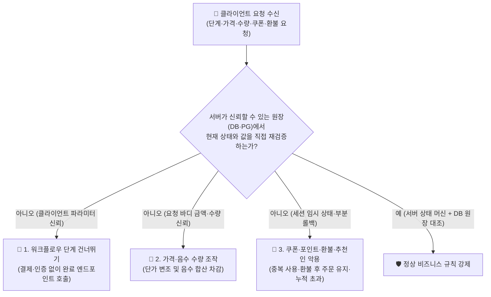
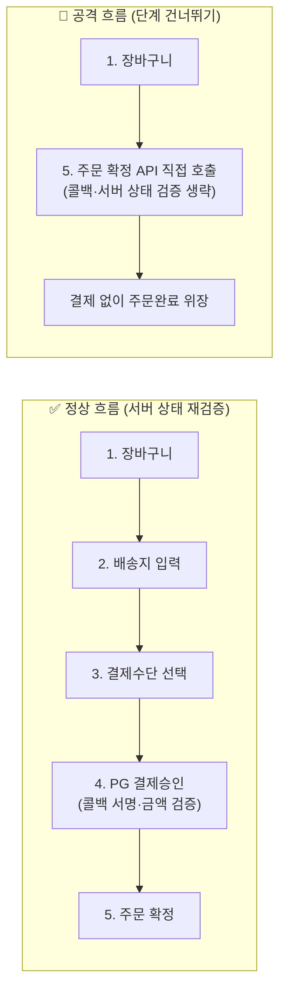

> [!summary] ⏱️ 5초 핵심 요약
> - **한 줄 비유**: 출입문 자물쇠(인증·SQLi 방어)는 튼튼한데, **"1층 매표소를 거치지 않고 3층 상영관 비상구로 바로 들어가도 표 검사를 안 하는 영화관 운영 규칙의 허점"**을 찾는 과정입니다.
> - **핵심 원리**: 비즈니스 로직 결함([CWE-840](https://cwe.mitre.org/data/definitions/840.html))은 고정된 공격 페이로드가 없으며, **"클라이언트가 순서대로 정직하게 값을 보낼 것"**이라는 개발자의 가정이 서버 상태 검증으로 강제되지 않을 때 성립합니다.
> - **핵심 진단 질문**: **"서버가 매 요청마다 현재 상태·금액·소유권을 신뢰할 수 있는 DB 원장에서 스스로 다시 확인하는가, 아니면 클라이언트가 보낸 파라미터나 이전 흐름을 그대로 믿는가?"**
> - **핵심 방어**: 단계 전이 상태 머신(State Machine) 서버 강제, 가격·할인율의 서버 마스터 DB 재계산, 쿠폰·환불·포인트의 영구 원장 기반 원자적 차감 및 롤백 일관성 보장.

[[웹 취약점 진단 기법 입문 — XXE, SSRF부터 SQLi, XSS까지]], [[웹 취약점 진단 심화 — 실무에서 보는 기법들]], [[웹 취약점 진단 설정편 — CORS·SOP부터 후속 공격까지]]은 전부 "이 입력을 이렇게 바꾸면 깨진다"는 식의 재현 가능한 패턴이 있었습니다. 이번 글은 다릅니다. 비즈니스 로직 결함에는 찾아 넣어볼 고정된 페이로드가 없고, SQLi=CWE-89처럼 기법 하나하나에 맞아떨어지는 세분화된 CWE도 없습니다 — 굳이 분류하면 [CWE-840(Business Logic Errors)](https://cwe.mitre.org/data/definitions/840.html)이라는 포괄적인 범주 하나로 묶일 뿐이고, 실제 결함은 그 안에서 서비스마다 전부 다른 모양을 하고 있습니다.

있는 건 **"이 기능은 이런 순서로 동작할 거라고 개발자가 가정했다"는 전제 하나**뿐이고, 그 전제가 서버 코드에서 실제로 강제되지 않는 지점을 찾는 게 전부입니다. 그래서 이 글은 페이로드 목록이 아니라, 다단계 기능을 볼 때 "어디가 깨질 수 있는가"를 떠올리는 체크리스트에 가깝습니다.



---

## 한눈에 보는 비즈니스 로직 7대 결함 요약

| 결함 유형 | 서버의 잘못된 가정 (깨지는 조건) | 핵심 진단 포인트 | 근본 방어 설계 |
|---|---|---|---|
| **1. 워크플로우 건너뛰기** | 앞 단계를 통과해야만 뒷 단계 URL을 부를 것이다 | 앞 단계 생략 후 최종 확정 API 직접 호출, `step` 파라미터 변조 | 서버 세션/DB 상태 머신 검증 + PG 콜백 서명·금액 재검증 |
| **2. 가격/수량 조작** | 화면에서 계산해 보낸 `price`·양수 `quantity`가 그대로 올 것이다 | 요청 바디 내 단가·할인율 변조, 개별 품목 음수(`-1`) 수량 주입 | 가격·할인율은 서버 마스터 DB에서만 조회 + 수량 하한(≥1)·총액 하한(≥0) 검증 |
| **3. 쿠폰/포인트 악용** | 쿠폰은 한 번만 쓰고, 실패 시 환불만 해주면 끝날 것이다 | 재로그인·새 주문에서 쿠폰 재적용, 포인트 차감 직후 결제 중단 유도 | 계정 귀속 영구 사용 이력 검증 + 실패 시 포인트 환불과 주문 취소 원자적 묶음 처리 |
| **4. 로직 결함 vs 레이스** | 중복 체크가 아예 없거나(로직), 체크와 반영 사이가 벌어짐(레이스) | **순차 재전송**으로 뚫리면 로직 결함, **동시 전송**에만 뚫리면 레이스 컨디션 | 순차 검증 후 동시성 제어(DB 락·원자적 조건부 UPDATE)까지 단계적 점검 |
| **5. 환불/취소 악용** | 배송 완료 후엔 취소 버튼을 안 누르고, 부분 환불은 한 번만 할 것이다 | 배송 완료 상태 주문에 취소 API 호출, 동일 품목 부분 환불 반복 호출 | 배송 상태별 취소 분기 강제 + 주문별 `누적 환불액 ≤ 원 결제액` 추적·차감 |
| **6. 초대/추천인 악용** | 추천인과 가입자는 다른 사람이고 이메일이 다르면 다른 사람일 것이다 | 가입 후 화면에서 자기 추천 코드 입력, `+alias` 이메일로 다계정 생성 | `추천인 ID ≠ 본인 ID` 검증 + 전화번호·결제수단 등 독립 본인 식별값 중복 검사 |
| **7. 기능 제한 우회** | 프런트엔드 버튼을 막아두면 무료 한도를 넘기지 못할 것이다 | 로컬스토리지 초기화 후 API 직접 호출(`curl`/Burp) 반복 | 계정·API 키 기준 서버 DB/캐시 카운터로 매 요청마다 한도 집행 |

---

## 1. 워크플로우 단계 건너뛰기 / 순서 뒤바꾸기

**💡 한 줄 비유**: 공항에서 **보안 검색대와 출국 심사를 거치지 않고 탑승구 문으로 바로 걸어갔는데, 직원이 탑승권 도장(서버 상태 기록)을 확인하지 않고 비행기에 태워주는 상황**입니다.

### 핵심 원리
회원가입(`이메일 인증 → 본인인증 → 가입완료`)이나 결제(`장바구니 → 배송지 입력 → 결제수단 선택 → 결제승인 → 주문완료`)처럼 여러 단계로 나뉜 프로세스는, 각 단계 엔드포인트가 호출될 때마다 **"이전 단계가 실제로 끝났는가"**를 서버가 **신뢰할 수 있는 출처**로 재확인해야 안전합니다.

- **잘못된 신뢰 출처**: 클라이언트가 보낸 `step=4`, `status=PAID` 같은 요청 파라미터나 단순히 "특정 URL이 호출되었다"는 사실 자체
- **올바른 신뢰 출처**: 결제 단계라면 PG사가 보내는 결제완료 콜백(웹훅)의 **서명 검증을 통과한 서버 원장 기록(결제 ID, 실결제 금액, 상태)**



### 공격 시나리오와 주의할 점
- **중간 단계 생략 호출**: 서버가 "결제완료" 여부를 PG사 콜백 검증이 아니라 클라이언트가 호출한 URL이나 요청 파라미터만으로 판단하면, 공격자는 본인인증·결제 요청 없이 곧바로 마지막 단계(주문 확정 엔드포인트)를 호출해 통과할 수 있습니다.
- **콜백과 주문 확정이 분리된 구조의 함정**: "결제 성공 콜백"과 "주문 확정 처리"가 서로 다른 엔드포인트로 분리돼 있어도, 주문 확정 쪽이 **"콜백이 왔다"는 사실만 믿지 않고 PG사로부터 검증된 결제 상태(결제 ID, 금액, 서명)를 매번 다시 조회해 일치 여부를 확인**하며 그 상태 전이가 **단 한 번만** 일어나도록 보장해야 합니다.

```http
POST /api/orders/9812/confirm HTTP/1.1
Host: shop.example.com
Content-Type: application/json

{
  "orderId": 9812,
  "step": "COMPLETE",
  "paymentStatus": "PAID"
}
```
*(❌ 서버가 DB의 실제 PG 검증 기록을 조회하지 않고 요청 바디의 `"paymentStatus": "PAID"`를 그대로 반영하면 무결제 주문이 확정됩니다.)*

### 체크 포인트
- 뒷 단계 엔드포인트를 앞 단계 요청 없이 직접 호출했을 때 서버가 수락하는가?
- 요청에 담긴 `step`/`stage` 같은 파라미터나 클라이언트가 임의로 설정 가능한 주문 상태값을 조작해 단계를 앞당길 수 있는가?
- 주문 확정 로직이 PG사 콜백 서명·결제 금액을 서버 쪽에서 재검증하는가? (그냥 "콜백이 왔다"로만 판단하지 않는가?)
- 참고: [PortSwigger — Business logic vulnerabilities](https://portswigger.net/web-security/logic-flaws), [OWASP WSTG — Circumvention of Work Flows](https://wstg.owasp.org/latest/4-Web_Application_Security_Testing/10-Business_Logic/06-Circumvention_of_Work_Flows/)

---

## 2. 가격/수량 조작

**💡 한 줄 비유**: 마트 계산대에서 바코드를 찍는 대신 **손님이 포스트잇에 직접 적어 온 가격(`100원`)과 수량(`-2개`)을 계산원이 의심 없이 그대로 합산해 주는 것**과 같습니다.

### 핵심 원리
1. **가격·할인율 조작**: 장바구니·주문 API가 상품 가격·할인율·단가를 서버 마스터 DB에서 다시 조회해 계산하지 않고, 클라이언트가 보낸 요청 바디의 값(`price`, `discount`, `unit_price`)을 그대로 최종 결제 금액 계산에 사용할 때 성립합니다.
   - *주의*: 가격 필드가 요청에 노출돼 있다는 사실만으로는 '공격 표면'일 뿐이며, **서버가 그 값을 상품 마스터 DB 가격과 대조하지 않고 그대로 신뢰해야** 실제 취약점으로 성립합니다.
2. **음수 수량(Negative Quantity) 합산 조작**: 서버가 각 항목 수량에 대해 `"1 이상의 정수인가"`라는 하한 검증 없이 `"정수 형식인가"`만 확인하면 음수 수량(`-1`)이 섞여 들어갑니다. 이때 전체 합계 로직이 각 항목의 `수량 × 단가`를 단순 합산만 하고 **최종 합계 자체가 0 이상인지도 검증하지 않으면**, 음수 수량 항목이 다른 정상 상품의 금액을 깎아내립니다.

### 취약한 요청 예시 (음수 수량을 이용한 결제 금액 상쇄)
```json
// POST /api/checkout
{
  "items": [
    { "item_id": "고가_노트북", "unit_price": 2000000, "quantity": 1 },
    { "item_id": "마우스패드", "unit_price": 500000, "quantity": -3 }
  ]
}
// ❌ 서버 계산: (2,000,000 * 1) + (500,000 * -3) = 최종 결제 금액 500,000원
```

### 체크 포인트
- 요청 바디에 가격(`price`)·할인율(`discount`)이 파라미터로 노출돼 있고, 값을 바꿨을 때 서버가 상품 마스터 DB 가격과 대조하지 않고 그대로 수락하는가?
- 개별 항목 수량(`quantity`)에 음수나 `0`을 넣었을 때 서버가 항목 단위로 즉시 거부하는가?
- 개별 항목 검증과 별개로 최종 결제 합계의 하한(0 이상 및 정상 마스터 단가 합산 일치 여부)을 검증하는가?
- 참고: [PortSwigger — Excessive trust in client-side controls](https://portswigger.net/web-security/logic-flaws/examples#excessive-trust-in-client-side-controls), [OWASP WSTG — Integrity Checks](https://wstg.owasp.org/latest/4-Web_Application_Security_Testing/10-Business_Logic/03-Integrity_Checks/)

---

## 3. 쿠폰/포인트/크레딧 로직 악용

**💡 한 줄 비유**: **"1인 1회 할인 쿠폰"**을 냈는데 직원이 장부에 적지 않고 내 얼굴만 기억해서 **모자를 바꿔 쓰고(새 세션·새 주문) 오면 또 할인해 주거나**, 주문 취소 때 **포인트는 돌려주면서 이미 포장된 택배는 취소하지 않고 그대로 보내주는 상황**입니다.

### 핵심 원리
이 절에서 다루는 결함은 동시 요청(레이스 컨디션)이 아니라 **순차적인 요청 몇 번만으로 재현되는 상태 관리 실패**입니다.

1. **쿠폰 중복 사용 (세션 범위 검증의 한계)**:
   - 서버가 "이 쿠폰을 이미 썼다"는 기록을 현재 세션이나 진행 중인 단일 주문 범위에서만 체크하고, **쿠폰 코드와 사용자 계정을 묶은 영구 기록(DB 사용 이력 테이블)**으로 확인하지 않을 때 성립합니다.
   - 로그아웃 후 재로그인, 다른 브라우저 세션, 혹은 주문을 끝낸 뒤 새로 시작한 주문에 같은 쿠폰 코드를 다시 넣으면 서버가 "처음 보는 쿠폰"으로 취급해 반복 할인을 허용합니다.
2. **포인트 차감 후 결제 실패 시 부분 롤백(Partial Rollback) 결함**:
   - 일부 서비스는 주문 생성 시점에 포인트를 먼저 차감해 `"포인트 결제 완료"` 상태로 주문을 만들고, 실제 배송·정산은 이후 단계에서 진행합니다.
   - 포인트 차감 직후 뒷단 결제/주문 단계를 의도적으로 중단시켰을 때, 서버의 "실패 시 포인트 환불" 로직이 **포인트만 되돌려주고 이미 생성된 주문 자체는 취소 처리하지 않는다면**, 사용자는 환불받은 포인트와 확정된 주문을 둘 다 갖게 됩니다.

### 체크 포인트
- 같은 쿠폰 코드를 로그아웃 후 재로그인하거나 새 주문에서 다시 적용했을 때 서버가 계정 귀속 영구 이력을 바탕으로 `"이미 사용됨"`으로 거부하는가?
- 포인트 차감 후 결제/주문 단계가 실패했을 때, 포인트 환불 로직이 **이미 생성된 주문 상태도 하나의 트랜잭션으로 함께 취소 처리**하는가?
- 쿠폰/포인트 사용 이력이 브라우저나 세션이 아니라 계정에 묶인 영구 DB 기록으로 남는가?
- 참고: [PortSwigger — Domain-specific flaws](https://portswigger.net/web-security/logic-flaws/examples#domain-specific-flaws), [OWASP WSTG — Number of Times a Function Can Be Used Limits](https://wstg.owasp.org/latest/4-Web_Application_Security_Testing/10-Business_Logic/05-Number_of_Times_a_Function_Can_Be_Used_Limits/)

---

## 4. 로직 결함과 레이스 컨디션의 경계

**💡 한 줄 비유**: 문에 자물쇠가 아예 안 걸려 있어서 **천천히 걸어가서 열어도 매번 열리는 건 '로직 결함'**이고, 문이 닫히는 **0.1초의 틈에 열 명이 동시에 몸을 던져야만 겨우 비집고 들어가는 건 '레이스 컨디션'**입니다.

### 핵심 원리
엄밀히 따지면 레이스 컨디션도 "서버가 가정한 상태를 실제로 강제하지 않는다"는 점에서 넓은 의미의 비즈니스 로직 결함에 속하지만, 진단 실무에서는 **재현에 필요한 조건**이 달라 구분해서 접근하는 것이 훨씬 효율적입니다.

| 비교 항목 | 순수 비즈니스 로직 결함 (이 글) | 레이스 컨디션 / TOCTOU (심화편 12절) |
|---|---|---|
| **원인** | 중복 체크 코드 자체가 없거나, 뒷단계에서 체크 결과를 무시함 | 중복 체크 코드는 있으나, **확인(Check)과 반영(Use) 사이의 미세한 시간차**에 락이 없음 |
| **재현 방식** | 같은 요청을 시간 간격을 두고 **순차적으로 전송**해도 매번 뚫림 | 순차 전송에선 막히고, **동시에 여러 요청을 꽂아 넣어야만** 뚫림 |
| **진단 순서** | **1순위 점검** (리피터로 1건씩 순차 재전송) | **2순위 점검** (순차 전송이 막힐 때 Turbo Intruder 등 동시 전송) |

*(참고: 동시성 공격의 상세 원리는 [[웹 취약점 진단 심화 — 실무에서 보는 기법들]] 12번 "레이스 컨디션 (TOCTOU)" 섹션을 참고하세요.)*

### 체크 포인트
- 동일 요청을 시간차를 두고 순차적으로 재전송했을 때부터 중복 처리가 되는가? (→ 로직 결함 의심)
- 순차 전송에서는 정상 차단되는데 Burp Turbo Intruder 등으로 동시 전송했을 때만 중복 처리가 발생하는가? (→ 레이스 컨디션 의심)
- 참고: [[웹 취약점 진단 심화 — 실무에서 보는 기법들]] 12번 "레이스 컨디션 (TOCTOU)" 섹션

---

## 5. 환불/취소 로직 악용

**💡 한 줄 비유**: 이미 음식을 다 먹고 빈 그릇만 남았는데 **"주문 취소" 버튼을 누르니 식당이 확인도 안 하고 결제 금액을 전액 환불해 주거나**, 10,000원짜리 메뉴에서 **3,000원어치 부분 환불을 5번 연속 요청해 15,000원을 돌려받는 상황**입니다.

### 핵심 원리
1. **배송 상태 분기 누락 (수령 후 무검증 전액 환불)**:
   - 취소 처리 로직이 `"배송전 / 배송중 / 배송완료"` 상태를 구분하는 분기를 두지 않고, 어떤 상태에서 취소 요청이 들어오든 똑같이 PG사 환불 API 호출을 승인해 버릴 때 성립합니다.
   - 반품 회수나 수령 여부 재확인 단계가 취소 승인 전에 끼어들지 않으면 상품을 실제로 수령한 뒤에도 전액 환불이 가능해집니다.
2. **부분 환불 누적 금액 미추적**:
   - 서버가 `"이 주문에서 지금까지 환불된 누적 금액/수량"`을 추적하지 않고, 부분 환불 요청이 들어올 때마다 단순히 `요청 수량 × 단가`만 새로 계산해 지급할 때 발생합니다.
   - 같은 품목에 대해 부분 환불 API를 여러 번 반복 호출하면 **누적 환불액이 원래 결제 금액을 넘어서는** 결과를 만들 수 있습니다.

### 체크 포인트
- 취소/환불 처리 로직이 주문의 현재 배송 상태(`배송전`/`배송중`/`배송완료`)에 따라 엄격히 분기하는가?
- 배송 완료 이후에는 반품 회수 확인 전까지 즉시 환불 승인이 차단되는가?
- 같은 품목에 부분 환불 요청을 반복했을 때 서버가 **이미 환불된 금액·수량을 차감하고 누적 환불 상한(원 결제 금액 이하)을 검증**하는가?
- 참고: [PortSwigger — Domain-specific flaws](https://portswigger.net/web-security/logic-flaws/examples#domain-specific-flaws), [OWASP WSTG — Payment Functionality](https://wstg.owasp.org/latest/4-Web_Application_Security_Testing/10-Business_Logic/10-Payment_Functionality/)

---

## 6. 초대/추천인 보상 로직 악용

**💡 한 줄 비유**: **"친구를 데려오면 두 사람 모두에게 상품권을 준다"**는 행사에서, **내가 거울을 보고 내 이름을 추천인으로 적어 내거나(`자기 추천`), 이름 뒤에 번호표(`+1`, `+2`)만 바꿔 달고 혼자 열 번 입장해 상품권을 싹쓸이하는 격**입니다.

### 핵심 원리
추천인 가입 보너스는 **"추천인 계정"과 "신규 가입 계정"이 서로 다른 실체**임을 서버가 검증한다는 전제로 설계됩니다. 이 전제가 깨지는 대표 경로는 두 가지입니다.

1. **자기 자신 추천 (동일 계정 검증 누락)**:
   - 추천인 코드 입력을 가입 시점뿐 아니라 가입 후의 별도 `"친구 초대"` 화면에서도 받는 서비스에서, 입력한 코드의 소유자가 **현재 로그인한 계정 자신인지(`referrer_id != current_user_id`)** 비교하지 않으면 자기 추천 코드를 그대로 입력해 보상을 받을 수 있습니다.
2. **이메일 플러스 별칭(`+alias`)을 통한 다계정 반복 수령**:
   - 이메일 중복 가입 검증이 문자열 완전 일치만 확인할 때, Gmail 등이 지원하는 플러스 별칭(`user+1@example.com`, `user+2@example.com` → 모두 `user@example.com` 편지함으로 도착)을 별개 사용자로 취급하면 메일함 하나로 무한 계정을 만들어 가입·추천 보너스를 반복 수령할 수 있습니다.
   - **방어 설계 시 주의점**: 플러스 별칭 규칙은 메일 서비스마다 다르므로 무작정 모든 이메일의 `+alias`를 일괄 제거하면 다른 사용자를 오판할 부작용이 있습니다. 근본 방어는 이메일 정규화가 아니라 **추천인-피추천인 관계에 이메일과 독립적인 본인 식별값(전화번호 인증, 결제수단 등) 중복 검사를 추가**하는 것입니다.

### 체크 포인트
- 가입 후 별도 화면에서 추천 코드를 입력받는 기능이 있다면, 본인 계정의 추천 코드를 입력했을 때 거부되는가?
- 회원가입 이메일 중복 검사가 플러스 별칭(`+`)을 지원하는 메일 서비스의 로컬파트 변형을 어떻게 처리하는가?
- 동일 전화번호·본인인증 CI·결제수단으로 여러 계정을 만들어도 추천 보상이 매번 지급되는가?
- 참고: [PortSwigger — Making flawed assumptions about user behavior](https://portswigger.net/web-security/logic-flaws/examples#making-flawed-assumptions-about-user-behavior), [OWASP — Email Validation and Verification Cheat Sheet](https://cheatsheetseries.owasp.org/cheatsheets/Email_Validation_and_Verification_Cheat_Sheet.html)

---

## 7. (선택) 기능 제한 우회

**💡 한 줄 비유**: 무료 시식 코너에 **"1인당 3개까지"**라고 팻말만 세워두고 직원은 아무도 안 보고 있어서, **손님이 스스로 세던 손가락 숫자(로컬스토리지)만 지우면 무제한으로 집어 갈 수 있는 상태**입니다.

### 핵심 원리
무료 플랜의 사용량 제한(일일 API 호출 횟수, 파일 내보내기 건수 등)이 **프런트엔드 코드에서만 체크**되는 경우입니다.
- **취약한 구조**: 브라우저 `localStorage`에 카운터를 저장해 UI 버튼만 비활성화하거나, 클라이언트가 요청에 실어 보낸 카운터 값을 서버가 그대로 믿는 형태입니다. 이 경우 UI를 거치지 않고 `curl`이나 프록시로 API를 직접 호출하면 무제한 반복 호출이 가능합니다.
- **안전한 구조**: 서버가 계정 ID나 API 키 기준으로 호출 횟수를 서버 DB/캐시에 기록하고 매 요청마다 직접 검사하면 클라이언트 조작을 완전히 무력화할 수 있습니다.

### 체크 포인트
- 사용량 제한이 응답 헤더/본문의 플래그나 브라우저 `localStorage`/`sessionStorage` 값으로만 통제되는가?
- UI에서 제한에 걸린 상태로 보일 때 백엔드 API를 직접(`curl`, Burp Repeater) 호출하면 서버에서도 동일하게 거부되는가?
- 계정 단위 사용량 집계가 서버 측 저장소(DB/Redis 등)에 기록·차감되는가?
- 참고: [OWASP WSTG — Number of Times a Function Can Be Used Limits](https://wstg.owasp.org/latest/4-Web_Application_Security_Testing/10-Business_Logic/05-Number_of_Times_a_Function_Can_Be_Used_Limits/), [OWASP WSTG — Defenses Against Application Misuse](https://wstg.owasp.org/latest/4-Web_Application_Security_Testing/10-Business_Logic/07-Defenses_Against_Application_Misuse/)

---

## 정리 — 수작업 진단이 가장 강력한 이유

비즈니스 로직 결함은 범용 자동화 스캐너가 찾기 어려운 영역입니다. 기능마다 "정상 흐름"을 스캐너에 미리 정의해 줘야 하므로 자동화 비용이 수작업보다 훨씬 커지기 때문입니다.

기능 명세를 읽고 **"이 순서와 값이 꼭 지켜져야 하는 이유가 뭔가?"**를 각 단계마다 물어본 뒤, 그 이유를 서버 코드가 실제로 강제하는지 요청을 조작해 가며 확인하는 수작업이 가장 확실합니다. 더 많은 실제 패턴은 [PortSwigger Web Security Academy — Business logic vulnerabilities](https://portswigger.net/web-security/logic-flaws)와 [OWASP Web Security Testing Guide — Business Logic Testing](https://wstg.owasp.org/latest/4-Web_Application_Security_Testing/10-Business_Logic/00-Introduction_to_Business_Logic)에서 계속 갱신됩니다.
