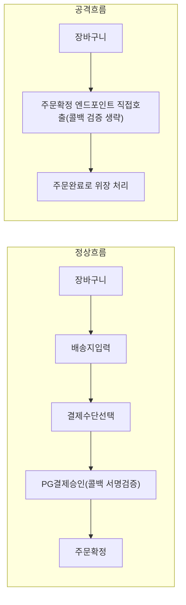

[[웹 취약점 진단 기법 입문 — XXE, SSRF부터 SQLi, XSS까지]], [[웹 취약점 진단 심화 — 실무에서 보는 기법들]], [[웹 취약점 진단 설정편 — CORS·SOP부터 후속 공격까지]]은 전부 "이 입력을 이렇게 바꾸면 깨진다"는 식의 재현 가능한 패턴이 있었습니다. 이번 글은 다릅니다. 비즈니스 로직 결함에는 찾아 넣어볼 고정된 페이로드가 없고, SQLi=CWE-89처럼 기법 하나하나에 맞아떨어지는 세분화된 CWE도 없습니다 — 굳이 분류하면 [CWE-840(Business Logic Errors)](https://cwe.mitre.org/data/definitions/840.html)이라는 포괄적인 범주 하나로 묶일 뿐이고, 실제 결함은 그 안에서 서비스마다 전부 다른 모양을 하고 있습니다. 있는 건 **"이 기능은 이런 순서로 동작할 거라고 개발자가 가정했다"는 전제 하나**뿐이고, 그 전제가 서버 코드에서 실제로 강제되지 않는 지점을 찾는 게 전부입니다. 그래서 이 글은 페이로드 목록이 아니라, 다단계 기능을 볼 때 "어디가 깨질 수 있는가"를 떠올리는 체크리스트에 가깝습니다. 공통 질문은 하나입니다 — **"서버가 매 요청마다 현재 상태를 스스로 다시 확인하는가, 아니면 클라이언트가 보낸 값이나 이전 요청의 흐름을 그냥 믿는가."**

---

## 1. 워크플로우 단계 건너뛰기/순서 뒤바꾸기

**원리**: 회원가입(이메일 인증 → 본인인증 → 가입완료)이나 결제(장바구니 → 배송지 입력 → 결제수단 선택 → 결제승인 → 주문완료)처럼 여러 단계로 나뉜 프로세스는, 각 단계 엔드포인트가 호출될 때마다 "이전 단계가 실제로 끝났는가"를 서버가 **신뢰할 수 있는 출처**로 재확인해야 안전합니다. 결제 단계라면 이 신뢰 출처는 PG사가 보내는 결제완료 콜백(웹훅)의 서명 검증을 통과한 결과여야지, 클라이언트가 보낸 `step` 파라미터나 클라이언트 쪽에서도 세팅 가능한 주문 상태 값이어서는 안 됩니다.

문제는 바로 이 지점에서 생깁니다 — 서버가 "결제완료" 여부를 PG사 콜백 검증이 아니라 클라이언트가 호출한 URL이나 클라이언트가 함께 보낸 상태 파라미터만으로 판단하면, 공격자는 중간 단계(본인인증, 결제) 요청 없이 곧바로 마지막 단계(주문 확정 엔드포인트)를 호출해 그 단계를 통과한 것처럼 위장할 수 있습니다.

"결제 성공" 콜백과 "주문 확정" 처리가 서로 다른 엔드포인트로 분리돼 있어도 문제는 없습니다 — 다만 주문 확정 쪽이 "콜백이 왔다"는 사실 자체가 아니라, PG사로부터 검증된 결제 상태(결제 ID, 금액, 서명)를 매번 다시 조회해 일치하는지 확인하고 그 상태 전이가 한 번만 일어나도록 보장해야 합니다. 이 재검증이 없으면 결제 없이도 주문 완료 상태까지 도달할 수 있습니다.

- 체크 포인트: 뒷 단계 엔드포인트를 앞 단계 요청 없이 직접 호출했을 때 수락되는지, 요청에 담긴 `step`/`stage` 같은 파라미터나 클라이언트가 임의로 설정 가능한 주문 상태값을 조작해 단계를 앞당길 수 있는지, 주문 확정 로직이 PG사 콜백 서명·결제 금액을 서버 쪽에서 재검증하는지(그냥 "콜백이 왔다"로만 판단하지 않는지)
- 참고: [PortSwigger — Business logic vulnerabilities](https://portswigger.net/web-security/logic-flaws), [OWASP WSTG — Circumvention of Work Flows](https://wstg.owasp.org/latest/4-Web_Application_Security_Testing/10-Business_Logic/06-Circumvention_of_Work_Flows/)

## 2. 가격/수량 조작

**원리**: 장바구니·주문 API가 상품 가격·할인율·수량을 서버 DB에서 다시 계산(검증)하지 않고, 클라이언트가 보낸 요청 바디에 담긴 값(`price`, `discount`, `unit_price` 같은 파라미터)을 그대로 최종 결제 금액 계산에 사용할 때 성립합니다 — 가격 필드가 요청에 노출돼 있다는 사실만으로는 공격 표면일 뿐이고, 서버가 그 값을 상품 마스터 DB 가격과 대조하지 않고 그대로 신뢰해야 실제로 깨집니다. 이 조건이 맞으면 Burp 같은 프록시로 요청을 가로채 가격 필드를 낮추거나 할인율을 100%에 가깝게 바꿔 보내는 것만으로 최종 결제 금액이 바뀝니다.

수량 필드는 결이 다른 문제인데, 서버가 각 항목 수량에 대해 "1 이상의 정수인가"라는 하한 검증 없이 "정수 형식인가"만 확인하면, 음수 수량을 가진 항목이 요청에 섞여 들어가도 거부되지 않습니다. 이때 전체 합계 로직이 각 항목의 `수량 × 단가`를 단순 합산만 하고 **최종 합계 자체**가 0 이상인지도 따로 검증하지 않으면, 음수 수량 항목이 다른 양수 항목의 금액을 깎아 실제보다 적은(혹은 마이너스) 결제 금액을 만들 수 있습니다.

- 체크 포인트: 요청 바디에 가격·할인율이 파라미터로 노출돼 있는지, 그 값을 바꿔도 서버가 상품 마스터 DB 가격과 대조하지 않고 그대로 받는지, 개별 항목 수량에 음수를 넣었을 때 서버가 항목 단위로 거부하는지와 별개로 최종 합계의 하한(0 이상)을 검증하는지
- 참고: [PortSwigger — Excessive trust in client-side controls](https://portswigger.net/web-security/logic-flaws/examples#excessive-trust-in-client-side-controls), [OWASP WSTG — Integrity Checks](https://wstg.owasp.org/latest/4-Web_Application_Security_Testing/10-Business_Logic/03-Integrity_Checks/)

## 3. 쿠폰/포인트/크레딧 로직 악용

**원리**: 쿠폰 중복 사용은 "이 쿠폰을 이미 썼다"는 기록을 서버가 세션이나 진행 중인 주문 범위에서만 체크하고, 쿠폰 코드와 사용자 계정을 묶은 영구 기록(사용 이력 테이블 등 DB에 남는 권위 있는 기록)으로 확인하지 않을 때 성립합니다. 이 경우 같은 쿠폰 코드를 다른 세션(로그아웃 후 재로그인, 다른 브라우저)이나 주문을 완전히 끝낸 뒤 새로 시작한 주문에 다시 적용해도 서버가 "처음 보는 쿠폰"으로 취급해 반복 할인을 허용합니다.

포인트 로직의 결함은 결이 다른데, 일부 서비스는 주문 생성 시점에 포인트를 먼저 차감해 "포인트로 결제 완료" 상태로 주문을 만들고, 실제 배송·정산 처리는 이후 별도 단계에서 진행합니다. 이 구조에서 포인트 차감 직후 결제/주문 단계를 의도적으로 중단시켰을 때, 서버의 "실패 시 포인트 환불" 로직이 포인트만 되돌려주고 이미 "포인트 결제 완료"로 생성된 주문 자체는 취소 처리하지 않는다면, 환불받은 포인트와 이미 확정된 주문을 둘 다 가지게 되어 같은 포인트로 두 번 혜택을 보는 결과가 나옵니다.

둘 다 동시 요청이 필요한 게 아니라 **순차적인 요청 몇 번**만으로 재현된다는 점이 핵심이고, "동시에 여러 요청을 보내야만" 성립하는 문제는 이 글이 아니라 다음 섹션에서 다루는 레이스 컨디션에 해당합니다.

- 체크 포인트: 같은 쿠폰 코드를 로그아웃 후 재로그인하거나 새 주문에서 다시 적용했을 때 서버가 "이미 사용됨"으로 거부하는지, 포인트 차감 후 결제/주문 단계가 실패했을 때 포인트 환불 로직이 이미 생성된 주문도 함께 취소 처리하는지, 쿠폰/포인트 사용 이력이 세션이 아니라 계정에 묶인 영구 기록으로 남는지
- 참고: [PortSwigger — Domain-specific flaws](https://portswigger.net/web-security/logic-flaws/examples#domain-specific-flaws), [OWASP WSTG — Number of Times a Function Can Be Used Limits](https://wstg.owasp.org/latest/4-Web_Application_Security_Testing/10-Business_Logic/05-Number_of_Times_a_Function_Can_Be_Used_Limits/)

## 4. 로직 결함과 레이스 컨디션의 경계

**원리**: 엄밀히 따지면 레이스 컨디션도 "서버가 가정한 상태를 실제로 강제하지 않는다"는 점에서 넓은 의미의 비즈니스 로직 결함에 속합니다. 다만 진단 실무에서는 재현에 필요한 조건이 달라서 구분해서 접근하는 게 효율적입니다.

[[웹 취약점 진단 심화 — 실무에서 보는 기법들]]의 "레이스 컨디션(TOCTOU)" 섹션이 다루는 문제는 **확인과 실행 사이의 시간차를 노려, 동시에 여러 요청을 꽂아 넣어야** 재현되는 결함입니다 — 중복 체크 코드 자체는 있지만, 그 체크와 실제 반영 사이의 좁은 시간 창에 여러 요청이 동시에 끼어들 때만 뚫립니다. 이 글에서 다루는 쿠폰/포인트/환불 로직 결함들은 그 중복 체크 자체가 아예 없거나, 체크는 하지만 그 결과를 뒷단계에서 무시하는 경우라 **같은 요청을 시간 간격을 두고 순차적으로 보내기만 해도** 뚫립니다.

이 차이를 실전에서 구분하는 가장 빠른 테스트는: 같은 요청을 하나씩 시간차를 두고 보냈을 때도 매번 중복 처리가 된다면 로직 결함 쪽을 먼저 의심하고, 순차 전송에서는 막히는데 동시에 여러 개를 보냈을 때만 가끔 중복 처리가 된다면 레이스 컨디션 쪽에 무게를 둡니다(이건 확정적 분류라기보다 "어느 쪽을 먼저 파볼지" 정하는 실무 휴리스틱입니다). 둘 다 같은 기능(쿠폰, 포인트, 재고)에서 나타날 수 있으므로, 순차 재현부터 확인한 뒤 안 되면 동시 요청으로 넘어가는 순서가 효율적입니다.

- 체크 포인트: 동일 요청을 순차적으로 재전송했을 때부터 중복 처리가 되는지(로직 결함), 순차 전송에서는 막히는데 Burp Turbo Intruder 등으로 동시 전송했을 때만 뚫리는지(레이스 컨디션)
- 참고: [[웹 취약점 진단 심화 — 실무에서 보는 기법들]] 12번 "레이스 컨디션 (TOCTOU)" 섹션

## 5. 환불/취소 로직 악용

**원리**: "상품을 받은 후 취소해도 재고·배송 상태를 되돌리지 않는" 문제는, 취소 처리 로직이 "배송 전/배송중/배송완료"를 구분하는 분기 자체를 두지 않고, 어떤 배송 상태에서 취소 요청이 들어오든 똑같이 PG사 환불 API 호출을 승인해 버릴 때 성립합니다. 배송완료 상태인 주문에 대해서도 이 동일한 취소 로직이 그대로 적용되면, 사용자는 상품을 실제로 수령한 뒤에도 전액 환불을 받아낼 수 있습니다 — 반품 회수나 수령 여부 재확인 같은 별도 검증 단계가 취소 승인 전에 끼어들지 않는다는 조건에서만 성립하는 결함입니다.

부분 환불의 정합성 문제는 조금 다른 지점에서 생기는데, 서버가 "이 주문에서 지금까지 환불된 누적 금액/수량"을 별도로 추적하지 않고, 부분 환불 요청이 들어올 때마다 "요청된 수량 × 단가"만 가지고 매번 새로 환불 금액을 계산해 지급하면, 같은 품목에 대해 부분 환불 API를 여러 번 반복 호출해 누적 환불액이 원래 결제 금액을 넘어서는 결과를 만들 수 있습니다. 이는 환불 가능 잔여 금액·수량을 서버가 추적·차감하지 않을 때만 성립하며, 요청마다 "이미 환불된 몫"을 빼고 계산하거나 누적 환불 상한을 검증하면 막힙니다.

- 체크 포인트: 취소/환불 처리 로직이 배송 상태(배송전/배송중/배송완료)에 따라 분기하는지, 전액 환불이 수령 확인 이후에도 승인되는지, 같은 품목에 부분 환불 요청을 반복했을 때 서버가 이미 환불된 금액/수량을 차감하지 않고 매번 새로 계산해 누적 환불액이 원 결제 금액을 넘어서는지
- 참고: [PortSwigger — Domain-specific flaws](https://portswigger.net/web-security/logic-flaws/examples#domain-specific-flaws), [OWASP WSTG — Payment Functionality](https://wstg.owasp.org/latest/4-Web_Application_Security_Testing/10-Business_Logic/10-Payment_Functionality/)

## 6. 초대/추천인 보상 로직 악용

**원리**: 추천인 가입 보너스는 "추천인 계정"과 "신규 가입 계정"이 서로 다른 실체임을 서버가 검증한다는 전제로 설계됩니다. 이 전제가 깨지는 경우가 두 가지입니다.

하나는 추천인 코드 입력을 가입 시점뿐 아니라 가입 후의 별도 "친구 초대" 화면에서도 받는 서비스에서, 그 입력 폼이 "입력한 코드의 소유자가 현재 로그인한 계정 자신인지"를 비교하지 않는 경우입니다 — 이미 가입한 계정이 자기 화면에서 자기 추천 코드를 그대로 입력해도 서버가 추천인 ID와 피추천인 ID의 동일성을 검증하지 않으면 보상이 그대로 지급됩니다.

다른 하나는 이메일 중복 가입 검증이 주소 전체 문자열 일치만 확인하는 경우로, Gmail 등 일부 메일 서비스가 지원하는 플러스 별칭(`user+1@example.com`처럼 `+` 뒤를 무시하고 전부 `user@example.com` 받은편지함으로 배달되는 규칙)을 정규화 없이 "다른 사용자"로 취급하면, 메일함 하나로 받는 주소 여러 개를 계정마다 다르게 등록해 각 계정으로 가입 보너스와(위 경로가 함께 성립하면) 추천 보너스까지 반복 수령할 수 있습니다.

다만 플러스 별칭 처리 방식은 메일 서비스마다 다르므로(지원 여부, `+`가 아닌 다른 구분자 사용 등), "모든 이메일의 `+alias`를 일괄 제거"하는 식의 범용 정규화는 오히려 서로 다른 사용자의 주소를 같다고 오판하는 부작용을 만들 수 있습니다 — 근본적인 방어는 이메일 정규화가 아니라 추천인-피추천인 관계에 이메일과 독립적인 본인 식별값(결제수단, 전화번호 인증 등) 중복 검사를 추가하는 쪽입니다.

- 체크 포인트: 가입 후 별도 화면에서 추천 코드를 입력받는 기능이 있다면 본인 계정 코드를 입력했을 때 보상이 지급되는지, 회원가입 이메일 중복 검사가 플러스 별칭을 지원하는 메일 서비스(Gmail 등)의 로컬파트까지 동일 주소로 인식하는지, 동일 결제수단/전화번호로 여러 계정을 만들어도 추천 보상이 매번 지급되는지
- 참고: [PortSwigger — Making flawed assumptions about user behavior](https://portswigger.net/web-security/logic-flaws/examples#making-flawed-assumptions-about-user-behavior), [OWASP — Email Validation and Verification Cheat Sheet](https://cheatsheetseries.owasp.org/cheatsheets/Email_Validation_and_Verification_Cheat_Sheet.html)

## 7. (선택) 기능 제한 우회

**원리**: 무료 플랜의 사용량 제한(일일 호출 횟수, 내보내기 건수 등)이 프런트엔드 코드에서만 체크되는 경우가 있습니다 — 예를 들어 버튼을 비활성화하거나, 브라우저 로컬스토리지에 카운터를 저장해 UI에서만 "한도 초과"를 표시하는 방식입니다. 이 전제에서는 실제 제한을 집행하는 코드가 서버 API 쪽에 아예 없거나, 있더라도 클라이언트가 보낸 카운터 값을 신뢰하는 형태입니다.

이 경우 UI를 거치지 않고 해당 API 엔드포인트를 직접 호출하면(혹은 로컬스토리지 값을 초기화하면) 서버가 계정 단위로 사용량을 집계하는 별도 로직이 없는 한 제한 없이 반복 호출이 가능합니다. 반대로 서버가 계정 ID나 API 키 기준으로 호출 횟수를 DB/캐시에 기록하고 매 요청마다 그 값을 검사한다면, 클라이언트 쪽 UI 제한을 우회해도 서버에서 그대로 막힙니다.

- 체크 포인트: 사용량 제한이 응답 헤더/본문의 플래그나 로컬스토리지 값으로만 표현되는지, 제한에 걸린 것처럼 보이는 상태에서 API를 직접(curl 등으로) 호출했을 때도 거부되는지, 계정 단위 사용량 집계가 서버 쪽 저장소에 남는지
- 참고: [OWASP WSTG — Number of Times a Function Can Be Used Limits](https://wstg.owasp.org/latest/4-Web_Application_Security_Testing/10-Business_Logic/05-Number_of_Times_a_Function_Can_Be_Used_Limits/), [OWASP WSTG — Defenses Against Application Misuse](https://wstg.owasp.org/latest/4-Web_Application_Security_Testing/10-Business_Logic/07-Defenses_Against_Application_Misuse/)

---

## 정리 — 질문은 결국 하나

| 결함 유형 | 깨지는 조건 |
|---|---|
| 워크플로우 건너뛰기 | 단계 진행 상태를 서버가 아니라 클라이언트 파라미터로 판단 |
| 가격/수량 조작 | 가격·할인율이 파라미터로 노출되고 서버가 재계산 안 함 |
| 쿠폰/포인트 악용 | 사용 이력이 세션 단위일 뿐 영구 기록이 없거나, 실패 시 복구 로직이 주문 상태를 함께 롤백 안 함 |
| 로직 결함 vs 레이스 컨디션 | 순차 요청만으로 뚫리는가(로직), 동시 요청이 필요한가(레이스) — 재현 조건으로 구분하는 실무 휴리스틱 |
| 환불/취소 악용 | 취소 로직이 배송 상태를 분기하지 않거나, 누적 환불액을 추적·차감하지 않음 |
| 추천인 보상 악용 | 본인 식별·이메일 정규화 없이 "다른 사용자"로 오판 |
| 기능 제한 우회 | 제한 집행이 서버가 아니라 클라이언트 UI에만 있음 |

비즈니스 로직 결함은 범용 스캐너가 찾기 어려운 영역입니다(기능마다 "정상 흐름"을 스캐너에 미리 정의해줘야 하니, 아예 불가능하다기보다 자동화 비용이 수작업보다 훨씬 커지는 쪽에 가깝습니다). 기능 명세를 읽고 "이 순서가 꼭 지켜져야 하는 이유가 뭔가"를 각 단계마다 물어보고, 그 이유를 서버 코드가 실제로 강제하는지 요청을 조작해 가며 확인하는 수작업이 가장 확실한 방법입니다. 더 많은 실제 패턴은 [PortSwigger Web Security Academy — Business logic vulnerabilities](https://portswigger.net/web-security/logic-flaws)와 [OWASP Web Security Testing Guide — Business Logic Testing](https://wstg.owasp.org/latest/4-Web_Application_Security_Testing/10-Business_Logic/00-Introduction_to_Business_Logic)에서 계속 갱신됩니다.
