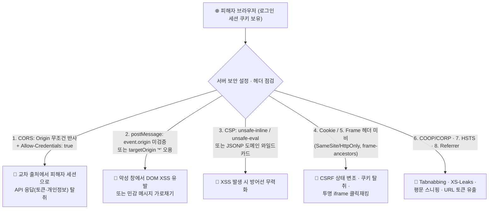
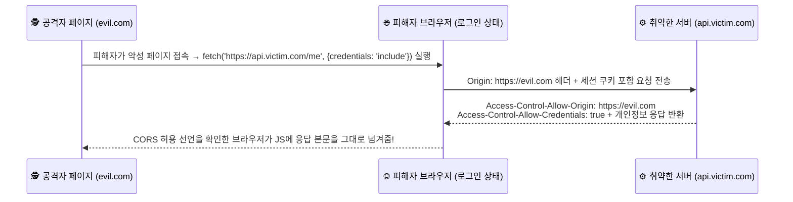

> [!summary] ⏱️ 5초 핵심 요약
> - **한 줄 비유**: 브라우저의 **SOP(동일 출처 정책)**가 집 안의 귀중품을 다른 집 사람이 못 가져가게 막는 **기본 방범창**이라면, **CORS·`postMessage`·CSP·쿠키 속성·프레임 헤더**는 집주인(서버 개발자)이 직접 조절하는 **방범창 개폐 스위치와 잠금 옵션**입니다.
> - **핵심 원리**: 보안 헤더나 설정은 단순히 "존재하는가?"가 아니라 **"어떤 값으로 조합되었고, 그 설정이 뚫렸을 때 실제로 피해자 세션에서 어떤 후속 공격(개인정보 탈취·계정 장악·CSRF·클릭재킹)이 성립하는가?"**로 진단해야 합니다.
> - **핵심 진단 포인트**: ① `Origin` 반사 + `Allow-Credentials: true`(CORS), ② `event.origin` 미검증(`postMessage`), ③ `unsafe-inline`/JSONP 허용 호스트(CSP), ④ `SameSite`/`HttpOnly`/`Secure` 누락(쿠키), ⑤ `frame-ancestors` 누락(클릭재킹)을 후속 익스플로잇 조건과 함께 교차 검증합니다.

[[웹 취약점 진단 기법 입문 — XXE, SSRF부터 SQLi, XSS까지]]와 [[웹 취약점 진단 심화 — 실무에서 보는 기법들]]에서 다룬 항목들이 주로 서버 애플리케이션 코드 레벨의 결함이었다면, 이번 글은 **브라우저 보안 모델을 지탱하는 설정값 하나가 전체 방어선을 무너뜨리는 8가지 사례**와 실제 후속 공격 체인을 다룹니다.

---

## 한눈에 보는 브라우저 보안 설정 8대 결함과 후속 공격 성립 조건

| 설정 항목 | 취약한 설정 패턴 | 후속 공격이 실제로 성립하기 위한 필수 조건 | 최종 피해 (Impact) |
|---|---|---|---|
| **1. CORS 설정 오류** | 요청 `Origin` 그대로 반사(또는 `null`/접미사 허술 검증) + `Access-Control-Allow-Credentials: true` | 교차 출처 요청에 세션 쿠키가 실제로 전송될 것(`SameSite` 및 서드파티 쿠키 정책 통과) + 민감 응답 반환 | 피해자 개인정보·API 키·CSRF 토큰 읽기 및 계정 탈취 |
| **2. `postMessage` 오류** | 수신부 `event.origin` 미검증 또는 발신부 `targetOrigin: "*"` | 수신 데이터를 `innerHTML`/`eval` 등 위험 싱크에 전달하거나 민감 토큰을 공격자 창에 발송 | DOM-based XSS 실행 또는 인증 토큰 유출 |
| **3. CSP 설정 오류** | `script-src`에 `'unsafe-inline'`(nonce/hash 부재), `'unsafe-eval'`, 또는 JSONP 보유 도메인 전체 허용 | 애플리케이션 내에 스크립트/마크업 주입 지점(XSS)이 존재할 것 | CSP 우회를 통한 XSS 스크립트 실행 |
| **4. 쿠키 속성 오류** | 세션 쿠키에 `HttpOnly`, `Secure`, `SameSite` 누락 또는 `GET`으로 상태 변경 허용 | XSS 발생(`HttpOnly` 누락 시), 평문 HTTP 유도(`Secure` 누락 시), 외부 사이트 요청 유도(`SameSite`/토큰 미비 시) | 세션 하이재킹 또는 CSRF 상태 변조 |
| **5. 클릭재킹 방어 누락** | `X-Frame-Options` 및 CSP `frame-ancestors` 모두 누락 | 타 사이트 `<iframe>` 안에서 로그인 세션이 유지되고 **클릭 한두 번으로 완료되는 민감 동작** 존재 | 사용자 모르게 권한 승인·송금·설정 변경 실행 |
| **6. COOP / CORP 누락** | `window.open()` 시 `noopener`/COOP 누락, 민감 리소스에 CORP 누락 | 열린 창이 `window.opener` 조작 가능하거나, 로그인 상태별 응답 차이를 `no-cors`로 관찰 가능 | 역 탭내빙(Reverse Tabnabbing) 피싱, XS-Leaks 정보 추론 |
| **7. HSTS 누락** | `Strict-Transport-Security` 미설정, 짧은 `max-age`, `includeSubDomains` 누락 | 사용자가 평문 `http://`로 접속하는 구간(초기 접속·서브도메인)에 네트워크 MITM 개입 | SSL Stripping 및 평문 요청/쿠키 가로채기 |
| **8. Referrer-Policy 노출** | 느슨한 정책(`unsafe-url` 등) + **URL 쿼리스트링에 민감 토큰 포함** | 해당 페이지에서 외부 이미지·광고·분석 스크립트를 로드하거나 외부 링크 클릭 | 외부 서버의 `Referer` 로그로 비밀번호 재설정/세션 토큰 유출 |

---

## 1. CORS (Cross-Origin Resource Sharing) 설정 오류

**💡 한 줄 비유**: 은행 금고실이 원래는 본점 창구(`Same-Origin`)에서만 열리는데, **"어느 동네 심부름센터(`Origin: https://evil.com`)에서 오든 손님 도장(`Allow-Credentials: true`)만 찍혀 있으면 금고 안의 서류를 다 보여줘라"라고 예외 규정을 열어둔 것**입니다.

- **핵심 원리와 성립 조건**: 브라우저의 **SOP(Same-Origin Policy)**는 기본적으로 다른 출처(Origin = 프로토콜 + 호스트 + 포트)의 JavaScript가 응답 본문을 읽지 못하게 차단합니다. 그런데 서버가 요청의 `Origin` 헤더를 검증 없이 `Access-Control-Allow-Origin`에 그대로 반사하면서 동시에 **`Access-Control-Allow-Credentials: true`**를 반환하면 SOP 방어벽이 무너집니다.
  - *(주의: 와일드카드 `*`와 `Allow-Credentials: true`는 브라우저 표준상 함께 동작하지 않으므로, 서버가 요청 `Origin` 문자열을 동적으로 복사해 찍어주는 구현이 진짜 위험합니다. 또한 공격 코드가 `{credentials: "include"}`로 요청할 때 피해자 세션 쿠키가 실제로 실리려면 쿠키의 `SameSite` 설정과 브라우저 서드파티 쿠키 정책 조건도 함께 맞아야 합니다.)*
- **자주 틀리는 Origin 검증 우회 패턴 3가지**:
  1. **접미사(`endsWith`) 검사 허점**: `origin.endsWith("example.com")`으로만 검사하면 공격자가 **`https://evil-example.com`** 도메인을 등록해 단번에 통과합니다.
  2. **접두사/포함(`startsWith`/`includes`) 검사 허점**: `https://example.com.attacker.com`처럼 서브도메인 형태로 신뢰 도메인을 앞에 끼워 넣으면 통과합니다.
  3. **`Origin: null` 허용 허점**: 서버가 `Access-Control-Allow-Origin: null`을 허용해 두면, 공격자는 악성 페이지 안에 **`<iframe sandbox="allow-scripts" srcdoc="...">`**를 띄워 강제로 `Origin: null` 요청을 만들어 보낼 수 있습니다.
- **체크 포인트**:
  - 민감 정보를 반환하는 API에 임의 `Origin`, 접두/접미 변형 `Origin`, `Origin: null`을 넣어 반사 여부와 `Access-Control-Allow-Credentials: true` 동반 여부를 확인
- **참고**: [PortSwigger — CORS vulnerabilities](https://portswigger.net/web-security/cors), [MDN — CORS](https://developer.mozilla.org/en-US/docs/Web/HTTP/Guides/CORS)

---

## 2. `window.postMessage` / SOP 우회

**💡 한 줄 비유**: 아파트 세대 간 인터폰(`postMessage`)으로 대화할 때, **수신자가 화면으로 누가 걸었는지(`event.origin`) 확인도 안 하고 "문 열어!"라는 말만 듣고 현관문을 열어주거나, 발신자가 수신 세대 번호를 지정하지 않고(`"*"`) 아무에게나 비밀번호를 불러주는 것**입니다.

- **핵심 원리와 2가지 공격 방향**: `window.postMessage()`는 서로 다른 출처의 창(iframe, 팝업)끼리 안전하게 메시지를 주고받도록 설계된 표준 API이지만, 개발자가 출처 검증을 빼먹으면 SOP 우회 통로가 됩니다.
  1. **수신 측 결함 (`event.origin` 미검증)**: `window.addEventListener("message", (event) => { ... })` 핸들러 안에서 **`event.origin`이 신뢰할 수 있는 정확한 출처인지 확인하지 않고** `event.data`를 그대로 `innerHTML`, `eval()`, `location.href`나 상태 변경 로직에 넣으면, 공격자 페이지가 피해 사이트를 iframe이나 팝업으로 띄운 뒤 악성 메시지를 던져 **DOM XSS**를 일으킬 수 있습니다.
  2. **발신 측 결함 (`targetOrigin: "*"` 오용)**: `targetWindow.postMessage(secretToken, "*")`는 인터넷 전체에 방송하는 것이 아니라 **그 `targetWindow` 참조가 현재 가리키는 문서의 출처가 무엇이든 상관없이 전달한다**는 뜻입니다. 만약 공격자가 그 iframe이나 팝업 창의 위치를 자신의 사이트로 이동(Navigation)시키거나 처음부터 공격자 창에서 열게 유도하면 비밀 토큰이 공격자 창으로 그대로 전달됩니다.
- **체크 포인트**:
  - 프런트엔드 코드 내 `addEventListener("message", ...)` 검색 후 `event.origin === "https://trusted.example.com"` 엄격 비교 유무와 `event.data`가 흘러가는 싱크 확인
  - `postMessage(data, "*")` 호출부에서 민감 데이터를 다루는지 확인
- **참고**: [PortSwigger — DOM-based vulnerabilities: postMessage](https://portswigger.net/web-security/dom-based/web-messages)

---

## 3. CSP (Content-Security-Policy) 설정 오류

**💡 한 줄 비유**: 건물에 최신 금속 탐지기(CSP)를 설치해 놓고는, **"단, 주머니에 넣은 칼(`'unsafe-inline'`)이나 현장에서 조립한 무기(`'unsafe-eval'`), 그리고 옆 건물 마트(`*.googleapis.com` 등 JSONP 보유 호스트)에서 산 물건은 무조건 통과!"라고 예외 규칙을 걸어둔 상태**입니다.

- **핵심 원리**: CSP는 설령 화면에 XSS 구멍이 있더라도 브라우저가 허가되지 않은 스크립트 실행과 외부 전송을 차단하는 강력한 2차 방어선입니다. 따라서 CSP 헤더가 "존재한다"가 아니라 **지시어(Directive) 구성이 실제로 우회 불가능한가**를 봐야 합니다.
- **대표적인 CSP 무력화 패턴 4가지**:
  1. **`'unsafe-inline'` 단독 사용**: `script-src`에 nonce나 hash 없이 `'unsafe-inline'`이 들어 있으면 공격자가 삽입한 인라인 `<script>`나 이벤트 핸들러가 그대로 실행됩니다.
  2. **`'unsafe-eval'` 허용**: 문자열을 코드로 실행하는 `eval()`, `setTimeout("...")`, `new Function()`을 허용해 동적 실행 기반 XSS 경로가 열립니다.
  3. **JSONP·구버전 라이브러리가 있는 광범위한 호스트 허용**: `script-src`에 `*.googleapis.com`, `cdnjs.cloudflare.com`이나 자체 CDN 도메인 전체를 경로 제한 없이 올려두면, 공격자는 **그 허용된 도메인 안에 존재하는 JSONP 엔드포인트(`?callback=alert(1)`)나 구버전 AngularJS 파일**을 `<script src="...">`로 불러와 CSP를 합법적으로 통과하며 임의 JS를 실행할 수 있습니다.
  4. **고정된 Nonce 또는 `Report-Only` 방치**: `nonce-...` 값이 매 응답마다 난수로 바뀌지 않고 고정되어 있거나, 차단 기능이 없는 `Content-Security-Policy-Report-Only` 헤더로만 적용된 경우 실제 방어력은 없습니다.
- **체크 포인트**: 응답의 CSP 헤더를 복사해 [Google CSP Evaluator](https://csp-evaluator.withgoogle.com/)에 넣고 `unsafe-inline`, `unsafe-eval`, 와일드카드/JSONP 허용 호스트, `base-uri`/`object-src` 누락 여부를 점검.
- **참고**: [Google CSP Evaluator](https://csp-evaluator.withgoogle.com/), [PortSwigger — Content Security Policy](https://portswigger.net/web-security/cross-site-scripting/content-security-policy)

---

## 4. 쿠키 속성 오류 (`SameSite`, `Secure`, `HttpOnly`)

**💡 한 줄 비유**: 금고 열쇠(세션 쿠키)를 주면서 **"누구나 손으로 만져볼 수 있게 하고(`HttpOnly` 누락), 투명 비닐봉지에 담아 다니고(`Secure` 누락), 남이 시키는 심부름 갈 때도 무조건 들고 가라(`SameSite` 미비)"**고 방치하는 것입니다.

- **3대 쿠키 보안 속성과 실제 공격 성립 조건**:
  1. **`HttpOnly` 누락 → XSS 피해 증폭**: `HttpOnly`가 빠졌다고 저절로 쿠키가 새어나가진 않지만, 같은 도메인에 XSS나 `postMessage` 결함이 하나라도 터지는 순간 공격자 스크립트가 `document.cookie`로 세션 쿠키를 통째로 훔쳐갈 수 있습니다.
  2. **`Secure` 누락 (`SameSite=None` 결합 포함)**: `Secure`가 없으면 사용자가 평문 `http://` 요청을 보낼 때 네트워크상에 쿠키가 평문으로 노출됩니다. 또한 최신 브라우저는 `SameSite=None`을 쓸 때 `Secure`가 없으면 쿠키 자체를 거부하지만, 비표준·구형 환경에서는 여전히 위험이 남습니다.
  3. **`SameSite=Lax`의 맹점 (Top-level GET 상태 변경)**: 최신 브라우저의 기본값인 `SameSite=Lax`는 교차 사이트 `POST`/iframe 요청에는 쿠키를 안 붙이지만, **링크 클릭이나 `window.location` 이동 같은 최상위 `GET` 네비게이션에는 여전히 쿠키를 붙여서 보냅니다.** 따라서 서버가 상태 변경(탈퇴, 권한 부여, 설정 변경 등)을 `GET` 요청으로도 처리하고 CSRF 토큰이 없다면 `SameSite=Lax` 상태에서도 CSRF가 그대로 성립합니다!
- **체크 포인트**:
  - 로그인 후 발급되는 `Set-Cookie` 헤더에 `HttpOnly`, `Secure`, `SameSite`가 모두 적절히 설정되어 있는지
  - `POST` 요청을 `GET`으로 바꿨을 때도 서버가 상태 변경을 수행하는지(`SameSite=Lax` 우회 CSRF)
- **참고**: [OWASP — CSRF Prevention Cheat Sheet](https://cheatsheetseries.owasp.org/cheatsheets/Cross-Site_Request_Forgery_Prevention_Cheat_Sheet.html), [web.dev — SameSite cookies explained](https://web.dev/articles/samesite-cookies-explained)

---

## 5. 클릭재킹(Clickjacking) 방어 헤더 누락

**💡 한 줄 비유**: 사기꾼이 **"무료 경품 받기" 종이 판(공격자 웹페이지) 위에 눈에 보이지 않는 투명 먹지(투명 `<iframe>`으로 띄운 은행 '송금 승인' 화면)를 겹쳐 놓고**, 피해자가 경품 버튼을 누르는 순간 실제로는 은행 송금 버튼이 눌리게 만드는 수법입니다.

- **핵심 원리와 성립 조건**: 응답에 `X-Frame-Options: DENY`(또는 `SAMEORIGIN`)나 CSP의 `frame-ancestors 'none'`(또는 `'self'`) 헤더가 없으면 다른 사이트가 해당 페이지를 `<iframe>`으로 끼워 넣을 수 있습니다.
  - **단, 헤더가 없다고 모든 페이지가 위험한 것은 아닙니다.** 실제로 클릭재킹 공격이 성립하려면 ① 외부 사이트의 iframe 안에서도 피해자의 로그인 쿠키가 전송·유지되어야 하고(`SameSite=None` 등 조건), ② 키보드 입력 없이 **마우스 클릭 한두 번만으로 완료되는 민감 기능(OAuth 권한 승인, 2단계 인증 해제, 계정 삭제, 원클릭 결제 등)**이 그 화면에 있어야 합니다.
- **체크 포인트**:
  - 단일 클릭으로 민감 작업이 수행되는 페이지에 `CSP: frame-ancestors` 또는 `X-Frame-Options`가 존재하는지 (구형 폐기 문법인 `ALLOW-FROM`만 쓰고 있지는 않은지 확인)
- **참고**: [OWASP — Clickjacking Defense Cheat Sheet](https://cheatsheetseries.owasp.org/cheatsheets/Clickjacking_Defense_Cheat_Sheet.html)

---

## 6. Cross-Origin Isolation 헤더 오설정 (`COOP` / `CORP`, XS-Leaks)

**💡 한 줄 비유**: 내 방에서 새 창문(`window.open`)을 열었는데 **그 창문 너머의 낯선 사람이 거꾸로 내 방 안의 가구 배치를 마음대로 바꾸거나(`window.opener` 조작), 문틈으로 흘러나오는 불빛 크기와 소리(응답 크기·상태코드·시간 차이)만 보고 내가 방에 있는지 알아맞히는(XS-Leaks) 기법**입니다.

- **핵심 원리와 현대 브라우저 기준**:
  1. **Reverse Tabnabbing과 `COOP`**: 현대 브라우저는 `<a target="_blank">` 태그에는 자동으로 `rel="noopener"`를 기본 적용합니다. 그러나 JavaScript 코드로 **`window.open()`을 직접 호출하면서 `noopener`를 주지 않았고 서버에 `Cross-Origin-Opener-Policy (COOP)` 헤더도 없다면**, 새로 열린 외부 창이 `window.opener.location = "https://phishing.example"`로 원래 탭을 피싱 사이트로 몰래 바꿔치기할 수 있습니다.
  2. **XS-Leaks(교차 사이트 누출)와 `CORP`**: 다른 출처에서 `<script>`, `` 등으로 리소스를 불러올 때 응답 본문은 SOP로 못 읽어도 **로드 성공/에러 이벤트(`onload`/`onerror`), 응답 소요 시간, 프레임 개수 차이** 같은 사이드채널 신호로 피해자의 로그인 여부나 특정 검색 결과 유무를 추론할 수 있습니다. `Cross-Origin-Resource-Policy: same-origin`(또는 `same-site`) 헤더는 이런 무단 교차 출처 리소스 로드를 차단해 XS-Leaks 표면을 줄여줍니다.
- **체크 포인트**: `window.open()` 호출부의 `noopener` 및 `Cross-Origin-Opener-Policy` 설정 유무, 개인화된 상태를 반환하는 엔드포인트의 `Cross-Origin-Resource-Policy` 적용 여부.
- **참고**: [XS-Leaks Wiki](https://xsleaks.dev/), [web.dev — COOP/COEP](https://web.dev/articles/coop-coep)

---

## 7. HSTS (HTTP Strict Transport Security) 누락

**💡 한 줄 비유**: 손님에게 **"앞으로 우리 매장에 올 때는 무조건 방탄차(`HTTPS`)만 타고 오세요. 일반 택시(`HTTP`)는 아예 타지도 마세요!"라고 기억시키는 서약서(`Strict-Transport-Security`)**가 빠져서, 첫 출발 순간에 가짜 택시(MITM)에 납치당하는 상황입니다.

- **핵심 원리와 성립 조건**: 사용자가 주소창에 `example.com`만 치거나 오래된 `http://` 링크를 눌렀을 때, 유효한 HSTS 정책이 없으면 첫 요청이 평문 HTTP로 나가면서 중간자 공격자(MITM)가 이를 가로채 HTTPS 전환을 막는 **SSL Stripping** 공격이나 평문 쿠키 탈취가 가능해집니다.
  - **최초 1회 접속(TOFU)의 한계와 Preload**: HSTS 헤더는 브라우저가 HTTPS로 한 번 이상 응답을 받아야 기억하므로, 생애 최초 접속 순간까지 보호하려면 브라우저에 내장된 **HSTS Preload List**에 등재되어야 합니다.
  - **`includeSubDomains` 누락의 위험**: 상위 도메인에만 HSTS가 걸려 있고 `includeSubDomains`가 빠지면, 평문 HTTP가 열려 있는 하위 서브도메인 하나가 중간자 공격을 당해 상위 도메인 범위의 쿠키를 탈취당하거나 변조(Cookie Tossing)당하는 구멍이 됩니다.
- **체크 포인트**: `Strict-Transport-Security: max-age=31536000; includeSubDomains; preload` 설정 여부 및 [hstspreload.org](https://hstspreload.org/) 등재 여부 확인.
- **참고**: [OWASP — HTTP Strict Transport Security Cheat Sheet](https://cheatsheetseries.owasp.org/cheatsheets/HTTP_Strict_Transport_Security_Cheat_Sheet.html), [hstspreload.org](https://hstspreload.org/)

---

## 8. `Referrer-Policy` 과다 노출과 URL 내 시크릿 유출

**💡 한 줄 비유**: 금고 열쇠 번호가 적힌 쪽지(`?reset_token=secret123`)를 손에 들고 백화점 안의 외부 브랜드 매장(외부 광고·분석 스크립트·외부 링크)에 들어갔더니, **입구 방명록(`Referer` 헤더)에 내가 방금 어디서 무슨 쪽지를 들고 왔는지 주소 전체가 그대로 찍혀 남에게 넘어가는 상황**입니다.

- **핵심 원리와 성립 조건**: 현대 브라우저의 기본 `Referrer-Policy`는 이미 `strict-origin-when-cross-origin`이므로 교차 출처 요청에는 경로와 쿼리스트링을 뺀 도메인(Origin)만 전달됩니다. 그러나 서버가 명시적으로 **`unsafe-url`이나 `no-referrer-when-downgrade` 같은 느슨한 정책을 설정**해 두었고, 동시에 **비밀번호 재설정 토큰·OAuth 코드·세션 ID 등 민감 정보를 URL 쿼리스트링에 담는 설계**가 결합되어 있을 때 문제가 터집니다.
  - 그 페이지 안에 외부 이미지, 광고/트래킹 스크립트가 로드되거나 사용자가 외부 링크를 클릭하는 순간, `Referer` 헤더에 전체 URL(토큰 포함)이 실려 제3자 서버 로그로 유출됩니다. *(참고: 페이지 안에 이미 로드된 서드파티 JS가 직접 `window.location.href`를 읽어 전송하는 것은 `Referrer-Policy`로도 막을 수 없으므로, 애초에 민감 토큰을 URL에 오래 남기지 않는 설계가 근본 해법입니다.)*
- **체크 포인트**:
  - 비밀번호 재설정 화면·마법 링크 로그인 화면 등 URL 쿼리에 일회용 토큰이 있는 페이지에서 외부 리소스 로드 여부 및 `Referrer-Policy: no-referrer`(또는 `strict-origin`) 설정 여부 확인
- **참고**: [OWASP — Referrer Policy](https://cheatsheetseries.owasp.org/cheatsheets/HTML5_Security_Cheat_Sheet.html#referrer), [web.dev — Referrer-Policy](https://web.dev/articles/referrer-best-practices)
