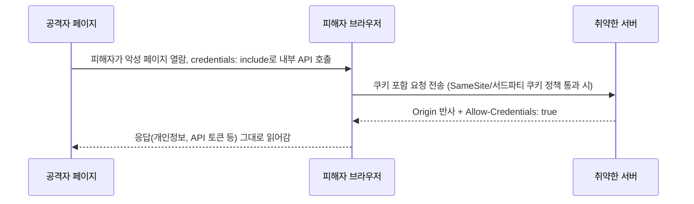

[[웹 취약점 진단 기법 입문 — XXE, SSRF부터 SQLi, XSS까지]], [[웹 취약점 진단 심화 — 실무에서 보는 기법들]]에서 다룬 항목들은 대부분 코드 레벨의 결함이지만, 이번 글은 코드가 아니라 **브라우저 보안 모델을 떠받치는 설정값 하나**가 전체 방어를 무너뜨리는 사례들을 모았습니다. CORS, SOP, CSP, 쿠키 속성, 클릭재킹 방어 헤더는 "있는지 없는지"가 아니라 **"어떻게 설정했는지"가 취약 여부를 가르는 항목**이라, 설정값 자체와 함께 그게 뚫렸을 때 실제로 가능해지는 후속 공격까지 같이 정리했습니다.

---

## 1. CORS 설정 오류

**원리**: Same-Origin Policy는 기본적으로 다른 출처의 JS가 응답을 읽지 못하게 막는데, CORS는 서버가 `Access-Control-Allow-Origin` 헤더로 예외를 선언하는 메커니즘입니다. 문제는 서버가 요청의 `Origin` 헤더를 검증 없이 그대로 반사하면서 동시에 `Access-Control-Allow-Credentials: true`를 켜는 경우입니다.

단, 이것만으로 쿠키가 자동 전송되진 않습니다 — 공격자 측 요청이 `fetch(..., {credentials: "include"})`나 XHR의 `withCredentials = true`를 명시해야 하고, 쿠키의 `SameSite` 속성과 브라우저의 서드파티 쿠키 정책이 전송을 허용해야 하며, 필요하면 preflight도 통과해야 합니다(**cross-origin과 cross-site는 다른 개념**입니다).

이 조건이 맞으면 공격자 페이지가 피해자 세션으로 내부 API를 호출해 응답(개인정보, API 토큰, CSRF 토큰 등)을 그대로 읽어갈 수 있습니다 — 단순 정보노출이 아니라 **계정 탈취로 이어지는 체인의 시작점**입니다.

Origin 검증 로직 자체도 구멍이 흔합니다: `endsWith("example.com")` 검사는 `evil-example.com`에 속고, `includes()`/정규식 부분일치 검사는 `example.com.attacker.com`처럼 앞쪽에 신뢰 도메인을 끼워 넣은 값에 속습니다. `null` origin(sandboxed iframe, `data:`, `file://`처럼 opaque origin을 갖는 문서)을 허용하는 것도 공격자가 쉽게 만들 수 있는 값이라 같은 구멍입니다.

- 체크 포인트:
  - `Access-Control-Allow-Origin`이 요청 Origin을 그대로 반사하면서 `Access-Control-Allow-Credentials: true`도 함께 있는지
  - Origin 검증이 `endsWith`/`includes`/정규식 부분일치로 느슨하게 돼 있는지
  - `null` origin을 허용하는지
  - 실제로 공격 코드가 자격 증명을 포함해 요청을 보낼 조건(SameSite, 서드파티 쿠키 정책)이 성립하는지
- 참고: [PortSwigger — CORS vulnerabilities](https://portswigger.net/web-security/cors), [MDN — CORS](https://developer.mozilla.org/en-US/docs/Web/HTTP/Guides/CORS)

## 2. postMessage / SOP 우회

**원리**: SOP 자체는 origin을 엄격히 비교하지만, `window.postMessage`는 교차 출처 통신을 위해 의도적으로 SOP를 우회하도록 설계된 API입니다. 수신 측이 `message` 이벤트의 `event.origin`을 검증하지 않으면, 공격자 페이지가 숨겨진 iframe·팝업을 열어 피해자 페이지에 임의 메시지를 보내 민감 동작(토큰 저장, 설정 변경, 메시지를 `innerHTML`에 그대로 넣거나 `eval`하는 핸들러라면 XSS급 코드 실행)을 피해자 세션에서 대신 수행시킬 수 있습니다.

발신 측의 `postMessage(data, "*")`는 흔히 "아무 origin에나 방송한다"고 오해하지만, 실제로는 **호출 시점에 쥐고 있는 특정 Window 참조**(열어둔 팝업, iframe 등)에만 전달됩니다 — 위험한 경우는 공격자가 그 Window 참조가 가리키는 문서를 자신의 origin으로 이동시키거나 애초에 공격자가 통제하는 iframe/팝업 URL로 메시지를 보내게 유도했을 때로 한정됩니다.

- 체크 포인트: `addEventListener("message", ...)` 핸들러에서 `event.origin` 검증 유무, `postMessage` 호출부의 두 번째 인자(targetOrigin)가 `*`인지, 메시지 payload를 DOM에 그대로 삽입하거나 `eval`하는지
- 참고: [PortSwigger — DOM-based vulnerabilities: postMessage](https://portswigger.net/web-security/dom-based/web-messages)

## 3. CSP 설정 오류

**원리**: CSP(Content-Security-Policy)는 XSS가 "터져도" 실행되지 않게 막는 방어선인데, `script-src`에 `'unsafe-inline'`이 들어가면 인라인 스크립트 차단이 풀리고(단, nonce-source나 hash-source가 함께 지정돼 있으면 `unsafe-inline`은 구형 브라우저 호환용 폴백으로만 남고 무시됩니다), `'unsafe-eval'`이 들어가면 문자열 기반 동적 실행(`eval`, `new Function` 등)이 허용돼 공격자 입력이 그 경로까지 닿으면 실행됩니다.

호스트 허용 목록에 `*.googleapis.com`처럼 경로 제한 없는 도메인을 통째로 올리면, 리다이렉트로 외부 도메인 스크립트를 끌어오는 게 아니라 **그 허용 호스트 자체에 있는 JSONP 엔드포인트 등을 경유해 임의 JS를 실행**시키는 방식으로 뚫립니다(허용 호스트 밖으로는 CSP가 여전히 막습니다).

nonce 기반 CSP도 응답마다 새로 생성하지 않고 재사용하면, 그 nonce가 유출된 적이 있고 공격자가 그 nonce를 쓰는 스크립트를 삽입할 지점까지 확보했을 때 재생 공격이 성립합니다.

즉 CSP가 "있다"는 사실이 아니라 **지시어 구성이 실제로 인라인·동적 실행·허용 호스트 경로를 얼마나 좁히는지**가 핵심입니다.

- 체크 포인트:
  - `script-src`에 `unsafe-inline`(nonce/hash 없이 단독으로 쓰였는지)이나 `unsafe-eval` 여부
  - 허용 호스트가 경로 제한 없이 도메인 전체를 올렸는지(그 호스트에 JSONP류 엔드포인트가 있는지)
  - nonce가 매 응답 재생성되는지
  - `Content-Security-Policy-Report-Only`로만 걸려 있어 실제 차단은 안 하는지
- 참고: [Google CSP Evaluator](https://csp-evaluator.withgoogle.com/), [PortSwigger — Content Security Policy](https://portswigger.net/web-security/cross-site-scripting/content-security-policy)

## 4. 쿠키 속성 오류

**원리**: `SameSite=None`으로 교차 출처 전송을 허용하면서 `Secure`를 빠뜨리면, 최신 브라우저는 쿠키 자체를 거부하지만 이를 따르지 않는 구형·비표준 클라이언트가 실제로 평문 HTTP 요청을 보내는 경우엔 네트워크 스니핑에 노출됩니다.

`SameSite=Lax`는 일반적인 교차 사이트 POST·fetch·iframe 요청엔 쿠키를 붙이지 않지만 **최상위 GET 네비게이션에는 여전히 쿠키를 붙이므로**, GET으로 상태를 바꾸는 엔드포인트가 있다면 그쪽이 구멍입니다. `SameSite=None`이나 Lax의 GET 허용 범위에 걸리는 상태 변경 요청을, 서버가 Origin 검증이나 별도 CSRF 토큰 없이 쿠키만 보고 그대로 처리하면 CSRF가 성립합니다(쿠키 속성이 느슨하다는 사실만으로 CSRF가 확정되는 건 아니고, "공격자가 유발한 요청을 서버가 받아들이는지"까지 확인해야 합니다).

`HttpOnly`가 빠지면 같은 페이지에 XSS 한 줄만 터져도 `document.cookie`로 (그 문서에서 접근 가능한 범위의) 세션 쿠키를 바로 읽어갈 수 있어, XSS의 피해 범위가 "알럿 창"에서 "계정 탈취"로 뛰어오릅니다.

- 체크 포인트: 세션 쿠키에 `HttpOnly`, `Secure`, `SameSite` 세 속성이 모두 있는지, GET으로 상태를 바꾸는 엔드포인트가 있는지(`SameSite=Lax`를 우회), 상태 변경 요청(POST/PUT/DELETE)에 쿠키와 독립적으로 검증되는 Origin 체크나 CSRF 토큰이 있는지
- 참고: [OWASP — CSRF Prevention Cheat Sheet](https://cheatsheetseries.owasp.org/cheatsheets/Cross-Site_Request_Forgery_Prevention_Cheat_Sheet.html), [web.dev — SameSite cookies explained](https://web.dev/articles/samesite-cookies-explained)

## 5. 클릭재킹 방어 헤더 누락

**원리**: `X-Frame-Options`나 CSP `frame-ancestors`가 없으면 공격자가 투명 iframe으로 피해 사이트를 자기 페이지 위에 겹쳐 띄우고, 피해자는 공격자가 의도한 가짜 버튼을 클릭한다고 믿지만 실제로는 iframe 안의 진짜 사이트를 클릭하게 됩니다.

다만 이게 바로 공격으로 이어지려면 **프레임 안에서도 피해자의 로그인 상태가 유지되고, 그 클릭 한 번만으로 동작이 완료되는 기능**이어야 합니다 — 계좌이체 승인, OAuth 권한 동의, 2단계 인증 해제처럼 단일 클릭형 민감 동작이 있는 페이지가 이 조건에 해당하면 바로 금전적·권한 탈취로 이어집니다.

- 체크 포인트: 민감 동작 페이지에 `X-Frame-Options: DENY/SAMEORIGIN` 또는 CSP `frame-ancestors`가 있는지, 더 이상 지원되지 않는 `ALLOW-FROM` 구문만 쓰고 있지 않은지
- 참고: [OWASP — Clickjacking Defense Cheat Sheet](https://cheatsheetseries.owasp.org/cheatsheets/Clickjacking_Defense_Cheat_Sheet.html)

## 6. Cross-Origin Isolation 헤더 오설정 (COOP/CORP, XS-Leaks)

**원리**: 현대 브라우저는 `<a target="_blank">`에 암묵적으로 `noopener`를 적용하므로, 단순 링크는 이미 tabnabbing에서 안전합니다.

위험은 **`window.open()`을 코드로 직접 호출하면서 `noopener` 옵션을 주지 않은 경우**에 남아있습니다 — 이때는 열린 창이 여전히 `window.opener`로 원래 탭을 참조할 수 있어, 공격자 페이지가 그 참조로 원래 탭의 `location`을 조작하는 tabnabbing이 가능합니다. `Cross-Origin-Opener-Policy`를 설정하면 이 경로를 구조적으로 차단할 수 있습니다.

`Cross-Origin-Resource-Policy`가 없는 리소스는 다른 출처의 `<script>`/`` 태그로 불러올 수 있는데, CORP는 이런 `no-cors` 방식의 교차 출처 로딩을 제한해 **일부** XS-Leaks(에러 메시지·응답 크기·타이밍 차이로 로그인 여부 등을 추론하는 사이드채널 공격군)의 경로를 줄여줍니다 — CORP 하나로 모든 XS-Leaks가 막히는 건 아니고, 실제 누출에는 인증 상태에 따라 달라지는 관찰 가능한 응답 신호가 별도로 필요합니다.

CORS가 "내용을 직접 읽는" 공격을 막는 거라면, 이쪽은 **내용을 안 읽어도 사이드채널로 정보가 흘러나가는** 더 미묘한 공격군이라 CORS만 점검하고 넘어가는 경우가 많습니다.

- 체크 포인트: 코드에서 `window.open()`을 호출하는 곳에 `noopener`(또는 `Cross-Origin-Opener-Policy`)가 있는지, `Cross-Origin-Resource-Policy` 헤더 유무, 응답 크기·상태코드가 로그인 여부에 따라 달라지면서 다른 출처에서 `no-cors`로 관찰 가능한 엔드포인트가 있는지
- 참고: [XS-Leaks Wiki](https://xsleaks.dev/), [web.dev — COOP/COEP](https://web.dev/articles/coop-coep)

## 7. HSTS 누락

**원리**: 유효한 HSTS 정책이 없는 상태에서 사용자가 `http://`로 접속(오래된 북마크·링크 포함)하면 그 요청은 평문으로 네트워크에 나가고, 이 구간에서 공격자가 MITM으로 끼어들면 세션 쿠키를 가로채거나(SSL stripping) 이후 통신을 HTTP로 고정시킬 수 있습니다.

다만 `Strict-Transport-Security` 헤더는 **그 응답을 한 번이라도 HTTPS로 받아본 이후부터** 브라우저가 기억해 적용하는 정책이라, "처음" 접속하는 바로 그 순간은 헤더가 있어도 보호하지 못합니다 — 이 공백은 브라우저에 미리 등록해 두는 HSTS preload로 줄일 수 있습니다.

반대로 지금 보는 응답에 헤더가 없어도 과거에 학습된 HSTS 캐시나 상위 도메인의 `includeSubDomains`로 이미 보호되고 있을 수 있으니, "유효한 HSTS 정책이 전혀 없고 실제로 평문 HTTP 요청이 나갈 수 있는 상황"인지를 확인해야 합니다.

`max-age`가 너무 짧거나 `includeSubDomains`가 빠지면, 보호 범위 밖의 서브도메인 하나가 쿠키 도메인 전체를 흔드는 구멍이 됩니다.

- 체크 포인트:
  - `Strict-Transport-Security` 헤더 유무와 과거 방문 이력(HSTS 캐시) 여부
  - `max-age`가 충분히 긴지(보통 1년 권장)
  - `includeSubDomains`/`preload` 여부
  - HSTS preload list 등재 여부
- 참고: [OWASP — HTTP Strict Transport Security Cheat Sheet](https://cheatsheetseries.owasp.org/cheatsheets/HTTP_Strict_Transport_Security_Cheat_Sheet.html), [hstspreload.org](https://hstspreload.org/)

## 8. Referrer-Policy 과다 노출

**원리**: 현대 브라우저의 기본 `Referrer-Policy`는 이미 `strict-origin-when-cross-origin`이라, 교차 출처 요청에는 경로·쿼리 없이 origin만 전달되는 게 표준 동작입니다.

문제는 이 기본값을 벗어나 **명시적으로 `no-referrer-when-downgrade` 같은 느슨한 정책을 지정했거나, 구형 기본값이 적용되는 환경**인 경우입니다 — 이때 URL 쿼리스트링에 세션 토큰이나 비밀번호 재설정 코드를 담는 레거시 설계가 남아 있으면, 그 페이지에 걸린 외부 이미지·스크립트(광고·분석 스크립트 등)로 전체 경로·쿼리가 `Referer` 헤더에 실려 제3자 서버로 전달됩니다(URL의 fragment `#...` 부분은 애초에 Referer에 포함되지 않습니다).

헤더 설정 실수 하나가 아니라 URL에 비밀을 담는 설계 자체가 근본 원인인 경우가 많고, 페이지에 삽입된 제3자 스크립트가 `location.href`를 직접 읽어가는 경로는 Referrer-Policy로 막을 수 없다는 점도 함께 봐야 합니다.

- 체크 포인트: 민감 정보가 URL 쿼리스트링에 노출되는지, `Referrer-Policy`가 기본값(`strict-origin-when-cross-origin`)보다 느슨하게 재설정돼 있는지, 외부 리소스(광고·분석 스크립트)가 많은 페이지인지
- 참고: [OWASP — Referrer Policy](https://cheatsheetseries.owasp.org/cheatsheets/HTML5_Security_Cheat_Sheet.html#referrer), [web.dev — Referrer-Policy](https://web.dev/articles/referrer-best-practices)
