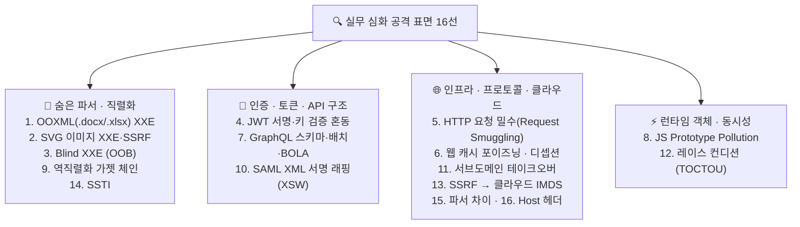
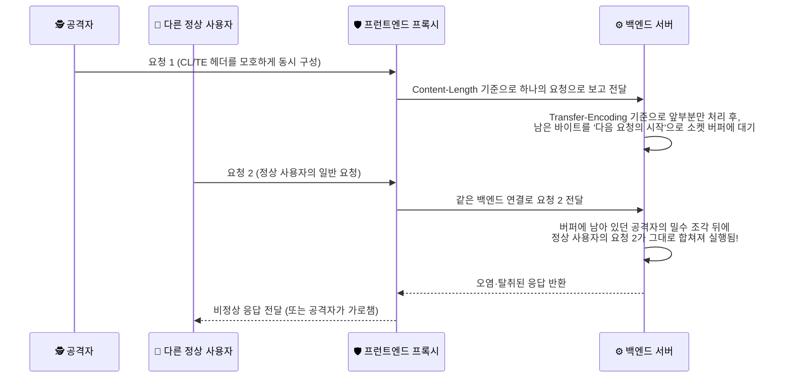

> [!warning] 실습 범위
> 아래 요청은 **본인이 소유하거나 명시적으로 허가받은 환경**, PortSwigger Web Security Academy, 또는 `127.0.0.1`에만 사용하세요. 특히 캐시·라우팅·정규화 시험은 다른 사용자의 요청에 영향을 줄 수 있으므로 운영 서비스에서는 승인된 테스트 창과 중단 기준이 필요합니다.

> [!summary] ⏱️ 5초 핵심 요약
> - **한 줄 비유**: 입문 기법이 **"문짝의 잠금장치(기본 입력값 필터)를 흔들어 보는 것"**이라면, 심화 기법은 **"문서 파일(`.docx`·`.svg`) 속 숨은 설계도, 앞문 경비원(프록시)과 뒷문 경비원(WAS)의 대화 착오, 확인과 처리 사이의 0.01초 틈새(레이스 컨디션)"**를 파고드는 기술입니다.
> - **핵심 원리**: 해당 기능(문서 변환, JWT, 캐시, GraphQL, SSO 등)이 존재한다고 무조건 취약한 것이 아니라, **파서 설정·키 검증·계층 간 프로토콜 해석·상태 동기화라는 '특정 성립 전제조건'이 깨질 때만** 실제 취약점으로 성립합니다.
> - **핵심 진단 포인트**: 단순 페이로드 대입이 아니라 **서비스에 어떤 공격 표면(단서 기능)이 있는지 먼저 식별**하고, 각 기법이 실제로 작동하기 위한 **성립 조건(Preconditions)**을 하나씩 교차 검증해야 합니다.

[[웹 취약점 진단 기법 입문 — XXE, SSRF부터 SQLi, XSS까지]]에서 다룬 기본 12종 다음으로, 실무 환경에 따라 반드시 점검 목록에 올려야 할 **심화 공격 표면 16가지**를 모았습니다. 전부 "무조건 흔하다"는 뜻이 아니라, **해당 기능이 존재할 때 그 이면의 공격 표면을 알아채고 성립 조건을 검증하는 법**에 초점을 맞춥니다.



---

## 한눈에 보는 심화 16대 기법 단서 기능 및 성립 조건 요약표

| 번호 및 기법 | 단서가 되는 화면·기능 | 실제로 취약해지는 핵심 성립 조건 |
|---|---|---|
| **1. OOXML XXE** | 이력서·엑셀 업로드, 문서 미리보기/변환 | 서버가 `.docx`/`.xlsx`(ZIP 내 XML)를 파싱할 때 DTD/외부 엔티티를 차단하지 않음 |
| **2. SVG XXE / SSRF** | 프로필·아이콘 등 이미지 업로드(`.svg`) | 서버 측 XML/이미지 변환기(ImageMagick 등)가 외부 엔티티나 외부 `<image>` URL을 호출함 |
| **3. Blind XXE / OOB** | 응답에 파싱 결과가 출력되지 않는 XML 처리 | 외부 엔티티 차단 미비 + 서버에서 공격자 콜백 서버로 아웃바운드 통신(DNS/HTTP) 가능 |
| **4. JWT 공격** | `eyJ...` 형태의 토큰 기반 인증 | `alg: none` 허용, RS256 공개키를 HS256 대칭키로 오용, 또는 `kid`/`jku` 헤더를 검증 없이 신뢰 |
| **5. HTTP 요청 밀수** | 리버스 프록시/CDN + 백엔드 WAS 다중 구성 | 프런트와 백엔드가 `Content-Length`/`Transfer-Encoding`(또는 H2→H1 변환) 경계를 다르게 해석 |
| **6. 캐시 포이즈닝/디셉션** | CDN·리버스 프록시 캐시 적용 구간 | Unkeyed 헤더가 응답에 반사되어 캐시되거나(포이즈닝), 개인화 응답이 정적 경로로 오인 캐시됨(디셉션) |
| **7. GraphQL 취약점** | `/graphql` 단일 엔드포인트 사용 | Introspection 무제한 노출, 배치/깊이 제한 미비(DoS·브루트포스), 리졸버별 객체 인가(BOLA) 누락 |
| **8. Prototype Pollution** | JS 객체 깊은 병합(`merge`, `clone`) 로직 | 사용자 입력의 `__proto__`·`constructor.prototype` 키가 필터링 없이 전역 Object 프로토타입에 병합됨 |
| **9. 역직렬화 가젯 체인** | 직렬화 객체(`rO0AB...`, `__VIEWSTATE` 등) 수신 | 서명/클래스 필터 없는 역직렬화 + 클래스패스 내에 위험 메서드로 이어지는 가젯 라이브러리 존재 |
| **10. SAML 서명 래핑(XSW)** | SAML 기반 기업용 SSO 로그인 | XML 서명 검증 대상 요소와 실제 로그인 세션을 생성하는 참조 요소의 위치 검증이 분리됨 |
| **11. 서브도메인 테이크오버** | 외부 클라우드(S3, GitHub Pages 등) 연결 도메인 | DNS CNAME은 남아 있으나 연결된 외부 리소스가 삭제/만료되어 제3자가 동일 이름으로 선점 가능 |
| **12. 레이스 컨디션 (TOCTOU)** | 쿠폰·포인트·출금·제한 횟수 차감 로직 | 상태 '확인(Check)'과 '변경(Use)' 사이에 원자적 락(Lock)/트랜잭션 격리가 없어 동시 요청이 모두 통과 |
| **13. SSRF → 클라우드 IMDS** | 클라우드(AWS/GCP/Azure) 호스팅 + SSRF | SSRF로 `169.254.169.254` 도달 가능(IMDSv1 또는 헤더 조작 가능한 v2) + 연결된 IAM Role 권한 존재 |
| **14. SSTI** | 메일·문서·미리보기 템플릿, 오류 메시지·표시명 커스터마이징 | 사용자 입력이 템플릿의 데이터가 아니라 **템플릿 소스**에 이어 붙고 엔진이 표현식을 평가함 |
| **15. 파서 차이** | 프록시+WAS, URL 가져오기, JSON API, 동적 Spring 뷰 이름 | 보안 검사 계층과 실제 처리 계층이 경로·URL·중복 키·뷰 이름을 서로 다르게 정규화/해석함 |
| **16. Host 헤더 공격** | 비밀번호 재설정 메일, 절대 URL 생성, 가상 호스트·프록시·캐시 | 클라이언트가 정한 `Host`/`X-Forwarded-Host`가 링크 생성·라우팅·캐시 응답에 검증 없이 사용됨 |

---

## 1. OOXML 문서를 통한 XXE

**💡 한 줄 비유**: 겉보기엔 평범한 워드·엑셀 문서(`.docx`, `.xlsx`) 같지만, 사실 지퍼(ZIP 압축)를 열어보면 그 안은 전부 **XML 설계도 묶음**이라 그 안에 외부 파일 호출 지시서를 몰래 끼워 넣는 기법입니다.

- **핵심 원리와 성립 조건**: `.docx`, `.xlsx`, `.pptx`는 ZIP으로 압축된 XML 파일 묶음(Office Open XML, OOXML)입니다. 사용자가 올린 문서를 서버가 열어서 **텍스트 추출·데이터 일괄 등록·미리보기·PDF 변환**을 수행할 때 내부 XML을 파싱합니다. **단, 문서 업로드 기능이 있다고 무조건 뚫리는 것이 아니라, 서버의 XML 파서가 DTD/외부 엔티티를 비활성화하지 않았을 때만** 실제로 취약합니다.
- **체크 포인트**:
  - 이력서·입사지원서(`.docx`) 자동 파싱, 엑셀(`.xlsx`) 대량 업로드, 문서 뷰어/PDF 변환 기능 식별
  - 정상 문서를 압축 해제한 뒤 `word/document.xml`(docx) 또는 `xl/workbook.xml`(xlsx) 등에 DTD/외부 엔티티를 삽입하고 다시 ZIP으로 압축해 업로드 테스트
- **참고**: [hahwul — Web Hacking: OOXML XXE](https://www.hahwul.com/blog/2017/web-hacking-ooxml-xxe/), [OWASP XXE Prevention Cheat Sheet](https://cheatsheetseries.owasp.org/cheatsheets/XML_External_Entity_Prevention_Cheat_Sheet.html)

---

## 2. SVG/이미지 파서를 통한 XXE 및 SSRF

**💡 한 줄 비유**: 사진만 받는다는 프로필 업로드 창구에 **"그림 그리는 방법(XML 코드)이 적힌 벡터 도면(`.svg`)"**을 냈더니, 서버가 그림을 그리려다 도면에 적힌 외부 주소나 내부 파일을 그대로 읽어버리는 상황입니다.

- **핵심 원리와 성립 조건**: SVG(Scalable Vector Graphics)는 본질적으로 XML 문서입니다. "이미지 업로드" 기능이지만 서버 뒤단에서 썸네일 생성이나 포맷 변환을 위해 XML 파서나 변환 라이브러리(ImageMagick, Batik 등)가 SVG를 열 때, 외부 엔티티를 막지 않았다면 **XXE**가, SVG 내부 `<image xlink:href="http://...">` 태그가 가리키는 주소를 서버가 대신 요청하면 **SSRF**가 성립합니다.
- **체크 포인트**:
  - 이미지 업로드에서 `.svg` 확장자 및 `image/svg+xml` 허용 여부
  - 서버 측 이미지 변환 라이브러리 종류 및 알려진 취약 버전(예: 과거 ImageTragick 계열 CVE) 확인
- **참고**: [PortSwigger — XXE via SVG file upload](https://portswigger.net/web-security/xxe)

---

## 3. Blind XXE / OOB (Out-of-Band) 데이터 유출

**💡 한 줄 비유**: 서버 안에 심부름꾼을 보냈는데 결과를 화면에 안 보여주자, 심부름꾼에게 **"금고 문서를 읽은 다음, 그 내용을 내 개인 휴대폰 문자(`http://공격자서버/?data=내용`)로 쏴라"**라고 지시하는 방식입니다.

- **핵심 원리와 성립 조건**: 서버가 XML을 파싱하긴 하지만 파싱 결과를 HTTP 응답 화면에 전혀 출력하지 않을 때(Blind), DTD의 **파라미터 엔티티(`%`)**와 외부 DTD 파일을 조합해 서버가 읽은 내부 파일 내용을 외부 공격자 서버 URL의 쿼리스트링 등에 실어 보내게 만드는 기법입니다.
- **체크 포인트**:
  - Burp Collaborator 등 OOB(아웃오브밴드) 수신 도구로 서버의 외부 DNS/HTTP 발신 가능 여부 확인
- **참고**: [PortSwigger — Blind XXE](https://portswigger.net/web-security/xxe/blind)

---

## 4. JWT (JSON Web Token) 검증 우회 공격

**💡 한 줄 비유**: 위조 방지 인감도장이 찍힌 신분증(JWT)을 검사할 때, 신분증 귀퉁이에 **"도장 없음(`alg: none`)"**이라고 적혀 있다고 그냥 통과시키거나, **누구나 볼 수 있는 회사 안내판 글씨(공개키)를 비밀 인감도장(HMAC 대칭키)으로 착각해 검사하는 허점**입니다.

- **핵심 원리와 성립 조건**: 토큰 헤더에 `alg`, `kid`, `jku`가 존재한다는 사실 자체는 표준 스펙입니다. 취약점은 **서버가 허용 알고리즘과 키 출처를 코드에 고정하지 않고 클라이언트가 보낸 헤더 값을 그대로 신뢰할 때** 성립합니다.
  1. **`alg: none` 수용**: 서명 부분을 지우고 헤더 알고리즘을 `none`으로 바꿨을 때 서명 검증을 건너뛰는 경우.
  2. **알고리즘 혼동 (RS256 → HS256)**: 서버가 비대칭키(RS256)로 검증하도록 설계되었으나, 공격자가 `alg: HS256`으로 바꾸고 서버의 **공개키(Public Key) 문자열을 대칭키(HMAC Secret)로 삼아 서명**했을 때 서버 라이브러리가 이를 그대로 검증에 사용하는 경우.
  3. **`kid` / `jku` 헤더 악용**: 키 식별자(`kid`)에 경로 조작(`../../dev/null`)이나 SQLi를 넣거나, `jku`(JWK Set URL)에 공격자 서버 주소를 넣어 공격자가 만든 키로 서명을 검증하게 유도하는 경우.
- **체크 포인트**:
  - 서명 검증 라이브러리가 헤더의 `alg`를 화이트리스트로 강제하는지
  - `kid`/`jku`/`x5u`로 지정한 키 소스를 서버가 검증 없이 외부/임의 경로에서 가져오는지
  - 만료(`exp`), 발급자(`iss`), 대상(`aud`) 클레임까지 빠짐없이 검증하는지
- **참고**: [Auth0 — Critical vulnerabilities in JSON Web Token libraries](https://auth0.com/blog/critical-vulnerabilities-in-json-web-token-libraries/), [PortSwigger — JWT attacks](https://portswigger.net/web-security/jwt)

---

## 5. HTTP 요청 밀수 (HTTP Request Smuggling)

**💡 한 줄 비유**: 입구 경비원(프록시)은 **"상자 크기(`Content-Length`) 기준"**으로 짐을 재고, 안쪽 담당자(백엔드 서버)는 **"포장 매듭(`Transfer-Encoding`) 기준"**으로 짐을 잴 때, 상자 하나 안에 몰래 다음 사람 주문서를 숨겨 넣어 **뒤따라오는 정상 손님의 요청에 내 악성 요청을 덧붙여 버리는 기법**입니다.



- **핵심 원리와 성립 조건**: 프런트엔드(CDN/로드밸런서/리버스 프록시)와 백엔드 WAS가 하나의 연결을 재사용하면서 요청의 끝(경계)을 판단하는 기준(`Content-Length` vs `Transfer-Encoding`, 또는 HTTP/2를 HTTP/1.1로 다운그레이드 변환하는 과정)이 서로 어긋날 때 발생합니다. 캐시 오염, WAF 우회, 타 사용자 세션 탈취로 직결되는 고위험 취약점입니다.
- **체크 포인트**:
  - 프런트와 백엔드 서버 소프트웨어가 다른 다중 계층 구성 및 백엔드 HTTP/1.1 Keep-Alive 재사용 여부
  - *(주의: 실제 운영 환경에서 밀수 패킷을 보내면 다른 실제 사용자의 트래픽이 섞여 장애나 피해가 발생할 수 있으므로, 타이밍 기반 탐지 기법을 우선 사용하고 극도로 주의해야 합니다.)*
- **참고**: [PortSwigger — HTTP Request Smuggling](https://portswigger.net/web-security/request-smuggling), [James Kettle, "HTTP Desync Attacks" (BlackHat 2019)](https://portswigger.net/research/http-desync-attacks-request-smuggling-reborn), [James Kettle, "HTTP/1 Must Die" (2025)](https://portswigger.net/research/http1-must-die)

---

## 6. 웹 캐시 포이즈닝 (Cache Poisoning) / 캐시 디셉션 (Cache Deception)

**💡 한 줄 비유**: **캐시 포이즈닝**은 식당 정수기(공용 캐시)에 몰래 소금을 타서 **뒤이어 물을 마시는 모든 손님에게 짠물이 나가게 하는 것**이고, **캐시 디셉션**은 앞사람이 받아가는 **개인 은행 명세서(`/my-account/style.css`)를 식당 공용 전단지함에 복사해 두도록 속여 내가 꺼내 보는 것**입니다.

- **두 기법의 정확한 구분**:
  1. **웹 캐시 포이즈닝**: 캐시가 "같은 요청인지" 구분하는 기준(**Cache Key**, 보통 URL과 `Host` 헤더)에는 포함되지 않지만(Unkeyed Input, 예: `X-Forwarded-Host`, `X-Original-URL`), 백엔드 서버가 응답 HTML/스크립트 주소를 만들 때는 반영하는 헤더를 이용해 **악성 응답을 공용 캐시에 저장시키고 불특정 다수에게 배포**하는 공격입니다.
  2. **웹 캐시 디셉션**: 백엔드 서버는 경로 조작(`/profile/..%2fstyle.css` 또는 `/profile/nonexistent.css`)을 무시하고 로그인된 피해자의 개인정보 페이지를 반환하는데, 앞단 캐시 서버는 확장자(`.css`)만 보고 "정적 파일이구나!"라고 착각해 **피해자의 개인정보 응답을 공용 캐시에 저장**해버리는 공격입니다.
- **체크 포인트**:
  - 헤더 반사 관찰만으로 단정하지 말고, 실제로 캐시 헤더(`X-Cache: hit`, `Age` 등)를 통해 변조/개인화된 응답이 **다른 세션에서도 재사용되는지** 확인
- **참고**: [PortSwigger — Practical Web Cache Poisoning](https://portswigger.net/research/practical-web-cache-poisoning), [PortSwigger — Web Cache Deception](https://portswigger.net/web-security/web-cache-deception)

---

## 7. GraphQL 공격 표면

**💡 한 줄 비유**: 일반 식당(REST)은 메뉴판에 적힌 요리만 주문할 수 있지만, **뷔페식 주방(GraphQL `/graphql`)에 들어가 주방 전체 식재료 목록(Introspection)을 통째로 달라고 하거나, 접시 1만 개를 한 쟁반에 포개어(Batching/깊은 중첩) 한 번에 달라고 요구하는 것**입니다.

- **핵심 원리와 성립 조건**: GraphQL은 단일 엔드포인트(`/graphql`)가 모든 쿼리와 뮤테이션을 처리합니다. 기능 자체가 취약점이 아니라 **운영 환경에서 다음 3가지 제한이 빠졌을 때** 문제가 됩니다.
  1. **Introspection 무제한 허용**: `__schema` 쿼리가 열려 있으면 비공개 내부 필드와 뮤테이션까지 포함된 전체 API 설계도가 그대로 노출됩니다.
  2. **배치(Batching) 및 중첩 깊이 제한 부재**: 하나의 HTTP 요청 안에 수천 개의 로그인/OTP 인증 쿼리를 배열이나 별칭(Alias)으로 묶어 보내 IP당 Rate Limit을 한 번에 우회하거나, 순환 중첩 쿼리로 서버 자원을 고갈(DoS)시킬 수 있습니다.
  3. **필드·리졸버 단위 인가 누락 (BOLA)**: REST의 [[웹 취약점 진단 기법 입문 — XXE, SSRF부터 SQLi, XSS까지|IDOR]]과 똑같이, 특정 객체를 거쳐 연결된 하위 필드를 조회할 때 소유자 검증이 빠지면 타인의 데이터를 읽을 수 있습니다.
- **체크 포인트**: `/graphql` Introspection 응답 여부, 배열/Alias 배치 쿼리 허용 여부, 쿼리 깊이(Depth)·복잡도 제한, 각 쿼리/뮤테이션 리졸버의 소유권 검증 유무.
- **참고**: [OWASP GraphQL Cheat Sheet](https://cheatsheetseries.owasp.org/cheatsheets/GraphQL_Cheat_Sheet.html), [PortSwigger — GraphQL API vulnerabilities](https://portswigger.net/web-security/graphql), [OWASP API Security Top 10](https://api-security.owasp.org/editions/2023/en/0x11-t10/)

---

## 8. Prototype Pollution (JavaScript 프로토타입 오염)

**💡 한 줄 비유**: 아파트 한 세대(개별 JS 객체)의 인테리어 신청서에 **`"아파트 전체 설계 원본(`__proto__`)의 모든 현관문 잠금을 해제 상태로 변경"`**이라고 적어 내어, 새로 만들어지는 모든 세대의 기본 속성을 오염시키는 기법입니다.

- **핵심 원리와 성립 조건**: JavaScript에서 두 객체를 재귀적으로 합치는 깊은 병합(Deep Merge, 구형 `lodash.merge` 등)이나 경로 기반 속성 할당 함수에 사용자 입력 JSON이 그대로 들어갈 때, `__proto__` 또는 `constructor.prototype` 키를 주입해 **애플리케이션 내 모든 객체가 상속받는 최상위 `Object.prototype`에 임의 속성(예: `isAdmin: true` 또는 템플릿 엔진 실행 옵션)을 심는 기법**입니다.
- **체크 포인트**:
  - 클라이언트(DOM XSS로 연결) 및 서버 사이드(Node.js 권한 상승·RCE로 연결)에서 JSON 입력을 재귀 병합하는 로직 및 구버전 라이브러리 사용 여부
- **참고**: [PortSwigger — Prototype Pollution](https://portswigger.net/web-security/prototype-pollution), [Snyk — Prototype Pollution guide](https://snyk.io/blog/prototype-pollution/)

---

## 9. Insecure Deserialization 가젯 체인 (Gadget Chain)

**💡 한 줄 비유**: 서버 안에 이미 굴러다니는 평범한 부품들(라이브러리 클래스)을 도미노처럼 교묘하게 줄 세워, **상자(직렬화 데이터)를 여는 순간 첫 도미노가 쓰러지며 연쇄 작용으로 결국 폭발 스위치(`Runtime.exec`)를 누르게 만드는 설계도**입니다.

- **핵심 원리와 성립 조건**: 입문편의 역직렬화 취약점을 실제 코드 실행(RCE)으로 연결할 때 쓰는 기법입니다. 공격자가 서버에 새 클래스를 올리는 것이 아니라, **서버의 클래스패스(Classpath)에 이미 로드되어 있는 기존 라이브러리(예: Apache Commons Collections, Spring 등)의 클래스들** 중 역직렬화 시 자동 호출되는 메서드(`readObject`, PHP `__wakeup`/`__destruct`, .NET `__VIEWSTATE` 등)부터 최종 명령 실행까지 이어지는 연결 고리(**가젯 체인**)를 조립해 전달합니다.
- **체크 포인트**:
  - 직렬화 데이터 수신 지점 식별 후, 대상 서버에 올라와 있는 라이브러리 종류·버전과 매칭되는 가젯 체인 성립 여부 확인 (도구가 있다고 무조건 성립하는 것이 아니라 클래스패스 조건이 맞아야 함)
- **참고**: [ysoserial 프로젝트](https://github.com/frohoff/ysoserial), [PortSwigger — Insecure deserialization](https://portswigger.net/web-security/deserialization)

---

## 10. SAML/XML 서명 우회 (XML Signature Wrapping, XSW)

**💡 한 줄 비유**: 위조 방지 도장이 찍힌 진짜 출입증(`Signed Assertion`)은 봉투 구석에 그대로 붙여 두고, **직원 눈앞에는 "관리자 출입증(위조 요소)"을 맨 위에 겹쳐 놓아, 직원이 도장은 진짜 출입증에서 확인하고 이름은 위조 출입증에서 읽게 속이는 기법**입니다.

- **핵심 원리와 성립 조건**: SAML SSO 로그인은 IdP(인증 서버)가 전자서명한 XML 응답을 SP(서비스 서버)가 검증해 처리합니다. 이때 SP가 **"XML 문서 어딘가에 유효한 서명이 있는가?"를 검증하는 로직(XPath 등)과 "실제 로그인할 사용자 아이디(`NameID`)를 꺼내오는 로직"이 참조하는 XML 노드 위치가 어긋날 때**, 서명된 원본 요소 옆에 위조된 `<Assertion>` 요소를 끼워 넣어(Wrapping) 서명 검증은 통과하면서 관리자로 로그인하는 공격이 성립합니다.
- **체크 포인트**: SAML SSO 연동 구간에서 SAML Raider 등의 확장 도구로 서명 제거 및 XSW 변형 패턴 검증 여부 확인.
- **참고**: [OWASP — XML Signature Wrapping](https://owasp.org/www-community/vulnerabilities/XML_Signature_Wrapping), [SAML Raider 도구 문서](https://github.com/CompassSecurity/SAMLRaider)

---

## 11. 서브도메인 테이크오버 (Subdomain Takeover)

**💡 한 줄 비유**: 회사가 예전에 쓰던 외부 임시 매장(`promo.example.com` → 외부 클라우드 호스트)을 철수하면서 **건물 안내판(DNS `CNAME` 레코드)은 안 떼어냈을 때, 공격자가 그 빈 매장을 자기 이름으로 계약해 회사 공식 지점 행세를 하는 것**입니다.

- **핵심 원리와 성립 조건**: 서브도메인의 DNS 레코드(`CNAME` 등)가 AWS S3, GitHub Pages, Azure App Service 같은 외부 클라우드 서비스를 가리키고 있는데, **실제 그 외부 서비스의 리소스(버킷, 프로젝트)가 삭제·만료되어 주인이 없는 상태(Dangling DNS)**일 때 성립합니다. 공격자가 외부 서비스에서 동일한 이름으로 리소스를 생성하면 정상 서브도메인 주소로 피싱 페이지를 띄우거나 상위 도메인 쿠키(`Domain=.example.com`) 탈취, OAuth 허용 도메인 우회를 수행할 수 있습니다.
- **체크 포인트**: 만료/미사용 서브도메인의 `CNAME` 대상이 `NoSuchBucket`, `404 There isn't a GitHub Pages site here` 등 미할당 시그니처를 반환하는지 확인.
- **참고**: [can-i-take-over-xyz (서비스별 테이크오버 가능 조건 총정리)](https://github.com/EdOverflow/can-i-take-over-xyz)

---

## 12. 레이스 컨디션 (Race Condition / TOCTOU)

**💡 한 줄 비유**: 잔액이 1만 원뿐인 통장으로 **ATM 기계 10대에서 정확히 같은 0.001초 순간에 "1만 원 출금" 버튼을 동시에 눌렀더니**, 10대 모두 "현재 잔액 1만 원 맞네, 통과!"라고 판단해 총 10만 원이 인출되는 현상입니다.

- **핵심 원리와 성립 조건**: **"상태 확인(Time-of-Check, 예: 쿠폰 미사용 확인)"과 "상태 변경(Time-of-Use, 예: 쿠폰 사용 완료 처리)" 사이에 미세한 시간차**가 존재하고, 데이터베이스 비관적/낙관적 락(Lock)이나 원자적 쿼리(`UPDATE ... WHERE used = false`)로 동시 접근을 막지 않았을 때 성립합니다.
- **체크 포인트**:
  - 선착순 쿠폰 발급, 포인트 전환, 출금/송금, 추천인 중복 입력, 투표 횟수 제한 기능
  - Burp Repeater의 **Send group in parallel (single-packet attack)** 또는 Turbo Intruder를 사용해 수십 개의 요청이 서버에 정확히 동시에 도착하도록 전송해 중복 처리 여부 확인
- **참고**: [PortSwigger — Race Conditions](https://portswigger.net/web-security/race-conditions), [James Kettle, "Smashing the state machine"](https://portswigger.net/research/smashing-the-state-machine)

---

## 13. SSRF를 통한 클라우드 자격증명 탈취와 권한상승 조건

**💡 한 줄 비유**: 웹 서버에게 심부름(SSRF)을 시켜 **클라우드 서버 컴퓨터 밑바닥에 붙어 있는 관리용 비밀 포스트잇(`169.254.169.254` IMDS)을 읽어오게 한 뒤, 거기에 적힌 임시 마스터키(IAM Role 자격증명)로 클라우드 전체 자원을 노리는 체인**입니다.

- **핵심 원리와 성립 조건**: 클라우드(AWS EC2/ECS/EKS, GCP, Azure) 위에서 동작하는 웹 서버에 SSRF가 있으면 인스턴스 메타데이터 서비스(IMDS)에 접근해 인스턴스에 연결된 IAM 역할의 임시 자격증명(`AccessKeyId`, `SecretAccessKey`, `Token`)을 탈취할 수 있습니다.
  1. **IMDSv1 vs IMDSv2**: 구버전인 IMDSv1은 단순 `GET` 요청 하나로 자격증명이 노출되어 SSRF에 매우 취약합니다. 반면 **IMDSv2**는 먼저 `PUT` 요청과 커스텀 헤더(`X-aws-ec2-metadata-token-ttl-seconds`)로 세션 토큰을 발급받아야 하므로 단순 `GET` 전용 SSRF를 효과적으로 차단합니다.
  2. **탈취 후 권한 범위**: 자격증명을 얻었다고 무조건 클라우드 전체가 장악되는 것은 아니며, **그 인스턴스 역할에 부여된 IAM 권한 범위**에 따라 영향도가 결정됩니다. 만약 `iam:PassRole` + 컴퓨트 생성 권한 등이 결합되어 있다면 관리자 권한 상승까지 이어집니다(자세한 클라우드 체인은 [[클라우드 인프라 진단 — IMDS SSRF로 자격증명 탈취]] 및 [[클라우드 인프라 진단 — AWS IAM 권한상승 체인]] 참고).
- **체크 포인트**: SSRF 발견 시 `169.254.169.254` 도달 여부, IMDSv2 강제 여부, 획득한 IAM Role의 정책 범위 확인.
- **참고**: [AWS — 인스턴스 메타데이터의 보안 자격증명](https://docs.aws.amazon.com/AWSEC2/latest/UserGuide/instance-metadata-security-credentials.html), [AWS — IMDSv2 설정 가이드](https://docs.aws.amazon.com/AWSEC2/latest/UserGuide/configuring-instance-metadata-service.html), [HackTricks — AWS Pentesting](https://book.hacktricks.xyz/pentesting-cloud/aws-pentesting)

---

## 14. SSTI — 템플릿 엔진 식별에서 영향 확인까지

**💡 한 줄 비유**: 고객 이름을 명찰 칸에 값으로 넣어야 하는데, 고객이 쓴 문장을 **명찰 인쇄 프로그램의 소스코드에 이어 붙여 실행**하는 실수입니다.

### 어디서 의심하고, 왜 되는가

- **단서 기능**: 이메일·알림·견적서·PDF 미리보기, CMS 테마, 오류 문구, 사용자 표시명처럼 서버가 문자열을 템플릿으로 렌더링하는 기능입니다. 입력한 `${...}`, `{{...}}`, `<%=...%>`가 그대로 보이거나 500 오류에 엔진 클래스명이 나타나면 우선 의심합니다.
- **성립 조건**: 취약한 코드는 `render("Hello " + user_input)`처럼 입력을 **템플릿 소스**로 조립합니다. 안전한 코드는 고정 템플릿 `Hello {{ name }}`에 `name`을 데이터로 바인딩합니다. HTML 이스케이프는 XSS 방어일 뿐 이미 서버에서 일어난 표현식 평가를 막지 못합니다.
- **영향**: 엔진·샌드박스·노출 객체에 따라 단순 데이터 열람에서 파일 읽기, 내부 요청, 서버 코드 실행까지 달라집니다. 산술식 평가만 확인했다고 곧바로 RCE로 등급을 올리면 안 됩니다.

| 엔진 단서 | 부작용 없는 평가식 | 기대 결과와 추가 식별점 |
|---|---|---|
| **Thymeleaf / SpringEL** | `${7*7}` | `49`; Spring/Thymeleaf 오류 클래스와 `${...}` 처리 여부를 함께 봄 |
| **Jinja2** | `{{7*7}}` | `49`; `{{7*'7'}}`는 `7777777`이 되어 Twig와 구별 가능 |
| **FreeMarker** | `${7*7}` | `49`; `<#...>` 지시문 오류와 Java `freemarker.*` 스택이 단서 |
| **Twig** | `{{7*7}}` | `49`; `{{7*'7'}}`도 수치 곱셈으로 처리되어 보통 `49` |

한 표현식이 여러 엔진에서 같은 결과를 내므로 **결과 하나만으로 엔진을 단정하지 말고**, 오류 지문·응답 헤더·의존성 목록과 교차 확인합니다.

### 따라하기 — PortSwigger `Basic server-side template injection`

실습: [Lab: Basic server-side template injection](https://portswigger.net/web-security/server-side-template-injection/exploiting/lab-server-side-template-injection-basic). 이 랩의 엔진은 ERB지만, **입력 위치 발견 → 부작용 없는 식 평가 → 엔진 식별**이라는 진단 절차는 동일합니다.

1. 랩을 시작하고 첫 상품의 재고 상세 링크를 눌러 `message` 파라미터가 화면 문구로 렌더링되는 것을 확인합니다.
2. Burp Repeater에서 다음 요청을 보냅니다. 랩 ID만 자신의 것으로 바꿉니다.

```http
GET /?message=%3C%25%3D%207*7%20%25%3E HTTP/1.1
Host: YOUR-LAB-ID.web-security-academy.net
Connection: close
```

3. 정상 문자열 `message=hello`는 `hello`, 평가식은 `49`로 렌더링되는지 비교합니다.

**성공 판별 기준**은 응답 본문에 입력식 자체가 아니라 계산 결과 `49`가 나타나고, 같은 요청을 반복해도 일관되게 서버가 계산하는 것입니다. 이 글의 목적은 탐지까지이므로 파일 삭제·명령 실행 페이로드는 사용하지 않습니다.

### 진단 체크리스트와 오탐 구분

- [ ] 입력이 어느 렌더링 컨텍스트(평문, 속성, 기존 표현식 내부)에 들어가는지 기록했다.
- [ ] 정상 문자열, 잘못된 문법, 산술식 세 요청의 응답 코드·본문·시간을 비교했다.
- [ ] `49`가 클라이언트 JavaScript 계산이나 단순 치환이 아니라 **서버 응답 원문**에 있는지 확인했다.
- [ ] 엔진과 버전, 샌드박스, 템플릿에 노출된 객체·함수 범위를 확인했다.
- [ ] 산술식 평가와 파일 읽기/RCE 가능성을 별도 증거로 분리했다.

`${7*7}`이 그대로 출력되면 취약점 증거가 아닙니다. WAF가 문자열을 바꾸거나 프런트엔드가 계산한 경우도 SSTI가 아닙니다. 반대로 문법 오류만으로는 템플릿 엔진의 정상 입력 검증일 수 있으므로, **서버 측 평가 결과**가 있어야 확정합니다.

### 조치와 탐지 포인트

```python
# 취약: 사용자가 템플릿 소스가 된다.
template = env.from_string("Hello " + user_name)

# 안전: 템플릿은 고정하고 사용자는 데이터로만 전달한다.
template = env.from_string("Hello {{ user_name }}")
html = template.render(user_name=user_name)
```

- 사용자가 템플릿을 작성해야 하는 업무라면 logic-less 문법, 엄격한 허용 기능, 별도 저권한 컨테이너·네트워크 차단을 함께 적용합니다. 샌드박스만 단독 경계로 믿지 않습니다.
- 탐지 시 `${`, `{{`, `<%` 자체만 경보로 삼으면 오탐이 많습니다. 템플릿 편집 기능에서 **문법 오류 증가, 비정상 객체 탐색, 렌더링 프로세스의 파일/프로세스/네트워크 접근**을 함께 연결합니다.
- 참고: [PortSwigger SSTI 방법론](https://portswigger.net/web-security/server-side-template-injection), [Jinja 템플릿 문서](https://jinja.palletsprojects.com/en/stable/templates/), [FreeMarker 표현식 문서](https://freemarker.apache.org/docs/dgui_template_exp.html), [Thymeleaf 공식 튜토리얼](https://www.thymeleaf.org/doc/tutorials/3.1/usingthymeleaf.html), [Twig 공식 문서](https://twig.symfony.com/doc/3.x/)

---

## 15. 파서 차이(Parser Differential) — 같은 바이트, 다른 의미

**💡 한 줄 비유**: 앞문 경비원은 주소를 적힌 그대로 읽고, 안쪽 직원은 세미콜론·점·중복 항목을 정리한 뒤 읽어서 **둘이 서로 다른 목적지와 권한을 본다**는 문제입니다.

### 단서 기능·성립 조건·원리

프록시/WAF와 Tomcat·Spring, URL 허용 목록과 실제 HTTP 클라이언트, JSON 검사기와 역직렬화기처럼 **두 계층 이상이 같은 입력을 해석**할 때 의심합니다. 취약점은 특수문자가 있다는 사실이 아니라, 보안 결정을 한 표현과 최종 소비자가 실행한 표현이 달라서 생깁니다.

| 차이 지점 | 앞 계층의 판단 | 뒤 계층의 해석과 영향 |
|---|---|---|
| Tomcat/Spring 경로 `..;/` | 프록시는 `/public/..;/admin`을 공개 경로로 봄 | Servlet 계층이 경로 파라미터 `;...`를 제거하고 `..`를 정규화해 `/admin`으로 매핑, 접근통제 우회 가능 |
| SSRF URL | 필터가 문자열 분할·디코딩 전 host를 허용 | 실제 URL 라이브러리는 userinfo, 역슬래시, 리다이렉트, IP 표기를 다르게 해석해 내부 주소로 요청 |
| JSON 중복 키 | 검사기는 첫 `role`을 채택 | 백엔드는 마지막 `role`을 채택해 `{"role":"user","role":"admin"}`의 의미가 달라짐 |
| Spring 뷰 이름 | 입력을 단순 화면 이름으로 간주 | `redirect:`·`forward:` 접두사를 제어 명령으로 해석해 외부 이동·내부 포워드 |
| Thymeleaf 전처리 | 1차 문자열 검사는 평문으로 봄 | `__${...}__`를 먼저 평가한 뒤 결과를 다시 표현식으로 처리해 2단계 평가 |

### 따라하기 — localhost Docker 최소 앱

이 앱은 **실제 제품 취약 버전을 배포하는 대신**, 앞 계층과 뒤 계층의 파서를 분리해 경로·URL·중복 키·뷰 이름의 의미가 갈리는 순간을 안전하게 보여 줍니다. 새 빈 폴더에 다음 두 파일을 저장합니다.

`Dockerfile`:

```dockerfile
FROM ghcr.io/astral-sh/uv:python3.12-bookworm-slim
WORKDIR /app
RUN uv pip install --system "flask==3.1.2"
COPY app.py .
CMD ["python", "app.py"]
```

`app.py`:

```python
import json
import posixpath
import re
from http.client import HTTPConnection
from urllib.parse import urlsplit

from flask import Flask, jsonify, request

app = Flask(__name__)


def servlet_normalize(path: str) -> str:
    without_params = "/".join(part.split(";", 1)[0] for part in path.split("/"))
    return posixpath.normpath("/" + without_params.lstrip("/"))


@app.get("/path/<path:raw_path>")
def path_check(raw_path: str):
    raw = "/" + raw_path
    front_allowed = not raw.startswith("/admin")
    backend_path = servlet_normalize(raw)
    return jsonify(
        raw=raw,
        front_allowed=front_allowed,
        backend_path=backend_path,
        reached_admin=front_allowed and backend_path == "/admin",
    )


@app.get("/url-check")
def url_check():
    target = request.args["url"]
    filter_view = target.split("@", 1)[0]
    filter_host = urlsplit(filter_view).hostname
    if filter_host != "example.com":
        return jsonify(error="blocked", filter_host=filter_host), 400
    parsed = urlsplit(target)
    connection = HTTPConnection(parsed.hostname, parsed.port or 80, timeout=2)
    connection.request("GET", parsed.path or "/")
    body = connection.getresponse().read().decode()
    connection.close()
    return jsonify(filter_host=filter_host, fetcher_host=parsed.hostname, body=body)


@app.get("/internal-url")
def internal_url():
    return "LOCAL_INTERNAL_OK"


@app.post("/json-check")
def json_check():
    pairs = json.loads(request.get_data(as_text=True), object_pairs_hook=lambda value: value)
    first = dict(reversed(pairs))
    last = dict(pairs)
    return jsonify(waf_role=first.get("role"), backend_role=last.get("role"))


@app.get("/view")
def view_name():
    name = request.args.get("name", "home")
    if name.startswith("forward:") or name.startswith("redirect:"):
        return jsonify(interpreted_as_control=True, view=name)
    match = re.fullmatch(r"[a-z0-9_-]+", name)
    return jsonify(interpreted_as_control=False, accepted=bool(match), view=name)


if __name__ == "__main__":
    app.run(host="0.0.0.0", port=5000, threaded=True)
```

빌드·실행 시 포트를 반드시 루프백에만 바인딩합니다.

```bash
docker build -t parser-diff-lab .
docker run --rm --name parser-diff-lab -p 127.0.0.1:5000:5000 parser-diff-lab
```

> [!success] 직접 검증
> 2026-11-24에 Docker Engine 29.5.2로 이미지 빌드와 아래 네 요청을 실행해 경로 `/admin` 도달, localhost URL fetch, JSON `user`/`admin` 해석 차이, 뷰 제어 접두사 인식을 확인했습니다.

다른 터미널에서 순서대로 확인합니다.

```bash
# 1) 프런트는 공개 경로로 허용하지만 뒤 파서는 /admin으로 정규화
curl --path-as-is 'http://127.0.0.1:5000/path/public/..;/admin'
# 기대: "front_allowed":true, "backend_path":"/admin", "reached_admin":true

# 2) 필터는 example.com, 실제 fetcher는 127.0.0.1을 봄
curl -G 'http://127.0.0.1:5000/url-check' \
  --data-urlencode 'url=http://example.com@127.0.0.1:5000/internal-url'
# 기대: filter_host=example.com, fetcher_host=127.0.0.1, body=LOCAL_INTERNAL_OK

# 3) 같은 JSON에서 첫 키와 마지막 키의 권한이 갈림
curl -s -X POST 'http://127.0.0.1:5000/json-check' \
  -H 'Content-Type: application/json' --data-binary '{"role":"user","role":"admin"}'
# 기대: waf_role=user, backend_role=admin

# 4) 사용자 입력이 Spring식 제어 접두사 모양인지 확인
curl -G 'http://127.0.0.1:5000/view' \
  --data-urlencode 'name=redirect:http://example.com'
# 기대: interpreted_as_control=true
```

**성공 판별 기준**은 각 응답에서 한 요청에 대해 두 해석 결과가 동시에 다르게 보이는 것입니다. `curl`이 경로를 먼저 정규화하지 않도록 첫 요청에 `--path-as-is`가 꼭 필요합니다.

### 진단 체크리스트와 오탐 구분

- [ ] 원본 요청 바이트, 프록시 로그의 경로, WAS의 최종 매핑 경로를 함께 확보했다.
- [ ] URL 검사는 파싱 → IDNA/IPv4·IPv6 정규화 → DNS 확인 → 리다이렉트 후 목적지 재검증 순서로 점검했다.
- [ ] JSON 중복 키를 거부하는지, 첫 값/마지막 값 중 무엇을 채택하는지 모든 계층에서 비교했다.
- [ ] 컨트롤러가 사용자 입력을 그대로 뷰 이름으로 반환하는지와 `redirect:`/`forward:` 처리를 확인했다.
- [ ] Thymeleaf `__${...}__`가 실제 사용자 제어 위치에서 **두 번 평가**되는지 확인했다.

400/404가 달라졌다는 사실만으로 접근통제 우회는 아닙니다. 최종 보호 자원에 도달하거나 보안 결정이 달라져야 합니다. URL 요청의 DNS 조회만 있고 HTTP 연결이 없다면 완전한 SSRF 영향과 구분하며, JSON은 라이브러리 하나의 동작이 아니라 WAF·게이트웨이·앱 전체 흐름을 비교합니다.

### 조치와 탐지 포인트

- 엣지와 앱이 **동일한 정규형 경로**로 인가하게 하고, 세미콜론 경로 파라미터·역슬래시·중복 디코딩처럼 지원하지 않는 표현은 초입에서 거부합니다. 프록시만 믿지 말고 WAS에서도 `/admin`을 인가합니다.
- URL은 검증과 요청에 같은 파서 결과를 사용하고, userinfo 금지, 허용 스킴·호스트·포트 목록, DNS 결과의 공인 주소 확인, 모든 리다이렉트 홉 재검증, 아웃바운드 방화벽을 적용합니다.
- I-JSON 규칙대로 중복 키를 거부합니다. Spring 컨트롤러는 허용 목록의 논리 뷰 이름만 반환하고 사용자 입력을 `redirect:`/`forward:`에 연결하지 않습니다. Thymeleaf 전처리 구문에 비신뢰 입력을 넣지 않습니다.
- 탐지는 원본 URI와 정규화 URI, URL의 요청 host와 연결 IP, JSON 중복 키 거부 로그를 함께 남깁니다. `..;`, `%2e`, `@`, 중복 `Host`, 중복 JSON 키의 단발성 문자열 일치보다 **해석 결과 불일치**를 경보 조건으로 삼습니다.
- 참고: [Tomcat Security Considerations — path parameter normalization](https://tomcat.apache.org/tomcat-10.1-doc/security-howto.html), [RFC 7493 I-JSON — 중복 이름 금지](https://datatracker.ietf.org/doc/html/rfc7493), [Spring MVC `redirect:`/`forward:` 접두사](https://docs.spring.io/spring-framework/docs/4.1.x/spring-framework-reference/html/mvc.html), [Thymeleaf Preprocessing](https://www.thymeleaf.org/doc/tutorials/3.1/usingthymeleaf.html#preprocessing), [PortSwigger SSRF 방어 우회](https://portswigger.net/web-security/ssrf#circumventing-common-ssrf-defenses)

---

## 16. Host 헤더 공격 — 링크 생성·라우팅·캐시의 신뢰 경계

**💡 한 줄 비유**: 택배 기사가 봉투의 수신 주소(`Host`)를 고객이 적은 그대로 믿고, 비밀번호 재설정 열쇠가 든 편지를 그 주소로 보내거나 그 주소를 보고 내부 창고로 배달하는 문제입니다.

### 어디서 의심하고, 왜 되는가

- **단서 기능**: 비밀번호 재설정·이메일 인증의 절대 URL, canonical URL, 리다이렉트, 테넌트/가상 호스트 라우팅, 리버스 프록시와 CDN 캐시입니다.
- **성립 조건**: `Host` 또는 프록시가 전달한 `X-Forwarded-Host`를 신뢰해 링크·라우팅·캐시 콘텐츠를 만들고, 신뢰 가능한 프록시와 허용 도메인을 고정하지 않은 경우입니다.
- **영향 갈래**:
  1. **비밀번호 재설정 링크 오염**: 유효 토큰이 `https://공격자호스트/...` 링크에 포함됩니다.
  2. **라우팅 기반 SSRF**: 프록시가 Host를 백엔드 선택에 사용해 내부 가상 호스트로 요청합니다.
  3. **캐시 결합**: 응답에는 변조 Host가 반영되지만 캐시 키에는 해당 입력이 빠져, 다른 사용자에게 오염 응답이 전달됩니다.

### 따라하기 — PortSwigger `Basic password reset poisoning`

실습: [Lab: Basic password reset poisoning](https://portswigger.net/web-security/host-header/exploiting/password-reset-poisoning/lab-host-header-basic-password-reset-poisoning).

1. `wiener:peter`로 로그인하고 본인 계정의 비밀번호 재설정을 한 번 요청해 정상 메일 링크의 호스트를 기록합니다.
2. `POST /forgot-password`를 Burp Repeater로 보내고, **먼저 본인 계정**으로 다음처럼 Host만 랩의 exploit server로 바꿉니다.

```http
POST /forgot-password HTTP/1.1
Host: YOUR-EXPLOIT-SERVER-ID.exploit-server.net
Content-Type: application/x-www-form-urlencoded
Content-Length: 15

username=wiener
```

3. 메일 클라이언트에서 새 링크가 `https://YOUR-EXPLOIT-SERVER-ID.exploit-server.net/forgot-password?...`로 생성되는지 봅니다. 이 확인만으로 링크 오염이 재현됩니다.
4. `X-Forwarded-Host` 변형은 별도 공식 랩 [Password reset poisoning via middleware](https://portswigger.net/web-security/authentication/other-mechanisms/lab-password-reset-poisoning-via-middleware)에서 같은 순서로 연습할 수 있습니다.

**성공 판별 기준**은 서버가 생성한 메일의 유효 재설정 토큰이 공격자가 정한 호스트의 URL에 포함되는 것입니다. 단순히 응답 본문에 Host가 반사되거나 200이 반환되는 것만으로는 성공이 아닙니다. 라우팅·캐시 갈래는 각각 [Routing-based SSRF 랩](https://portswigger.net/web-security/host-header/exploiting/lab-host-header-routing-based-ssrf), [Web cache poisoning via ambiguous requests 랩](https://portswigger.net/web-security/host-header/exploiting/lab-host-header-web-cache-poisoning-via-ambiguous-requests)에서 분리해 검증합니다.

### 진단 체크리스트와 오탐 구분

- [ ] `Host`, 포트가 붙은 Host, `X-Forwarded-Host`, 표준 `Forwarded: host=`를 하나씩 바꾸고 기준 응답과 비교했다.
- [ ] 절대 URL이 생성되는 메일·리다이렉트·HTML·API 응답을 확인했다.
- [ ] Burp의 연결 대상은 원래 랩 서버로 고정한 채 HTTP 헤더만 바꿨다.
- [ ] 캐시라면 cache-buster로 백엔드 응답을 확인한 뒤 `Age`/`X-Cache`와 다른 세션 재사용을 검증했다.
- [ ] 라우팅 SSRF는 임의 Host 반사와 구분해 실제 다른 백엔드 응답 또는 공식 랩의 Collaborator 증거를 확보했다.

임의 Host에서 400이 아니라고 취약한 것은 아닙니다. 기본 가상 호스트가 응답할 수 있습니다. Host가 HTML에 반사되어도 피해자의 브라우저가 그 Host를 보내도록 만들 수 없으면 단독 XSS 영향은 제한적입니다. 반면 캐시 키 불일치가 확인되면 저장형 영향으로 바뀝니다.

### 조치와 탐지 포인트

```java
// 취약: 요청 헤더로 보안 링크의 기준 URL을 만든다.
String resetUrl = "https://" + request.getHeader("Host") + "/reset?token=" + token;

// 안전: 배포 설정의 고정된 공개 기준 URL을 사용한다.
String resetUrl = publicBaseUrl + "/reset?token=" + URLEncoder.encode(token, UTF_8);
```

- 웹 서버·로드밸런서에서 허용 Host 목록을 적용하고 미등록 Host는 거부합니다. 외부에서 들어온 `X-Forwarded-*`는 제거한 뒤 **신뢰 프록시만** 다시 설정하게 합니다.
- 라우팅 대상은 동적 Host가 아니라 고정 upstream 목록으로 제한하고, 공개·내부 가상 호스트를 같은 프런트에 섞지 않습니다. 캐시 키와 백엔드 변형 입력을 일치시키거나 해당 응답을 캐시하지 않습니다.
- 탐지 시 요청 Host/SNI/`Forwarded` 계열/선택된 upstream/응답의 절대 URL을 상관 분석합니다. 재설정 요청의 Host 불일치, 숫자 IP·내부 호스트, 동일 캐시 키에서 서로 다른 Host 입력을 우선 경보합니다.
- 참고: [PortSwigger HTTP Host header attacks](https://portswigger.net/web-security/host-header), [Password reset poisoning 원리](https://portswigger.net/web-security/host-header/exploiting/password-reset-poisoning), [Cracking the Lens — HTTP hidden attack surface](https://portswigger.net/research/cracking-the-lens-targeting-https-hidden-attack-surface), [OWASP Forgot Password Cheat Sheet](https://cheatsheetseries.owasp.org/cheatsheets/Forgot_Password_Cheat_Sheet.html)
