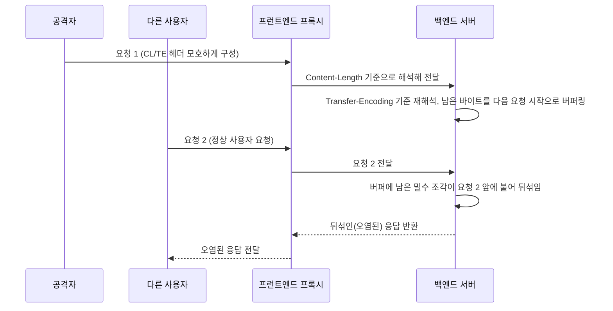

[[웹 취약점 진단 기법 입문 — XXE, SSRF부터 SQLi, XSS까지]]에서 다룬 기본 10여 종 다음으로, 환경에 따라 꼭 확인해 봐야 할 심화 공격 표면 13가지를 모았습니다. 전부 "요즘 흔하다"는 뜻이 아니라, **기능이 있으면 반드시 점검 목록에 올려야 하는 항목들**입니다. 이번 글은 **페이로드 모음이 아니라 "이런 공격 표면이 있다는 걸 알고 찾아보는 법"**에 초점을 맞춥니다. 기법마다 원리, 실제로 취약해지는 조건(기능이 있다고 자동으로 취약한 게 아닙니다), 참고 자료를 링크했으니, 실제 테스트 방법과 최신 우회 기법은 링크된 원문과 해당 시점의 공식 문서로 확인하세요.

---

## 1. OOXML 문서를 통한 XXE

**원리**: `.docx`, `.xlsx`, `.pptx`는 사실 ZIP으로 압축된 XML 파일 묶음입니다(Office Open XML, OOXML). 사용자가 올린 문서를 서버가 열어서 텍스트 추출·미리보기·변환을 하는 기능이 있다면, 그 서버는 ZIP 안의 XML을 파싱합니다 — **단, 그 파서가 DTD/외부 엔티티를 막아 두지 않았을 때만** 실제로 취약합니다. "문서 업로드"라 XML 공격 표면이라는 사실 자체를 간과하기 쉬운 게 문제이지, 업로드 기능이 있다고 무조건 뚫리는 건 아닙니다.

- 체크 포인트: 이력서 업로드, 템플릿 변환, 문서 뷰어/미리보기, Office→PDF 변환 기능
- ZIP 안의 `word/document.xml`(docx), `xl/workbook.xml`(xlsx) 등에 DTD/외부 엔티티를 심어 압축하면 원본 docx처럼 열립니다
- 참고: [hahwul — Web Hacking: OOXML XXE](https://www.hahwul.com/blog/2017/web-hacking-ooxml-xxe/), [OWASP XXE Prevention Cheat Sheet](https://cheatsheetseries.owasp.org/cheatsheets/XML_External_Entity_Prevention_Cheat_Sheet.html)

## 2. SVG/이미지 파서를 통한 XXE, SSRF

**원리**: SVG는 XML입니다. "이미지 업로드"로 받지만 실제로는 XML 파서나 변환 라이브러리가 처리하는 경우, 그 파서가 외부 엔티티를 막아 두지 않았다면 XXE, SVG 안에 담긴 `<image>` 태그가 가리키는 주소를 서버가 대신 가져오게 하면 SSRF가 성립합니다. ImageMagick 같은 변환 라이브러리를 거치면 라이브러리 자체의 알려진 취약점(예: 과거 ImageTragick류)도 겹칠 수 있어, 라이브러리 버전 확인이 선행되어야 합니다.

- 참고: [PortSwigger — XXE via SVG file upload](https://portswigger.net/web-security/xxe)

## 3. Blind XXE / OOB 데이터 유출

**원리**: 응답에 값이 직접 안 보여도, DTD의 파라미터 엔티티(`%`)를 이용해 서버가 공격자 서버로 데이터를 실어 보내게 만들 수 있습니다. 내부 파일 읽기 결과를 외부 URL의 쿼리스트링에 실어 보내는 식입니다. Burp Collaborator처럼 아웃오브밴드 상호작용을 관찰하는 도구가 필수입니다.

- 참고: [PortSwigger — Blind XXE](https://portswigger.net/web-security/xxe/blind)

## 4. JWT 공격

**원리**: `alg`, `kid`, `jku` 같은 헤더가 존재한다고 취약한 게 아니라, **서버가 허용 알고리즘과 키 출처를 제한하지 않거나 키 선택 입력을 검증 없이 그대로 쓸 때** 우회가 성립합니다. `alg: none`으로 서명을 없애거나, `jku`/`kid` 헤더로 공격자가 지정한 키(또는 공개키)를 서버가 신뢰하게 만들거나, RS256 검증 구현이 공개키를 HMAC 비밀키로 오용하도록 속이는 알고리즘 혼동 등이 대표적입니다.

- 체크 포인트: 서명 검증 라이브러리가 헤더의 `alg`를 그대로 신뢰하는지, `kid`/`jku`로 지정한 키 소스를 서버가 제한 없이 가져오는지, `iss`/`aud`/`exp` 클레임까지 검증하는지
- 참고: [Auth0 — Critical vulnerabilities in JSON Web Token libraries](https://auth0.com/blog/critical-vulnerabilities-in-json-web-token-libraries/), [PortSwigger — JWT attacks](https://portswigger.net/web-security/jwt)

## 5. HTTP 요청 밀수 (Request Smuggling)

**원리**: 프런트엔드(로드밸런서/리버스프록시)와 백엔드 서버가 `Content-Length`와 `Transfer-Encoding` 헤더를 **서로 다르게** 해석할 때, 한 요청 안에 다음 요청을 밀어 넣어 다른 사용자의 요청과 뒤섞이게 만드는 기법입니다. 캐시 오염, 인증 우회, 세션 탈취로 이어질 수 있어 영향도가 큽니다.

- 체크 포인트: 프런트와 백엔드 서버 스택이 다른 구성(nginx+구형 WAS 등), HTTP/1.1 keep-alive 구간
- 참고: [PortSwigger — HTTP Request Smuggling](https://portswigger.net/web-security/request-smuggling), [James Kettle, "HTTP Desync Attacks" (BlackHat 2019)](https://portswigger.net/research/http-desync-attacks-request-smuggling-reborn), [James Kettle, "HTTP/1 Must Die" (2025)](https://portswigger.net/research/http1-must-die) — HTTP/2를 HTTP/1로 변환하는 과정의 요청 경계 해석 차이도 같은 계열의 공격 표면입니다

## 6. 웹 캐시 포이즈닝 / 캐시 디셉션

**원리**: 두 가지는 다른 문제입니다. **캐시 포이즈닝**은 응답 내용에 영향을 주는 입력(특정 헤더 등)이 캐시 키에는 반영되지 않아서, 그 입력으로 만들어진 유해한 응답이 캐시에 저장된 채 다른 사용자에게 그대로 재사용되는 문제입니다. **캐시 디셉션**은 경로 규칙과 캐시 규칙이 어긋나서, 원래 캐시되면 안 되는 개인화된 응답(로그인 정보 등)이 정적 리소스로 오인되어 캐시되고 공격자가 그걸 그대로 읽어가는 문제입니다. 둘 다 "헤더가 응답에 반사된다"는 관찰만으로 취약하다고 단정할 수 없고, 실제로 캐시가 그 변형된 응답을 저장·재사용하는지까지 확인해야 합니다.

- 체크 포인트: `X-Forwarded-Host`처럼 캐시 키에는 안 들어가지만 응답 생성에는 쓰이는 헤더, 정적 리소스처럼 보이는 URL 뒤에 붙는 개인화 페이지(`/profile/../nonexistent.css`)
- 참고: [PortSwigger — Practical Web Cache Poisoning](https://portswigger.net/research/practical-web-cache-poisoning), [PortSwigger — Web Cache Deception](https://portswigger.net/web-security/web-cache-deception)

## 7. GraphQL 공격 표면

**원리**: REST와 달리 GraphQL은 하나의 엔드포인트가 모든 쿼리를 받습니다. introspection이나 배치 쿼리 자체는 GraphQL의 정상 기능이고, 문제는 **그걸 막거나 제한하지 않았을 때**입니다 — introspection이 열려 있으면 숨겨진 필드·뮤테이션까지 포함한 스키마 전체가 노출되고, 배치/중첩 쿼리 깊이 제한이 없으면 한 요청으로 로그인 시도를 수천 번 묶어 보내 Rate limit을 우회하거나 서버 자원을 소모시킬 수 있습니다. REST의 IDOR에 해당하는 **필드·타입 단위 권한 검증 누락(BOLA)**도 GraphQL에서 특히 자주 보이는데, 이는 입문 글에서 다룬 [[웹 취약점 진단 기법 입문 — XXE, SSRF부터 SQLi, XSS까지|IDOR]]과 같은 뿌리의 문제입니다.

- 체크 포인트: `/graphql` introspection 쿼리 응답, 배치 요청 허용 여부, 쿼리 깊이/복잡도 제한, 뮤테이션·쿼리마다 소유자 검증이 있는지
- 참고: [OWASP GraphQL Cheat Sheet](https://cheatsheetseries.owasp.org/cheatsheets/GraphQL_Cheat_Sheet.html), [PortSwigger — GraphQL API vulnerabilities](https://portswigger.net/web-security/graphql), [OWASP API Security Top 10](https://api-security.owasp.org/editions/2023/en/0x11-t10/)

## 8. Prototype Pollution (JS)

**원리**: JS 객체 병합(lodash `merge`, 깊은 복사 유틸 등)에 사용자 입력이 그대로 들어가면 `__proto__`, `constructor.prototype` 같은 키로 **모든 객체가 공유하는 프로토타입 자체**를 오염시킬 수 있습니다. 서버 사이드(Node.js)에서는 이게 인증 우회나 원격 코드 실행으로 이어진 사례들이 있습니다.

- 체크 포인트: 사용자 입력을 재귀적으로 병합하는 함수, 오래된 lodash/jQuery 버전
- 참고: [PortSwigger — Prototype Pollution](https://portswigger.net/web-security/prototype-pollution), [Snyk — Prototype Pollution guide](https://snyk.io/blog/prototype-pollution/)

## 9. Insecure Deserialization 가젯 체인

**원리**: 입문 글에서 다룬 역직렬화 취약점을 실무에서는 "가젯 체인(gadget chain)"으로 공략합니다. 애플리케이션이 쓰는 라이브러리들 중, 역직렬화 과정에서 의도치 않게 메서드를 호출하도록 연결되는 클래스 조합을 찾아 코드 실행까지 이어가는 방식입니다. 자바 생태계에서는 ysoserial이 알려진 가젯 체인들을 자동으로 만들어 주는 PoC 도구로 쓰이고, .NET은 ViewState(`__VIEWSTATE`) 위변조, PHP는 매직 메서드(`__wakeup`, `__destruct`) 체인이 대표적입니다. 다만 어떤 가젯이 실제로 먹히는지는 클래스패스에 올라온 라이브러리 구성에 따라 달라지므로, 도구가 있다고 바로 성립하는 건 아닙니다.

- 참고: [ysoserial 프로젝트](https://github.com/frohoff/ysoserial)(자바 역직렬화 가젯 체인 PoC 도구), [PortSwigger — Insecure deserialization](https://portswigger.net/web-security/deserialization)

## 10. SAML/XML 서명 우회 (XML Signature Wrapping)

**원리**: SAML SSO는 서명된 XML 응답을 주고받습니다. 서버가 "서명이 유효한 XML이 어딘가에 있다"만 확인하고 "그게 실제로 검증하려는 그 요소다"는 확인을 소홀히 하면, 서명된 원본 요소는 그대로 두고 그 옆에 위조된 요소를 끼워 넣어(Wrapping) 서버가 위조된 쪽을 처리하게 만들 수 있습니다. 인증 우회로 직결됩니다.

- 참고: [OWASP — XML Signature Wrapping](https://owasp.org/www-community/vulnerabilities/XML_Signature_Wrapping), [CVE 사례 모음 - SAML Raider 도구 문서](https://github.com/CompassSecurity/SAMLRaider)

## 11. 서브도메인 테이크오버

**원리**: DNS 레코드(CNAME 등)가 더 이상 존재하지 않는 외부 서비스(옛 S3 버킷, 깃허브 페이지, 클라우드 앱 등)를 가리킬 때, 공격자가 그 서비스 이름으로 자신의 리소스를 새로 만들면 원래 서브도메인의 콘텐츠를 장악하게 됩니다. 쿠키 스코프 공유, 피싱, OAuth 리다이렉트 URI 탈취로 이어집니다.

- 체크 포인트: DNS에 남아 있지만 실제 리소스가 삭제/만료된 CNAME
- 참고: [can-i-take-over-xyz (서비스별 테이크오버 조건 모음)](https://github.com/EdOverflow/can-i-take-over-xyz)

## 12. 레이스 컨디션 (TOCTOU)

**원리**: "잔액 확인"과 "차감"처럼 **확인과 실행 사이에 시간차**가 있는 로직에, 같은 요청을 동시에 여러 개 보내면 확인 로직이 매번 "아직 괜찮음"으로 통과해 버려 의도한 횟수 이상으로 처리되게 만드는 기법입니다. 쿠폰 중복 사용, 포인트 중복 적립, 동시 출금 같은 금융 로직에서 특히 실무 영향이 큽니다.

- 체크 포인트: Burp의 Turbo Intruder 등으로 단일 패킷 다중 요청을 보내 동시 처리 여부 확인
- 참고: [PortSwigger — Race Conditions](https://portswigger.net/web-security/race-conditions), [James Kettle, "Smashing the state machine" (race condition 연구)](https://portswigger.net/research/smashing-the-state-machine)

## 13. SSRF를 통한 클라우드 자격증명 탈취와 권한상승 조건

**원리**: 웹 애플리케이션이 클라우드(AWS/Azure/GCP) 위에서 돈다면, SSRF로 인스턴스 메타데이터(IMDS)에 접근해 **그 인스턴스에 붙은 역할의 임시 자격증명**을 얻어낼 수 있습니다. 여기서 끝이 아니라, 탈취한 자격증명으로 실제 할 수 있는 일은 **그 역할에 허용된 IAM 권한 범위**로 한정됩니다 — 추가로 다른 리소스에 권한 상승을 하려면 `iam:PassRole`처럼 역할을 바꿔치기할 수 있는 정책이나, 과도하게 허용된 Lambda 실행 역할처럼 **별도의 정책·신뢰 관계 misconfiguration**이 필요합니다. 또한 구버전(IMDSv1)은 단순 GET 요청만으로 토큰을 가져올 수 있어 SSRF와 궁합이 특히 나쁘고, IMDSv2는 토큰 발급에 `PUT` 요청과 커스텀 헤더를 요구해 일부 단순한 SSRF로는 접근이 막힙니다.

- 체크 포인트: SSRF 확인 후 메타데이터 엔드포인트 접근 가능 여부, IMDSv1/v2 여부(요청 방식·헤더 제어가 되는 SSRF인지), 획득한 역할의 IAM 정책 범위와 `iam:PassRole` 등 역할 전환 권한 유무
- 참고: [AWS — 인스턴스 메타데이터의 보안 자격증명](https://docs.aws.amazon.com/AWSEC2/latest/UserGuide/instance-metadata-security-credentials.html), [AWS — IMDSv2 설정 가이드](https://docs.aws.amazon.com/AWSEC2/latest/UserGuide/configuring-instance-metadata-service.html), [HackTricks — AWS Pentesting](https://book.hacktricks.xyz/pentesting-cloud/aws-pentesting)

---

## 정리 — 어디서 찾을지 감각 잡기

| 기법 | 단서가 되는 기능 |
|---|---|
| OOXML XXE | 문서 업로드/변환/미리보기 |
| SVG XXE/SSRF | "이미지" 업로드인데 실제론 XML |
| Blind XXE/OOB | 응답에 값이 안 보이는 XML 처리 기능 |
| JWT 공격 | 토큰 기반 인증, `alg`/`kid`/`jku` 헤더 |
| 요청 밀수 | 프런트-백엔드 서버 스택이 다를 때 |
| 캐시 포이즈닝/디셉션 | CDN/프록시 캐시 사용 |
| GraphQL | `/graphql` 단일 엔드포인트 |
| Prototype Pollution | JS 객체 깊은 병합 로직 |
| 역직렬화 가젯 체인 | 쿠키/파라미터의 직렬화 데이터 |
| SAML Wrapping | SSO/SAML 로그인 |
| 서브도메인 테이크오버 | 만료된 외부 서비스 CNAME |
| 레이스 컨디션 | 잔액·쿠폰·포인트 등 확인 후 실행 로직 |
| SSRF → 클라우드 자격증명 탈취 | 클라우드 위에서 도는 앱 + SSRF |

이 목록은 "이런 공격 표면이 있다"를 아는 용도이고, 실제 최신 우회 기법·도구 옵션·CVE는 시점마다 바뀌므로 진단 시점에 PortSwigger Web Security Academy, OWASP, 각 벤더 보안 공지로 다시 확인하는 걸 권합니다.
