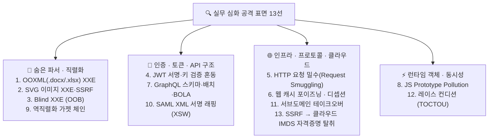
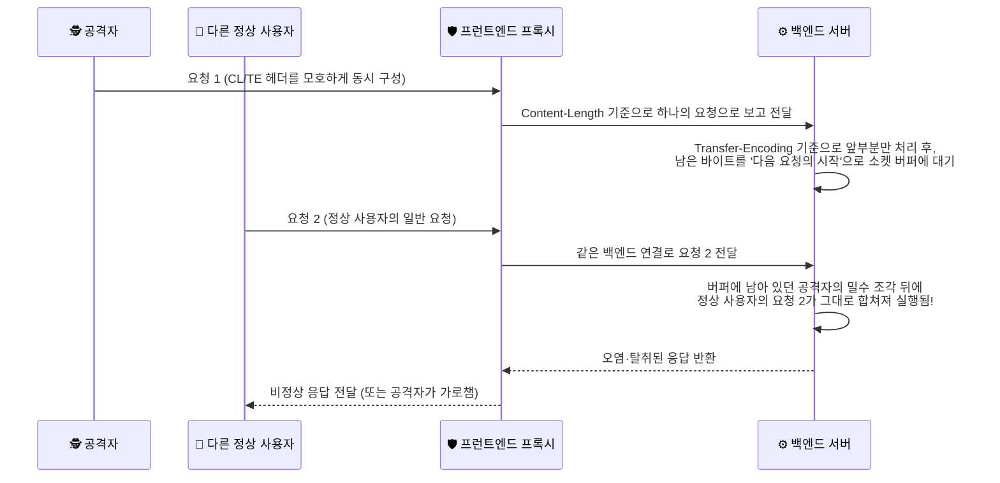

> [!summary] ⏱️ 5초 핵심 요약
> - **한 줄 비유**: 입문 기법이 **"문짝의 잠금장치(기본 입력값 필터)를 흔들어 보는 것"**이라면, 심화 기법은 **"문서 파일(`.docx`·`.svg`) 속 숨은 설계도, 앞문 경비원(프록시)과 뒷문 경비원(WAS)의 대화 착오, 확인과 처리 사이의 0.01초 틈새(레이스 컨디션)"**를 파고드는 기술입니다.
> - **핵심 원리**: 해당 기능(문서 변환, JWT, 캐시, GraphQL, SSO 등)이 존재한다고 무조건 취약한 것이 아니라, **파서 설정·키 검증·계층 간 프로토콜 해석·상태 동기화라는 '특정 성립 전제조건'이 깨질 때만** 실제 취약점으로 성립합니다.
> - **핵심 진단 포인트**: 단순 페이로드 대입이 아니라 **서비스에 어떤 공격 표면(단서 기능)이 있는지 먼저 식별**하고, 각 기법이 실제로 작동하기 위한 **성립 조건(Preconditions)**을 하나씩 교차 검증해야 합니다.

[[웹 취약점 진단 기법 입문 — XXE, SSRF부터 SQLi, XSS까지]]에서 다룬 기본 12종 다음으로, 실무 환경에 따라 반드시 점검 목록에 올려야 할 **심화 공격 표면 13가지**를 모았습니다. 전부 "무조건 흔하다"는 뜻이 아니라, **해당 기능이 존재할 때 그 이면의 공격 표면을 알아채고 성립 조건을 검증하는 법**에 초점을 맞춥니다.

---

## 한눈에 보는 심화 13대 기법 단서 기능 및 성립 조건 요약표

| 번호 및 기법 | 단서가 되는 화면·기능 | 실제로 취약해지는 핵심 성립 조건 |
|---|---|---|
| **1. OOXML XXE** | 이력서·엑셀 업로드, 문서 미리보기/변환 | 서버가 `.docx`/`.xlsx`(ZIP 내 XML)를 파싱할 때 DTD/외부 엔티티를 차단하지 않음 |
| **2. SVG XXE / SSRF** | 프로필·아이콘 등 이미지 업로드(`.svg`) | 서버 측 XML/이미지 변환기(ImageMagick 등)가 외부 엔티티나 외부 `<image>` URL을 호출함 |
| **3. Blind XXE / OOB** | 응답에 파싱 결과가 출력되지 않는 XML 처리 | 외부 엔티티 차단 미비 + 서버에서 공격자 콜백 서버로 아웃바운드 통신(DNS/HTTP) 가능 |
| **4. JWT 공격** | `eyJ...` 형태의 토큰 기반 인증 | `alg: none` 허용, RS256 공개키를 HS256 대칭키로 오용, 또는 `kid`/`jku` 헤더를 검증 없이 신뢰 |
| **5. HTTP 요청 밀수** | 리버스 프록시/CDN + 백엔드 WAS 다중 구성 | 프런트와 백엔드가 `Content-Length`/`Transfer-Encoding`(또는 H2→H1 변환) 경계를 다르게 해석 |
| **6. 캐시 포이즈닝/디셉션** | CDN·리버스 프록시 캐시 적용 구간 | Unkeyed 헤더가 응답에 반사되어 캐시되거나(포이즈닝), 개인화 응답이 정적 경로로 오인 캐시됨(디셉션) |
| **7. GraphQL 취약점** | `/graphql` 단일 엔드포인트 사용 | Introspection 무제한 노출, 배치/깊이 제한 미비(DoS·브루트포스), 리졸버별 객체 인가(BOLA) 누락 |
| **8. Prototype Pollution** | JS 객체 깊은 병합(`merge`, `clone`) 로직 | 사용자 입력의 `__proto__`·`constructor.prototype` 키가 필터링 없이 전역 Object 프로토타입에 병합됨 |
| **9. 역직렬화 가젯 체인** | 직렬화 객체(`rO0AB...`, `__VIEWSTATE` 등) 수신 | 서명/클래스 필터 없는 역직렬화 + 클래스패스 내에 위험 메서드로 이어지는 가젯 라이브러리 존재 |
| **10. SAML 서명 래핑(XSW)** | SAML 기반 기업용 SSO 로그인 | XML 서명 검증 대상 요소와 실제 로그인 세션을 생성하는 참조 요소의 위치 검증이 분리됨 |
| **11. 서브도메인 테이크오버** | 외부 클라우드(S3, GitHub Pages 등) 연결 도메인 | DNS CNAME은 남아 있으나 연결된 외부 리소스가 삭제/만료되어 제3자가 동일 이름으로 선점 가능 |
| **12. 레이스 컨디션 (TOCTOU)** | 쿠폰·포인트·출금·제한 횟수 차감 로직 | 상태 '확인(Check)'과 '변경(Use)' 사이에 원자적 락(Lock)/트랜잭션 격리가 없어 동시 요청이 모두 통과 |
| **13. SSRF → 클라우드 IMDS** | 클라우드(AWS/GCP/Azure) 호스팅 + SSRF | SSRF로 `169.254.169.254` 도달 가능(IMDSv1 또는 헤더 조작 가능한 v2) + 연결된 IAM Role 권한 존재 |

---

## 1. OOXML 문서를 통한 XXE

**💡 한 줄 비유**: 겉보기엔 평범한 워드·엑셀 문서(`.docx`, `.xlsx`) 같지만, 사실 지퍼(ZIP 압축)를 열어보면 그 안은 전부 **XML 설계도 묶음**이라 그 안에 외부 파일 호출 지시서를 몰래 끼워 넣는 기법입니다.

- **핵심 원리와 성립 조건**: `.docx`, `.xlsx`, `.pptx`는 ZIP으로 압축된 XML 파일 묶음(Office Open XML, OOXML)입니다. 사용자가 올린 문서를 서버가 열어서 **텍스트 추출·데이터 일괄 등록·미리보기·PDF 변환**을 수행할 때 내부 XML을 파싱합니다. **단, 문서 업로드 기능이 있다고 무조건 뚫리는 것이 아니라, 서버의 XML 파서가 DTD/외부 엔티티를 비활성화하지 않았을 때만** 실제로 취약합니다.
- **체크 포인트**:
  - 이력서·입사지원서(`.docx`) 자동 파싱, 엑셀(`.xlsx`) 대량 업로드, 문서 뷰어/PDF 변환 기능 식별
  - 정상 문서를 압축 해제한 뒤 `word/document.xml`(docx) 또는 `xl/workbook.xml`(xlsx) 등에 DTD/외부 엔티티를 삽입하고 다시 ZIP으로 압축해 업로드 테스트
- **참고**: [hahwul — Web Hacking: OOXML XXE](https://www.hahwul.com/blog/2017/web-hacking-ooxml-xxe/), [OWASP XXE Prevention Cheat Sheet](https://cheatsheetseries.owasp.org/cheatsheets/XML_External_Entity_Prevention_Cheat_Sheet.html)

---

## 2. SVG/이미지 파서를 통한 XXE 및 SSRF

**💡 한 줄 비유**: 사진만 받는다는 프로필 업로드 창구에 **"그림 그리는 방법(XML 코드)이 적힌 벡터 도면(`.svg`)"**을 냈더니, 서버가 그림을 그리려다 도면에 적힌 외부 주소나 내부 파일을 그대로 읽어버리는 상황입니다.

- **핵심 원리와 성립 조건**: SVG(Scalable Vector Graphics)는 본질적으로 XML 문서입니다. "이미지 업로드" 기능이지만 서버 뒤단에서 썸네일 생성이나 포맷 변환을 위해 XML 파서나 변환 라이브러리(ImageMagick, Batik 등)가 SVG를 열 때, 외부 엔티티를 막지 않았다면 **XXE**가, SVG 내부 `<image xlink:href="http://...">` 태그가 가리키는 주소를 서버가 대신 요청하면 **SSRF**가 성립합니다.
- **체크 포인트**:
  - 이미지 업로드에서 `.svg` 확장자 및 `image/svg+xml` 허용 여부
  - 서버 측 이미지 변환 라이브러리 종류 및 알려진 취약 버전(예: 과거 ImageTragick 계열 CVE) 확인
- **참고**: [PortSwigger — XXE via SVG file upload](https://portswigger.net/web-security/xxe)

---

## 3. Blind XXE / OOB (Out-of-Band) 데이터 유출

**💡 한 줄 비유**: 서버 안에 심부름꾼을 보냈는데 결과를 화면에 안 보여주자, 심부름꾼에게 **"금고 문서를 읽은 다음, 그 내용을 내 개인 휴대폰 문자(`http://공격자서버/?data=내용`)로 쏴라"**라고 지시하는 방식입니다.

- **핵심 원리와 성립 조건**: 서버가 XML을 파싱하긴 하지만 파싱 결과를 HTTP 응답 화면에 전혀 출력하지 않을 때(Blind), DTD의 **파라미터 엔티티(`%`)**와 외부 DTD 파일을 조합해 서버가 읽은 내부 파일 내용을 외부 공격자 서버 URL의 쿼리스트링 등에 실어 보내게 만드는 기법입니다.
- **체크 포인트**:
  - Burp Collaborator 등 OOB(아웃오브밴드) 수신 도구로 서버의 외부 DNS/HTTP 발신 가능 여부 확인
- **참고**: [PortSwigger — Blind XXE](https://portswigger.net/web-security/xxe/blind)

---

## 4. JWT (JSON Web Token) 검증 우회 공격

**💡 한 줄 비유**: 위조 방지 인감도장이 찍힌 신분증(JWT)을 검사할 때, 신분증 귀퉁이에 **"도장 없음(`alg: none`)"**이라고 적혀 있다고 그냥 통과시키거나, **누구나 볼 수 있는 회사 안내판 글씨(공개키)를 비밀 인감도장(HMAC 대칭키)으로 착각해 검사하는 허점**입니다.

- **핵심 원리와 성립 조건**: 토큰 헤더에 `alg`, `kid`, `jku`가 존재한다는 사실 자체는 표준 스펙입니다. 취약점은 **서버가 허용 알고리즘과 키 출처를 코드에 고정하지 않고 클라이언트가 보낸 헤더 값을 그대로 신뢰할 때** 성립합니다.
  1. **`alg: none` 수용**: 서명 부분을 지우고 헤더 알고리즘을 `none`으로 바꿨을 때 서명 검증을 건너뛰는 경우.
  2. **알고리즘 혼동 (RS256 → HS256)**: 서버가 비대칭키(RS256)로 검증하도록 설계되었으나, 공격자가 `alg: HS256`으로 바꾸고 서버의 **공개키(Public Key) 문자열을 대칭키(HMAC Secret)로 삼아 서명**했을 때 서버 라이브러리가 이를 그대로 검증에 사용하는 경우.
  3. **`kid` / `jku` 헤더 악용**: 키 식별자(`kid`)에 경로 조작(`../../dev/null`)이나 SQLi를 넣거나, `jku`(JWK Set URL)에 공격자 서버 주소를 넣어 공격자가 만든 키로 서명을 검증하게 유도하는 경우.
- **체크 포인트**:
  - 서명 검증 라이브러리가 헤더의 `alg`를 화이트리스트로 강제하는지
  - `kid`/`jku`/`x5u`로 지정한 키 소스를 서버가 검증 없이 외부/임의 경로에서 가져오는지
  - 만료(`exp`), 발급자(`iss`), 대상(`aud`) 클레임까지 빠짐없이 검증하는지
- **참고**: [Auth0 — Critical vulnerabilities in JSON Web Token libraries](https://auth0.com/blog/critical-vulnerabilities-in-json-web-token-libraries/), [PortSwigger — JWT attacks](https://portswigger.net/web-security/jwt)

---

## 5. HTTP 요청 밀수 (HTTP Request Smuggling)

**💡 한 줄 비유**: 입구 경비원(프록시)은 **"상자 크기(`Content-Length`) 기준"**으로 짐을 재고, 안쪽 담당자(백엔드 서버)는 **"포장 매듭(`Transfer-Encoding`) 기준"**으로 짐을 잴 때, 상자 하나 안에 몰래 다음 사람 주문서를 숨겨 넣어 **뒤따라오는 정상 손님의 요청에 내 악성 요청을 덧붙여 버리는 기법**입니다.

- **핵심 원리와 성립 조건**: 프런트엔드(CDN/로드밸런서/리버스 프록시)와 백엔드 WAS가 하나의 연결을 재사용하면서 요청의 끝(경계)을 판단하는 기준(`Content-Length` vs `Transfer-Encoding`, 또는 HTTP/2를 HTTP/1.1로 다운그레이드 변환하는 과정)이 서로 어긋날 때 발생합니다. 캐시 오염, WAF 우회, 타 사용자 세션 탈취로 직결되는 고위험 취약점입니다.
- **체크 포인트**:
  - 프런트와 백엔드 서버 소프트웨어가 다른 다중 계층 구성 및 백엔드 HTTP/1.1 Keep-Alive 재사용 여부
  - *(주의: 실제 운영 환경에서 밀수 패킷을 보내면 다른 실제 사용자의 트래픽이 섞여 장애나 피해가 발생할 수 있으므로, 타이밍 기반 탐지 기법을 우선 사용하고 극도로 주의해야 합니다.)*
- **참고**: [PortSwigger — HTTP Request Smuggling](https://portswigger.net/web-security/request-smuggling), [James Kettle, "HTTP Desync Attacks" (BlackHat 2019)](https://portswigger.net/research/http-desync-attacks-request-smuggling-reborn), [James Kettle, "HTTP/1 Must Die" (2025)](https://portswigger.net/research/http1-must-die)

---

## 6. 웹 캐시 포이즈닝 (Cache Poisoning) / 캐시 디셉션 (Cache Deception)

**💡 한 줄 비유**: **캐시 포이즈닝**은 식당 정수기(공용 캐시)에 몰래 소금을 타서 **뒤이어 물을 마시는 모든 손님에게 짠물이 나가게 하는 것**이고, **캐시 디셉션**은 앞사람이 받아가는 **개인 은행 명세서(`/my-account/style.css`)를 식당 공용 전단지함에 복사해 두도록 속여 내가 꺼내 보는 것**입니다.

- **두 기법의 정확한 구분**:
  1. **웹 캐시 포이즈닝**: 캐시가 "같은 요청인지" 구분하는 기준(**Cache Key**, 보통 URL과 `Host` 헤더)에는 포함되지 않지만(Unkeyed Input, 예: `X-Forwarded-Host`, `X-Original-URL`), 백엔드 서버가 응답 HTML/스크립트 주소를 만들 때는 반영하는 헤더를 이용해 **악성 응답을 공용 캐시에 저장시키고 불특정 다수에게 배포**하는 공격입니다.
  2. **웹 캐시 디셉션**: 백엔드 서버는 경로 조작(`/profile/..%2fstyle.css` 또는 `/profile/nonexistent.css`)을 무시하고 로그인된 피해자의 개인정보 페이지를 반환하는데, 앞단 캐시 서버는 확장자(`.css`)만 보고 "정적 파일이구나!"라고 착각해 **피해자의 개인정보 응답을 공용 캐시에 저장**해버리는 공격입니다.
- **체크 포인트**:
  - 헤더 반사 관찰만으로 단정하지 말고, 실제로 캐시 헤더(`X-Cache: hit`, `Age` 등)를 통해 변조/개인화된 응답이 **다른 세션에서도 재사용되는지** 확인
- **참고**: [PortSwigger — Practical Web Cache Poisoning](https://portswigger.net/research/practical-web-cache-poisoning), [PortSwigger — Web Cache Deception](https://portswigger.net/web-security/web-cache-deception)

---

## 7. GraphQL 공격 표면

**💡 한 줄 비유**: 일반 식당(REST)은 메뉴판에 적힌 요리만 주문할 수 있지만, **뷔페식 주방(GraphQL `/graphql`)에 들어가 주방 전체 식재료 목록(Introspection)을 통째로 달라고 하거나, 접시 1만 개를 한 쟁반에 포개어(Batching/깊은 중첩) 한 번에 달라고 요구하는 것**입니다.

- **핵심 원리와 성립 조건**: GraphQL은 단일 엔드포인트(`/graphql`)가 모든 쿼리와 뮤테이션을 처리합니다. 기능 자체가 취약점이 아니라 **운영 환경에서 다음 3가지 제한이 빠졌을 때** 문제가 됩니다.
  1. **Introspection 무제한 허용**: `__schema` 쿼리가 열려 있으면 비공개 내부 필드와 뮤테이션까지 포함된 전체 API 설계도가 그대로 노출됩니다.
  2. **배치(Batching) 및 중첩 깊이 제한 부재**: 하나의 HTTP 요청 안에 수천 개의 로그인/OTP 인증 쿼리를 배열이나 별칭(Alias)으로 묶어 보내 IP당 Rate Limit을 한 번에 우회하거나, 순환 중첩 쿼리로 서버 자원을 고갈(DoS)시킬 수 있습니다.
  3. **필드·리졸버 단위 인가 누락 (BOLA)**: REST의 [[웹 취약점 진단 기법 입문 — XXE, SSRF부터 SQLi, XSS까지|IDOR]]과 똑같이, 특정 객체를 거쳐 연결된 하위 필드를 조회할 때 소유자 검증이 빠지면 타인의 데이터를 읽을 수 있습니다.
- **체크 포인트**: `/graphql` Introspection 응답 여부, 배열/Alias 배치 쿼리 허용 여부, 쿼리 깊이(Depth)·복잡도 제한, 각 쿼리/뮤테이션 리졸버의 소유권 검증 유무.
- **참고**: [OWASP GraphQL Cheat Sheet](https://cheatsheetseries.owasp.org/cheatsheets/GraphQL_Cheat_Sheet.html), [PortSwigger — GraphQL API vulnerabilities](https://portswigger.net/web-security/graphql), [OWASP API Security Top 10](https://api-security.owasp.org/editions/2023/en/0x11-t10/)

---

## 8. Prototype Pollution (JavaScript 프로토타입 오염)

**💡 한 줄 비유**: 아파트 한 세대(개별 JS 객체)의 인테리어 신청서에 **`"아파트 전체 설계 원본(`__proto__`)의 모든 현관문 잠금을 해제 상태로 변경"`**이라고 적어 내어, 새로 만들어지는 모든 세대의 기본 속성을 오염시키는 기법입니다.

- **핵심 원리와 성립 조건**: JavaScript에서 두 객체를 재귀적으로 합치는 깊은 병합(Deep Merge, 구형 `lodash.merge` 등)이나 경로 기반 속성 할당 함수에 사용자 입력 JSON이 그대로 들어갈 때, `__proto__` 또는 `constructor.prototype` 키를 주입해 **애플리케이션 내 모든 객체가 상속받는 최상위 `Object.prototype`에 임의 속성(예: `isAdmin: true` 또는 템플릿 엔진 실행 옵션)을 심는 기법**입니다.
- **체크 포인트**:
  - 클라이언트(DOM XSS로 연결) 및 서버 사이드(Node.js 권한 상승·RCE로 연결)에서 JSON 입력을 재귀 병합하는 로직 및 구버전 라이브러리 사용 여부
- **참고**: [PortSwigger — Prototype Pollution](https://portswigger.net/web-security/prototype-pollution), [Snyk — Prototype Pollution guide](https://snyk.io/blog/prototype-pollution/)

---

## 9. Insecure Deserialization 가젯 체인 (Gadget Chain)

**💡 한 줄 비유**: 서버 안에 이미 굴러다니는 평범한 부품들(라이브러리 클래스)을 도미노처럼 교묘하게 줄 세워, **상자(직렬화 데이터)를 여는 순간 첫 도미노가 쓰러지며 연쇄 작용으로 결국 폭발 스위치(`Runtime.exec`)를 누르게 만드는 설계도**입니다.

- **핵심 원리와 성립 조건**: 입문편의 역직렬화 취약점을 실제 코드 실행(RCE)으로 연결할 때 쓰는 기법입니다. 공격자가 서버에 새 클래스를 올리는 것이 아니라, **서버의 클래스패스(Classpath)에 이미 로드되어 있는 기존 라이브러리(예: Apache Commons Collections, Spring 등)의 클래스들** 중 역직렬화 시 자동 호출되는 메서드(`readObject`, PHP `__wakeup`/`__destruct`, .NET `__VIEWSTATE` 등)부터 최종 명령 실행까지 이어지는 연결 고리(**가젯 체인**)를 조립해 전달합니다.
- **체크 포인트**:
  - 직렬화 데이터 수신 지점 식별 후, 대상 서버에 올라와 있는 라이브러리 종류·버전과 매칭되는 가젯 체인 성립 여부 확인 (도구가 있다고 무조건 성립하는 것이 아니라 클래스패스 조건이 맞아야 함)
- **참고**: [ysoserial 프로젝트](https://github.com/frohoff/ysoserial), [PortSwigger — Insecure deserialization](https://portswigger.net/web-security/deserialization)

---

## 10. SAML/XML 서명 우회 (XML Signature Wrapping, XSW)

**💡 한 줄 비유**: 위조 방지 도장이 찍힌 진짜 출입증(`Signed Assertion`)은 봉투 구석에 그대로 붙여 두고, **직원 눈앞에는 "관리자 출입증(위조 요소)"을 맨 위에 겹쳐 놓아, 직원이 도장은 진짜 출입증에서 확인하고 이름은 위조 출입증에서 읽게 속이는 기법**입니다.

- **핵심 원리와 성립 조건**: SAML SSO 로그인은 IdP(인증 서버)가 전자서명한 XML 응답을 SP(서비스 서버)가 검증해 처리합니다. 이때 SP가 **"XML 문서 어딘가에 유효한 서명이 있는가?"를 검증하는 로직(XPath 등)과 "실제 로그인할 사용자 아이디(`NameID`)를 꺼내오는 로직"이 참조하는 XML 노드 위치가 어긋날 때**, 서명된 원본 요소 옆에 위조된 `<Assertion>` 요소를 끼워 넣어(Wrapping) 서명 검증은 통과하면서 관리자로 로그인하는 공격이 성립합니다.
- **체크 포인트**: SAML SSO 연동 구간에서 SAML Raider 등의 확장 도구로 서명 제거 및 XSW 변형 패턴 검증 여부 확인.
- **참고**: [OWASP — XML Signature Wrapping](https://owasp.org/www-community/vulnerabilities/XML_Signature_Wrapping), [SAML Raider 도구 문서](https://github.com/CompassSecurity/SAMLRaider)

---

## 11. 서브도메인 테이크오버 (Subdomain Takeover)

**💡 한 줄 비유**: 회사가 예전에 쓰던 외부 임시 매장(`promo.example.com` → 외부 클라우드 호스트)을 철수하면서 **건물 안내판(DNS `CNAME` 레코드)은 안 떼어냈을 때, 공격자가 그 빈 매장을 자기 이름으로 계약해 회사 공식 지점 행세를 하는 것**입니다.

- **핵심 원리와 성립 조건**: 서브도메인의 DNS 레코드(`CNAME` 등)가 AWS S3, GitHub Pages, Azure App Service 같은 외부 클라우드 서비스를 가리키고 있는데, **실제 그 외부 서비스의 리소스(버킷, 프로젝트)가 삭제·만료되어 주인이 없는 상태(Dangling DNS)**일 때 성립합니다. 공격자가 외부 서비스에서 동일한 이름으로 리소스를 생성하면 정상 서브도메인 주소로 피싱 페이지를 띄우거나 상위 도메인 쿠키(`Domain=.example.com`) 탈취, OAuth 허용 도메인 우회를 수행할 수 있습니다.
- **체크 포인트**: 만료/미사용 서브도메인의 `CNAME` 대상이 `NoSuchBucket`, `404 There isn't a GitHub Pages site here` 등 미할당 시그니처를 반환하는지 확인.
- **참고**: [can-i-take-over-xyz (서비스별 테이크오버 가능 조건 총정리)](https://github.com/EdOverflow/can-i-take-over-xyz)

---

## 12. 레이스 컨디션 (Race Condition / TOCTOU)

**💡 한 줄 비유**: 잔액이 1만 원뿐인 통장으로 **ATM 기계 10대에서 정확히 같은 0.001초 순간에 "1만 원 출금" 버튼을 동시에 눌렀더니**, 10대 모두 "현재 잔액 1만 원 맞네, 통과!"라고 판단해 총 10만 원이 인출되는 현상입니다.

- **핵심 원리와 성립 조건**: **"상태 확인(Time-of-Check, 예: 쿠폰 미사용 확인)"과 "상태 변경(Time-of-Use, 예: 쿠폰 사용 완료 처리)" 사이에 미세한 시간차**가 존재하고, 데이터베이스 비관적/낙관적 락(Lock)이나 원자적 쿼리(`UPDATE ... WHERE used = false`)로 동시 접근을 막지 않았을 때 성립합니다.
- **체크 포인트**:
  - 선착순 쿠폰 발급, 포인트 전환, 출금/송금, 추천인 중복 입력, 투표 횟수 제한 기능
  - Burp Repeater의 **Send group in parallel (single-packet attack)** 또는 Turbo Intruder를 사용해 수십 개의 요청이 서버에 정확히 동시에 도착하도록 전송해 중복 처리 여부 확인
- **참고**: [PortSwigger — Race Conditions](https://portswigger.net/web-security/race-conditions), [James Kettle, "Smashing the state machine"](https://portswigger.net/research/smashing-the-state-machine)

---

## 13. SSRF를 통한 클라우드 자격증명 탈취와 권한상승 조건

**💡 한 줄 비유**: 웹 서버에게 심부름(SSRF)을 시켜 **클라우드 서버 컴퓨터 밑바닥에 붙어 있는 관리용 비밀 포스트잇(`169.254.169.254` IMDS)을 읽어오게 한 뒤, 거기에 적힌 임시 마스터키(IAM Role 자격증명)로 클라우드 전체 자원을 노리는 체인**입니다.

- **핵심 원리와 성립 조건**: 클라우드(AWS EC2/ECS/EKS, GCP, Azure) 위에서 동작하는 웹 서버에 SSRF가 있으면 인스턴스 메타데이터 서비스(IMDS)에 접근해 인스턴스에 연결된 IAM 역할의 임시 자격증명(`AccessKeyId`, `SecretAccessKey`, `Token`)을 탈취할 수 있습니다.
  1. **IMDSv1 vs IMDSv2**: 구버전인 IMDSv1은 단순 `GET` 요청 하나로 자격증명이 노출되어 SSRF에 매우 취약합니다. 반면 **IMDSv2**는 먼저 `PUT` 요청과 커스텀 헤더(`X-aws-ec2-metadata-token-ttl-seconds`)로 세션 토큰을 발급받아야 하므로 단순 `GET` 전용 SSRF를 효과적으로 차단합니다.
  2. **탈취 후 권한 범위**: 자격증명을 얻었다고 무조건 클라우드 전체가 장악되는 것은 아니며, **그 인스턴스 역할에 부여된 IAM 권한 범위**에 따라 영향도가 결정됩니다. 만약 `iam:PassRole` + 컴퓨트 생성 권한 등이 결합되어 있다면 관리자 권한 상승까지 이어집니다(자세한 클라우드 체인은 [[클라우드 인프라 진단 — IMDS SSRF로 자격증명 탈취]] 및 [[클라우드 인프라 진단 — AWS IAM 권한상승 체인]] 참고).
- **체크 포인트**: SSRF 발견 시 `169.254.169.254` 도달 여부, IMDSv2 강제 여부, 획득한 IAM Role의 정책 범위 확인.
- **참고**: [AWS — 인스턴스 메타데이터의 보안 자격증명](https://docs.aws.amazon.com/AWSEC2/latest/UserGuide/instance-metadata-security-credentials.html), [AWS — IMDSv2 설정 가이드](https://docs.aws.amazon.com/AWSEC2/latest/UserGuide/configuring-instance-metadata-service.html), [HackTricks — AWS Pentesting](https://book.hacktricks.xyz/pentesting-cloud/aws-pentesting)
